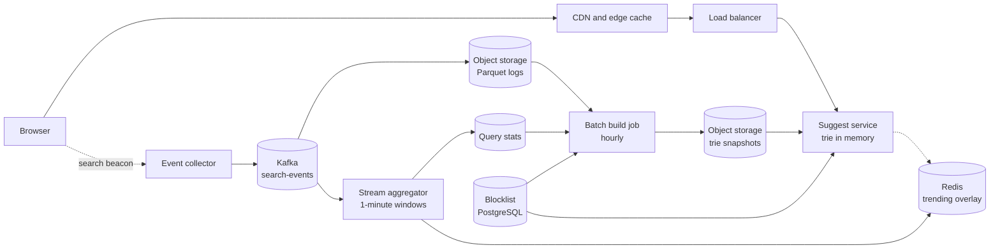

# Design a Search Autocomplete System

Search autocomplete (also called typeahead or query suggestion) shows a short list of likely queries while the user types. This case study gives the design that a strong candidate presents in 45 minutes: a trie that stores the top-k completions at each node, a pipeline that turns search logs into counts and counts into a trie, caching at the browser and the CDN, ranking, and filtering. Follow the steps in [how to approach an HLD interview](../how-to-approach-hld.md). The estimation method is on [back-of-envelope estimation](../back-of-envelope-estimation.md).

!!! note "About the sources"
    Companies publish little about the internals of their autocomplete systems. This page is a reference design. Where a company states how its system behaves, the text cites it. The Google Search Help page "How Google autocomplete predictions work" states which signals Google uses and which predictions it removes. The research papers in Further Reading describe the ranking and data structures. Every number that sizes the design is an assumption that the page labels.

## Problem Statement

"Design the autocomplete box of a web search engine. When a user types a prefix, the system returns the best 5 query suggestions that start with that prefix. The suggestions must appear fast enough that the user does not notice a delay, and they must reflect what people search for now."

The scope of this page is query suggestion: the system completes a query from a log of past queries. It does not search documents, and it does not complete product names from a catalog. The search index that answers the final query is a different system (see [search and indexing](../fundamentals/11-search-and-indexing.md)).

## Clarifying Questions

| Question | Answer that this design assumes |
|---|---|
| What does the system complete? | Whole queries from past searches of all users, in one language and region at first |
| How many users? | 100 million daily active users (DAU), 10 searches for each user each day (Assumption) |
| How many suggestions? | 5 for each prefix. The Java check below uses 3, to keep its output short |
| What is the latency target? | The suggestions must arrive within 100 ms of the keystroke, measured at the browser (Assumption). The server share is a few milliseconds |
| Does a suggestion depend on the user? | Not in version 1. All users with the same language and region see the same suggestions, so the CDN can cache them. Personalization is an extension (see Deep Dives) |
| How fresh must the suggestions be? | Changes in long-term popularity may take 1 hour to appear. A breaking-news query must appear within 5 minutes (Assumption) |
| Does the system correct typos? | No. It matches prefixes only. A fuzzy fallback is an extension |
| Which queries must not appear? | Queries that a content policy forbids, and queries that expose private data. The design has a blocklist and a minimum number of distinct users for each suggestion |
| How long can a prefix be? | 1 to 50 characters. A request outside that range gets an error |
| What happens if the service fails? | The search box still works, without suggestions. Autocomplete is a convenience, so it fails open (Assumption) |
| Multiple regions? | Yes. Each region serves its own copy of the data from a snapshot (Assumption) |
| Availability target? | 99.9% for the suggest endpoint (Assumption) |

## Requirements

### Functional

1. `suggest`: given a prefix, language, and region, return the top 5 completions in ranked order.
2. `log`: record each submitted search (and the suggestion that the user chose, if any) for the next build of the data.
3. Rank by popularity, with a decay so that old popularity fades and a recent rise counts.
4. Show a trending query within 5 minutes of its rise.
5. Remove forbidden and private queries, and let an operator block a query at once.

### Non-functional

| Requirement | Target |
|---|---|
| Latency | Under 100 ms at the browser. The server computes a response in under 5 ms at p99 (Assumption) |
| Scale | 40,000 suggest requests for each second on average, 120,000 at the peak (see Estimation) |
| Availability | 99.9%. On failure, the box shows no suggestions |
| Freshness | 1 hour for popularity. 5 minutes for trending queries, measured at the browser, which includes the time that a response waits in the edge and browser caches (see Deep Dives, section 3) |
| Accuracy | The returned list is the exact top 5 of the stored counts. The counts may be approximate (sampled) |
| Privacy | A query appears only if enough distinct users searched for it |
| Operations | A bad build must roll back in minutes |

## Estimation

Rounding rule (the same as on the estimation page): one day is 10^5 seconds. The exact day has 86,400 seconds, so each rate is 13.6% lower than the exact rate. The error is smaller than the error of the assumptions.

Inputs (all are assumptions): 100 million DAU. 10 searches for each user each day. 4 suggest requests for each search. A user types about 20 characters, but the client waits 100 to 150 ms after the last keystroke before it sends a request (debounce), and it skips requests for prefixes that the cache holds. The peak factor is 3. The browser and the CDN answer 60% of the requests from cache. One suggest server answers 20,000 requests for each second from memory (measure it). The suggestion corpus holds the 10 million best queries. The trie has 100 million nodes (it has fewer nodes than the corpus has characters, because queries share prefixes: 10 million queries of 25 characters have 250 million characters, and the assumption is 40% of that). A trie node costs 40 bytes (a top-5 list of 4-byte IDs is 20 bytes, and the child links and the edge label are about 20 bytes).

| Step | Calculation | Result |
|---|---|---|
| Searches for each day | 100,000,000 × 10 | 10^9 |
| Suggest requests for each day | 10^9 × 4 | 4 × 10^9 |
| Suggest requests for each second (average) | 4 × 10^9 / 10^5 | 40,000 |
| Suggest requests for each second (peak) | 40,000 × 3 | 120,000 |
| Requests that reach the origin (peak) | 120,000 × (1 − 0.6) | 48,000 |
| Suggest servers for capacity | ceil(48,000 / 20,000) | 3. Run 6 or more, across 2 or more zones, for failure and deploys |
| Response size | 5 suggestions × 30 bytes of text, plus JSON and headers | about 500 bytes |
| Peak edge traffic out | 120,000 × 500 B × 8 | 480 Mbit/s |
| Search events to log (average) | 10^9 / 10^5 | 10,000 for each second. 30,000 at the peak |
| Raw log for each day | 10^9 × 100 B | 100 GB each day, about 36 TB each year |
| Trie memory | 100,000,000 × 40 B | 4 GB |
| Query table (strings and scores) | 10,000,000 × (25 B + 8 B) | 330 MB |
| Memory of one replica | 4 GB + 0.33 GB | 4.33 GB. A build needs a second copy while it loads: about 9 GB |
| Sampling error, rate 1%, true count 1,000,000 | sqrt((1 − 0.01) / (1,000,000 × 0.01)) | 1.0% relative standard error |
| Sampling error, rate 1%, true count 1,000 | sqrt((1 − 0.01) / (1,000 × 0.01)) | 31.5% relative standard error |
| Hourly decay for a half-life of 7 days | 0.5^(1 / 168) | 0.99588 |

What the numbers decide:

- The read rate is high (120,000 for each second at the peak), but the cache removes 60% of it, and a lookup in an in-memory trie takes microseconds. Three servers carry the origin load. The design needs more servers for availability, not for capacity.
- The whole trie fits in 4.33 GB. Each replica holds the full trie, so no request needs a second server. The system does not need sharding for capacity. Say this to the interviewer. Sharding is for a corpus 10 times larger, or for one trie for each language.
- The log is the largest data: 100 GB for each day. The pipeline that aggregates it is the part of the design with the most data movement.
- Sampling at 1% costs almost no accuracy for popular queries (1% error at 1 million searches) and large error for rare ones (31.5% at 1,000). Rare queries do not reach the top 5 of a prefix, so the error does not change the result for most prefixes. Short prefixes have only popular completions. A long prefix has a small set of candidates, and a rare query can be the best of them. For these, do not sample (see Deep Dives).

The program below prints these numbers. `main` comes first, and the block has its own imports, so you can copy it into `AutocompleteEstimate.java` and run `java AutocompleteEstimate.java`.

```java
import java.util.Locale;

public class AutocompleteEstimate {
    public static void main(String[] args) {
        double searchesPerDay = 100e6 * 10;
        double requestsPerDay = searchesPerDay * 4;
        double avg = requestsPerDay / 1e5;
        double peak = avg * 3;
        double origin = peak * 0.4;
        System.out.println(g("searches per day", searchesPerDay));
        System.out.println(g("suggest requests per second", avg));
        System.out.println(g("peak requests per second", peak));
        System.out.println(g("peak origin requests per second", origin));
        System.out.println(g("suggest servers (20,000 each)", Math.ceil(origin / 20_000)));
        double nodes = 100e6;
        double trieBytes = nodes * 40;
        double tableBytes = 10e6 * (25 + 8);
        System.out.println(g("trie nodes", nodes));
        System.out.println(g("trie + query table MB", (trieBytes + tableBytes) / 1e6));
        double p = 0.01;
        for (double c : new double[] {1_000_000, 1_000}) {
            double err = Math.sqrt((1 - p) / (c * p));
            System.out.println(String.format(Locale.ROOT,
                    "sampling 1%%, true count %,.0f: relative error %.1f%%", c, err * 100));
        }
        double decay = Math.pow(0.5, 1.0 / 168);
        System.out.println(String.format(Locale.ROOT,
                "hourly decay for a 7-day half-life: %.5f", decay));
    }

    static String g(String label, double v) {
        return String.format(Locale.ROOT, "%-34s %,.0f", label, v);
    }
}
```

<!-- expected-output -->
```text
searches per day                   1,000,000,000
suggest requests per second        40,000
peak requests per second           120,000
peak origin requests per second    48,000
suggest servers (20,000 each)      3
trie nodes                         100,000,000
trie + query table MB              4,330
sampling 1%, true count 1,000,000: relative error 1.0%
sampling 1%, true count 1,000: relative error 31.5%
hourly decay for a 7-day half-life: 0.99588
```

## API Design

The public API has one hot endpoint. The write path is a fire-and-forget beacon.

| Endpoint | Request | Response |
|---|---|---|
| `GET /v1/suggest?q={prefix}&lang={lang}&region={region}&limit=5` | Query parameters. `q` is 1 to 50 characters after normalization. `limit` is 1 to 5, because each trie node stores 5 entries | `200` with `{"prefix": "tr", "suggestions": ["train", "travel", "tree", "trip", "trim"], "complete": false, "version": "2026-10-15T09"}`. Headers: `Cache-Control: public, max-age=60`, `CDN-Cache-Control: max-age=120, stale-while-revalidate=30`, and `Vary: Accept-Encoding` |
| `POST /v1/events/search` | `{"query": "train", "lang": "en", "region": "IN", "source": "typed", "selected": "train times", "position": 2}`. The body can hold a batch of events | `202 Accepted`, no body. The client does not wait for processing |
| `PUT /v1/admin/blocklist/{term}` | `{"reason": "policy"}` | `204`. Origin answers drop the term within 1 minute. Edge copies drop it after a CDN purge, or within the 120-second edge TTL plus the 30-second stale window. Browser copies drop it within the 60-second browser TTL |
| `DELETE /v1/admin/blocklist/{term}` | None | `204` |
| `GET /internal/snapshots/latest?lang={lang}&region={region}` | None | `200` with `{"version": "...", "objectKey": "...", "sha256": "...", "nodes": 100000000}`. Suggest servers poll it |

Design notes:

- **The response does not depend on cookies.** The key of the cache is the URL. If a header such as `Cookie` changed the answer, the CDN could not share one cached answer between users. Personal suggestions come from a separate source (see Deep Dives).
- **Normalization happens before the cache key.** The client and the edge lowercase the prefix, remove leading spaces, collapse each run of spaces to one space, apply Unicode NFKC normalization, and sort the parameters. `Tr` and `tr` then share one cache entry. A trailing space stays, because it changes the answer: `car ` excludes `cards`, and `car` does not.
- **The `complete` flag.** The server sets `complete: true` only when the response holds every completion that the server has for the prefix. Four conditions must all hold: the node stores fewer than 5 entries (so the stored list is the whole subtree), no read-time filter removed an entry, the merge with the trending overlay did not cut the merged list to 5, and `limit` did not cut it either. Then the client can filter the list locally for a longer prefix (see Deep Dives, section 3). The client does not compute this from the list length: a read-time filter can shorten a list that is not complete, and a request with `limit=3` can return 3 of 4 completions.
- **Caching headers.** `Cache-Control: max-age=60` sets the browser TTL. `CDN-Cache-Control` (RFC 9213) is a field that only CDN caches read, and here it sets a 120-second edge TTL. Its `stale-while-revalidate=30` lets the edge serve a stale answer for up to 30 seconds while it fetches a new one in the background (RFC 5861). The design does not use `s-maxage` for the edge TTL: RFC 9111 (section 5.2.2.10) states that `s-maxage` includes the semantics of `proxy-revalidate`, so a shared cache must not serve a stale response, and that disables `stale-while-revalidate` at the edge. Deep Dives, section 3, shows how these TTLs fit the 5-minute freshness target.
- **Errors.** `400` for an empty prefix or a prefix longer than 50 characters. `429` when a client sends more than a set rate (see [rate limiting algorithms](../fundamentals/13-rate-limiting-algorithms.md)). On `5xx`, the browser shows no suggestions and does not retry for that keystroke.
- **The `version` field** lets a test or a debug session see which snapshot answered.

## Data Model

Three kinds of data exist: events (large, append-only), counts (aggregates), and the serving structure (a trie snapshot).

| Data | Store and key | Content | Reason |
|---|---|---|---|
| Search events | Kafka topic `search-events`, key = hash of the normalized query. Archive to object storage as Parquet files, one folder for each hour | `ts`, `user_hash`, `query`, `lang`, `region`, `source`, `selected`, `position` | Append-only, high rate, replayable. The key keeps all events of one query in one partition, which makes counting local (see [message queues and streams](../fundamentals/08-message-queues-and-streams.md)) |
| Hourly counts | Table in the data lake (Parquet), partitioned by `lang`, `region`, and `hour` | `query`, `events`, `distinct_users` | A batch job reads it. No point lookups are needed, so a lake is cheaper than a database |
| Query stats | Key-value table keyed by `(lang, region, query)` | `decayed_score`, `distinct_users_30d`, `last_hour_events`, `updated_at` | The batch job reads and writes it by key. Any wide-column or key-value store fits (see [choosing a database](../fundamentals/04-choosing-a-database.md)) |
| Trending overlay | Redis hash or sorted set for each `(lang, region)`, with a TTL of 1 hour | The 1,000 queries with the largest recent rise | Small, updated every minute, read by every suggest server |
| Blocklist | PostgreSQL table `blocklist(term, reason, added_by, added_at)` | The forbidden terms | Small and rarely written. It needs transactions and an audit trail. Suggest servers read it with a version number |
| Snapshot catalog | PostgreSQL table `snapshots(version, lang, region, object_key, sha256, nodes, built_at, status)` | One row for each build | The row tells servers which file to load and lets an operator roll back by changing `status` |
| Trie snapshot | A file in object storage, for example `tries/en-IN/2026-10-15T09.bin` | The trie as flat arrays, with the query table | A suggest server memory-maps the file or reads it into arrays. No database sits on the read path |

The serving structure is a file, not a database. A read costs a few array lookups, and the build job owns the write path. Section "Deep Dives" explains the layout.

## High-Level Design



Components:

- **Browser.** The search box debounces keystrokes, cancels the request in flight when a new keystroke comes, and keeps a local cache of the last responses. It sends one beacon for each submitted search.
- **CDN and edge cache.** Answers repeated prefixes from cache for 120 seconds (`CDN-Cache-Control`). This removes about 60% of the requests (Assumption). See [load balancing, DNS, and CDN](../fundamentals/02-load-balancing-dns-cdn.md).
- **Suggest service.** A stateless Java service. Each instance holds the full trie of its language and region in memory. A lookup walks the prefix and reads the stored top-5 list. The service merges that list with the trending overlay, drops blocked terms, and returns the first 5.
- **Event collector.** Receives beacons, validates them, drops obvious bots, and writes to Kafka. It returns `202` before the pipeline processes the event.
- **Kafka `search-events`.** The log of all submitted searches.
- **Stream aggregator.** A stream job (Flink or Kafka Streams) that counts events for each query in 1-minute tumbling windows (see [batch and stream processing](../fundamentals/17-batch-and-stream-processing.md)). It updates `last_hour_events` in the query stats and writes the trending overlay to Redis.
- **Batch build job.** Runs every hour. It reads the query stats, applies the decay, removes forbidden and rare-user queries, builds the trie with top-k lists, writes the snapshot, and inserts a row in the snapshot catalog.
- **Trie snapshots.** Immutable files. A suggest server downloads the newest one, checks its hash, builds the new structure beside the old one, and swaps a pointer.
- **Blocklist.** The build job applies it, and the suggest service applies it again at read time, so an operator removes a term from origin answers within 1 minute without a rebuild. Cached copies expire within their TTLs, and a CDN purge removes the edge copies at once.

## Deep Dives

### 1. The Trie With Top-k Lists

A trie (prefix tree) stores strings along paths from the root. Each edge carries one character. All strings that share a prefix share the path of that prefix. The [DSA trie page](../../dsa/17-trie/README.md) covers the structure and the standard problems. LeetCode 642 asks for this system in a small form.

**The naive lookup.** To list the best completions of a prefix, walk to the node of the prefix, then visit every node in its subtree and sort the completions by score. The cost is O(L + S log S), where L is the length of the prefix and S is the number of queries below the node. For the prefix `a`, S can be millions. Millions of operations do not fit in a 5 ms budget.

**The fix: store the answer at the node.** Each node stores the k best completions of its own prefix. A lookup walks L nodes and reads one list. The cost is O(L + k), and it does not depend on S. The price is memory and a harder update.

```text
root
 `-- t
     `-- r   top-3 for "tr": train:100, travel:95, tree:90
         |-- a   top-3 for "tra": train:100, travel:95, tram:50
         |   |-- i -- n   (query "train", count 100)
         |   |-- v -- e -- l   (query "travel", count 95)
         |   `-- m   (query "tram", count 50)
         `-- i   top-3 for "tri": trie:80, trip:70, trim:60
```

**Why the lists compose.** The top k of a node is the top k of the union of two things: the node's own query (if the prefix is itself a query), and the top-k lists of its children. The proof: take a query q in the top k of the node, other than the node's own query. q lies below exactly one child. Every query that beats q inside that child's subtree also lies below the node, so it also beats q at the node. Fewer than k queries beat q at the node, so fewer than k beat q in the child, and q is in the child's top k. The proof needs a total order: break ties in the score by the query string, as the code does. So the build computes the lists from the leaves up, and each node merges at most `(number of children × k) + 1` entries. The Java check below verifies this against a brute-force search for every prefix.

**Memory.** The assumption of 40 bytes for each node (see Estimation) stores the k best queries as 4-byte IDs into one shared table of query strings and scores, not as copies of the strings. With copies, a 25-character query could appear in up to 25 lists. With IDs, it costs 4 bytes in each list. A radix tree (a trie whose edges carry strings, so a chain of single-child nodes becomes one node) cuts the node count further. The top-k list of a node with one child and no own query equals the list of the child, so such a node can share it.

Hsu and Ottaviano (WWW 2013) state the two costs of this design: it needs k before the build, and its space grows with k. Their paper studies compressed tries for top-k completion when the query set is so large that it needs compression to fit in memory. Each of their three structures answers a top-k query without a stored list at each node:

- **Completion Trie.** A compressed trie that stores at each node the highest score below the node, and orders the children of each node by that score. A lookup walks to the prefix node and then lists completions in score order with a best-first search (the paper calls it a variation of A* search): a priority queue keyed by the stored maximum pops the best node, and each completed query that it pops is the next-best completion.
- **RMQ Trie.** A structure that maps the strings in lexicographic order to consecutive integers, plus a range-minimum-query (RMQ) structure over the scores in that order. The completions of a prefix form one range, and repeated RMQ calls return the best k of the range.
- **Score-Decomposed Trie.** A path-decomposed trie in which each path follows the child with the highest descendant score.

On the AOL query log with 10 million unique queries, the paper reports 120 bits for each query (scores included) and 3.7 µs for a top-10 completion for the Completion Trie, 62 bits and 8.0 µs for the Score-Decomposed Trie, and 65 bits and 33.9 µs for the RMQ Trie. 120 bits is 15 bytes for each query. The design on this page costs about 400 bytes for each query (4 GB for 10 million queries). Name this alternative if the interviewer asks for less memory. The top-k list design stays the main answer because it is the simplest to build and explain, and its memory fits one machine at this scale.

**Updates.** A new count changes the list of every ancestor of the query: up to L nodes, and each one merges up to `alphabet size × k` entries. Online updates have three costs. They need a lock or a copy-on-write on a structure that 120,000 requests for each second read. A popular query changes lists in the top levels of the trie on every update. The work repeats for the same hot nodes. Because of this, the design rebuilds the whole trie in a batch job and swaps the snapshot. Section 2 explains the freshness gap that this leaves and how the trending overlay closes it.

The program below builds a top-3 trie, answers prefix lookups, applies an update, and compares every prefix result with a brute-force result. `main` comes first, and the block has its own imports. It uses a `TreeMap` for the children, so the output order does not change between runs.

```java
import java.util.ArrayList;
import java.util.Comparator;
import java.util.List;
import java.util.Map;
import java.util.TreeMap;

public class TopKTrieCheck {
    static final int K = 3;

    public static void main(String[] args) {
        trie();
    }

    static final class Entry {
        final String query;
        final long count;

        Entry(String query, long count) {
            this.query = query;
            this.count = count;
        }
    }

    static final Comparator<Entry> BEST_FIRST = Comparator
            .comparingLong((Entry e) -> -e.count).thenComparing(e -> e.query);

    static final class Node {
        final Map<Character, Node> children = new TreeMap<>();
        Entry own;
        List<Entry> top = new ArrayList<>();
    }

    static final class TopKTrie {
        final Node root = new Node();
        int nodes = 1;

        void add(String query, long delta) {
            List<Node> path = new ArrayList<>();
            Node n = root;
            path.add(n);
            for (char c : query.toCharArray()) {
                Node next = n.children.get(c);
                if (next == null) {
                    next = new Node();
                    n.children.put(c, next);
                    nodes++;
                }
                n = next;
                path.add(n);
            }
            long old = n.own == null ? 0 : n.own.count;
            n.own = new Entry(query, old + delta);
            for (int i = path.size() - 1; i >= 0; i--) {
                recompute(path.get(i));
            }
        }

        void recompute(Node n) {
            List<Entry> all = new ArrayList<>();
            if (n.own != null) {
                all.add(n.own);
            }
            for (Node child : n.children.values()) {
                all.addAll(child.top);
            }
            all.sort(BEST_FIRST);
            n.top = new ArrayList<>(all.subList(0, Math.min(K, all.size())));
        }

        List<String> suggest(String prefix) {
            Node n = root;
            for (char c : prefix.toCharArray()) {
                n = n.children.get(c);
                if (n == null) {
                    return List.of();
                }
            }
            List<String> out = new ArrayList<>();
            for (Entry e : n.top) {
                out.add(e.query + ":" + e.count);
            }
            return out;
        }
    }

    static void trie() {
        System.out.println("== Top-k trie (k = " + K + ") ==");
        String[] q = {"tree", "trie", "tried", "trip", "trim", "tram", "train", "trade",
            "travel", "tea"};
        long[] c = {90, 80, 20, 70, 60, 50, 100, 40, 95, 30};
        TopKTrie t = new TopKTrie();
        for (int i = 0; i < q.length; i++) {
            t.add(q[i], c[i]);
        }
        System.out.println("nodes: " + t.nodes);
        System.out.println("tr  -> " + t.suggest("tr"));
        System.out.println("tri -> " + t.suggest("tri"));
        System.out.println("te  -> " + t.suggest("te"));
        System.out.println("zz  -> " + t.suggest("zz"));
        t.add("trie", 50);
        System.out.println("after trie +50");
        System.out.println("tr  -> " + t.suggest("tr"));
        System.out.println("tri -> " + t.suggest("tri"));

        Map<String, Long> truth = new TreeMap<>();
        for (int i = 0; i < q.length; i++) {
            truth.put(q[i], c[i]);
        }
        truth.merge("trie", 50L, Long::sum);
        int checked = 0;
        boolean ok = true;
        for (String query : q) {
            for (int len = 1; len <= query.length(); len++) {
                String prefix = query.substring(0, len);
                List<Entry> all = new ArrayList<>();
                for (Map.Entry<String, Long> e : truth.entrySet()) {
                    if (e.getKey().startsWith(prefix)) {
                        all.add(new Entry(e.getKey(), e.getValue()));
                    }
                }
                all.sort(BEST_FIRST);
                List<String> expected = new ArrayList<>();
                for (Entry e : all.subList(0, Math.min(K, all.size()))) {
                    expected.add(e.query + ":" + e.count);
                }
                checked++;
                ok &= expected.equals(t.suggest(prefix));
            }
        }
        System.out.println("prefixes checked against brute force: " + checked);
        System.out.println("all match: " + ok);
    }
}
```

<!-- expected-output -->
```text
== Top-k trie (k = 3) ==
nodes: 21
tr  -> [train:100, travel:95, tree:90]
tri -> [trie:80, trip:70, trim:60]
te  -> [tea:30]
zz  -> []
after trie +50
tr  -> [trie:130, train:100, travel:95]
tri -> [trie:130, trip:70, trim:60]
prefixes checked against brute force: 44
all match: true
```

The check shows two things. The top-k list of `tr` changes after `trie` gains 50 searches, and the path from the root to `trie` is the only part that the update touches. The program runs 44 checks, one for each prefix of each of the 10 queries (the 10 lengths add up to 44). They cover the 20 distinct prefixes, which are the 20 nodes below the root, and all of them match the brute-force answer.

**Alternatives that the design rejected or keeps in reserve:**

| Technique | Lookup | Reason not chosen as the main structure |
|---|---|---|
| Trie with top-k lists | O(L + k) | Chosen. Fast, simple to explain, memory is acceptable (4.33 GB) |
| Trie with the maximum descendant score at each node, best-first search (Hsu and Ottaviano's Completion Trie) | O(σ L + k l log(k l)), where σ is the alphabet size and l is the average length of a completion after the prefix (the paper's bound) | Less memory, and any k works at query time. A lookup does more work than a read of one list. A good answer when memory limits the design |
| Sorted array of queries, binary search for the prefix range, then a range-maximum structure for the top k | O(L log N + k log k) | Smaller in memory. Hsu and Ottaviano's RMQ Trie is this idea on a compressed trie (strings in lexicographic order plus a range query over scores). In their tests it was the slowest of their three structures |
| Edge n-grams in Elasticsearch | One term lookup | Larger index, and ranking by popularity needs a stored field. A fit when a search engine is already running (see [search and indexing](../fundamentals/11-search-and-indexing.md)) |
| Elasticsearch completion suggester | In-memory structure on a `completion` field | The documentation states that its data structures "enable fast lookups, but are costly to build and are stored in-memory". The ranking weight is set at index time, so a new weight means a reindex of the document. It supports fuzzy queries and contexts (category, geo). Memory-bound in the same way as the trie |
| Redis lexicographic range on a sorted set (`ZRANGE ... BYLEX`, which replaces the deprecated `ZRANGEBYLEX`) | O(log N + M), M = number of returned items | Returns lexicographic order, not popularity order, so ranking needs extra structure |
| Compute at query time from the search index | A search per keystroke | The cost for each request is too high at 48,000 requests for each second |

### 2. The Data Pipeline: From Logs to a Trie

The pipeline has four jobs: collect, count, score, and build.

**Collect.** Log each submitted search, not each keystroke. A keystroke is not a search, and logging 20 events for each search would multiply the volume by 20 and teach the system half-typed prefixes. Log the suggestion that the user selected and its position, because the click-through rate by position is the main quality signal. Drop events from known bots and apply a per-user cap: one user must not raise a query by repeating it 10,000 times.

**Sample.** At 10,000 events for each second the pipeline does not need sampling for capacity: Kafka and a stream job handle that volume. Sampling matters for cost at a larger scale. Sample 1 event in 100 and multiply by 100. The relative standard error of a count c at sampling rate p is sqrt((1 − p) / (c × p)) (the standard deviation of a binomial count, divided by its mean). It is 1% for c = 1,000,000 and 31.5% for c = 1,000 (see Estimation). Sample by query hash, not by event, if you need all events of a sampled query: the sampled queries are then exact and the others are absent. Do not sample queries that are new or rare, because for them the count is the signal.

**Count.** A stream job reads `search-events`, keyed by query, and keeps a count in 1-minute tumbling windows. It writes the window counts to the query stats and to a trending detector. Events can arrive late, so the job uses event time with a watermark (see [batch and stream processing](../fundamentals/17-batch-and-stream-processing.md)). A hot query during a big event can send tens of thousands of events for each second to one partition. A combiner that adds counts in memory for 1 second before it writes removes this skew. If the number of distinct queries is too large to keep exact counts, a count-min sketch with a heap of the heaviest items gives approximate counts in fixed memory (see [probabilistic data structures](../distributed-systems/04-probabilistic-data-structures.md)). Metwally, Agrawal, and El Abbadi (ICDT 2005) describe the Space-Saving algorithm, which keeps a fixed number of counters for the most frequent elements of a stream. It is a different structure for the same job.

**Score.** The score of a query combines all hours with a decay, so that popularity from last month counts less than popularity from today. A common form is an exponential decay. If the half-life is 7 days (168 hours), the hourly factor is 0.5^(1/168) = 0.99588 (Assumption: tune the half-life against click data). The job keeps one number for each query and updates it each hour:

```text
score_new = score_old × 0.99588 + events_in_the_last_hour
```

A query that was popular once and then stopped loses half of its score in 7 days. A query with a constant rate of e events each hour converges to e / (1 − 0.99588), which is about 243 × e: the score is about the number of events of the last 243 hours, weighted toward recent hours.

**Trending.** A rise in the last minutes is not visible in an hourly score. The trending detector compares the count of the last 15 minutes with the expected count for that period (the decayed baseline). A query whose ratio is above a threshold, and whose count is above a floor, goes into the overlay in Redis with a boost. The suggest service merges overlay entries into the trie's list for any prefix that they match, so a rising query shows within the 5-minute target without a rebuild. The overlay holds about 1,000 queries, so the merge is a scan of a small list.

**Filter.** The build job removes, in this order: queries in the blocklist, queries that a content policy classifier rejects, queries with fewer than N distinct users in the last 30 days (Assumption: N = 20), and queries that look like personal data (long digit strings, e-mail addresses). The distinct-user threshold is a privacy rule: if only one person searched for a string, the string may be private, and showing it to others would reveal it. The Google Search Help page states the policy side of this: automated systems try to prevent predictions that violate its policies, enforcement teams remove those that the systems miss, and Google removes the specific prediction and closely related variations.

**Build and publish.** The job writes the trie as flat arrays (node offsets, edge labels, top-k ID lists, the query table) into one file, computes its hash, uploads it, and inserts a row with status `ready`. A suggest server polls the catalog every minute, downloads a new version, verifies the hash, loads it beside the old structure, runs a smoke test (a list of known prefixes with expected non-empty answers), and swaps the pointer. Servers swap at different times (a random delay of up to 10 minutes) so that edge caches do not all expire at once. If a build fails the smoke test, the row gets status `rejected`, servers keep the old snapshot, and an alert fires. A rollback sets the status of the bad row to `rejected` and servers return to the previous version.

### 3. Serving and Caching Layers

Latency is mostly network time. The server computes an answer in microseconds, so the design saves time by not sending requests.

| Layer | Technique | Effect |
|---|---|---|
| Browser, before the request | Debounce 100 to 150 ms. Skip the request if the last response for this prefix is cached. Cancel the request in flight when a new key arrives | Cuts the 20 keystrokes of a query to about 4 requests (Assumption) |
| Browser cache | `Cache-Control: public, max-age=60`. HTTP caching rules are in RFC 9111 | A repeated prefix costs no request for 60 seconds |
| Client prefix reuse | If the answer for `tr` carries `complete: true`, it holds every completion of `tr`, so the client filters it locally for `tra`. If not, the client must ask | Saves requests for long prefixes that have few completions |
| CDN or edge cache | Cache key = path and sorted, normalized query. TTL 120 seconds from `CDN-Cache-Control`, with `stale-while-revalidate=30`. Pre-warm all 1-, 2-, and 3-character prefixes | Short prefixes have the highest request rate and the fewest variants. With 36 characters (26 letters and 10 digits), there are 36 + 36^2 + 36^3 = 47,988 such prefixes for each language and region. The edge answers 60% of requests (Assumption) |
| Suggest service | Full trie in memory, no external call on the hot path. The overlay is read from a local copy that refreshes every 10 seconds | A lookup takes microseconds. No dependency fails the read |
| Connection | HTTP/2 or keep-alive, TLS session resumption, compressed responses | Avoids a TLS handshake for each keystroke |

Latency budget for the 100 ms target (Assumption): debounce is not in the budget, because it delays the request and not the response. Network round trip to the edge: 20 to 40 ms. Edge to origin on a miss: 10 to 30 ms. Suggest service: under 5 ms. Browser render: under 10 ms. The sum is below 100 ms for a cache miss and near 30 ms for a cache hit.

Freshness budget for the 5-minute trending target (Assumption). Each cache adds its TTL to the worst-case delay, so the TTLs come from this budget and not from the hit ratio alone. The stream job closes a 1-minute window and writes the overlay: up to 1 minute. The suggest server refreshes its local copy of the overlay: up to 10 seconds. The edge holds an old answer: up to 120 seconds, plus 30 seconds of `stale-while-revalidate`. The browser holds an old answer: up to 60 seconds. The worst case is 1 minute + 10 s + 150 s + 60 s = 4 minutes 40 seconds, which is inside the 5-minute target. A TTL of 5 minutes at the edge alone would break the target. A longer TTL raises the edge hit ratio and lowers the origin load. A shorter TTL does the opposite. Measure the hit ratio at each TTL before you change it.

**Sharding, when needed.** Each replica holds the full trie, so a request needs one server and the tier scales by adding replicas. If the corpus grows 10 times, one replica needs about 43 GB. Then split the trie by prefix range: shard 1 holds prefixes `a` to `c`, and so on. Prefix frequencies are skewed, so build the ranges from the counts (equal request load for each shard), not from the alphabet. A router maps the first one or two characters of the prefix to a shard. The cost is a hot shard when a trend makes one prefix popular. A replica group for each shard absorbs it.

**Failure.** If the suggest tier fails, the browser gets errors or timeouts, and it shows no suggestions. The search box works. A circuit breaker in the browser code stops requests for 30 seconds after 3 failures (Assumption; see [reliability patterns](../fundamentals/12-reliability-patterns.md)). If the Redis overlay fails, the suggest service answers from the trie alone and loses only the trending boost.

### 4. Ranking, Personalization, Filtering, and Typos

**Ranking signals.** Popularity (the decayed score) is the base. Recency (the trending boost) is next. Click data adds a quality signal: a suggestion that users select often when shown at position 1 is better than a suggestion that they skip. Language and region select which trie answers. The Google Search Help page lists the same factors as the basis of its predictions: real searches, the language and location of the query, trending interest, and, for signed-in users, past searches. Bar-Yossef and Kraus (WWW 2011) call the popularity ranking MostPopularCompletion and test context from the user's recent queries on the public AOL query log. After one typed character, their NearestCompletion algorithm has a 48% higher mean reciprocal rank (MRR) than MostPopularCompletion when the recent queries relate to the current query, and an MRR of about zero when they do not. Their HybridCompletion combines the two and improves MRR by 31.5% on average over MostPopularCompletion. So session context helps, and it needs popularity as the fallback.

**Personalization without losing the cache.** A personal answer cannot be in a shared cache. The design keeps the shared answer public and merges personal data in the browser. The browser keeps the user's last searches in local storage. When the user types a prefix, the browser merges matching personal queries (shown first, marked as history) with the public suggestions. Nothing personal leaves the device, and the edge cache stays valid. If a personal model must run on the server, send the request with a user token to a separate path that bypasses the cache, and accept the cost: the cache hit ratio for that path is near zero.

**Filtering.** Three layers apply. The build removes forbidden and rare-user queries. The suggest service applies the live blocklist at read time. An operator tool adds a term to the blocklist, and the term disappears from origin answers within 1 minute. Cached edge answers keep it for up to 150 seconds (the TTL plus the stale window), and browser caches for up to 60 seconds. For an urgent removal, purge the CDN keys of the prefixes of that term (Assumption: the CDN supports purge by URL). No server can purge a browser cache, so the 60-second browser TTL is the bound for browsers.

**Typos.** The prefix match returns nothing for `tarin`. A fallback runs only when the trie returns no result: search the trie with an edit distance of 1 using a Levenshtein automaton or a walk that allows one substitution, insertion, or deletion, then rank the matches by score. The cost is higher, so the fallback runs for a small share of requests and its results are cached at the edge as well.

**Other languages.** Normalize with Unicode NFKC and case folding before the lookup and in the build. For languages without spaces (Chinese, Japanese), characters act as the units of the trie, and users often type a phonetic form (pinyin, romaji). A separate map from the phonetic prefix to the written queries serves that case. Use one trie for each language and region, so that the lists reflect local popularity.

## Bottlenecks and Scaling

| What fails as load grows | Symptom | Fix |
|---|---|---|
| Request rate at the origin | CPU on suggest servers at the limit | A longer TTL on the edge, within the freshness budget. Pre-warm short prefixes. More replicas. The tier is stateless |
| Trie memory | The snapshot no longer fits in one machine | A radix tree, shared lists, smaller IDs. Raise the threshold of minimum users. Split by prefix range, or by language |
| Build time | The hourly build takes more than 1 hour | Build tries per language in parallel. Build incrementally from the changed queries and the previous snapshot. Reduce the corpus to the top queries |
| Hot partition in the event stream | One partition lags during a big event | A combiner before the write. Key by query plus a salt, then merge the partial counts |
| Event volume | The log grows by 100 GB each day | Sample non-critical events. Compress and tier the archive. Keep 30 to 90 days for scoring |
| Snapshot rollout | Many servers load a new snapshot at the same time and the origin load rises | Staggered swaps. Load the new snapshot beside the old one. A cold structure does not serve requests |
| Edge cache stampede | After a deploy or a TTL expiry, many edge nodes ask the origin for the same prefix | Request coalescing at the edge, `stale-while-revalidate` (RFC 5861), jittered TTLs |
| Poisoned suggestions | A bot farm raises an offensive query | A cap for each user and each IP, a minimum number of distinct users, anomaly detection on the trend rise, the blocklist |
| Multi-region | A region must serve its own users without cross-region calls | Each region loads the snapshot from a replicated object store. The overlay runs in each region |

## Trade-offs

| Decision | Chosen | Rejected alternative and the reason |
|---|---|---|
| Structure | Trie with top-k lists | Query-time search or subtree scan: too slow at 48,000 requests for each second. Elasticsearch completion: another system to run for a structure of 4 GB |
| Update model | Hourly batch rebuild plus a trending overlay | Online updates of the trie: lock and write cost on the hot path, and repeated work for the hot nodes |
| Placement of the data | Full trie on each replica | Sharded trie: more moving parts, and the data fits in memory. Shard only when it no longer fits |
| Serving store | A snapshot file in memory | A database on the read path: a network hop for each keystroke, and a failure source |
| Freshness | 1 hour for popularity, 5 minutes for trends | Real-time for all queries: more cost, and no gain for stable queries |
| Caching | Public responses, 60 seconds in the browser and 120 seconds at the edge | No cache: 120,000 requests for each second at the origin. A longer TTL (for example 5 minutes): a higher hit ratio, but it breaks the 5-minute trending target and slows removals |
| Personalization | Merge history in the browser | Server-side personal answers: no shared cache, and personal data on the server |
| Counting | Exact counts with an optional sample at scale | A count-min sketch from the start: error on the exact top-k order, and no gain at 10,000 events for each second |
| Privacy | A minimum of 20 distinct users | Raw counts only: one user can expose a private string |
| Failure mode | Fail open, with no suggestions | Fail closed: a convenience feature must not stop the search |

## Follow-up Questions

??? question "Why store the top-k list at each node and not compute it at query time?"

    The direct answer: a lookup then costs O(L + k) and does not depend on how many queries share the prefix.

    Without the lists, a lookup for the prefix `a` visits the whole subtree, which can hold millions of queries, and sorts them. That cost is far above a 5 ms server budget at 48,000 requests for each second. With the lists, the lookup walks L nodes and reads one array.

    The trade-off is memory and updates. Each node holds k IDs (20 bytes for k = 5), and an update of one count changes the lists of up to L ancestors. At 10 million queries the cost is acceptable: 4.33 GB. The update cost is why the design rebuilds in batches. If memory is the limit, store only the maximum descendant score at each node and run a best-first search (Hsu and Ottaviano's Completion Trie: 120 bits for each query on a 10-million-query log, against about 400 bytes for each query here), or use a sorted array with a range-maximum structure. Both are smaller and do more work for each lookup. Also note that a stored list fixes k at build time: a request for 10 suggestions cannot come from a 5-entry list.

??? question "How do you keep suggestions fresh without rebuilding the trie on every search?"

    Use two paths. The slow path is an hourly batch build from decayed counts, which handles long-term popularity. The fast path is a trending overlay: a stream job counts events in 1-minute windows, compares the last 15 minutes with the baseline, and writes the queries with a large rise to Redis. The suggest service merges the overlay into the trie's list at read time.

    The trie stays immutable, so reads need no locks and a build cannot corrupt the live structure. The overlay is small (about 1,000 queries), so the merge costs little. The limit: a trending query shows only if it matches the prefix, and the caches delay it by up to their TTLs. The design sizes the TTLs from the 5-minute target: 1 minute for the window, 10 seconds for the overlay refresh, 150 seconds at the edge (120 seconds plus 30 seconds stale), and 60 seconds in the browser, which is 4 minutes 40 seconds in the worst case. For a faster show, lower the TTL for the short prefixes at the cost of more origin load.

??? question "The trie no longer fits in memory on one machine. What do you do?"

    First reduce it. Use a radix tree so that chains of single-child nodes become one node. Store IDs in the lists, not strings. Raise the threshold for the minimum number of distinct users, which drops the long tail of rare queries that do not reach a top-k list. If the lists are the main cost, drop them: store the maximum descendant score at each node and find the top k with a best-first search, or use a sorted array with a range-maximum structure (both in Hsu and Ottaviano).

    If it still does not fit, shard by prefix range. Build the ranges from request counts so that each shard gets equal load, because letters are not equally frequent. A router maps the first one or two characters to a shard. Each shard has replicas. The cost is a hot shard when a trend makes one prefix popular, and the router must be updated with each rebuild, because the ranges change. Another option is one trie for each language or region, which also improves the relevance.

??? question "How do you handle a user who types a typo, such as `tarin`?"

    Keep the main path as an exact prefix match, because it is fast and cacheable. If it returns no results, run a fallback. The fallback walks the trie and allows one edit (substitution, insertion, or deletion), or uses a Levenshtein automaton, then ranks the matches by score. Edit distance 1 covers most typos, and the cost grows with each extra allowed edit.

    The fallback runs for a small share of requests, and its answers can be cached at the edge like any other response. An alternative is an n-gram index that finds candidate queries by shared character n-grams, then reranks by edit distance. The "did you mean" feature of the search results page is a separate system and uses the full query and the document index.

??? question "How do you personalize suggestions and keep the CDN cache?"

    Keep the shared answer public and merge personal data in the browser. The browser stores the user's recent searches locally. For each prefix it fetches the public suggestions (cache-friendly) and merges the matching history entries on top. The server does not see the personal list.

    If personalization needs server data (a model that uses the user's long history), the response differs for each user, so it cannot sit in a shared cache. Route those requests to a path with a user token that bypasses the cache, and accept a cache hit ratio near zero for them. Limit this path to signed-in users, and keep the public path as the fallback if the personal path is slow.

??? question "How do you stop offensive or private queries from appearing?"

    Layer the defenses. (1) A minimum number of distinct users in the build: a string that one or two people searched for does not appear. This protects private strings. (2) A policy classifier and a blocklist in the build job. (3) A live blocklist that the suggest service checks at read time, so an operator removes a term from origin answers in about 1 minute without a rebuild, a CDN purge removes the edge copies, and the 60-second browser TTL bounds the rest. (4) Abuse resistance in the counts: a cap for each user and IP, bot filtering, and an alert on abnormal rises.

    No filter is perfect, so the design has an operator path. Google's help page describes the same structure: automated systems prevent predictions that violate policy, enforcement teams remove the ones that the systems miss, and it removes the specific prediction and closely related variations.

??? question "A new snapshot is bad. It has too few queries because an upstream job failed. How does the system protect itself?"

    The build job checks its own output before it publishes: the number of queries must be within a set range of the previous build (for example, not below 90%), and a list of known prefixes must return non-empty answers. A failed check marks the build `rejected`, keeps the previous snapshot as the current one, and raises an alert.

    On the serving side, each suggest server verifies the hash of the file, loads the new structure beside the old one, runs the same smoke test, and only then swaps the pointer. A rollback is a status change in the catalog. Servers stagger the swap, so a bad snapshot that passes the checks reaches only a share of the servers before monitoring shows an issue (for example, a drop in the suggestion acceptance rate on the new version).

??? question "How do you measure the quality of the autocomplete?"

    Measure what the user gains and what the system costs. Quality metrics: the acceptance rate (share of searches that start from a selected suggestion), the average position of the selected suggestion (lower is better), keystrokes saved for each search, and the share of prefixes that return no suggestion. Offline, replay a log of past searches: for each query, check at which prefix length the query appears in the top 5. Mean reciprocal rank on the selected position is the standard summary, and Cai and de Rijke survey the evaluation methods.

    System metrics: p50 and p99 latency at the browser and at the server, the edge hit ratio, the error rate, and the age of the snapshot. Run an A/B test for each ranking change, because an offline gain does not always carry over to user behavior. Metrics for the design are in [observability in design](../fundamentals/20-observability-in-design.md).

??? question "How do you reduce the load of the keystrokes themselves?"

    Four levers, in order of effect. The browser debounces 100 to 150 ms and cancels requests that a new key has made useless. The browser caches answers for 60 seconds and the CDN for 120 seconds, and the cache key is normalized so that `Tr` and `tr` share an entry. The client reuses a complete short answer for a longer prefix (if the answer for `tr` carries `complete: true`, `tra` is a local filter). The server enforces a minimum prefix length for expensive paths, such as the typo fallback, and rate limits each client.

    Together these change 20 keystrokes into about 4 requests, and the edge answers 60% of them (both are assumptions to measure). The design does not move the cost to the browser: the work is small string operations.

??? question "How would you support many languages, including languages without spaces?"

    Normalize the text (NFKC and case folding) in the client, the edge, and the build, so the same query maps to the same key. Build one trie for each language and region, because popularity differs by locale, and select the trie from the request or the user's settings. For Chinese and Japanese, the units are characters, and users type a phonetic form. A map from phonetic prefix to the written queries feeds the same top-k lists. For right-to-left scripts the trie order follows the logical character order, and the browser handles the display.

    The cost is more tries and more builds. The corpus for a small language is small, so its trie is small, and the builds run in parallel.

??? question "Why not update the trie online instead of an hourly batch?"

    An online update changes the top-k list of every ancestor of the query, up to L nodes, each by merging up to `alphabet size × k` entries. The hot queries update the same top nodes again and again. The trie is read by 120,000 requests for each second at the peak, so each update needs a lock or copy-on-write. The result is write amplification and lock contention on the hot path.

    The batch build has no such cost, and it gives a natural place for filters, checks, and rollbacks. The remaining gap (up to 1 hour) is for long-term popularity, which changes slowly. The trending overlay covers fast changes. If a product needs updates within seconds for all queries, the answer is a trie with fine-grained locks or an LSM-style structure (small mutable trie plus large immutable trie, merged at read time), at a high cost in complexity.

## 45-Minute Plan

| Minutes | What to present |
|---|---|
| 0 to 5 | Clarify: what is completed (past queries), scale (100 million DAU), latency (100 ms), freshness, personalization, filtering, failure mode. Write the functional and non-functional requirements |
| 5 to 10 | Estimation: 40,000 and 120,000 requests for each second, 48,000 at the origin, 4.33 GB trie, 100 GB of logs for each day. State that the trie fits on one machine |
| 10 to 15 | API (`GET /v1/suggest`, `POST /v1/events/search`) and the data model (events, counts, snapshot). Say why the serving store is a file in memory |
| 15 to 22 | High-level diagram: edge cache, suggest service, event collector, Kafka, stream aggregator, batch build, snapshot storage, overlay |
| 22 to 36 | Deep dives. The trie with top-k lists, the proof that the lists compose, and the update cost (about 6 minutes). The pipeline, decay, trending, filters, and the publish step (about 5 minutes). Caching layers and personalization briefly (about 3 minutes), as time allows |
| 36 to 41 | Bottlenecks: memory, build time, hot partitions, snapshot rollout, poisoned counts |
| 41 to 45 | Trade-offs and a summary. Invite questions: freshness, typos, sharding, privacy |

## Further Reading

- Google Search Help, ["How Google autocomplete predictions work"](https://support.google.com/websearch/answer/7368877). The signals that Google states it uses (real searches, language, location, trending interest, past searches) and its policies for removing predictions.
- Bar-Yossef and Kraus, ["Context-Sensitive Query Auto-Completion"](https://www.ee.technion.ac.il/people/zivby/papers/consuggest/consuggest.pdf), WWW 2011. Ranking by popularity (the `MostPopularCompletion` baseline), and the MRR gains and limits of session context (NearestCompletion, HybridCompletion).
- Hsu and Ottaviano, ["Space-Efficient Data Structures for Top-k Completion"](https://archives.iw3c2.org/www2013/proceedings/p583.pdf), WWW 2013. The Completion Trie, the RMQ Trie, and the Score-Decomposed Trie: compressed alternatives to a stored top-k list at each node, with sizes and lookup times on a 10-million-query log.
- Cai and de Rijke, ["A Survey of Query Auto Completion in Information Retrieval"](https://nowpublishers.com/article/Details/INR-055), Foundations and Trends in Information Retrieval 10(4), 2016. Signals (time-sensitive and user-specific), models (heuristic and learning to rank), and evaluation methods.
- Metwally, Agrawal, and El Abbadi, "Efficient Computation of Frequent and Top-k Elements in Data Streams", ICDT 2005. The Space-Saving algorithm for approximate top-k counts.
- Cormode and Muthukrishnan, "An Improved Data Stream Summary: The Count-Min Sketch and Its Applications", Journal of Algorithms, 2005. Error bounds of the sketch that this page names as an alternative for counting.
- [RFC 9111, "HTTP Caching"](https://www.rfc-editor.org/rfc/rfc9111). The freshness rules that decide how a browser and a CDN cache the suggestion responses.
- [RFC 5861, "HTTP Cache-Control Extensions for Stale Content"](https://www.rfc-editor.org/rfc/rfc5861). `stale-while-revalidate`, which keeps the edge from stampeding the origin.
- [RFC 9213, "Targeted HTTP Cache Control"](https://www.rfc-editor.org/rfc/rfc9213). The `CDN-Cache-Control` field, which sets a CDN TTL apart from the browser TTL.
- Elasticsearch reference, ["Suggesters"](https://www.elastic.co/docs/reference/elasticsearch/rest-apis/search-suggesters) (completion suggester). A search-engine alternative to the trie, with index-time weights, fuzzy queries, and contexts.
- Related pages: [search and indexing](../fundamentals/11-search-and-indexing.md), [caching](../fundamentals/03-caching.md), [load balancing, DNS, and CDN](../fundamentals/02-load-balancing-dns-cdn.md), [message queues and streams](../fundamentals/08-message-queues-and-streams.md), [batch and stream processing](../fundamentals/17-batch-and-stream-processing.md), [probabilistic data structures](../distributed-systems/04-probabilistic-data-structures.md), [partitioning and sharding](../fundamentals/06-partitioning-and-sharding.md), [reliability patterns](../fundamentals/12-reliability-patterns.md), [trie (DSA pattern)](../../dsa/17-trie/README.md), [URL shortener](01-url-shortener.md), [leaderboard and top-k](16-leaderboard-and-top-k.md).
