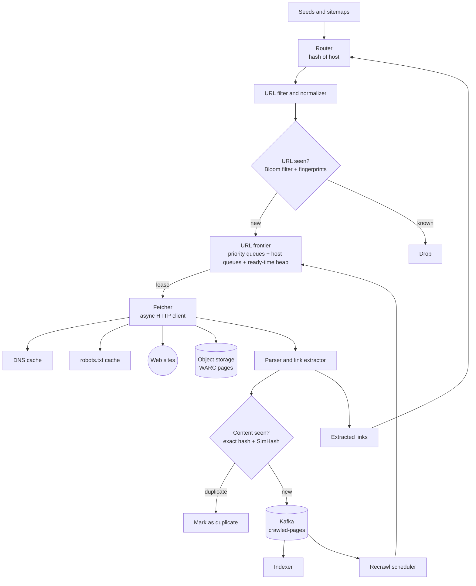
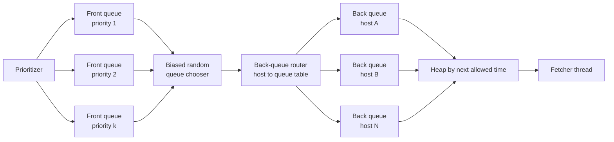
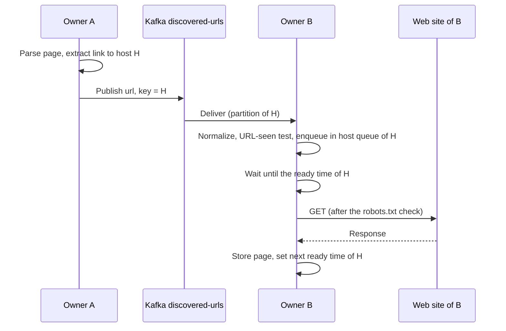

# Design a Web Crawler

A web crawler starts from a set of seed URLs, downloads each page, extracts the links, and downloads the pages that the links point to. A search engine uses a crawler to collect the documents that it indexes. This case study gives the design that a strong candidate presents in 45 minutes: a URL frontier that enforces politeness and priority, a DNS cache, `robots.txt` handling, deduplication of URLs and of content, distribution of the work over many machines, and defenses against crawler traps. Follow the steps in [how to approach an HLD interview](../how-to-approach-hld.md). The estimation method is on [back-of-envelope estimation](../back-of-envelope-estimation.md).

!!! note "About the sources"
    The crawler architecture here follows two published designs. The first is Mercator (Heydon and Najork, "Mercator: A Scalable, Extensible Web Crawler", 1999; and the report "High-Performance Web Crawling" by Najork and Heydon, 2001). The second is the crawler section of the original Google paper (Brin and Page, 1998). The `robots.txt` rules come from RFC 9309, the near-duplicate method comes from Manku, Jain, and Das Sarma (WWW 2007), and the budget and disk-based URL-seen ideas come from IRLbot (Lee et al., WWW 2008). The facts about Mercator come from the 2001 report, except the content-seen test details and the URL checksum layout, which come from the 1999 paper. The numbers that size the design are assumptions, and the page labels them.

## Problem Statement

"Design a web crawler for a search engine. It starts from a list of seed URLs and collects the HTML pages of the web. It must scale to billions of pages, must not overload any web site, must respect the rules that site owners publish, and must not waste work on duplicate pages or pages that never end."

The output of the crawler is a store of raw pages and a stream of "page fetched" events. Indexing, ranking, and link analysis read that output and are not part of this design (see [search and indexing](../fundamentals/11-search-and-indexing.md) for the index).

## Clarifying Questions

| Question | Answer that this design assumes |
|---|---|
| What is the crawler for? | A general search engine. It crawls the public web and keeps the content fresh (Assumption) |
| How many pages? | 1 billion page fetches each month. The known URL universe is 10 billion URLs (Assumption). The text shows what changes at 10 times this scale |
| Which content? | HTML pages only for the first version. The crawler downloads no images, videos, or PDFs, and it does not run JavaScript. Pages that need JavaScript to show content are an extension (see Follow-up Questions) |
| How fresh must pages be? | News and busy sites: hours. Most pages: weeks. The crawler schedules a recrawl by how often a page changes (Assumption) |
| Must the crawler obey `robots.txt`? | Yes. The rules come from RFC 9309 |
| How polite must it be? | At most one request in flight to a host. A delay between two requests to one host, set from the last download time and a minimum of 1 second (Assumption). Limits for each IP address and for each registered domain |
| Is one crawl a snapshot or continuous? | Continuous. A scheduler mixes new URLs with recrawls |
| Which duplicates must it detect? | Duplicate URLs (the same page under many URLs) and duplicate content (the same or almost the same page under different URLs) |
| What about pages behind a login? | Out of scope. The crawler sees what an anonymous visitor sees |
| Where do crawlers run? | In a few data centers, with an egress IP range that the crawler publishes. Site owners can verify the crawler by its user agent and IP range (Assumption) |
| What is the storage target? | Keep 3 monthly snapshots of the compressed pages (Assumption) |
| What is the failure target? | A crawler node can fail at any time. The system must not lose the frontier, must not fetch a URL twice in a burst, and must keep the politeness delay after a failure |

## Requirements

### Functional

1. Accept seed URLs and sitemaps, and discover new URLs from the links of fetched pages.
2. Fetch each URL over HTTP and HTTPS, follow redirects up to a limit, and store the response.
3. Obey `robots.txt` and the crawl-rate limits of each host.
4. Detect duplicate URLs and duplicate content, and skip them.
5. Schedule recrawls by the change rate and the importance of a page.
6. Publish each fetched page to downstream consumers (the indexer) as an event.
7. Let an operator block a host, change its rate, or request a recrawl of a URL.

### Non-functional

| Requirement | Target |
|---|---|
| Throughput | 333 pages for each second on average (1 billion for each month). Design for 2 times headroom |
| Politeness | At most one request in flight for each host. The delay between two requests for one host is at least 1 second and at least 10 times the last download time |
| Scalability | Add machines to raise the rate. No central component on the data path |
| Robustness | Survive malformed HTML, slow servers, redirect loops, huge files, and crawler traps |
| Extensibility | New content types and new processing steps without a rewrite of the core |
| Durability | The frontier and the URL state survive a node loss. A page that the crawler stored is kept for 3 snapshots |
| Freshness | Maximize the average freshness of the stored pages, weighted by importance. The recrawl rate depends on the change rate of each page, but it is not proportional to it (see Deep Dives) |

## Estimation

Rounding rule (the same as on the estimation page): one day is 10^5 seconds, so a 30-day month is 3 × 10^6 seconds. The exact values are 8.64 × 10^4 and 2.592 × 10^6. Both ratios are 0.864, so every rate is 13.6% lower than the exact rate. The error is smaller than the error of the assumptions.

Inputs (all are assumptions): 1 billion fetches each month. An average page is 100 KB on the wire. A fetch lasts 0.5 s in total (DNS from cache, connect, TLS, download). An average page has 50 outgoing links. A page is stored compressed at 25 KB (about 4:1). The crawler keeps 3 snapshots, and each object has 3 replicas (the text notes the saving from erasure coding below). The universe holds 10 billion known URLs. A URL record is 100 bytes (fingerprint, host ID, state, timestamps, and a compressed URL string). A SimHash fingerprint has 64 bits, and the near-duplicate index holds one for each page in the store: at most 3 snapshots × 10^9 pages = 3 × 10^9 fingerprints (an upper bound, because a recrawl of a URL replaces its old fingerprint). 5 million distinct hosts are crawled each day, and a parsed `robots.txt` file is 2 KB on average. One fetcher node keeps 500 fetches in flight.

| Step | Calculation | Result |
|---|---|---|
| Pages for each second | 10^9 / (3 × 10^6) | 333 |
| Inbound bandwidth | 333 × 100 KB × 8 | 267 Mbit/s |
| Fetches in flight | 333 × 0.5 s | 167 |
| Fetcher nodes for capacity | ceil(167 / 500) | 1. Run 10: a node failure moves 10% of the hosts, and the work spreads over more IP addresses |
| Pages one fast host can give each month (best case: the delay is the 1 s minimum, so the download takes 100 ms or less) | 3 × 10^6 s / 1 s | at most 3 × 10^6 |
| Time to crawl a host of 100 million pages in the best case | 10^8 / (3 × 10^6) | 33 months |
| Pages one typical host can give each month (a 0.5 s fetch, so the delay is 10 × 0.5 s = 5 s, and one fetch starts every 5.5 s) | 3 × 10^6 s / 5.5 s | about 545,000 |
| Page store for each month | 10^9 × 25 KB | 25 TB |
| Page store with 3 snapshots and 3 replicas | 25 TB × 3 × 3 | 225 TB (with erasure coding at about 1.5 times the data, 112 TB) |
| Extracted links for each second | 10^9 × 50 / (3 × 10^6) | 16,700 |
| URL records | 10^10 × 100 B | 1 TB. With 3 replicas: 3 TB |
| Frontier (assume 2 billion pending URLs) | 2 × 10^9 × 100 B | 200 GB |
| Exact set of 64-bit URL fingerprints | 10^10 × 8 B | 80 GB |
| Bloom filter for 10^10 URLs at 1% false positives | 10^10 × 9.59 bits / 8 | 12 GB |
| Expected 64-bit fingerprint collisions among 10^10 URLs | (10^10)^2 / (2 × 2^64) | about 2.7 pairs |
| `robots.txt` fetches for each second | 5,000,000 / 10^5 | 50 |
| `robots.txt` cache | 5,000,000 × 2 KB | 10 GB |
| SimHash tables (20 tables, each with all 3 × 10^9 fingerprints, uncompressed) | 3 × 10^9 × 8 B × 20 | 480 GB |

What the numbers decide:

- Compute and bandwidth are small. One node could carry the fetch rate. The design uses 10 nodes for failure isolation and for spread, not for capacity. At 10 times the scale (10 billion fetches each month), the rates are 3,333 pages for each second, 2.7 Gbit/s, and 1,667 fetches in flight, which still need only a handful of nodes.
- Politeness, not capacity, limits the rate. A fast host, at the 1 second minimum delay, gives at most 3 million pages each month. A host with 100 million pages needs 33 months at that rate. A typical host (0.5 s for each fetch, so a 5 second delay under the 10 times rule) gives about 545,000 pages each month. The crawler must prioritize inside such a host, and it must accept that it does not get all pages of the largest hosts. Raising the rate for one host needs the owner's consent.
- The URL-seen test is a lookup of 16,700 links for each second against 10 billion URLs. An exact set of fingerprints is 80 GB and a Bloom filter is 12 GB. Both fit in the memory of a small cluster. The check must be local to the host's owner, or the lookups cross the network 16,700 times each second.
- A 64-bit fingerprint is not exact. About 2.7 pairs of the 10 billion URLs are expected to collide, which means that the crawler may skip about 3 URLs by mistake. That is acceptable for a crawl, and it is not acceptable for a billing system.
- Near-duplicate detection is the largest memory consumer: 480 GB for 20 uncompressed SimHash tables, spread over a cluster. Manku et al. keep each table compressed in the main memory of a set of machines.
- Storage is dominated by the pages: 225 TB with replication. Erasure coding cuts it to about 112 TB (see [storage types](../fundamentals/10-storage-types.md)).

The program below prints these numbers. `main` comes first, and the block has its own imports, so you can copy it into `CrawlerEstimate.java` and run `java CrawlerEstimate.java`.

```java
import java.util.Locale;

public class CrawlerEstimate {
    public static void main(String[] args) {
        double secondsPerMonth = 3e6;
        double pagesPerMonth = 1e9;
        double pagesPerSecond = pagesPerMonth / secondsPerMonth;
        double wireBytes = 100e3;
        double inboundMbit = pagesPerSecond * wireBytes * 8 / 1e6;
        double inFlight = pagesPerSecond * 0.5;
        System.out.println(g("pages per second", pagesPerSecond));
        System.out.println(g("inbound Mbit/s", inboundMbit));
        System.out.println(g("fetches in flight (0.5 s each)", inFlight));
        System.out.println(g("pages per host per month at 1 s", secondsPerMonth / 1.0));
        System.out.println(g("months for a 100M-page host", 100e6 / (secondsPerMonth / 1.0)));
        double typicalGap = 0.5 + 10 * 0.5;
        System.out.println(g("pages per typical host per month", secondsPerMonth / typicalGap));
        double stored = pagesPerMonth * 25e3;
        System.out.println(g("page store per month, TB", stored / 1e12));
        System.out.println(g("with 3 snapshots, replica 3, TB", stored * 3 * 3 / 1e12));
        double links = pagesPerMonth * 50;
        System.out.println(g("extracted links per second", links / secondsPerMonth));
        double known = 10e9;
        System.out.println(g("exact 64-bit set, GB", known * 8 / 1e9));
        System.out.println(g("Bloom filter 1%, GB", known * 9.59 / 8 / 1e9));
        double pairs = known * known / (2 * Math.pow(2, 64));
        System.out.println(String.format(Locale.ROOT,
                "%-34s %.1f", "expected 64-bit collisions", pairs));
        double hostsPerDay = 5e6;
        System.out.println(g("robots.txt fetches per second", hostsPerDay / 1e5));
        System.out.println(g("robots cache, GB (2 KB each)", hostsPerDay * 2e3 / 1e9));
        double storedPages = 3 * pagesPerMonth;
        System.out.println(g("SimHash tables, GB (20 x 8 B)", storedPages * 8 * 20 / 1e9));
    }

    static String g(String label, double v) {
        return String.format(Locale.ROOT, "%-34s %,.1f", label, v);
    }
}
```

<!-- expected-output -->
```text
pages per second                   333.3
inbound Mbit/s                     266.7
fetches in flight (0.5 s each)     166.7
pages per host per month at 1 s    3,000,000.0
months for a 100M-page host        33.3
pages per typical host per month   545,454.5
page store per month, TB           25.0
with 3 snapshots, replica 3, TB    225.0
extracted links per second         16,666.7
exact 64-bit set, GB               80.0
Bloom filter 1%, GB                12.0
expected 64-bit collisions         2.7
robots.txt fetches per second      50.0
robots cache, GB (2 KB each)       10.0
SimHash tables, GB (20 x 8 B)      480.0
```

## API Design

A crawler has few public endpoints. Most of its interfaces are internal contracts between its components.

| Endpoint | Request | Response |
|---|---|---|
| `POST /v1/seeds` | `{"urls": ["https://example.com/"], "priority": 5, "source": "manual"}` or `{"sitemap": "https://example.com/sitemap.xml"}` | `202` with `{"accepted": 120, "rejected": 3}`. The rejected URLs are invalid, blocked, or already known |
| `GET /v1/urls/status?url={url}` | The URL, percent-encoded | `200` with `{"url": "...", "state": "fetched", "lastFetch": "2026-10-14T08:10:00Z", "httpStatus": 200, "nextFetch": "2026-10-21T08:10:00Z", "contentHash": "...", "robots": "allowed"}` |
| `POST /v1/recrawl` | `{"url": "https://example.com/a", "priority": 9}` | `202`. The URL goes to the front of its host queue |
| `PUT /v1/hosts/{host}/policy` | `{"minDelayMs": 2000, "blocked": false, "maxConcurrent": 1}` | `204`. An operator override, for example after a complaint |
| `GET /v1/hosts/{host}` | None | `200` with the host state: robots status, delay, queue length, error count, owner node |
| Internal gRPC `Frontier.Lease(workerId, maxUrls)` | The worker asks for URLs that are ready now | A list of `{url, leaseId, leaseUntil}`. A lease expires if the worker does not acknowledge it |
| Internal gRPC `Frontier.Complete(leaseId, outcome)` | `{status, downloadMs, bytes, redirectTo, contentHash}` | `OK`. The frontier sets the next allowed time for the host |
| Kafka topic `discovered-urls` | Key = host. Value = `{url, depth, sourceUrl, priorityHint}` | Consumed by the owner of the host |
| Kafka topic `crawled-pages` | Key = URL fingerprint. Value = `{url, fetchedAt, httpStatus, objectKey, contentHash, simhash, outlinks}` | Consumed by the indexer and other jobs |

Design notes:

- **The fetcher pulls work with a lease.** A fetcher asks for a batch of ready URLs and acknowledges each result. If a fetcher dies, its leases expire, and the frontier gives the URLs to another fetcher. This gives at-least-once fetching. A repeated fetch is harmless for a crawler, because a page is idempotent to read, and the frontier, not the fetcher, keeps the politeness delay. Set the lease time above the total fetch timeout (for example 60 s against 30 s, Assumption), and make the fetcher abandon a fetch when its lease ends. Then an expired lease cannot put two requests to one host in flight at the same time.
- **The route key is the host.** Every URL of one host goes to one owner node. That node alone enforces the politeness delay for that host, so no distributed lock is needed.
- **Events carry no page body.** The body is in object storage. The event holds the key.

## Data Model

| Data | Store and key | Content | Reason |
|---|---|---|---|
| URL records | Wide-column or LSM key-value store (for example Cassandra, HBase, or RocksDB on each owner node). Partition key = host ID. Clustering key = URL fingerprint. For hosts with millions of URLs, add a bucket (fingerprint modulo 64) to the partition key | `url`, `state` (new, queued, fetched, failed, blocked), `priority`, `depth`, `discovered_at`, `last_fetch_at`, `next_fetch_at`, `http_status`, `etag`, `last_modified`, `content_hash`, `simhash`, `fail_count`, `canonical_fp` | 10 billion rows (1 TB), lookups by key, a high write rate, and no joins. See [choosing a database](../fundamentals/04-choosing-a-database.md). Partitioning by host keeps all URLs of a host on one owner and avoids hot spots through the bucket |
| Host state | Key-value store keyed by host | `robots_body`, `robots_fetched_at`, `robots_status`, `crawl_delay_ms`, `ready_at`, `backoff_until`, `error_count`, `ips`, `ips_resolved_at`, `owner_epoch` | One small record for each host (100 million hosts). The owner node holds it in memory and persists it |
| Frontier queues | Sorted structure for each owner node (RocksDB or an append-only log with an in-memory index), key = (host, priority, sequence) | The URLs that wait for each host | Needs ordered reads by priority within a host and fast removal of the head |
| URL-seen filter | In-memory Bloom filter for each owner node, plus the exact fingerprint set on disk | 64-bit URL fingerprints | The filter answers "never seen" without a disk read. See [probabilistic data structures](../distributed-systems/04-probabilistic-data-structures.md) |
| Content-seen index | Key-value store keyed by the exact content hash | `canonical_url_fp`, `first_seen_at` | One lookup for each fetched page |
| SimHash index | 20 sorted tables of permuted 64-bit fingerprints, sharded over a cluster | Fingerprints and pointers to URL records | Hamming-distance search for near duplicates (see Deep Dives) |
| Raw pages | Object storage in WARC files (the ISO 28500 web-archive format), key = `{snapshot}/{host_hash}/{file}.warc.gz`. Many pages in each file | The HTTP response headers and the body | Large, immutable, written in sequence. Erasure coding fits (see [storage types](../fundamentals/10-storage-types.md)) |
| Page events | Kafka topic `crawled-pages` | The metadata of each fetched page | Decouples the indexer. Replayable |

Why a wide-column store: the workload is point reads and writes by a key, at a size (1 TB of records, 200 GB of frontier) that one database must spread over many nodes, with no multi-row transactions. A relational database can serve a smaller crawler, and the schema is the same. At 10 billion rows, partitioning by host in a store built for it avoids a manual sharding layer.

## High-Level Design



Components:

- **Seeds and sitemaps.** The starting URLs. A sitemap lists the URLs that the owner wants crawled, with the last-modified date. A crawler can find a sitemap through a `Sitemap:` line in `robots.txt`.
- **Router.** Maps each URL to its owner node with consistent hashing of the host (see [partitioning and sharding](../fundamentals/06-partitioning-and-sharding.md)). In practice the route is a Kafka topic `discovered-urls` that is partitioned by host.
- **URL filter and normalizer.** Rejects URLs that the crawler must not fetch (unsupported scheme, too long, blocked host, a known trap pattern) and rewrites each URL to a canonical form (see Deep Dives).
- **URL-seen test.** A Bloom filter answers "definitely new" in memory. A "possibly seen" answer goes to the exact fingerprint set. Each owner node keeps the filter only for its own hosts.
- **URL frontier.** The central data structure. It decides which URL to fetch next, so it enforces priority and politeness. The next section describes it in detail.
- **Fetcher.** An asynchronous HTTP client with many connections in flight. It checks the `robots.txt` cache, resolves the host from the DNS cache, downloads the page with a size limit and a timeout, and follows redirects through the frontier (a redirect target is a new URL). It stores the page in a WARC file.
- **DNS cache.** A local resolver with its own cache (see Deep Dives).
- **Parser and link extractor.** Parses the HTML, extracts the text, the links, and the canonical link, and sends the links back to the router.
- **Content-seen test.** An exact hash of the normalized text finds identical pages. A SimHash fingerprint finds near-identical pages.
- **Kafka `crawled-pages`.** The output stream. The indexer, the link-analysis job, and the recrawl scheduler read it.
- **Recrawl scheduler.** Computes the next fetch time for each page from its history (changed or unchanged at each visit) and its importance. It adds URLs to the frontier when they are due.

## Deep Dives

### 1. The URL Frontier: Politeness and Priority

The frontier answers one question: which URL should a fetcher download next? Two requirements pull in different directions. Priority says to fetch the most valuable URLs first. Politeness says to wait between two requests to one host. A single FIFO queue satisfies neither: it mixes hosts, and it ignores value.

**The Mercator design.** Najork and Heydon describe a frontier with two parts. The front end has `k` FIFO queues, one for each priority. A pluggable prioritizer assigns each new URL a priority from 1 to k, based on the URL and its download history, and puts it in the matching queue. The back end has `n` FIFO queues, and each holds URLs of one host only, with a table that maps a host to its queue. A heap holds one handle for each back queue, ordered by the time at which the host may be contacted again. To get a URL, a thread removes the root of the heap (it blocks until that time has come), downloads the head URL of that queue, and then reinserts the queue in the heap with a new time. When a back queue becomes empty, the thread refills it from a front queue that it picks at random, with a bias toward high priority. If the URL that comes from the front belongs to a host that already has a back queue, it goes into that queue, and the refill continues.

Their politeness rule: the crawler waits 10 times as long as the last download from that host took before it contacts the host again, and the production crawls use 3 times as many back queues as crawling threads. A slow host then receives requests at a lower rate, because the delay grows with the download time, and a host that responds fast is visited more often.



**Our version: the frontier is local to the host's owner.** Mercator runs one frontier for each crawl process. The design here assigns each host to one owner node, so the owner holds the front queues and the back queues of its hosts, and no other node needs to know a host's delay. Two nodes do not hit one host together, because only the owner schedules it. This removes the need for a distributed lock for politeness.

**Rules of the host queue:**

1. At most one request is in flight for a host. While a URL of the host is leased, the host is not in the heap.
2. After a response, the next allowed time is `now + max(minDelay, 10 × downloadTime)`, where `minDelay` is 1 second (Assumption). If the `robots.txt` of the host has a `Crawl-delay` value, use the larger of the two, with a cap of 30 seconds (Assumption). RFC 9309 does not define `Crawl-delay`, and Google's documentation lists it among the fields that Google does not support. The crawler may follow it as a courtesy, and the value is not a rule of the standard.
3. On a `429` or `503` response, honor `Retry-After` (RFC 9110, section 10.2.3), and otherwise back off exponentially for that host (1 s, 2 s, 4 s, up to 1 hour) with jitter (see [reliability patterns](../fundamentals/12-reliability-patterns.md)).
4. Limit the rate for each IP address and for each registered domain too. Many host names can share one IP address (virtual hosting), and a crawler that is polite to each name can still overload the one machine. IRLbot reports this problem with hosting services that put thousands of virtual hosts on one server, and it adds a per-server delay (1 second by default for low-ranked domains) to the per-host delay.
5. A host that fails (timeouts, connection errors) several times in a row goes to a penalty list with a growing backoff. A dead host must not occupy a back queue.

**Priority.** The prioritizer combines: the importance of the page (link-based scores such as PageRank, or the number of known inlinks), the depth from the seed (a shallow page is more likely important), the change history (a page that changed at each visit goes up), and the type of site (a news site has a short recrawl interval). Cho, Garcia-Molina, and Page (WWW 1998) studied URL ordering on a crawl of the Stanford web. They conclude that ordering by PageRank is an excellent ordering metric when the crawler looks for pages with many backlinks or with a high PageRank: it beat ordering by backlink count. The result depends on the importance definition: when importance was similarity to a topic, the backlink and PageRank orderings did no better than a random crawler, and only breadth-first order gave a reasonable result. A crawl also needs a rule for how to mix new URLs with recrawls. Mercator's continuous mode puts each downloaded URL back into the frontier, and the prioritizer gives it a priority from its download history: in one configuration, the priority of a page that does not change falls over time. The biased random choice of a front queue then mixes new and old URLs. This design uses the same mechanism, with the change history and the importance as inputs to the priority.

**Recrawl.** Each page has a `next_fetch_at`. The scheduler estimates a change rate from the history, for example the share of visits where the content hash changed. The obvious policy is to revisit each page at a rate proportional to its change rate. Cho and Garcia-Molina ("Synchronizing a Database to Improve Freshness", SIGMOD 2000; journal version in ACM TODS 2003) show that this proportional policy is worse than the uniform policy (the same rate for every page) for the average freshness of the copies, in every case that they analyze. The reason: a page that changes faster than the crawler can revisit it is almost never fresh, so the extra visits to it are wasted. Their optimal policy gives more visits to pages that change more often only up to a point, and then fewer, and their words are: "to improve freshness, we should penalize the elements that change too often". In their estimate from real web data (in the extended 1999 draft of the paper), the average freshness is 0.12 with the proportional policy, 0.57 with the uniform policy, and 0.62 with the optimal policy. So the scheduler gives each page an interval from its change rate and its importance, with fewer visits to pages that change faster than the crawl budget can follow, within a minimum and a maximum (1 hour to 90 days, Assumption). The fetcher sends a conditional request (`If-None-Match` with the stored `ETag`, or `If-Modified-Since`, RFC 9110) so that an unchanged page costs a `304` response with no body. This saves most of the bandwidth for pages that change rarely.

**Frontier storage.** The frontier holds 200 GB in our estimate, which exceeds the memory of one node. Mercator keeps the bulk of each queue on disk and only the head and tail in memory. The design does the same with a sorted store (RocksDB) on each owner node: the head of each host queue is cached, and the rest lives on disk. The ready-time heap holds one entry for each host that has work, in memory.

The program below is a small frontier with an injected clock. It has priority queues in front and a back queue for each host. A heap holds the hosts by their next allowed time. After each download, the frontier sets that time to `max(1000 ms, 10 × download time)`. `main` comes first, and the block has its own imports. The clock is a field that the test sets, so the output does not depend on real time. Priority 0 is the highest. Two simplifications keep the output deterministic and short. First, the refill takes the next URL from the highest-priority non-empty front queue, where Mercator picks a front queue at random with a bias toward high priority. Second, the frontier refills only while fewer than 2 hosts wait in the heap (`targetHosts`), where Mercator's production crawls use 3 times as many back queues as crawling threads.

```java
import java.util.ArrayDeque;
import java.util.HashMap;
import java.util.Map;
import java.util.PriorityQueue;

public class FrontierCheck {
    public static void main(String[] args) {
        FakeClock clock = new FakeClock();
        Frontier frontier = new Frontier(clock, 3, 1_000, 10);
        frontier.add("http://a.com/1", 0);
        frontier.add("http://a.com/2", 0);
        frontier.add("http://a.com/3", 1);
        frontier.add("http://b.com/1", 0);
        frontier.add("http://b.com/2", 2);
        frontier.add("http://c.com/1", 2);
        Map<String, Long> download = Map.of("a.com", 100L, "b.com", 300L, "c.com", 50L);
        Map<String, Long> lastStart = new HashMap<>();
        long worstSlack = Long.MAX_VALUE;
        int fetched = 0;
        while (fetched < 6) {
            String url = frontier.next();
            if (url == null) {
                clock.now = frontier.nextReadyAt();
                continue;
            }
            String host = Frontier.host(url);
            long start = clock.now;
            if (lastStart.containsKey(host)) {
                worstSlack = Math.min(worstSlack, start - lastStart.get(host));
            }
            lastStart.put(host, start);
            System.out.println("t=" + start + " ms fetch " + url);
            clock.now += download.get(host);
            frontier.done(url, download.get(host));
            fetched++;
        }
        System.out.println("smallest gap between two fetches of one host: " + worstSlack + " ms");
    }
}

class FakeClock {
    long now;
}

class Frontier {
    private record Slot(long readyAt, String host) { }

    private final FakeClock clock;
    private final long minDelayMs;
    private final int factor;
    private final int targetHosts;
    private final ArrayDeque<String>[] front;
    private final Map<String, ArrayDeque<String>> back = new HashMap<>();
    private final Map<String, Long> readyAt = new HashMap<>();
    private final PriorityQueue<Slot> heap = new PriorityQueue<>((x, y) -> {
        int c = Long.compare(x.readyAt, y.readyAt);
        return c != 0 ? c : x.host.compareTo(y.host);
    });

    @SuppressWarnings("unchecked")
    Frontier(FakeClock clock, int priorities, long minDelayMs, int factor) {
        this.clock = clock;
        this.minDelayMs = minDelayMs;
        this.factor = factor;
        this.targetHosts = 2;
        this.front = new ArrayDeque[priorities];
        for (int i = 0; i < priorities; i++) {
            front[i] = new ArrayDeque<>();
        }
    }

    static String host(String url) {
        int start = url.indexOf("//") + 2;
        int end = url.indexOf('/', start);
        return url.substring(start, end < 0 ? url.length() : end);
    }

    void add(String url, int priority) {
        front[priority].add(url);
    }

    private void refill() {
        while (heap.size() < targetHosts) {
            String url = null;
            for (ArrayDeque<String> q : front) {
                if (!q.isEmpty()) {
                    url = q.poll();
                    break;
                }
            }
            if (url == null) {
                return;
            }
            String host = host(url);
            ArrayDeque<String> queue = back.get(host);
            if (queue == null) {
                queue = new ArrayDeque<>();
                back.put(host, queue);
                heap.add(new Slot(readyAt.getOrDefault(host, 0L), host));
            }
            queue.add(url);
        }
    }

    String next() {
        refill();
        Slot top = heap.peek();
        if (top == null || top.readyAt > clock.now) {
            return null;
        }
        heap.poll();
        return back.get(top.host).poll();
    }

    long nextReadyAt() {
        refill();
        return heap.peek().readyAt;
    }

    void done(String url, long downloadMs) {
        String host = host(url);
        readyAt.put(host, clock.now + Math.max(minDelayMs, factor * downloadMs));
        if (back.get(host).isEmpty()) {
            back.remove(host);
        } else {
            heap.add(new Slot(readyAt.get(host), host));
        }
    }
}
```

<!-- expected-output -->
```text
t=0 ms fetch http://a.com/1
t=100 ms fetch http://b.com/1
t=1100 ms fetch http://a.com/2
t=2200 ms fetch http://a.com/3
t=2300 ms fetch http://c.com/1
t=3400 ms fetch http://b.com/2
smallest gap between two fetches of one host: 1100 ms
```

The output shows the rules at work. Host `a.com` takes 100 ms to download, so the delay is the minimum (1,000 ms): its fetches start at 0, 1,100, and 2,200 ms. Host `b.com` takes 300 ms, so the delay is 3,000 ms, and its second fetch starts at 3,400 ms (400 ms plus 3,000 ms). While `b.com` waits, the frontier serves other hosts. The smallest gap between two fetches of one host is 1,100 ms, which is at least the 1,000 ms minimum plus the 100 ms download.

### 2. Fetch Hygiene: `robots.txt`, DNS, and Safe Fetching

**`robots.txt` (RFC 9309).** The Robots Exclusion Protocol lets a site owner say which paths a crawler may fetch. The file sits at `/robots.txt` on each origin (scheme, host, and port). The crawler fetches it before any other URL of the host. The rules of RFC 9309 that the design needs:

| Rule | Detail from RFC 9309 |
|---|---|
| Groups | A group starts with one or more `User-Agent` lines and contains `Allow` and `Disallow` rules. The crawler matches its product token against the `User-Agent` lines without regard to case. If more than one group matches, the crawler must combine their rules into one group. If none matches, it uses the group for `*`. If no group applies, no rules apply |
| Matching | The crawler matches the path of the URL (the RFC's examples include the query string) against each rule, starting from the first octet of the path. The matching should be case sensitive. Before the comparison, the crawler percent-encodes non-ASCII and reserved octets, and decodes percent-encoded unreserved characters. `*` designates 0 or more instances of any character, and `$` designates the end of the match pattern |
| Which rule wins | The most specific match wins: the rule that matches the most octets. If an `Allow` and a `Disallow` rule are equivalent, the `Allow` rule should be used |
| No match | If no rule matches, the URL is allowed. The `/robots.txt` URI itself is implicitly allowed |
| Redirects | The crawler should follow at least five consecutive redirects to reach `robots.txt`. After more than five, it may treat the file as unavailable |
| 2xx | The crawler parses the file |
| 4xx ("unavailable") | The crawler may access any resource on the server |
| 5xx or network error ("unreachable") | The crawler must assume complete disallow. If the file stays unreachable for a long time (for example 30 days), the crawler may treat it as unavailable or continue to use a cached copy |
| Caching | The crawler may cache the file, and should not use a cached copy for more than 24 hours, unless the file is unreachable |
| Size | The crawler should limit the parsing size, and the limit must be at least 500 kibibytes |
| Extensions | The standard does not define `Crawl-delay`. It allows other lines (for example `Sitemap`) |

Google's documentation shows how one large operator applies the rules. It states that Google follows at least five redirect hops, caches `robots.txt` for up to 24 hours (it may use the `Cache-Control` `max-age` value to change that), enforces a size limit of 500 KiB and ignores content after that limit, and lists `user-agent`, `allow`, `disallow`, and `sitemap` as the supported fields, with `crawl-delay` among the unsupported ones. It ignores a rule with no path. For precedence, it uses the most specific rule by the length of the rule path, and the least restrictive rule if two rules conflict. It treats each 4xx status except 429 as if no valid `robots.txt` existed, and it excludes 429 from that rule. For a 5xx error, Google stops crawling the site for the first 12 hours while it retries, then uses the last good version for up to 30 days. If no cached version exists in that period, Google's documentation says that it assumes there are no crawl restrictions. After 30 days, it treats the site as having no `robots.txt` if the site is otherwise available. RFC 9309 says that an unreachable file means complete disallow. The two differ for the case with no cached copy after the first 12 hours, so a crawler that wants to follow the RFC strictly must choose the RFC's rule: do not crawl the host until the file is reachable.

A `robots.txt` cache sits on each owner node. It holds the parsed rules for each host, with the fetch time and the status. 5 million hosts each day make 50 fetches for each second and a 10 GB cache in our estimate. Mercator keeps a fixed-size LRU cache of host names to rules, with a default of 2^18 entries (see the [LRU cache case study](../../lld/case-studies/02-lru-and-lfu-cache/README.md)). The design stores more because a node owns many hosts, and it spills to disk. A robots check costs no network call when the rules are cached. The fetcher checks the rules again before it fetches, not only when the URL enters the frontier, because the rules can change while a URL waits. Mercator reports that robots exclusion removed 3.92% of the download attempts in a 17-day crawl (35 million of 891 million processed URLs).

The program below implements the matching rules of RFC 9309 sections 2.2.2 and 2.2.3 for one group: the longest match wins, an `Allow` rule wins over an equivalent `Disallow` rule, `*` matches any run of characters, `$` anchors the end, and `/robots.txt` is always allowed. It measures "most octets" as the length of the rule's pattern, which is how Google's documentation states the precedence ("based on the length of the rule path"). It ignores a rule with an empty pattern, so an empty `Disallow` allows everything. RFC 9309 allows the empty pattern in its grammar but does not state this case in words, and Google's documentation states that it ignores a rule with no path. The matcher runs in time proportional to the pattern length times the path length, because RFC 9309 section 3 tells implementers to treat the file as untrusted input. The program leaves out the percent-encoding step of section 2.2.2 and the group selection by product token. It runs the group for `*` from section 5.1 of the RFC and the longest-match example from section 5.2. `main` comes first, and the block has its own imports.

```java
import java.util.ArrayList;
import java.util.List;

public class RobotsCheck {
    public static void main(String[] args) {
        // The group for "*" from RFC 9309, section 5.1.
        Group star = new Group();
        star.add(false, "*.gif$");
        star.add(false, "/example/");
        star.add(true, "/publications/");
        String[] paths = {"/index.html", "/example/a.html", "/publications/x.pdf",
            "/pics/cat.gif", "/pics/cat.gif?size=2", "/robots.txt"};
        for (String p : paths) {
            String verdict = star.allowed(p) ? "allow" : "DISALLOW";
            System.out.println(String.format("%-24s %s", p, verdict));
        }
        // The longest-match example from RFC 9309, section 5.2.
        Group foobot = new Group();
        foobot.add(true, "/example/page/");
        foobot.add(false, "/example/page/disallowed.gif");
        System.out.println("longest match: /example/page/disallowed.gif -> "
                + (foobot.allowed("/example/page/disallowed.gif") ? "allow" : "DISALLOW"));
        System.out.println("longest match: /example/page/other.gif -> "
                + (foobot.allowed("/example/page/other.gif") ? "allow" : "DISALLOW"));
        Group tie = new Group();
        tie.add(false, "/a");
        tie.add(true, "/a");
        System.out.println("equal rules: /a -> " + (tie.allowed("/a") ? "allow" : "DISALLOW"));
        Group empty = new Group();
        empty.add(false, "");
        System.out.println("empty Disallow: /x -> " + (empty.allowed("/x") ? "allow" : "DISALLOW"));
    }
}

class Group {
    private record Rule(boolean allow, String pattern) { }

    private final List<Rule> rules = new ArrayList<>();

    void add(boolean allow, String pattern) {
        rules.add(new Rule(allow, pattern));
    }

    boolean allowed(String path) {
        if (path.equals("/robots.txt")) {
            return true;
        }
        int bestLength = -1;
        boolean bestAllow = true;
        for (Rule r : rules) {
            if (r.pattern.isEmpty() || !matches(r.pattern, path)) {
                continue;
            }
            int length = r.pattern.length();
            if (length > bestLength || (length == bestLength && r.allow)) {
                bestLength = length;
                bestAllow = r.allow;
            }
        }
        return bestAllow;
    }

    // A pattern matches if its end is reached before a difference. '*' matches any run of
    // characters. '$' at the end of the pattern anchors the match to the end of the path.
    // The loop takes O(pattern length x path length) time. A backtracking matcher can take
    // exponential time on a pattern with many '*', and a robots.txt file is untrusted input.
    private static boolean matches(String pat, String s) {
        int n = pat.length();
        boolean anchored = n > 0 && pat.charAt(n - 1) == '$';
        if (anchored) {
            n--;
        }
        // reach[j] is true if the pattern characters read so far can end at path position j.
        boolean[] reach = new boolean[s.length() + 1];
        reach[0] = true;
        for (int i = 0; i < n; i++) {
            char c = pat.charAt(i);
            boolean[] next = new boolean[s.length() + 1];
            boolean seen = false;
            for (int j = 0; j <= s.length(); j++) {
                if (c == '*') {
                    seen |= reach[j];
                    next[j] = seen;
                } else if (reach[j] && j < s.length() && s.charAt(j) == c) {
                    next[j + 1] = true;
                }
            }
            reach = next;
        }
        if (anchored) {
            return reach[s.length()];
        }
        for (boolean r : reach) {
            if (r) {
                return true;
            }
        }
        return false;
    }
}
```

<!-- expected-output -->
```text
/index.html              allow
/example/a.html          DISALLOW
/publications/x.pdf      allow
/pics/cat.gif            DISALLOW
/pics/cat.gif?size=2     allow
/robots.txt              allow
longest match: /example/page/disallowed.gif -> DISALLOW
longest match: /example/page/other.gif -> allow
equal rules: /a -> allow
empty Disallow: /x -> allow
```

In the output, `/pics/cat.gif` is disallowed by `*.gif$`, and `/pics/cat.gif?size=2` is allowed, because `$` requires the path to end after `.gif`. In the longest-match example, the `Disallow` rule for the file is longer than the `Allow` rule for the folder, so the file is disallowed and the other files in the folder are allowed.

`robots.txt` is not security. RFC 9309 states that the protocol is not a substitute for content security measures, and a listed path is visible to anyone. It only controls well-behaved crawlers.

**DNS.** Every new host needs a DNS lookup, and a synchronous resolver blocks a thread while it waits. Najork and Heydon note that one DNS request can take seconds or even tens of seconds, because it may need several round trips to name servers. They report that the Java DNS interface and the DNS interface on most Unix systems (`gethostbyname`) were synchronized, so only one request for an uncached name could be outstanding in a process, and the cache miss rate was high enough to make this a severe bottleneck. They wrote their own multi-threaded resolver that forwards requests to a local name server. Before the change, DNS lookups took 70% of each thread's elapsed time. After it, they took 14%. Brin and Page report the same stress in the first Google crawler: "A major performance stress is DNS lookup", so each crawler kept its own DNS cache, used asynchronous I/O, and kept about 300 connections open, and four crawlers reached over 100 pages for each second at peak. The design uses an asynchronous resolver with its own cache in the fetcher process:

- Cache each answer for its TTL, with a floor of 5 minutes and a ceiling of 24 hours (Assumption), so a host with a TTL of 0 does not cause a lookup for each page. Cache negative answers (name not found) for a short time (RFC 2308). See [load balancing, DNS, and CDN](../fundamentals/02-load-balancing-dns-cdn.md) and `kb/networking/06-dns.md` for the protocol.
- Resolve each host once for a batch of URLs of that host, which the host queues make natural.
- Use more than one resolver, and rate limit the lookups for each domain's name servers, so the crawler does not overload a small authoritative server.
- Keep the resolved IP address in the host state. It feeds the per-IP politeness limit.

**Safe fetching.** A crawler fetches URLs that strangers chose, so it is a way to reach internal systems if it is careless (server-side request forgery). After DNS resolution, and again after each redirect, check the IP address: refuse private ranges (10.0.0.0/8, 172.16.0.0/12, 192.168.0.0/16), loopback, link-local (169.254.0.0/16, where cloud metadata services live), and the IPv6 equivalents. Connect to the checked IP address, not to the name again, so that a DNS record that changes between the check and the connection cannot bypass the check (DNS rebinding). Also set: a total timeout for each fetch (for example 30 s), a body size limit (for example 10 MB, and stop reading when it is exceeded), a limit of 5 to 10 redirects, a limit on header size, and a whitelist of content types. Run fetchers in a network segment with no route to internal services.

**Identify the crawler.** Send a `User-Agent` that names the crawler and gives a URL with contact information, and publish the IP range, so site owners can verify it and report issues.

### 3. Deduplication: URLs and Content

Two kinds of duplicates waste work. The same page can have many URLs. Different URLs can have the same or almost the same content.

**URL normalization.** Rewrite each URL to a canonical form before the URL-seen test. RFC 3986 section 6 defines safe normalizations: lowercase the scheme and host, uppercase the hex digits of percent-encodings, decode percent-encoded unreserved characters, resolve `.` and `..` segments, and, by scheme-based normalization for `http` and `https`, remove an empty or default port and treat an empty path as `/` (so `http://host` and `http://host/` are one URL). Beyond that, apply rules that the RFC does not define: remove the fragment (`#...`), sort the query parameters, and drop session and tracking parameters (`jsessionid`, `utm_*`, a list that the crawler learns). Fragment removal is safe for a crawler because the client removes the fragment before it sends the request (RFC 3986, section 3.5), so the server returns the same response with or without it. RFC 3986 itself says that the fragment is not subject to scheme-based normalization, because the fragment can matter to the client. Every rule has a risk: if a parameter matters, dropping it merges two different pages. Start with the RFC rules and add the others from evidence.

**URL-seen test.** After normalization, compute a 64-bit fingerprint of the URL (Mercator uses Rabin fingerprints and stores 8-byte checksums of URLs, not the URLs. Its 1999 paper builds each URL checksum from two fingerprints, so that the high-order bits come from the host name: URLs of one host then sort together, which keeps the host locality of links in the disk lookups). Check the fingerprint in two steps. A Bloom filter in memory answers "definitely new" for most links without any disk access. Bloom filters have no false negatives, so a "new" answer is certain (see [probabilistic data structures](../distributed-systems/04-probabilistic-data-structures.md)). A "possibly seen" answer goes to the exact set of fingerprints on disk. A Bloom false positive costs one disk lookup and does not cause a lost URL. The filter for 10 billion URLs at 1% false positives takes 12 GB (see Estimation). Najork and Heydon describe three implementations of this test. The first keeps all 8-byte checksums in an in-memory hash table, which needs slightly over 5 GB for 1 billion URLs, and the memory grows with the crawl. The second keeps the hash table on disk with a cache of popular fingerprints in memory. Only one in six submissions misses the cache, but almost every miss costs a disk seek. A seek takes about 8 ms, which allows 125 seeks for each second. At one seek for each six submissions, that is 750 submissions for each second, and with about 10 links for each page it limits the crawl to about 75 downloads for each second. The third buffers new fingerprints in memory and merges them into one sorted file in batches, so the access to the disk is sequential. The report says that this one performs at least twice as well as the seek-limited one, and that its throughput still falls over time, because the merge takes longer as the file grows. The design uses the third idea: writes go to an in-memory buffer and are merged into sorted files in batches (an LSM tree does this).

A 64-bit fingerprint has collisions: for n URLs, the expected number of colliding pairs is about n^2 / 2^65. For n = 10^10, it is about 2.7. The crawler would skip about three URLs by mistake. If that is not acceptable, use a 128-bit fingerprint, which has 16 bytes for each URL and a collision probability that is negligible at this size.

**Canonical links and redirects.** If a page declares `<link rel="canonical" href="...">` (RFC 6596), the crawler records the relation and prefers the canonical URL, but it must not trust it blindly: a canonical link can point to an unrelated page by mistake or by abuse. A redirect target counts as a new URL that goes through the same test, and the crawler records that the source URL redirects to it.

**Exact content duplicates.** After the parse, compute a hash of the normalized text (lowercase, tags and whitespace removed, boilerplate stripped if possible). Look it up in the content-seen index. If the hash exists, the page is a duplicate of a known page, and the crawler stores a pointer and does not process the page further. Mercator calls this the content-seen test. Its 1999 paper stores a 64-bit fingerprint of the contents of each downloaded document (Broder's implementation of Rabin's algorithm) in a small in-memory hash table plus a large sorted file on disk, and merges the table into the file when the table fills.

**Near duplicates: SimHash.** Many pages are almost the same: the same article with a different ad, a different timestamp, or a different session ID in a link. An exact hash differs for each of them. Charikar's SimHash gives a fingerprint of a document such that similar documents have fingerprints that differ in few bit positions. The algorithm in outline:

1. Break the document into features (words, or shingles of several words) with a weight for each (for example, the term frequency).
2. Hash each feature to a 64-bit value.
3. Keep a vector of 64 integers. For each feature and each bit position, add the weight if the hash bit is 1 and subtract the weight if it is 0.
4. The fingerprint has bit i set to 1 if the sum for position i is positive, and 0 if not.

Two documents are near duplicates if the Hamming distance of their fingerprints (the number of bit positions where they differ) is at most k. Manku, Jain, and Das Sarma evaluate this at Google scale. They report that, for a repository of 8 billion web pages, 64-bit SimHash fingerprints with k = 3 are reasonable. In their experiment with k = 3, both precision and recall were near 0.75. They also state the search problem: find all fingerprints in a collection that differ from a given one in at most k bits, which is hard to do with one lookup because a one-bit difference changes the key.

**Hamming search with tables.** The idea of the paper: split the 64 bits into blocks, and for each choice of some blocks, make a table that stores the fingerprints permuted so that the chosen blocks are the leading bits, then sorted. A query looks for exact matches of the leading bits in each table, then checks the Hamming distance of the few candidates. The pigeonhole argument makes this exact: if two fingerprints differ in at most k bits and the 64 bits are split into b blocks, the differing bits fall into at most k blocks, so at least b − k blocks are identical. One table for each choice of b − k blocks therefore finds every match. The smallest case is b = k + 1 blocks and one table for each block. The paper shows four designs for f = 64, k = 3, and 8 billion (2^34) fingerprints. 20 tables: 6 blocks, one table for each of the 20 ways to choose 3 blocks, about 31 to 33 leading bits, and at most about 8 candidates for each probe on average. 16 tables: a two-level split (choose 1 of 4 blocks of 16 bits, then 1 of 4 blocks of 12 bits in the rest), 28 leading bits, about 64 candidates. 10 tables: 5 blocks, choose 2, 25 or 26 leading bits, at most about 512 candidates. 4 tables: 4 blocks of 16 bits, choose 1, 16 leading bits, at most about 256 thousand candidates. With t leading bits, a probe returns about 2^(34 − t) candidates. More tables use more memory and give fewer candidates for each query.

The program below shows SimHash and the four-table design (the 4-table row above, with k + 1 blocks of 16 bits). `main` comes first, and the block has its own imports. It computes fingerprints of a text, of the same text with one word added, of the same text with a larger edit, and of an unrelated text. It then checks the pigeonhole claim on 2,000 random fingerprints with 3 flipped bits, using a seeded random generator, so the output does not change between runs.

```java
import java.nio.charset.StandardCharsets;
import java.util.ArrayList;
import java.util.HashMap;
import java.util.List;
import java.util.Map;
import java.util.SplittableRandom;

public class SimHashCheck {
    public static void main(String[] args) {
        String a = "the crawler keeps a frontier of urls and a politeness delay for each host "
                + "it fetches a page parses the links and adds new urls to the frontier "
                + "before it stores the page it checks whether it has seen the content";
        String b = a + " today";
        String d = a.replace("keeps a frontier", "keeps one frontier") + " today";
        String c = "a trie stores the top suggestions at each node so that a lookup reads one node "
                + "and the build job recomputes the lists from the aggregated query counts";
        long fa = simhash(a);
        long fb = simhash(b);
        long fc = simhash(c);
        long fd = simhash(d);
        System.out.println("distance(a, b) = " + Long.bitCount(fa ^ fb) + " (near duplicate)");
        System.out.println("distance(a, d) = " + Long.bitCount(fa ^ fd) + " (larger edit)");
        System.out.println("distance(a, c) = " + Long.bitCount(fa ^ fc) + " (different page)");

        NearDupIndex index = new NearDupIndex();
        index.add(fa);
        System.out.println("k = 3 finds b near a: " + index.hasNear(fb, 3));
        System.out.println("k = 3 finds d near a: " + index.hasNear(fd, 3));
        System.out.println("k = 3 finds c near a: " + index.hasNear(fc, 3));
        SplittableRandom rnd = new SplittableRandom(42);
        int trials = 2000;
        int found = 0;
        for (int i = 0; i < trials; i++) {
            NearDupIndex one = new NearDupIndex();
            long base = rnd.nextLong();
            one.add(base);
            long probe = base;
            for (int flips = 0; flips < 3; flips++) {
                probe ^= 1L << rnd.nextInt(64);
            }
            if (one.hasNear(probe, 3)) {
                found++;
            }
        }
        System.out.println("fingerprints within 3 bits found: " + found + " of " + trials);
    }

    static long fnv1a64(String s) {
        long h = 0xcbf29ce484222325L;
        for (byte x : s.getBytes(StandardCharsets.UTF_8)) {
            h ^= (x & 0xff);
            h *= 0x100000001b3L;
        }
        // FNV-1a mixes the low bits poorly: a multiplication moves information only toward
        // higher bits, so bit i of h depends only on bits 0 to i of the input bytes. These
        // steps of the MurmurHash3 64-bit finalizer spread the bits. SimHash uses all 64.
        h ^= h >>> 33;
        h *= 0xff51afd7ed558ccdL;
        h ^= h >>> 33;
        return h;
    }

    static long simhash(String text) {
        int[] v = new int[64];
        Map<String, Integer> weights = new HashMap<>();
        for (String t : text.split("\\s+")) {
            weights.merge(t, 1, Integer::sum);
        }
        for (Map.Entry<String, Integer> e : weights.entrySet()) {
            long h = fnv1a64(e.getKey());
            for (int bit = 0; bit < 64; bit++) {
                v[bit] += ((h >>> bit) & 1L) == 1L ? e.getValue() : -e.getValue();
            }
        }
        long out = 0;
        for (int bit = 0; bit < 64; bit++) {
            if (v[bit] > 0) {
                out |= 1L << bit;
            }
        }
        return out;
    }
}

// Four tables, one for each 16-bit block. If two fingerprints differ in at most 3 bits,
// the differing bits fall in at most 3 of the 4 blocks, so at least one block is equal.
class NearDupIndex {
    private final List<Map<Integer, List<Long>>> tables = new ArrayList<>();

    NearDupIndex() {
        for (int i = 0; i < 4; i++) {
            tables.add(new HashMap<>());
        }
    }

    private static int block(long fp, int i) {
        return (int) ((fp >>> (16 * i)) & 0xffff);
    }

    void add(long fp) {
        for (int i = 0; i < 4; i++) {
            tables.get(i).computeIfAbsent(block(fp, i), k -> new ArrayList<>()).add(fp);
        }
    }

    boolean hasNear(long fp, int k) {
        for (int i = 0; i < 4; i++) {
            for (long other : tables.get(i).getOrDefault(block(fp, i), List.of())) {
                if (Long.bitCount(fp ^ other) <= k) {
                    return true;
                }
            }
        }
        return false;
    }
}
```

<!-- expected-output -->
```text
distance(a, b) = 2 (near duplicate)
distance(a, d) = 4 (larger edit)
distance(a, c) = 22 (different page)
k = 3 finds b near a: true
k = 3 finds d near a: false
k = 3 finds c near a: false
fingerprints within 3 bits found: 2000 of 2000
```

Notes on the output. The added word moves the fingerprint by 2 bits, so the index finds it with k = 3. The larger edit moves it by 4 bits, so k = 3 does not find it. This is the trade-off that the paper tunes: a short text has few features, so one edit moves a large share of them, and a small k misses near duplicates. Two fingerprints of random, independent texts differ in about 32 bits on average. These two texts differ in 22, because they share frequent words (`the`, `a`, `and`) that pull bits in the same direction. Manku et al. build features with standard IR steps, among them stop-word removal and stemming, which removes this effect. The pigeonhole check finds all 2,000 fingerprints, because with 4 blocks and at most 3 flipped bits, one block is always intact. The 4-table design stores 4 copies of each fingerprint and returns many candidates per probe at the scale of billions (the paper's figure is about 256 thousand), so a production system uses more tables.

**MinHash and shingling (Broder).** Broder defines the resemblance of two documents as the size of the intersection of their sets of shingles (contiguous runs of words) divided by the size of the union, and shows how to estimate it from small random samples of the shingle sets (min-wise hashing). It suits the question "how similar are these two sets" with an explicit similarity number. SimHash gives one 64-bit value for each document, so it needs less storage and its comparison is one XOR and a bit count. Use SimHash for the crawler's bulk detection and MinHash when you need the resemblance score.

**What the crawler does with a duplicate.** For an exact duplicate, it records the link between the URLs and skips the index. For a near duplicate, it keeps one page as the representative, lets the indexer decide whether to index both, and demotes a host in which most pages are near duplicates of each other (a sign of a trap, see below).

### 4. Crawler Traps, Distribution, and Failures

**Traps.** A crawler trap is a set of URLs that never ends. Examples: a calendar with a "next month" link that continues forever, a URL that adds a path segment each time (`/a/b/a/b/a/b/...`), a session ID in each link that makes each visit a new URL, a faceted search whose filters combine into billions of URLs, and a server that answers any path with a page (a soft 404 with links). Some are accidents and some are built to waste a crawler's time. DNS wildcards can produce an infinite set of subdomains.

Defenses, from cheapest to most expensive:

| Defense | How it works | Limit |
|---|---|---|
| Maximum URL length | Reject URLs longer than 2,048 characters (Assumption) | Stops path-growing traps. Rejects a few valid URLs |
| Maximum depth | Reject URLs more than 15 links from a seed (Assumption) | Cuts calendars. Cuts deep but valid pages |
| Repeated segments | Reject a path where one segment repeats more than 3 times, or where a pattern of segments repeats | Rule-based. Misses other trap forms |
| Budget for each host | Allow a number of pages for each host and each registered domain, growing with the number of distinct registered domains that link to it (as in IRLbot) | A budget accepts that the crawler does not reach the whole of a large host. The politeness math already forces this (see Estimation) |
| Duplicate ratio | If more than 50% of the pages from a host in a window are exact or near duplicates, lower its priority and budget (Assumption) | Needs the content-dedup pipeline. Catches traps that the rules miss |
| Parameter limits | Allow at most N distinct query parameters and M values for each parameter for each path | Controls faceted navigation |
| Registered-domain budget | Count pages for each registered domain (using the public suffix list), not only for each host name | Stops wildcard-subdomain traps |
| Manual blocklist | An operator blocks a host or pattern | Reactive |

Lee, Leonard, Wang, and Loguinov describe the budget approach at scale in the IRLbot paper ("IRLbot: Scaling to 6 Billion Pages and Beyond", WWW 2008). IRLbot ran on one server for 41 days and downloaded 6,380,051,942 unique HTML pages at an average of 1,789 pages for each second. The paper names three techniques:

- **STAR (Spam Tracking and Avoidance through Reputation)** gives each pay-level domain (PLD, a domain that needs payment at a registrar, such as `amazon.com` or `ebay.co.uk`) a budget of pages for each time period. The budget includes all hosts and subdomains of the PLD, and it grows with the PLD's in-degree: the number of other PLDs that link to it. The paper chose PLD in-degree because a spammer must pay for each PLD, so it cannot create links from new PLDs without limit. The paper also rejects PageRank-style ranks at this scale, because they need heavy disk work and link farms can manipulate them.
- **BEAST (Budget Enforcement with Anti-Spam Tactics)** enforces the budgets. It does not discard a URL that exceeds its budget. It delays the URL in one of a growing number of disk queues, so that sites far over budget are read less often as the crawl grows. The paper shows that a naive design, which re-reads one queue of failed URLs after each pass, needs disk I/O that grows with the crawl size and becomes the bottleneck.
- **DRUM (Disk Repository with Update Management)** stores key-value pairs on disk with three batch operations: check, update, and check+update. It spreads the incoming keys into buckets by key prefix, sorts each bucket in memory, and merges all buckets with the sorted disk file in one sequential pass. The URL-seen structure is a DRUM object with 8-byte URL hashes as keys. The same mechanism stores the `robots.txt` cache and the PLD in-degree data.

IRLbot couples the budgets to politeness: it uses a per-host delay of 40 seconds for low-ranked PLDs and scales the delay down for high-ranked PLDs in proportion to their budget, so the crawler does not fill its memory with URLs of a few huge sites. This page's design takes two ideas from it: a page budget for each registered domain that grows with the number of distinct domains that link to it, and batched, sorted disk merges for the URL-seen test.

**Distribution.** Partition the work by host. A hash of the host name (or of the registered domain, if domain-level politeness is needed) selects the owner node. Consistent hashing (see [partitioning and sharding](../fundamentals/06-partitioning-and-sharding.md)) limits the movement of hosts when the cluster changes. UbiCrawler (Boldi et al.) uses consistent hashing to assign hosts to crawler agents in a fully distributed crawler without a central coordinator. Mercator's distributed mode is the same idea: the host name space is partitioned across crawler processes, each process holds the frontier, the URL set, and the DNS cache only for its own hosts, and the report says that the state of a crawl is fully partitioned, with no replication of data. When a process extracts a URL for a host that another process owns, it forwards the URL there, and it batches the forwarded URLs. The report states that about 80% of links are relative, so most extracted URLs stay on the process that found them. In the design here, the forwarding is a Kafka topic partitioned by host. An owner node checks its own hosts locally and publishes only the links of other owners' hosts, which cuts the topic traffic.



**Failure handling.**

- **A fetcher dies.** Its leases expire and the frontier hands the URLs to another fetcher. A page can be fetched twice. This is harmless.
- **An owner node dies.** The hosts of the node move to the next nodes on the hash ring (or the Kafka partitions rebalance to other consumers). The new owner rebuilds the host state and the frontier from the persistent store (the URL records and the frontier log). Set a new owner epoch, and start each host with a delay as if a request just happened, so the new owner does not fetch from a host that its predecessor fetched from a moment ago. Messages in Kafka that were not committed are delivered again, and the URL-seen test removes the repeats (see [message queues and streams](../fundamentals/08-message-queues-and-streams.md)).
- **A host is slow or down.** Timeouts, penalty backoff, and the cap on the number of fetches in flight for each host keep it from holding the fetch threads.
- **Downstream is slow.** The indexer lags. The `crawled-pages` topic buffers, and the frontier slows when the topic exceeds a size limit (backpressure).
- **Checkpointing.** Mercator checkpoints its state at a configurable rate, typically 1 to 4 times each day. In the 17-day crawl of the report, it checkpointed once a day, and the throughput graph shows a dip at each checkpoint. The design persists the frontier and the URL records continuously in the store, so a restart does not need a stop.

Mercator's results give a sense of scale and failure rates: in a 17-day crawl on four servers with a 160 Mbit/s connection, it downloaded about 50 million documents each day. Of 891 million processed URLs, 81.36% of the download attempts returned 200, 5.94% returned 404, 3.04% returned 302, 3.92% were excluded by `robots.txt`, 3.12% had a TCP error, and 1.02% had a DNS error. Failures and exclusions are a normal share of the work, not an exception.

## Bottlenecks and Scaling

| What fails as load grows | Symptom | Fix |
|---|---|---|
| Politeness limits for large hosts | The frontier holds millions of URLs for a few hosts, and the fetch rate drops | Budgets and priority inside the host. Sitemaps and conditional requests to save requests. Ask for a higher limit with the owner's consent. Accept an incomplete crawl of the largest hosts |
| URL-seen lookups | Disk seeks limit the rate. Latency of the router grows | A Bloom filter in memory. Batch the checks. Merge sorted files in batches (LSM). Partition by host so the filter is local |
| DNS | Fetch threads wait for lookups | An asynchronous resolver, a long-lived cache, one lookup for each host batch, several resolvers |
| Memory of the frontier | The frontier exceeds RAM | Keep the head and tail of each queue in memory and the rest on disk. Put the host with the biggest queues on separate nodes |
| Hot owner node | One node owns many busy hosts, and its CPU or network is full | Use many virtual nodes on the hash ring. Move hosts by load, not only by hash |
| Near-duplicate index | 480 GB of tables (4.8 TB at 10 times the scale), with a lookup in 20 tables for each page | Shard the tables over a cluster. Compress them. Restrict near-duplicate checks to the same registered domain for most pages, and use the global check for pages with high priority |
| Bandwidth | The network of a data center is full | Spread fetchers over regions. Use conditional requests and compression (`Accept-Encoding`). Skip large files by `Content-Length` |
| Output pipeline | The indexer cannot keep up | Buffer in Kafka. Scale the indexer. Slow the frontier with backpressure |
| Traps and spam | A host or domain consumes the budget with junk | Budgets, duplicate-ratio demotion, and the blocklist |
| Recrawl load | Refreshes crowd out new URLs | A biased mix of new and refresh queues. A change-rate model that spaces refreshes of stable pages |
| Complaints and blocks | Sites block the crawler's IP addresses | Stay polite, publish a user agent and an IP range, honor `robots.txt`, honor `429`, and answer abuse reports |

## Trade-offs

| Decision | Chosen | Rejected alternative and the reason |
|---|---|---|
| Frontier ownership | One owner node for each host, with local queues | A global frontier with a distributed lock for politeness: a central bottleneck and a lock for each request |
| Politeness delay | `max(1 s, 10 × last download time)` | A fixed delay: too slow for fast hosts and too fast for slow ones. Mercator's rule scales with the load that the host shows |
| Scheduling | Priority front queues and host back queues with a heap | One FIFO: ignores priority. Pure priority queue: ignores hosts and breaks politeness |
| URL-seen test | A Bloom filter plus an exact fingerprint set | A Bloom filter alone: a false positive loses a URL. Exact set alone: a disk access for each link |
| Fingerprint size | 64 bits (about 3 expected collisions in 10 billion URLs) | 128 bits: twice the memory, for a collision that matters little in a crawl |
| Near-duplicate method | SimHash with k = 3 and table lookup | MinHash on shingles: a larger signature for each page and more comparison work. Exact hash only: misses pages that differ in an ad or a timestamp |
| Content store | WARC files in object storage | One object for each page: too many small objects, and the metadata cost is high |
| URL record store | Wide-column or LSM key-value store, partitioned by host | A relational database: possible at small scale, a manual sharding layer at 10 billion rows |
| Robots failure rule | RFC 9309: unreachable means do not crawl | Google's no-cache case (assume no restrictions): crawls more, and a transient error then breaks the owner's rules |
| Duplicate delivery | At-least-once with the URL-seen test as the filter | Exactly-once delivery: costs more, and a page read is already safe to repeat |
| Language of pages | Fetch HTML without running JavaScript | A rendering browser for each page: 10 to 100 times more CPU for each page (Assumption: measure it). Render only for sites that need it |
| Crawl strategy | Priority by importance with a mix of new and refresh | Breadth-first only: it ignores the importance signals that the crawler already has, and Cho et al. found PageRank ordering better at finding pages with high PageRank or many backlinks |

## Follow-up Questions

??? question "How do you make the crawler polite, and where is the politeness enforced?"

    Enforce it in the frontier, at the host level, and at one place only. Each host has one owner node, the owner keeps a back queue for the host, and a heap holds the next allowed time for each host. A fetcher gets only the URLs of hosts whose time has come, and a host has at most one request in flight.

    The delay after a download is `max(minDelay, 10 × download time)`, following Mercator: a slow host gets fewer requests. Add limits for each IP address and for each registered domain, because many names share one machine. Honor `429` and `Retry-After`, back off on errors, and follow `Crawl-delay` as a courtesy if present (RFC 9309 does not define it, and Google does not support it). Publish the user agent and IP range so owners can reach you.

    Enforcing it in one owner avoids a distributed lock. The cost is that the owner is a single point for its hosts, so the design needs fast failover and a delay after a takeover.

??? question "What does `robots.txt` handling involve? What do you do when the file cannot be fetched?"

    Fetch `/robots.txt` of each origin before any other URL, parse it, and cache the rules (RFC 9309: do not use a cached copy for more than 24 hours unless the file is unreachable). Select the group by the product token of the crawler, or `*`. For a URL, find the matching rules. The longest match wins, and an `Allow` wins over an equal `Disallow`. No match means allowed.

    The status decides the rest. A 2xx response is parsed. A 4xx response means the file is unavailable, and the crawler may fetch anything. A 5xx response or a network error means unreachable, and the RFC requires the crawler to assume complete disallow. Follow up to five redirects. Limit the parse size to 500 KiB or more.

    Say where practice differs: Google keeps using the last good copy for up to 30 days during errors, and assumes no restrictions if it has no cached copy. A strict crawler follows the RFC, and waits for a reachable file. Also say that `robots.txt` controls crawling and is not access control.

??? question "How do you detect duplicate URLs and duplicate pages?"

    Two separate tests. For URLs: normalize (RFC 3986 rules plus safe extras such as sorted parameters and removed session IDs), compute a 64-bit fingerprint, test a Bloom filter in memory, and confirm "possibly seen" answers against the exact fingerprint set. The filter has no false negatives, so a "new" answer is certain. For 10 billion URLs it needs 12 GB at 1% false positives, against 80 GB for the exact set.

    For content: an exact hash of the normalized text finds identical pages. SimHash finds near duplicates: a 64-bit fingerprint where similar documents differ in few bits, searched with Hamming distance at most 3 (Manku et al. report this works for 8 billion pages, with precision and recall near 0.75). Tables built on blocks of the fingerprint make the search practical.

    The trade-offs to state: Bloom false positives cost a lookup, not a lost URL. A 64-bit fingerprint has about 3 expected collisions in 10 billion URLs. A normalization rule that is too aggressive merges different pages.

??? question "How do you scale the crawler to many machines without a central bottleneck?"

    Partition by host. A hash of the host (consistent hashing, with virtual nodes) selects the owner. The owner holds the frontier, the URL-seen filter, the DNS and `robots.txt` caches, and the host state only for its hosts, so all politeness and dedupe checks are local. A URL found on a page of host A for host B goes through a Kafka topic partitioned by host to B's owner. Mercator and UbiCrawler use the same split.

    Fetchers are stateless and lease URLs from the owner. When a node joins or leaves, only its hash range moves, and the new owner rebuilds state from the persistent store. The shared pieces are the object store for pages, the Kafka topics, and the near-duplicate index (sharded by fingerprint block).

    The costs are a hot node when one owner has many busy hosts (use virtual nodes and move hosts by load) and a delay when ownership changes (start moved hosts with a fresh delay).

??? question "What is a crawler trap, and how do you defend against it?"

    A trap is a set of URLs that never ends: an infinite calendar, a path that grows with each link, session IDs that make each link new, faceted search combinations, or a server that returns a page for any path. The crawler wastes its budget and the site's capacity.

    Layer the defenses: a maximum URL length (2,048), a maximum depth (15), detection of repeated path segments, a limit on the number of query parameters and values, a page budget for each host and for each registered domain (which also stops wildcard subdomains), and demotion of hosts where most pages are duplicates (using exact and SimHash dedupe). Add a manual blocklist for the rest.

    Name the limit: a budget means the crawler will not fetch every page of a large legitimate site. That is already true because politeness limits a host to at most about 3 million pages each month at a 1 second delay. Base the budget on a signal that a spammer cannot grow for free. IRLbot uses the in-degree of each pay-level domain from other pay-level domains, because each linking domain costs the spammer a registration, and it delays over-budget URLs instead of dropping them.

??? question "How do you decide when to recrawl a page?"

    Estimate how often each page changes, then spend a fixed recrawl budget to maximize the average freshness of the store, weighted by importance. The history gives the estimate: the share of visits where the content hash changed. A page that never changed gets a long interval (weeks). Add the importance of the page, because a fresh copy of an important page is worth more. Set a minimum (1 hour) and a maximum (90 days) interval. Send `If-None-Match` or `If-Modified-Since`, so an unchanged page costs a `304` with no body.

    Do not make the rate proportional to the change rate. Cho and Garcia-Molina show that the proportional policy gives a lower average freshness than the uniform policy (one rate for all pages), and that the optimal policy penalizes pages that change too often: a page that changes faster than the crawler can revisit it is almost never fresh, so the visits are wasted. In their estimate from real web data, the average freshness was 0.12 for proportional, 0.57 for uniform, and 0.62 for optimal. Production crawlers tune the policy with measurements of freshness.

    Mix recrawls with new URLs by priority with a biased random choice, as Mercator does, so refreshes do not starve discovery, and the other way round. Sitemaps with `lastmod` and feeds give a hint for pages that change.

??? question "How does the crawler handle DNS at this scale?"

    An uncached lookup can take from milliseconds to seconds, and a blocking resolver stalls threads. Najork and Heydon found that the Java and Unix resolvers were synchronized, so one lookup for an uncached name per process was outstanding. They wrote a multi-threaded resolver, and the share of thread time spent on DNS fell from 70% to 14%. Use an asynchronous resolver with a cache in the fetcher: respect the TTL with a floor (5 minutes) and a ceiling (24 hours), cache negative answers briefly, do one lookup for each host and reuse it for its whole queue, and limit lookups for each name-server domain.

    Store the IP address in the host state for the per-IP politeness limit, and check it against private and link-local ranges after each resolution and each redirect, to prevent the crawler from being used to reach internal systems. Connect to the checked IP, not to the name again.

??? question "How would you crawl pages that need JavaScript to show their content?"

    Fetch the HTML first, and detect pages with little text and many scripts. Send those to a separate rendering tier with headless browsers. The rendering tier is 10 to 100 times more expensive for each page (Assumption: measure it), so it needs its own queue, its own budget, and a strict timeout. Render only pages that matter by priority, and cache the result for the page's recrawl interval.

    Rendering adds new risks: the browser runs untrusted code, so isolate it in a sandbox with no internal network access, a limit on CPU and memory, and no persistent state. The extra requests that the page makes (scripts, API calls) go through the same politeness and `robots.txt` rules, with the host of each request.

??? question "The crawler runs at 10 times the scale. What changes?"

    The rates are 3,333 pages for each second, 2.7 Gbit/s, and 1,667 fetches in flight. The state grows 10 times: 10 TB of URL records, 800 GB of exact fingerprints, 120 GB of Bloom filters, and 4.8 TB of uncompressed SimHash tables (3 × 10^10 stored pages × 8 bytes × 20 tables). The fetcher tier needs only 4 nodes for capacity (1,667 / 500), and it grows to tens of nodes for spread over regions and IP addresses. The structure does not change, because host partitioning scales by adding owners.

    What gets harder: the near-duplicate index (shard it, compress it, and limit the global check to high-priority pages), the Kafka routing volume (167,000 links for each second, so batch them and drop known URLs early with a Bloom filter at the sender), and the politeness math, which now shows more clearly that large hosts cap the crawl. The priority system and budgets decide the quality of the crawl. Operations also grow: monitoring of block rates and complaints, and a team process for abuse reports.

??? question "A site owner complains that your crawler overloads their server. How do you respond, in the system and in the process?"

    In the process: find the host in the logs, check the request rate and concurrency against the policy, and reply to the owner with the user agent and the contact address. In the system: the operator API (`PUT /v1/hosts/{host}/policy`) sets a longer delay or blocks the host at once, and the owner node applies it on the next lease.

    Then find the cause. Many host names on one IP address can add up past the per-IP limit. The owner might have changed after a failover without the delay carry-over. The `Crawl-delay` or the `robots.txt` might have changed. A bug might let two owners crawl the same host, such as a split brain in the host assignment. Fix the cause and add a test or an alert: the number of concurrent requests for each host and IP, and the rate for each host, as metrics (see [observability in design](../fundamentals/20-observability-in-design.md)).

??? question "How do you make the pipeline exactly once?"

    Do not aim for it. The crawler is at-least-once in three places (lease expiry, Kafka redelivery, and a retry after a timeout), and each repeat is harmless: a page fetch is a read, the URL-seen test removes repeated URLs, and the page is stored under a key that includes the fetch time, so a repeat adds a copy and not an error. The downstream indexer must be idempotent (keyed by the URL and the content hash), as in the [message queues and streams](../fundamentals/08-message-queues-and-streams.md) page.

    Where duplicates would cost something real (a billing or an audit use of the crawl data), put a unique ID on each fetch event and deduplicate on that ID in the consumer.

## 45-Minute Plan

| Minutes | What to present |
|---|---|
| 0 to 5 | Clarify: purpose (search engine), scale (1 billion pages for each month), HTML only, freshness, `robots.txt`, politeness, duplicates. Write the functional and non-functional requirements |
| 5 to 10 | Estimation: 333 pages for each second, 267 Mbit/s, 167 in flight, 25 TB of pages for each month, 16,700 links for each second, 12 GB Bloom filter. State that politeness, not capacity, limits the crawl: at most 3 million pages for each host for each month, and about 545,000 for a typical host |
| 10 to 15 | API (seeds, status, recrawl, host policy, internal lease) and the data model (URL records by host, host state, frontier, WARC pages, Kafka events) |
| 15 to 22 | High-level diagram: router, URL filter, URL-seen, frontier, fetcher with DNS and `robots.txt` caches, parser, content-seen, Kafka, recrawl scheduler |
| 22 to 36 | Deep dives. The frontier with priority queues, host queues, and the heap, with the 10 times rule (about 5 minutes). `robots.txt` per RFC 9309 and DNS (about 3 minutes). Deduplication: normalization, Bloom filter, SimHash with k = 3 (about 4 minutes). Traps and distribution by host (about 2 minutes) |
| 36 to 41 | Bottlenecks: large hosts, URL-seen, DNS, near-duplicate index, owner failure |
| 41 to 45 | Trade-offs and a summary. Invite questions: recrawl, JavaScript pages, complaints, scale at 10 times |

## Further Reading

- Najork and Heydon, ["High-Performance Web Crawling"](https://www.cs.cornell.edu/courses/cs685/2002fa/mercator.pdf), Compaq SRC Research Report 173, 2001. The Mercator design: the two-level frontier, the politeness rule, the URL-seen test, the DNS resolver, the content-seen test, and distributed crawling. The source of most Mercator facts and numbers on this page.
- Heydon and Najork, ["Mercator: A Scalable, Extensible Web Crawler"](https://webpages.charlotte.edu/sakella/courses/cloud09/papers/Mercator.pdf), World Wide Web 2, 219–229, 1999. The content-seen test with 64-bit document fingerprints, and URL checksums that keep host locality.
- Brin and Page, ["The Anatomy of a Large-Scale Hypertextual Web Search Engine"](https://snap.stanford.edu/class/cs224w-readings/Brin98Anatomy.pdf), Computer Networks and ISDN Systems 30, 1998. The original Google paper: one URL server feeds about 3 crawlers, each with about 300 open connections and its own DNS cache.
- [RFC 9309, "Robots Exclusion Protocol"](https://www.rfc-editor.org/rfc/rfc9309), 2022. The rules for groups, matching, status codes, caching, and size limits.
- Google Search Central, ["How Google interprets the robots.txt specification"](https://developers.google.com/search/docs/crawling-indexing/robots/robots_txt). How a large crawler applies RFC 9309, with its handling of errors, caching, and unsupported fields such as `crawl-delay`.
- Manku, Jain, and Das Sarma, ["Detecting Near-Duplicates for Web Crawling"](https://research.google/pubs/detecting-near-duplicates-for-web-crawling/) ([PDF](https://research.google.com/pubs/archive/33026.pdf)), WWW 2007. SimHash for 8 billion pages, `f = 64` and `k = 3`, and the table designs for Hamming-distance search.
- Charikar, "Similarity Estimation Techniques from Rounding Algorithms", STOC 2002. The origin of the SimHash technique.
- Broder, "On the Resemblance and Containment of Documents", Compression and Complexity of Sequences, 1997. Shingling and min-wise sampling to estimate the resemblance of documents.
- Lee, Leonard, Wang, and Loguinov, ["IRLbot: Scaling to 6 Billion Pages and Beyond"](https://archives.iw3c2.org/www2008/papers/pdf/p427-leeA.pdf), WWW 2008. DRUM for the disk-based URL-seen test, STAR budgets by pay-level-domain in-degree, and BEAST budget enforcement against spam and traps.
- Boldi, Codenotti, Santini, and Vigna, "UbiCrawler: A Scalable Fully Distributed Web Crawler", Software: Practice and Experience 34(8), 711–726, 2004. An assignment function based on consistent hashing that partitions the hosts among the crawler agents, with linear scalability and fault tolerance.
- Cho, Garcia-Molina, and Page, ["Efficient Crawling Through URL Ordering"](https://archives.iw3c2.org/www7/proceedings/1919/com1919.htm), WWW 1998. Ordering URLs by PageRank, backlink count, or breadth-first, and how the result depends on the importance definition.
- Cho and Garcia-Molina, "Synchronizing a Database to Improve Freshness", SIGMOD 2000 ([extended draft of 25 October 1999](https://www.kth.se/social/files/554f1d5bf27654514fd00393/synchronizing-a-database-to-improve-freshness.pdf), the source of the quote and the freshness numbers on this page), and the journal version "Effective Page Refresh Policies for Web Crawlers", ACM Transactions on Database Systems 28(4), 2003. Uniform, proportional, and optimal refresh policies, and why proportional refresh gives the lowest freshness.
- [RFC 3986, "Uniform Resource Identifier (URI): Generic Syntax"](https://www.rfc-editor.org/rfc/rfc3986), section 6. Normalization of URLs.
- [RFC 6596, "The Canonical Link Relation"](https://www.rfc-editor.org/rfc/rfc6596). The `rel="canonical"` link.
- [RFC 9110, "HTTP Semantics"](https://www.rfc-editor.org/rfc/rfc9110). Conditional requests (`If-None-Match`, `If-Modified-Since`), `Retry-After`, and redirects.
- [RFC 2308, "Negative Caching of DNS Queries"](https://www.rfc-editor.org/rfc/rfc2308). Caching of "name not found" answers.
- [Sitemaps protocol](https://www.sitemaps.org/protocol.html). The format of sitemaps that sites publish for crawlers.
- Related pages: [caching](../fundamentals/03-caching.md), [load balancing, DNS, and CDN](../fundamentals/02-load-balancing-dns-cdn.md), [message queues and streams](../fundamentals/08-message-queues-and-streams.md), [search and indexing](../fundamentals/11-search-and-indexing.md), [partitioning and sharding](../fundamentals/06-partitioning-and-sharding.md), [storage types](../fundamentals/10-storage-types.md), [reliability patterns](../fundamentals/12-reliability-patterns.md), [probabilistic data structures](../distributed-systems/04-probabilistic-data-structures.md), [batch and stream processing](../fundamentals/17-batch-and-stream-processing.md), [URL shortener](01-url-shortener.md), [search autocomplete](07-search-autocomplete.md).
