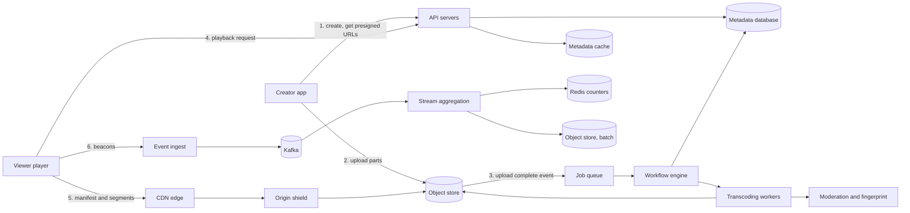
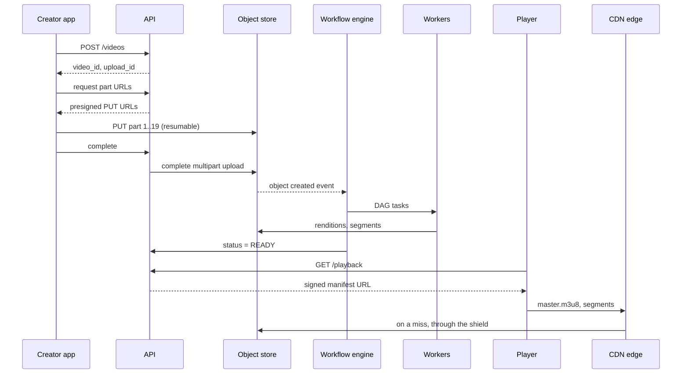
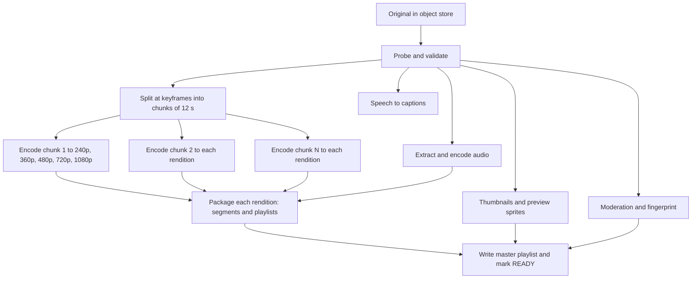
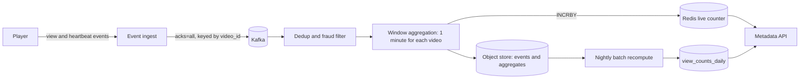

# Design a Video Streaming Service

A video streaming service lets users upload videos and lets other users watch them on any device and any network. This case study gives the design that a strong candidate presents in 45 minutes: the numbers, the upload path, the transcoding pipeline as a directed acyclic graph (DAG) of tasks, adaptive bitrate streaming with HLS and MPEG-DASH, the CDN, the metadata store, and view counts. Follow the steps in [how to approach an HLD interview](../how-to-approach-hld.md). The estimation method is on [back-of-envelope estimation](../back-of-envelope-estimation.md), which uses this design as its worked example 4. The numbers on this page are the same numbers.

!!! note "About the sources"
    Companies publish parts of their video systems. Netflix describes its encoding and its Open Connect CDN. Facebook published a paper on its video processing pipeline. Google describes its transcoding hardware. No company publishes the full design, so this page is a reference design that uses the published building blocks. Each claim about a real company cites that company's post or paper in "Further Reading". All inputs in the estimation are assumptions of this KB.

## Problem Statement

"Design a service like YouTube or Netflix. Users upload videos. Other users watch them on phones, laptops, and TVs, on fast and slow networks. The video must start in a few seconds and must not stop to buffer. The service must handle a very large number of viewers."

This page designs the video-on-demand (VOD) case: the video exists as a file before anyone watches it. Live streaming differs in the pipeline (no time to encode in parallel for minutes), and the follow-up questions cover it.

## Clarifying Questions

| Question | Answer that this design assumes |
|---|---|
| Video on demand or live? | Video on demand. Live streaming is a follow-up (Assumption) |
| How many users? | 50 million daily active users (DAU). Each user watches 5 videos each day. Each video play lasts 300 seconds on average (Assumption) |
| How many uploads? | 500,000 videos each day. The average length is 300 seconds (Assumption) |
| Which devices? | Browsers, Android, iOS, and smart TVs. They do not all play the same formats, so the service delivers HLS and DASH |
| What are the limits on an upload? | Up to 10 GB and 4 hours for each file. Resumable upload is required, because mobile networks break (Assumption) |
| How soon must a new video be watchable? | The lowest renditions in 2 minutes for a 5-minute video. All renditions in 10 minutes (Assumption) |
| Which video quality levels? | A ladder of 5 renditions, from 240p to 1080p. 4K and HDR are out of scope (Assumption) |
| Who can watch? | Public videos for everyone. Private and unlisted videos need an access check. Paid content with digital rights management (DRM) is a follow-up |
| What does the service count? | Views for each video, with a delay of up to a few minutes. Counts may be approximate while the video is trending, and exact after a batch correction |
| Does the service own a CDN? | No. The design uses one or more commercial CDNs. A follow-up discusses an own CDN as Netflix built (Assumption) |
| Search and recommendations? | Out of scope. They use the metadata, and the page names the interface (see the news feed and search case studies) |
| Availability target? | Playback: 99.99%. Upload and publish: 99.9% (Assumption) |

## Requirements

### Functional

1. `upload`: a creator uploads a video file, with title and description. The upload resumes after a network failure.
2. `process`: the service converts the file into a set of renditions (resolutions and bitrates), thumbnails, and audio tracks for the supported devices.
3. `play`: a viewer opens a video and watches it. The player adapts the quality to the network speed. The viewer can seek.
4. `metadata`: the service stores and serves title, description, owner, duration, status, and visibility.
5. `views`: the service counts the views of each video and shows the count.
6. Safety: the service scans each upload for policy violations and for copyright matches, and lets an operator block a video.

### Non-functional

| Requirement | Target |
|---|---|
| Start-up time | p50 below 2 seconds, p99 below 5 seconds from pressing play to the first frame (Assumption) |
| Rebuffering | Below 0.5% of the watch time (Assumption) |
| Playback availability | 99.99%, which is about 52.6 minutes of downtime each year |
| Durability | Uploaded originals are not lost. Erasure coding, tolerating several failures ([storage types](../fundamentals/10-storage-types.md)) |
| Scale | 750,000 concurrent viewers on average and 1.5 million at the peak. 5 uploads each second (see Estimation) |
| Time to playable | Lowest renditions in 2 minutes. All renditions in 10 minutes |
| View count freshness | Within 5 minutes. No effect on playback |

## Estimation

Rounding rule (the same as on the estimation page): one day is 10^5 seconds. The exact day has 86,400 seconds, so the rates are 13.6% lower than the exact rates.

Inputs (all are assumptions):

- 50 million DAU. Each user plays 5 videos each day, 300 seconds each. The average stream bitrate is 2.5 Mbit/s.
- 500,000 uploads each day, 300 seconds each. The original has a bitrate of 4 Mbit/s.
- The stored ladder has 5 renditions: 240p at 0.3, 360p at 0.6, 480p at 1.1, 720p at 2.0, and 1080p at 4.0 Mbit/s. The sum is 8 Mbit/s.
- Erasure coding with an overhead factor of 1.5 (for example RS(6,3), see [storage types](../fundamentals/10-storage-types.md)).
- Transcoding costs 600 CPU-seconds for each 5-minute video, for all renditions together. A transcoding machine has 32 cores.
- A segment lasts 4 seconds. A viewer sends one progress beacon every 30 seconds. The CDN serves 95% of the segment bytes from its caches. One edge server delivers 20 Gbit/s of sustained traffic.
- Peak factor 2 for viewing. Each view causes 5 metadata reads (home page, search, details, recommendations, playback information).

| Step | Calculation | Result |
|---|---|---|
| Watch seconds each day | 50,000,000 × 5 × 300 s | 75 × 10^9 s |
| Average concurrent viewers (Little's law: concurrency is rate × duration) | 75 × 10^9 s / 10^5 s | 750,000 |
| Average egress | 750,000 × 2.5 Mbit/s | 1,875,000 Mbit/s = 1.875 Tbit/s |
| Peak egress | 1.875 Tbit/s × 2 | 3.75 Tbit/s |
| Views each second, average and peak | 250,000,000 / 10^5 and × 2 | 2,500 and 5,000 |
| Metadata reads each second | 2,500 × 5 | 12,500 |
| Progress beacons each second | 750,000 / 30 | 25,000 |
| Segment size at 2.5 Mbit/s | 2.5 Mbit/s × 4 s / 8 | 1.25 MB |
| Segment requests each second | 750,000 / 4 s | 187,500 |
| Origin traffic with a 5% miss rate | 1.875 Tbit/s × 0.05 | 93.75 Gbit/s |
| Edge servers at the peak | 3,750 Gbit/s / 20 Gbit/s | 188 (before geographic spread) |
| Uploads each second | 500,000 / 10^5 | 5 |
| Stored size of one video | 300 s × 8 Mbit/s / 8 | 300 MB |
| Stored each day | 500,000 × 300 MB | 150 TB |
| Stored each year | 150 TB × 365 | 54.75 PB |
| Stored each year with erasure coding | 54.75 PB × 1.5 | 82.1 PB |
| Originals each year with erasure coding | 500,000 × 150 MB × 365 × 1.5 | 41.1 PB |
| Upload bandwidth | 500,000 × 150 MB / 10^5 s | 750 MB/s = 6 Gbit/s |
| Transcoding cores | 500,000 × 600 core-s / 10^5 s | 3,000 |
| Transcoding machines, average and at 2× peak | 3,000 / 32 and 6,000 / 32 | 94 and 188 |
| Encode tasks for one video (25 chunks of 12 s, 5 renditions) | 25 × 5 | 125 |
| Parts of one 150 MB upload at 8 MB each | ceil(150 / 8) | 19 |

What the numbers decide:

- **Egress decides the architecture.** 1.9 Tbit/s on average cannot leave one origin. The CDN carries the viewing traffic, and the origin serves only the misses. Even a 5% miss rate means 94 Gbit/s at the origin, so an origin shield (a mid-tier cache) and a high hit ratio matter. A change of 1 percentage point in the hit ratio changes the average origin load by 19 Gbit/s.
- **Storage decides the data tier.** 82 PB each year (123 PB with the originals) needs an object store with erasure coding, and a tiering policy for videos that nobody watches.
- **Uploads are few and large.** 5 uploads each second is a small request rate, but each file is 150 MB on average and up to 10 GB at the limit. The design uses resumable uploads straight to the object store, and a queue of processing jobs.
- **Transcoding is the compute problem.** 3,000 cores on average is a fleet of 94 machines. The fleet must absorb a peak of 2 times and bursts above that, so the pipeline has a priority queue and runs on cheap preemptible machines.
- **The metadata load is small.** 12,500 reads each second fit a cache plus a few database shards. The progress beacons (25,000 each second) are larger than the metadata reads, so they go to a stream, not to a database.

The first program checks the arithmetic of the table. `main` comes first, and the block has its own imports, so you can copy it into `VideoEstimate.java` and run `java VideoEstimate.java` on JDK 21.

```java
import java.util.Locale;

public class VideoEstimate {
    // Ladder in Mbit/s. The five renditions add up to 8 Mbit/s.
    static final double[] LADDER = {0.3, 0.6, 1.1, 2.0, 4.0};
    static final double SEGMENT_SECONDS = 4.0;

    public static void main(String[] args) {
        estimation();
    }

    static void estimation() {
        System.out.println("== Estimation (1 day = 10^5 s) ==");
        double dau = 50e6, videosPerUser = 5, watchSeconds = 300, avgMbit = 2.5;
        double watchPerDay = dau * videosPerUser * watchSeconds;
        double concurrent = watchPerDay / 1e5;
        double egressTbit = concurrent * avgMbit / 1e6;
        System.out.println(line("watch seconds per day", watchPerDay));
        System.out.println(line("average concurrent viewers", concurrent));
        System.out.println(line("average egress Tbit/s", egressTbit));
        System.out.println(line("peak egress Tbit/s", egressTbit * 2));
        double views = dau * videosPerUser;
        System.out.println(line("views per second", views / 1e5));
        System.out.println(line("peak views per second", views / 1e5 * 2));
        System.out.println(line("metadata reads per second (5 per view)", views / 1e5 * 5));
        System.out.println(line("heartbeats per second (30 s)", concurrent / 30));
        System.out.println(line("segment requests per second", concurrent / SEGMENT_SECONDS));
        System.out.println(line("segment size MB (2.5 Mbit/s, 4 s)",
                avgMbit * SEGMENT_SECONDS / 8));
        System.out.println(line("origin egress Gbit/s (5% miss)", egressTbit * 1000 * 0.05));
        System.out.println(line("edge servers at 20 Gbit/s, peak",
                Math.ceil(egressTbit * 2 * 1000 / 20)));
        double uploads = 500_000;
        double ladderSum = 0;
        for (double r : LADDER) ladderSum += r;
        double storedMb = 300 * ladderSum / 8;
        double perDayTb = uploads * storedMb / 1e6;
        System.out.println(line("ladder sum Mbit/s", ladderSum));
        System.out.println(line("stored MB per video", storedMb));
        System.out.println(line("stored TB per day", perDayTb));
        System.out.println(line("stored PB per year", perDayTb * 365 / 1000));
        System.out.println(line("stored PB per year, EC 1.5", perDayTb * 365 / 1000 * 1.5));
        double originalMb = 300 * 4.0 / 8;
        System.out.println(line("originals PB per year, EC 1.5",
                uploads * originalMb * 365 / 1e9 * 1.5));
        double cores = uploads * 600 / 1e5;
        System.out.println(line("transcoding cores", cores));
        System.out.println(line("transcoding machines (32 cores)", Math.ceil(cores / 32)));
        System.out.println(line("encode tasks per video (25 chunks x 5)", 25 * 5));
        System.out.println(line("upload parts of 8 MB for 150 MB", Math.ceil(150.0 / 8)));
    }

    static String line(String label, double value) {
        return String.format(Locale.ROOT, "%-40s %,.2f", label, value);
    }
}
```

<!-- expected-output -->
```text
== Estimation (1 day = 10^5 s) ==
watch seconds per day                    75,000,000,000.00
average concurrent viewers               750,000.00
average egress Tbit/s                    1.88
peak egress Tbit/s                       3.75
views per second                         2,500.00
peak views per second                    5,000.00
metadata reads per second (5 per view)   12,500.00
heartbeats per second (30 s)             25,000.00
segment requests per second              187,500.00
segment size MB (2.5 Mbit/s, 4 s)        1.25
origin egress Gbit/s (5% miss)           93.75
edge servers at 20 Gbit/s, peak          188.00
ladder sum Mbit/s                        8.00
stored MB per video                      300.00
stored TB per day                        150.00
stored PB per year                       54.75
stored PB per year, EC 1.5               82.13
originals PB per year, EC 1.5            41.06
transcoding cores                        3,000.00
transcoding machines (32 cores)          94.00
encode tasks per video (25 chunks x 5)   125.00
upload parts of 8 MB for 150 MB          19.00
```

## API Design

The control APIs use HTTPS and JSON. The media bytes do not pass through the API servers. The client sends the upload parts straight to the object store with presigned URLs ([storage types](../fundamentals/10-storage-types.md)), and the player reads segments from the CDN.

| Method and path | Request | Response |
|---|---|---|
| `POST /v1/videos` | `{title, description, visibility, size_bytes, content_type}` | `201 {video_id, upload_id, part_size, status: "UPLOADING"}` |
| `POST /v1/videos/{id}/uploads/{upload_id}/parts` | `{part_numbers: [1, 2, 3]}` | `200 {urls: [{part, url, expires_at}]}`. Presigned `PUT` URLs, one for each part |
| `GET /v1/videos/{id}/uploads/{upload_id}` | none | `200 {parts_received: [1, 2]}`. The client asks this after a failure and sends only the missing parts |
| `POST /v1/videos/{id}/uploads/{upload_id}/complete` | `{parts: [{part, etag}]}` | `202 {status: "PROCESSING"}`. The service completes the multipart upload and starts the pipeline. Idempotent: a repeat returns the same answer |
| `GET /v1/videos/{id}` | none | `200 {video_id, title, owner, duration_s, status, visibility, thumbnails, view_count}` |
| `GET /v1/videos/{id}/playback` | none | `200 {manifest_url, drm: null}`. The service checks the visibility rules and returns a signed manifest URL. Status `404` if the video is not `READY` or is blocked |
| `GET {cdn}/v/{id}/master.m3u8` | none | The HLS multivariant playlist. Served by the CDN |
| `GET {cdn}/v/{id}/{rendition}/seg_{n}.m4s` | `Range` is optional | A media segment. Served by the CDN |
| `POST /v1/playback-events` | `[{event_id, video_id, type, position_s, session_id}]` | `204`. Types: `start`, `view`, `heartbeat`, `stop`. A batch of events from one session |
| `DELETE /v1/videos/{id}` | none | `202`. Marks the video `DELETED`, removes it from caches, and schedules the removal of the files |

Notes:

- Every `POST` that creates state takes an `Idempotency-Key` header, so a retry after a timeout does not create a second video ([reliability patterns](../fundamentals/12-reliability-patterns.md)).
- `video_id` is an opaque 64-bit time-ordered ID ([unique ID generation](../fundamentals/15-unique-id-generation.md)), encoded for URLs.
- The playback API is the access control point. The CDN serves immutable bytes by path, so the access check happens when the service issues the signed manifest URL or signed cookie, not on each segment (see Deep Dive 3).

## Data Model

### Where each kind of data lives

| Data | Store | Why |
|---|---|---|
| Original uploads, renditions, segments, thumbnails | Object store (S3-style, erasure coded) | Large immutable blobs. Cheap, durable, and the CDN reads them as origin |
| Video metadata | Sharded relational database (for example MySQL with Vitess, or PostgreSQL), with a cache in front | Point reads by `video_id`, a list by owner, status transitions with transactions |
| Job and task state | The workflow engine's own store (a relational database) | The pipeline needs transactions for state changes, and the volume is small (625 tasks each second on average) |
| Playback events | Kafka topic, partitioned by `video_id` | High write rate (25,000 each second), replay, several consumers ([message queues and streams](../fundamentals/08-message-queues-and-streams.md)) |
| View counters | Redis for the live counter, and a durable aggregate table | Fast reads for display, and a durable total |
| Watch progress ("continue watching") | Key-value store keyed by `user_id` | Write-heavy, read by user. No joins |

The database choice follows the access pattern ([choosing a database](../fundamentals/04-choosing-a-database.md)). Video metadata is read by key and updated through a small state machine, and its volume is a few terabytes, so a sharded relational database with a cache is enough. YouTube built Vitess to scale MySQL, and the Vitess documentation says so; the point for an interview is that the relational model scales to this size if you partition by `video_id` ([partitioning and sharding](../fundamentals/06-partitioning-and-sharding.md)). A DynamoDB or Cassandra table works as well. The decision rule: choose the store that your team operates well, because the access pattern does not need a special engine.

### Tables

`videos` (sharded by `video_id`):

| Column | Type | Notes |
|---|---|---|
| `video_id` | bigint, primary key | Time-ordered ID |
| `owner_id` | bigint | Secondary index `(owner_id, created_at desc)`. A global index in a separate table, or a scatter query, because it crosses shards |
| `title`, `description` | text | Search indexing reads a change stream |
| `status` | enum | `UPLOADING`, `PROCESSING`, `READY`, `FAILED`, `BLOCKED`, `DELETED` |
| `visibility` | enum | `PUBLIC`, `UNLISTED`, `PRIVATE` |
| `duration_ms`, `created_at` | numbers | |
| `original_key` | string | Object key of the upload |
| `manifest_prefix` | string | Path prefix of the packaged output, `v/{video_id}/` |

`renditions` (same shard as the video): `(video_id, rendition_id)` primary key, `codec`, `width`, `height`, `bitrate_kbps`, `segment_count`, `status`. The master playlist is generated from the rows with `status = READY`.

`upload_sessions`: `(upload_id)` primary key, `video_id`, `object_upload_id` (the object store's multipart ID), `part_size`, `expires_at`, `state`. A job removes expired sessions and aborts their multipart uploads, so incomplete parts do not stay in storage and cost money.

`transcode_tasks`: `(video_id, task_id)` primary key, `stage`, `chunk_no`, `rendition_id`, `state` (`PENDING`, `RUNNING`, `DONE`, `FAILED`), `attempts`, `lease_until`, `output_key`.

`view_counts_daily`: `(video_id, day)` primary key, `views`. A batch job writes the exact value. The stream job writes the early value.

The object keys are deterministic, for example `v/{video_id}/1080p/seg_00042.m4s`. A retried task writes the same key, so a retry replaces the output of the failed attempt and does not create a copy. The design does not reuse a key for different content, which keeps the CDN copies valid (see Deep Dive 3).

## High-Level Design



| Component | Responsibility |
|---|---|
| API servers | Stateless. Create the video record, issue presigned upload URLs, check access, issue signed manifest URLs, serve metadata. Scale behind a load balancer ([load balancing, DNS, and CDN](../fundamentals/02-load-balancing-dns-cdn.md)) |
| Object store | Holds originals, renditions, and segments. Emits an event when a multipart upload completes |
| Workflow engine | Runs the processing DAG of each video. Keeps task state, schedules tasks, retries failures, and sets the video status |
| Job queue | Holds ready tasks in priority classes. Workers pull from it |
| Transcoding workers | Stateless machines (preemptible where possible). Each task reads its input from the object store, encodes it, and writes its output under a deterministic key |
| Moderation and fingerprinting | Scan the video for policy violations and compare a fingerprint with a database of reference works |
| Metadata database and cache | Metadata and status. The cache serves the 12,500 reads each second |
| CDN and origin shield | Deliver manifests and segments. The shield collapses the misses of all edge locations into one request for each object |
| Event ingest, Kafka, stream aggregation | Collect playback events and compute view counts and watch time |
| Redis counters | Hold the live view count for display |

The upload path ends when the object store has the file and the metadata row says `PROCESSING`. The viewing path does not touch the API servers for media bytes. Because of this split, the viewing load (Tbit/s) and the control load (thousands of requests each second) scale separately.

### The life of a video



## Deep Dives

### Deep Dive 1: The upload and the transcoding DAG

**Resumable upload.** A mobile network breaks often, and a 150 MB file at 5 Mbit/s uploads for 4 minutes. The client splits the file into parts (8 MB here, so 19 parts for 150 MB) and uploads each part with its own presigned `PUT` ([storage types](../fundamentals/10-storage-types.md) covers multipart upload and presigned URLs). After a failure, the client asks which parts the store has, and sends only the others. The part size is a trade-off: small parts resume with little waste but multiply the requests (S3 allows at most 10,000 parts in one multipart upload, per the S3 documentation), and large parts waste more after a failure. The client uploads 3 to 4 parts in parallel to fill the link. The client checks a checksum for each part. After `complete`, the file stays in the object store under the original key.

**Why transcode.** The creator's file has one codec, one resolution, and one bitrate. Viewers have different screens, codecs, and networks. Transcoding converts the original into a ladder of renditions that the player switches between (Deep Dive 2). It also normalizes the container, so every rendition has the same segment boundaries.

**The cost shape.** A 5-minute video costs 600 CPU-seconds in this estimation, so one machine with 32 cores needs 19 seconds if the work parallelizes perfectly. A single-machine pipeline would take 600 seconds on one core. The design splits the work so that the time to playable is minutes and not an hour for a long video.

**The DAG.** The pipeline is a directed acyclic graph of tasks. Each node is a task with inputs and outputs in the object store. A node runs when all its inputs exist. Facebook's Streaming Video Engine (SVE) paper (Qi Huang et al., SOSP 2017) describes this idea. Application programmers write the processing of a video as a DAG of tasks, and many worker machines run the tasks of the DAG in parallel. When it can, the client splits the video into segments at group-of-pictures (GOP) boundaries before the upload, so each segment is a small standalone video, and SVE processes segments while the rest of the upload is still in progress. The paper reports that these changes cut the time from the end of an upload to a shareable video by 2.3 to 9.3 times compared with its earlier monolithic encoding script. SVE also uses a high-priority and a low-priority task queue, the same idea as the priority classes below.



Details of the stages:

1. **Probe and validate.** Read the container and streams, check the duration and codec, reject files that are broken or exceed the limits. The task writes the result to the metadata.
2. **Split at keyframes.** A chunk must start at a keyframe (an I-frame, a frame that does not depend on earlier frames), so the encoder can start from it. The chunks are 12 seconds long here, which is 25 chunks for a 5-minute video. The chunk length is a multiple of the segment length (12 = 3 × 4 seconds), so every chunk holds whole segments. State this alignment in an interview. If the boundaries of the renditions do not align, the player stutters when it switches.
3. **Encode.** One task for each chunk and each rendition, so 125 tasks for a 5-minute video. Each task takes 4.8 CPU-seconds on average in this estimation (600 / 125). They are independent, so they run on a fleet in parallel.
4. **Package.** Cut each rendition into 4-second segments in fragmented MP4 (fMP4), write the media playlist (HLS) and the manifest (DASH), and write the master playlist. With the Common Media Application Format (CMAF, ISO/IEC 23000-19) one set of segments serves both HLS and DASH, so the storage does not double.
5. **Side branches.** Thumbnails, preview sprites, captions, and moderation run beside the encoding. The moderation result decides whether the video is published at all.
6. **Publish.** Write the master playlist, set the status to `READY`, and emit an event ("video published") that search, feed, and notification services read ([event-driven architecture](../fundamentals/16-event-driven-architecture.md)).

**Progressive publishing.** Do not wait for all renditions. As soon as the 360p or 480p rendition is complete, the video becomes watchable with a master playlist that lists the available renditions. The service later republishes the playlist with more renditions. This lowers the time to playable. It costs complexity, because the playlist changes over time, and the CDN holds a short-lived copy of the old playlist (a short TTL on playlists, not on segments).

**Orchestration and failure handling.**

- Tasks are idempotent. A task has deterministic input and output keys, so running it twice gives the same bytes and overwrites the same key.
- The workflow engine keeps the state of each task in a database, with a lease (`lease_until`). A worker renews the lease while it works. If the worker dies or its preemptible machine is reclaimed, the lease expires and the engine schedules the task again. This is the visibility-timeout pattern of queues ([message queues and streams](../fundamentals/08-message-queues-and-streams.md)).
- A task fails and retries up to a limit (3 attempts here) with backoff ([reliability patterns](../fundamentals/12-reliability-patterns.md)). A task that fails every time marks the video `FAILED` with a reason, and goes to a dead-letter list for a human. A broken input file is a common cause (a poison message).
- The number of tasks is bounded. A 4-hour video has 1,200 chunks and 6,000 encode tasks. The engine limits how many tasks of one video run at once, so one huge video does not take all workers.
- **Priority classes.** New uploads of verified creators and short videos go in the high class. Re-encodes (a new codec, a repair) go in the low class. Without classes, a backfill of 10 million old videos delays every new upload. The queue gives each class a share of the workers.
- **Hardware.** Encoding is CPU-bound and the tasks are short, so they suit preemptible or spot machines, because a lost task costs only a few seconds of work. YouTube's 2021 blog post and the ASPLOS 2021 paper by Ranganathan et al. describe Google's custom transcoding accelerator, the video coding unit (VCU, the chip is named Argos). The paper reports 20 to 33 times better efficiency than Google's earlier well-tuned system without accelerators. Software encoders on commodity machines are enough in an interview, and the answer names the hardware option as a cost lever at scale.

**Per-title and per-shot encoding.** A fixed ladder wastes bits. A cartoon looks good at a bitrate that a sports match needs twice. Netflix's December 2015 post describes per-title encoding: it analyzes each title and builds a custom ladder, which gives the same quality at a lower bitrate for easy content. A 2018 Netflix post extends it to shots with the Dynamic Optimizer, which chooses the encoding parameters for each shot. The trade-off is more compute at encode time to save storage and egress for each view. The saving is large only if a video has many views, so a platform with a long tail applies the expensive analysis to the popular videos and uses the fixed ladder for the rest (a design choice that this KB recommends, not a published fact).

### Deep Dive 2: Adaptive bitrate streaming (HLS and DASH)

**The idea.** Adaptive bitrate (ABR) streaming stores the video as many short segments in several renditions. The player downloads one segment at a time over plain HTTP, measures the speed, and chooses the rendition of the next segment. The server is a static file server, so CDNs cache it like any file. The server holds no session state.

**HLS (HTTP Live Streaming).** RFC 8216 defines it. The client reads text playlists in the M3U8 format. The master playlist (RFC 8216 calls it the Master Playlist, and Apple's current documents call it the multivariant playlist) lists the renditions with the `EXT-X-STREAM-INF` tag and its `BANDWIDTH`, `RESOLUTION`, and `CODECS` attributes. Each rendition has a media playlist that lists segments with `EXTINF` (duration), and ends with `EXT-X-ENDLIST` for video on demand.

```text
# master.m3u8
#EXTM3U
#EXT-X-VERSION:7
#EXT-X-STREAM-INF:BANDWIDTH=450000,RESOLUTION=426x240,CODECS="avc1.42c01e,mp4a.40.2"
240p/index.m3u8
#EXT-X-STREAM-INF:BANDWIDTH=2400000,RESOLUTION=1280x720,CODECS="avc1.4d401f,mp4a.40.2"
720p/index.m3u8
#EXT-X-STREAM-INF:BANDWIDTH=4500000,RESOLUTION=1920x1080,CODECS="avc1.640028,mp4a.40.2"
1080p/index.m3u8
```

```text
# 720p/index.m3u8
#EXTM3U
#EXT-X-VERSION:7
#EXT-X-TARGETDURATION:4
#EXT-X-MEDIA-SEQUENCE:0
#EXT-X-MAP:URI="init.mp4"
#EXTINF:4.000,
seg_00000.m4s
#EXTINF:4.000,
seg_00001.m4s
#EXT-X-ENDLIST
```

The `BANDWIDTH` values here are the video bitrate plus the audio bitrate and overhead, in bit/s. `EXT-X-MAP` points to the initialization segment of an fMP4 stream. RFC 8216 section 7 says that a Media Playlist that contains `EXT-X-MAP` (and is not an I-frame playlist) must declare `EXT-X-VERSION` 6 or higher. The examples declare version 7.

**MPEG-DASH (Dynamic Adaptive Streaming over HTTP).** ISO/IEC 23009-1 defines it. The client reads an XML manifest, the Media Presentation Description (MPD). It has `Period` elements, each with `AdaptationSet` elements (video, audio, text) that hold `Representation` elements (the renditions). A `SegmentTemplate` gives the segment URL pattern, so the manifest stays small. The DASH Industry Forum (DASH-IF) publishes interoperability guidelines for it.

```xml
<MPD type="static" mediaPresentationDuration="PT5M" minBufferTime="PT4S"
     xmlns="urn:mpeg:dash:schema:mpd:2011">
  <Period>
    <AdaptationSet mimeType="video/mp4" segmentAlignment="true">
      <SegmentTemplate initialization="$RepresentationID$/init.mp4"
                       media="$RepresentationID$/seg_$Number%05d$.m4s"
                       duration="4" startNumber="0"/>
      <Representation id="720p" bandwidth="2400000" width="1280" height="720"
                      codecs="avc1.4d401f"/>
      <Representation id="1080p" bandwidth="4500000" width="1920" height="1080"
                      codecs="avc1.640028"/>
    </AdaptationSet>
  </Period>
</MPD>
```

| Aspect | HLS | MPEG-DASH |
|---|---|---|
| Specification | RFC 8216 (Informational, from Apple) | ISO/IEC 23009-1 |
| Manifest | M3U8 text playlists | XML MPD |
| Native support | Safari, iOS, tvOS, many smart TVs | Android (ExoPlayer), many browsers through Media Source Extensions (MSE), many smart TVs |
| Segment format | MPEG-2 TS or fMP4 | fMP4 (ISO base media file format) or others |
| DRM | FairPlay on Apple devices | Widevine and PlayReady. Common Encryption (ISO/IEC 23001-7) with its `cbcs` scheme lets one encrypted set of CMAF segments serve all three systems on devices that support `cbcs` |

Recommendation: package once as CMAF fMP4 segments and write both an HLS playlist and a DASH MPD that point to the same files. Then the storage and the CDN cache hold one copy. The text above does not claim that every device accepts CMAF. Test the target devices.

**The ladder.** The ladder has a few points whose bitrates differ by a factor of about 1.5 to 2, so each switch is a visible but not extreme change. Too few points waste bandwidth or cause stalls. Too many points fragment the cache and cost storage. The 5 points in this estimation sum to 8 Mbit/s of stored data for each second of video.

**Segment duration.** A shorter segment lets the player adapt faster and lowers the start-up time. It also raises the number of requests (187,500 each second at 4 seconds, 375,000 at 2 seconds) and lowers the encoding efficiency, because each segment starts with a keyframe. A longer segment does the reverse. Apple's HLS authoring specification for Apple devices says that target durations should be 6 seconds (rule 7.5), that key frames should be present every 2 seconds (rule 1.13), and that video segments must start with an IDR frame, a keyframe that resets the decoder (rule 7.4). This design uses 4-second segments, which hold two 2-second keyframe intervals, and departs from Apple's 6-second recommendation to adapt faster. Test the target devices with the chosen duration.

**The player's algorithm.** The server does not choose the rendition. The player does, with one of these rules:

| Rule | Input | Strength | Weakness |
|---|---|---|---|
| Throughput-based | Measured download speed of recent segments | Reacts to an increase in speed | The estimate is noisy. A wrong estimate before a dip causes a stall |
| Buffer-based | The seconds of video in the buffer | Does not need a speed estimate. Fewer stalls | Slow to climb to a high rendition at the start |
| Hybrid | Both | Used in practice | More parameters to tune |

Te-Yuan Huang et al. (SIGCOMM 2014) tested a buffer-based rule on millions of Netflix users. The rule maps the buffer level to a rate: the lowest rendition while the buffer is in a *reservoir* (the first `r` seconds), then a rate that rises with the buffer across a *cushion*, and the highest rendition above the cushion. The paper's baseline used a 240-second buffer, a 90-second reservoir, and a linear map that reaches the highest rate at 216 seconds. The paper reports that its approach reduced the rebuffer rate by 10 to 20% compared with Netflix's then-default algorithm, at a similar average video rate. It also found that the pure buffer rule climbs slowly at start-up, when the buffer is still empty, so the final design uses a simple capacity estimate in the start-up phase. The second program simulates both rules on a speed trace with a dip. `main` comes first and the block has its own imports.

```java
import java.util.Locale;

public class AbrSim {
    static final double[] LADDER = {0.3, 0.6, 1.1, 2.0, 4.0};
    static final String[] NAMES = {"240p", "360p", "480p", "720p", "1080p"};
    static final double SEGMENT_SECONDS = 4.0;

    public static void main(String[] args) {
        abr();
    }

    // Throughput trace in Mbit/s, one value for each segment download.
    static void abr() {
        System.out.println("== ABR: throughput rule against buffer rule ==");
        double[] trace = {6, 6, 5, 5, 0.8, 0.8, 0.8, 3, 5, 6, 6, 6};
        simulate("throughput", trace);
        simulate("buffer", trace);
    }

    static void simulate(String rule, double[] trace) {
        System.out.println("-- rule: " + rule);
        double buffer = 8;          // seconds of video in the buffer at the start
        double lastThroughput = trace[0];
        double stall = 0;
        double bitrateSum = 0;
        for (int i = 0; i < trace.length; i++) {
            int level = rule.equals("throughput")
                    ? byThroughput(lastThroughput) : byBuffer(buffer);
            double sizeMbit = LADDER[level] * SEGMENT_SECONDS;
            double download = sizeMbit / trace[i];
            double stalled = Math.max(0, download - buffer);
            buffer = Math.max(0, buffer - download) + SEGMENT_SECONDS;
            stall += stalled;
            bitrateSum += LADDER[level];
            lastThroughput = trace[i];
            System.out.println(String.format(Locale.ROOT,
                    "seg %2d net %.1f pick %-5s download %.2fs buffer %.2fs stall %.2fs",
                    i, trace[i], NAMES[level], download, buffer, stalled));
        }
        System.out.println(String.format(Locale.ROOT,
                "average bitrate %.2f Mbit/s, total stall %.2f s",
                bitrateSum / trace.length, stall));
    }

    // Highest rendition whose bitrate is at most 80% of the last measured throughput.
    static int byThroughput(double throughput) {
        int best = 0;
        for (int i = 0; i < LADDER.length; i++) {
            if (LADDER[i] <= 0.8 * throughput) best = i;
        }
        return best;
    }

    // Buffer-based rule: lowest rendition in the 6 s reservoir, highest above the
    // 14 s cushion (buffer at 20 s or more), linear across the cushion.
    static int byBuffer(double buffer) {
        double reservoir = 6, cushion = 14;
        if (buffer <= reservoir) return 0;
        if (buffer >= reservoir + cushion) return LADDER.length - 1;
        double f = (buffer - reservoir) / cushion;
        return (int) Math.floor(f * (LADDER.length - 1));
    }
}
```

<!-- expected-output -->
```text
== ABR: throughput rule against buffer rule ==
-- rule: throughput
seg  0 net 6.0 pick 1080p download 2.67s buffer 9.33s stall 0.00s
seg  1 net 6.0 pick 1080p download 2.67s buffer 10.67s stall 0.00s
seg  2 net 5.0 pick 1080p download 3.20s buffer 11.47s stall 0.00s
seg  3 net 5.0 pick 1080p download 3.20s buffer 12.27s stall 0.00s
seg  4 net 0.8 pick 1080p download 20.00s buffer 4.00s stall 7.73s
seg  5 net 0.8 pick 360p  download 3.00s buffer 5.00s stall 0.00s
seg  6 net 0.8 pick 360p  download 3.00s buffer 6.00s stall 0.00s
seg  7 net 3.0 pick 360p  download 0.80s buffer 9.20s stall 0.00s
seg  8 net 5.0 pick 720p  download 1.60s buffer 11.60s stall 0.00s
seg  9 net 6.0 pick 1080p download 2.67s buffer 12.93s stall 0.00s
seg 10 net 6.0 pick 1080p download 2.67s buffer 14.27s stall 0.00s
seg 11 net 6.0 pick 1080p download 2.67s buffer 15.60s stall 0.00s
average bitrate 2.98 Mbit/s, total stall 7.73 s
-- rule: buffer
seg  0 net 6.0 pick 240p  download 0.20s buffer 11.80s stall 0.00s
seg  1 net 6.0 pick 360p  download 0.40s buffer 15.40s stall 0.00s
seg  2 net 5.0 pick 480p  download 0.88s buffer 18.52s stall 0.00s
seg  3 net 5.0 pick 720p  download 1.60s buffer 20.92s stall 0.00s
seg  4 net 0.8 pick 1080p download 20.00s buffer 4.92s stall 0.00s
seg  5 net 0.8 pick 240p  download 1.50s buffer 7.42s stall 0.00s
seg  6 net 0.8 pick 240p  download 1.50s buffer 9.92s stall 0.00s
seg  7 net 3.0 pick 360p  download 0.80s buffer 13.12s stall 0.00s
seg  8 net 5.0 pick 480p  download 0.88s buffer 16.24s stall 0.00s
seg  9 net 6.0 pick 480p  download 0.73s buffer 19.51s stall 0.00s
seg 10 net 6.0 pick 720p  download 1.33s buffer 22.17s stall 0.00s
seg 11 net 6.0 pick 1080p download 2.67s buffer 23.51s stall 0.00s
average bitrate 1.45 Mbit/s, total stall 0.00 s
```

Read the output. The throughput rule picks 1080p at segment 4, because the last measurement was 5 Mbit/s, and the speed falls to 0.8 Mbit/s. The 16 Mbit segment needs 20 seconds, the buffer holds 12.27 seconds, and the player stalls for 7.73 seconds. The buffer rule picks 1080p at segment 4 as well, but its buffer is 20.92 seconds, so it survives the 20-second download. It also pays a price: its average bitrate is 1.45 Mbit/s against 2.98 Mbit/s, because it climbs slowly. The simulation is a toy with one trace and buffer sizes scaled down from the paper. A real player also handles the first segment, the buffer limit, and the rate switch penalty, and the paper's rule changes the rendition only when the map crosses the next rate up or down, so it does not switch on every small change of the buffer. The conclusion that it supports is the trade-off, not a ranking.

**Start-up time.** To start in under 2 seconds, the player starts with a low or middle rendition and a small first buffer, fetches the manifest and the first segments in parallel, and reuses one connection (HTTP/2 or HTTP/3 over QUIC, [load balancing, DNS, and CDN](../fundamentals/02-load-balancing-dns-cdn.md)). The service sends the manifest URL in the playback response, and the player prefetches while the page loads. Putting the first segments of popular videos in the edge cache (the default for any segment that the CDN has seen) removes the origin round trip.

**Seeking.** The player maps the time to a segment number (time / 4 s) and downloads that segment. This is possible because segments have a fixed duration and start at keyframes. The HLS playlist and the DASH timeline give the positions.

### Deep Dive 3: Delivery through the CDN

The CDN is the largest part of the cost and the biggest part of the user-visible quality. [Load balancing, DNS, and CDN](../fundamentals/02-load-balancing-dns-cdn.md) explains the mechanism of edge caches, pull and push, cache keys, and the origin shield. This section applies it to video.

**Cache behavior of video.**

- Segments are immutable. A segment at a given path does not change, so the response carries a long TTL with `Cache-Control: public, max-age=31536000, immutable` (RFC 9111, RFC 8246). The CDN keeps it until it evicts it. A re-encode writes new paths (a version in the path), so no purge is needed.
- Playlists change while the video is being published, so they carry a short TTL (seconds). After `ENDLIST` and the final publish, they can have a long TTL too.
- The cache key is the path. Do not put the signed token in the cache key, or each viewer gets a separate copy and the hit ratio falls to zero. Move the token into a signed cookie, or exclude the signature parameters from the key in the CDN configuration.
- Range requests are optional. With segments as separate files, whole-object caching works well.

**Popularity is skewed.** A small share of videos gets most of the views, and a long tail gets very few. The CDN caches the head. The tail misses at the edge, and the shield and the origin serve it. The long tail is why a 95% hit ratio is an assumption and not a certainty. Treat the byte hit ratio of the real catalog as the number to measure first.

**Layers.** Edge caches in or near the user's network serve the head. A regional or shield layer (mid-tier) serves the warm part and merges the misses of many edges into one origin request, which protects the origin from a flash crowd. The origin (the object store) holds all objects.

**Open Connect, the own-CDN option.** Netflix describes Open Connect: the company builds its own cache appliances (Open Connect Appliances, OCAs) and places them inside the networks of internet service providers (ISPs) and at internet exchange points. The Open Connect overview says that the appliances download most content updates during configurable off-peak fill windows, because Netflix predicts with high accuracy what its members will watch and at what time of day, and that appliances also fill from each other. The appliances then serve the peak-hour traffic from inside the ISP network. The control plane runs in AWS. The appliances report their health, their learned BGP routes, and the files they store to it, and a steering service picks the appliances for each playback and returns their URLs to the client through the playback service. Netflix's catalog is far smaller and more predictable than the catalog of a user-upload service, so it can pre-position content. An upload service such as YouTube has a huge, unpredictable tail, so it cannot pre-position everything, and caches on demand. Recommendation: use commercial CDNs until egress cost justifies the engineering of an own network (this KB's judgment puts that at a sustained traffic of several Tbit/s; no company publishes a threshold), and keep the player free of CDN-specific logic so that you can use two CDNs and move traffic between them.

**Access control.** The CDN serves bytes by URL, so a URL is a capability. For public videos this is fine. For private and unlisted videos, the playback API checks the viewer and then returns a signed URL or sets a signed cookie with a short expiry (for example, 1 hour). A signed cookie or a path-based token covers all the segment paths of the video, because an HLS player resolves segment URLs relative to the playlist, and a query-string signature on the playlist does not carry to them. CloudFront signed cookies are the documented way to do this on one CDN. A signed URL can be shared while it is valid. If this is a business problem (paid content), DRM encrypts the segments, and the license server decides who gets the key (follow-up questions).

**Flash crowd and cold start.** When a new video goes viral, all edges miss at once. The shield merges the misses (request coalescing), so the origin sees one request for each segment. For a scheduled premiere, warm the cache before the start by requesting the first segments of each rendition through the CDN. For a very hot video, the object store must serve the read rate of the shield layer. S3-style stores partition the key space and scale the rate for each prefix with request volume. The S3 documentation states at least 3,500 write and 5,500 read requests each second for each partitioned prefix, says that the scaling is gradual, and says that the store can return `503 Slow Down` while it scales. Spread the paths across prefixes if the limit matters.

**Takedown.** To remove a video, set `BLOCKED` in the metadata, stop issuing signed URLs, and purge the manifests from the CDN. Segments with a long TTL stay in edge caches until they expire, but without the playlist or a valid signature no one can reach them. A legal takedown needs a purge of all paths. A purge takes time to reach all edges, and the next requests go to the origin (see the CDN invalidation section of [load balancing, DNS, and CDN](../fundamentals/02-load-balancing-dns-cdn.md)).

### Deep Dive 4: View counts and playback events

**The problem.** 2,500 views each second on average (5,000 at the peak), and 25,000 progress beacons each second. A single viral video gets a large share of them. A relational `UPDATE videos SET views = views + 1` for each view puts the write rate of the hottest row at the rate of the video's views, and locks the row. It fails first at the hottest video.

**What counts as a view.** This is a product rule. This design assumes that a view is a play of at least 30 seconds (or the whole video if it is shorter), once for each viewer session. Say in the interview that the rule exists to resist fake views, and that the service can change it without changing the pipeline.

**The pipeline.**



1. **Ingest.** The player sends an event with a client-generated `event_id` (a UUID). The ingest service validates it and writes it to Kafka, partitioned by `video_id`, so one consumer sees all events of a video and keeps its state in memory. The ingest service writes with `acks=all`. Since Kafka 3.0 the producer is idempotent by default, so a retry of the producer does not write a batch twice inside one producer session. The same event can still arrive twice: the player re-sends a batch over HTTP when it gets no response, and a consumer that crashes before it commits its offset processes the events again after the restart. The delivery is at-least-once ([message queues and streams](../fundamentals/08-message-queues-and-streams.md)).
2. **Deduplicate and filter.** The consumer drops an event if it has seen its `event_id` in the last hour (a state store, or a `SET NX` with a TTL in Redis). It also applies the view rule and a fraud filter (a rate for each IP and device, known bot ranges).
3. **Aggregate before writing.** A window of 1 minute counts the accepted views for each video. The job writes one `INCRBY` for each active video each minute, not one for each view. A video with 100,000 views in a minute causes 1 write. This takes the hot-key problem out of the database ([caching](../fundamentals/03-caching.md) covers hot keys, [batch and stream processing](../fundamentals/17-batch-and-stream-processing.md) covers windows and watermarks).
4. **Serve.** The metadata API reads the count from Redis, and the cache of the video page keeps it for a few seconds. The count lags the truth by about the window plus the pipeline delay, which meets the 5-minute target.
5. **Reconcile.** The raw events go to the object store. A nightly batch recomputes the exact daily counts with full deduplication and a better fraud model, and overwrites `view_counts_daily`. The live Redis value is replaced by the batch value for closed days. This is the Lambda-style split of speed layer and batch layer, with the cost that two code paths must agree (Kreps argues for a single stream path in "Questioning the Lambda Architecture", and [batch and stream processing](../fundamentals/17-batch-and-stream-processing.md) covers this).

**Other signals from the same stream.**

- Watch time and "continue watching": the heartbeat (every 30 seconds) carries the playback position. The service stores the last position for each user and video in a key-value store keyed by `user_id`, and overwrites it. A lost heartbeat loses at most 30 seconds of position.
- Trending: a count-min sketch for each region with a heap of the top videos gives approximate top-k without a counter for each video ([probabilistic data structures](../distributed-systems/04-probabilistic-data-structures.md)). The same idea is the leaderboard design in `kb/hld/case-studies/16-leaderboard-and-top-k.md`.
- Unique viewers: HyperLogLog gives a distinct count in a small fixed memory. With 16,384 registers (about 12 KB) the standard error is 0.81% (see the same page).

## Bottlenecks and Scaling

| What fails first | Why | Fix |
|---|---|---|
| Origin egress | A 5% miss rate is 94 Gbit/s. A flash crowd on a cold video is worse | Origin shield, request coalescing, a longer TTL, cache warming for known events, two CDNs. Raise the hit ratio before adding origin capacity |
| Transcoding backlog | A burst of uploads, a backfill, or a long video takes all workers | Priority classes, a per-video concurrency limit, autoscaling on queue depth, preemptible workers, progressive publishing |
| Hottest-row writes | View counter for a viral video | Aggregate in the stream before the write. If a counter must be written for each view, split it into N sub-counters and sum them on read |
| Hot metadata rows | One video page read by millions | Cache with a short TTL in the application and the CDN (the page JSON is also cacheable for a few seconds). Request coalescing on a miss |
| Upload failures on mobile | Long transfers over weak networks | Resumable parts, parallel parts, a regional upload endpoint close to the user, checksums for each part |
| Storage growth | 82 PB each year (123 PB with originals) | Erasure coding, lifecycle tiers, delete failed uploads, and a policy for the long tail (store fewer renditions for videos with no views, and re-encode on the first new view) |
| Cost of storing every rendition | Most videos are not watched in 1080p | Lazy renditions. Encode the top renditions on demand and store them. The trade-off is the first viewer's delay, so apply it only to old, cold videos |
| Event ingest | 25,000 beacons each second, bursts at the start of a premiere | Batch events in the client, partition Kafka by `video_id`, add partitions, drop non-critical heartbeats under load (load shedding, [rate limiting algorithms](../fundamentals/13-rate-limiting-algorithms.md)) |
| Metadata database | Sharded by `video_id` works, but a global list by owner crosses shards | An owner index table sharded by `owner_id`, kept in sync by the change stream. A search index for browse and search ([search and indexing](../fundamentals/11-search-and-indexing.md)) |
| Regional failure | A region with the API and the workers goes down | Multi-region API and workers, replicated object store, a CDN that fails over between origins ([multi-region and disaster recovery](../fundamentals/19-multi-region-and-disaster-recovery.md)). Segments already in edge caches keep playing |

Scaling steps in order: put the CDN and the origin shield first (the biggest lever), then cache metadata, then scale the transcoding fleet and the queue, then shard the metadata database, then add regions.

## Trade-offs

| Decision | Chosen | Alternative rejected | Reason |
|---|---|---|---|
| Streaming protocol | Adaptive bitrate over HTTP with segments (HLS and DASH) | Progressive download of one MP4. A custom streaming server with a stateful protocol (RTMP, RTSP) | HTTP segments use CDNs and stateless servers, and adapt to the network. Progressive download cannot change the rendition. Stateful servers cannot scale to Tbit/s |
| Container | CMAF fMP4, one set of files for HLS and DASH | Separate MPEG-TS for HLS and fMP4 for DASH | Halves the storage and the cache footprint. Cost: older devices may need TS |
| Segment duration | 4 seconds | 2 seconds, 10 seconds | 2 seconds doubles the requests and lowers encoding efficiency. 10 seconds adapts slowly and starts slowly |
| Transcoding | Chunk-parallel DAG | One machine for each video | Parallel work gives minutes and not an hour for long videos. Cost: orchestration and chunk boundary care |
| Renditions | Pre-encode a fixed ladder, progressive publish | Encode all on demand at the first view. Per-title ladder for every video | On-demand puts the delay on the first viewer. Per-title costs more compute (use it for popular videos) |
| Upload path | Direct to the object store with presigned multipart URLs | Upload through the API servers | API servers would carry 6 Gbit/s of upload and hold the connections. Direct upload scales with the object store |
| Delivery | Commercial CDN, optional second CDN | Own CDN from the start | An own CDN needs hardware and ISP agreements. It pays off at a very large scale (Netflix chose it for its own traffic) |
| Access control | Signed cookie or token from the playback API | Check on each segment at the origin | A check on each segment defeats the cache. A token costs one check for each video play |
| View count | Stream aggregation plus nightly batch | Synchronous `UPDATE` for each view. Exact counts only | A synchronous update fails on the hottest row. Exact real-time counts cost too much for the value |
| Metadata store | Sharded relational plus cache | Wide-column store for everything | The relational model fits the status machine and the queries. A wide-column store also works, and the decision depends on team skills |
| Storage tiering | Erasure coding, tiers for cold videos | Triple replication for everything | 1.5× against 3× saves 1.5 × 54.75 PB, about 82 PB each year for the renditions, and about 123 PB each year with the originals. Cost: repair traffic and CPU |

## Follow-up Questions

??? question "Why does the player, and not the server, choose the rendition?"

    The player sees the thing that matters: its own download speed and its own buffer. The server cannot see the last mile. If the server chose, it would need a connection with state for each viewer (a session), which breaks CDN caching, because the CDN returns the same bytes for the same URL to everyone. With client-side adaptation the server side is a static file server. Any cache can hold the files, and adding capacity means adding caches.

    The trade-off is that the player's algorithm decides the quality. A bad algorithm causes stalls or low quality, and the service must ship updates to many device types. Large services measure quality of experience (start-up time, rebuffer ratio, average bitrate, switches) from the playback events and tune the algorithm with experiments. A service can add server-side hints: Apple's HLS Content Steering and the DASH-IF Content Steering specification let a steering server tell the player which CDN to prefer, so the service can move clients between CDNs.

??? question "Why split the video into chunks before encoding? What goes wrong at the chunk boundaries?"

    Encoding one 5-minute video costs 600 CPU-seconds in this estimation. On one core it takes 10 minutes, and a 4-hour video takes hours. Splitting at keyframes lets the system encode 125 independent tasks (25 chunks and 5 renditions) on many machines, so the time to playable is the time of the slowest task plus the stitching, which is minutes. A task is small, so a failure or a preemption repeats a few seconds of work.

    Boundary problems: (1) A chunk must start at a keyframe, otherwise the encoder needs frames from the previous chunk. (2) The chunk length and the segment length must align, because the player switches renditions at segment boundaries and all renditions need keyframes at the same times. (3) Rate control: an encoder that works on a short chunk does not see the whole video, so the bitrate can differ at the joints. The usual fix is to give the encoder a target for each chunk and to use two-pass encoding with data from the probe stage. (4) Audio is separate and continuous. It is encoded once and not split with the video, to avoid clicks at the joints.

    The cost of the design is the extra orchestration and some loss of compression efficiency (each chunk starts with an I-frame). For short videos the gain is small, and a single task is enough.

??? question "How would you start playback within 2 seconds?"

    Add up the steps and attack each. (1) The playback API call returns the signed manifest URL. Cache the metadata and keep this call cheap, and let the player start loading the page's data before the user presses play. (2) The manifest: the CDN serves it from the edge, and the player requests it while the DNS and TLS handshake complete. Use HTTP/2 or HTTP/3 and one connection for all requests to reduce handshakes. (3) The first segment: start with a low or middle rendition, because a small first segment downloads fast (240p at 0.3 Mbit/s × 4 s is 150 KB). Many players start with a short first segment or request the first segments in parallel. (4) Decode and render: the player needs a small buffer (one or two segments) before it starts.

    Then ramp up: after the first segments the player climbs to a higher rendition as its buffer grows. The trade-off is that the first seconds look worse. Services accept this, because a stall costs more than a blurry second.

    Server side: keep the first segments of popular videos in the edge cache, and warm the cache for premieres. Measure start-up time as a distribution (p50, p99), by device and region.

??? question "A video goes viral and traffic goes up 50 times in minutes. What happens, and what do you do?"

    Where it breaks first: the cache. A viral video is new or cold, so all edges miss at once and send requests to the shield and the origin. Without protection the origin sees a request from every edge for every segment (a stampede, see [caching](../fundamentals/03-caching.md)).

    Defenses: (1) The origin shield and request coalescing: the shield holds one request for each segment and answers all waiting edges from it. (2) Long TTL on immutable segments, so the second request does not go to the origin. (3) A second CDN, so that a limit on one CDN does not stop playback. Weighted traffic split by DNS or by the playback API. (4) Cache warming: if the service sees a rising count for a video, a job requests its first segments through the CDN. (5) The object store scales by prefix, so check the request rate for the hot prefix. (6) Metadata: the video page is cached for a few seconds, which turns millions of reads into a few for each edge. (7) The view counter: aggregation in the stream takes the hot-key write away. (8) Degrade on purpose if needed: cap the highest rendition for a short time (the player adapts). In this ladder, a cap at 720p halves the egress of each viewer who would watch 1080p (2.0 against 4.0 Mbit/s).

    What not to do: scale up the origin database for playback. Playback does not read it for each segment.

??? question "How do you handle a 4-hour, 10 GB upload from a phone on a poor network?"

    The upload is resumable and parallel. The client asks for presigned URLs for each part (8 MB, so 1,250 parts for 10 GB, which is within the 10,000-part limit of S3-style multipart upload), uploads a few parts at a time, and keeps a local record of the finished parts. After a break, the client calls the status endpoint (or the object store's list-parts call) and uploads the missing parts. Each part has a checksum, so a corrupted part is detected and sent again. The presigned URLs expire, so the client asks for new ones.

    Mobile specifics: pause on a metered network if the user wants, resume in the background with the operating system's background transfer API, and show progress. Choose an upload endpoint in the region of the user (or an accelerated endpoint of the object store) to cut the round-trip time.

    On the server: an upload session expires after a limit (for example, 7 days), and a job aborts the abandoned multipart uploads, because incomplete parts cost storage money. The processing pipeline starts only after `complete`. For very long videos, the workflow limits the number of concurrent tasks for one video, and the time to playable grows with length, so the product shows "processing". The alternative to uploading a 10 GB file is a client that compresses or transcodes before upload, which saves bandwidth and costs battery.

??? question "How do you count views correctly when events can be duplicated, lost, or faked?"

    Define the view (for example, a play of at least 30 seconds, once for each session), because the definition is a product decision and is the first defense against fakes. Then handle each failure.

    Duplicates: every event has a client `event_id`. The player re-sends a batch after a timeout, and a consumer reprocesses events after a crash, so the pipeline is at-least-once, and the consumer drops an `event_id` that it saw in the last hour. For an exact result, the nightly batch deduplicates over the whole day. Lost events: the player buffers events and retries, and the ingest endpoint accepts batches. Some events still get lost (the app is killed). The count is a close estimate and not an exact one, and the product accepts that. Fake events: the fraud filter counts events for each IP, device, and account, drops known bots, and the batch job applies a stronger model with data from the whole day. Counts can be corrected after the fact, which is why the displayed count may change by a small amount.

    The architecture gives a fast but approximate number (stream plus Redis) and a slow but better number (batch). The consumer aggregates for one minute before it writes, so the hot-key write rate stays at one for each video each minute.

    Edge: the count must not decrease for a viewer. When the batch value replaces the live value, show `max(live, batch)` for the current day or accept small corrections, and say which one the product chooses.

??? question "How do you protect paid or private content?"

    Two layers with different strength. First, access control: the playback API checks the user's right (a subscription, ownership, a share list) and returns a signed URL or signed cookie with a short expiry. The CDN verifies the signature at the edge. This stops a person without a right from getting the manifest. It does not stop a person with a right from sharing the link while it is valid, or from downloading the segments.

    Second, DRM (digital rights management). The segments are encrypted with Common Encryption (ISO/IEC 23001-7) with a content key. The player asks a license server for the key, and the license server checks the user and the device, and returns the key to the secure decryption module of the device (Widevine on Android and Chrome, FairPlay on Apple devices, PlayReady on Microsoft platforms). The application does not receive the key in clear text. The packaging stage encrypts once with CMAF and the `cbcs` scheme of Common Encryption, and the three DRM systems can use the same encrypted segments with different license wrappers, on devices that support `cbcs`. Older Widevine and PlayReady clients support only the `cenc` scheme (AES in counter mode), so a service that must reach them stores a second encrypted copy of the segments. HLS also defines the `AES-128` and `SAMPLE-AES` methods of `EXT-X-KEY` (RFC 8216). If the key URI returns the key in clear text (the default `identity` key format), any client that can fetch the key can decrypt the segments, so this alone gives weak protection. FairPlay Streaming delivers the key for `SAMPLE-AES` or `cbcs` segments through its license server instead.

    Cost and limit: DRM adds a license service on the critical path of the start-up time, a key management system, and device test work. It stops casual copying and does not stop a determined attacker who records the screen. Say this limit in the interview.

??? question "How does the design change for live streaming?"

    The video does not exist in advance, so the pipeline works on a stream of segments in real time and the delay budget drops from minutes to seconds. Ingest changes: the broadcaster pushes with a protocol such as RTMP or SRT to an ingest server. The server transcodes on the fly into the ladder, and packages short segments (2 seconds, or partial segments for low-latency HLS and low-latency DASH) into a rolling playlist. The playlist changes every segment, so its TTL on the CDN is about one segment, and the player requests it repeatedly (RFC 8216 describes the live playlist rules, and Apple's low-latency HLS extension adds partial segments and blocking playlist reload).

    The chunk-parallel DAG does not apply as it is, because the chunks arrive in real time. The transcoder for one stream is a long-running process with a failover partner (two ingest paths so that an ingest failure does not end the stream). The end-to-end latency has three classes (approximate figures, they depend on the segment duration and the player buffer): normal HLS (about 10 to 30 seconds), low-latency HLS or DASH (about 2 to 5 seconds), and sub-second WebRTC for interaction. Lower latency means smaller buffers, more stalls, and less cache benefit. The CDN cost is the same per byte, but the "flash crowd" is the norm: millions watch the same segment at once, so request coalescing at the shield is required. Live-to-VOD: the same segments become the recording. Chat and counts of concurrent viewers use WebSocket or SSE, and the concurrent count is a stream aggregate (see the chat case study, `kb/hld/case-studies/06-chat-system.md`).

??? question "How would you cut the storage cost without hurting viewers?"

    Measure first: the cost is the bytes stored times the price of the tier, plus the transcoding and the egress. Then use the skew of popularity. Most videos get few views, and a few videos get most of the views. The levers:

    1. **Erasure coding** instead of triple replication: overhead 1.5 against 3, for the same or better durability ([storage types](../fundamentals/10-storage-types.md)).
    2. **Fewer renditions for the tail.** Store a minimal ladder for videos with no views for 90 days. If a viewer wants a higher rendition, encode it on demand and keep it. The first viewer waits, so apply this only to cold videos.
    3. **Better codecs for the head.** A newer codec (HEVC, VP9, AV1) saves bitrate at the same quality, which saves storage and egress for each view, at the price of encoding compute and device support. It pays for popular videos.
    4. **Per-title encoding** (Netflix) for popular videos.
    5. **Lifecycle tiers.** Move cold objects to a cheaper tier, with a first-byte delay. Keep the originals in a cold tier, because they are read only for a re-encode.
    6. **Delete what no one needs.** Abandoned uploads, failed jobs, and intermediate chunk files after the packaging.
    7. **Deduplication of exact duplicate uploads** by a content hash of the original, if the policy allows it (the file storage case study, [file storage and sync](10-file-storage-and-sync.md), covers the mechanism and its privacy risks).

    The trade-off of each lever is compute, latency for the first viewer, or complexity. A good answer asks about the cost split first. For many services, egress costs more than storage.

??? question "How do you know that the service works well for viewers? What do you measure?"

    Measure the viewer's experience, not only the servers. From the player, send events for: time to first frame, rebuffer events and their duration, average bitrate and the share of time at each rendition, rendition switches, playback errors, and the CDN and region that served the video. Report them as distributions (p50, p95, p99) and aggregate by device, ISP, region, and CDN. These are the service level indicators, and a target such as "rebuffer ratio below 0.5%" is the service level objective ([scalability and availability](../fundamentals/01-scalability-and-availability.md) covers SLI, SLO, and error budgets).

    Server side: the cache hit ratio (by bytes, not by requests) at the edge and the shield, the origin egress, the transcoding queue depth and the time to playable, the failure rate of tasks, the Kafka lag of the event pipeline, and the error rate of the playback API ([observability in design](../fundamentals/20-observability-in-design.md)). Alert on the viewer metrics first, because a CDN problem in one ISP does not show in server metrics. Use A/B tests for changes to the player algorithm and the ladder. The full practice of metrics, logs, and traces is in `kb/engineering-practice/08-observability.md`.

??? question "How would you add recommendations and search to this design?"

    They are separate systems that consume the metadata and the playback events. The "video published" event (and later the title edits) goes through a change stream to a search index ([search and indexing](../fundamentals/11-search-and-indexing.md)). The playback events (views, watch time, likes) go to the same Kafka cluster, and a batch and stream pipeline computes features for a ranking model. The recommendation service returns a list of `video_id` values for a user, and the metadata service fills in the titles and thumbnails. The page then combines the lists with the metadata cache. The boundary matters: playback must work when recommendations are down, so the player's path (playback API, CDN) does not depend on them. See `kb/hld/case-studies/05-news-feed.md` for ranked lists and cursors, and `kb/hld/case-studies/07-search-autocomplete.md` for search suggestions.

## 45-Minute Plan

| Minutes | What to present |
|---|---|
| 0 to 5 | Clarify: video on demand, 50 million DAU, 500,000 uploads each day, devices, quality targets, DRM out of scope, live as a follow-up. Write functional and non-functional requirements |
| 5 to 10 | Estimation: 750,000 concurrent viewers, 1.9 Tbit/s average egress, 82 PB a year, 5 uploads each second, 3,000 transcoding cores. State the conclusion: the CDN carries the traffic and the object store carries the data |
| 10 to 15 | API (create, resumable parts, complete, playback, events) and data model (metadata in a sharded database, blobs in an object store, events in Kafka). Say why |
| 15 to 22 | High-level diagram: upload path, workflow engine and workers, object store, CDN with shield, event pipeline. Walk the life of a video |
| 22 to 36 | Deep dives. The transcoding DAG and failure handling (about 5 minutes). Adaptive bitrate and the manifests (about 4 minutes). CDN and access control (about 3 minutes). View counts, if the interviewer asks (about 2 minutes) |
| 36 to 41 | Bottlenecks: origin egress and flash crowds, transcoding backlog, hot counters, storage cost |
| 41 to 45 | Trade-offs and a summary. Invite questions: live, DRM, cost, measurement |

## Further Reading

- Pantos and May, [RFC 8216, "HTTP Live Streaming"](https://www.rfc-editor.org/rfc/rfc8216) (2017). The playlist format, the tags used above, segment rules, protocol versions (section 7), and encryption. The primary source for HLS.
- Apple, ["HTTP Live Streaming (HLS) authoring specification for Apple devices"](https://developer.apple.com/documentation/http-live-streaming/hls-authoring-specification-for-apple-devices). The rules for target duration, keyframe interval, and segment format on Apple devices.
- ISO/IEC 23009-1, "Dynamic adaptive streaming over HTTP (DASH), Part 1: Media presentation description and segment formats". The primary source for MPEG-DASH. The [DASH Industry Forum guidelines](https://dashif.org/guidelines/) give the interoperability profiles and practical advice.
- ISO/IEC 23000-19, "Common media application format (CMAF)". One segment format for HLS and DASH. ISO/IEC 23001-7, "Common encryption", for DRM.
- Netflix Technology Blog, ["Per-Title Encode Optimization"](https://netflixtechblog.com/per-title-encode-optimization-7e99442b62a2) (2015). Why a fixed ladder wastes bits and how a custom ladder for each title helps.
- Netflix Technology Blog, ["Dynamic Optimizer: A Perceptual Video Encoding Optimization Framework"](https://netflixtechblog.com/dynamic-optimizer-a-perceptual-video-encoding-optimization-framework-e19f1e3a277f) (2018). Shot-based encoding.
- Netflix, [Open Connect Overview](https://openconnect.netflix.com/Open-Connect-Overview.pdf) (PDF) and the [Open Connect site](https://openconnect.netflix.com/). The cache appliances inside ISP networks and at internet exchange points, the off-peak fill windows, and the steering of clients by the control plane in AWS. Read it for the own-CDN option.
- Qi Huang et al., ["SVE: Distributed Video Processing at Facebook Scale"](https://www.cs.princeton.edu/~wlloyd/papers/sve-sosp17.pdf), SOSP 2017. A video processing system built as a DAG of tasks, with segments split at GOP boundaries by the client and processed in parallel while the upload continues. Read it for the pipeline design.
- Te-Yuan Huang, Johari, McKeown, Trunnell, and Watson, ["A Buffer-Based Approach to Rate Adaptation: Evidence from a Large Video Streaming Service"](https://web.mit.edu/6.829/www/currentsemester/papers/buffer_rate_adap.pdf), SIGCOMM 2014. The buffer-based rule that the simulation above uses, with experiments on millions of Netflix users.
- YouTube Official Blog, ["Reimagining video infrastructure to empower YouTube"](https://blog.youtube/inside-youtube/new-era-video-infrastructure/) (2021), and Ranganathan et al., ["Warehouse-Scale Video Acceleration: Co-design and Deployment in the Wild"](https://research.google/pubs/warehouse-scale-video-acceleration-co-design-and-deployment-in-the-wild/), ASPLOS 2021. The custom transcoding chips of YouTube.
- Vitess documentation, [vitess.io](https://vitess.io/docs/). Vitess began at YouTube to scale MySQL by sharding. Read it for the sharding of a relational store.
- [RFC 9111, "HTTP Caching"](https://www.rfc-editor.org/rfc/rfc9111) and [RFC 8246, "HTTP Immutable Responses"](https://www.rfc-editor.org/rfc/rfc8246). The headers for immutable segments.
- Amazon S3 documentation, "Uploading and copying objects using multipart upload" and ["Best practices design patterns: optimizing Amazon S3 performance"](https://docs.aws.amazon.com/AmazonS3/latest/userguide/optimizing-performance.html), and the CloudFront documentation, ["Use signed cookies"](https://docs.aws.amazon.com/AmazonCloudFront/latest/DeveloperGuide/private-content-signed-cookies.html). The limits of multipart upload and the signed-cookie pattern for HLS and DASH.
- Kreps, ["Questioning the Lambda Architecture"](https://www.oreilly.com/radar/questioning-the-lambda-architecture/), O'Reilly Radar (July 2, 2014). The argument for one stream path, relevant to the view-count design.
- Related pages: [load balancing, DNS, and CDN](../fundamentals/02-load-balancing-dns-cdn.md), [storage types](../fundamentals/10-storage-types.md), [message queues and streams](../fundamentals/08-message-queues-and-streams.md), [event-driven architecture](../fundamentals/16-event-driven-architecture.md), [caching](../fundamentals/03-caching.md), [reliability patterns](../fundamentals/12-reliability-patterns.md), [file storage and sync](10-file-storage-and-sync.md), [back-of-envelope estimation](../back-of-envelope-estimation.md).
