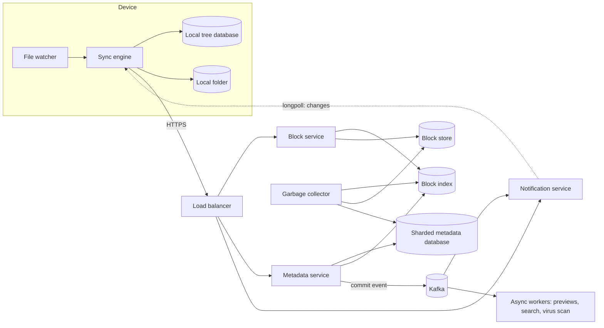
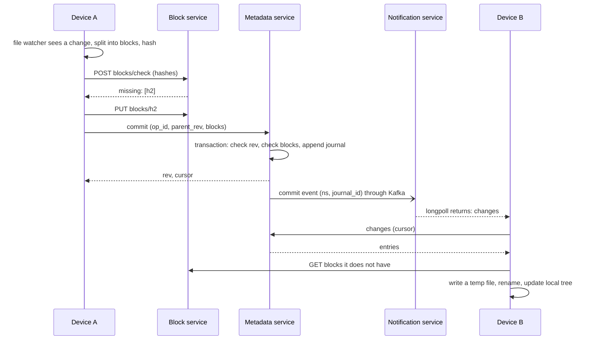
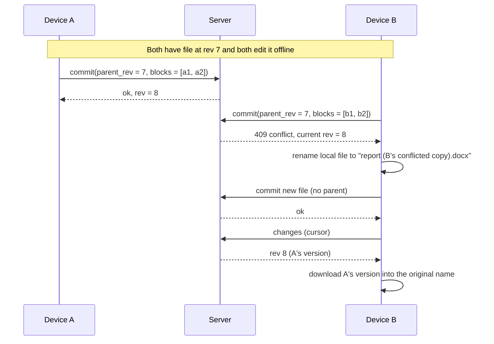

# Design a File Storage and Sync Service

A file storage and sync service keeps a folder on several devices in step, and keeps a copy in the cloud. Dropbox, Google Drive, and OneDrive are examples. This case study gives the design that a strong candidate presents in 45 minutes: the numbers, the split of every file into blocks, deduplication, the metadata service, the sync protocol, conflict handling, change notification, block storage, and versioning. Follow the steps in [how to approach an HLD interview](../how-to-approach-hld.md). The estimation method is on [back-of-envelope estimation](../back-of-envelope-estimation.md).

!!! note "About the sources"
    Dropbox publishes more about its internals than most companies: its 2014 description of the sync protocol (namespaces, a journal, cursors, and block lists), the Magic Pocket block store, the Nucleus sync engine, and its block size and hashing. This page uses those posts for the parts that they describe. Where the page gives a design choice that Dropbox does not describe, the text says "design choice". All numbers in the estimation are assumptions of this KB.

## Problem Statement

"Design a service like Dropbox. A user installs a client on a laptop. The client watches a folder and uploads changes to the cloud. The user's other devices (and the web and mobile apps) receive the changes and update their copies. Users can share folders, see old versions of a file, and work offline. The service must not lose a file."

For the in-memory model of a file tree with paths, folders, and operations, see the LLD case study [in-memory file system](../../lld/case-studies/14-in-memory-file-system/README.md). This page is about the distributed system around such a tree.

## Clarifying Questions

| Question | Answer that this design assumes |
|---|---|
| How many users? | 200 million registered users. 50 million daily active users (DAU). 20 million are online at one time, with 2 devices each (Assumption) |
| How much data? | 2 GB on average for each registered user, so 400 PB of logical data. The average file is 1 MB (Assumption) |
| How often do files change? | 10 file changes for each DAU each day. The new data in one change is 500 KB on average (Assumption) |
| Maximum file size? | 10 GB. Large files are the reason for chunking and resumable upload (Assumption) |
| Which clients? | Desktop clients (Windows, macOS, Linux) that sync a folder, plus web and mobile apps that read and write through the API |
| Sync model? | Eventually consistent. A change reaches the other devices within seconds when they are online. A device that is offline catches up when it connects |
| Sharing? | Yes. A user shares a folder with other users, with roles (viewer, editor). Public links are a follow-up |
| Versioning? | The service keeps old versions for 30 days and lets the user restore one (Assumption) |
| Conflicts? | Two devices edit the same file at the same time. The service must not lose either edit |
| Encryption? | TLS in transit. Encryption at rest on the server. End-to-end (zero-knowledge) encryption is out of scope, and a follow-up discusses its cost |
| Real-time co-editing of documents? | No. That is a different system (see the collaborative editor case study, `kb/hld/case-studies/19-collaborative-editor.md`) |
| Deduplication across users? | Within one account: yes. Across accounts: only with a proof that the client has the content (see Deep Dive 1) |
| Availability and durability? | Metadata and sync: 99.9%. Block durability: the service does not lose an acknowledged block. Replication and erasure coding across failure domains (Assumption) |

## Requirements

### Functional

1. `upload` and `download` of files up to 10 GB, resumable.
2. `sync`: a change on one device appears on the user's other devices. The client detects local changes and applies remote changes.
3. `list` of a folder, `move`, `rename`, `delete`.
4. `versions`: list and restore the versions of a file.
5. `share` a folder with other users, with roles.
6. `conflict` handling: no change is lost silently.
7. Offline use: the client queues changes and syncs them later.

### Non-functional

| Requirement | Target |
|---|---|
| Sync latency | A small change appears on another online device in 5 seconds at the 95th percentile (Assumption) |
| Bandwidth | Upload only the data that the server does not have. A change of one byte in a 1 GB file uploads about one block, not 1 GB |
| Durability | An acknowledged file is not lost. Erasure-coded blocks across failure domains |
| Consistency of metadata | A commit is atomic. A reader sees the file at the old version or at the new version, and not a mix |
| Availability | 99.9% for sync. Local files stay usable when the service is down |
| Scale | 5,000 commits each second on average, 15,000 at the peak. 40 million open connections (see Estimation) |
| Efficiency | Deduplication cuts the stored bytes by about 30% (Assumption) |

## Estimation

Rounding rule: one day is 10^5 seconds. Peak factor 3.

Inputs (all are assumptions): 200 million registered users, 50 million DAU. 2 GB stored for each registered user. Average file 1 MB, average block 1 MB (many small files, and larger files in blocks up to 4 MB). 10 changes for each DAU each day, 500 KB of new data for each change. Deduplication leaves 70% of the bytes (30% saved). Erasure coding overhead 1.5. A file entry takes 1 KB of metadata. A block index entry takes 100 bytes. A change is delivered to 1.5 other devices on average. 20 million users online with 2 devices each. A notification server holds 200,000 connections.

| Step | Calculation | Result |
|---|---|---|
| Logical storage | 200 × 10^6 × 2 GB | 400 PB |
| Unique storage after deduplication | 400 PB × 0.7 | 280 PB |
| Physical storage with erasure coding | 280 PB × 1.5 | 420 PB |
| Number of files | 400 PB / 1 MB | 4 × 10^11 |
| File metadata | 4 × 10^11 × 1 KB | 400 TB |
| Metadata shards at 2 TB each | 400 TB / 2 TB | 200 |
| Unique blocks | 280 PB / 1 MB | 2.8 × 10^11 |
| Block index | 2.8 × 10^11 × 100 B | 28 TB |
| Changes each day | 50 × 10^6 × 10 | 5 × 10^8 |
| Commits each second, average and peak | 5 × 10^8 / 10^5, then × 3 | 5,000 and 15,000 |
| Upload each day before deduplication | 5 × 10^8 × 500 KB | 250 TB |
| Upload bandwidth, average and peak | 250 TB × 8 / 10^5 s, then × 3 | 20 and 60 Gbit/s |
| New stored bytes each day | 250 TB × 0.7 | 175 TB |
| Growth each year, unique and physical | 175 TB × 365, then × 1.5 | 63.9 PB and 95.8 PB |
| Download bandwidth, average | 20 Gbit/s × 1.5 | 30 Gbit/s |
| Notifications each second, average and peak | 5,000 × 1.5, then × 3 | 7,500 and 22,500 |
| Open connections | 20 × 10^6 × 2 | 40 × 10^6 |
| Notification servers | 40 × 10^6 / 200,000 | 200 |
| Long-poll reconnects each second, 60 s timeout | 40 × 10^6 / 60 | 666,667 |
| Long-poll reconnects each second, 300 s timeout | 40 × 10^6 / 300 | 133,333 |

What the numbers decide:

- **Metadata is a large database.** 400 TB of file entries (4 × 10^11 rows) needs about 200 shards. The block index (28 TB) is smaller but must be fast, because every upload and download touches it. Compare with the [URL shortener](01-url-shortener.md), whose whole table fits on a few machines.
- **The data path and the control path scale differently.** 60 Gbit/s of upload at the peak is a throughput problem for the block servers and the object store. 15,000 commits each second is a transaction problem for the metadata database. The design keeps the two apart: clients send block bytes to block servers, and send only hashes and names to the metadata service.
- **Bytes are cheap to save.** Deduplication and block-level sync cut the upload from 250 TB to 175 TB each day in this estimation. For a user-visible effect, the more important saving is that a small edit of a large file uploads one block.
- **Notification connections cost more than notification events.** 7,500 events each second are small, but 40 million idle connections need 200 servers. The reconnect rate of long polling (667,000 each second with a 60-second timeout) is a load by itself, so the design uses long timeouts or persistent connections (see Deep Dive 2).
- **Storage grows by 96 PB each year** (physical), so the block store is the largest cost. Erasure coding and a good deduplication rate matter more than any other tuning.

The first program checks the arithmetic. `main` comes first, and the block has its own imports, so you can copy it into `SyncEstimate.java` and run `java SyncEstimate.java` on JDK 21.

```java
import java.util.Locale;

public class SyncEstimate {
    public static void main(String[] args) {
        double registered = 200e6, dau = 50e6;
        double gbPerUser = 2, avgFileMb = 1, avgBlockMb = 1;
        double changesPerDau = 10, changedKbPerChange = 500;
        double uniqueRatio = 0.7, erasure = 1.5, peak = 3, fanout = 1.5;
        double day = 1e5;

        double logicalPb = registered * gbPerUser * 1e9 / 1e15;
        double uniquePb = logicalPb * uniqueRatio;
        System.out.println(row("logical storage PB", logicalPb));
        System.out.println(row("unique after dedup PB", uniquePb));
        System.out.println(row("physical with erasure coding PB", uniquePb * erasure));

        double files = logicalPb * 1e15 / (avgFileMb * 1e6);
        double metadataTb = files * 1000 / 1e12;
        System.out.println(row("files", files));
        System.out.println(row("file metadata TB (1 KB each)", metadataTb));
        System.out.println(row("metadata shards at 2 TB each", Math.ceil(metadataTb / 2)));
        double uniqueBlocks = uniquePb * 1e15 / (avgBlockMb * 1e6);
        double indexTb = uniqueBlocks * 100 / 1e12;
        System.out.println(row("unique blocks", uniqueBlocks));
        System.out.println(row("block index TB (100 B each)", indexTb));

        double changesPerDay = dau * changesPerDau;
        double commitQps = changesPerDay / day;
        System.out.println(row("commits per second", commitQps));
        System.out.println(row("peak commits per second", commitQps * peak));
        double uploadTbDay = changesPerDay * changedKbPerChange * 1e3 / 1e12;
        System.out.println(row("upload TB per day before dedup", uploadTbDay));
        System.out.println(row("upload Gbit/s average", uploadTbDay * 1e12 * 8 / day / 1e9));
        System.out.println(row("upload Gbit/s peak", uploadTbDay * 1e12 * 8 / day / 1e9 * peak));
        double storedTbDay = uploadTbDay * uniqueRatio;
        System.out.println(row("stored TB per day after dedup", storedTbDay));
        System.out.println(row("growth PB per year (unique)", storedTbDay * 365 / 1000));
        System.out.println(row("growth PB per year (physical)",
                storedTbDay * 365 / 1000 * erasure));
        System.out.println(row("download Gbit/s average",
                uploadTbDay * fanout * 1e12 * 8 / day / 1e9));
        System.out.println(row("notifications per second", commitQps * fanout));
        System.out.println(row("peak notifications per second", commitQps * fanout * peak));

        double connections = 20e6 * 2;
        System.out.println(row("open connections", connections));
        System.out.println(row("notification servers at 200k each",
                Math.ceil(connections / 200e3)));
        System.out.println(row("reconnects per second, 60 s timeout", connections / 60));
        System.out.println(row("reconnects per second, 300 s timeout", connections / 300));
    }

    static String row(String label, double value) {
        return String.format(Locale.ROOT, "%-40s %,.2f", label, value);
    }
}
```

<!-- expected-output -->
```text
logical storage PB                       400.00
unique after dedup PB                    280.00
physical with erasure coding PB          420.00
files                                    400,000,000,000.00
file metadata TB (1 KB each)             400.00
metadata shards at 2 TB each             200.00
unique blocks                            280,000,000,000.00
block index TB (100 B each)              28.00
commits per second                       5,000.00
peak commits per second                  15,000.00
upload TB per day before dedup           250.00
upload Gbit/s average                    20.00
upload Gbit/s peak                       60.00
stored TB per day after dedup            175.00
growth PB per year (unique)              63.88
growth PB per year (physical)            95.81
download Gbit/s average                  30.00
notifications per second                 7,500.00
peak notifications per second            22,500.00
open connections                         40,000,000.00
notification servers at 200k each        200.00
reconnects per second, 60 s timeout      666,666.67
reconnects per second, 300 s timeout     133,333.33
```

## API Design

The service has two kinds of calls. Block calls move bytes. Metadata calls change the file tree. The client uploads blocks first, and then commits the file with a list of block hashes, so a file does not refer to a block that does not exist. All calls use HTTPS and an access token. The names follow the design of the public Dropbox HTTP API for the sync-related calls (`list_folder`, a cursor, and `longpoll`) where this page says so.

| Method and path | Request | Response |
|---|---|---|
| `POST /v1/blocks/check` | `{namespace_id, hashes: [h1, h2, ...]}` (up to 1,000 hashes) | `200 {missing: [h2, ...]}`. The hashes that the server does not have for this namespace |
| `PUT /v1/blocks/{sha256}` | The block bytes, up to 4 MB, `Content-Length` | `200`. The server hashes the bytes and compares with the path. `400` if they differ. Idempotent: a repeat of the same hash is a no-op |
| `GET /v1/blocks/{sha256}?namespace_id=` | none | `200` with the bytes, or a redirect to a signed URL of the block store |
| `POST /v1/namespaces/{ns}/commit` | `{op_id, path or file_id, parent_rev, size, mtime, blocks: [h1, h2, ...]}` | `200 {file_id, rev, cursor}` on success. `409 {reason: "conflict", current_rev}` if `parent_rev` is not the current revision. `409 {reason: "missing_blocks", missing: [...]}` if a block is not in the store |
| `POST /v1/namespaces/{ns}/move` | `{op_id, file_id, new_parent_id, new_name, parent_rev}` | `200 {rev, cursor}`. One row changes, also for a folder with a million files |
| `POST /v1/namespaces/{ns}/delete` | `{op_id, file_id, parent_rev}` | `200 {rev, cursor}`. Creates a tombstone |
| `POST /v1/namespaces/{ns}/changes` | `{cursor}` (or empty for the first listing) | `200 {entries: [...], cursor, has_more}`. The entries after `cursor`, in order. `409 {reason: "reset"}` if the cursor is too old |
| `POST /v1/changes/longpoll` | `{cursors: {ns1: c1, ns2: c2}, timeout: 300}` | `200 {changes: true}` as soon as one namespace is ahead of its cursor, or `{changes: false}` at the timeout. The response carries no data |
| `GET /v1/files/{id}/versions` | none | `200 {versions: [{rev, size, mtime, modified_by}]}` |
| `POST /v1/files/{id}/restore` | `{rev}` | `200 {rev}`. Creates a new revision that refers to the old blocks |
| `POST /v1/namespaces/{ns}/members` | `{user_id, role}` | `200`. Shares the folder |

Notes:

- `op_id` is a UUID that the client creates for each operation. The server stores it with the journal entry. If the client sends the same `op_id` again (after a timeout), the server returns the original result and does not apply the operation twice. Without it, a retry of a successful commit fails with a conflict against the client's own earlier commit.
- `parent_rev` is the revision that the client based the change on. It is the basis of the conflict rule (Deep Dive 3).
- `cursor` is an opaque token. Inside it is the last journal ID that the client has seen for the namespace.
- The Dropbox HTTP API has the same shape: `list_folder` returns a cursor, `list_folder/continue` returns the changes since the cursor, and `list_folder/longpoll` blocks until there are changes or a timeout occurs, and returns only `changes: true` or `false`. Its `timeout` parameter is 30 to 480 seconds (default 30), and the server adds up to 90 seconds of random jitter "to avoid the thundering herd problem". The response can carry a `backoff` field that tells the client to wait that many seconds before the next long poll. Both `list_folder/continue` and `list_folder/longpoll` return a `reset` error when the cursor is invalidated, and the client then calls `list_folder` for a new cursor. One difference: the Dropbox long poll takes one cursor, and the `longpoll` call above takes a cursor for each namespace.

## Data Model

### Where each kind of data lives

| Data | Store | Why |
|---|---|---|
| File tree (files and folders), the change journal, revisions | Sharded relational database (for example MySQL), sharded by `namespace_id` | A commit is a transaction with a compare-and-set on the revision. A move and an ancestor check need several rows in one transaction. All rows of a namespace are on one shard |
| Block bytes | A block store: object store, or a purpose-built store (Magic Pocket) at very large scale | Immutable, content-addressed, large volume. See Deep Dive 4 |
| Block index (`hash` to location) | Key-value store sharded by hash | A point lookup for each block. Written once per block |
| Namespace membership, sharing, quotas | Relational database (the same shards or a separate one) | Small, relational, needs transactions |
| Change notifications | In memory on the notification servers, fed by a Kafka topic | Hints that are fast to lose and cheap to recompute |
| Search index, previews, thumbnails | Derived stores fed by the journal and a queue | Asynchronous. Out of the sync path |

Dropbox describes a similar split. Its 2014 sync post names a block server that "maintains a key-value store of hash to encrypted contents" and a metadata server that holds users, namespaces, and the Server File Journal (SFJ), an append-only record in which each row is a version of a file. The file contents now live in Magic Pocket. Dropbox's Edgestore post describes a metadata store built on sharded MySQL for entities such as users, teams, and shared folders. It does not say that the file journal lives in Edgestore. The choice of a relational database follows from the access pattern ([choosing a database](../fundamentals/04-choosing-a-database.md)): every write needs a transaction and an ordering for each namespace. A system that gives up multi-row transactions for a wide-column store has to rebuild them in the application.

### The namespace

A namespace is a tree of files and folders with one owner or one set of members. Each user has a root namespace. A shared folder is its own namespace, and it appears in each member's tree as a mount point. The namespace is the shard key, the unit of ordering, and the unit of access control. Everything that must be atomic (a commit, a move, an ancestor check) stays inside one namespace and so inside one shard.

### Tables (sharded by `ns_id`)

`namespaces`: `ns_id` (primary key), `kind` (`USER_ROOT`, `SHARED`), `owner_id`, `latest_journal_id`, `quota_bytes`.

`members`: `(ns_id, user_id)` primary key, `role`. Index `(user_id)` for "which namespaces does this user see". This table is small and is also kept in a global lookup by `user_id`.

`files`: the current state of each node.

| Column | Notes |
|---|---|
| `(ns_id, file_id)` | Primary key. `file_id` is a time-ordered ID ([unique ID generation](../fundamentals/15-unique-id-generation.md)) |
| `parent_id`, `name` | The place in the tree. The path is not stored. A move changes one row |
| `name_key` | `name` in a normalized, lower-case form. Unique index `(ns_id, parent_id, name_key)` for live rows, so two devices cannot create the same name in one folder |
| `is_dir`, `deleted` | A deleted file stays as a tombstone for the retention period |
| `rev` | The journal ID of the last change. The conflict check compares it with `parent_rev` |
| `size`, `mtime`, `blocklist` | The current content. `blocklist` is a packed array of 32-byte hashes (a 10 GiB file with 4 MiB blocks has 2,560 hashes, which is 80 KiB) |

`journal`: the ordered log of changes in a namespace.

| Column | Notes |
|---|---|
| `(ns_id, journal_id)` | Primary key. `journal_id` increases by one for each commit in the namespace |
| `file_id`, `op` | `ADD`, `EDIT`, `MOVE`, `DELETE` |
| `parent_id`, `name`, `blocklist`, `size` | The new state, so a client can apply the entry without another read |
| `op_id` | Unique index `(ns_id, op_id)`. This is the idempotency key |
| `committed_at`, `device_id`, `user_id` | Audit and display |

`revisions`: old versions. `(ns_id, file_id, rev)` primary key, `size`, `blocklist`, `created_at`, `expires_at`. A restore copies the list of hashes (8 KiB for a 1 GiB file with 4 MiB blocks), not the data.

`block_index` (key-value, sharded by hash prefix): `hash` key, then `volume_id`, `offset`, `length`, `created_at`, `last_touched_at`. The block store and the garbage collector use `last_touched_at` (Deep Dive 4).

Why the tree uses `parent_id` and not a full path: a rename of a folder with 100,000 files changes one row, and the journal carries one `MOVE` entry. With full paths stored in each row, the rename would rewrite 100,000 rows and write 100,000 journal entries, and each client would handle each one. The client applies the single move to its local tree.

## High-Level Design



| Component | Responsibility |
|---|---|
| Desktop sync engine | Watches the folder, splits files into blocks, hashes them, uploads missing blocks, commits, listens for changes, downloads blocks, and updates the local folder. It keeps a local database of the tree state. This is the most complex component (Dropbox rewrote it as Nucleus) |
| Load balancer | Spreads calls over stateless services ([load balancing, DNS, and CDN](../fundamentals/02-load-balancing-dns-cdn.md)) |
| Block service | Stateless. Verifies the hash of each uploaded block, writes it to the block store, records it in the block index, and serves downloads |
| Block store | Holds the immutable blocks, with erasure coding |
| Block index | Maps `hash` to location. Answers `check` |
| Metadata service | Stateless in front of the sharded database. Runs the commit transaction (parent check, block check, journal append), `changes`, `versions`, sharing |
| Notification service | Holds the long-poll or WebSocket connections. Tells a device that a namespace has new changes |
| Kafka | Carries commit events to the notification servers and to the async workers ([message queues and streams](../fundamentals/08-message-queues-and-streams.md)) |
| Async workers | Previews, thumbnails, content search indexing, virus scan. They read the journal and run outside the sync path |
| Garbage collector | Finds blocks that no revision references and deletes them, after a grace period |

### The life of one change



## Deep Dives

### Deep Dive 1: Blocks, deduplication, and delta sync

**Why blocks.** A file is a list of blocks, and a block is the unit of hashing, storing, uploading, and deduplicating. If one byte changes in a 1 GB file, the client uploads only the blocks that changed, and a resumed upload skips the blocks that the server already has. Dropbox's 2014 sync post states that "every file in Dropbox is partitioned into 4MB blocks, with the final block potentially being smaller", and that the blocks "are hashed with SHA-256". The content-hash page of the Dropbox API defines the same 4 MB as 4,194,304 bytes (4 MiB). The Magic Pocket post describes blocks of up to 4 MB, keyed in most cases by the SHA-256 hash of the block.

**Fixed-size and content-defined chunking.**

| Aspect | Fixed-size blocks (for example 4 MB) | Content-defined chunking (CDC) |
|---|---|---|
| How the cut points are chosen | Every N bytes | Where a rolling hash of the last few bytes matches a pattern |
| Insert one byte at the start | All following blocks shift, so all hashes change. The client uploads the whole file again | Only the chunk that holds the insert changes. The cut points after it stay at the same content |
| Edit in place (no length change) | Only the touched block changes | Only the chunk that holds the edit changes |
| Cost to compute | One pass for the SHA-256 | A rolling hash over every byte plus the SHA-256 |
| Chunk size | Fixed | Varies between a minimum and a maximum around an average |
| Deduplication | Good for identical files and in-place edits | Better for insertions, and for data with shifted content |
| Used by | Dropbox (4 MiB blocks, per its sync post and API documentation) | The low-bandwidth network file system LBFS (Muthitacharoen et al., 2001: Rabin fingerprints over a 48-byte window, chunks of 2 KB to 64 KB with an 8 KB expected size), backup tools, FastCDC (Xia et al., 2016) |

The program below compares the two on a 400,000-byte file after a 10-byte insert near the start. It uses the Gear hash, the rolling hash of FastCDC: `h = (h << 1) + GEAR[byte]`, where `GEAR` is a table of 256 random 64-bit numbers. A cut point is where the bits of `h` under a mask with 13 one-bits are all zero. That happens with a probability of 1 in 8,192 at each byte, so a chunk ends about 8 KB after the 2 KB minimum (the output shows 44 chunks for 400,000 bytes, about 9 KB each). The maximum chunk is 64 KB. The mask is `MaskA` from the FastCDC paper (`0x0000d90303530000`). Its one-bits lie between bit 16 and bit 47. Each shift moves the effect of a byte one bit higher, so bit 47 depends only on the last 48 bytes: the shift gives a sliding window of 48 bytes without an explicit removal step. A mask on the low 13 bits would give a window of only 13 bytes, which the FastCDC paper names as the weakness of the earlier Gear-based chunking. The file content and the table come from fixed seeds, so the output is the same on every run. `main` comes first and the block has its own imports.

```java
import java.security.MessageDigest;
import java.security.NoSuchAlgorithmException;
import java.util.ArrayList;
import java.util.Arrays;
import java.util.HashSet;
import java.util.HexFormat;
import java.util.List;
import java.util.Locale;
import java.util.Random;
import java.util.Set;

public class ChunkCheck {
    static final int FIXED = 8192;
    static final int MIN = 2048;
    static final int MAX = 65536;
    // FastCDC mask for 8 KB chunks: 13 one-bits spread over bits 16 to 47.
    static final long MASK = 0x0000d90303530000L;
    static final long[] GEAR = new long[256];

    static {
        Random seeded = new Random(42);
        for (int i = 0; i < 256; i++) GEAR[i] = seeded.nextLong();
    }

    public static void main(String[] args) {
        byte[] original = new byte[400_000];
        new Random(7).nextBytes(original);
        byte[] edited = insert(original, 100, new byte[10]);   // 10 bytes near the start

        report("fixed 8 KB", fixed(original), fixed(edited));
        report("content-defined", cdc(original), cdc(edited));

        // Store three versions of a file and count the stored bytes.
        byte[] second = edited.clone();
        second[300_000] ^= 1;                                    // change 1 byte in the middle
        Set<String> store = new HashSet<>();
        long logical = 0;
        long stored = 0;
        for (byte[] version : new byte[][] {original, edited, second}) {
            for (byte[] chunk : cdc(version)) {
                logical += chunk.length;
                if (store.add(sha256(chunk))) stored += chunk.length;
            }
        }
        System.out.printf(Locale.ROOT,
                "three versions: logical %d bytes, stored %d bytes (%.1f%%)%n",
                logical, stored, 100.0 * stored / logical);
    }

    static byte[] insert(byte[] data, int at, byte[] extra) {
        byte[] out = new byte[data.length + extra.length];
        System.arraycopy(data, 0, out, 0, at);
        System.arraycopy(extra, 0, out, at, extra.length);
        System.arraycopy(data, at, out, at + extra.length, data.length - at);
        return out;
    }

    static List<byte[]> fixed(byte[] data) {
        List<byte[]> chunks = new ArrayList<>();
        for (int i = 0; i < data.length; i += FIXED) {
            chunks.add(Arrays.copyOfRange(data, i, Math.min(data.length, i + FIXED)));
        }
        return chunks;
    }

    // Gear hash: h = (h << 1) + GEAR[byte]. A cut point is where (h & MASK) == 0.
    // Each shift moves older bytes toward the high bits, so the bits under MASK
    // depend only on the last 48 bytes: a sliding window with no explicit removal.
    static List<byte[]> cdc(byte[] data) {
        List<byte[]> chunks = new ArrayList<>();
        int start = 0;
        long h = 0;
        for (int i = 0; i < data.length; i++) {
            h = (h << 1) + GEAR[data[i] & 0xFF];
            int length = i - start + 1;
            boolean cut = length >= MIN && (h & MASK) == 0;
            if (cut || length >= MAX || i == data.length - 1) {
                chunks.add(Arrays.copyOfRange(data, start, i + 1));
                start = i + 1;
                h = 0;
            }
        }
        return chunks;
    }

    static void report(String name, List<byte[]> before, List<byte[]> after) {
        Set<String> known = new HashSet<>();
        for (byte[] c : before) known.add(sha256(c));
        int newChunks = 0;
        long newBytes = 0;
        for (byte[] c : after) {
            if (!known.contains(sha256(c))) {
                newChunks++;
                newBytes += c.length;
            }
        }
        System.out.printf(Locale.ROOT,
                "%-16s chunks before %d, after %d, to upload %d (%d bytes)%n",
                name, before.size(), after.size(), newChunks, newBytes);
    }

    static String sha256(byte[] data) {
        try {
            return HexFormat.of().formatHex(MessageDigest.getInstance("SHA-256").digest(data));
        } catch (NoSuchAlgorithmException e) {
            throw new IllegalStateException("every JDK has SHA-256", e);
        }
    }
}
```

<!-- expected-output -->
```text
fixed 8 KB       chunks before 49, after 49, to upload 49 (400010 bytes)
content-defined  chunks before 44, after 44, to upload 1 (10203 bytes)
three versions: logical 1200020 bytes, stored 420287 bytes (35.0%)
```

Read the output. With fixed blocks of 8 KB, the 10-byte insert shifts the content, so all 49 blocks change, and the client would upload 400,010 bytes. With content-defined chunks, 43 of 44 chunks keep the same hash. The client uploads one chunk (10,203 bytes). The last line shows the storage effect: three versions of the file, with 1,200,020 logical bytes, use 420,287 stored bytes (35.0%).

The program shows the idea. It is not the FastCDC algorithm in full: FastCDC also skips the hashing of the first 2 KB of each chunk (no cut point can fall there), and it uses normalized chunking, a stricter mask before 8 KB and a looser mask after 8 KB, so that most chunk sizes fall near the 8 KB target.

**Block size trade-off.** A smaller block improves deduplication and shrinks the upload after a small edit. It also raises the metadata and the request count. A 10 GiB file has 2,560 blocks at 4 MiB and 163,840 blocks at 64 KiB. At 32 bytes for each hash, the block lists are 80 KiB and 5 MiB. The index has more entries to hold, and each block needs a request unless the client batches them. Many small files are the opposite problem: each file is one block, and the per-request cost dominates, so the client batches the `check` and `commit` calls and uploads small blocks together. A block size of a few megabytes is a common balance, and Dropbox's published block size is 4 MiB.

**The upload protocol in three steps.**

1. `check`: the client sends the hashes of the file's blocks. The server answers with the ones it does not have.
2. `PUT`: the client uploads only those blocks, in parallel (a few at a time to fill the link). The server hashes each block and compares it with the hash in the path, so a client cannot store wrong bytes under a hash. The block is idempotent: a repeat does nothing.
3. `commit`: the client sends the block list. The server checks that every block exists, and then makes the file visible.

Dropbox's 2014 post describes a variant with one round trip fewer when the server already has every block: the client commits the block list first, the metadata server answers "need blocks" with the missing hashes (after it checks that the hashes are known and that the user has access to the namespace), the client stores those blocks on the block server, and then it commits again.

The order matters. The blocks are in the store before the metadata refers to them, so a reader does not see a file with a missing block. If the client crashes after step 2, the blocks are in the store with no reference. The garbage collector removes them (Deep Dive 4).

**Delta sync inside a block (rsync).** Block-level sync uploads a whole 4 MB block for a change of 1 byte. The rsync algorithm (Tridgell and Mackerras, 1996) sends less. The receiver, which has the old file, splits it into blocks and sends for each block a weak 32-bit rolling checksum and a strong hash. The sender scans its new file with the weak checksum at every byte offset, using a rolling update that costs a constant time for each step. When the weak checksum matches, the sender checks the strong hash. A match means "copy block *k* of your old file". Everything between matches is sent as literal bytes. The program below implements it with a block size of 700 bytes, a 30-byte insert, and a 5-byte change. The paper uses MD4 as the strong hash. The program uses MD5 for the demonstration, and a production system uses a modern hash.

```java
import java.security.MessageDigest;
import java.security.NoSuchAlgorithmException;
import java.util.ArrayList;
import java.util.Arrays;
import java.util.HashMap;
import java.util.HexFormat;
import java.util.List;
import java.util.Map;
import java.util.Random;

public class DeltaCheck {
    static final int BLOCK = 700;

    // The rsync weak checksum (Tridgell and Mackerras, 1996) over a window x[0..len-1]:
    // a = sum of x[i], b = sum of (len - i) * x[i], both mod 2^16. The value is a + 65536 * b.
    static int weak(byte[] d, int from, int len) {
        int a = 0, b = 0;
        for (int i = 0; i < len; i++) {
            a += d[from + i] & 0xFF;
            b += (len - i) * (d[from + i] & 0xFF);
        }
        return (a & 0xFFFF) | ((b & 0xFFFF) << 16);
    }

    // Slide the window one byte to the right in constant time.
    static int roll(int sum, byte out, byte in, int len) {
        int a = sum & 0xFFFF;
        int b = (sum >>> 16) & 0xFFFF;
        a = (a - (out & 0xFF) + (in & 0xFF)) & 0xFFFF;
        b = (b - len * (out & 0xFF) + a) & 0xFFFF;
        return a | (b << 16);
    }

    public static void main(String[] args) {
        byte[] oldFile = new byte[20_000];
        new Random(11).nextBytes(oldFile);
        // New file: 30 bytes inserted at offset 5000 and 5 bytes changed at offset 15000.
        byte[] newFile = new byte[oldFile.length + 30];
        System.arraycopy(oldFile, 0, newFile, 0, 5000);
        Arrays.fill(newFile, 5000, 5030, (byte) 9);
        System.arraycopy(oldFile, 5000, newFile, 5030, oldFile.length - 5000);
        for (int i = 0; i < 5; i++) newFile[15030 + i] ^= 0x55;

        // The receiver (holds the old file) sends a signature for each block.
        Map<Integer, List<Integer>> weakIndex = new HashMap<>();
        List<String> strong = new ArrayList<>();
        int blocks = 0;
        for (int off = 0; off + BLOCK <= oldFile.length; off += BLOCK) {
            int w = weak(oldFile, off, BLOCK);
            weakIndex.computeIfAbsent(w, k -> new ArrayList<>()).add(blocks);
            strong.add(md5(oldFile, off, BLOCK));
            blocks++;
        }

        // The sender (holds the new file) scans it byte by byte with the rolling checksum.
        int copies = 0;
        int literalBytes = 0;
        int pos = 0;
        int literalStart = 0;
        int sum = 0;
        boolean valid = false;
        while (pos + BLOCK <= newFile.length) {
            if (!valid) {
                sum = weak(newFile, pos, BLOCK);
                valid = true;
            }
            int match = -1;
            List<Integer> candidates = weakIndex.get(sum);
            if (candidates != null) {
                String s = md5(newFile, pos, BLOCK);
                for (int c : candidates) {
                    if (strong.get(c).equals(s)) {
                        match = c;
                        break;
                    }
                }
            }
            if (match >= 0) {
                literalBytes += pos - literalStart;
                copies++;
                pos += BLOCK;
                literalStart = pos;
                valid = false;
            } else {
                if (pos + BLOCK < newFile.length) {
                    sum = roll(sum, newFile[pos], newFile[pos + BLOCK], BLOCK);
                }
                pos++;
            }
        }
        literalBytes += newFile.length - literalStart;
        System.out.println("old file bytes:    " + oldFile.length + " (" + blocks + " blocks)");
        System.out.println("new file bytes:    " + newFile.length);
        System.out.println("copy instructions: " + copies);
        System.out.println("literal bytes:     " + literalBytes);
        System.out.println("rolling check ok:  " + rollingMatchesFull(newFile));
    }

    static boolean rollingMatchesFull(byte[] d) {
        int sum = weak(d, 0, BLOCK);
        for (int i = 0; i + BLOCK < d.length; i++) {
            sum = roll(sum, d[i], d[i + BLOCK], BLOCK);
            if (sum != weak(d, i + 1, BLOCK)) return false;
        }
        return true;
    }

    static String md5(byte[] d, int from, int len) {
        try {
            MessageDigest md = MessageDigest.getInstance("MD5");
            md.update(d, from, len);
            return HexFormat.of().formatHex(md.digest());
        } catch (NoSuchAlgorithmException e) {
            throw new IllegalStateException("every JDK has MD5", e);
        }
    }
}
```

<!-- expected-output -->
```text
old file bytes:    20000 (28 blocks)
new file bytes:    20030
copy instructions: 26
literal bytes:     1830
rolling check ok:  true
```

Read the output. The old file has 28 blocks of 700 bytes (the last 400 bytes are not a full block). The paper also sends a signature for the shorter last block. The program skips it, so the 400-byte tail goes as literal bytes. The new file has 20,030 bytes. 26 blocks match, and the sender transmits 26 copy instructions plus 1,830 literal bytes: the 730 bytes around the insert, the 700 bytes of the changed block, and the 400-byte tail. The last line checks that the rolling update gives the same value as a full recomputation at every offset.

In a sync service the roles are different from the classic rsync. The server stores immutable blocks, and rsync needs the receiver to hold the old file and compute signatures. The client can fetch the signatures of the old revision's blocks from the server, or keep them locally (the client computed them when it uploaded the old version), and send a delta against one block that the server rebuilds. This is a design choice. It saves upload bandwidth for large files with small edits, and it costs CPU on the client and a rebuild step on the server. Block-level sync is simpler and covers most of the gain, so a design starts there and adds delta sync inside a block if the data shows that it pays.

**Compression.** The client compresses a block before it uploads it, if the data compresses. The hash covers the uncompressed bytes (so deduplication works across compression settings). The server stores the compressed form.

**Deduplication scope and its risk.** Deduplication within one account has no cross-user privacy risk. Deduplication across accounts has one. If the server answers "I already have this hash" to any user, a user can test whether another user has a given file, by checking its hash. Harnik, Pinkas, and Shulman-Peleg (2010) describe this side channel, and Mulazzani et al. (USENIX Security 2011) showed an attack on a hash-based client-side deduplication of Dropbox at the time, in which knowing the hash was enough to get the content. Defenses:

- The server answers `check` for blocks that the caller has a right to. A hash alone is not a proof. The server asks for a proof of possession: a challenge (for example, "send the hash of the bytes at these random offsets of the block, mixed with this nonce"). Only a client that has the bytes can answer.
- Deduplicate only inside an account or an organization.
- Upload every block, and deduplicate on the server (the user's bandwidth is then not saved, but the storage is).

Recommendation: deduplicate across accounts only with a proof of possession, and measure the saving against the cost of the challenge.

### Deep Dive 2: The metadata service and the sync protocol

**The journal and the cursor.** Each namespace has a journal: an append-only list of changes, numbered 1, 2, 3, and so on. A commit appends one entry in the same transaction that updates the `files` row, so the current state and the journal agree. A device remembers one number for each namespace: the last journal ID it has applied (its cursor). To catch up, it asks for the entries after its cursor, applies them in order, and stores the new cursor. This is the same pattern as a change feed or a replication log ([replication](../fundamentals/05-replication.md)). It works because the order is fixed by the server, the entries are small, and a device that was offline for a week sends one cursor and receives all it missed.

**The commit transaction.** On one shard, in one transaction:

1. Lock the namespace row (`SELECT ... FOR UPDATE`), so commits to one namespace run one at a time. This gives a total order. If a namespace commits at most once each 5 ms, it supports about 200 commits each second (Assumption: measure it). A very busy shared folder is the limit of this design. A split of one namespace across shards needs a different design, and no published fact says that Dropbox does it.
2. Check `op_id`: if `(ns_id, op_id)` exists, return the stored result (a retry).
3. Check `parent_rev` against the current `rev` of the file (Deep Dive 3). If it differs, return a conflict.
4. Check the unique name in the folder, and for a move, check that the new parent is not a descendant of the node (a cycle).
5. Ask the block index to touch every block in the list. If any block is missing, return `missing_blocks`.
6. Increment `latest_journal_id`, insert the journal entry, update the `files` row, insert the `revisions` row.
7. Commit the transaction. After the commit, publish `(ns_id, journal_id)` to Kafka.

The block check at step 5 is a call to another system inside the transaction. It is a read and a touch, not a write that needs rollback. If the transaction rolls back after the touch, the effect is that a block stays alive a little longer, which is harmless.

**Publishing after commit.** The publish happens after the database commit, so there is a window in which the commit succeeded and the process crashed before it published. Then no notification is sent. This is the dual-write problem, and the fix is the transactional outbox ([distributed transactions](../distributed-systems/03-distributed-transactions.md)): write the event into an outbox table in the same transaction, and a relay reads the table and publishes to Kafka. Here a missed notification is also covered by the fallback poll (below), so the system tolerates it, but the outbox gives a bound on the delay.

**The client's view: three trees.** The sync engine must decide what to do from three pieces of state. Dropbox describes this in its post on testing the Nucleus engine ("Testing sync at Dropbox", 2020): the engine keeps the Local Tree (the last observed state of the user's folder on disk), the Remote Tree (the latest state in the cloud), and the Synced Tree (the last known fully synced state between the two). A difference between the local tree and the synced tree is a local change to upload. A difference between the remote tree and the synced tree is a remote change to download. A node that differs on both sides is a conflict. The post says that each node of the Synced Tree works as a merge base, as in a three-way merge, so the engine can tell which side made a change. The testing post also says that randomized testing is the most important part of the test strategy, that every randomized test must be deterministic and reproducible, and that Dropbox runs tens of millions of randomized test runs every night. The Nucleus post ("Rewriting the heart of our sync engine", 2020) adds that almost all of the engine's code runs on a single "Control thread" that is deterministic when its inputs and scheduling are fixed, that expensive work such as hashing goes to a thread pool, and that the team encodes invariants of the system in the type system so that the compiler checks them. The rule "a node that differs on both sides is a conflict" is the general idea of any sync engine with a merge base.

Client steps for an upload, in order:

1. The file system watcher (FSEvents on macOS, inotify on Linux, ReadDirectoryChangesW on Windows) reports a change. The engine waits until the file stops changing (a short debounce), because an editor or a copy may still write to it.
2. The engine reads the file, splits it, and hashes the blocks. If the file changes while it reads, the engine detects it (the modification time or size differs after the read) and starts again.
3. It runs `check`, `PUT`, and `commit` as above, with a new `op_id` and the `parent_rev` from the synced tree.
4. On success, it updates the synced tree and the stored `rev`. On `409 conflict`, it goes to conflict handling. On `missing_blocks`, it uploads those blocks and commits again.
5. All state changes go to the local database in a transaction, so a crash restarts from the last stored state. Because the operations are idempotent (`op_id`, content-addressed blocks), a restart repeats work without damage.

Client steps for a download:

1. A notification (or the periodic poll) triggers `changes(cursor)`. The client receives entries in order.
2. For each entry, the client decides which blocks it lacks. It already has the blocks of the previous version of the file, so for an edit it downloads only the new blocks and assembles the file from old and new blocks.
3. The client writes the new file to a temporary file in the same folder, and then renames it over the target. A rename on one file system is atomic, so the user does not see a half-written file.
4. It stores the new cursor after it applied the entries.

**Change notification.** The long-poll call carries the device's cursor for each namespace that it watches. The server compares each cursor with the namespace's `latest_journal_id`. If any namespace is ahead, the call returns at once. If not, the call waits until a notification arrives or the timeout ends. The response has no data. It tells the client to call `changes`.

This design keeps the notification a hint and the journal the truth. A lost notification delays a sync, but it does not lose a change, because the next poll (and the next connect) compares cursors. The client also polls on a slow timer (for example, every few minutes) as a fallback. This is why the notification service can be simple and does not need strong delivery guarantees.

The notification servers need to know which of their connections to wake. The estimation gives an easy answer. The commit stream is 15,000 events each second at the peak, and each event is a namespace ID and a journal ID of about 20 to 30 bytes, which is about 450 KB/s. Every notification server can read the whole stream (each server is its own consumer group in Kafka) and filter by the namespaces of its own connections. This avoids a registry that maps namespaces to servers. The stream is small enough at this scale. With a rate 100 times higher, the design would partition the connections by user and route events through a registry.

Connection cost: 40 million connections at 200,000 for each server needs 200 servers (Assumption: measure the real limit, which depends on memory for each connection and the kernel settings). With a 60-second long-poll timeout the clients reconnect 667,000 times each second, and each reconnect is a TLS handshake or at least an HTTP request. A longer timeout (300 seconds, 133,000 each second) or a persistent connection (WebSocket, or an HTTP/2 stream) cuts that. The Dropbox long-poll API allows a timeout of up to 480 seconds, and its server adds up to 90 seconds of random jitter to spread the reconnects. [Communication patterns](../fundamentals/09-communication-patterns.md) compares long polling, SSE, and WebSocket. Add jitter to the timeout so the reconnects spread out. If a notification server fails, its 200,000 clients reconnect at once. They use exponential backoff with jitter, and the load balancer limits the connection rate ([reliability patterns](../fundamentals/12-reliability-patterns.md)).

**Large and many files.** A large file uploads in parallel blocks and the client keeps the list of uploaded blocks, so a break resumes where it stopped. For many small files (a source tree, a photo import), the client batches `check` and `commit` calls, because 100,000 separate requests would take far longer than the bytes. The client limits its bandwidth and the number of parallel requests, and a user setting lets the user cap it.

### Deep Dive 3: Conflicts and versions

**The rule.** Each file has a revision, `rev`. A commit says "I changed the file that was at `parent_rev`". The server applies the change only if `parent_rev` is the file's current `rev`. This is optimistic concurrency control: a compare-and-set on the revision, run inside the commit transaction. Two devices that edit the same file from the same base both send `parent_rev = 7`. The server serializes them. The first commit succeeds and creates revision 8. The second commit sees that the current revision is 8, and returns a conflict.



**What the client does after a conflict.** The server cannot merge two binary files, because it does not know the format. The service must not lose either edit. The standard answer, which the Dropbox help center describes, is a conflicted copy: the second device renames its version to a new name that shows the device or user and the date (for example `report (Asha's conflicted copy 2026-10-15).docx`), uploads it as a new file, and downloads the winning version into the original name. Both versions exist, and the user decides which to keep. The service decides nothing about the content.

**Alternatives.**

| Approach | How it works | Problem |
|---|---|---|
| Last writer wins | The later commit overwrites the earlier one | Loses the earlier edit silently. [Conflict resolution](../distributed-systems/06-crdts-and-conflict-resolution.md) describes this data loss |
| Conflicted copy | Keep both as two files | The user must merge by hand. No data is lost |
| Automatic three-way merge | Merge two versions against the common base | Works for plain text (the synced tree gives the base). Does not work for binary formats |
| CRDT or operational transformation | The editor sends operations, and the server merges them | Needs an editor that works on operations, not on opaque files. Used by real-time editors (see `kb/hld/case-studies/19-collaborative-editor.md`) |
| Locking | A user checks out a file, and others cannot edit | Blocks offline work. Needs leases and fencing for a crash of the holder ([distributed locks and leases](../distributed-systems/05-distributed-locks-and-leases.md)). Useful for formats that cannot merge, as an option |

Recommendation: use the conflicted copy as the default and offer locking as an option for specific file types.

**Structural conflicts.** Conflicts are not only about content.

- *Edit against delete.* Device A edits a file and Device B deletes it. A policy: the edit wins, and the file comes back, because the system prefers a surprise to data loss.
- *Same name created twice.* Two devices create `notes.txt` in one folder. The unique index on `(ns_id, parent_id, name_key)` rejects the second commit, and the client creates a conflicted copy of the second file.
- *Rename against rename.* Two devices rename one file. The first commit wins. The second gets a conflict on `parent_rev` and applies the winner's name.
- *Move cycles.* Device A moves folder X into Y, and Device B moves Y into X. The commit transaction checks the ancestors of the new parent inside the namespace, so the second move fails. A namespace on one shard makes this check possible.
- *Name rules.* Windows and macOS file systems are case-insensitive by default and Linux is case-sensitive. `name_key` normalizes case so that `A.txt` and `a.txt` cannot both exist in one folder, which would break the clients on other systems. macOS can also store a different Unicode form of the same visible name. The service normalizes names (for example to NFC) in `name_key`, and the client handles characters that its file system cannot store.

**Versions.** Every commit is a new immutable revision with its own block list. The service keeps old revisions for the retention period (30 days here) and then expires them. A restore creates a new revision whose block list is a copy of the old list (8 KiB for a 1 GiB file with 4 MiB blocks: 256 hashes of 32 bytes), and no data moves. A deleted file is a tombstone with its last revision, so it can be restored. A change inside one 4 MiB block of a 1 GiB file costs one new block (4 MiB) plus one new block list (8 KiB) for each revision. The cost of versions is the blocks that only old revisions refer to. They stay until the revision expires, and then the garbage collector can free them.

### Deep Dive 4: The block store, durability, and garbage collection

**What the block store does.** It stores immutable, content-addressed blocks: `put(hash, bytes)`, `get(hash)`, and `touch(hash)`. A block does not change, because its name is its content. This makes the store simple. There are no updates, no locks for writes, and no cache invalidation. The block service can run on any server, and a CDN can cache a block forever.

**Build or buy.** At the beginning, use an object store ([storage types](../fundamentals/10-storage-types.md)) with the hash as the key. It gives durability, erasure coding, and scale with no work for the team. Dropbox was "an early adopter of Amazon S3" and then built its own store, Magic Pocket. Its March 2016 post reports that it then stored and served over 90% of its users' data in-house, at more than 500 petabytes of user data, and gives two reasons: performance (control of the whole stack) and better unit economics from custom hardware and software. Recommendation: build a store only for cost and control at a very large scale (hundreds of petabytes), because it takes years of work.

**How such a store is built (the Magic Pocket design, in general terms).**

- *Many small objects.* The data is hundreds of billions of blocks of up to 4 MB. A file system with one file for each block would waste space and metadata. The store appends blocks into large files and keeps an index from `hash` to `(volume, offset, length)`. "Inside the Magic Pocket" describes how Magic Pocket aggregates blocks into 1 GB logical containers called buckets, and stores the buckets in volumes that are replicated or erasure coded.
- *Immutability.* A volume that is full is sealed (Magic Pocket calls it closed) and does not change. A sealed volume can be erasure coded, copied, and checked without coordination with writers. The Magic Pocket post states that a block never changes once it is written.
- *Durability.* Erasure coding across failure domains (disks, servers, racks, data centers), as in [storage types](../fundamentals/10-storage-types.md): RS(6,3) gives an overhead of 1.5 and survives 3 lost fragments. "Inside the Magic Pocket" describes clusters in the western, central, and eastern United States, with each block stored in at least two zones. Checksums on every read, a background scrub that reads all data to find silent corruption, and automatic repair after a disk failure complete the design. The repair speed decides the durability, because loss needs more failures than the code tolerates before the repair finishes.
- *Hot and cold data.* New blocks are read often and old blocks rarely. Dropbox's cold-storage post (2019) reports that over 40% of file retrievals are for data uploaded in the last day and over 90% for data from the last year. Its warm tier keeps a full copy of a block in each of two regions. Its cold tier splits a block into two fragments plus an XOR parity fragment and stores the three in three regions, which uses about 25% less disk. A cold read fetches fragments from all three regions and uses the first two that arrive. An asynchronous process moves blocks from the warm tier to the cold tier when they become cold.

**Garbage collection.** A block is garbage when no live revision refers to it. Blocks become garbage after a revision expires, after a user deletes data permanently, after an upload that did not commit, and after a crash between `PUT` and `commit`. The design:

1. *Mark.* A periodic batch job reads the block lists of all live and retained revisions and builds the set of live hashes. At 2.8 × 10^11 unique blocks with 32-byte hashes, the set is about 9 TB, which a batch system handles by sorting and joining by hash prefix ([batch and stream processing](../fundamentals/17-batch-and-stream-processing.md)).
2. *Sweep.* The job lists blocks that are not live and whose `last_touched_at` is older than a grace period (for example, 7 days).
3. *Delete only if untouched.* The sweeper deletes a block with a conditional operation: "delete this hash if `last_touched_at` is still older than T". The commit step touches every block it refers to, so a block that a commit uses after the sweeper listed it is not deleted.
4. *Compact.* A sealed volume with many dead blocks is rewritten: the live blocks go to a new volume, the index points to the new location, and the old volume is freed. The compaction runs when the live fraction falls under a threshold (for example, 50%).

The reason for the touch and the grace period is a race. A client calls `check` and the server says "I have block h". Before the client commits, the sweeper decides that h has no references and deletes it. The client commits a file that refers to a deleted block. Three rules close the race: the commit validates that the blocks exist (the authority is the commit, not the earlier `check`), the commit touches the blocks, and the sweeper deletes only blocks that were not touched for the grace period, using a conditional delete. If the race still occurs, the commit returns `missing_blocks` and the client uploads the block again. The cost is one retry.

A reference count for each block is the alternative to mark and sweep. It frees space sooner, but the count lives in a different system from the file metadata, so a crash between the two updates makes the count drift, and a wrong count either leaks a block or deletes a live one. Mark and sweep recomputes the truth from the metadata each time, which this design prefers, at the cost of a large periodic job and a delay before space is freed.

## Bottlenecks and Scaling

| What fails first | Why | Fix |
|---|---|---|
| Hot namespace | A shared folder with thousands of members commits at a high rate, and the commit transaction locks the namespace | Keep the transaction short. Batch the changes of one client into one commit call. If it is still too hot, limit the commit rate for the namespace and coalesce changes. A single-namespace split is a hard change and needs a new design |
| Metadata database size | 400 TB in 200 shards, and a growth of the user count | Add shards by moving namespaces (a directory table maps `ns_id` to a shard). Archive old journal entries and expired revisions to cheaper storage |
| Block index | Every upload and download looks up a hash. 28 TB with many point reads | Shard by hash prefix, cache the hot part in memory, and use a Bloom filter in front of the index so that a `check` for a new block does not read the disk ([probabilistic data structures](../distributed-systems/04-probabilistic-data-structures.md)) |
| Upload bandwidth at the peak | 60 Gbit/s at the peak | Scale the stateless block servers. Use regional upload endpoints. Let clients upload straight to the object store with presigned URLs, and verify the hash afterward |
| Notification connections | 40 million connections, and a reconnect storm after a server failure | 200 or more servers, a long timeout, jitter, backoff, and an admission limit on the load balancer |
| Initial sync of a large account | A user with 500,000 files starts a new device | Page through `changes` with `has_more`. Download in parallel. Prioritize recently modified files. Skip blocks that the device already has (a re-install keeps the old folder) |
| Many small files | The per-request cost of 100,000 tiny files | Batch `check` and `commit`. Bundle small blocks in one upload request |
| Garbage collection load | A scan of 2.8 × 10^11 block references | Run in the background, in partitions by hash prefix, and sort by hash. Delay the sweep and accept a delay in freeing space |
| Hot block (a popular public file) | Many users download one block | Serve public content through a CDN ([load balancing, DNS, and CDN](../fundamentals/02-load-balancing-dns-cdn.md)). Blocks are immutable, so a long TTL is safe |
| Regional failure | A data center fails | Replicate metadata across regions (asynchronous, with a bounded loss window) and the block store across regions. State the RPO and RTO ([multi-region and disaster recovery](../fundamentals/19-multi-region-and-disaster-recovery.md)) |
| Client bugs | The sync engine runs on millions of different machines, and file systems differ | The engine is the hardest part. Test it with randomized simulations of the file system and the network, as the Nucleus post describes, and ship it with a kill switch |

## Trade-offs

| Decision | Chosen | Alternative rejected | Reason |
|---|---|---|---|
| Unit of sync | Blocks of a few MB, identified by a SHA-256 hash | Whole files. Small blocks of a few KB | Whole files re-upload on each edit. Small blocks multiply metadata and requests |
| Chunking | Fixed-size blocks to start. Content-defined chunking as an option | Content-defined chunking from the start | Fixed blocks are simpler and fit in-place edits (Dropbox's published choice). Content-defined chunking is better for insertions and costs CPU on the client |
| Delta inside a block | Not at first. Add rsync-style delta if the data shows large files with small edits | Delta for every upload | Saves bandwidth but costs CPU, state, and a rebuild step |
| Metadata store | Sharded relational by `namespace_id` | Wide-column store with no transactions | A commit needs a compare-and-set, an order, and multi-row atomicity. A namespace on one shard gives all three |
| Ordering | A journal with a cursor for each namespace | Timestamps of files. A version vector for each file | Timestamps from clients do not agree ([failures and time](../distributed-systems/01-failures-and-time.md)). A server-assigned journal ID is a total order with no clocks |
| Conflict policy | Conflicted copy | Last writer wins. Automatic merge | No data loss, and it works for any format. The user merges by hand |
| Change notification | A hint through long poll or WebSocket, and a cursor as truth | Push the data in the notification | A hint is small and a loss is harmless. Pushing data needs reliable delivery and per-device buffering |
| Tree structure | `parent_id` and `name`, with no stored path | Full path in each row | A folder rename is one row, not a million |
| Dedup across users | Only with a proof of possession | Hash lookup for everyone | A bare hash answer leaks which files exist in the service |
| Block store | An object store first. A purpose-built store at a very large scale | Own store from the start | Own storage costs years of work. It pays only at hundreds of petabytes |
| Garbage collection | Mark and sweep with touch and grace period | Reference counts | Counts live in another system and drift. Mark and sweep recomputes from the metadata |
| Durability | Erasure coding across failure domains | Three full copies | 1.5× against 3× overhead, at a cost in repair traffic and CPU |

## Follow-up Questions

??? question "Two devices edit the same file while both are offline. What happens when they reconnect?"

    Each edit is a commit with `parent_rev` set to the revision that the device last synced, say 7. The server serializes the commits. The first commit to arrive succeeds and creates revision 8. The second commit carries `parent_rev = 7`, but the current revision is 8, so the server returns a conflict. The server does not merge, because it does not know the file format.

    The second device then keeps both versions. It renames its local version to a conflicted copy (a new name with the user and the date), uploads that as a new file, and downloads revision 8 into the original name. No edit is lost, and the user sees two files and decides. For plain text the client could try a three-way merge against the synced tree, which holds the common base, but for most formats a merge is not possible.

    The design question behind this is who decides. Last writer wins is simpler and loses data silently. A conflicted copy costs the user some effort and loses nothing. For documents that need merging at the level of characters, a different system (operational transformation or CRDTs, see [CRDTs and conflict resolution](../distributed-systems/06-crdts-and-conflict-resolution.md)) is the answer, and that is a different product.

??? question "How does a client know what changed on the server, without reading the whole tree?"

    The server keeps an ordered journal for each namespace, and each commit gets the next journal ID. The client stores the last ID it applied, called the cursor. To catch up, it calls `changes(cursor)` and gets only the entries after the cursor, in order. It applies them and stores the new cursor. A device that was offline for a week catches up with one call (or a few pages, with `has_more`).

    To learn that there is something new, the client uses a long-poll call with its cursors. The server returns when a namespace is ahead of the cursor. The notification contains no data, only the signal. If a notification is lost, the next poll or reconnect compares cursors and finds the gap, so a lost notification delays a sync but does not lose a change. The edge case is a cursor that is too old, because the journal is trimmed. The server returns a `reset` error, and the client does a full listing and rebuilds its state.

    Compare with a design that polls the tree on a timer: the cost is proportional to the tree size for each device, and the delay is the polling interval. The cursor design costs one small call, and the delay is the notification time.

??? question "A user changes 1 byte in a 10 GiB file. How many bytes does the client upload?"

    With fixed 4 MiB blocks (Dropbox's 4 MB is 4 MiB), the file has 10 GiB / 4 MiB = 2,560 blocks. One byte changes one block, so the client hashes the file again (reading 10 GiB locally, which takes time and disk I/O but no network), finds that 2,559 hashes match what the server has, and uploads one block of 4 MiB plus the new block list of 80 KiB (2,560 × 32 bytes). The rest of the file is not uploaded.

    The client does not need to read the whole file if it knows which region changed. Some clients keep the hash of each block and the modification information, and rehash only when the file changed. Most operating systems do not report the changed byte range for a file, so the client reads the file.

    If the user inserted a byte at the start, fixed blocks shift, all 2,560 hashes change, and the client uploads 10 GiB. This is the reason for content-defined chunking: only the chunk with the insert changes, and the chunks after it keep their hashes. The ChunkCheck program above shows this effect.

    A second option helps only the in-place edit: rsync-style delta inside a block. It brings the 4 MiB upload of the changed block down to one rsync block of literal bytes (700 bytes in the DeltaCheck program, the rsync block size is a parameter) plus the copy instructions, at the cost of CPU and a rebuild step on the server. Delta inside a block does not fix the insert at the start: with fixed blocks, every block after the insert has new content and a new hash, so the server must still build and store 2,560 new blocks, even if each one arrives as a small delta.

    The honest answer in an interview is: one block for an in-place edit with fixed blocks, and the whole file for an insert at the start, unless the design uses content-defined chunking. Then say which one you choose and why.

??? question "Is it safe to deduplicate across users? What can go wrong?"

    It saves storage, but a naive version leaks information. If the server answers "I already have this hash" to any client, a client can send the hash of a known file and learn whether anyone has stored it. Harnik, Pinkas, and Shulman-Peleg described this side channel in 2010. In a weaker design, the client could even get the content of a block by sending only its hash. Mulazzani et al. showed such an attack against Dropbox's client-side deduplication in 2011.

    Defenses: (1) Require a proof of possession. The server sends a challenge (a nonce and random offsets), and the client answers with a hash of those bytes mixed with the nonce. Only a client that has the bytes can answer. (2) Limit deduplication to one account or one organization. (3) Deduplicate only on the server after the upload, so the answer to the client does not depend on other users' data. The user then pays the bandwidth, and the storage still gets the saving. (4) Randomize the answer. Harnik et al. propose a random threshold for each file: the server deduplicates on the client side only after a random number of copies of the file exist, and before that it asks for the upload. A single test then reveals little, but the scheme reduces the leak and does not remove it, and it gives up part of the bandwidth saving.

    Trade-off: cross-user deduplication has the largest effect for popular files (installers, shared documents). The saving in this estimation is 30% overall, and the part that comes from cross-account matches is smaller. Name the risk, name the defense, and say the decision depends on the product and the threat model. With end-to-end encryption with per-user keys, cross-user deduplication is not possible at all, because the same file gives different ciphertexts.

??? question "How do you delete blocks safely when many files and versions share them?"

    A block is shared by many files, versions, and users, so a delete of one file must not delete the block. The design uses mark and sweep. A periodic job builds the set of hashes that all live and retained revisions refer to. It lists the blocks that are not in the set and are older than a grace period, and deletes them.

    The race to close: a client calls `check` and the server says it has block h. The sweeper then sees h as unreferenced and deletes it, and the client commits a file that refers to h. Three rules prevent this. First, the commit validates that every block exists and touches it (updates `last_touched_at`), so the commit is the authority and not the earlier `check`. Second, the sweeper deletes only blocks that were not touched during the grace period, such as 7 days. Third, the delete is conditional: "delete h if `last_touched_at` is still older than T", so a touch after the listing stops the delete. If the race happens anyway, the commit returns `missing_blocks` and the client uploads the block again.

    Why not reference counts: the count is in a different system from the file metadata. A crash between the two updates makes the count wrong. Too low deletes a live block, which loses data. Too high leaks storage. Mark and sweep recomputes from the metadata and cannot drift, but it needs a large scan. Also compact: in append-only volumes, deleting a block only marks space dead, and a volume with a low live fraction is rewritten to free the space.

??? question "Your metadata database is sharded by namespace. What are the limits of that choice?"

    The gain: a namespace is on one shard, so a commit, a move, a cycle check, and the journal order are single-shard transactions. There are no distributed transactions in the sync path, which is the main reason for the choice ([distributed transactions](../distributed-systems/03-distributed-transactions.md)).

    The limits: (1) A busy namespace is limited by one shard and by the serialization of its commits. With a 5 ms transaction, a namespace tops out near 200 commits each second. A big company folder with automated writers can hit it. Mitigations: batch several changes in one commit, coalesce changes on the client, rate limit by namespace. (2) A huge namespace (hundreds of millions of files) can outgrow a shard, and splitting it needs a new design. (3) A user who is a member of many namespaces needs data from many shards for one view. The client handles this because it keeps one cursor for each namespace, and the long-poll call carries all of them. (4) Moving a folder between two namespaces (for example, from a personal folder into a shared folder) crosses shards, so it becomes a copy plus a delete with a saga ([distributed transactions](../distributed-systems/03-distributed-transactions.md)). Because blocks are content-addressed, the copy moves only metadata, not data. (5) A hot shard from an uneven mix of namespaces: a directory service maps `ns_id` to a shard so that the operator can move a namespace.

    Say that this is a deliberate boundary: the unit of atomicity is the namespace, and the design accepts the limit.

??? question "How do you scale the notification service to tens of millions of connections?"

    Start with the numbers. In this estimation 40 million connections need 200 servers at 200,000 connections for each server (Assumption: the real figure depends on memory per connection, which is mostly the buffers and TLS state, and on kernel limits). A connection is idle most of the time, so the cost is memory and the number of open file descriptors, not CPU.

    The event rate is small: 15,000 commit events each second at the peak, and each event is about 25 bytes (a namespace ID and a journal ID). So every notification server can consume the whole stream from Kafka (one consumer group for each server) and filter by the namespaces of its connections. This avoids a registry of who listens to what.

    Connection management: use a long timeout or a persistent connection to cut the reconnects (667,000 each second at 60 seconds, 133,000 each second at 300 seconds). Add jitter. When a server dies, its clients reconnect at the same time, so they use backoff with jitter and the load balancer rate-limits new connections. The first action after a reconnect is a cursor comparison, so nothing is lost while the client was disconnected.

    Because the notification is only a hint, the service does not need exactly-once delivery or persistence. If it loses a message, the periodic poll catches the change. That relaxed contract is what allows the simple design. Compare [communication patterns](../fundamentals/09-communication-patterns.md) for the options, and mention that mobile clients use the platform push service (APNs, FCM) instead of an open connection, to save battery.

??? question "How does sharing and permission checking work?"

    A shared folder is its own namespace with a member list and roles. A user's tree shows it as a mount point. Every call carries a namespace ID, and the metadata service checks the caller's role in `members` before it reads or writes. A viewer can read, an editor can commit, an owner can change the members. The check is on the shard that holds the namespace, so it is local.

    The client keeps one cursor for each namespace it can see. When the user joins a shared folder, the client adds the namespace and does an initial listing. When the user leaves or is removed, the next call returns an access error, and the client removes the folder from the local tree (the data was already on the device, so removal means deleting the local copy, which is a product decision to state).

    Block access needs care. Blocks are content-addressed and shared across namespaces by deduplication, so a request for a block by hash alone must not work. The block service checks that the caller's namespace refers to the hash (or proves possession), and signed block URLs carry the namespace. Otherwise a user who guesses or learns a hash reads another user's data.

    Public links are a separate mechanism: a random, unguessable token that maps to a file or folder, with an optional expiry and password. The download path can go through a CDN with that token. Revoking a link deletes the mapping.

??? question "What changes if the service must be end-to-end encrypted, so the server cannot read the files?"

    The client encrypts each block before the upload with a key that the server does not have. Several features that depend on the server seeing the content stop working or change.

    - *Deduplication:* the same file under two random keys gives two different ciphertexts, so cross-user deduplication is not possible. Convergent encryption is the exception: the client derives the key from the content (for example, a hash of the block), so the same plaintext gives the same ciphertext for every user and deduplication works again. It brings back the side channel above, because anyone who has a file can compute its ciphertext and test whether the service stores it.
    - *Server-side search, previews, and virus scan:* they need the plaintext, so they move to the client or disappear.
    - *Delta sync inside blocks:* the server cannot apply a delta to a block that it cannot decrypt. The client can still compute the delta, but it must upload the whole re-encrypted block. Block-level sync still works, because the client encrypts only the changed blocks and keeps the references to the unchanged ones.
    - *Sharing:* the client must share the folder key with each member, using public-key cryptography, and a removed member needs a key rotation, which re-encrypts data or wraps a new key.
    - *Key loss:* if the user loses the key, the service cannot recover the data. Recovery options (a recovery key) are a product decision.
    - *Integrity:* the server can still check the hash of the ciphertext and keep the content-addressed design. The block hash is over the ciphertext.

    The trade-off: stronger privacy, less storage efficiency, and fewer server features. In an interview, say that the sync protocol (cursor, journal, commit with block lists) does not change, because the server works on hashes and names, and the block store works on opaque bytes. The key management and the sharing model change.

??? question "A client crashes in the middle of an upload or in the middle of applying a download. What state is left, and how does it recover?"

    Upload crash: some blocks may be in the store with no commit. That is harmless. They are unreferenced, and the garbage collector removes them after the grace period. On restart, the client reads its local database, sees that the operation did not finish, and runs it again. `check` skips the blocks already stored, and `commit` carries the same `op_id`. If the commit had reached the server before the crash, the server finds the `op_id` and returns the first result, so the retry does not create a conflict with the client's own commit.

    Download crash: the client writes the new file to a temporary file and renames it over the target at the end, so a crash leaves either the old file or the new file, and not a half-written file. The temporary file is deleted at the next start. The cursor is stored only after the entries are applied, so a crash makes the client fetch the same entries again. Applying an entry must be idempotent: if the local file already has the target blocks, nothing happens.

    The principle: every step is idempotent, state changes go through a local transaction, and the server is the source of truth for order. This is also why the Nucleus post stresses testing with simulated crashes and file system races. The hard cases are in the details: a file that changes while it is read, a folder that is deleted while a file inside it is being written, and a rename that races with an upload.

??? question "How would you make a rename of a folder with 100,000 files cheap?"

    Store the tree as `(file_id, parent_id, name)` and not as a path. A rename or a move changes the `name` or the `parent_id` of one row, and the journal gets one entry. Clients apply one move to their local tree, and the file system moves the folder with one rename call. The cost does not depend on the number of files below it.

    If the rows stored full paths, a rename of the folder would rewrite 100,000 rows and create 100,000 journal entries, and each client would delete and re-create 100,000 files (and in a naive client, upload them again). Name-based changes also lose the identity of the file, so versions and sharing would break. A stable `file_id` keeps the history across renames.

    The cost moves to reading: to get the path of a file, the service walks the parents up to the root. A cache of paths or a short ancestor chain makes it cheap, because trees are shallow. The cycle check on a move is the same walk. These walks are inside one namespace and so one shard, which is another reason for that sharding choice. See the [in-memory file system](../../lld/case-studies/14-in-memory-file-system/README.md) for the tree model in code.

## 45-Minute Plan

| Minutes | What to present |
|---|---|
| 0 to 5 | Clarify: 200 million users, 400 PB, sync across devices, sharing, versions, conflicts, encryption scope. Write the functional and non-functional requirements |
| 5 to 10 | Estimation: 5,000 commits each second, 400 PB logical and 280 PB after deduplication, 400 TB of metadata, 20 Gbit/s upload, 40 million connections. State the split: data path and control path |
| 10 to 15 | API (`check`, `PUT` block, `commit`, `changes`, `longpoll`) and data model (namespace, files, journal, block index). Choose the stores and say why |
| 15 to 22 | High-level diagram: client sync engine, block service, block store, metadata service and shards, notification service. Walk one change from device A to device B |
| 22 to 36 | Deep dives. Blocks and deduplication (fixed against content-defined, delta sync) for about 5 minutes. Sync protocol, journal, commit, and notification for about 5 minutes. Conflicts and versions for about 3 minutes. Block store and garbage collection, if the interviewer asks |
| 36 to 41 | Bottlenecks: hot namespace, block index, notification connections, initial sync, garbage collection |
| 41 to 45 | Trade-offs and a summary. Invite questions: dedup security, end-to-end encryption, crash recovery |

## Further Reading

- Koorapati, ["Streaming File Synchronization"](https://dropbox.tech/infrastructure/streaming-file-synchronization), Dropbox Tech Blog (July 2014). The 4 MB blocks with SHA-256 hashes, namespaces, the Server File Journal with a journal ID for each namespace, cursors, and the commit with "need blocks". Read it for Deep Dives 1 and 2.
- Gupta, ["Scaling to exabytes and beyond"](https://dropbox.tech/infrastructure/magic-pocket-infrastructure), Dropbox Tech Blog (March 2016), and Cowling, ["Inside the Magic Pocket"](https://dropbox.tech/infrastructure/inside-the-magic-pocket), Dropbox Tech Blog (May 2016). Why Dropbox moved its file data from Amazon S3 to its own store, and the design of that store: immutable blocks of up to 4 MB keyed by SHA-256, 1 GB buckets in volumes, erasure coding, and storage in at least two zones. Read them for Deep Dive 4.
- Le, ["How we optimized Magic Pocket for cold storage"](https://dropbox.tech/infrastructure/how-we-optimized-magic-pocket-for-cold-storage), Dropbox Tech Blog (May 2019). The warm and cold tiers and the fragments with XOR parity across three regions.
- Jayakar, ["Rewriting the heart of our sync engine"](https://dropbox.tech/infrastructure/rewriting-the-heart-of-our-sync-engine), Dropbox Tech Blog (March 2020), and Goldberg, ["Testing sync at Dropbox"](https://dropbox.tech/infrastructure/-testing-our-new-sync-engine), Dropbox Tech Blog (April 2020). The Nucleus sync engine: the single control thread, invariants in the type system, the Local, Remote, and Synced Trees, and randomized testing. Read them for the client side of Deep Dive 2.
- Tahara, ["(Re)Introducing Edgestore"](https://dropbox.tech/infrastructure/reintroducing-edgestore), Dropbox Tech Blog (August 2016). Dropbox's metadata store on sharded MySQL, for entities such as users and shared folders.
- Dropbox, [HTTP API documentation](https://www.dropbox.com/developers/documentation/http/documentation), sections `files/list_folder`, `list_folder/continue`, and `list_folder/longpoll`, and the [content hash reference](https://docs.dropboxapi.com/dropbox-api/docs/technical-reference/content-hash). A public API with cursors and long polling, the model for the `changes` and `longpoll` calls above. The [conflicted copy help article](https://help.dropbox.com/organize/conflicted-copy) describes the conflicted-copy behavior.
- Tridgell and Mackerras, ["The rsync algorithm"](https://rsync.samba.org/tech_report/), Technical Report TR-CS-96-05, Australian National University (1996). The rolling checksum and the delta algorithm.
- Muthitacharoen, Chen, and Mazières, "A Low-Bandwidth Network File System", SOSP 2001. Content-defined chunking with Rabin fingerprints for a file system.
- Xia et al., ["FastCDC: A Fast and Efficient Content-Defined Chunking Approach for Data Deduplication"](https://www.usenix.org/conference/atc16/technical-sessions/presentation/xia), USENIX ATC 2016. The Gear hash, the padded mask `MaskA` that the program above uses, the skip of the minimum size, and normalized chunking.
- Harnik, Pinkas, and Shulman-Peleg, "Side Channels in Cloud Services: Deduplication in Cloud Storage", IEEE Security & Privacy 8(6), 2010. The side channel of cross-user deduplication and the random-threshold defense.
- Mulazzani et al., ["Dark Clouds on the Horizon: Using Cloud Storage as Attack Vector and Online Slack Space"](https://www.usenix.org/legacy/event/sec11/tech/full_papers/Mulazzani.pdf), USENIX Security 2011. An attack on hash-based deduplication in the Dropbox client of that time.
- Kleppmann, *Designing Data-Intensive Applications*, chapters 5 and 7. Replication logs and transactions, the background for the journal and the commit transaction.
- Related pages: [storage types](../fundamentals/10-storage-types.md), [load balancing, DNS, and CDN](../fundamentals/02-load-balancing-dns-cdn.md), [message queues and streams](../fundamentals/08-message-queues-and-streams.md), [communication patterns](../fundamentals/09-communication-patterns.md), [CRDTs and conflict resolution](../distributed-systems/06-crdts-and-conflict-resolution.md), [distributed transactions](../distributed-systems/03-distributed-transactions.md), [video streaming](09-video-streaming.md), [in-memory file system (LLD)](../../lld/case-studies/14-in-memory-file-system/README.md).
