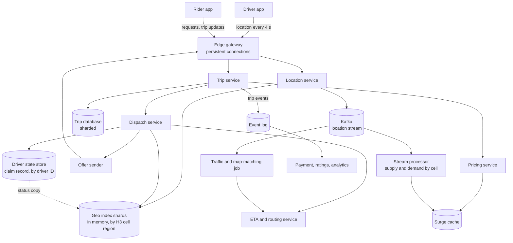
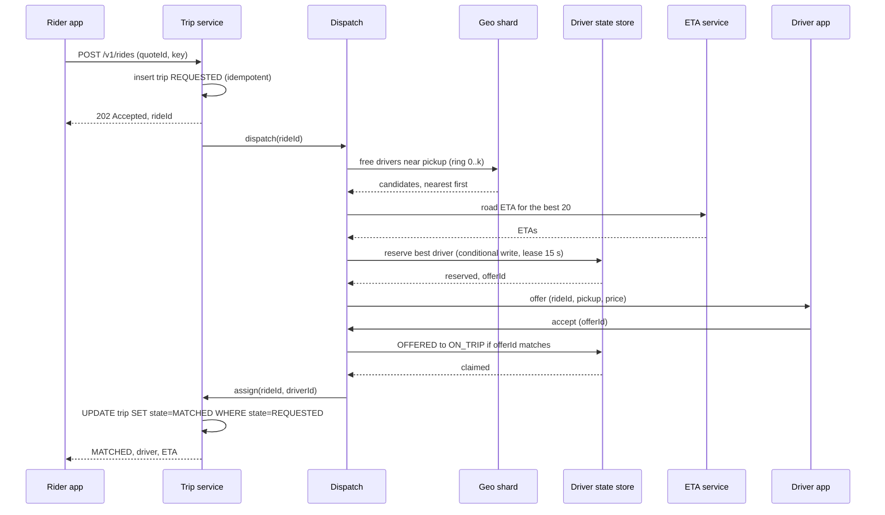

# Design a Ride-Hailing Service and Proximity Search

A ride-hailing service connects a rider with a nearby driver in a few seconds, tracks the trip, and prices it. The hard part is proximity: a million drivers move all the time, and every ride request needs the free drivers near one point. This case study gives the design that a strong candidate presents in 45 minutes: the update load of moving drivers, a geospatial index in memory, matching that never gives one driver to two riders, a trip state machine, surge pricing, and ETA.

The class-level version of this problem (matching strategy, fare strategy, trip states inside one program) is the LLD page [Design a Ride-Sharing Service](../../lld/case-studies/17-ride-sharing/README.md). This page does not repeat it. It uses the same trip states and the same driver claim rule (a compare-and-set from `AVAILABLE` to `ON_TRIP`), and it shows how they work across many servers. The index structures (geohash, S2, H3) have their home on [geospatial indexing](../fundamentals/18-geospatial-indexing.md).

!!! note "About the sources"
    Uber published most of what the industry knows about this design. The posts and talks are from 2015 to 2022, and Uber's systems have changed since. This page cites three Uber sources for specific facts: the H3 post (grid for pricing and dispatch), the Ringpop post (sharding of the geospatial service), and the DeepETA post (ETA correction). Where the page describes a choice that no source supports (the number of shards, the offer timeout, the batch window), the text says "Assumption" or "Recommendation".

## Problem Statement

The interviewer says: "Design Uber. A rider opens the app and requests a ride from a pickup point to a destination. The system finds a nearby available driver and sends the driver an offer. After the driver accepts, both see each other on a map until the trip ends. The system computes the price and the ETA. Millions of drivers send their location all the time."

The problem tests four skills: handling a high rate of small writes (location), a spatial query on moving data, a claim that two riders cannot both win, and a state machine that survives crashes.

## Clarifying Questions

Ask these in the first 5 minutes. Each row gives the answer that this design assumes.

| Question | Assumed answer |
|---|---|
| Which flows do we design? | Driver location updates, ride request, matching and offer, trip tracking, fare estimate with surge, ETA. Ratings, driver onboarding, and support are out of scope |
| What scale? | 20 million trips each day worldwide. 1 million drivers online at the peak, 500,000 on average over the day |
| How often does a driver send a location? | Every 4 seconds while online |
| Do we support shared rides (pool)? | No. One rider group for each trip. Pool is a follow-up question |
| What does "nearby" mean? | Free drivers of the requested vehicle class within a pickup ETA of about 5 to 10 minutes, searched in rings of growing radius. The first search uses about 2.5 km |
| How fast must matching be? | The first offer reaches a driver within 3 seconds at the 95th percentile. The rider sees a matched driver within 30 seconds at the 95th percentile, which leaves room for one decline or one offer timeout. The search gives up with "no driver" after 2 minutes (Assumption) |
| Does the rider see cars on a map before requesting? | Yes. Up to 8 nearby cars, refreshed every 4 seconds. They are for display, and the system does not reserve them |
| How strict is the "one driver, one trip" rule? | Strict. A driver never gets two active trips. A lost update is not acceptable |
| How fresh must a location be? | A driver position older than 15 seconds does not count as available |
| Regions? | Many cities in several cloud regions. A trip stays inside one region. A city belongs to one region |
| Payment? | A separate system. This page ends the trip with a "trip completed" event that the payment system consumes (see the payment case study, `kb/hld/case-studies/13-payment-system.md`) |

## Requirements

### Functional

1. A driver goes online or offline, and sends location updates while online.
2. A rider requests a fare estimate (price and ETA) for a pickup, a destination, and a vehicle class.
3. A rider requests a ride. The system finds a free driver nearby, sends the driver an offer, and assigns the first driver who accepts.
4. The rider and the driver see each other's position until pickup, and the rider sees the car during the trip.
5. The trip moves through `REQUESTED`, `MATCHED`, `ARRIVED`, `IN_PROGRESS`, and `COMPLETED`, or ends in `CANCELLED` (the same states as the LLD page).
6. The price includes surge. The price that the rider saw before the request is the price the rider pays.
7. After completion, the system emits an event for payment and ratings.

### Non-functional

| Requirement | Target |
|---|---|
| Location ingest | 250,000 updates per second at the peak (1 million drivers, one update each 4 seconds) |
| Nearby query latency | p99 below 50 ms inside the index (Assumption) |
| Request to offer | p95 below 3 seconds. Request to confirmed match: p95 below 30 seconds (one offer timeout is 15 seconds) |
| Consistency of assignment | A driver has at most one active trip. Strong consistency on the claim, in a durable store |
| Availability | The location path favors availability: it tolerates a lost update. The trip path favors consistency |
| Freshness of the index | A driver appears in the index within 5 seconds of an update, and disappears within 15 seconds of the last update |
| Durability | A trip record survives a node failure. A location point does not need to (the next point replaces it) |

## Estimation

Rounding rule (the same as on the [estimation page](../back-of-envelope-estimation.md)): one day is 10^5 seconds. The exact day has 86,400 seconds, so the rates are about 14% lower than the exact rates. The error is smaller than the error of the assumptions.

Inputs (all are assumptions): 20 million trips each day. 1 million drivers online at the peak and 500,000 on average. One location update each 4 seconds, 100 bytes on the wire and 100 bytes in the index (a driver ID, two coordinates, a timestamp, a heading, a status, and map overhead). 50 bytes for each stored raw point in the location stream (with the Kafka record overhead). 40 bytes for each point of a trip trail (a map-matched point stored in a batch, without the driver ID and the status, which the trip ID implies). A trip lasts 20 minutes. A trip row has 1 KB. Each trip causes 4 conditional writes on the driver claim record (two reserves, because one offer in two fails, one accept, and one release at the end). Each trip causes 10 "nearby cars" map views. Peak factor 3. A location server handles 25,000 updates each second. For each request, the dispatcher computes the route ETA for 20 candidates. A routing node handles 2,000 route queries each second (measure it).

| Step | Calculation | Result |
|---|---|---|
| Location updates each second, peak | 1,000,000 / 4 | 250,000 |
| Ingress bandwidth | 250,000 × 100 B = 25 MB/s | 200 Mbit/s |
| Index memory | 1,000,000 × 100 B | 100 MB for the whole world |
| Location servers | 250,000 / 25,000 | 10. Run 20 for failure and deploys |
| Raw location stream each day | 500,000 / 4 × 10^5 s × 50 B | 625 GB each day |
| Trips each second, average | 20,000,000 / 10^5 | 200 |
| Trips each second, peak | 200 × 3 | 600 |
| Driver claim writes each second, peak | 600 × 4 | 2,400 |
| Trail points for each trip | 20 × 60 s / 4 s | 300 |
| Trail storage each day | 20,000,000 × 300 × 40 B | 240 GB each day |
| Trip row storage | 20,000,000 × 1 KB | 20 GB each day, 7.3 TB each year, 21.9 TB with 3 replicas |
| Nearby-car views each second | 20,000,000 × 10 / 10^5 | 2,000 on average, 6,000 at the peak |
| Route queries each second, peak | 600 × 20 | 12,000 |
| Routing nodes | 12,000 / 2,000 | 6. Run 12 |

What the numbers decide:

- **The location stream is the largest load, and it is a write load.** 250,000 writes each second is far above what one primary database handles with durable writes. But the data has no value after 15 seconds. So keep it in memory, shard it, and do not make it durable. The whole index is 100 MB. Memory is not the problem. The write rate and the spread of load over cities are.
- **The durable load is small.** 600 trips each second and 2,400 driver claim writes each second at the peak fit on a few database shards. Only the trip path and the driver claim need strong storage.
- **The raw stream (625 GB each day) is the volume that costs money.** Keep it in a log (Kafka) for a few days for analytics, surge, and traffic, and keep full trails only for trips (240 GB each day).
- **Route queries are the CPU cost of matching.** 12,000 route queries each second is the reason to rank candidates by straight-line distance first and to compute the road ETA only for the best 20.

The program below checks the arithmetic, computes the size of an H3 search disk, and shows why matching one request at a time (greedy) can be worse than matching a batch. `main` comes first, and the block has its own imports, so you can copy it into `RideCheck.java` and run `java RideCheck.java` on JDK 21.

```java
import java.util.Locale;

public class RideCheck {
    public static void main(String[] args) {
        estimation();
        cells();
        matching();
    }

    static void estimation() {
        System.out.println("== Estimation (1 day = 10^5 s) ==");
        double driversPeak = 1_000_000;
        double updatesPerSecond = driversPeak / 4;
        System.out.println(g("location updates per second (peak)", updatesPerSecond));
        System.out.println(g("ingress MB/s at 100 B", updatesPerSecond * 100 / 1e6));
        System.out.println(g("ingress Mbit/s at 100 B", updatesPerSecond * 100 * 8 / 1e6));
        System.out.println(g("index memory MB (100 B each)", driversPeak * 100 / 1e6));
        System.out.println(g("location servers at 25000/s", Math.ceil(updatesPerSecond / 25_000)));
        double avgOnline = 500_000;
        double rawPerDay = avgOnline / 4 * 1e5 * 50;
        System.out.println(g("raw location stream GB per day", rawPerDay / 1e9));
        double trips = 20e6;
        System.out.println(g("trips per second (average)", trips / 1e5));
        System.out.println(g("trips per second (peak, x3)", trips / 1e5 * 3));
        System.out.println(g("driver claim writes per second (peak)", trips / 1e5 * 3 * 4));
        double points = 20 * 60 / 4;
        System.out.println(g("trail points per trip", points));
        System.out.println(g("trail GB per day (40 B each)", trips * points * 40 / 1e9));
        System.out.println(g("trip rows GB per day (1 KB)", trips * 1000 / 1e9));
        System.out.println(g("trip rows TB per year", trips * 365 * 1000 / 1e12));
        System.out.println(g("trip rows TB per year, 3 replicas", trips * 365 * 1000 * 3 / 1e12));
        double views = trips * 10;
        System.out.println(g("nearby views per second (average)", views / 1e5));
        System.out.println(g("nearby views per second (peak, x3)", views / 1e5 * 3));
        double routeQueries = trips / 1e5 * 3 * 20;
        System.out.println(g("route queries per second (peak)", routeQueries));
        System.out.println(g("routing nodes at 2000/s", Math.ceil(routeQueries / 2000)));
    }

    static void cells() {
        System.out.println("== H3 resolution 8 search disk ==");
        double edgeM = 531;
        double spacing = Math.sqrt(3) * edgeM;
        System.out.println(g("center spacing m", spacing));
        for (int k = 1; k <= 4; k++) {
            int cells = 1 + 3 * k * (k + 1);
            System.out.println(String.format(Locale.ROOT,
                    "k=%d cells=%d safe radius %.0f m", k, cells, (k - 1) * spacing));
        }
    }

    static void matching() {
        System.out.println("== Greedy against batch matching ==");
        int[] riders = {0, 8, 20};
        int[] drivers = {4, -6, 17};
        boolean[] used = new boolean[drivers.length];
        int greedy = 0;
        for (int r : riders) {
            int best = -1;
            for (int d = 0; d < drivers.length; d++) {
                if (used[d]) continue;
                if (best < 0 || Math.abs(r - drivers[d]) < Math.abs(r - drivers[best])) best = d;
            }
            used[best] = true;
            int cost = Math.abs(r - drivers[best]);
            greedy += cost;
            System.out.println("greedy rider " + r + " gets driver " + drivers[best]
                    + " cost " + cost);
        }
        int[] bestPerm = new int[1];
        bestPerm[0] = Integer.MAX_VALUE;
        permute(riders, drivers, new boolean[drivers.length], 0, 0, bestPerm);
        System.out.println("greedy total pickup distance " + greedy);
        System.out.println("batch optimum total pickup distance " + bestPerm[0]);
    }

    static void permute(int[] riders, int[] drivers, boolean[] used, int i, int sum,
                        int[] best) {
        if (i == riders.length) {
            best[0] = Math.min(best[0], sum);
            return;
        }
        for (int d = 0; d < drivers.length; d++) {
            if (used[d]) continue;
            used[d] = true;
            int cost = Math.abs(riders[i] - drivers[d]);
            permute(riders, drivers, used, i + 1, sum + cost, best);
            used[d] = false;
        }
    }

    static String g(String label, double value) {
        return String.format(Locale.ROOT, "%-40s %,.1f", label, value);
    }
}
```

<!-- expected-output -->
```text
== Estimation (1 day = 10^5 s) ==
location updates per second (peak)       250,000.0
ingress MB/s at 100 B                    25.0
ingress Mbit/s at 100 B                  200.0
index memory MB (100 B each)             100.0
location servers at 25000/s              10.0
raw location stream GB per day           625.0
trips per second (average)               200.0
trips per second (peak, x3)              600.0
driver claim writes per second (peak)    2,400.0
trail points per trip                    300.0
trail GB per day (40 B each)             240.0
trip rows GB per day (1 KB)              20.0
trip rows TB per year                    7.3
trip rows TB per year, 3 replicas        21.9
nearby views per second (average)        2,000.0
nearby views per second (peak, x3)       6,000.0
route queries per second (peak)          12,000.0
routing nodes at 2000/s                  6.0
== H3 resolution 8 search disk ==
center spacing m                         919.7
k=1 cells=7 safe radius 0 m
k=2 cells=19 safe radius 920 m
k=3 cells=37 safe radius 1839 m
k=4 cells=61 safe radius 2759 m
== Greedy against batch matching ==
greedy rider 0 gets driver 4 cost 4
greedy rider 8 gets driver 17 cost 9
greedy rider 20 gets driver -6 cost 26
greedy total pickup distance 39
batch optimum total pickup distance 13
```

How to read the output. The H3 section uses the resolution 8 average edge length from the H3 table (0.531 km, approximate; the table says that it extrapolated the values for resolution 7 and finer). The centers of two neighbor cells are about `sqrt(3) × 531 = 920 m` apart. A disk of *k* rings has `1 + 3k(k + 1)` cells. The "safe radius" column is this page's own conservative rule of thumb, `(k - 1) × 920 m`. It is the radius of a circle around the rider that the disk covers completely, wherever the rider stands in the center cell. A check of the geometry with regular, flat hexagons of edge 531 m gives a slightly larger exact value (about 1,405 m for *k* = 2, 2,124 m for *k* = 3, and 2,956 m for *k* = 4), so the rule is safe with a margin. The margin matters, because real H3 cells differ in size from the average. For the first search of 2.5 km, the design uses *k* = 4 (61 cells, safe radius about 2.76 km). In the matching section, riders at 0, 8, and 20 m (on a line) and drivers at 4, -6, and 17 m show the greedy flaw. Greedy serves the rider at 0 first and takes the driver at 4 (4 m). The rider at 8 then takes the driver at 17 (9 m), because the driver at 4 is gone. The rider at 20 gets the driver at -6, 26 m away. The total is 39. The batch optimum gives -6 to the rider at 0, 4 to the rider at 8, and 17 to the rider at 20, for a total of 13.

## API Design

Driver apps and rider apps hold a persistent connection to the edge (see [communication patterns](../fundamentals/09-communication-patterns.md)). The driver app uses it for location updates, and the service uses it to push offers. The rider app uses it to receive trip updates. Mobile push (APNs and FCM) is the fallback when the connection is closed. Every request that creates something carries an `Idempotency-Key` header (see [reliability patterns](../fundamentals/12-reliability-patterns.md)).

### `POST /v1/drivers/{driverId}/locations`

A batch of points. The driver app sends one point each 4 seconds. After a network gap, it sends all the buffered points in one request.

Request:

```json
{
  "points": [
    {"lat": 12.9716, "lon": 77.5946, "heading": 90, "speedMps": 8.2,
     "accuracyM": 6, "seq": 10452, "clientTime": "2026-10-15T08:30:04Z"}
  ]
}
```

Response: `204 No Content`. The service checks `seq` and drops a point that is older than the point that it holds (reordering on mobile networks is common). The service never blocks the driver on a durable write.

### `PUT /v1/drivers/{driverId}/status`

Request: `{"status": "ONLINE", "vehicleClass": "ECONOMY"}`. Allowed values: `ONLINE`, `OFFLINE`. Response: `200 OK`. The status `ON_TRIP` is not set by the client. The trip service sets it.

### `GET /v1/quotes?pickup=12.97,77.59&dropoff=12.93,77.62&class=ECONOMY`

Response `200 OK`:

```json
{
  "quoteId": "q_8f2c",
  "priceCents": 18400,
  "surgeMultiplierX100": 150,
  "pickupEtaSeconds": 240,
  "tripEtaSeconds": 1320,
  "expiresAt": "2026-10-15T08:35:00Z"
}
```

The quote holds the price (including the surge multiplier) for 5 minutes (Assumption). The ride request refers to the quote.

### `POST /v1/rides`

Request: `{"quoteId": "q_8f2c", "pickup": {...}, "dropoff": {...}, "class": "ECONOMY"}`, with `Idempotency-Key`.

Response `202 Accepted`: `{"rideId": "r_71ab", "state": "REQUESTED"}`. The request starts matching, which takes seconds, so the response does not wait. The rider app receives the match over the connection. If the same key arrives again, the service returns the same `rideId`. If the rider already has an active ride, the response is `409 Conflict`.

### `GET /v1/rides/{rideId}`

Returns the state, the driver (after `MATCHED`), the surge multiplier, and the ETA. The app uses it to recover after it was closed.

### `POST /v1/rides/{rideId}/cancel`

Response `200 OK` with the final state, or `409 Conflict` if the ride has started (`IN_PROGRESS` or later).

### Driver-side endpoints

| Method and path | Purpose | Response |
|---|---|---|
| `POST /v1/offers/{offerId}/accept` | The driver accepts an offer | `200 OK` with the trip, or `409 Conflict` if the offer expired or another driver took the trip |
| `POST /v1/offers/{offerId}/decline` | The driver declines | `204 No Content` |
| `POST /v1/rides/{rideId}/arrived` | The driver is at the pickup point | `200 OK` |
| `POST /v1/rides/{rideId}/start` | The ride starts | `200 OK` |
| `POST /v1/rides/{rideId}/complete` | The ride ends | `200 OK` with the final fare |

### `GET /v1/nearby-drivers?lat=12.97&lon=77.59&class=ECONOMY`

Returns up to 8 cars (`lat`, `lon`, `heading`) for the map. The service rounds the data and does not return driver IDs. The service rate-limits the endpoint per rider (see [rate limiting algorithms](../fundamentals/13-rate-limiting-algorithms.md)), because it leaks the positions of all drivers to a scraper.

## Data Model

The system has two kinds of data with opposite needs.

| Data | Needs | Store |
|---|---|---|
| Live driver position and availability | 250,000 writes each second. Reads by area. Loss of 15 seconds of data is acceptable | In-memory index, sharded by geography. No disk on the write path |
| Trip and its state | Strong consistency. Conditional updates. 600 writes each second at the peak. Durable | A sharded relational database (PostgreSQL or MySQL), or a key-value store with conditional writes (for example DynamoDB) |
| Driver claim and offers | One record for each driver: is the driver free, offered, or on a trip. An atomic conditional write. Durable, because a lost `ON_TRIP` status gives one driver two trips. 2,400 writes each second at the peak | The `driver_state` table, keyed by `driver_id`, in the same kind of store as the trips (relational, or key-value with conditional writes). The geo index keeps a copy of the status only to filter candidates |
| Trip trail | Append-only. Read by trip. 240 GB each day | A wide-column store or object storage in time-ordered batches, keyed by trip ID |
| Surge and supply counters | Aggregations by cell and time window | A stream processor (Flink or Kafka Streams) that writes the multiplier for each cell to a cache with a TTL |
| Raw location history | Large, append-only, read in bulk | Kafka with 3 days of retention, then a data lake |

### Tables

`trips` (partitioned by `trip_id`, or by `city_id` and then `trip_id`):

| Column | Type | Note |
|---|---|---|
| `trip_id` | 64-bit ID | Primary key. Time-ordered ID (see [unique ID generation](../fundamentals/15-unique-id-generation.md)) |
| `rider_id`, `driver_id` | 64-bit ID | `driver_id` is null until `MATCHED` |
| `state` | small integer | The trip state |
| `version` | integer | Increases with each transition |
| `city_id`, `vehicle_class` | small integer | |
| `pickup`, `dropoff` | two doubles each | Plus the H3 cell of the pickup at resolution 8 |
| `quote_id`, `surge_x100`, `quoted_price_cents` | | The surge percent is fixed when the rider requests (the same rule as the LLD page) |
| `requested_at`, `matched_at`, `started_at`, `completed_at` | timestamp | |
| `final_fare_cents` | integer (cents) | Money is an integer, never a `double` |

Indexes: a secondary index `(rider_id, requested_at DESC)` for the rider's history and for "is there an active trip", and `(driver_id, requested_at DESC)`. On a single database, a partial unique index on `driver_id` where `state IN (MATCHED, ARRIVED, IN_PROGRESS)` would make "one active trip for each driver" a database rule. If the database is sharded by trip ID, a unique index is local to a shard, so it cannot enforce the rule across shards. That is why the rule lives in its own table, keyed by the driver.

`driver_state` (primary key `driver_id`, sharded by `driver_id`): the claim record of deep dive 2.

| Column | Type | Note |
|---|---|---|
| `driver_id` | 64-bit ID | Primary key |
| `status` | small integer | `OFFLINE`, `AVAILABLE`, `OFFERED`, `ON_TRIP` |
| `offer_id`, `offer_expires_at` | ID, timestamp | Set while `OFFERED`. The offer ID is the fencing token. The expiry is the lease |
| `trip_id` | 64-bit ID, nullable | Set while `ON_TRIP`. The reconciliation job uses it to compare with the trip row |
| `version` | integer | Increases with each change. The geo index copies the status with this version and ignores an older copy |

The driver's position is not in this table. The position changes every 4 seconds and lives only in the geo index. The status changes a few times for each trip, so a durable table handles it.

`trip_events` (append-only, for audit and for rebuilding state): `(trip_id, seq, event_type, payload, at)`.

`drivers`: `(driver_id, vehicle_class, rating_x100, city_id, ...)`. A normal relational table. It changes rarely and has about 5 million rows (Assumption).

Live index (in memory on each geo shard):

```text
cell index    :  H3 cell (resolution 8)  ->  set of driver IDs
driver record :  driver ID -> {lat, lon, heading, seq, updatedAt, status, vehicleClass, cell}
```

Surge (cache, TTL 2 minutes): `surge:{cityId}:{h3cell8}` -> multiplier in hundredths.

### Database choice

The trip store and the `driver_state` table need one thing from the database: a conditional update on one row (`UPDATE ... WHERE state = 'REQUESTED'`), which every relational database and DynamoDB (conditional writes) support. The write rate is small, so any sharded store works. The decision is not about scale. It is about correctness of the state machine. See [choosing a database](../fundamentals/04-choosing-a-database.md) and [partitioning and sharding](../fundamentals/06-partitioning-and-sharding.md).

The live index is not a database. A database with a spatial index (PostGIS with a GiST index) stores each update on disk, so 250,000 updates each second would need a large cluster. For data that is useless after 15 seconds, durability is wasted work. See the nearby-search table in the geospatial page, which reaches the same conclusion.

## High-Level Design



### Components

| Component | Responsibility |
|---|---|
| Edge gateway | Terminates TLS, holds the persistent connections (WebSocket or gRPC streams), authenticates, and routes messages to the services. Holds about 100,000 connections for each server (Assumption, see the connection arithmetic on the communication patterns page). 1 million driver connections plus the riders need tens of gateways |
| Location service | Validates a point, drops stale or out-of-order points, computes the H3 cell, and writes to the geo index shard that owns the cell. It also appends the point to Kafka. It is stateless |
| Geo index shards | Hold the live position of each driver and a copy of the driver's status in memory. Answer "free drivers of class C near point P". Each shard owns a set of cells. The index is soft state: if a shard dies, the drivers' next updates rebuild it in seconds |
| Dispatch service | Takes a ride request, finds candidates, ranks them, sends offers one at a time, and commits the match |
| Driver state store | Holds one claim record for each driver (`driver_state`). The only place where a driver changes from `AVAILABLE` to `OFFERED` to `ON_TRIP`. Durable and sharded by driver ID. Its changes go to the geo index as a status copy for filtering |
| ETA and routing service | Computes the road ETA between two points. Uses a road graph and live traffic |
| Offer sender | Pushes an offer to a driver over the connection (and over mobile push as a fallback) and receives the answer |
| Trip service | Owns the trip state machine and the trip database. The only writer of trip state |
| Pricing service | Computes a quote: base price from the route, times the surge multiplier of the pickup cell |
| Stream processor | Reads the location stream and the request stream, counts supply and demand for each cell in a sliding window, and writes the surge multiplier |
| Kafka | Carries the location stream and trip events (see [message queues and streams](../fundamentals/08-message-queues-and-streams.md)) |

### Flow of a ride request



If the driver declines or the offer expires after 15 seconds, the dispatcher releases the reservation and offers to the next candidate. If no driver accepts after the search reaches its maximum radius or the time limit (2 minutes, Assumption), the trip becomes `CANCELLED` with the reason "no driver".

## Deep Dives

### Deep dive 1: Location updates and the geospatial index

**The load.** 250,000 updates each second, 20 location servers. Each update goes to one place, the shard that owns the driver's cell. The location server hashes nothing. It computes the H3 cell at resolution 8 from the coordinates, and a routing table maps the cell (or its resolution 4 parent, a region of about 1,770 km2, approximate) to a shard.

**Why resolution 8.** An H3 resolution 8 cell has an average area of about 0.737 km2 and an average edge of about 531 m (H3 "Table of Cell Areas"). In a dense city, a cell holds a few dozen drivers at the peak (1 million drivers over a world of cities with perhaps 100,000 active cells, so about 10 on average and hundreds in a hot cell, Assumption). A cell smaller than that (resolution 9, edge about 201 m) makes the search disk bigger in cell count. A larger cell (resolution 7, edge about 1.4 km) makes each cell hold too many drivers to scan.

**Cell choice: H3, S2, or geohash.** All three work (see the comparison on the geospatial page). This design chooses H3 for two reasons. First, Uber describes H3 as the grid for "optimizing ride pricing and dispatch", and the hexagon has one center-to-neighbor distance, so a search by rings and a smoothing of surge over neighbors are uniform (Uber Engineering, "H3: Uber's Hexagonal Hierarchical Spatial Index"). Second, `gridDisk` gives the cells of a search ring in one call. S2 is an equally good answer with `S2RegionCoverer`, and geohash is acceptable with the 9-cell border rule. Say the reason for the choice, and name the other two.

**The update algorithm.**

1. The location service receives a point for driver D with sequence number `seq`.
2. If `seq` is not greater than the stored `seq` of D, drop the point.
3. Compute `newCell = latLngToCell(lat, lon, 8)`.
4. Send the update to the shard that owns `newCell`. That shard writes the new record for D.
5. If D's old cell differs from `newCell`, the shard removes D from the old cell's set and adds D to the new one. If the old cell belongs to another shard, the old shard receives a removal message. Most updates stay in the same cell: a car at 50 km/h moves about 55 m in 4 seconds, and the cell edge is 531 m, so a car in a straight line changes cell on average about once in 17 updates (a cell is about 920 m wide across its flat sides, and 920 / 55 is about 17). A car that crosses a cell near a corner changes cell sooner.
6. Each record has a time of last update. A sweep removes records older than 15 seconds. This removes drivers whose app died.

**One owner for each position.** A driver's position record lives on exactly one shard: the shard of the driver's current cell. When the driver crosses into a cell of another shard, the record moves with the update (step 5). During the move, a nearby query might miss the driver for one update interval (4 seconds), or, for a moment, see the driver on both shards. Both cases are harmless, because the index only finds candidates. The claim (deep dive 2) runs on the `driver_state` record, which is keyed by the driver ID and does not move when the car moves.

**Sharding the index.** Shard by region. A city is a set of cells with the same resolution 4 or 5 parent, so one shard serves all the queries of a city and no query crosses a network boundary, except near the border of two shards. For the border, the dispatcher sends the query to both shards (the query covers cells of both) and merges the answers. The ownership map of regions to shards is a small table. Two ways to build it:

| Way | How | Trade-off |
|---|---|---|
| Static map plus manual splits | An operator assigns regions to shards, and splits a hot city into more regions | Simple and predictable. Needs a person to react to growth |
| Consistent hash ring over region keys | A library maps a region key to a node and moves regions when nodes change. Uber's Ringpop does this: it combines SWIM gossip for membership, consistent hashing, and request forwarding, and Uber states that its first use was the geospatial service that finds matches for ride requests, replacing an in-memory system that scanned every vehicle (Uber Engineering, "Ringpop: Scalable, fault-tolerant application-layer sharding") | Automatic rebalancing. A hot region still lands on one node. See [partitioning and sharding](../fundamentals/06-partitioning-and-sharding.md) for the ring and for virtual nodes |

Recommendation: use a coarse key (resolution 4 or 5 parent) with a consistent hash ring, and keep an override table for hot cities that an operator can split to finer cells (resolution 6).

**Hot cities.** The load of one shard follows the density of its region. A shard for a city of 100,000 online drivers sees 25,000 updates each second. That is within one node's capacity (25,000 each second is the planning figure above, so measure). A larger city splits to several shards by resolution 6 parents, and a search that crosses the shard border queries both.

**Replication and failure.** Do not replicate the index synchronously. Each shard has a warm standby that consumes the same updates (a second subscription to the location topic in Kafka, or a duplicate send). If the primary shard fails, the standby takes over with a state that is at most a few seconds old. If both fail, the shard restarts empty and fills within one update interval (4 seconds) as the drivers send their next points. A rebuilt shard knows the positions but not the status of each driver, so it loads the status copy from the driver state store (or treats every driver as "status unknown" until the copy arrives). Even a wrong status copy cannot assign a driver twice, because the claim checks the durable record. This is why the design can keep the location path "available, not durable".

**What the driver app does.** The app sends points at a fixed rate and adapts. It can lower the rate when the car does not move, and raise it near the pickup point. It batches points when the network is bad. The server accepts batches (see the API). This is a design choice with a cost on each side: a lower rate saves battery and bandwidth but makes the position older.

**Noise and map matching.** GPS points jump. A stream job snaps points to roads (map matching) and writes the cleaned position for trip trails and for traffic estimates. The index uses the raw position, because the 4-second freshness matters more than the 5-meter accuracy.

**The rider's map.** The "nearby cars" view queries the same index, takes up to 8 cars, and returns rounded positions. The rider app interpolates between updates so the cars move smoothly. The service does not push every update to the riders: 6,000 views each second at the peak is small, but pushing 250,000 updates each second to riders would not be.

### Deep dive 2: Matching and the single-assignment guarantee

**Candidate search.**

1. Take the pickup cell and compute `gridDisk(cell, k)` with *k* = 4 (61 cells, a safe radius of about 2.76 km, which covers the first search of 2.5 km).
2. Read the driver sets of those cells from the shards that own them. Filter by vehicle class, by the status copy `AVAILABLE`, and by freshness (updated in the last 15 seconds).
3. If fewer than 5 candidates remain, widen the ring (*k* = 8, then 12) up to the maximum radius (Assumption: about 8 km) and repeat.
4. Sort the candidates by straight-line distance (Haversine). Keep the nearest 20.
5. Ask the ETA service for the road ETA of each. Straight-line distance misleads across a river or a one-way system, so rank by ETA.

The ETA step costs 12,000 route queries each second at the peak (see the estimation), which is why it runs on 20 candidates and not on all of them.

**Ranking.** The sort key is the pickup ETA. The design may add the driver's acceptance rate, a bonus for a driver who is about to finish a trip near the pickup (a driver on a trip can be a candidate if the trip ends within seconds near the pickup), and fairness rules. Keep the ranking function replaceable, as the LLD page does with `MatchingStrategy`.

**One at a time or several at once.** The dispatcher sends an offer to the best driver and waits up to 15 seconds (Assumption), then goes to the next. The alternative is to send the offer to the best 3 drivers at once and take the first accept. The table shows the trade-off.

| Option | Time to match | Driver experience | Risk |
|---|---|---|---|
| One offer at a time | Slow if the first drivers decline: each decline or timeout costs up to 15 seconds | A driver who gets an offer is sure to win it if the driver accepts | A rider waits long in a thin market |
| Offers to the best 3 at once | Faster: the first accept wins | Two drivers lose a race and see "offer taken". This frustrates drivers | More offer traffic. A driver who accepts late wastes time |

Recommendation: start with one offer at a time with a 10 to 15 second timeout, because it is simpler to reason about. Move to a few parallel offers only when the data shows that the match time is too long.

**Matching one request at a time, or in a batch.** A greedy matcher serves each request with the nearest driver at that moment. As the program above shows, greedy can give a worse total pickup distance than an optimal assignment of a batch (39 against 13 in the example). A batch matcher collects the requests of a short window (Assumption: 2 seconds) in one area, builds a cost matrix of pickup ETAs between the requests and the free drivers, and solves the assignment problem (the Hungarian algorithm, `O(n^3)`, or a greedy approximation). The cost: every request waits for the window to close, and a batch needs a single owner for the area. Matt Ranney's QCon London 2015 talk, "Scaling Uber's Real-time Market Platform", covers "the dispatch systems, the geospatial index, handling failure", and "the distributed traveling salesman problem" (InfoQ summary). None of the sources on this page describes a batch window at Uber, so this page treats the window as a design option, not as a fact about Uber.

**The claim.** Two riders must not get the same driver. The LLD page solves this with `Driver.tryReserve()`, an `AtomicReference` compare-and-set from `AVAILABLE` to `ON_TRIP` (see the LLD ride-sharing page, section "Key Code"). On many servers, the same idea needs one owner for each driver's status, and that owner must not lose the status. The geo shard is the wrong owner for two reasons: it loses all state if the primary and the standby both fail, and the owner shard changes when the car crosses a shard border. So the owner is the `driver_state` row, keyed by the driver ID. A conditional update on one row is the distributed form of the compare-and-set.

1. The dispatcher reserves the best candidate with a lease (PostgreSQL syntax, because of `now()` and `interval`):

    <!-- sql-skip: postgresql -->
    ```sql
    UPDATE driver_state
    SET status = 'OFFERED', offer_id = ?, offer_expires_at = now() + interval '15 seconds',
        version = version + 1
    WHERE driver_id = ?
      AND (status = 'AVAILABLE' OR (status = 'OFFERED' AND offer_expires_at <= now()));
    ```

    If one row changes, the dispatcher owns the offer. If zero rows change, another dispatcher won, and this dispatcher takes the next candidate. One of two concurrent callers wins, because the database serializes the two updates on the row lock.

2. The dispatcher sends the offer with `offerId`. The driver accepts with `offerId`.
3. The accept is a second conditional update: `SET status = 'ON_TRIP', trip_id = ? WHERE driver_id = ? AND status = 'OFFERED' AND offer_id = ? AND offer_expires_at > now()`. If the offer expired, or another offer replaced it, zero rows change, and the accept fails with `409 Conflict`.
4. The dispatcher calls the trip service, which runs `UPDATE trips SET state = 'MATCHED', driver_id = ?, version = version + 1 WHERE trip_id = ? AND state = 'REQUESTED'`. If zero rows change (the rider cancelled in the meantime), the dispatcher releases the driver with `SET status = 'AVAILABLE', trip_id = NULL WHERE driver_id = ? AND status = 'ON_TRIP' AND trip_id = ?`. The trip service runs the same release when the trip ends in `COMPLETED` or `CANCELLED`.
5. The change of `driver_state` goes to the geo index as a status copy with its `version`, so later searches skip the driver. A stale copy costs one failed reserve and nothing more.

The reservation is a lease: it expires by itself, so a crashed dispatcher does not hold a driver forever. The `offerId` acts as a fencing token (see [distributed locks and leases](../distributed-systems/05-distributed-locks-and-leases.md)): a late accept for an old offer is rejected, because the row checks the token. The locks page defines a fencing token as a number that grows with each grant. Here the row stores the current offer ID and accepts only that ID. The effect is the same, because the row is both the lock and the resource. The time comes from the database clock only, so the clocks of the dispatchers do not matter. A separate distributed lock (Redis or ZooKeeper) is not needed, because the row is already the single writer for the driver's status. That is the first question to ask in any design with a claim: who is the one owner of this state, and does it survive a crash?

The load is small: 2,400 conditional writes each second at the peak (see the estimation), spread over the shards by driver ID. A claim never crosses two shards, because it touches one driver row. The step from the driver row to the trip row crosses two shards, and deep dive 3 covers what happens between the two writes.

**Crash safety of the dispatcher.** The dispatcher is a stateless worker, so the state of a request must survive its crash. The trip row (`REQUESTED`) is the durable record. A "needs dispatch" message in a queue, or a periodic scan of `REQUESTED` trips older than a few seconds with no active dispatcher, restarts the search. The reservation has a lease of 15 seconds, so a dead dispatcher releases its driver within 15 seconds. The trip service guarantees by its conditional update that restarting cannot produce two matches for the same trip.

**Driver who is on a trip and a driver who is offline.** An `OFFLINE` driver is removed from the index. A driver with `ON_TRIP` stays in the index (for the map and for "about to finish" matching) but the dispatcher skips the driver unless the ranking rule allows it.

### Deep dive 3: The trip state machine and its consistency

The states are the same as in the LLD page: `REQUESTED`, `MATCHED`, `ARRIVED`, `IN_PROGRESS`, `COMPLETED`, `CANCELLED`. Each transition is a conditional update on the trip row.

| Transition | Event | Condition in the `WHERE` clause | Side effect |
|---|---|---|---|
| `REQUESTED` to `MATCHED` | Driver accepted | `state = 'REQUESTED'` | Push to the rider |
| `MATCHED` to `ARRIVED` | Driver at pickup | `state = 'MATCHED' AND driver_id = ?` | Notify the rider |
| `ARRIVED` to `IN_PROGRESS` | Ride starts | `state = 'ARRIVED'` | Start fare meter |
| `IN_PROGRESS` to `COMPLETED` | Ride ends | `state = 'IN_PROGRESS'` | Emit `TripCompleted` for payment |
| `REQUESTED`, `MATCHED`, or `ARRIVED` to `CANCELLED` | Rider cancels, or no driver | `state IN (...)` | Release the driver |

A transition that finds zero changed rows returns `409 Conflict` to the caller. This resolves the races without a lock: if the rider cancels at the same moment as the driver presses "start", exactly one of the two conditional updates succeeds, and the other sees `409`.

**Idempotent transitions.** Mobile apps retry. A repeated `complete` call must not charge twice. Each transition request carries an idempotency key or its target state, and a repeated call that finds the trip already in the target state returns the same success. The trip service writes the state change and an outbox row in one local transaction (see the transactional outbox in [distributed transactions](../distributed-systems/03-distributed-transactions.md)), and a relay publishes `TripCompleted` to Kafka. Payment consumes the event with an inbox check. This avoids the dual-write problem: the database and the event log never disagree.

**Two records, one order of writes.** The `driver_state` row is the truth for "is this driver free right now". The trip row is the truth for "which driver has which trip". They are on different shards, so no single transaction covers both. The two can disagree for a short time: the driver row says `ON_TRIP` with `trip_id = T`, but trip T is not yet `MATCHED`. The design handles this by order and by repair. The driver row changes first (the claim), then the trip row. A reconciliation job runs every few seconds over drivers in `ON_TRIP`: if the trip that the driver row names is `CANCELLED` or `COMPLETED`, or stays `REQUESTED` with another driver for longer than a limit, the job releases the driver with a conditional update on `trip_id`. If a trip is `MATCHED` and its driver row does not name it, the job repairs the driver row. The trip row wins every conflict, because the rider and the payment see the trip.

**Tracking during the trip.** The driver's points go to the location service as before. The service also sends them to a pub-sub channel keyed by `tripId`, and the rider's gateway subscribes to it. The rider sees the car through the connection (see [communication patterns](../fundamentals/09-communication-patterns.md) for the routing of a message to the right gateway). The trail is appended to the trip trail store in batches.

**Driver or rider disconnects.** If the driver's connection drops during a trip, the trip does not change state. The service keeps the trip, and the driver app resumes after reconnect with `GET /v1/rides/{id}`. If a driver is silent for a long time (Assumption: 2 minutes) during `MATCHED`, the dispatcher can cancel the match and re-dispatch (see "Bottlenecks").

### Deep dive 4: Surge pricing and ETA

#### Surge pricing

**Goal.** When demand in an area is higher than supply, a higher price lowers demand and attracts drivers. The multiplier is a function of the ratio of requests to free drivers in the area (the LLD page implements this as `DemandSupplySurge`, with an in-process counter).

**The computation at scale.**

1. Two streams feed the stream processor (see [batch and stream processing](../fundamentals/17-batch-and-stream-processing.md)): the location stream (supply: free drivers) and the request stream (demand: ride requests and app opens that show a price).
2. Each event gets its H3 cell. The processor keeps, for each cell at resolution 8, a count over a sliding window of a few minutes (Assumption: 5 minutes, hop of 30 seconds).
3. It computes `ratio = demand / max(supply, 1)` and maps the ratio to a multiplier with a step function or a smooth curve, with a minimum of 1.0 and a cap (a legal limit in some cities).
4. It smooths the result: the multiplier of a cell moves toward the average of the cell and its neighbors (`gridDisk(cell, 1)`), and it limits the change for each interval. Without smoothing, a driver sees a boundary where the price doubles on one side of a street. Uber's H3 post states that Uber measures supply and demand in hexagons to compute surge, and that the equal distance to all six neighbors simplifies smoothing across a gradient.
5. It writes `surge:{city}:{cell}` to a cache with a TTL of 2 minutes.

**The quote.** The pricing service reads the multiplier of the pickup cell, computes the price (base fare from the route distance and time, times the multiplier), and stores a quote with a 5-minute expiry (Assumption). The ride request refers to the quote. The trip stores `surge_x100`. This is the rule on the LLD page ("the trip stores the percent once") applied across services: a surge that changes during the ride cannot change the price.

**Failure.** If the surge pipeline stops, the cache entries expire after 2 minutes, and the pricing service falls back to a multiplier of 1.0 or to the last known value with a limit. The business decides. A stale high multiplier harms riders, and a missing one loses revenue and the supply it attracts. Recommendation: fall back to the last value for up to 10 minutes, then to 1.0, and alert.

#### ETA

There are two ETAs. The pickup ETA (driver to rider) ranks candidates. The trip ETA (pickup to destination) drives the price estimate and the rider's expectation.

**Routing.** The road network is a weighted graph (intersections as nodes, road segments as edges, travel time as weight). A plain Dijkstra search on a city graph is too slow for 12,000 queries each second. Production routing engines preprocess the graph. Contraction hierarchies (Geisberger, Sanders, Schultes, and Delling, WEA 2008) add shortcut edges so that a query visits a tiny part of the graph. The open-source OSRM engine offers two preprocessing pipelines: contraction hierarchies (`osrm-contract`) and multi-level Dijkstra (MLD, `osrm-partition` and `osrm-customize`), and its README recommends MLD by default (OSRM README). The routing service keeps the graph in memory, one copy for each node, and the number of nodes scales with the query rate (6 nodes by the estimate, 12 with headroom).

**Traffic.** Edge weights change with traffic. The location stream gives the speed of every car on every segment. A stream job map-matches points to segments, averages the speed for each segment over a recent window, and publishes new weights to the routing nodes every few minutes (Assumption). With plain contraction hierarchies, new weights mean a new contraction of the graph. OSRM's multi-level Dijkstra pipeline has a separate `osrm-customize` step after `osrm-partition`, and OSRM recommends MLD by default. Any of these preprocessing runs costs far more than one query, which is why weights change in batches and not for each point.

**Correction with machine learning.** The routing ETA is a sum of segment times, and it has a systematic error (turns, stops, pickup time, driver behavior). Uber's DeepETA post states that Uber's routing engine produces a baseline ETA from segment traversal times, and that a model then predicts the residual between that baseline and the observed outcome. The final ETA is the baseline plus the correction. This design keeps the same split: a deterministic routing engine that is easy to debug, plus a learned correction that can be rolled back.

**Cache.** Many ETA queries repeat: the same pickup area to the same drivers' area. A cache keyed by (cell of origin, cell of destination, time bucket of 1 to 5 minutes) answers many of them with a small loss of accuracy. This is a trade-off, and the cell size sets the error.

## Bottlenecks and Scaling

What fails first as load grows, in the order that it usually fails:

| Bottleneck | Symptom | Fix |
|---|---|---|
| Location ingest in one hot city | One geo shard at its write limit. Updates queue. Index freshness grows | Split the city to finer regions (resolution 6 parents). Drop stale updates under load (a newer point replaces the older point, so dropping the older one loses nothing). Raise the interval of drivers who do not move |
| Request spike at one place (concert ends, airport, rain) | Thousands of requests in one cell. Few drivers. Dispatch queue grows. Surge rises | Surge shifts demand and supply. Rate-limit dispatch for a cell. Queue the requests and keep the rider informed. Pre-position drivers with hints |
| Reconnect storm | A gateway fails, and 100,000 apps reconnect at once. Authentication and TLS overload the next gateways | Jittered backoff in the client (see [reliability patterns](../fundamentals/12-reliability-patterns.md)). Session resumption. Spare gateway capacity |
| Routing CPU | ETA queries slow. Dispatch latency grows | Rank by straight line first and compute ETA for fewer candidates. ETA cache by cell pair. Add nodes |
| Trip database | Hot shard if keyed by city. Write latency | Key by trip ID, not city. Index tables for rider and driver history written by an event consumer |
| Kafka lag | Surge and traffic are stale | Add partitions (key by cell region). Make consumers idempotent. Surge falls back to the last value |
| Region failure | A city is unreachable | Each city has a home region. Replicate trip data to a second region asynchronously (see [multi-region and disaster recovery](../fundamentals/19-multi-region-and-disaster-recovery.md)). On failover, drivers reconnect and rebuild the index within seconds. Active trips resume from the last replicated state, and a few seconds of state changes can be lost, so the apps resync with `GET /v1/rides/{id}` |
| Geo shard failure | Matching in a region stops for a few seconds | Warm standby. If it also fails, the index refills in about 4 seconds |

## Trade-offs

| Decision | Chosen | Rejected | Why |
|---|---|---|---|
| Live location store | In-memory index, sharded by region, no durability | PostGIS or another database with a spatial index on each update | 250,000 writes each second of data that is worthless after 15 seconds. A disk index would need a large cluster for no benefit |
| Cell system | H3, resolution 8 | Geohash, S2 | Uniform neighbor distance for ring search and surge smoothing. Geohash and S2 also work if the team knows them |
| Index sharding | Region key, consistent hash ring, override for hot cities | Hash of the driver ID | A hash of the driver ID scatters the drivers of one area over all shards, and every nearby query becomes a scatter to all shards |
| Index replication | Warm standby with a stream copy, rebuild from the next updates | Synchronous replication | The data lives for 15 seconds. Synchronous replication adds latency for nothing |
| Assignment claim | One durable `driver_state` row for each driver, with a conditional update, a reservation lease, and an `offerId` as the fencing token | A distributed lock on the driver (Redis or ZooKeeper). The claim in the in-memory geo shard | The row is the single writer and survives a crash. A lock service adds a failure mode and needs fencing anyway. The geo shard loses its state when it fails, and its owner changes when the car crosses a shard border |
| Offers | One at a time, 10 to 15 seconds | Parallel offers to several drivers | Simple, and the driver who accepts always wins. Move to parallel offers when data demands it |
| Matching | Greedy for each request first, batch window as an upgrade | Batch from the start | Greedy is the simplest correct design. The batch gain appears at high density (see the program) |
| Trip store | Sharded relational or conditional-write key-value, key by trip ID | A store without conditional writes, with a lock service on top | The state machine needs a conditional update. Adding a lock service adds a failure mode |
| Price | A quote with a fixed multiplier for 5 minutes | Recompute at the end of the trip | The rider agreed to a price. A changing price breaks trust and the LLD rule |
| ETA | Routing engine plus a learned correction | A learned model only | The engine is explainable and works in new cities. The correction improves accuracy |
| Location protocol | Persistent connection, batch of points | One HTTP request for each point | At 250,000 updates each second, per-request TLS and headers are too costly. Batching handles network gaps |

## Follow-up Questions

??? question "Why not store driver locations in a database with a spatial index, such as PostGIS?"

    The direct answer: the update rate is too high, and the data is worth nothing after a few seconds. The design has 250,000 updates each second at the peak. A database that writes each update to disk and maintains a spatial index (a GiST R-tree in PostGIS) needs a large, sharded cluster for that rate. The result of that cost is a position that the next update replaces within 4 seconds.

    The reason: durability and rich queries are what a database gives, and this data needs neither. A lost update is replaced by the next one. The queries are simple (free drivers in these cells). So keep the data in memory, in a map from cell to driver set, shard it by region, and let it rebuild itself from the stream of updates after a failure.

    The trade-off: the in-memory index has no history and no ad hoc queries. History goes to Kafka and a data lake for analytics. A database with a spatial index fits when objects are static or move slowly, for example stores, restaurants, or delivery zones (see the geospatial page).

??? question "A driver is near the border between two cells, or two index shards. How does the search avoid missing the driver?"

    The search does not read only the rider's cell. It reads a ring of cells around it. In H3 that is `gridDisk(cell, k)`, which returns the cell and all cells within *k* steps. With resolution 8 (center spacing about 920 m) and *k* = 4, that is 61 cells and a safe radius of about 2.76 km by this page's conservative rule `(k - 1) × 920 m`. The search then filters by exact distance, so the extra cells cost only a few more reads.

    When the ring crosses the border of two shards, the dispatcher sends the read to both shards and merges the answers. A shard border is a region border (resolution 4 or 5), so only searches near a region edge pay this cost.

    A driver within the search radius can be missed only if the disk is too small. The disk covers whole cells, so the question is only whether the union of the cells contains the whole search circle around the rider. The rider can stand anywhere in the center cell, which is why the rule subtracts one ring: `(k - 1) × 920 m` is a safe radius at resolution 8. The position of the driver inside the driver's own cell does not matter, because a driver inside the circle is inside a cell of the disk. The edge problem of geohash has the same fix with the 9-cell query.

    The edge case that remains is a driver who is moving across the border during the query. The position record exists on one shard at a time and moves with the update (about 4 seconds). The query may miss the driver once, or see the driver twice. That is harmless for matching, because the claim on the `driver_state` row is the real check.

??? question "How do you make sure two riders never get the same driver?"

    Give each driver one owner for the status, and make the claim atomic at the owner. In this design the owner is a durable `driver_state` row keyed by the driver ID. The dispatcher runs a conditional update: set `OFFERED` with an `offerId` and an expiry, `WHERE driver_id = ? AND status = 'AVAILABLE'` (or an expired offer). The database serializes two concurrent updates on the row lock. One changes one row and wins. The other changes zero rows and moves to the next candidate. This is the compare-and-set of `Driver.tryReserve()` in the LLD page, moved to a database row.

    The reservation expires after 15 seconds. This is a lease, so a crashed dispatcher does not block the driver. The `offerId` acts as a fencing token: the accept is a second conditional update `WHERE offer_id = ? AND offer_expires_at > now()`, so an accept for an old offer changes nothing. After the accept, the trip service runs a conditional update of the trip row (`WHERE state = 'REQUESTED'`), so a rider who cancelled in the meantime does not get a match, and the dispatcher releases the driver.

    Why not the in-memory geo shard as the owner? It loses its state if it and its standby fail, and a driver on a trip would come back as free. Its owner also changes when the car crosses a shard border. The claim must live where it survives. Why not a distributed lock? It adds a service, and a lock without fencing is unsafe when a client pauses (see the locks page). The row already is the single writer.

??? question "Compare geohash, S2, and H3 for this system."

    Geohash maps a point to a string. A prefix identifies an enclosing rectangle, and a prefix scan on any ordered store works. It is the simplest choice, and it has the edge problem (neighbor cells with different prefixes) and distorted rectangles at high latitudes. S2 maps a point to a 64-bit integer along a Hilbert curve on a cube, so a region covering is a small set of contiguous ranges. It handles the whole sphere and works well with range-scan stores. H3 uses hexagons with one distance to all neighbors and a 64-bit index. It fits ring searches and smoothing of aggregates. Its parent and child cells do not nest exactly, and it has 12 pentagons at every resolution.

    For the live index (a map in memory), all three give the same performance. For this design, H3 is the choice because the same cell serves the search (`gridDisk`) and the surge aggregation (smoothing over neighbors). A team that already runs S2 would not switch. The point for an interview is to name the choice, give the reason, and mention the edge problem and its fix.

??? question "How does the system handle a hot spot, such as thousands of requests when a stadium event ends?"

    The load has two parts: ride requests and the location updates of many drivers who move toward the area. The requests do not stay at one shard for long if the geo index shards by region: a stadium is one cell or a few. The dispatch work for one cell is bounded by the number of free drivers there, which is small. The problem is not CPU. It is that demand is much higher than supply.

    The system answers in layers. Surge pricing rises, which lowers demand and attracts drivers (see deep dive 4). The dispatcher rate-limits matching for the cell and gives requests a queue position, so the rider sees an honest wait and the same driver is not offered to hundreds of riders. The search ring grows, so drivers from further away become candidates. A batch matcher gets better value here than a greedy one, because many requests and many drivers meet in the same window.

    On the data side, the hot cell is on one geo shard. Move it to a finer split (resolution 6 or 7 for that region) with the override table. Pre-scaling for known events (a calendar of venues) avoids the reaction time.

??? question "What happens if the dispatcher crashes after it reserved a driver and before it created the trip assignment?"

    The state is in three places: the trip row (`REQUESTED`), the `driver_state` row (the driver is `OFFERED` with an expiry), and the dispatcher's memory. Only the first two survive, and both are durable.

    The reservation expires after 15 seconds. The next reserve treats an expired offer as free, so the driver is available again without any clean-up job. The trip row stays `REQUESTED`. A recovery path restarts the search: either the trip service re-publishes a "needs dispatch" message for `REQUESTED` trips that have no activity for a few seconds, or a scanner does the same. The new dispatcher searches again, and possibly offers to the same driver, which is fine.

    If the driver accepted and the driver row became `ON_TRIP` with `trip_id = T`, but the dispatcher died before it called the trip service, the reconciliation job finds a driver `ON_TRIP` whose trip T is still `REQUESTED` with no driver. It either completes the assignment (a conditional update of trip T `WHERE state = 'REQUESTED'`) or releases the driver. Because the driver row records the trip ID, the repair is exact. The rule: every state has one durable owner, every temporary state has an expiry, and a job repairs the cases between two owners.

??? question "How do you compute surge pricing, and how do you keep it from flipping at cell borders?"

    A stream processor reads two streams: free drivers (supply) and ride requests and price views (demand). It counts both for each cell in a sliding window (Assumption: 5 minutes, hop of 30 seconds), computes the ratio, and maps it to a multiplier with a cap. It writes the multiplier for the cell to a cache with a TTL.

    A raw value for each cell makes a visible jump at the border: two riders 100 m apart see prices of 1.0 and 2.0. The fix is smoothing: average the cell with its neighbors (`gridDisk(cell, 1)`), and limit how fast the value changes. H3 helps here because a hexagon has one distance to every neighbor (Uber's H3 post says this simplifies smoothing across a gradient).

    The price that the rider sees is a quote with a 5-minute expiry. The trip stores the multiplier, and the final fare uses it. If surge is not computed (pipeline failure), the system uses the last value for a limited time and then 1.0, and raises an alert. The trade-off: the longer the window, the more stable and the later the reaction. A short window reacts to demand and also to noise.

??? question "How would you add shared rides (pool)?"

    A shared ride changes the matching problem and the trip model. A driver may have one or two riders on board and still be a candidate. The request is no longer "find a free driver". It is "find a driver and a route where this rider can be inserted with a small detour for everyone".

    Changes: the driver status adds a capacity (seats free). The candidate search keeps drivers with free seats whose current route passes near the pickup. The ETA service must compute the detour of an insertion (the new route with the added stops against the old route), and the dispatcher rejects an insertion that exceeds a limit (for example 5 minutes for any rider on board). A batch matcher is almost required, because inserting riders in a good order across several drivers is an assignment problem.

    The trip model changes from one trip for each driver to a driver route that holds several rider legs. The claim rule becomes "a driver has at most `capacity` active riders", which is a seat counter in the `driver_state` row (a conditional update `WHERE seats_free >= ?`) instead of a single status. The state machine for each rider leg stays the same as before. The price for each rider uses the shared route share.

??? question "How do you scale to 10 times the load, and what do you scale first?"

    First locate the load. The location ingest scales with drivers online (times 10 is 2.5 million updates each second). Trips scale with riders (6,000 each second at the peak). They scale differently.

    For ingest: add location servers (they are stateless) and geo shards. The ring of regions moves regions to new nodes, and cities that are too big split to finer regions. Reduce load with adaptive rates in the driver app: a stopped car sends less. Use a binary format and batching to cut bandwidth. Kafka partitions go up with the key by region.

    For trips: the trip store shards by trip ID, so more shards give more writes. The secondary-index tables for rider and driver history are written by event consumers and scale separately.

    For dispatch: more dispatcher workers, because the search is independent for each request. The routing service scales out with more graph replicas. The ETA cache hit rate decides the routing cost, so measure it first.

    A test says more than the estimate: replay the location stream at 10 times the rate against one shard and find the first limit (CPU, network, memory, or lock contention).

??? question "Which parts of the design favor availability and which favor consistency?"

    The location path favors availability. A lost or late update has no lasting effect, because the next update replaces it. The index can be briefly wrong (a driver appears in the old cell, is missing, or has a stale status copy), and the claim step on the durable row corrects the effect. During a partition between a gateway and the index, drivers can keep sending, and the index recovers by itself.

    The trip path favors consistency. A trip transition is a conditional update on one row, and the driver claim is a conditional update on one `driver_state` row. If the trip store primary or the driver state primary is unavailable, new rides cannot be created or changed, and the system returns an error instead of risking two drivers on one trip or a double charge. That is the CP side of [CAP](../fundamentals/07-consistency-and-cap.md), taken on purpose for the part where a wrong answer costs money.

    The surge and ETA paths are eventually consistent and have fallbacks (last value, baseline ETA). A stale surge multiplier costs a little revenue or a little fairness, so availability wins.

??? question "How do you protect the location data of drivers and riders?"

    Location is personal data. The design applies these rules (see [security in design](../fundamentals/21-security-in-design.md)): the nearby-cars endpoint returns rounded positions and no driver IDs, and it is rate-limited, so a scraper cannot map all drivers. The rider sees the exact driver position only after the match. The driver sees the exact rider pickup point only after accepting the offer (before that, the offer shows an approximate area). Trip trails are kept for a bounded time with access control and an audit log. All connections use TLS, and the connection is authenticated with a short-lived token. The raw location stream has a short retention (3 days), and the long-term data is aggregated or anonymized.

    The trade-off: hiding the pickup point from the driver before acceptance lowers the information the driver uses to choose, so the acceptance rate can fall. This is a product decision that the design supports with a flag.

## 45-Minute Plan

| Minutes | What to present |
|---|---|
| 0 to 5 | Clarify: scale (20 million trips each day, 1 million drivers online), update interval, nearby radius, match time, strictness of the one-driver rule, regions. Write the requirements |
| 5 to 10 | Estimation: 250,000 location updates each second, 100 MB of index, 600 trips and 2,400 claim writes each second at the peak, 12,000 route queries each second. State what it decides: memory index, not a database, for location |
| 10 to 15 | API (location batch, quote, ride, accept, state changes) and the data model (trips table with `version`, the `driver_state` claim row, in-memory index, surge cache). Say why the live index is not in a database |
| 15 to 22 | High-level diagram: gateway, location service, geo shards, dispatch, driver state store, ETA, trip service, pricing, Kafka, stream processor. Walk through one request |
| 22 to 36 | Deep dives. The index (H3, resolution 8, ring search, sharding by region, update algorithm) in about 5 minutes. Matching and the single-assignment claim (a conditional update on the durable driver row, the lease, and the `offerId` fencing token) in about 5 minutes. State machine, surge, and ETA in about 4 minutes, as time allows |
| 36 to 41 | Bottlenecks: hot city, event spike, reconnect storm, routing CPU, region failure |
| 41 to 45 | Trade-offs and a summary. Invite questions: pool, batch matching, privacy, 10 times load |

## Further Reading

- Uber Engineering, ["H3: Uber's Hexagonal Hierarchical Spatial Index"](https://www.uber.com/blog/h3/) (2018). Why Uber built H3 for pricing and dispatch, the single neighbor distance of hexagons, and the use of cells to measure supply and demand for surge.
- Uber Engineering, ["Ringpop: Scalable, fault-tolerant application-layer sharding"](https://www.uber.com/blog/ringpop-open-source-nodejs-library/) (February 2016). SWIM gossip membership, consistent hashing, and request forwarding. Its first use case was Uber's geospatial service, "the first layer of Uber's matching system".
- Matt Ranney, ["Scaling Uber's Real-time Market Platform"](https://www.infoq.com/presentations/uber-market-platform/), QCon London, 2015 (InfoQ). The talk covers the dispatch systems, the geospatial index, and failure handling. This page cites only the topic list of the InfoQ summary, not detailed facts from the video.
- Uber Engineering, ["DeepETA: How Uber Predicts Arrival Times Using Deep Learning"](https://www.uber.com/blog/deepeta-how-uber-predicts-arrival-times/) (February 2022). The routing engine baseline ("a sum of segment-wise traversal times") and the learned residual.
- H3 documentation ([h3geo.org/docs](https://h3geo.org/docs/)), including the [table of cell areas and edge lengths](https://h3geo.org/docs/core-library/restable). Resolutions, average areas (0.737 km2 at resolution 8), average edge lengths (0.531 km at resolution 8, extrapolated for resolution 7 and finer), and `gridDisk`.
- Geisberger, Sanders, Schultes, and Delling, "Contraction Hierarchies: Faster and Simpler Hierarchical Routing in Road Networks", WEA 2008, LNCS 5038, pages 319 to 333. The preprocessing that makes road routing fast.
- OSRM, the [osrm-backend README](https://github.com/Project-OSRM/osrm-backend). An open-source routing engine with two pipelines, contraction hierarchies and multi-level Dijkstra, and the recommendation to use MLD by default.
- Garcia-Molina and Salem, "Sagas", ACM SIGMOD 1987. The origin of compensating transactions, used for the payment step after the trip.
- Kleppmann, *Designing Data-Intensive Applications*, chapters 6 and 11. Partitioning, and stream processing with windows.
- Related pages: [geospatial indexing](../fundamentals/18-geospatial-indexing.md), [communication patterns](../fundamentals/09-communication-patterns.md), [partitioning and sharding](../fundamentals/06-partitioning-and-sharding.md), [reliability patterns](../fundamentals/12-reliability-patterns.md), [rate limiting algorithms](../fundamentals/13-rate-limiting-algorithms.md), [distributed transactions](../distributed-systems/03-distributed-transactions.md), [distributed locks and leases](../distributed-systems/05-distributed-locks-and-leases.md), [how to approach HLD](../how-to-approach-hld.md), [back-of-envelope estimation](../back-of-envelope-estimation.md), the LLD ride-sharing page [Design a Ride-Sharing Service](../../lld/case-studies/17-ride-sharing/README.md), and the sibling case study [ticket booking](12-ticket-booking.md).
