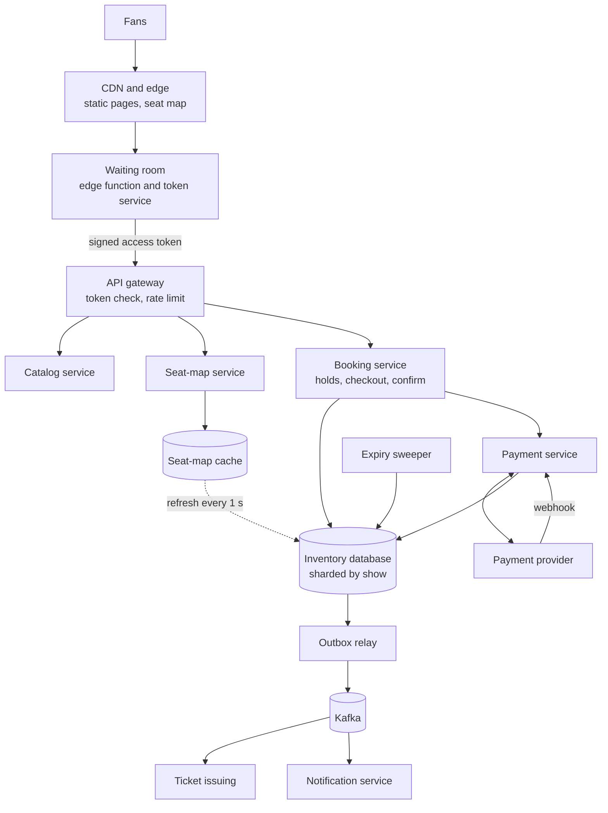
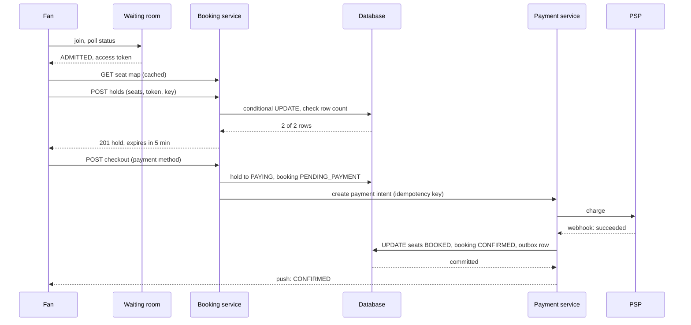
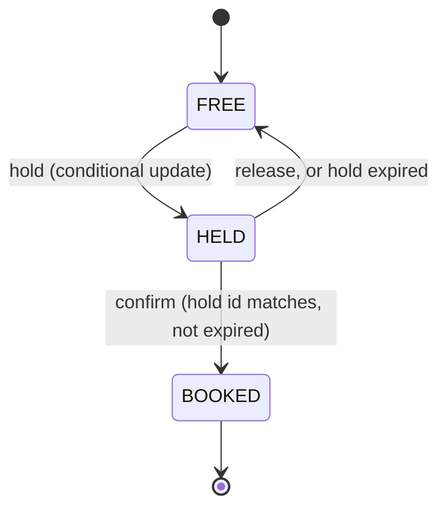

# Design a Ticket Booking System

A ticket booking system sells a fixed number of seats for shows and events. The hard part is contention: when a popular event goes on sale, millions of people want the same few thousand seats in the same minute, and the system must never sell a seat twice. This case study gives the design that a strong candidate presents in 45 minutes: a seat inventory with holds that expire, a virtual waiting room in front of it, payment with idempotency, and an explicit choice of consistency for each part.

The class-level version of this problem (seats, a timed hold, payment, cancellation inside one JVM) is the LLD page [Design a Movie Ticket Booking System](../../lld/case-studies/05-movie-ticket-booking/README.md). This page uses the same rules (a 5-minute hold, lazy expiry, a conditional update for the seat) and moves them to many servers. The LLD page ends with a section "More than one server" that sketches the `show_seat` table. This page builds the system around it. One difference: the LLD sketch writes the `booking_id` into the seat row at hold time, because its booking exists from the hold on. This page separates the hold from the booking, so the seat row carries a `hold_id` as the owner, and the `booking_id` only after the confirm. The booking states keep the LLD names (`PENDING_PAYMENT`, `CONFIRMED`, `EXPIRED`, `CANCELLED`) and add `FAILED` and `REFUNDED` for the PSP outcomes.

!!! note "About the sources"
    Ticketmaster and similar companies do not publish the internals of their queues. This page is a reference design. It cites what the companies and vendors state about their product behavior: Ticketmaster's pages about its Smart Queue, and Queue-it's developer documentation. It does not claim that any company runs this design. The AWS "Virtual Waiting Room on AWS" solution is no longer available (its page says so, checked 2026-10-15), so this page does not describe it. Where the text says "Assumption" or "Recommendation", the choice is the design's, not a source's.

## Problem Statement

The interviewer says: "Design a ticket booking system like Ticketmaster or BookMyShow. Users browse events, pick seats on a seat map, pay, and receive tickets. Some events sell out in minutes, and millions of fans arrive at the moment of the on-sale. A seat must never be sold to two people."

The interviewer tests four skills: the correctness of a claim on a scarce resource, the protection of the system from a traffic spike that is far above its capacity, the handling of payment as a step that can fail or repeat, and the choice of consistency.

## Clarifying Questions

Ask these in the first 5 minutes. Each row gives the answer that this design assumes.

| Question | Assumed answer |
|---|---|
| Reserved seats or general admission? | Reserved seating is the main design. General admission (a count, no seat IDs) is a follow-up |
| Which flows do we design? | Browse the seat map, hold seats, pay, confirm, issue tickets, cancel before payment. Resale, transfer, and refunds after confirmation are out of scope |
| What scale in steady state? | 5 million tickets each day, 2.5 tickets for each booking, so 2 million bookings each day |
| What is the worst event? | One venue with 60,000 seats. 3 million fans arrive in the first minute of the on-sale |
| How long does a hold last? | 5 minutes, the same as the LLD page. The hold covers selecting seats and paying |
| How many seats in one booking? | 1 to 6 |
| Does the user pick the seats? | Yes, on a seat map. A "best available" option lets the system choose |
| Who takes the payment? | An external payment service provider (PSP). It can be slow, fail, decline, or send the result twice |
| Is overselling allowed? | No. A seat is sold at most once. This is strict. (Airlines overbook on purpose. Tickets do not) |
| How fresh must the seat map be? | A map up to 2 seconds old is acceptable to browse. The hold step is always exact |
| Bots and scalpers? | A basic defense is in scope: one place in the queue for each account, rate limits, and a token check. Advanced fraud detection is out of scope |
| Regions? | An event belongs to one home region. Users in other regions are routed to it |

## Requirements

### Functional

1. A user searches or browses events and shows, and sees the seat map of a show with the status of each seat.
2. A user holds 1 to 6 seats. The hold lasts 5 minutes. If the user does not pay, the seats return to the pool.
3. A user pays for the held seats. After a successful payment, the booking is confirmed and the user receives tickets.
4. A user releases a hold before paying.
5. For a high-demand on-sale, the system admits users in a controlled order through a waiting room.
6. Every request that changes state is safe to retry.

### Non-functional

| Requirement | Target |
|---|---|
| No double sale | Zero. A seat has at most one confirmed booking. Strong consistency on the seat write path |
| On-sale arrival | 50,000 requests each second at the edge for 1 minute (3 million fans). The core system sees at most 2,000 to 3,000 requests each second |
| Hold latency | p99 below 300 ms |
| Seat map freshness | At most 2 seconds old for browsing |
| Availability | 99.95% for browsing. For holds and payment, correctness comes before availability: refuse the request instead of selling twice |
| Durability | A confirmed booking and a payment record never get lost (replicated, synchronous within the region) |
| Steady state | 60 bookings each second at the peak |

## Estimation

Rounding rule: one day is 10^5 seconds (see the [estimation page](../back-of-envelope-estimation.md)). The exact day has 86,400 seconds. The error is smaller than the error of the assumptions.

Inputs (all are assumptions): 5 million tickets each day and 2.5 tickets for each booking. A booking row has 2 KB. 100,000 shows are on sale at any time, with 200 seats each on average. A seat row has 100 bytes. Peak factor 3. For the flash on-sale: a venue with 60,000 seats, 3 million fans in the first minute, a status poll each 10 seconds, 10,000 shoppers inside the system at the same time with an average session of 180 seconds (select, hold, pay), 60% of the shoppers complete a booking, a seat-map poll each 5 seconds, 2 bits for each seat in the seat-map bitmap, 3 hold attempts for each shopper (because of conflicts), and 100 bytes for each waiting-room entry.

**Steady state.**

| Step | Calculation | Result |
|---|---|---|
| Bookings each day | 5,000,000 / 2.5 | 2,000,000 |
| Bookings each second, average | 2,000,000 / 10^5 | 20 |
| Bookings each second, peak | 20 × 3 | 60 |
| Booking storage | 2,000,000 × 2 KB | 4 GB each day, 1.5 TB each year |
| Seat rows | 100,000 shows × 200 seats | 20,000,000 rows |
| Seat table | 20,000,000 × 100 B | 2 GB |

**Flash on-sale.**

| Step | Calculation | Result |
|---|---|---|
| Bookings to sell out | 60,000 seats / 2.5 | 24,000 |
| Arrivals each second | 3,000,000 / 60 | 50,000 |
| Status polls each second | 3,000,000 / 10 | 300,000 |
| Admission rate (Little's law: concurrency = rate × time) | 10,000 shoppers / 180 s | 55.6 admissions each second |
| Admissions needed | 24,000 bookings / 0.6 | 40,000 |
| Time to sell out | 40,000 / 55.6 | 720 seconds, 12 minutes |
| Fans who never get in | 1 − 40,000 / 3,000,000 | 98.7% |
| Seat-map polls each second | 10,000 / 5 | 2,000 |
| Seat-map bitmap | 60,000 × 2 bits | 15 KB |
| Seat-map bandwidth | 2,000 × 15 KB × 8 | 240 Mbit/s (served by cache and CDN, not by the database) |
| Hold attempts each second | 55.6 × 3 | About 167 |
| Waiting-room storage | 3,000,000 × 100 B | 300 MB |

What the numbers decide:

- **The steady state is small.** 60 bookings each second fit on one database primary. A ticket system is not a large-scale problem on an ordinary day. It is a problem on the days of the on-sale.
- **The spike is 50,000 arrivals each second and 300,000 status polls each second, against a core that can take about 170 holds each second.** The ratio is about 300 to 1 for arrivals and about 1,800 to 1 for polls. The core cannot absorb it, so a layer in front must hold the crowd. This is the reason for the waiting room. A bigger cluster does not fix it, and it would sit idle on every other day.
- **Little's law sets the admission rate.** The core needs 10,000 shoppers at the same time, and each stays 180 seconds, so the system admits 55.6 users each second. The number of shoppers is the number to load-test and tune. It is not the number of fans.
- **Most fans never get in.** 98.7% of the 3 million fans cannot buy, because 60,000 seats cannot serve them. The queue must tell the fans the truth when the event sells out (close the queue and show "sold out"). A queue that stays open for hours would keep millions of devices polling for nothing.
- **The seat map is a small read-heavy object.** 15 KB for 60,000 seats. A cache serves it. The database serves only holds.

The program below checks the arithmetic and then runs a small experiment: eight threads try to hold one seat with a compare-and-set, and the program shows that exactly one wins, that an expired hold can be taken by another buyer, and that the old holder can no longer confirm. `main` comes first, and the block has its own imports, so you can copy it into `TicketCheck.java` and run `java TicketCheck.java` on JDK 21.

```java
import java.util.ArrayList;
import java.util.List;
import java.util.Locale;
import java.util.concurrent.atomic.AtomicInteger;
import java.util.concurrent.atomic.AtomicReference;

public class TicketCheck {
    public static void main(String[] args) throws Exception {
        steadyState();
        onSale();
        holdRace();
    }

    static void steadyState() {
        System.out.println("== Steady state (1 day = 10^5 s) ==");
        double tickets = 5e6;
        double bookings = tickets / 2.5;
        System.out.println(g("bookings per day", bookings));
        System.out.println(g("bookings per second (average)", bookings / 1e5));
        System.out.println(g("bookings per second (peak, x3)", bookings / 1e5 * 3));
        System.out.println(g("booking rows GB per day (2 KB)", bookings * 2000 / 1e9));
        System.out.println(g("booking rows TB per year", bookings * 365 * 2000 / 1e12));
        System.out.println(g("show_seat rows (100k shows x 200)", 100_000 * 200.0));
        System.out.println(g("show_seat table GB (100 B each)", 100_000 * 200.0 * 100 / 1e9));
    }

    static void onSale() {
        System.out.println("== Flash on-sale ==");
        double seats = 60_000;
        double fans = 3_000_000;
        double seatsPerBooking = 2.5;
        double bookingsToSellOut = seats / seatsPerBooking;
        System.out.println(g("bookings to sell out", bookingsToSellOut));
        System.out.println(g("arrivals per second (3M in 60 s)", fans / 60));
        System.out.println(g("status polls per second (10 s)", fans / 10));
        double shoppers = 10_000;
        double sessionSeconds = 180;
        double admitRate = shoppers / sessionSeconds;
        System.out.println(g("admit rate per second (Little)", admitRate));
        double completion = 0.6;
        double admitsNeeded = bookingsToSellOut / completion;
        System.out.println(g("admits needed at 60% completion", admitsNeeded));
        System.out.println(g("minutes to sell out", admitsNeeded / admitRate / 60));
        System.out.println(g("percent of fans never admitted", 100 * (1 - admitsNeeded / fans)));
        System.out.println(g("seat map polls per second (5 s)", shoppers / 5));
        double bitmapKb = seats * 2 / 8 / 1000;
        System.out.println(g("seat map bitmap KB (2 bits each)", bitmapKb));
        double polls = shoppers / 5;
        double mbit = polls * bitmapKb * 8 / 1000;
        System.out.println(g("seat map Mbit/s at the poll rate", mbit));
        System.out.println(g("hold attempts per second (3 tries)", admitRate * 3));
        System.out.println(g("waiting room MB (100 B each)", fans * 100 / 1e6));
    }

    record Hold(String id, long expiresAt) {}

    static void holdRace() throws Exception {
        System.out.println("== One seat, eight buyers ==");
        AtomicReference<Hold> seat = new AtomicReference<>();
        AtomicInteger winners = new AtomicInteger();
        long now = 1000;
        List<Thread> threads = new ArrayList<>();
        for (int i = 0; i < 8; i++) {
            Hold mine = new Hold("h" + i, now + 300);
            Thread t = new Thread(() -> {
                if (seat.compareAndSet(null, mine)) winners.incrementAndGet();
            });
            t.start();
            threads.add(t);
        }
        for (Thread t : threads) t.join();
        System.out.println("winners " + winners.get());
        Hold winner = seat.get();
        long later = 1400;
        Hold taker = new Hold("late", later + 300);
        boolean expired = winner.expiresAt() <= later;
        boolean took = expired && seat.compareAndSet(winner, taker);
        System.out.println("hold expired at " + later + ": " + expired);
        System.out.println("late buyer took the seat: " + took);
        boolean confirmOld = seat.get().id().equals(winner.id());
        System.out.println("old holder can confirm: " + confirmOld);
        System.out.println("new holder can confirm: " + seat.get().id().equals("late"));
    }

    static String g(String label, double value) {
        return String.format(Locale.ROOT, "%-40s %,.1f", label, value);
    }
}
```

<!-- expected-output -->
```text
== Steady state (1 day = 10^5 s) ==
bookings per day                         2,000,000.0
bookings per second (average)            20.0
bookings per second (peak, x3)           60.0
booking rows GB per day (2 KB)           4.0
booking rows TB per year                 1.5
show_seat rows (100k shows x 200)        20,000,000.0
show_seat table GB (100 B each)          2.0
== Flash on-sale ==
bookings to sell out                     24,000.0
arrivals per second (3M in 60 s)         50,000.0
status polls per second (10 s)           300,000.0
admit rate per second (Little)           55.6
admits needed at 60% completion          40,000.0
minutes to sell out                      12.0
percent of fans never admitted           98.7
seat map polls per second (5 s)          2,000.0
seat map bitmap KB (2 bits each)         15.0
seat map Mbit/s at the poll rate         240.0
hold attempts per second (3 tries)       166.7
waiting room MB (100 B each)             300.0
== One seat, eight buyers ==
winners 1
hold expired at 1400: true
late buyer took the seat: true
old holder can confirm: false
new holder can confirm: true
```

How to read the output. The 12 minutes to sell out is the time of the flash on-sale at the chosen admission rate. If the product wants the sale to last 5 minutes, raise the number of shoppers to 24,000 or shorten the session. The experiment at the end is the in-memory form of the conditional `UPDATE` in the Data Model section: the hold succeeds only if the seat is free (or its old hold has expired), and the confirm succeeds only for the current hold.

## API Design

All state-changing requests have an `Idempotency-Key` header (see [reliability patterns](../fundamentals/12-reliability-patterns.md)). All requests to the booking API during an on-sale carry a queue access token (see deep dive 2).

### `GET /v1/shows/{showId}/seats`

Response `200 OK`, with `Cache-Control: max-age=2` and an `ETag`:

```json
{
  "showId": 7,
  "version": 18342,
  "sections": [
    {"id": "A", "seats": "FFHHBBFF...", "priceCents": 12000}
  ]
}
```

The example shows one letter for each seat (`F` free, `H` held, `B` booked) so that a reader can see it. A letter costs 8 bits, so a 60,000-seat map would be 60 KB. The production format is the bitmap of the estimate: 2 bits for each seat in the seat order of the section, 15 KB for 60,000 seats, sent as binary (`application/octet-stream`) or as base64 text, which adds one third (20 KB, and about 320 Mbit/s instead of 240 Mbit/s at the poll rate, before compression). The response holds no user data, so a CDN or a cache can serve it to everyone. A client can send `If-None-Match` and receive `304 Not Modified`.

### `POST /v1/shows/{showId}/holds`

Request:

```json
{"seatIds": ["A12", "A13"], "queueToken": "eyJ..."}
```

Response `201 Created`:

```json
{"holdId": "h_5c1e", "seatIds": ["A12", "A13"], "expiresAt": "2026-10-15T09:05:00Z",
 "totalCents": 24000}
```

Response `409 Conflict`: `{"unavailable": ["A13"]}`. The call is all-or-nothing: if one seat is not free, no seat is held. A repeated call with the same key returns the same hold. A call with a missing or invalid queue token during an on-sale returns `403 Forbidden`. A call over the rate limit returns `429 Too Many Requests`.

### `DELETE /v1/holds/{holdId}`

Releases the seats. Response `204 No Content`. A repeated call also returns `204`.

### `POST /v1/holds/{holdId}/checkout`

Starts the payment. Request: `{"paymentMethodToken": "pm_..."}`. Response `202 Accepted`: `{"bookingId": "b_91d0", "state": "PENDING_PAYMENT"}`. The final result arrives by push and by `GET /v1/bookings/{bookingId}`, because the PSP answers later (a redirect, a 3-D Secure step, or a webhook). Response `410 Gone` if the hold expired before checkout.

### `GET /v1/bookings/{bookingId}`

Returns the state: `PENDING_PAYMENT`, `CONFIRMED`, `FAILED`, `EXPIRED`, `CANCELLED`, or `REFUNDED`. With `CONFIRMED` it returns the tickets.

### `POST /v1/bookings/{bookingId}/cancel`

Cancels a booking in `PENDING_PAYMENT`. The booking moves to `CANCELLED`, the system releases the seats, and it cancels the payment intent at the PSP. If the PSP reports that the charge already succeeded, the system refunds it. Cancel after confirmation is out of scope.

### Waiting-room endpoints

| Method and path | Purpose | Response |
|---|---|---|
| `POST /v1/waiting-rooms/{eventId}/join` | The user joins the queue. One entry for each account | `200 OK` with `{"ticket": "<signed>", "state": "WAITING"}` |
| `GET /v1/waiting-rooms/{eventId}/status` (with the ticket) | The client asks whether it can enter | `200 OK` with `{"state": "WAITING", "retryAfterSeconds": 12}`, or `{"state": "ADMITTED", "accessToken": "<signed>", "expiresAt": "..."}`, or `{"state": "SOLD_OUT"}` |

### Payment webhook (from the PSP)

`POST /v1/webhooks/psp` with a signed body. The service verifies the signature and answers `200 OK` after it records the event. The same event can arrive more than once, so the handler de-duplicates by the event ID.

## Data Model

| Data | Needs | Store |
|---|---|---|
| Seat inventory (`show_seat`) | Multi-row atomic update with a condition. Strong consistency. Per-show hot spot | A relational database (PostgreSQL or MySQL), partitioned by show |
| Holds and bookings | Transactions with the seats. Unique keys for idempotency | The same database, same shard as the show |
| Seat-map cache | Many reads, 1 to 2 seconds of staleness | Redis or an in-process cache, plus the CDN |
| Waiting-room state | A counter and a signed ticket. 3 million entries | Redis (the counter and rank data), or a key-value store. The ticket is verified without a lookup |
| Idempotency keys | Unique insert. Keep for 24 hours | A table in the same database (same transaction as the hold) |
| Events for tickets and notifications | Reliable publish | An outbox table and Kafka (see [message queues and streams](../fundamentals/08-message-queues-and-streams.md)) |
| Catalog (events, venues, shows) | Many reads. Search | A separate service, with a database and a search index (see [search and indexing](../fundamentals/11-search-and-indexing.md)) |

### Tables

`show_seat` (primary key `(show_id, seat_id)`):

| Column | Type | Note |
|---|---|---|
| `show_id`, `seat_id` | integer, text | One row for each seat of each show, created when the show is created |
| `status` | `FREE`, `HELD`, `BOOKED` | |
| `hold_id` | text, nullable | The hold that owns the seat. It acts as a fencing token |
| `hold_expires_at` | timestamp, nullable | Compared with the database clock |
| `booking_id` | text, nullable | Set at confirm |
| `price_cents` | integer | |

`holds`: `(hold_id PK, show_id, user_id, seat_ids, state, expires_at, created_at)`, a unique key on `(user_id, idempotency_key)`.

`bookings`: `(booking_id PK, hold_id UNIQUE, user_id, show_id, state, amount_cents, psp_payment_id UNIQUE, created_at)`.

`webhook_events`: `(psp_event_id PK, received_at)`. The primary key is the de-duplication check.

`outbox`: `(id, topic, payload, created_at, published_at)`.

### The seat rule, runnable

The rule from the LLD page, in SQL: a hold updates only the rows that are free or whose hold has expired, and the application commits only if the number of changed rows equals the number of requested seats. The queries below run on SQLite with fixed times (seconds) in place of `now()`. The first block creates the table.

```sql
CREATE TABLE show_seat (
  show_id INTEGER, seat_id TEXT, status TEXT, hold_id TEXT, hold_expires_at INTEGER,
  PRIMARY KEY (show_id, seat_id));
INSERT INTO show_seat VALUES
  (7, 'A1', 'FREE', NULL, NULL),
  (7, 'A2', 'FREE', NULL, NULL),
  (7, 'A3', 'FREE', NULL, NULL);
```

User A holds A1 and A2 at time 1000 for 300 seconds. Both seats are free, so 2 rows change, and 2 equals the number of requested seats.

```sql
UPDATE show_seat SET status = 'HELD', hold_id = 'h1', hold_expires_at = 1300
WHERE show_id = 7 AND seat_id IN ('A1', 'A2')
  AND (status = 'FREE' OR (status = 'HELD' AND hold_expires_at <= 1000));
SELECT changes() AS rows_changed;
```

<!-- sql-result -->
```text
rows_changed
2
```

User B asks for A2 and A3 at time 1100. A2 is held until 1300, so only A3 changes. 1 is less than the 2 requested seats, so the application rolls back, and B holds nothing.

```sql
BEGIN;
UPDATE show_seat SET status = 'HELD', hold_id = 'h2', hold_expires_at = 1400
WHERE show_id = 7 AND seat_id IN ('A2', 'A3')
  AND (status = 'FREE' OR (status = 'HELD' AND hold_expires_at <= 1100));
SELECT changes() AS rows_changed;
ROLLBACK;
```

<!-- sql-result -->
```text
rows_changed
1
```

User A confirms A1 at time 1200. The confirm checks the hold ID and that the hold has not expired.

```sql
UPDATE show_seat SET status = 'BOOKED'
WHERE show_id = 7 AND seat_id = 'A1' AND status = 'HELD' AND hold_id = 'h1'
  AND hold_expires_at > 1200;
SELECT changes() AS rows_changed;
```

<!-- sql-result -->
```text
rows_changed
1
```

At time 1400, A's hold on A2 has expired (1300 is not after 1400). B holds A2 and A3, and both change: the expired hold counts as free.

```sql
UPDATE show_seat SET status = 'HELD', hold_id = 'h2', hold_expires_at = 1700
WHERE show_id = 7 AND seat_id IN ('A2', 'A3')
  AND (status = 'FREE' OR (status = 'HELD' AND hold_expires_at <= 1400));
SELECT changes() AS rows_changed;
```

<!-- sql-result -->
```text
rows_changed
2
```

A tries to confirm A2 at 1450 with the old hold `h1`. The seat belongs to `h2` now, so no row changes. The application then refunds the payment (if any) and tells the user.

```sql
UPDATE show_seat SET status = 'BOOKED'
WHERE show_id = 7 AND seat_id = 'A2' AND status = 'HELD' AND hold_id = 'h1'
  AND hold_expires_at > 1450;
SELECT changes() AS rows_changed;
```

<!-- sql-result -->
```text
rows_changed
0
```

The final state of the table:

```sql
SELECT seat_id, status, hold_id FROM show_seat ORDER BY seat_id;
```

<!-- sql-result -->
```text
seat_id | status | hold_id
A1 | BOOKED | h1
A2 | HELD | h2
A3 | HELD | h2
```

In PostgreSQL the same statements use `now()` for the time and run inside one transaction. The `WHERE` clause and the check on the number of changed rows are the same.

### Database choice

A relational database fits because a hold changes several rows atomically with a condition, and a booking, a hold, and an idempotency key must commit together. Partition by `show_id`: all seats of a show are on one shard, so a hold is a single-shard transaction. The price is that one popular show is one hot shard. The estimate shows why it is acceptable: 167 hold attempts each second, each touching 1 to 6 rows, is a small load for one primary. The reads that would make it hot (the seat map) are served from a cache. See [choosing a database](../fundamentals/04-choosing-a-database.md) and [partitioning and sharding](../fundamentals/06-partitioning-and-sharding.md).

The alternative is a key-value store with conditional writes and transactions, such as DynamoDB. Its `TransactWriteItems` groups up to 100 write actions, each with an optional condition, "in a single all-or-nothing operation" (AWS documentation). A hold of 6 seats is then one transaction of 6 conditional updates. It works with the same rule. It changes the operations story, not the design.

## High-Level Design



### Components

| Component | Responsibility |
|---|---|
| CDN and edge | Serves static pages and the cached seat map. Absorbs the arrival spike. Runs the waiting-room check at the edge |
| Waiting room | Gives each fan a place in a queue, and admits fans at a controlled rate. Issues a signed access token to admitted fans |
| API gateway | Verifies the access token without a database lookup, rate-limits for each account, and routes |
| Catalog service | Events, venues, shows, search. Read-only for the booking path. Separate database |
| Seat-map service | Builds the seat-map bitmap of a show from the database every second and serves it from a cache |
| Booking service | The only writer of seats, holds, and bookings. Runs the conditional updates. Owns the state machine of the booking |
| Payment service | Creates payment intents at the PSP, receives the webhooks, and tells the booking service the result |
| Expiry sweeper | Frees seats of expired holds (a background clean-up, see deep dive 1) |
| Outbox relay and Kafka | Publish `BookingConfirmed` reliably for ticket issuing and notifications |

### The main flow



## Deep Dives

### Deep dive 1: Seat inventory and holds

**The rule.** A seat has three states: `FREE`, `HELD`, and `BOOKED`. A hold moves seats from `FREE` to `HELD` for a bounded time. A confirm moves them to `BOOKED`. A release or an expiry moves them back to `FREE`.



**The conditional update is the lock.** The hold is one statement: `UPDATE show_seat SET status = 'HELD', hold_id = ?, hold_expires_at = now() + interval '5 minutes' WHERE show_id = ? AND seat_id IN (...) AND (status = 'FREE' OR (status = 'HELD' AND hold_expires_at <= now()))`. The database takes the row locks, checks the condition, and changes the rows in one atomic step. The application commits if the changed row count equals the number of requested seats. Otherwise it rolls back and returns `409 Conflict`. Two buyers cannot both pass the check for one seat. The second update waits for the row lock. At `READ COMMITTED` (the PostgreSQL default), it then checks the condition again on the committed row and sees the new status, so it changes zero rows (PostgreSQL manual, section 13.2.1 "Read Committed Isolation Level"). The SQL above shows each case.

**Why not `SELECT ... FOR UPDATE` and then `UPDATE`?** It also works, and PostgreSQL documents `FOR UPDATE` with `NOWAIT` and `SKIP LOCKED` (PostgreSQL manual, "The Locking Clause"). The conditional update needs one round trip and holds locks for less time. A read-then-write holds row locks while the application thinks. Under contention, buyers queue on the lock and the connection pool fills. Prefer the single statement.

**Multi-seat deadlocks.** Two holds with overlapping seat sets can deadlock if they lock the shared rows in different orders: A locks A1 and waits for A2, while B locks A2 and waits for A1. The order of the values in the `IN` list does not set the lock order. One `UPDATE` locks rows in the order in which its query plan visits them, and the PostgreSQL manual does not promise an order. Two single-statement holds with the same index plan usually visit the shared rows in the same index order, but that is a property of the plan, not a guarantee. The risk is high if the application holds seats with one statement for each seat, in the order of the user's clicks. The fixes:

1. If the design needs a guaranteed order, lock first in the same transaction: `SELECT seat_id FROM show_seat WHERE show_id = ? AND seat_id IN (...) ORDER BY seat_id FOR UPDATE`, then run the conditional update. The PostgreSQL manual explains that `ORDER BY` is applied before the locking clause, so the command takes the row locks in the sorted order. The cost is one more round trip, with no application work between the two statements.
2. If the hold uses one statement for each seat, sort the seat IDs in the application and run the statements in that order.
3. If a deadlock still occurs, PostgreSQL detects it and aborts one transaction. The application retries that hold once.

**The hold ID is a fencing token.** The confirm statement says `AND hold_id = ? AND hold_expires_at > now()`. A buyer whose hold has expired, and whose seat another buyer took, changes zero rows. This is the same idea as a fencing token on a lease (see [distributed locks and leases](../distributed-systems/05-distributed-locks-and-leases.md)): the resource (the row) checks the token, so a paused or slow client cannot act on a lock that it no longer holds. The locks page defines the fencing token as a number that grows with each grant. Here the row stores the ID of the current hold and accepts only that ID. The effect is the same, because the row is both the lock and the resource. The time comes from the database clock only. Never compare the client clock or an application server clock with `hold_expires_at`, because clocks differ (see [failures and time](../distributed-systems/01-failures-and-time.md)).

**Expiry.** Two mechanisms, as on the LLD page.

1. Lazy expiry: the hold condition treats an expired hold as free (`hold_expires_at <= now()`). Correctness never depends on a background job.
2. A sweeper: a job runs each 30 seconds. It sets `FREE` on rows whose hold expired, and it marks the hold `EXPIRED`. This keeps the seat map correct and the table clean. A hold in `PAYING` (see deep dive 3) has a later `hold_expires_at` in its seat rows, so neither the sweeper nor another buyer frees those seats before the payment limit.

**Redis as a fast path (optional).** At the on-sale peak, the database sees 167 hold attempts each second, which it handles. If a design needs more, put a fast pre-check in Redis: for each seat, `SET seat:{show}:{seat} {holdId} NX PX 300000`, and a Lua script for several seats, so that a clearly taken seat is rejected without a database call. The database stays the source of truth. A Redis key can be lost on a failover (see the discussion of Redlock and lease locks in the locks page), so a Redis hold alone must never decide a sale.

**Best available.** On a popular on-sale, many buyers click the same best seats, and most holds fail with `409`. Each failure costs a round trip and a retry. A "best available" mode lets the server choose the seats: the service selects a block of adjacent free seats and holds it. In PostgreSQL, `SELECT ... FOR UPDATE SKIP LOCKED` lets concurrent requests take different free rows instead of waiting for the same one (PostgreSQL manual). The manual warns that skipping locked rows returns an inconsistent view, so it suits "give me any free seats", not a report. Conflicts fall, and the success rate for each attempt rises.

**General admission.** There are no seat IDs. The inventory is a counter for each tier: `UPDATE tier SET available = available - ? WHERE tier_id = ? AND available >= ?`. The row is one hot row for the whole event. At 167 attempts each second it is fine for one primary. For a higher rate, split the counter into N sub-counters (for example 16) and decrement a random one that has enough capacity. This trades a possible "sold out" error when stock sits in other sub-counters for a higher write rate.

**Hot show on one shard.** All writes for a show go to one shard. At 167 holds each second this is not the limit. If a case needs more (a show with 500,000 seats), partition the seats of the show by section, so that each section is one shard. A hold across sections becomes a cross-shard operation (a saga that holds each section and releases on failure), which is why the product often limits one booking to one section.

### Deep dive 2: The virtual waiting room

**Why.** The estimate shows 50,000 arrivals and 300,000 status polls each second against a core that serves about 170 holds each second. A waiting room is a queue in front of the booking system. It admits users at a rate that the core can serve, and it gives the others a place in line and a page that costs almost nothing to serve. Ticketmaster's Smart Queue page states: "Fans sign in with their Ticketmaster accounts and join the virtual waiting room before the sale", "Once the sale starts, waiting fans are assigned a spot in the queue", and "Fans enter the sale at a rate that minimizes check-out errors and maximizes sell-through". Queue-it, a commercial product, describes the same function: "At the throughput rate you configure, Queue-it then redirects the visitors who waited in line back to your website in the correct, sequential order" (Queue-it developer documentation, "How Queue-it works"). Queue-it's product page says that the outflow is set in visitors each minute and that the customer "can adjust it up or down on-the-fly using Queue-it's API or web-based admin platform".

**Fair order.** A first-come order rewards the fastest connection and the best bot. Ticketmaster's consumer guide states: "The time you join the Waiting Room does not determine your place in the Smart Queue line", and "Anyone who doesn't join the Waiting Room will be placed at the end of the line". Queue-it's documentation states that for a scheduled sale, "At sale or registration start, visitors are randomized and assigned a place in line", and that "Visitors who arrive after the sale starts get a first-come, first-served place in the queue". For a room that is always on as a "safety net", it places visitors "in a standard first-in, first-out order". The design follows the scheduled-sale model:

1. Before the sale opens, a fan joins the pre-queue. Every fan who joined before the open gets an equal chance.
2. At the opening time, the system assigns a random rank to each fan in the pre-queue (a random number from a seeded generator, sorted).
3. Fans who join after the opening time get the next ranks in order of arrival.

**Admission.** The system keeps one global counter, `servingRank`. A fan with rank `r` is admitted if `r <= servingRank`. A scheduler increases `servingRank` by the admission rate (55 each second in the estimate) and adjusts it by feedback from the core: the rate falls when the booking service latency rises or when the number of active shoppers passes the limit (10,000), and rises when it is below the limit. Queue-it's blog post on rate-based queuing derives the same number with Little's law (the outflow equals the maximum number of concurrent sessions divided by the average session length) and gives an example of 200 visitors each minute. Queue-it's product page recommends a load test to find the right outflow.

**The ticket and the token.** When a fan joins, the service returns a signed queue ticket (an HMAC or a signature over `{eventId, accountId, rank}`). The ticket carries the rank, so the status check does not need to look up the fan. When the fan is admitted, the status check returns an access token: a signed value over `{eventId, accountId, expiresAt}` with a short life. Ticketmaster's guide states: "When it's your turn, your spot will be held for 10 minutes to begin shopping". This design uses 10 minutes for the access token too (Assumption). The API gateway verifies the signature with a public key or a shared secret and checks `expiresAt` without a database call. Without a valid token, the hold endpoint returns `403`. This means that a user who skips the waiting room page and calls the API directly gets nothing.

**Serving 300,000 polls each second.** The status check must not reach the origin. Design:

1. The client polls the edge (CDN function or an edge worker), not the origin.
2. The edge holds a copy of `servingRank`, refreshed each 1 to 2 seconds from the token service (one cheap read for each edge location, not for each client).
3. The edge decides from the ticket's rank: `rank > servingRank` returns `WAITING` with a `retryAfterSeconds` that grows with the distance (`(rank - servingRank) / admissionRate`, bounded between 5 and 60 seconds, with random jitter); `rank <= servingRank` returns `ADMITTED` with a freshly signed access token (the edge holds the signing key, or calls the token service once for each admitted fan, which is 55 calls each second).
4. `retryAfterSeconds` spreads the polls, so 3 million clients do not poll at the same time. The cap of 60 seconds sets the floor of the poll load: 3 million fans who each poll once a minute still send 3,000,000 / 60 = 50,000 polls each second. The edge serves all of them, which is the job of the edge.
5. The sale sells out after about 40,000 admissions (12 minutes in the estimate). A fan at rank 2 million would need 2,000,000 / 55.6 = 36,000 seconds, about 10 hours, so that fan never reaches the front. When the event sells out, the edge returns `SOLD_OUT`, and the clients stop polling. Recommendation: the status response also gives the fan an honest estimate. A rank far above the expected sell-out rank (about 40,000 here) gets the message that tickets will probably sell out first.

This is the reason the arrival spike never reaches the core: the origin sees about 55 token creations each second, a few thousand seat-map requests, and the holds. The polls stop at the edge.

**Queue storage.** The ranks of 3 million fans are 300 MB in the estimate. A sorted structure in Redis (a sorted set keyed by rank) holds them. The "join" call is one `ZADD`-style operation, and 50,000 joins each second spread over several Redis shards by event partition. Alternatively, the system avoids storing the rank list at all: the rank is a function of the join order assigned by an atomic counter (`INCR`) for post-opening joiners, and a pre-computed random permutation for pre-queue joiners. The ticket carries the rank, so the status path needs no storage.

**Sold out.** When the booking service reports that the inventory is gone (no `FREE` seats and few `HELD` seats), the token service sets the event state to `SOLD_OUT`. The status call returns `SOLD_OUT` to all waiting fans, and the system stops admitting. If held seats return to the pool (expired holds), the system can open the queue again for a short time. Telling the truth early is the best fix for the polling load.

**Abuse and bots.** The waiting room is the point where the system sees every fan, so it is the place for defenses. One entry for each verified account (login before the sale). Rate limits for each IP and each account (see [rate limiting algorithms](../fundamentals/13-rate-limiting-algorithms.md)). A challenge (CAPTCHA or a proof of work) at the join. Device and behavior signals. A limit on the number of tickets for each account for each event. The access token binds to the account, so one token does not serve many bots. No defense is complete, and a determined scalper finds ways around it. State this in the interview.

**What the waiting room is not.** It does not guarantee fairness at the seat level: once admitted, fans race for the best seats, and the hold conflicts decide who gets them. It also does not replace rate limiting at the API: an admitted token can be abused, so the gateway rate-limits each token.

**Products.** Many teams buy this part. Queue-it offers connectors for the client side, the server side, and the edge (CDN, load balancer, proxy). Its documentation says of the client-side JavaScript connector that "tech-savvy users can skip the queue". It describes the server-side connector as "an unskippable queue", and says that the edge connectors remove "the possibility of end-user manipulation, ensuring an unskippable queue". This is the same reason this design checks the access token at the API gateway and not only in the page. AWS published a "Virtual Waiting Room on AWS" solution, and its page now says that the solution is no longer available and points to AWS Marketplace alternatives and to a custom design with CloudFront. Build or buy is a real trade-off: the product costs money for each event, and a custom room costs engineering time and the risk of a failure on the day that matters.

### Deep dive 3: Payment, idempotency, and the race with expiry

The payment is the step that crosses a system boundary. The PSP can answer slowly, answer twice, or not answer. The booking system must keep the seats and the money consistent. Money handling in depth has its home on the payment case study (`kb/hld/case-studies/13-payment-system.md`). This section covers what a ticket system adds.

**The flow.**

1. The user calls `POST /v1/holds/{id}/checkout`. In one database transaction, the booking service sets the hold to `PAYING`, extends the deadline to a payment limit (Assumption: 10 minutes from the original hold, never more), and inserts a booking in `PENDING_PAYMENT`. The deadline that counts is `hold_expires_at` in the seat rows, because the hold statement and the confirm statement read it there. So the transaction runs `UPDATE show_seat SET hold_expires_at = ? WHERE show_id = ? AND hold_id = ? AND status = 'HELD' AND hold_expires_at > now()`. If fewer rows change than the hold has seats, the hold already expired: the transaction rolls back, and the API returns `410 Gone`.
2. The payment service creates a payment intent at the PSP, using the booking ID as the PSP idempotency key. The PSP then charges the card, possibly with a challenge such as 3-D Secure in the user's browser.
3. The PSP sends a webhook with the result. The payment service verifies the signature and records the event ID in `webhook_events` (the primary key rejects a duplicate).
4. On success, one transaction sets the seats to `BOOKED` (the conditional update: `hold_id` matches), the booking to `CONFIRMED`, and inserts an outbox row. On failure, the transaction releases the seats, or leaves the hold for a retry until the hold expires.
5. The outbox relay publishes `BookingConfirmed` to Kafka. Ticket issuing and the notification service consume it with an inbox check (see [distributed transactions](../distributed-systems/03-distributed-transactions.md)).

**Idempotency at each layer.**

| Layer | What repeats | The guard |
|---|---|---|
| Client to booking service | A user double-clicks "pay", or the app retries after a timeout | `Idempotency-Key` stored with a unique key `(user_id, key)` in the same transaction as the hold or the checkout. A repeat returns the stored response. Stripe describes this pattern: a key that the client generates, and the stored result of the first request (Stripe Engineering, "Designing robust and predictable APIs with idempotency"). Stripe's API reference adds that its idempotency layer "compares incoming parameters to those of the original request and errors if they're not the same" |
| Booking service to PSP | The service retries the charge after a timeout | The booking ID as the PSP's idempotency key, so the PSP creates one charge |
| PSP to payment service | The PSP sends the webhook again | The event ID as a primary key in `webhook_events` |
| Payment to Kafka | The relay publishes twice after a crash | The consumer de-duplicates by booking ID (at-least-once delivery, idempotent consumer) |

**The race between payment and expiry.** The LLD page handles it this way: if the payment succeeds after the hold ended, a second check fails, and the system refunds. That is correct and expensive: the customer is charged and then refunded, and the seat may be gone. The design reduces the chance with the `PAYING` state. When checkout starts, the deadline in the seat rows moves to the payment limit, so neither the sweeper nor the lazy expiry of another buyer's hold frees the seats before that limit. Only a payment that is slower than the limit can lose the seat, and the system then refunds. The refund path stays, because a webhook can arrive after any limit. The rule: money is only taken for seats that the system holds, and a payment that arrives for seats that it cannot give leads to a refund, never to a double sale.

**Money and seats are two systems.** A transaction cannot span the database and the PSP, so the design is a saga (see [sagas](../distributed-systems/03-distributed-transactions.md)): hold seats, charge, confirm. The compensation of the charge is the refund. The compensation of the hold is the release. A reconciliation job compares the PSP's records with the bookings each day and reports a charge with no confirmed booking, and a confirmed booking with no charge.

**3-D Secure and slow payments.** A bank can take a minute for a challenge. The extended hold covers it. If the user closes the tab, the webhook still arrives, and the booking confirms. The user finds the tickets in the account and by email.

**What the user sees on failure.** A declined card: the booking returns to the hold with the same expiry, and the user can try another method. A timeout at the PSP: the booking stays `PENDING_PAYMENT`, and a poller asks the PSP for the status of the intent after the deadline, so the system does not depend on a webhook that never comes.

### Deep dive 4: Consistency choices

The system uses a different consistency level in each part. State each in the interview, with its reason (see [consistency and CAP](../fundamentals/07-consistency-and-cap.md)).

| Part | Level | Reason |
|---|---|---|
| Seat hold and confirm | Strong (linearizable on one row, one primary for each show). Read from the primary | A stale read here sells a seat twice. The cost of a wrong answer is a double sale |
| Seat map for browsing | Eventual, up to 2 seconds old | 240 Mbit/s of reads. A stale map causes at most a `409` on a click, which the client handles by refreshing |
| The holder's own view | Read your writes | After a hold, the user sees the seats as held. The hold response carries the state, and the client shows it without waiting for the cache |
| Waiting-room counter at the edge | Eventual, 1 to 2 seconds | A fan admitted 2 seconds late loses nothing |
| Catalog and search | Eventual | Event details change rarely |
| Payment and booking | Strong inside the database, saga across the PSP | Money needs a durable and exact record |
| Replication of the inventory | Synchronous to one replica in the same region, asynchronous across regions | A lost confirmed booking is not acceptable inside a region. A failover to another region may lose seconds of data, so the recovery must reconcile with the PSP |

**CAP.** During a partition that cuts the booking service from the inventory primary, the system refuses holds (it returns an error) and does not sell from a stale copy. This is the CP choice (see [consistency and CAP](../fundamentals/07-consistency-and-cap.md)), and it is on purpose: an unavailable minute costs less than a seat sold twice. Browsing keeps working from the cache, which is the AP side.

**Keeping the seat map in step.** The seat-map service reads the table each second (a cheap indexed scan, or a change stream), builds the bitmap, and writes it to the cache with a version. A hold or a release can also push a small diff `{seatId, status}` to the browsers of the show, over WebSocket or Server-Sent Events (see [communication patterns](../fundamentals/09-communication-patterns.md)), so a seat that another user holds turns gray in a second. At 10,000 shoppers, this is a small fan-out.

**Multi-region.** An event has a home region, and the inventory primary is there. A user in another region is routed to the home region for holds (Assumption: 100 to 200 ms of extra latency for each round trip between continents), and browses from a local cache. This is one writer for each show, and it avoids the conflict-resolution problem of multi-leader replication (see [replication](../fundamentals/05-replication.md) and [multi-region and disaster recovery](../fundamentals/19-multi-region-and-disaster-recovery.md)).

## Bottlenecks and Scaling

| Bottleneck | Symptom | Fix |
|---|---|---|
| The front door at the on-sale | 50,000 arrivals and 300,000 polls each second overload the origin | Waiting room at the edge. Static pages on the CDN. Status served by the edge from a cached counter |
| Seat-map reads | 2,000 polls each second of 15 KB reach the database | Cache with a 1 to 2 second TTL. Request coalescing so one miss refreshes for all (see [caching](../fundamentals/03-caching.md)). Diff push over SSE |
| Hot show shard | Lock waits on the best seats. Connection pool fills | Conditional update with no application work while the locks are held. `FOR UPDATE NOWAIT` or a short `lock_timeout`, so a conflict fails at once instead of waiting. Best-available mode with `SKIP LOCKED`. Admission rate limits the load |
| Hold conflicts | Most hold attempts fail with `409` | Best available. Tell the user early. Client retry with a different seat set, not the same one |
| PSP limits | The PSP throttles or slows. Payments pile up | The extended `PAYING` hold. A queue and a circuit breaker for PSP calls (see [reliability patterns](../fundamentals/12-reliability-patterns.md)). Multiple PSPs behind a router. The waiting room lowers its rate when the PSP latency rises |
| Expiry sweeper | Seats stay held after expiry | Lazy expiry makes correctness independent of the sweeper. Index on `(status, hold_expires_at)`. Batches |
| Token service | A single counter as one point of failure | Replicate it. The edge keeps the last counter value and keeps admitting at the last rate for a short time if the service is down, then closes |
| Bots | A flood of holds from automation | Verified accounts, challenge at the join, per-token rate limits, limit of tickets for each account |
| Database failover during the on-sale | The primary of the show's shard fails | Synchronous replica in the same region and automatic promotion. The booking service retries idempotent requests. The holds in the replica survive, because they are rows. Test it before the day |

## Trade-offs

| Decision | Chosen | Rejected | Why |
|---|---|---|---|
| Protect the core | Virtual waiting room at the edge | Scale the core to the peak. Plain rate limiting with `429` | The peak is about 300 times the core capacity in arrivals and about 1,800 times in polls, for 1 minute. A rate limit with `429` causes retry storms and gives no fairness |
| Queue order | Random for the pre-queue, first-come after the open | First-come for all | First-come rewards bots and fast networks. Random is fairer for a sale that opens at a known time |
| Seat lock | Conditional `UPDATE` in the database | A distributed lock (Redis, ZooKeeper) on each seat | The database already is the single writer for the row. A lock service adds a failure mode and needs fencing anyway (see the locks page) |
| Hold storage | Rows with `hold_expires_at` and lazy expiry | A Redis key with TTL as the only record | Redis can lose a key on failover, and a lost hold means a double sale. Redis can serve as a fast pre-check only |
| Hold length | 5 minutes, extended in `PAYING` | A fixed 5 minutes with refund on late payment | The extension removes most charge-then-refund cases. The cost is seats held longer when a payment stalls |
| Seat-map consistency | Cache 1 to 2 seconds, exact check at hold | Exact reads for the map | 240 Mbit/s of exact reads would overload the primary, and the hold check corrects any stale click |
| Shard key | Show | User, or seat | A hold touches several seats of one show. One shard keeps the hold a local transaction |
| Payment integration | Saga with a refund as compensation | Two-phase commit with the PSP | The PSP does not take part in 2PC (see the distributed transactions page) |
| CAP side for holds | CP: refuse during a partition | AP: accept holds and merge later | A double sale cannot be undone without a customer who loses a seat. A merge rule would have to cancel someone's booking |
| Waiting room | Build or buy per event load | Always build, or always buy | A product (Queue-it) is quick to start and costs for each event. A custom room costs engineering time and risk on the day |

## Follow-up Questions

??? question "How do you guarantee that two users never get the same seat?"

    The seat row is the single point of truth, and every change to it is a conditional update in one database transaction. A hold runs `UPDATE show_seat SET status = 'HELD', hold_id = ?, hold_expires_at = ... WHERE show_id = ? AND seat_id IN (...) AND (status = 'FREE' OR (status = 'HELD' AND hold_expires_at <= now()))`, and the application commits only if the changed row count equals the number of requested seats. Two concurrent updates for one seat serialize on the row lock. The second one sees the new status and changes zero rows.

    The confirm is also conditional: `WHERE hold_id = ? AND hold_expires_at > now()`. A buyer whose hold expired changes zero rows, and the system refunds. The hold ID acts as a fencing token, so a slow client cannot confirm a seat that another buyer holds.

    The trade-off: the guarantee needs one writer for each show (one primary), so the show is a hot shard and the system is unavailable for holds if that primary is down and no replica has been promoted. That is the right side of the trade-off for money and seats. The LLD page shows the same rule inside one JVM with a lock for each show.

??? question "Why use a virtual waiting room instead of just scaling the servers?"

    Because the spike is far above any sensible capacity and lasts one minute. The estimate: 50,000 arrivals each second and 300,000 status polls each second, against a core that serves about 170 holds each second. Scaling the core by a factor of 300 to 1,800 for a minute is expensive, and it does not help where the limit is the inventory: 60,000 seats cannot serve 3 million fans, so 98.7% of the fans cannot buy whatever the capacity is.

    A waiting room moves the crowd to a cheap layer (the CDN and edge functions), admits users at the rate that the core can serve (Little's law: 10,000 shoppers at 180 seconds each is 55 admissions each second), and gives the fans a fair place and an honest status. The alternative, plain `429` responses, makes every client retry at once. That adds load, gives no order, and favors bots.

    The cost: more components, the risk that the queue fails on the day that matters, and a trade-off between build and buy (Queue-it is a product for this, and Ticketmaster operates its own Smart Queue).

??? question "How does the waiting room keep a million clients from overloading the system with status polls?"

    The status check never reaches the origin. The client holds a signed ticket with its rank. The edge (a CDN function) holds a copy of the global `servingRank`, refreshed each 1 to 2 seconds. The edge answers `WAITING` or `ADMITTED` by comparing the two numbers. Only an admitted fan causes a call to create the access token, about 55 each second.

    The edge also returns `retryAfterSeconds`, computed as `(rank - servingRank) / admissionRate`, bounded between 5 and 60 seconds, with jitter. The poll rate falls from 300,000 each second (at 10-second polls) toward 50,000 each second (3 million fans at the 60-second cap), because most fans have a large distance and a long delay. The edge serves all of these polls. The poll load ends when the event sells out (about 12 minutes in the estimate), because the edge then returns `SOLD_OUT` and the clients stop. If the connection is cheap, Server-Sent Events can replace polling (see [communication patterns](../fundamentals/09-communication-patterns.md)).

    The risk to name: the edge counter is up to 2 seconds old, so a fan can be admitted late, which does no harm. If the token service is down, the edge keeps the last rate for a short time and then closes the room, which is a safe failure.

??? question "A user pays, but the hold expired while the payment was in progress. What happens?"

    This is the race between payment and expiry. The correct end state is: no double sale, and the user is not charged for nothing.

    The design lowers the chance of the race first. At checkout, the hold goes to `PAYING` and its deadline extends to a payment limit (10 minutes from the original hold, Assumption). The sweeper does not free a `PAYING` seat before the payment is final. A slow 3-D Secure step then fits inside the extended hold.

    If the webhook still arrives after the limit and another buyer holds the seat, the confirm statement (`WHERE hold_id = ?`) changes zero rows. The payment service creates a refund at the PSP, with an idempotency key, marks the booking `FAILED`, and tells the user. A daily reconciliation catches any charge that has no confirmed booking. The LLD page uses the same two checks and the same refund.

    The trade-off: the extended hold keeps seats out of the pool longer when payments stall. Bound the extension, because a bot could otherwise start many checkouts to hold seats.

??? question "How do you prevent a double charge when a user clicks Pay twice or the app retries?"

    Use an idempotency key at every hop. The client sends one `Idempotency-Key` for the logical checkout. The booking service stores `(user_id, key)` with a unique constraint in the same transaction as the booking, so the second request finds the first and returns its stored response. The key is scoped to the user, and the service checks that the repeat has the same parameters. Stripe's API reference documents the same check: its idempotency layer "compares incoming parameters to those of the original request and errors if they're not the same".

    The call to the PSP uses the booking ID as the PSP's idempotency key, so a retry after a timeout does not create a second charge. The webhook handler uses the PSP event ID as a primary key, so a repeated webhook has no effect. The consumer of `BookingConfirmed` de-duplicates by booking ID, because Kafka delivery is at-least-once.

    The trade-off: the keys need storage and a retention rule. Stripe's API reference says that keys can be removed "after they're at least 24 hours old", and this design keeps them for 24 hours. The client retry window must be shorter than the retention. Say this in the interview: "exactly once" is built from at-least-once delivery plus idempotent handlers.

??? question "How would you design general admission, where there are no seat IDs?"

    The inventory is a counter for each ticket tier. The hold is `UPDATE tier SET available = available - ? WHERE tier_id = ? AND available >= ?`. If the changed row count is 0, the tier is sold out. A hold row records the quantity and the expiry, and expiry adds the quantity back (`available = available + ?`) in the sweeper, in a transaction with the hold state change, so the add happens once.

    The counter is one hot row. At about 170 attempts each second, one primary handles it. For a higher rate, split the counter into sub-counters (for example 16 rows) and decrement a random sub-counter that has enough stock. This raises the write rate by about the number of rows. The price is that a request can fail with "sold out" while other sub-counters still have stock. A fallback tries a second sub-counter, and a periodic rebalance moves stock between them.

    The expiry must be exact: a lost add leaks stock, and a double add oversells. Make it a transaction with the hold state change. This is the part to check.

??? question "How do you keep bots and scalpers from taking most of the seats?"

    No defense is complete. Layer them. Before the sale: verified accounts, one queue entry for each account, and a challenge at the join. In the queue: rate limits for each IP and device, and behavior signals. After admission: the access token binds to the account, the gateway rate-limits each token, and the system limits the number of tickets for each account for each event (for example 6) and for each payment card. After purchase: a rule that cancels tickets of detected fraud and returns them to the pool.

    Ticketmaster's Smart Queue page lists the goal to "Keep bots out while prioritizing fans", and its consumer guide says the queue lets fans shop "while keeping bots at bay". The waiting room is the best place for defenses because every user passes through it, and the check at the edge costs the core nothing.

    The trade-off: every defense adds friction for real fans (CAPTCHA, verification), and strict limits lock out legitimate groups who buy for friends. Measure the false-positive rate, and keep a human path for support.

??? question "What changes if the system must support multiple regions?"

    Keep one writer for each show. The inventory of a show lives in a home region, and requests for holds go there. Users in other regions browse from a local cache of the seat map and the catalog, and pay the extra latency (Assumption: 100 to 200 ms) only on holds and checkout. This avoids multi-leader conflict resolution for a resource that cannot be merged: two regions that both sold seat A1 cannot reconcile without cancelling a purchase.

    Within the home region, replicate the inventory database synchronously to a replica in another zone, so a zone failure loses no confirmed booking. Replicate to another region asynchronously for disaster recovery. A failover to the other region may lose the last seconds of writes, so the recovery procedure reconciles bookings with the PSP records: a charge without a booking gets a refund or a re-confirm if the seats are still free.

    The waiting room is the one component that must be global. Its edge layer already is, and the counter has one home region with edge caches. See [multi-region and disaster recovery](../fundamentals/19-multi-region-and-disaster-recovery.md).

??? question "A hold request fails with a database deadlock. What happened, and how do you fix it?"

    Two multi-seat holds locked overlapping rows in different orders. Buyer A's statement locked A1 and waits for A2. Buyer B's statement locked A2 and waits for A1. The database detects the cycle and aborts one transaction.

    The order of the `IN` list does not decide the lock order. A single `UPDATE` locks rows in the order that its plan visits them, and a hold built from one statement for each seat locks them in the order of the user's clicks. The fixes: take the locks in one fixed order for every buyer. Either run `SELECT ... WHERE seat_id IN (...) ORDER BY seat_id FOR UPDATE` first in the same transaction (PostgreSQL applies `ORDER BY` before the locking clause, so it locks in sorted order), or, for one statement for each seat, sort the seat IDs in the application. Retry an aborted transaction once with a small random delay. Under a heavy on-sale, fail fast instead of waiting: `FOR UPDATE NOWAIT` reports an error at once if a row is locked, or a short `lock_timeout` bounds the wait for a plain `UPDATE`. The service then returns `409`, instead of building a queue of waiting transactions that fills the connection pool.

    The deeper fix is to reduce contention: best-available mode and `SKIP LOCKED` give each buyer different rows, so there is no overlap to deadlock on.

??? question "How would you test that the system is ready for an on-sale?"

    Test the layers on their own, then together. First, a load test of the booking core at its target: 10,000 shoppers, 167 hold attempts each second with a high conflict rate (most buyers pick the same 5% of seats). Measure the hold latency p99, the lock wait time, and the connection pool use. Second, a load test of the waiting room: 3 million simulated clients joining within a minute and polling, to check that the origin sees a few thousand requests each second and that the edge counter works. Third, a failure test: kill the inventory primary during the load, and check that the holds survive and that the idempotent retries produce no double booking. Fourth, a PSP test: a slow and a failing PSP, with webhooks that arrive twice and late.

    Check invariants after every test: no seat has two `BOOKED` bookings, every confirmed booking has one successful charge, and every charge has a booking or a refund. The invariants matter more than the speed numbers. Run a rehearsal with a small real on-sale, and keep a switch that closes the queue and a runbook for the change of the admission rate.

## 45-Minute Plan

| Minutes | What to present |
|---|---|
| 0 to 5 | Clarify: reserved or general admission, scale (5 million tickets each day, a 60,000-seat on-sale with 3 million fans), hold time, overselling rule, payment. Write the requirements |
| 5 to 10 | Estimation: 60 bookings each second at the peak, 50,000 arrivals and 300,000 polls each second at an on-sale against 170 holds each second at the core. Little's law for the admission rate. State what it decides: a waiting room |
| 10 to 15 | API (seat map, hold, checkout, waiting-room join and status) and the data model (`show_seat` with `hold_id` and `hold_expires_at`). Say why a relational database sharded by show |
| 15 to 22 | High-level diagram: CDN and edge, waiting room, gateway, booking service, inventory database, payment service and PSP, outbox and Kafka. Walk through the flow |
| 22 to 36 | Deep dives. The conditional update, lazy expiry, and the fencing token in about 5 minutes. The waiting room in about 5 minutes. Payment, idempotency, and the race with expiry in about 4 minutes, as time allows |
| 36 to 41 | Bottlenecks: the front door, the seat map, the hot shard, the PSP, the bots, database failover |
| 41 to 45 | Trade-offs, the consistency table, and a summary. Invite questions: general admission, bots, multi-region |

## Further Reading

- Ticketmaster, ["Smart Queue"](https://business.ticketmaster.com/smart-queue/). The product description: sign in, join the virtual waiting room before the sale, receive a spot when the sale starts, and enter at a controlled rate. Marketing material, not an engineering paper.
- Ticketmaster, ["Guide to Smart Queue"](https://discover.ticketmaster.com.au/guide-to/ticketmasters-guide-to-smart-queue-15286). The consumer guide: the joining time does not determine the place in line, fans who do not join before the sale go to the end of the line, and the spot is held for 10 minutes.
- Queue-it developer documentation, ["How Queue-it works"](https://queue-it.com/developers/how-queue-it-works). The waiting-room model: random placement at the start of a scheduled sale, first-come, first-served after the start, first-in, first-out for a safety-net room, and connectors at the client, server, and edge (which ones a user can skip).
- Queue-it, ["Rate-based queuing"](https://queue-it.com/blog/rate-based-queuing/). The outflow rate derived with Little's law from concurrent sessions and session length. The same calculation as this page's estimate.
- Queue-it, ["Virtual waiting room"](https://queue-it.com/lp/virtual-waiting-room/) (product page). The outflow in visitors each minute, adjustable during the event through the API or the admin platform.
- AWS Solutions, ["Virtual Waiting Room on AWS"](https://aws.amazon.com/solutions/implementations/virtual-waiting-room-on-aws/). The page states that the solution is no longer available (checked 2026-10-15) and lists alternatives. Read it to see that the build-or-buy question is real.
- Brandur Leach, Stripe Engineering, ["Designing robust and predictable APIs with idempotency"](https://stripe.com/blog/idempotency) (February 2017). Idempotency keys, retries, and why a client-generated key makes a payment safe to repeat.
- Stripe API reference, ["Idempotent requests"](https://docs.stripe.com/api/idempotent_requests). The stored first response, the comparison of parameters on a repeat, and the removal of keys after at least 24 hours.
- PostgreSQL documentation, ["SELECT: The Locking Clause"](https://www.postgresql.org/docs/current/sql-select.html#SQL-FOR-UPDATE-SHARE). `FOR UPDATE`, `NOWAIT`, and `SKIP LOCKED`, with the warning about inconsistent views.
- Amazon DynamoDB documentation, ["Amazon DynamoDB Transactions: How it works"](https://docs.aws.amazon.com/amazondynamodb/latest/developerguide/transaction-apis.html). `TransactWriteItems` with up to 100 conditional actions in one all-or-nothing operation, the key-value form of the seat rule.
- Little, "A Proof for the Queuing Formula: L = λW", *Operations Research* 9(3), pages 383 to 387, 1961. The law that sets the admission rate in the estimate.
- Kleppmann, ["How to do distributed locking"](https://martin.kleppmann.com/2016/02/08/how-to-do-distributed-locking.html) (2016). Why a lease without a fencing token is unsafe, the argument behind the hold ID.
- Garcia-Molina and Salem, "Sagas", ACM SIGMOD 1987. Compensating transactions: the release of a hold and the refund of a charge.
- Related pages: [caching](../fundamentals/03-caching.md), [partitioning and sharding](../fundamentals/06-partitioning-and-sharding.md), [replication](../fundamentals/05-replication.md), [consistency and CAP](../fundamentals/07-consistency-and-cap.md), [communication patterns](../fundamentals/09-communication-patterns.md), [reliability patterns](../fundamentals/12-reliability-patterns.md), [rate limiting algorithms](../fundamentals/13-rate-limiting-algorithms.md), [distributed transactions](../distributed-systems/03-distributed-transactions.md), [distributed locks and leases](../distributed-systems/05-distributed-locks-and-leases.md), [how to approach HLD](../how-to-approach-hld.md), [back-of-envelope estimation](../back-of-envelope-estimation.md), the LLD page [Design a Movie Ticket Booking System](../../lld/case-studies/05-movie-ticket-booking/README.md), and the sibling case study [ride-hailing and proximity](11-ride-hailing-and-proximity.md).
