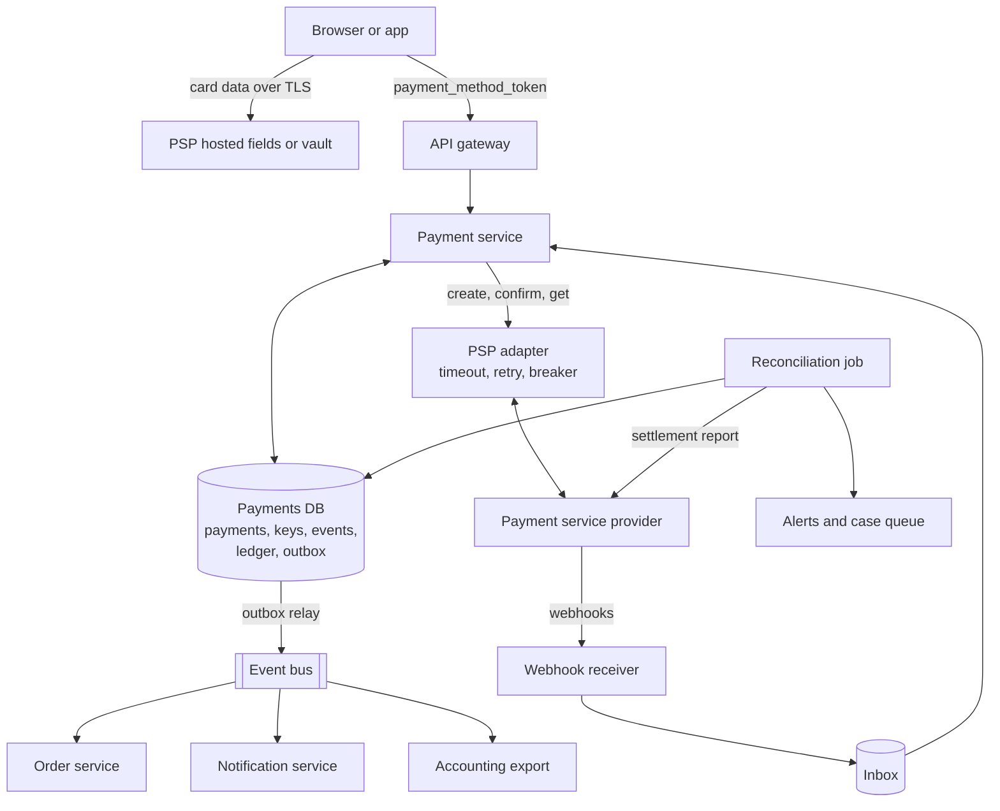
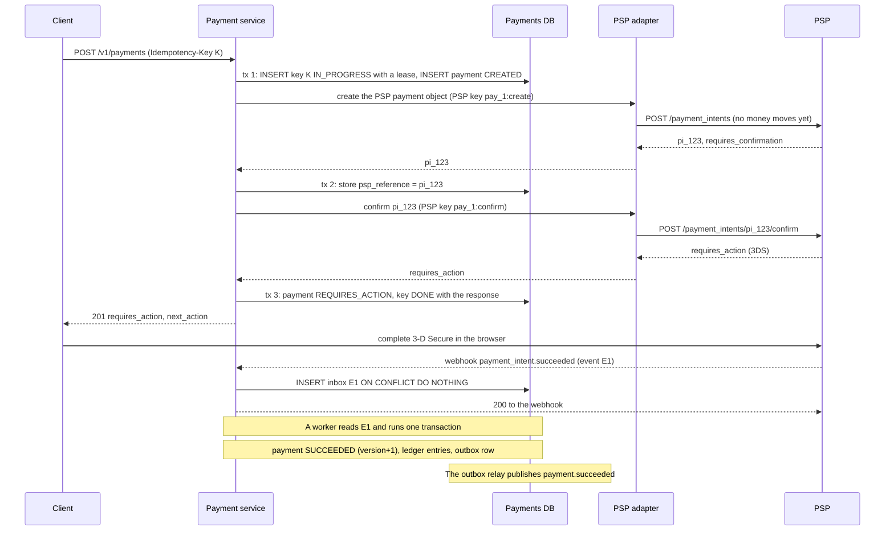
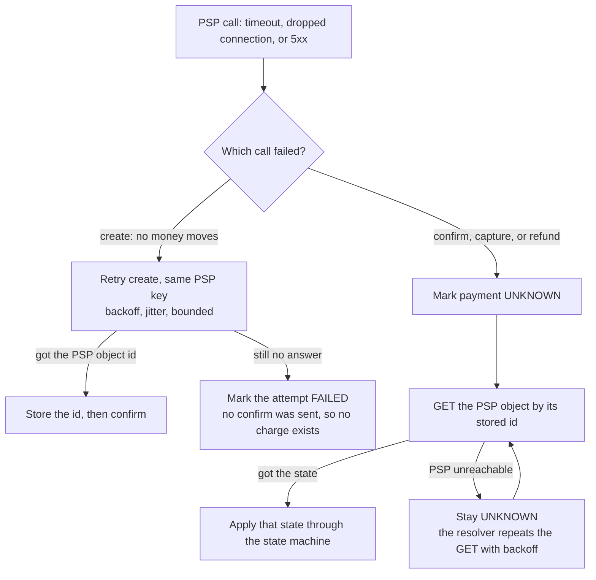
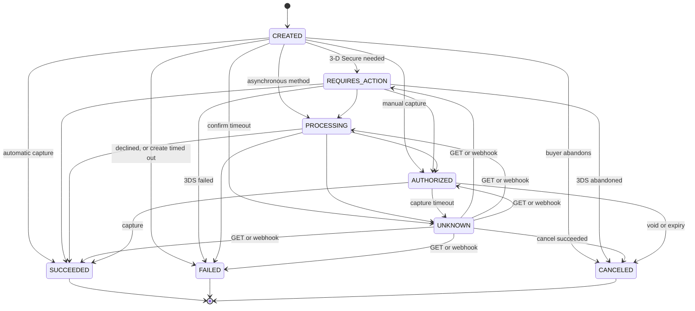
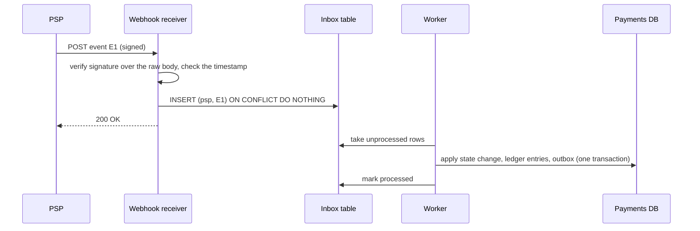

# Design a Payment System

A payment system moves money for a purchase. A buyer pays for an order, the platform keeps a record of every cent, and the platform later receives the money from a payment service provider (PSP). This case study gives the design that a strong candidate presents in 45 minutes. The system is small in traffic (about 10 payments per second on average) and large in risk. A duplicate charge, a lost payment, or a ledger that does not add up costs money and trust, so the design spends its effort on correctness: idempotency at every hop, a double-entry ledger, a payment state machine that survives unknown outcomes, and a reconciliation job that finds what the other parts missed. Follow the steps in [how to approach an HLD interview](../how-to-approach-hld.md). The code-level version of the money rules is in [the LLD digital wallet](../../lld/case-studies/23-digital-wallet/README.md), and the idempotent checkout inside one program is in [the LLD shopping cart and orders](../../lld/case-studies/18-shopping-cart-and-orders/README.md). This page links to them and does not repeat their code.

!!! note "About the sources"
    Companies publish few details of their payment systems. This page is a reference design. Where a company has published its design, the text cites the source: Stripe on idempotent requests, the PaymentIntent lifecycle, webhooks, and its ledger; Airbnb on avoiding double payments. The PCI Security Standards Council defines the card data rules. A claim without a citation is a design decision of this page, and the page says so.

## Problem Statement

Design the payment system of an online marketplace. A buyer pays for an order with a card. The platform does not talk to the card networks itself. It uses a PSP (for example Stripe or Adyen) that charges the card. The platform records each payment, splits the money between the seller and the platform fee, supports refunds, and checks its records against the reports of the PSP. The system must never charge a buyer twice for one order, and it must never lose a payment that the PSP completed.

## Clarifying Questions

| Question | Assumed answer |
|---|---|
| Are we the PSP or a merchant that uses a PSP? | A merchant (a marketplace) that uses an external PSP. We do not build the card network connection, the card vault, or fraud scoring |
| Which payment methods? | Cards, including a 3-D Secure step that the buyer completes in a browser. Bank debits and wallets follow the same state machine with a longer `processing` time |
| What does the system do? | Create a payment, authorize and capture it, refund it, record the money in a ledger, and reconcile with the PSP |
| Are authorization and capture one step or two? | Both exist. Digital goods use one step (authorize and capture at once). Physical goods authorize at checkout and capture at shipment |
| What volume? | 1 million successful payments each day, with a peak of 5 times the average during a sale. Assumption: the platform measures its own peak |
| Which currencies? | Many. Each payment has one currency. The system stores money as integer minor units and does no currency conversion in the payment path |
| Do we store card numbers? | No. The browser sends the card data straight to the PSP, and our servers see only a token. This keeps most of the system outside the PCI DSS scope (see High-Level Design) |
| How strict is consistency? | A payment has one correct state. The ledger is strongly consistent. Dashboards and analytics can lag by seconds |
| What availability? | Assumption: 99.95% for `POST /v1/payments`. When the PSP is down, the system fails the payment cleanly and does not guess |
| Who retries? | The client retries after a timeout, and our server retries calls to the PSP. Both retries must be safe |
| Marketplace payouts to sellers? | In scope in brief: the ledger holds the seller balance. The payout itself is a second flow with the same state machine |
| Fraud, tax, subscriptions, invoicing? | Out of scope |

## Requirements

### Functional

1. A client creates a payment for an order with an amount, a currency, and a payment-method token. The call carries an idempotency key.
2. The system authorizes the payment at the PSP, handles a 3-D Secure challenge, and captures the money (at once or later).
3. The system accepts PSP webhooks, and updates the payment state from them.
4. A client reads the status of a payment at any time.
5. A client cancels an authorized payment (void) or refunds a captured payment, in full or in part.
6. Each money movement writes balanced entries in a double-entry ledger.
7. A daily reconciliation compares the payments, the ledger, and the PSP settlement report, and reports each difference.
8. Other services (orders, notifications, accounting) learn about payment events.

### Non-functional

| Requirement | Target (assumption unless a source is named) |
|---|---|
| Correctness | No duplicate charge for one order. No payment that the PSP completed is missing from the ledger. The ledger sums to zero |
| Durability | A payment record, once acknowledged, survives the loss of one node (synchronous replication to at least one replica) |
| Latency | `POST /v1/payments`: 3 seconds at the 99th percentile for a one-step card payment. The PSP call is most of that time |
| Availability | 99.95% for the create API (about 4.4 hours of downtime in a year, see [scalability and availability](../fundamentals/01-scalability-and-availability.md)) |
| Throughput | 10 payments per second on average, 50 at the peak |
| Retention | Ledger and payment records for 7 years (assumption: a typical financial record-keeping period. Check the rules of each country) |
| Auditability | Each state change and each ledger entry is append-only and traceable to a request |
| Security | No card number or card verification code on our systems. All traffic uses TLS. Webhooks are signature-checked |

## Estimation

Rounding rule (the same as on the [estimation page](../back-of-envelope-estimation.md)): one day is 10^5 seconds. The exact day has 86,400 seconds, so the rates are about 14% lower than the exact rates. The error is smaller than the error of the assumptions.

Inputs (all are assumptions):

- 1 million payments each day. Peak factor 5.
- One payment row of 1 KB.
- The webhook endpoint receives 2 events for each payment. Stripe advises that an endpoint subscribes only to the event types that the integration needs, so 2 is a plausible minimum. A raw webhook payload is 1 KB.
- A payment produces on average 4 ledger entries: 3 at capture, plus refunds amortized over all payments, plus a margin. Settlement posts one transaction for each PSP payout batch (bank, fee, and clearing lines for the whole batch), so its cost for each payment is close to zero. The Java program below settles one payment by itself only to keep the example small.
- One ledger entry of 200 bytes. A PSP settlement report line of 300 bytes. One idempotency record (key, request hash, stored response) of 500 bytes.
- One API request plus its response is 5 KB.
- Retention 7 years (Assumption: a typical financial record-keeping period. Check the rules of each country). Idempotency keys are kept 48 hours (Assumption, explained in the first deep dive). Replication factor 3.
- One card payment with 3-D Secure causes about 14 write statements: the payment insert (1), three payment updates that store `psp_reference`, `requires_action`, and `succeeded` (3), the idempotency key insert and update (2), two event rows (2), one multi-row insert for the ledger entries of the capture (1), one outbox row (1), and for each of the two webhooks an inbox insert and an update that marks it processed (4). A payment without 3-D Secure causes fewer.

| Step | Calculation | Result |
|---|---|---|
| Payments per second (average) | 1,000,000 / 10^5 | 10 |
| Payments per second (peak) | 10 × 5 | 50 |
| Database writes per second at the peak | 50 × 14 | 700 |
| PSP calls per second at the peak | 50 × 2 (create the PSP payment object, then confirm it) | about 100 |
| Webhooks per second at the peak | 50 × 2 | about 100 |
| Payment rows each day | 1,000,000 × 1 KB | 1 GB |
| Raw webhook payloads each day | 1,000,000 × 2 × 1 KB | 2 GB |
| Ledger entries each day | 1,000,000 × 4 | 4 million |
| Ledger size each day | 4,000,000 × 200 B | 800 MB |
| Ledger size in 7 years | 800 MB × 365 × 7 | 2,044 GB, about 2 TB |
| Ledger with 3 replicas | 2,044 GB × 3 | 6.1 TB |
| Idempotency keys kept for 48 hours | 1,000,000 × 2 days × 500 B | 1 GB |
| Settlement report each day | 1,000,000 × 300 B | 300 MB |
| Peak API traffic | 50 × 5 KB × 8 bits | 2,000 kbit/s = 2 Mbit/s |

What the numbers decide:

- The load is small. 700 database writes each second at the peak fit on one PostgreSQL primary on ordinary hardware (Assumption: measure it with your own schema and indexes). The reason to partition later is blast radius and growth, not today's throughput. Say this out loud: the hard part of a payment system is not scale.
- The ledger is about 2 TB in 7 years. That is a few machines, and the old months can move to cheaper storage.
- The raw webhook payloads (2 GB each day) are larger than the payment rows (1 GB). Keep them for audit and replay, but move them to object storage after 90 days (Assumption).
- The PSP is the slowest and least reliable part. Its latency decides the API latency, and its outage is the main failure.

The program below checks the arithmetic and also runs the four ideas of the design: money as minor units, the state machine, the idempotency store, and the ledger with a reconciliation. `main` comes first and the block has its own imports, so you can copy it into `PaymentCheck.java` and run `java PaymentCheck.java` on JDK 21.

```java
import java.math.BigDecimal;
import java.math.RoundingMode;
import java.util.ArrayList;
import java.util.Arrays;
import java.util.EnumMap;
import java.util.HashMap;
import java.util.List;
import java.util.Map;
import java.util.Set;
import java.util.TreeMap;
import java.util.TreeSet;

public class PaymentCheck {
    public static void main(String[] args) {
        estimation();
        money();
        stateMachine();
        idempotency();
        ledgerAndReconciliation();
    }

    // ---------- 1. Estimation (1 day = 10^5 s) ----------
    static void estimation() {
        System.out.println("== Estimation ==");
        long paymentsPerDay = 1_000_000L;
        long avgTps = paymentsPerDay / 100_000L;
        long peakTps = avgTps * 5;
        long entriesPerDay = paymentsPerDay * 4;
        long ledgerBytesPerDay = entriesPerDay * 200;
        long ledgerBytes7y = ledgerBytesPerDay * 365 * 7;
        long writesPerSecondAtPeak = peakTps * 14;
        System.out.println("average payments per second: " + avgTps);
        System.out.println("peak payments per second: " + peakTps);
        System.out.println("ledger entries per day: " + entriesPerDay);
        System.out.println("ledger MB per day: " + ledgerBytesPerDay / 1_000_000L);
        System.out.println("ledger GB in 7 years: " + ledgerBytes7y / 1_000_000_000L);
        System.out.println("ledger GB with 3 replicas: " + 3 * ledgerBytes7y / 1_000_000_000L);
        System.out.println("database writes per second at peak: " + writesPerSecondAtPeak);
    }

    // ---------- 2. Money is an integer count of minor units ----------
    static long toMinor(String amount, int exponent) {
        BigDecimal value = new BigDecimal(amount).setScale(exponent, RoundingMode.UNNECESSARY);
        return value.movePointRight(exponent).longValueExact();
    }

    static long[] split(long total, int parts) {
        long[] shares = new long[parts];
        for (int i = 0; i < parts; i++) {
            shares[i] = total / parts + (i < total % parts ? 1 : 0);
        }
        return shares;
    }

    static long feeBasisPoints(long amountMinor, long bps) {
        return (Math.multiplyExact(amountMinor, bps) + 5_000) / 10_000; // round half up
    }

    static void money() {
        System.out.println("== Money ==");
        System.out.println("19.99 USD = " + toMinor("19.99", 2) + " minor units");
        System.out.println("1500 JPY = " + toMinor("1500", 0) + " minor units");
        try {
            toMinor("19.999", 2);
        } catch (ArithmeticException e) {
            System.out.println("19.999 USD is rejected: it has a fraction of a cent");
        }
        System.out.println("0.1 + 0.2 as double = " + (0.1 + 0.2));
        System.out.println("10 + 20 minor units = " + (10 + 20));
        System.out.println("split 1000 in 3 = " + Arrays.toString(split(1000, 3)));
        System.out.println("fee of 2.90% on 1999 = " + feeBasisPoints(1999, 290));
    }

    // ---------- 3. Payment state machine ----------
    enum Status { CREATED, REQUIRES_ACTION, PROCESSING, AUTHORIZED, SUCCEEDED, FAILED, CANCELED,
        UNKNOWN }

    static final Map<Status, Set<Status>> NEXT = new EnumMap<>(Status.class);

    static {
        NEXT.put(Status.CREATED, Set.of(Status.REQUIRES_ACTION, Status.PROCESSING,
                Status.AUTHORIZED, Status.SUCCEEDED, Status.FAILED, Status.CANCELED,
                Status.UNKNOWN));
        NEXT.put(Status.REQUIRES_ACTION, Set.of(Status.PROCESSING, Status.AUTHORIZED,
                Status.SUCCEEDED, Status.FAILED, Status.CANCELED));
        NEXT.put(Status.PROCESSING, Set.of(Status.AUTHORIZED, Status.SUCCEEDED, Status.FAILED,
                Status.UNKNOWN));
        // UNKNOWN takes the state that a GET of the PSP object returns
        NEXT.put(Status.UNKNOWN, Set.of(Status.REQUIRES_ACTION, Status.PROCESSING,
                Status.AUTHORIZED, Status.SUCCEEDED, Status.FAILED, Status.CANCELED));
        // a capture or a void can time out too
        NEXT.put(Status.AUTHORIZED, Set.of(Status.SUCCEEDED, Status.CANCELED, Status.UNKNOWN));
        NEXT.put(Status.SUCCEEDED, Set.<Status>of());
        NEXT.put(Status.FAILED, Set.<Status>of());
        NEXT.put(Status.CANCELED, Set.<Status>of());
    }

    static final class Payment {
        Status status = Status.CREATED;
        int version = 0;

        String apply(Status target) {
            if (target == status) {
                return "duplicate, ignored";
            }
            if (!NEXT.get(status).contains(target)) {
                return "stale or illegal, ignored (stays " + status + ")";
            }
            status = target;
            version++;
            return "applied, version " + version;
        }
    }

    static void stateMachine() {
        System.out.println("== State machine ==");
        Payment p = new Payment();
        Status[] events = { Status.PROCESSING, Status.SUCCEEDED, Status.SUCCEEDED,
            Status.PROCESSING, Status.FAILED };
        for (Status event : events) {
            System.out.println("event " + event + ": " + p.apply(event));
        }
        Payment q = new Payment();
        System.out.println("PSP confirm times out: " + q.apply(Status.UNKNOWN));
        System.out.println("GET of the PSP object says SUCCEEDED: " + q.apply(Status.SUCCEEDED));
    }

    // ---------- 4. Idempotency key store ----------
    record Stored(String request, String state, String response) { }

    static final Map<String, Stored> KEYS = new HashMap<>();
    static int nextId = 1;

    static String create(String key, String request) {
        Stored old = KEYS.get(key);
        if (old != null) {
            if (!old.request().equals(request)) {
                return "422 key reused with a different request";
            }
            if (old.state().equals("IN_PROGRESS")) {
                return "409 first request still running, retry later";
            }
            return "replay of " + old.response();
        }
        KEYS.put(key, new Stored(request, "IN_PROGRESS", null));
        String response = "201 pay_" + nextId++;
        KEYS.put(key, new Stored(request, "DONE", response));
        return response;
    }

    static void idempotency() {
        System.out.println("== Idempotency ==");
        System.out.println("first call: " + create("k1", "order=7;amount=1999"));
        System.out.println("retry:      " + create("k1", "order=7;amount=1999"));
        System.out.println("bug:        " + create("k1", "order=7;amount=2999"));
        KEYS.put("k2", new Stored("order=8;amount=500", "IN_PROGRESS", null));
        System.out.println("concurrent: " + create("k2", "order=8;amount=500"));
    }

    // ---------- 5. Ledger and reconciliation ----------
    record Entry(String txId, String account, long amount) { }

    static void ledgerAndReconciliation() {
        System.out.println("== Ledger ==");
        List<Entry> ledger = new ArrayList<>();
        // debit is positive, credit is negative
        ledger.add(new Entry("capture-P1", "psp_clearing", 10_000));
        ledger.add(new Entry("capture-P1", "seller_payable", -9_500));
        ledger.add(new Entry("capture-P1", "platform_revenue", -500));
        ledger.add(new Entry("settle-P1", "bank", 9_680));
        ledger.add(new Entry("settle-P1", "psp_fees", 320));
        ledger.add(new Entry("settle-P1", "psp_clearing", -10_000));
        Map<String, Long> byTx = new TreeMap<>();
        Map<String, Long> byAccount = new TreeMap<>();
        for (Entry e : ledger) {
            byTx.merge(e.txId(), e.amount(), Long::sum);
            byAccount.merge(e.account(), e.amount(), Long::sum);
        }
        System.out.println("sum of each transaction: " + byTx);
        byAccount.forEach((account, balance) ->
                System.out.println("balance " + account + ": " + balance));

        System.out.println("== Reconciliation ==");
        Map<String, Long> ours = new TreeMap<>();
        ours.put("P1", 10_000L);
        ours.put("P2", 2_500L);
        ours.put("P4", 4_000L);
        Map<String, Long> psp = new TreeMap<>();
        psp.put("P1", 10_000L);
        psp.put("P2", 2_400L);
        psp.put("P3", 7_000L);
        Set<String> all = new TreeSet<>(ours.keySet());
        all.addAll(psp.keySet());
        for (String id : all) {
            Long a = ours.get(id);
            Long b = psp.get(id);
            String verdict;
            if (a == null) {
                verdict = "missing in our ledger, PSP has " + b;
            } else if (b == null) {
                verdict = "missing in PSP report, ledger has " + a;
            } else if (!a.equals(b)) {
                verdict = "amount mismatch, ledger " + a + " and PSP " + b;
            } else {
                verdict = "match";
            }
            System.out.println(id + ": " + verdict);
        }
    }
}
```

<!-- expected-output -->
```text
== Estimation ==
average payments per second: 10
peak payments per second: 50
ledger entries per day: 4000000
ledger MB per day: 800
ledger GB in 7 years: 2044
ledger GB with 3 replicas: 6132
database writes per second at peak: 700
== Money ==
19.99 USD = 1999 minor units
1500 JPY = 1500 minor units
19.999 USD is rejected: it has a fraction of a cent
0.1 + 0.2 as double = 0.30000000000000004
10 + 20 minor units = 30
split 1000 in 3 = [334, 333, 333]
fee of 2.90% on 1999 = 58
== State machine ==
event PROCESSING: applied, version 1
event SUCCEEDED: applied, version 2
event SUCCEEDED: duplicate, ignored
event PROCESSING: stale or illegal, ignored (stays SUCCEEDED)
event FAILED: stale or illegal, ignored (stays SUCCEEDED)
PSP confirm times out: applied, version 1
GET of the PSP object says SUCCEEDED: applied, version 2
== Idempotency ==
first call: 201 pay_1
retry:      replay of 201 pay_1
bug:        422 key reused with a different request
concurrent: 409 first request still running, retry later
== Ledger ==
sum of each transaction: {capture-P1=0, settle-P1=0}
balance bank: 9680
balance platform_revenue: -500
balance psp_clearing: 0
balance psp_fees: 320
balance seller_payable: -9500
== Reconciliation ==
P1: match
P2: amount mismatch, ledger 2500 and PSP 2400
P3: missing in our ledger, PSP has 7000
P4: missing in PSP report, ledger has 4000
```

The program shows three facts that the design relies on. `0.1 + 0.2` in `double` is not `0.3`, so money is never a `double`. The late `PROCESSING` event and the conflicting `FAILED` event do not change a payment that is already `SUCCEEDED`. After the settlement, the `psp_clearing` account is back at zero: the money that the PSP held for us has arrived in the bank, less the PSP fee. The negative balances are credit balances in the sign convention of this page: `seller_payable` at -9500 means that the platform owes the seller 95.00, and `platform_revenue` at -500 means that the platform earned 5.00 (see the sign convention in the second deep dive). The program keeps the idempotency store in a `HashMap` on one thread, so it shows the decisions and not the concurrency. The database version claims the key with an atomic insert (first deep dive).

## API Design

All endpoints use HTTPS and JSON. Amounts are integers in minor units (`19.99` USD is `1999`). A currency is an ISO 4217 code. The server returns the same error shape for every failure: `{"error": {"code": "...", "message": "...", "request_id": "..."}}`.

### Create a payment

```text
POST /v1/payments
Idempotency-Key: 6f0e3d1a-6a46-4d64-9a11-3c1f0a1b6f2e
Authorization: Bearer <merchant or service token>

{
  "order_id": "ord_8123",
  "amount_minor": 1999,
  "currency": "USD",
  "payment_method_token": "pm_tok_abc123",
  "capture_method": "automatic"          // or "manual"
}
```

Response `201 Created` (or `200 OK` for a replay, with the header `Idempotent-Replayed: true`):

```text
{
  "payment_id": "pay_01HV...",
  "order_id": "ord_8123",
  "status": "requires_action",
  "amount_minor": 1999,
  "currency": "USD",
  "next_action": { "type": "redirect_to_3ds", "url": "https://..." }
}
```

| Status | Meaning |
|---|---|
| `400` | The `Idempotency-Key` header is missing, or a field is invalid |
| `402` | The PSP declined the payment (the response body gives the decline code). The decline is stored under the key, so a retry returns the same decline |
| `409` | Another request with the same key is still running. The client waits and retries with the same key |
| `422` | The key was used before with a different body |
| `502` or `504` | The PSP did not answer. The payment is in `unknown`. The client retries with the same key or polls `GET /v1/payments/{id}` |

The status codes follow the pattern that the [reliability patterns page](../fundamentals/12-reliability-patterns.md) describes: `400` for a missing key, `409` for a request in flight, and `422` for a key reused with a different body. That page notes that the matching IETF draft is not a standard. Stripe documents the idempotent behavior in its API but not these exact codes for every case, so these are the choices of this design.

### Other endpoints

| Method and path | Purpose | Request | Response |
|---|---|---|---|
| `GET /v1/payments/{id}` | Read the payment and its status | none | `200` with the payment, including `status` and `version` |
| `GET /v1/payments?order_id={order_id}` | Find the payments of an order, for a client that never received the create response | none | `200` with a list of payments, newest first |
| `POST /v1/payments/{id}/capture` | Capture an authorized payment | `Idempotency-Key`, optional `amount_minor` (not more than authorized) | `200` with the new status |
| `POST /v1/payments/{id}/cancel` | Void an authorization | `Idempotency-Key` | `200`, or `409` if the payment is already captured |
| `POST /v1/payments/{id}/refunds` | Refund all or part of a captured payment | `Idempotency-Key`, `amount_minor`, `reason` | `201` with `refund_id` and `status` (`pending`, `succeeded`, `failed`) |
| `POST /v1/webhooks/psp/{psp}` | Receive PSP events | The raw body and the PSP signature header | `200` after the event is stored. A `4xx` for a bad signature |
| `GET /internal/v1/reconciliation/{date}` | Read the result of the reconciliation for a day | none | `200` with the counts and the list of differences |

The webhook endpoint stores the event and returns `200` before it does any other work. Stripe tells integrators to return a `2xx` before complex logic, to verify the `Stripe-Signature` header over the raw body, and to process events with an asynchronous queue. A `POST` to the ledger is not public: only the payment service writes ledger transactions, through an internal interface.

## Data Model

### The database choice

The payment service uses a relational database with ACID transactions: PostgreSQL (or MySQL with InnoDB). The reasons:

- One payment update touches several rows that must change together: the payment row, the idempotency record, the event row, the ledger entries, and the outbox row. A local transaction gives all of them or none.
- Constraints enforce the rules where the data lives: a unique key for idempotency, a unique key for webhook events, a `CHECK` for positive amounts.
- The data is small (2 TB in 7 years) and the write rate is low (700 each second), so a single primary with replicas is enough (see the estimation).
- A wide-column or key-value store would need extra work for multi-row atomicity and for the ledger sum check. See [choosing a database](../fundamentals/04-choosing-a-database.md).

Recommendation: keep the payment tables, the ledger tables, and the outbox in one database, so that one local transaction covers a payment change and its ledger entries. [Distributed transactions](../distributed-systems/03-distributed-transactions.md) lists this as the first option to try, before a saga or two-phase commit.

### Tables

<!-- sql-skip: PostgreSQL -->
```sql
-- PostgreSQL syntax. Money is BIGINT in minor units, never FLOAT or NUMERIC with a guess.
CREATE TABLE payments (
    payment_id      TEXT PRIMARY KEY,
    merchant_id     TEXT        NOT NULL,
    order_id        TEXT        NOT NULL,
    amount_minor    BIGINT      NOT NULL CHECK (amount_minor > 0),
    currency        CHAR(3)     NOT NULL,
    status          TEXT        NOT NULL,       -- created, requires_action, ..., unknown
    version         INT         NOT NULL DEFAULT 0,
    psp             TEXT        NOT NULL,
    psp_reference   TEXT,                       -- PSP object id, stored before confirm
    captured_minor  BIGINT      NOT NULL DEFAULT 0,
    refunded_minor  BIGINT      NOT NULL DEFAULT 0,
    created_at      TIMESTAMPTZ NOT NULL DEFAULT now(),
    updated_at      TIMESTAMPTZ NOT NULL DEFAULT now(),
    CHECK (captured_minor <= amount_minor),
    CHECK (refunded_minor <= captured_minor)
);

-- At most one live payment for each order. A failed or canceled attempt
-- does not block the next attempt (for example, a second card after a decline).
CREATE UNIQUE INDEX one_live_payment_per_order
    ON payments (merchant_id, order_id)
    WHERE status NOT IN ('failed', 'canceled');

CREATE TABLE idempotency_keys (
    merchant_id      TEXT        NOT NULL,
    idem_key         TEXT        NOT NULL,
    request_hash     BYTEA       NOT NULL,
    state            TEXT        NOT NULL,      -- IN_PROGRESS or DONE
    lease_expires_at TIMESTAMPTZ NOT NULL,      -- the owner of IN_PROGRESS holds a lease
    payment_id       TEXT,
    response_code    INT,
    response_body    JSONB,
    created_at       TIMESTAMPTZ NOT NULL DEFAULT now(),
    PRIMARY KEY (merchant_id, idem_key)
);

CREATE TABLE payment_events (               -- append-only history of state changes
    event_id        BIGSERIAL PRIMARY KEY,
    payment_id      TEXT        NOT NULL REFERENCES payments (payment_id),
    from_status     TEXT,
    to_status       TEXT        NOT NULL,
    source          TEXT        NOT NULL,       -- api, webhook, reconciliation
    psp_event_id    TEXT,
    created_at      TIMESTAMPTZ NOT NULL DEFAULT now()
);

CREATE TABLE webhook_inbox (                -- one row for each PSP event, for deduplication
    psp             TEXT        NOT NULL,
    psp_event_id    TEXT        NOT NULL,
    payload         JSONB       NOT NULL,
    received_at     TIMESTAMPTZ NOT NULL DEFAULT now(),
    processed_at    TIMESTAMPTZ,
    PRIMARY KEY (psp, psp_event_id)
);

CREATE TABLE ledger_accounts (
    account_id      TEXT PRIMARY KEY,           -- for example psp_clearing, seller:42:payable
    kind            TEXT        NOT NULL,       -- asset, liability, revenue, expense
    currency        CHAR(3)     NOT NULL
);

CREATE TABLE ledger_entries (                -- append-only: no UPDATE, no DELETE
    entry_id        BIGSERIAL PRIMARY KEY,
    tx_id           TEXT        NOT NULL,
    account_id      TEXT        NOT NULL REFERENCES ledger_accounts (account_id),
    amount_minor    BIGINT      NOT NULL,       -- debit positive, credit negative
    currency        CHAR(3)     NOT NULL,
    payment_id      TEXT,
    created_at      TIMESTAMPTZ NOT NULL DEFAULT now(),
    UNIQUE (tx_id, account_id)
);

CREATE TABLE outbox (                        -- events to publish, written in the same transaction
    outbox_id       BIGSERIAL PRIMARY KEY,
    topic           TEXT        NOT NULL,
    key             TEXT        NOT NULL,
    payload         JSONB       NOT NULL,
    created_at      TIMESTAMPTZ NOT NULL DEFAULT now(),
    published_at    TIMESTAMPTZ
);

CREATE TABLE reconciliation_items (
    run_date        DATE        NOT NULL,
    psp_reference   TEXT        NOT NULL,
    kind            TEXT        NOT NULL,       -- match, amount_mismatch, missing_ours, missing_psp
    ours_minor      BIGINT,
    psp_minor       BIGINT,
    state           TEXT        NOT NULL DEFAULT 'open',
    PRIMARY KEY (run_date, psp_reference)
);
```

Key points:

- The partial unique index `one_live_payment_per_order` is a second guard against a double charge. Even if a client sends two different idempotency keys for the same order, the database accepts only one live payment for it. A second create with a new key gets a unique violation, and the service returns the existing payment. A payment in `unknown` is live, so the index also blocks a second attempt while the first outcome is unresolved. That is the rule the first deep dive needs. A payment in `failed` or `canceled` is not live, so the buyer can try another card for the same order. A plain `UNIQUE (merchant_id, order_id)` would block that common path after a decline.
- `version` is for optimistic concurrency: `UPDATE payments SET status = ?, version = version + 1 WHERE payment_id = ? AND version = ?`.
- `captured_minor` and `refunded_minor` have `CHECK` constraints, so a bug cannot refund more than the capture.
- `ledger_entries` has no `UPDATE` and no `DELETE` grant for the application role. A correction is a new reversing transaction.
- Partition key if the system outgrows one node: `merchant_id`. All the rows of one merchant (payments, ledger entries, keys) live on one shard, so a payment change stays one local transaction. See [partitioning and sharding](../fundamentals/06-partitioning-and-sharding.md). Platform-wide accounts (such as `psp_clearing`) become one account for each shard, and a report adds them.

### A runnable reduced model

The next blocks run on SQLite. They show two of the constraints at work: the idempotency primary key and the zero sum of each ledger transaction.

```sql
CREATE TABLE idempotency_keys (
    merchant_id   TEXT NOT NULL,
    idem_key      TEXT NOT NULL,
    request_hash  TEXT NOT NULL,
    PRIMARY KEY (merchant_id, idem_key)
);

-- The second insert has the same key. ON CONFLICT DO NOTHING makes it a no-op.
-- PostgreSQL supports the same clause.
INSERT INTO idempotency_keys VALUES ('m1', 'key-1', 'hash-a') ON CONFLICT DO NOTHING;
INSERT INTO idempotency_keys VALUES ('m1', 'key-1', 'hash-a') ON CONFLICT DO NOTHING;

CREATE TABLE ledger_entries (
    entry_id      INTEGER PRIMARY KEY,
    tx_id         TEXT    NOT NULL,
    account_id    TEXT    NOT NULL,
    amount_minor  INTEGER NOT NULL,
    UNIQUE (tx_id, account_id)
);

INSERT INTO ledger_entries (tx_id, account_id, amount_minor) VALUES
    ('capture-P1', 'psp_clearing',     10000),
    ('capture-P1', 'seller_payable',   -9500),
    ('capture-P1', 'platform_revenue',  -500),
    ('settle-P1',  'bank',               9680),
    ('settle-P1',  'psp_fees',            320),
    ('settle-P1',  'psp_clearing',     -10000);
```

The first query counts the stored keys. Two inserts with one key leave one row.

```sql
SELECT COUNT(*) AS stored_keys FROM idempotency_keys;
```

<!-- sql-result -->
```text
stored_keys
1
```

The second query is the invariant check that a ledger audit runs: the sum of each transaction must be 0. A transaction with another sum would appear in this result with `HAVING SUM(amount_minor) <> 0`. Here, the plain `GROUP BY` shows both sums.

```sql
SELECT tx_id, SUM(amount_minor) AS total FROM ledger_entries GROUP BY tx_id ORDER BY tx_id;
```

<!-- sql-result -->
```text
tx_id | total
capture-P1 | 0
settle-P1 | 0
```

The third query computes the balance of each account from the entries. `psp_clearing` is 0: the settlement cleared it.

```sql
SELECT account_id, SUM(amount_minor) AS balance
FROM ledger_entries GROUP BY account_id ORDER BY account_id;
```

<!-- sql-result -->
```text
account_id | balance
bank | 9680
platform_revenue | -500
psp_clearing | 0
psp_fees | 320
seller_payable | -9500
```

## High-Level Design



| Component | Responsibility |
|---|---|
| Browser or app, PSP hosted fields | Collects the card data and sends it to the PSP, not to our servers. Returns a token that stands for the card. This is what keeps our servers out of most of the PCI DSS scope |
| API gateway | TLS termination, authentication, rate limiting (see [rate limiting algorithms](../fundamentals/13-rate-limiting-algorithms.md)), and routing |
| Payment service | Owns the payment state machine, the idempotency table, and the ledger writes. It is stateless: all state is in the database. It runs on several instances behind a load balancer |
| Payments DB | The single source of truth for payments and the ledger. Primary with synchronous replication to one replica and asynchronous replicas for reads and reports |
| PSP adapter | One interface: `create`, `confirm`, `capture`, `cancel`, `refund`, `get`. It maps each PSP to the internal states, sets timeouts, retries with backoff and jitter, and opens a circuit breaker when the PSP fails ([reliability patterns](../fundamentals/12-reliability-patterns.md)). It always forwards an idempotency key to the PSP |
| Webhook receiver | Verifies the signature over the raw body, writes the event to the inbox (a unique key on `psp` and `psp_event_id`), and returns `200` at once. A worker then applies the event to the payment |
| Outbox relay and event bus | Publish `payment.succeeded`, `payment.failed`, `refund.succeeded` events with at-least-once delivery. Consumers are idempotent (see [event-driven architecture](../fundamentals/16-event-driven-architecture.md) and [message queues and streams](../fundamentals/08-message-queues-and-streams.md)) |
| Order, notification, accounting | Consumers of payment events. The order service marks the order as paid. It follows the saga pattern of [distributed transactions](../distributed-systems/03-distributed-transactions.md) |
| Reconciliation job | Compares our payments and ledger with the PSP settlement report and with the bank statement. It raises each difference as a case |

### The flow of one card payment



The payment service does not hold a database transaction open during a PSP call. Each PSP call sits between two short local transactions: one records what the service is about to do, and one records the answer. Airbnb's payments team describes the same split as three phases, Pre-RPC, RPC, and Post-RPC, with two rules: no network calls in the Pre-RPC and Post-RPC phases, and no database work in the RPC phase. Their reason: network calls inside a database transaction caused connection pool exhaustion and performance degradation.

The service creates the PSP payment object first and stores its id (`psp_reference`) before it confirms. Stripe advises the same order: create the PaymentIntent as soon as the amount is known, so that Stripe records all attempted payments. The split matters for the unknown outcome. A create call moves no money. A confirm call does, and after a confirm the service always knows the id of the object to read. If the service crashes at any point, the key stays `IN_PROGRESS` until its lease expires, and the recovery path in the first deep dive finds the true state.

### Card data and PCI scope

The PCI Security Standards Council (PCI SSC) publishes the PCI Data Security Standard (PCI DSS). The standard applies to all entities that store, process, or transmit cardholder data or sensitive authentication data, or that could affect the security of the cardholder data environment. The Council's documents define two kinds of account data:

- **Cardholder data:** the primary account number (PAN), the cardholder name, the expiration date, and the service code.
- **Sensitive authentication data (SAD):** the full track data, the card verification code, and PINs or PIN blocks.

Requirement 3.3.1 states: "SAD is not retained after authorization, even if encrypted. All sensitive authentication data received is rendered unrecoverable upon completion of the authorization process." (quoted from the v4.0 self-assessment questionnaire SAQ C). The Council's FAQ on card verification codes states the one exception: "Only issuers or those providing issuing services may have a legitimate business need to store SAD after an authorization." A merchant is not an issuer, so a merchant never stores the card verification code, not even for a later charge. The Council published PCI DSS v4.0.1 on 11 June 2024 as a limited revision of v4.0, and its announcement says: "There are no additional or deleted requirements in this revision." v4.0.1 was the current version when this page was written. Check the document library for the current version.

The design decision: our servers never touch card data. The browser sends the card number to a field that the PSP hosts (an iframe or a redirect), and gets back a token. Our system stores and sends only the token and the last four digits for display. This shrinks the systems in scope to the page that embeds the PSP field and the systems that connect to it.

The Council publishes self-assessment questionnaires (SAQs). The shortest one, SAQ A, is for card-not-present merchants whose account data functions are completely outsourced. Its eligibility criteria (v4.0 text) include these:

- All processing of account data is outsourced to a PCI DSS compliant third-party service provider (TPSP) or payment processor.
- The merchant does not electronically store, process, or transmit any account data on its systems or premises.
- The merchant has reviewed the PSP's Attestation of Compliance.
- For e-commerce, all elements of the payment pages or forms that the browser receives "originate only and directly from a PCI DSS compliant TPSP/payment processor".

The January 2025 revision of SAQ A for v4.0.1 added a criterion: the merchant confirms that its site is not susceptible to script attacks. The Council's FAQ 1588 (February 2025) says that this criterion applies only to merchants whose page embeds the PSP's payment form, for example in an iframe, and not to merchants that redirect to the PSP. A merchant can meet it with controls such as those of Requirements 6.4.3 and 11.6.1, or with a confirmation from the PSP that its embedded solution protects the page. Which questionnaire applies depends on the integration and on the acquirer, which is the entity that accepts the merchant's compliance report.

Recommendation: ask the PSP and a qualified assessor to confirm the scope of the integration before launch. This page states a design goal (no PAN on our systems), not a compliance result. Never write a card number or a code to a log line, a trace, an error message, or an analytics event. A log scrubber and a test that sends a test card number and searches all logs for it are cheap controls.

## Deep Dives

### Deep Dive 1: Idempotency, retries, and the unknown outcome

A client that gets no answer to `POST /v1/payments` does not know whether the charge happened. The same is true when the payment service calls the PSP. The design has three layers of idempotency, and each layer closes one gap.

| Layer | Key | Stored in | Closes the gap |
|---|---|---|---|
| Client to payment service | `Idempotency-Key` header, a UUID that the client creates once for the logical payment | `idempotency_keys` | The client retries after a timeout, or the user double-clicks |
| Payment service to PSP | The payment service sends its own idempotency key to the PSP, one for each operation on the payment: `pay_1:create`, `pay_1:confirm`, `pay_1:capture`, `refund_7:create`. The key is derived from our id and the operation, so a retry after a crash produces the same key. One key cannot serve two operations: Stripe compares the parameters of a retry with those of the original request and returns an error if they differ | The PSP | The payment service retries after a timeout or a crash, with the PSP's own deduplication |
| PSP to payment service | The PSP event id | `webhook_inbox` | The PSP sends a webhook more than once. Stripe documents that an endpoint can receive the same event more than once, and tells integrators to log processed event ids |

Airbnb calls the key form of the second layer *entity-level* idempotency: a key derived from the business object (their example is `payment-1234-refund`), as opposed to a random key for each request.

Server procedure for the first layer:

1. In one transaction, run `INSERT INTO idempotency_keys ... ON CONFLICT DO NOTHING`, with the key scoped to the merchant (so one merchant cannot read the result of another), the hash of the request body, and a lease (`lease_expires_at = now() + L`). If the insert adds a row, this request owns the key. Insert the payment row in the same transaction.
2. If the insert adds no row, read the existing record. If the request hash differs, return `422`. If the state is `DONE`, return the stored response with the header `Idempotent-Replayed: true`. If the state is `IN_PROGRESS` and the lease is still valid, return `409` and tell the client to retry with the same key.
3. If the state is `IN_PROGRESS` and the lease has expired, the owner has crashed or stalled. The new request takes over the key with a conditional update (`UPDATE ... SET lease_expires_at = now() + L WHERE ... AND lease_expires_at < now()`). Only one request wins that update. The winner does not start from the beginning: it reads the payment, and if a `psp_reference` exists, it reads the PSP object first and continues from that state.
4. The owner calls the PSP outside any transaction, with the PSP idempotency key of the operation.
5. The owner commits the result in a second transaction: the payment status, the stored response, the event row, the ledger entries (if money moved), and the outbox row. The key becomes `DONE`.

The lease length `L` must be longer than the PSP call timeout, including the bounded retries, so that a slow but live owner keeps its key. Airbnb's Orpheus library uses the same mechanism: each request takes a row-level lock on its idempotency key, which grants an expiring lease, a retry can proceed only after the lease expires, and "a good rule of thumb is to have a higher lease expiration than the RPC timeout". Airbnb's post gives the same step as an example of work in its RPC phase: on a retry attempt, query the downstream service for the status of the transaction first.

Two more rules close the gaps around the lease:

- **Someone must sweep.** A takeover happens only when a retry arrives, and a client may never retry. A resolver job therefore scans for keys whose lease has expired and for payments that stay in `created` or `requires_action` longer than a threshold (Assumption: 30 minutes, longer than a 3-D Secure challenge takes). For each one, the resolver reads the PSP object if one exists. If the PSP reports a final or progressing state, the resolver applies it. If not, the resolver cancels the PSP object and, after the cancel succeeds, moves the payment to `canceled`. This also frees the order for a new attempt, because the partial unique index ignores canceled payments.
- **Safety does not depend on the lease.** An owner can stall past its lease (a long garbage-collection pause, for example) and then try to commit after another request took over. The late commit fails: the `version` check on the payment row rejects a stale update, and the ledger `tx_id` unique key rejects a second posting. The lease only keeps the system moving. The same rule, a lease for liveness and a fencing check for safety, is in [distributed locks and leases](../distributed-systems/05-distributed-locks-and-leases.md).

Read and write the idempotency records on the primary database, never on a replica. Airbnb gives the reason: if the record of a successful payment has not yet reached a lagging replica, a retry that reads the replica finds no record and charges again. Airbnb scaled the primary by sharding the idempotency tables by idempotency key.

Stripe's documented behavior is a good model. For API v1, Stripe saves the status code and body of the first request that began to run, including `500` errors, and returns them to retries. It saves nothing if the request fails validation before it runs or if another request with the key is in flight. Stripe keeps keys for at least 24 hours and can remove them after that, and a reuse after the removal can execute a new request. It recommends a UUID v4 or a key derived from a user-attached object such as a cart id, and it tells clients to retry an unresolved operation with the same key and parameters only within 24 hours of the original request. The retention of this design is 48 hours (Assumption) so that it always outlives a client retry window of 24 hours. The client must stop retrying after 24 hours and look up the payment of the order with `GET /v1/payments?order_id=...` instead.

#### The unknown outcome

The hard case is a PSP call that gets no clear answer: a timeout, a dropped connection, or a `5xx`. The PSP may have charged the card, may not have received the request, or may still process it. The adapter must not mark the payment as failed. What it does depends on which call failed, and the create-then-confirm split makes each case resolvable:



Rules for this flow:

- **The GET of a known object is the source of truth.** After a confirm, a capture, or a refund without a clear answer, read the PSP object by its id, and apply the state that the PSP returns. The answer can be any state: `succeeded`, `requires_action`, `processing`, a decline, or `requires_capture`.
- **After a `500`, a retry with the same key does not help.** Stripe caches a `500` response under the key and returns the same `500` to every retry while it keeps the key. A same-key retry resolves only a timeout or a dropped connection, where the PSP may never have run the request. Stripe says: treat the outcome of a `500` as indeterminate, do not retry with a new key until the original outcome is resolved, and reconcile through the object, the Dashboard, and webhooks.
- **Never start a new charge with a new key while the outcome is unknown.** A new key can start a second charge. The partial unique index on the order enforces this: a payment in `unknown` is live, so no second payment for the order can exist.
- **Respect the key window.** Stripe keeps keys for at least 24 hours and tells clients to limit retries to that window. After it, Stripe says not to retry with either the old key or a new one, and to reconcile or contact Stripe support.
- **Declare a payment `FAILED` only from a PSP answer.** The answer is a final PSP state (a decline), a successful cancel of the PSP object (Stripe allows a cancel before `processing` or `succeeded`), or the create case above, where no confirm was sent. "We did not find it" is not an answer.
- Retry only errors that can be transient: a network failure, a timeout, a `5xx`, a `429`. Never retry a decline (for example `card_declined`) automatically. A decline is a final answer. Airbnb's team makes the same split: it treats `5XX` errors from network and infrastructure as retryable, and validation errors (`4XX`) as non-retryable. It warns that a wrong label in either direction is costly. A transient error marked non-retryable fails a payment that would succeed. A final error marked retryable can cause a double payment.
- Put a limit on the attempts and the total time, and use exponential backoff with jitter (see [reliability patterns](../fundamentals/12-reliability-patterns.md)). A retry storm during a PSP incident makes the incident worse. Use a retry budget and a circuit breaker.
- Do not retry in the client and in every layer between. A retry at each of three layers gives 3 × 3 × 3 = 27 attempts. Retry at one layer (the payment service) and let the others fail fast.
- Do not show the buyer "failed" for an `UNKNOWN` payment. Show "processing", and tell the order service to wait. The buyer must not try a second payment that doubles the charge.
- Embed a local identifier (the `payment_id`) in the metadata of the PSP object. Stripe recommends this so that you can match an object that you learn about from a webhook, including after the PSP reconciles a failed operation. The resolver also uses it to find and cancel an orphan PSP object: an object that the PSP created after our create call timed out, and that we never confirmed.

Airbnb's engineering team describes this problem in "Avoiding Double Payments in a Distributed Payments System" (Jon Chew and Ninad Khisti, April 2019). Their solution is Orpheus, an idempotency library inside each payments service, not a separate idempotency service, because a separate service "would suffer from the same problems it was originally intended to solve". The post gives the Pre-RPC, RPC, and Post-RPC phases, the retryable and non-retryable errors, the expiring lease on each key, the stored responses, and the rule to read idempotency data from the primary database. Each of these appears on this page. The post uses the phrase "exactly-once delivery" loosely: what it builds is the exactly-once effect of the next section.

#### Why this is not "exactly-once"

No protocol gives exactly-once delivery over an unreliable network. The design gives an exactly-once effect: at-least-once attempts, plus a deduplicating receiver at each hop. The first layer deduplicates by the client key, the second by the PSP key, the third by the PSP event id. The [distributed transactions page](../distributed-systems/03-distributed-transactions.md) examines exactly-once claims in detail. In an interview, say "at-least-once with idempotent receivers", and name the table that holds each key.

The same idea applies to the effects inside our system. The ledger transaction id is derived from the business event (`capture-<payment_id>`, `refund-<refund_id>`), and `UNIQUE (tx_id, account_id)` makes a second insert of the same transaction fail. A worker that retries after a crash cannot post the money twice.

The inbox key is not enough on its own. Stripe documents that "in some cases, two separate Event objects are generated and sent" for one change, and these two events have different event ids, so the inbox stores both. The second event still changes nothing: the state machine treats `SUCCEEDED` on a `SUCCEEDED` payment as a no-op, and the ledger `tx_id` rejects a second capture posting. The deduplication that protects the money is the one keyed by the business event, not the one keyed by the message.

### Deep Dive 2: The ledger and double-entry bookkeeping

A payment table says what happened to each payment. A ledger says where each cent is. The ledger is the part that auditors, finance, and the reconciliation job trust. Stripe describes its ledger (Ilya Ganelin, Stripe, 2024) as an immutable record of money movement, built on double-entry accounting, in which "transactions previously published into Ledger cannot be deleted or modified". To correct an error, "we have to revert and reprocess prior operations". The post gives Stripe's scale: "Each day, Ledger sees five billion events and 99.99% of our dollar volume is fully ingested and verified within four days." The rest of this section describes the design of this page, which uses the same principles at a small scale.

#### The rules

1. **Every money movement is a transaction with at least two entries**, and the entries of one transaction sum to zero. The sum of all entries in the ledger is zero at all times.
2. **Entries are append-only.** A mistake is corrected by a new transaction that reverses it. The application role has no `UPDATE` or `DELETE` right on the table.
3. **Money is `BIGINT` minor units with a currency.** A transaction does not mix currencies. A currency conversion is two transactions through an FX account, one in each currency.
4. **A balance is a sum of entries**, or a cached sum that a job verifies against the entries. Never edit a balance in place.
5. **The transaction id comes from the business event**, so a retry cannot post it twice.

**The sign convention.** This page stores a debit as a positive amount and a credit as a negative amount, the form that accounting systems use. A debit increases an asset or expense account and decreases a liability or revenue account. A credit does the reverse. So an asset account (`bank`, `psp_clearing`) has a positive balance, and a liability or revenue account (`seller_payable`, `platform_revenue`) has a negative balance, called a credit balance. `seller_payable` at -9500 means that the platform owes the seller 95.00.

The [LLD digital wallet](../../lld/case-studies/23-digital-wallet/README.md) uses the opposite sign: a debit is negative (money leaves the user's account) and a credit is positive (money arrives). It does so because all of its accounts are user wallets, which are liabilities of the wallet company, and the opposite sign makes a user balance a positive number. The words agree between the two pages. A transfer out of a wallet is a debit of that account on both pages. Only the sign differs. The mapping is exact: for every entry, the wallet's amount equals minus this page's amount. A wallet balance of +120.00 is a credit balance of -12000 minor units in this page's form. Both conventions give the same invariant, because multiplying every entry by -1 keeps a zero sum at zero. Say which convention you use. This page uses the debit-positive form because its accounts are of four kinds (asset, liability, revenue, expense), and one rule covers all of them.

#### The accounts and the transactions

| Account | Kind | Meaning |
|---|---|---|
| `psp_clearing` | Asset | Money that the PSP holds for us and has not yet sent to our bank |
| `bank` | Asset | Our bank account |
| `seller_payable:<id>` | Liability | Money that we owe to a seller |
| `platform_revenue` | Revenue | Our fee |
| `psp_fees` | Expense | The fee that the PSP deducts |
| `refunds_pending` | Liability | A refund that the PSP has accepted and not yet paid out |

The flows of a 100.00 payment (10,000 minor units) with a platform fee of 5.00 and a PSP fee of 3.20. These are the numbers of the Java program above:

| Event | Transaction | Entries (debit +, credit -) | Sum |
|---|---|---|---|
| Capture succeeded | `capture-P1` | `psp_clearing` +10000, `seller_payable` -9500, `platform_revenue` -500 | 0 |
| PSP settles to our bank | `settle-P1` | `bank` +9680, `psp_fees` +320, `psp_clearing` -10000 | 0 |
| Partial refund of 20.00 | `refund-R1` | `seller_payable` +1900, `platform_revenue` +100, `psp_clearing` -2000 | 0 |

After `settle-P1`, `psp_clearing` is zero for this payment. A clearing account that does not return to zero shows money in transit or an error. Stripe uses the same signal. Its post defines one data quality metric this way: "Clearing measures the fraction of Ledger that is appropriately zeroed out at steady state." One of its example queries is: "Find the clearing Accounts with nonzero balance."

An authorization alone (before capture) does not move money. The ledger posts at capture, not at authorization. A hold is a state in the payment table. Some teams post a memo entry for an authorization. Both work if the rule is written down.

#### Writing the entries

The ledger write is in the same database transaction as the payment status change, so the status and the entries cannot disagree:

1. `UPDATE payments SET status='succeeded', version=version+1 WHERE payment_id=? AND version=?`. If zero rows change, another transaction won, and this one rolls back.
2. `INSERT` the entries of the transaction (`capture-<payment_id>`). The unique key rejects a duplicate.
3. A trigger, a deferred constraint, or a check in the code asserts that the entries sum to zero before commit. A cheap application check is `assert sum == 0` before the insert. A background audit then also runs the SQL `SELECT tx_id FROM ledger_entries GROUP BY tx_id HAVING SUM(amount_minor) <> 0`.
4. `INSERT` the outbox row.

#### Hot accounts

`psp_clearing` and `platform_revenue` receive an entry from every payment. At 50 payments per second at the peak, one account receives 50 new entry rows each second. This is fine for insert-only entries, because each insert writes a new row, and no two inserts wait for the same row lock. The trouble comes from a stored balance column that every transaction updates: all payments then queue on one row lock. Two fixes:

- Keep no stored balance on hot accounts. Compute the balance as a sum, and keep a periodic snapshot (balance as of entry N) so that the sum reads only the entries after the snapshot.
- Split a hot account into sub-accounts (`psp_clearing:0` to `psp_clearing:15`), choose one by a hash of the payment id, and add them for a report.

#### Refunds, chargebacks, and corrections

A refund is a new transaction, never an edit of the capture. The service checks `refunded_minor + amount <= captured_minor` in the same transaction. A chargeback (a dispute that the card issuer starts) arrives as a PSP event, creates a transaction that moves the disputed amount and the dispute fee, and opens a case. A wrong entry is fixed by posting the exact reverse, then the correct transaction. The history shows both.

### Deep Dive 3: The payment state machine and webhook handling

A payment passes through states, and the PSP reports most of them asynchronously. The state machine decides which change is legal. The model follows the lifecycle that Stripe documents for a PaymentIntent. A PaymentIntent has the statuses `requires_payment_method`, `requires_confirmation`, `requires_action`, `processing`, `requires_capture`, `succeeded`, and `canceled`. Stripe describes that a failed payment attempt returns the intent to `requires_payment_method`, that `processing` is for asynchronous payment methods that can take several days, and that cancellation works before `processing` or `succeeded` (with exceptions for some bank debit methods). The states of this design are its own and simpler, and the adapter maps each PSP status to them.



The diagram and the transition table `NEXT` in the Java program list the same transitions. `SUCCEEDED` means captured. A decline makes this payment `FAILED`. Stripe instead returns the PaymentIntent to `requires_payment_method` after a decline, so that the same object can take another payment method. This design records each attempt as its own payment row, and the adapter maps the Stripe status to `FAILED` for the attempt. A refund is not a state of the payment. It is a separate object with its own small state machine (`pending`, `succeeded`, `failed`) and an amount, and the payment holds the sum `refunded_minor`. This keeps the payment state machine small and allows many partial refunds.

#### Rules for applying a change

1. **Compare and set.** `UPDATE ... WHERE payment_id = ? AND version = ?`. Two concurrent writers cannot both win. The loser reloads and decides again.
2. **Check the transition table.** A change that the table does not allow is ignored and logged. This is what drops the late `PROCESSING` webhook that arrives after `SUCCEEDED`, as the Java program shows.
3. **A repeated change is a no-op.** Applying `SUCCEEDED` to a `SUCCEEDED` payment changes nothing and creates no second ledger transaction.
4. **Do not use the event timestamp to order events.** Stripe states that it does not guarantee that events arrive in the order that it generated them, that `created` has a resolution of one second so that different events can share a timestamp, and that integrators should track event ids and retrieve the object from the API when an event arrives early. This design does the same: the webhook handler treats an event as a hint, and for a conflicting or surprising event it reads the current object from the PSP (a GET of the PSP object) and applies that state.
5. **Terminal states are final.** `SUCCEEDED`, `FAILED`, and `CANCELED` have no outgoing transitions. A conflict between a terminal state and a later event (for example `FAILED` after `SUCCEEDED`) goes to a human queue, because it means that one of the two systems is wrong.

#### The webhook path



- The receiver verifies the signature (Stripe documents an HMAC-SHA256 over the timestamp and the raw payload, a default tolerance of 5 minutes, and constant-time comparison) and rejects a bad one with a `4xx`.
- The receiver returns `200` after it stores the event, and does the work later. A long synchronous handler makes the PSP time out and resend.
- The PSP retries a webhook that gets no `2xx`. Stripe documents retries for up to three days in live mode, with exponential backoff. Our receiver must therefore be idempotent (the inbox key) and must survive a long outage of our own.
- A webhook can also never arrive. The `UNKNOWN` resolver and the reconciliation job exist for that case. Do not make a payment's progress depend on one webhook.

#### Publishing the result to other services

When a payment becomes `SUCCEEDED`, the order service must hear about it. The payment service writes an outbox row in the same transaction that changes the status. A relay (a poller or change data capture) publishes the row to the event bus. The order service consumes the event with an inbox table for deduplication and marks the order as paid. The details of the outbox, the inbox, and the saga are in [distributed transactions](../distributed-systems/03-distributed-transactions.md). The same pattern at the shop side is in the [LLD shopping cart and orders](../../lld/case-studies/18-shopping-cart-and-orders/README.md), where checkout carries an idempotency key and the payment gateway is an interface with `charge(key, ...)`.

### Deep Dive 4: Reconciliation

Reconciliation compares independent records of the same money and reports every difference. It is the safety net for everything that the earlier parts could miss: a lost webhook, a bug, a PSP incident, a manual change at the PSP, or a partial failure in a deploy. Stripe's Ledger post measures data quality by clearing, timeliness, and completeness, and says that "these measurements roll up to create a unified DQ score". The design here uses the same three questions at a small scale.

#### The three records

| Record | Owner | Content |
|---|---|---|
| Internal payments and ledger | Us | Each payment, its status, and its entries |
| PSP settlement report (or the PSP balance transactions API) | The PSP | Each captured payment, refund, fee, and dispute that settled, with the amount, the currency, the fee, and the payout it belongs to. Usually one file or one API listing each day |
| Bank statement | The bank | Each payout that arrived, with an amount and a date |

#### The job

Run it once each day for the previous day, and again as new reports arrive. It is a batch job (see [batch and stream processing](../fundamentals/17-batch-and-stream-processing.md) for the idea):

1. Load the PSP report for the date and the payments that were captured, refunded, or disputed for the date. Join on the PSP reference (and on our `payment_id`, which we put in the PSP metadata).
2. For each reference, classify:

| Kind | Meaning | Usual cause | Action |
|---|---|---|---|
| `match` | Same reference, same amount, same currency, same status | Normal | None |
| `amount_mismatch` | Both exist, amounts or fees differ | Partial capture, a currency or rounding rule, a dispute | Open a case. Compare the PSP fee rule |
| `missing_ours` | The PSP has a capture that we have no record of as captured | A lost webhook, a crash after the PSP call, a payment created outside the service | GET the PSP object, apply the state through the normal path, post the ledger transaction |
| `missing_psp` | We show a capture that the PSP does not | A wrong state in our system, a settlement delay, a refund that failed | GET the PSP object. If it did not capture, correct through a reversing transaction and tell the order service |
| `status_conflict` | We say `SUCCEEDED`, the PSP says `FAILED` (or the reverse) | A bug or a manual action | Human review |

3. Check that each PSP payout matches the sum of the settled items, less fees, and that the payout matches the bank statement line. This is the "three-way" part.
4. Check the ledger invariants: every transaction sums to zero, the `psp_clearing` balance of each settled batch is zero, and each payment's entries match its `captured_minor` and `refunded_minor`.
5. Write the results to `reconciliation_items`, alert on any open item older than a threshold, and track the match rate as a metric (see [observability in design](../fundamentals/20-observability-in-design.md)).

Rules:

- **Auto-repair only what is safe.** A `missing_ours` item that the PSP confirms is safe to apply through the normal state machine and ledger path. A `status_conflict` is not safe, because the cause is unknown.
- **Reconciliation is idempotent.** Run it again for the same date and the result is the same. It never edits history. It posts new transactions.
- **Time zones and cut-off.** The PSP report day and our day can differ. Use the PSP's cut-off times and the UTC timestamps of the events, and compare by reference, not by day, where you can.
- **Currencies.** Compare in the original currency. Do not convert to compare.

The Java program above prints the four kinds on a toy data set: `P1` matches, `P2` has an amount mismatch (2,500 against 2,400), `P3` is missing in our ledger (a payment that the PSP captured and that we lost), and `P4` is missing at the PSP.

## Bottlenecks and Scaling

| Order | What fails first | Sign | Fix |
|---|---|---|---|
| 1 | The PSP: slow or down | The p99 of the create call grows, timeouts, many `UNKNOWN` payments | Timeouts shorter than the API timeout, a circuit breaker, a retry budget, a status resolver, a second PSP behind the adapter for failover (see the trade-offs) |
| 2 | Webhook bursts and our slow handler | The PSP retries, the inbox grows | Store and return `200`, process from the inbox with a worker pool, scale workers on the inbox depth |
| 3 | Hot ledger accounts | Lock waits on a balance column | Insert-only entries, snapshots, sub-accounts |
| 4 | The primary database: write rate | CPU or WAL throughput of the primary, replica lag | Batch the entries of a transaction in one insert, tune indexes (a payment has few), move reads and reports to replicas, then partition by `merchant_id` |
| 5 | The idempotency table growth | Table and index size | Partition by day, drop old partitions after 48 hours |
| 6 | Reconciliation run time | The job overruns its window | Partition by PSP reference range or by merchant, run in parallel, run incrementally during the day |
| 7 | One region fails | All payments fail | Active-passive in a second region with a replica and a runbook. Be careful with active-active, because two regions that both write the ledger can create conflicts (see [multi-region and disaster recovery](../fundamentals/19-multi-region-and-disaster-recovery.md)) |

At 10 times the load (500 payments per second at the peak, 7,000 database writes per second), the first change is vertical scaling and read replicas. At 100 times, shard by `merchant_id`. A very large merchant becomes its own shard. Note that the scaling work is about the database and the PSP. The stateless services scale by adding instances.

Security and observability controls for the design:

- Metrics: payments by status, the time in `UNKNOWN`, the age of the oldest open reconciliation item, the PSP error rate and latency by PSP, the inbox depth, the ledger audit result (zero non-zero transactions).
- Alerts: any non-zero ledger transaction, a payment in `UNKNOWN` for longer than 15 minutes (Assumption), a drop in the success rate by more than a threshold, any open `status_conflict`.
- Access: the ledger table is append-only for the application. Finance staff read through a reporting replica. Secrets and PSP keys live in a secrets manager (see [security in design](../fundamentals/21-security-in-design.md)).

## Trade-offs

| Decision | Chosen | Rejected alternatives and the reason |
|---|---|---|
| Who handles card data | PSP hosted fields and tokens. Our servers see no PAN | Collect the card on our servers: the full PCI DSS scope applies and the cost and risk are high. A reason to do it anyway is a large volume with its own acquirer relation |
| Database | PostgreSQL with ACID transactions for payments, ledger, and outbox | A key-value or wide-column store: no multi-row atomicity for the ledger and no constraints. A separate ledger service with its own store: needs a saga between payment and ledger, and brings a window where they disagree |
| Money type | `BIGINT` minor units plus a currency | `double`: inexact (see the Java output). `BigDecimal` in the database: exact, but slower and easy to mix scales. Use `BigDecimal` only at the edge to parse and format |
| Delivery guarantee | At-least-once with idempotent receivers at each hop | Exactly-once delivery: not available over an unreliable network. Two-phase commit with the PSP: the PSP does not support it |
| Ledger style | Append-only double entry, with corrections as reversals | A mutable balance column: fast and simple, but a bug leaves no trace and cannot be audited. Event sourcing for the whole system: it fits, but costs more than a ledger table in this scope (see [event-driven architecture](../fundamentals/16-event-driven-architecture.md)) |
| Idempotency scope | Per merchant, keyed by the client key, with a request hash, kept 48 hours | A global key space: one client can collide with or read another. Keys kept forever: unbounded growth. Keys kept shorter than the client retry window: a late retry charges again |
| State change | Compare and set on a `version` column, with a transition table | Pessimistic row locks around the PSP call: holds a lock during a slow network call. No version check: concurrent webhooks and API calls overwrite each other |
| Webhook handling | Store first, process asynchronously | Process in the request: the PSP times out and resends, and a burst overloads the service |
| Unknown outcome | Create the PSP object first and store its id, then confirm. On a timeout, a state `UNKNOWN`, then a GET of the PSP object by its id | Mark as failed on a timeout: a later success is a charge that the buyer did not expect. Assume success: ships goods that were not paid |
| Multi-PSP | One PSP per payment, chosen at creation. Failover only for a new payment, never for the same payment | Retry a timed-out charge on a second PSP: if the first charge succeeded, the buyer pays twice, and no idempotency key spans two PSPs |
| Reconciliation | Daily three-way, automatic repair for safe cases, humans for conflicts | Trust the webhooks only: a lost event is a lost payment. Repair every difference automatically: a bug in the repair hides a bug in the system |
| Order and payment consistency | Saga with events and an inbox | Two-phase commit between the order and payment services: blocking and not supported by the PSP. One service and one database for both: right for a small system, and the design keeps it as the first option |

## Follow-up Questions

??? question "The client sends POST /v1/payments and the connection drops. What happens when it retries?"

    The client keeps the same `Idempotency-Key` for every attempt of one logical payment. The server claims the key with an atomic insert on `(merchant_id, idem_key)` and stores the hash of the request body.

    There are five cases on the retry. If the first request finished, the server returns the stored response and marks it `Idempotent-Replayed: true`. If the first request is still running and holds a valid lease, the server returns `409` and the client retries later with the same key. If the first request crashed and its lease has expired, the retry takes over the key with a conditional update, reads the PSP object if one exists, and finishes the work from the state it finds. If the body differs, the server returns `422`, because the client has a bug. If the first request never reached the server, the retry is the first request.

    The server reads the key on the primary database, never on a replica: a lagging replica can hide a finished payment and cause a second charge, which is the failure that Airbnb's payments team describes. The server keeps the key for longer than the client retry window (48 hours against 24, an assumption). It scopes the key to the merchant. As a second guard, a partial unique index allows only one live payment for each order, so two different keys cannot create two payments for one order. The trade-off is storage and a lookup on every create, which is small at 10 payments each second.

??? question "The PSP call times out. Did the buyer pay? What does your system do?"

    The system does not know, and it must not guess. The design makes the question answerable by splitting the PSP work into two calls: create the PSP payment object (no money moves), store its id, then confirm it (money moves).

    If the create call times out, no confirm was sent, so the buyer did not pay. The service retries the create with the same PSP key. If it still gets no answer, it marks the attempt `FAILED`. A resolver later finds any orphan object through our `payment_id` in the PSP metadata and cancels it.

    If the confirm call times out or returns `5xx`, the service marks the payment `UNKNOWN` and reads the PSP object by its stored id. The PSP returns the true state, and the service applies it through the state machine. If the PSP is unreachable, the payment stays `UNKNOWN`, and a background resolver repeats the read with backoff. The reconciliation job is the last safety net. A retry of the confirm with the same key helps only after a timeout or a dropped connection. After a `500`, Stripe returns the cached `500` to every retry with that key, so the read is the only way forward.

    The service never starts a new charge with a new key while the outcome is unknown. Stripe documents the rule: a `500` is indeterminate, so do not use a new key until you have resolved the original outcome. After the 24-hour key window, Stripe says not to retry with either key, and to reconcile instead. The partial unique index on the order enforces the rule in the database: an `UNKNOWN` payment is live, so a second payment for the order cannot be created.

    The buyer sees "processing", not "failed". The order service waits for the `payment.succeeded` or `payment.failed` event. The trade-off is a longer time to a final answer in exchange for no double charge and no unpaid shipment.

??? question "Why a double-entry ledger? What does it protect that a balance column does not?"

    In a double-entry ledger, every money movement writes entries that sum to zero, and the entries are append-only. Three properties follow. First, the invariant is checkable: the sum of each transaction and of the whole ledger is zero, and a SQL query finds any violation. A bug that writes one side only is visible. Second, the history is complete: a balance is the sum of entries, so you can explain every value and rebuild it. Third, a correction is a reversal, so nothing is destroyed, which is what auditors need.

    A mutable balance column answers "how much now", and a bug (a lost update, a double apply) leaves no trace. The cost of the ledger is more rows (4 million a day in the estimate) and the need to sum or snapshot balances. Stripe describes its ledger as append-only double-entry for the same reasons. The [LLD wallet](../../lld/case-studies/23-digital-wallet/README.md) implements the idea inside one program.

??? question "Can you build exactly-once payments? What do you promise?"

    No system gives exactly-once delivery over an unreliable network. If a sender gets no acknowledgement, it either sends again (the receiver may see two messages) or stops (the receiver may see none). What the design promises is an exactly-once effect: the buyer is charged once and the ledger posts once. It gets that with at-least-once attempts and a deduplicating receiver at each hop.

    The client key stops a duplicate create. The PSP idempotency key stops a duplicate charge. The webhook inbox, keyed by the PSP event id, stops a redelivered event. It does not stop everything: Stripe documents that it sometimes sends two separate events, with two different ids, for one change. The idempotent transition (a second `SUCCEEDED` on a `SUCCEEDED` payment is a no-op) and the ledger transaction id, derived from the business event with a unique constraint, stop a duplicate posting in that case too. The outbox gives at-least-once publishing, and the consumers deduplicate with their own inbox. I would write "at-least-once with idempotent receivers" on the board and name each key table. See [distributed transactions](../distributed-systems/03-distributed-transactions.md).

??? question "PSP webhooks arrive twice, out of order, or never. How do you stay correct?"

    For duplicates, the receiver stores each event in an inbox with a unique key `(psp, event_id)`, and a duplicate insert does nothing. Stripe tells integrators to log processed event ids for this reason. Stripe also says that it sometimes sends two separate events for one change, which the event id cannot catch. The state machine catches them: the second event asks for a transition that has already happened, so it is a no-op, and the ledger transaction id rejects a second posting.

    For order, the state machine has a transition table and a `version` for compare and set. A late `PROCESSING` after `SUCCEEDED` is not a legal transition, and the handler ignores it. Event timestamps do not decide order: Stripe says that events are not guaranteed to arrive in generation order and that `created` has one-second resolution. For a surprising event, the handler reads the current object from the PSP and applies that state.

    For loss, the payment never depends on one webhook. A resolver reads the PSP object (a GET by its stored id) for payments that stay in `PROCESSING` or `UNKNOWN` for too long, and the daily reconciliation catches the rest. The receiver verifies the signature over the raw body and returns `200` after it stores the event. The trade-off is one more table and a worker, in return for a design where a webhook is a hint and the PSP is the source of truth for the PSP-side state.

??? question "What does reconciliation check, and what do you do with a mismatch?"

    It compares three records of the same money: our payments and ledger, the PSP settlement report, and the bank statement. Per reference, it finds `match`, `amount_mismatch`, `missing_ours` (the PSP captured and we have no record), `missing_psp` (we show a capture and the PSP does not), and `status_conflict`. It also checks that the payout equals the settled items less fees and equals the bank line, and that each transaction and each settled `psp_clearing` balance is zero.

    For the action, I separate safe repairs from unsafe ones. A `missing_ours` that the PSP confirms goes through the normal state machine and ledger path, with the same idempotency keys, so the repair is repeatable. A `status_conflict` goes to a person, because it means that one system is wrong and the cause is unknown. The job is idempotent, never edits history, and posts reversing transactions for corrections. I track the match rate and the age of the oldest open item as metrics. The trade-off is a delay: a mismatch shows up the next day, so the real-time paths (idempotency, the state machine, the resolver) still have to be right.

??? question "How do you keep card numbers out of your systems, and what does PCI DSS have to do with the design?"

    PCI DSS, from the PCI Security Standards Council, applies to entities that store, process, or transmit cardholder data. Every system that touches a card number is in scope, and so is every system that connects to such a system. The goal is to keep the scope small.

    The design collects the card in a field that the PSP hosts (an iframe or a redirect), so the number goes from the browser to the PSP. We receive a token and the last four digits. Our servers, logs, traces, and databases never see the number. We do not store the card verification code at all: Requirement 3.3.1 says that sensitive authentication data is not retained after authorization, even if encrypted, and only issuers have an exception.

    This design aims at SAQ A, the shortest self-assessment questionnaire. Its criteria include that all account data processing is outsourced to a PCI DSS compliant provider, that our systems do not store, process, or transmit account data electronically, and that every element of the payment form comes only and directly from the provider. With an embedded iframe, the 2025 revision of SAQ A also needs a confirmation that our page is protected against script attacks (FAQ 1588), either from our own controls or from the PSP. A redirect avoids that criterion. The exact questionnaire depends on the integration and on the acquirer, so I would confirm it with the PSP and an assessor.

    The trade-off is dependence on the PSP and its token format. Moving to another PSP needs either a token migration (ask both PSPs whether they support a PCI-compliant transfer of stored cards) or asking the buyers to enter the card again. I would also add a log scrubber and a test that searches all logs for a test card number.

??? question "How do you handle refunds, partial refunds, and chargebacks?"

    A refund is its own object with its own state (`pending`, `succeeded`, `failed`) and an amount. It is not a state of the payment. The payment keeps `refunded_minor`, and a `CHECK (refunded_minor <= captured_minor)` plus a check in the same transaction stop a refund above the capture. Many partial refunds are many refund rows, each with its own idempotency key.

    A refund posts a new ledger transaction (for example `seller_payable` and `platform_revenue` debited, `psp_clearing` credited). It never edits the capture. The platform decides who bears the fee: a rule in the ledger code splits the refund between the seller and the platform fee, and it is a business decision to write down.

    A chargeback is a dispute that the card issuer starts. It arrives as a PSP event. The system posts the transaction for the disputed amount and the dispute fee, moves the payment to a disputed flag, and opens a case with a deadline for evidence. Chargebacks arrive weeks later, so the ledger and the reconciliation must accept events for old payments.

??? question "How do you handle several currencies and rounding?"

    Each payment has one currency. Money is a `BIGINT` count of minor units, and the currency says how many decimals the minor unit has (ISO 4217: 2 for USD, 0 for JPY, 3 for KWD). Parsing uses `BigDecimal` with an exact scale and rejects a fraction of a minor unit, so `19.999` USD fails.

    Splits use integer arithmetic with a rule for the remainder. For example, 1000 split in three is 334, 333, and 333, so the parts add up to the total. A percentage fee uses basis points and a documented rounding rule (half up in the example: 2.90% of 1999 is 58). The sum of the parts must equal the whole, and the ledger sum check enforces it.

    A currency conversion is two ledger transactions through an FX account, with the rate and its source stored. A transaction never mixes currencies, and reconciliation compares in the original currency. The trade-off is more accounts and more rows in exchange for no hidden rounding loss.

??? question "Can you retry a failed charge on a second PSP for availability?"

    Not for the same payment attempt, unless you know the first charge did not happen. If the first PSP timed out, the charge may have succeeded. A retry on a second PSP then charges the buyer twice, and no idempotency key spans two PSPs.

    The safe design routes each new payment to one PSP at creation time, using health and cost rules, and records the PSP on the payment. A circuit breaker on PSP A sends new payments to PSP B. A payment that is `UNKNOWN` at PSP A is resolved at PSP A, with a GET of the PSP object by its stored id. Only when PSP A confirms that no charge exists (a final failed state, or a successful cancel) is it safe to create a new attempt, as a new payment row with a new key, on PSP B.

    The cost is two integrations, two token vaults (or a token migration), and two reconciliation feeds. A team adds a second PSP when the downtime or the fees justify that cost.

??? question "The ledger grows to 2 TB and one primary is not enough. How do you scale it?"

    First use the cheap steps: read replicas for reports, partition the large tables by time (so old months move to cheaper storage), and keep the entries insert-only. If the write rate still exceeds one primary, shard by `merchant_id`, so that a merchant's payments, keys, entries, and outbox live on one shard and a payment change stays one local transaction. See [partitioning and sharding](../fundamentals/06-partitioning-and-sharding.md).

    The hard parts are platform-wide accounts and reports. Each shard has its own `psp_clearing` and `platform_revenue` account, and a report adds the shards. A very large merchant gets a dedicated shard. A transfer between two merchants on different shards needs a saga with two ledger transactions through a transit account, because a local transaction cannot span both. I would avoid cross-shard transactions in the payment path by design, and keep them to payouts and transfers. The trade-off against a distributed SQL database is operational: a distributed database hides the sharding but adds latency to every commit and needs careful key design too.

??? question "How would you design payouts to sellers?"

    A payout is a flow with the same shape as a payment: a state machine (`scheduled`, `submitted`, `paid`, `failed`, `returned`), an idempotency key per payout, an external call to a bank or PSP payout API, and ledger transactions. The ledger moves money from `seller_payable` to a `payout_in_transit` account when the payout is submitted, and from `payout_in_transit` to `bank` when the bank confirms. A failed or returned payout reverses the first transaction.

    The payout amount is the seller balance at a cut-off time, less holds (for example for disputes), computed from the ledger and not from a cached number. The batch is partitioned by seller and every payout has a unique id derived from the seller and the period, so a rerun of the job cannot pay twice. The bank statement is reconciled to the payout batch. The risk to name is the cost of a wrong payout: money sent to a bank is harder to recall than money not yet sent, so payouts have limits, delays for new sellers, and a manual approval above a threshold.

## 45-Minute Plan

| Minutes | What to present |
|---|---|
| 0 to 5 | Clarify: merchant with a PSP, cards, no card data on our servers, 1 million payments each day, authorize and capture, refunds, reconciliation. Write the functional and non-functional requirements. State that correctness is the goal, not scale |
| 5 to 10 | Estimation: 10 and 50 payments each second, 700 database writes each second at the peak, 2 TB of ledger in 7 years. Say that one primary is enough and the risk is in the PSP and in the money rules |
| 10 to 16 | API: `POST /v1/payments` with the idempotency key and its status codes, `GET`, capture, cancel, refunds, webhook. Data model: `payments`, `idempotency_keys`, `payment_events`, `webhook_inbox`, ledger tables, `outbox`. Choose PostgreSQL and say why |
| 16 to 22 | High-level diagram: gateway, payment service, database, PSP adapter, webhook receiver, outbox and event bus, reconciliation. Walk through the sequence of one card payment. Add the PCI scope decision |
| 22 to 36 | Deep dives: idempotency at three layers and the unknown outcome (about 5 minutes), the double-entry ledger (about 4 minutes), the state machine and webhooks (about 3 minutes), reconciliation (about 2 minutes) |
| 36 to 41 | Bottlenecks: the PSP first, then webhook bursts, hot accounts, the primary database, region failure. Name metrics and alerts |
| 41 to 45 | Trade-offs: second PSP, exactly-once wording, ledger style, sharding. Summarize and invite questions on refunds, FX, or payouts |

## Further Reading

- Stripe documentation, ["Advanced error handling"](https://docs.stripe.com/error-low-level). Idempotent requests in API v1: keys sent in the `Idempotency-Key` header, results cached including errors, keys kept for at least 24 hours, `500` as an indeterminate outcome, and reconciliation with webhooks and metadata.
- Stripe API reference, ["Idempotent requests"](https://docs.stripe.com/api/idempotent_requests). The key format and the behavior for a reused key with different parameters.
- Stripe documentation, ["How PaymentIntents and SetupIntents work"](https://docs.stripe.com/payments/paymentintents/lifecycle). The statuses and transitions of a payment, the basis of the state machine on this page.
- Stripe documentation, ["Receive Stripe events in your webhook endpoint"](https://docs.stripe.com/webhooks). Signature verification, duplicate events, no ordering guarantee, `2xx` before heavy work, and retries for up to three days in live mode.
- Brandur Leach, Stripe Engineering, ["Designing robust and predictable APIs with idempotency"](https://stripe.com/blog/idempotency) (2017). Idempotency keys with retries, exponential backoff, and jitter.
- Ilya Ganelin, Stripe, ["Ledger: Stripe's system for tracking and validating money movement"](https://stripe.dev/blog/ledger-stripe-system-for-tracking-and-validating-money-movement) (2024). An immutable double-entry ledger, corrections by revert and reprocess, and the clearing, timeliness, and completeness metrics. The post states: "Each day, Ledger sees five billion events", a scale far above this page.
- Jon Chew and Ninad Khisti, Airbnb Engineering, ["Avoiding Double Payments in a Distributed Payments System"](https://medium.com/airbnb-engineering/avoiding-double-payments-in-a-distributed-payments-system-2981f6b070bb) (16 April 2019). Orpheus, Airbnb's idempotency library: the Pre-RPC, RPC, and Post-RPC phases, retryable and non-retryable errors, an expiring lease on each key, stored responses, request-level and entity-level keys, and idempotency reads on the primary database to avoid a duplicate payment from replica lag.
- PCI Security Standards Council, [Document Library](https://www.pcisecuritystandards.org/document_library/): PCI DSS v4.0.1, its Summary of Changes, and the self-assessment questionnaires (SAQ A has the eligibility criteria quoted on this page). The Council's announcement ["Just Published: PCI DSS v4.0.1"](https://blog.pcisecuritystandards.org/just-published-pci-dss-v4-0-1) (11 June 2024). The FAQ ["Can card verification codes/values be stored for card-on-file or recurring transactions?"](https://blog.pcisecuritystandards.org/faq-can-cvc-be-stored-for-card-on-file-or-recurring-transactions) (the issuer exception). [FAQ 1588](https://www.pcisecuritystandards.org/faqs/1588/) on the SAQ A criterion for scripts on pages that embed a payment form.
- ISO 4217, "Codes for the representation of currencies" (ISO). The currency codes and the number of minor unit digits for each currency.
- Pat Helland, ["Life beyond Distributed Transactions: an Apostate's Opinion"](https://www.cidrdb.org/cidr2007/papers/cidr07p15.pdf), CIDR 2007. Why large systems avoid distributed transactions and use entities, messages, and idempotent processing.
- Kleppmann, *Designing Data-Intensive Applications*, chapter 11 (stream processing and exactly-once effects) and chapter 7 (transactions).
- Related pages: [reliability patterns](../fundamentals/12-reliability-patterns.md), [event-driven architecture](../fundamentals/16-event-driven-architecture.md), [distributed transactions](../distributed-systems/03-distributed-transactions.md), [message queues and streams](../fundamentals/08-message-queues-and-streams.md), [partitioning and sharding](../fundamentals/06-partitioning-and-sharding.md), [choosing a database](../fundamentals/04-choosing-a-database.md), [the LLD digital wallet](../../lld/case-studies/23-digital-wallet/README.md), [the LLD shopping cart and orders](../../lld/case-studies/18-shopping-cart-and-orders/README.md), and the HLD case studies [ticket booking](12-ticket-booking.md) (holds and payment on a seat) and [notification system](04-notification-system.md) (the notification consumer).
