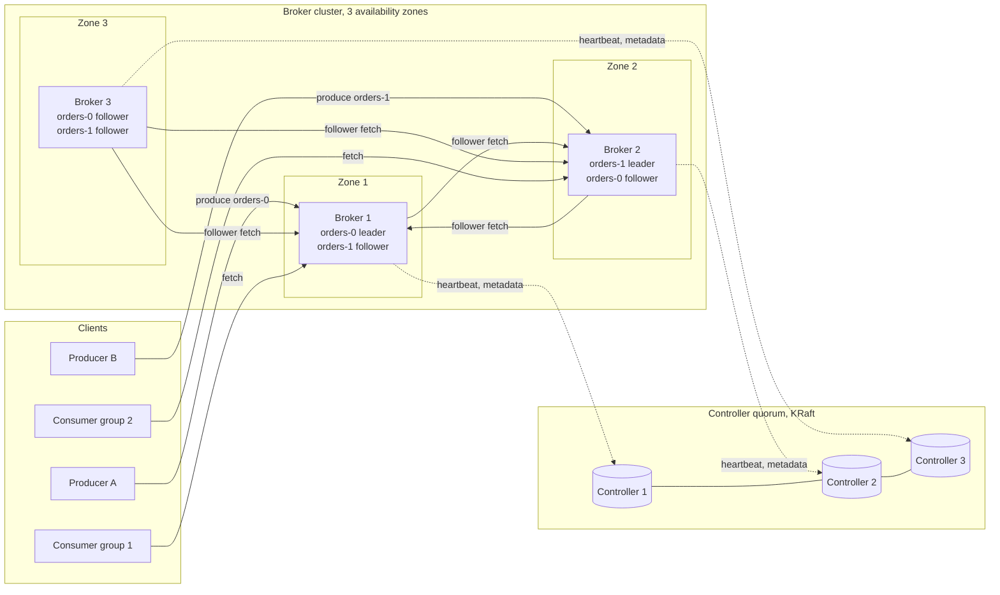
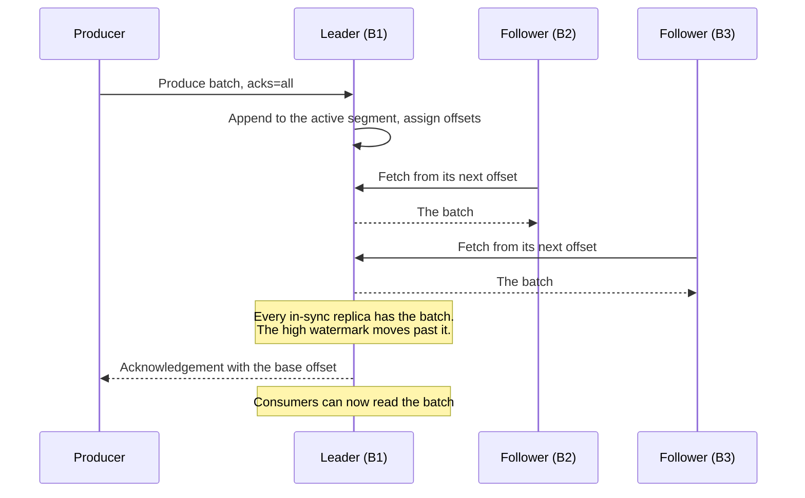

# Design a Distributed Message Queue (Kafka Style)

## Problem Statement

Design a distributed messaging system for a company with hundreds of services. Producers append records to named topics. Consumers read the records of a topic, at their own speed, in order. The system stores each record on several machines, keeps it for a retention period, and lets many independent consumer groups read the same data and replay old data. It must keep every acknowledged record when one machine fails, and it must carry hundreds of thousands of records each second.

This is the design of Apache Kafka: a partitioned, replicated commit log. The page states each fact about Kafka from the Kafka documentation (the version 4.2 pages that the Further Reading section lists). Three pages hold the neighbouring topics, and this page links to them instead of repeating them:

- The [pub-sub case study](../../lld/case-studies/15-pub-sub-message-queue/README.md) designs the same idea inside one JVM (topics, partitions, consumer groups, offsets, retry, dead-letter topic). This page designs the distributed system: disks, replicas, brokers, failures.
- [Message queues and streams](../fundamentals/08-message-queues-and-streams.md) is the home of delivery semantics, exactly-once claims, consumer group settings, dead-letter queues, backpressure, and the outbox pattern. This page gives at most two sentences on each.
- [Replication](../fundamentals/05-replication.md), [partitioning and sharding](../fundamentals/06-partitioning-and-sharding.md), and [consensus and leader election](../distributed-systems/02-consensus-and-leader-election.md) explain the building blocks.

## Clarifying Questions

Ask these in the first 5 minutes. Each row gives the answer that this design assumes.

| Question | Assumed answer |
|---|---|
| Is it a queue (the broker deletes a message after the ack) or a log (the broker keeps the record for a retention period)? | A log. Consumers do not remove records. Each consumer group tracks its own position. Replay is a requirement |
| Which services use it? | Hundreds of services in one company: event streams, change data capture, metrics, clickstream. A cluster serves many teams (multi-tenant) |
| What scale? | Average 200,000 records each second, peak 500,000. Average record 1 KB. Three consumer groups read every record (assumption for the network estimate) |
| How long does the system keep records? | 7 days by default for each topic. A topic for entity state can use log compaction instead |
| What ordering? | Total order inside one partition. No order across partitions. The producer picks the partition with a key |
| What durability? | No acknowledged record is lost when one broker fails. A record is on at least 2 brokers when the producer gets the acknowledgement (replication factor 3, `min.insync.replicas=2`) |
| Delivery guarantee? | At-least-once by default. Exactly-once only inside Kafka topics, with idempotent producers and transactions (see [message queues and streams](../fundamentals/08-message-queues-and-streams.md)) |
| Latency target? | Target (an assumption, not a Kafka guarantee): produce with `acks=all` below 20 ms at p99 inside one region. A consumer that is caught up sees a record within 100 ms at p99 |
| Availability target? | A partition stays writable when one of its three replicas fails. After a broker fails, the partitions that it led recover within seconds |
| Message size? | Up to 1 MB. The topic setting `max.message.bytes` defaults to 1,048,588 bytes, and the client and the broker settings must agree |
| Per-message features: priorities, per-message ack, delay, selective retry? | No. This is a log, not a task queue. Use a task queue (SQS, RabbitMQ) for those, or build retry topics on top (see the fundamentals page) |
| Geography? | One region with three availability zones. Cross-region mirroring is an extension |
| Security? | Out of scope for the core design (authentication, ACLs, TLS). See [security in design](../fundamentals/21-security-in-design.md). Quotas are in scope |

## Requirements

### Functional

1. `createTopic(name, partitions, replicationFactor, config)` creates a topic.
2. `produce(topic, key, value, headers)` appends a record to one partition of the topic and returns the offset that the broker assigned.
3. `fetch(topic, partition, offset)` returns the records that start at the given offset. A consumer reads only committed records.
4. A consumer group splits the partitions of a topic among its members. Each partition goes to one member of the group at a time.
5. The group stores a committed offset for each partition. After a restart, a member continues from the committed offset.
6. A consumer can reset its position to an earlier offset or to a timestamp, and read the retained records again.
7. The system deletes records by age or by size (retention), or keeps the latest record for each key (compaction).
8. An operator adds brokers, moves partitions between brokers, and increases the partition count of a topic, with no downtime.
9. The system enforces quotas for each client group, so that one client cannot use all the bandwidth.

### Non-functional

| Requirement | Target |
|---|---|
| Throughput | 200,000 records each second on average, 500,000 at the peak, 1 KB each (200 MB/s average, 500 MB/s peak) |
| Durability | A record that the producer got an acknowledgement for survives the loss of any one broker |
| Availability | Writes continue when one replica of a partition fails. Reads continue as long as one in-sync replica is up |
| Order | Total order of the records of one partition, for producers that use idempotence |
| Retention | 7 days by default. The size of retention is a cost decision, so the estimate shows the cost |
| Scalability | Add brokers and partitions without stopping producers or consumers |
| Isolation | A slow consumer does not slow a producer. A producer that sends too much is throttled by a quota |

## Estimation

Rounding rule of the [estimation page](../back-of-envelope-estimation.md): one day is 100,000 seconds (the exact value is 86,400, so the storage result is 15.7% too high, which is the safe side). Units are SI: 1 KB = 1,000 bytes, 1 TB = 10^12 bytes.

Inputs (assumptions): average 200,000 records each second, peak 500,000, each record 1,000 bytes. Retention 7 days. Replication factor 3. Three consumer groups read every record. No compression (the conservative choice: compression of batches reduces every storage and network number below). Disks fill to at most 70% (Assumption: free space is needed for retention to catch up, for re-replication, and for compaction). A broker has 24 TB of disk (Assumption: six 4 TB drives). The slowest consumer group handles 5 MB/s for each consumer instance (Assumption). The cluster hosts 4,000 partitions in all topics (Assumption). A replacement broker copies data at 200 MB/s (Assumption: the replication throttle that the operator sets, so that the copy leaves capacity for production traffic).

| Step | Calculation | Result |
|---|---|---|
| Average ingress | 200,000 records/s × 1,000 B | 200 MB/s |
| Peak ingress | 500,000 records/s × 1,000 B | 500 MB/s |
| Data each day (one copy) | 200 MB/s × 100,000 s | 20 TB |
| Retention, one copy | 20 TB × 7 days | 140 TB |
| Retention with replication | 140 TB × 3 | 420 TB |
| Disk to provision at 70% fill | 420 TB / 0.70 | 600 TB |
| Brokers for disk | 600 TB / 24 TB | 25 brokers |
| Replication traffic at the peak | 500 MB/s × (3 − 1) followers | 1,000 MB/s |
| Consumer traffic at the peak | 500 MB/s × 3 groups | 1,500 MB/s |
| Cluster ingress at the peak | 500 MB/s from producers + 1,000 MB/s from the replication | 1,500 MB/s |
| Cluster egress at the peak | 1,000 MB/s replication + 1,500 MB/s consumers | 2,500 MB/s |
| Egress for each broker | 2,500 MB/s / 25 | 100 MB/s = 800 Mbit/s |
| Disk write for each broker | 1,500 MB/s / 25 | 60 MB/s (sequential) |
| Produce requests with 64 KB batches | 500 MB/s / 64,000 B | about 7,800 requests/s (64 records each) |
| Produce requests without batching | 500,000 records/s, one each | 500,000 requests/s |
| Minimum partitions for the main topic | 500 MB/s / 5 MB/s per consumer | 100 |
| Partitions with growth factor 2 | 100 × 2 | 200 (2.5 MB/s each at the peak) |
| Partition replicas for each broker | 4,000 × 3 / 25 | 480 |
| Segment files for each broker | 420 TB / 12,000 replicas = 35 GB each; 35 GB / 1 GiB ≈ 32 segments; 480 × 32 | about 15,400 |
| Page cache for a 10-minute tail | 60 MB/s × 600 s | 36 GB for each broker |
| Data stored on each broker | 420 TB / 25 brokers | 16.8 TB (70% of 24 TB) |
| Re-replication of one broker into a replacement | 16.8 TB / 200 MB/s | 84,000 s = about 23 hours |
| Re-replication spread over the 24 other brokers | 16.8 TB / 24 = 0.7 TB each; 0.7 TB / 200 MB/s | 3,500 s = about 1 hour |

What the numbers decide:

- **Disk capacity sets the broker count, not the network or the CPU.** 25 brokers hold 600 TB. At the peak, each broker sends 800 Mbit/s, which a 10 Gbit/s network card carries with a large margin. Retention (7 days) and replication (3 copies) are the two knobs that move the cost. Halving the retention halves the broker count.
- **Consumer groups multiply the egress.** Three groups read 3 × 500 MB/s. Each group adds 500 MB/s of egress for the cluster. Consumers that read the tail of the log read from the page cache and cause no disk reads (the design documentation says that a cluster whose consumers are caught up serves them "entirely from cache"). A consumer that replays old data reads from disk and competes with the writes.
- **Batching decides the request rate.** A batch of 64 records cuts the produce requests from 500,000 to about 7,800 each second. The producer setting `linger.ms` and the batch size trade a small delay for a lower request rate (the design documentation gives "64kB or 10 ms" as an example of the bound).
- **Partition count follows the slowest consumer.** The consumers, not the brokers, limit the parallelism. A group has at most one active consumer for each partition.
- **Recovery takes hours, and Kafka does not start it by itself.** When a broker dies, Kafka elects new leaders, but it does not create new replicas on other brokers. The partitions stay under-replicated until the broker returns or an operator acts (the operations documentation says that the reassignment tool "does not have the ability to automatically generate a reassignment plan for decommissioning brokers yet"). The operator has two options. A replacement broker with the same broker ID fetches all 16.8 TB, and its own throttled ingress of 200 MB/s limits the copy to about 23 hours (derived). A reassignment that spreads the replicas over the 24 other brokers copies 0.7 TB to each, in parallel, in about 1 hour (derived). Each receiver copies at its own throttle of 200 MB/s, so the cluster carries 24 × 200 MB/s = 4.8 GB/s of extra replication traffic during that hour, and each receiver's disk goes from 70% to about 73% full (16.8 + 0.7 = 17.5 TB of 24 TB). During the copy, the partitions that had a replica on the failed broker run with 2 in-sync replicas, so one more failure stops writes with `min.insync.replicas=2`. This is the reason for a replication factor of 3 and for recovery that many brokers share.
- **File descriptors.** The Kafka hardware documentation gives the lower bound `number_of_partitions × (partition_size / segment_size)` for the segment files of a broker, and recommends at least 100,000 allowed file descriptors as a starting point. The estimate of about 15,400 files is far below that.

The program below checks the arithmetic. `main` comes first and the block has no imports, so you can copy it into `QueueSizing.java` and run `java QueueSizing.java` on JDK 21.

```java
public class QueueSizing {
    public static void main(String[] args) {
        // Inputs (assumptions). SI units: 1 KB = 1,000 B. One day is 10^5 s (rounding rule).
        long avgMsgPerSec = 200_000;
        long peakMsgPerSec = 500_000;
        long msgBytes = 1_000;
        int retentionDays = 7;
        int replicationFactor = 3;
        int consumerGroups = 3;
        double diskFillLimit = 0.70;
        long brokerDiskTb = 24;
        long batchBytes = 64_000;
        long slowestConsumerMbPerSec = 5;

        long avgMb = avgMsgPerSec * msgBytes / 1_000_000;
        long peakMb = peakMsgPerSec * msgBytes / 1_000_000;
        System.out.println("average ingress MB/s: " + avgMb);
        System.out.println("peak ingress MB/s: " + peakMb);

        long tbPerDay = avgMb * 100_000 / 1_000_000;
        long logicalTb = tbPerDay * retentionDays;
        long replicatedTb = logicalTb * replicationFactor;
        long provisionedTb = Math.round(replicatedTb / diskFillLimit);
        long brokers = (provisionedTb + brokerDiskTb - 1) / brokerDiskTb;
        System.out.println("TB per day: " + tbPerDay);
        System.out.println("TB for retention, one copy: " + logicalTb);
        System.out.println("TB with replication factor " + replicationFactor + ": " + replicatedTb);
        System.out.println("TB to provision at 70% fill: " + provisionedTb);
        System.out.println("brokers at " + brokerDiskTb + " TB each: " + brokers);

        long replicationOut = peakMb * (replicationFactor - 1);
        long consumerOut = peakMb * consumerGroups;
        long clusterIn = peakMb + replicationOut;
        long clusterOut = replicationOut + consumerOut;
        System.out.println("cluster ingress MB/s at peak: " + clusterIn);
        System.out.println("cluster egress MB/s at peak: " + clusterOut);
        System.out.println("egress per broker MB/s: " + clusterOut / brokers);
        System.out.println("egress per broker Mbit/s: " + clusterOut * 8 / brokers);
        System.out.println("disk write per broker MB/s: " + clusterIn / brokers);

        long batchesPerSec = peakMb * 1_000_000 / batchBytes;
        System.out.println("messages per batch: " + batchBytes / msgBytes);
        System.out.println("produce requests per second with batches: " + batchesPerSec);
        System.out.println("produce requests per second without batches: " + peakMsgPerSec);

        long minPartitions = (peakMb + slowestConsumerMbPerSec - 1) / slowestConsumerMbPerSec;
        long partitions = minPartitions * 2;
        System.out.println("minimum partitions: " + minPartitions);
        System.out.println("partitions with growth factor 2: " + partitions);
        System.out.println("peak MB/s per partition: " + peakMb * 10 / partitions / 10.0);

        long clusterPartitions = 4_000;
        long replicas = clusterPartitions * replicationFactor;
        long perBroker = replicas / brokers;
        long gbPerReplica = replicatedTb * 1_000 / replicas;
        long segmentsPerReplica = gbPerReplica * 1_000_000_000L / 1_073_741_824L;
        System.out.println("partition replicas per broker: " + perBroker);
        System.out.println("GB per replica: " + gbPerReplica);
        System.out.println("segments per replica: " + segmentsPerReplica);
        System.out.println("segment files per broker: " + perBroker * segmentsPerReplica);

        long tailGb = (clusterIn / brokers) * 600 / 1_000;
        System.out.println("GB of page cache for a 10-minute tail per broker: " + tailGb);

        long usedTbPerBroker10 = replicatedTb * 10 / brokers;
        long recoveryMbPerSec = 200;
        long seconds = usedTbPerBroker10 * 100_000L / recoveryMbPerSec;
        System.out.println("TB stored per broker: " + usedTbPerBroker10 / 10.0);
        System.out.println("hours to re-replicate one broker at 200 MB/s: " + seconds / 3_600);

        long receivers = brokers - 1;
        long gbPerReceiver = usedTbPerBroker10 * 100 / receivers;
        System.out.println("GB for each of " + receivers + " receivers: " + gbPerReceiver);
        System.out.println("seconds to re-replicate over " + receivers
                + " brokers at 200 MB/s each: " + gbPerReceiver * 1_000 / recoveryMbPerSec);
    }
}
```

<!-- expected-output -->
```text
average ingress MB/s: 200
peak ingress MB/s: 500
TB per day: 20
TB for retention, one copy: 140
TB with replication factor 3: 420
TB to provision at 70% fill: 600
brokers at 24 TB each: 25
cluster ingress MB/s at peak: 1500
cluster egress MB/s at peak: 2500
egress per broker MB/s: 100
egress per broker Mbit/s: 800
disk write per broker MB/s: 60
messages per batch: 64
produce requests per second with batches: 7812
produce requests per second without batches: 500000
minimum partitions: 100
partitions with growth factor 2: 200
peak MB/s per partition: 2.5
partition replicas per broker: 480
GB per replica: 35
segments per replica: 32
segment files per broker: 15360
GB of page cache for a 10-minute tail per broker: 36
TB stored per broker: 16.8
hours to re-replicate one broker at 200 MB/s: 23
GB for each of 24 receivers: 700
seconds to re-replicate over 24 brokers at 200 MB/s each: 3500
```

## API Design

Kafka does not use REST. Clients talk to brokers over a binary protocol on TCP. The protocol defines each API as a request and response pair, and each broker processes the requests of one connection in the order that it receives them (Kafka protocol guide). The table lists the client-facing operations with the protocol request that carries each one. Field lists are short forms.

| Operation | Protocol request | Sent to | Main request fields | Main response fields |
|---|---|---|---|---|
| Find the cluster | `Metadata` | Any broker | Topic names | Live brokers. For each partition: its leader, replicas, and in-sync replicas |
| Append records | `Produce` | The leader of the partition | `acks` (0, 1, or all), timeout, a record batch for each partition, optional transactional ID | For each partition: error code and the base offset of the batch |
| Read records | `Fetch` | The leader, or a follower for a consumer that reads from the closest replica (KIP-392) | Partition, fetch offset, minimum bytes, maximum wait, maximum bytes, isolation level | Records, the high watermark, error code |
| Find an offset by time | `ListOffsets` | The leader | Partition, timestamp (or earliest, latest) | The offset |
| Join a group (classic protocol) | `JoinGroup`, `SyncGroup`, `Heartbeat` | The group coordinator | Group ID, member ID, subscribed topics, session timeout | Member ID, generation, partition assignment |
| Join a group (KIP-848 protocol) | `ConsumerGroupHeartbeat` | The group coordinator | Group ID, member ID, subscribed topics | The assignment that the broker computes |
| Commit a position | `OffsetCommit` | The group coordinator | Group, topic, partition, offset | Error code |
| Read a committed position | `OffsetFetch` | The group coordinator | Group, topic, partition | Offset |
| Get a producer identity | `InitProducerId` | A broker (or the transaction coordinator) | Optional transactional ID | Producer ID and epoch |
| Create a topic | `CreateTopics` | The controller | Name, partitions, replication factor, configs | Error code for each topic |

The names come from the Kafka protocol guide. The ISR, the leader, and the replica list in the `Metadata` response are the reason that clients need no routing tier: the producer "sends data directly to the broker that is the leader for the partition without any intervening routing tier" (Kafka design documentation, "The Producer"). A client that sends a request to the wrong broker gets an error code, and it fetches fresh metadata.

The client library offers a small API on top of these requests. The signatures below are the logical shape, not Kafka's exact Java classes:

```text
producer.send(topic, key, value) -> Future<RecordMetadata(partition, offset)>
consumer.subscribe(topics)       // join the group
consumer.poll(timeout)           // fetch records from the assigned partitions
consumer.commit(offsets)         // OffsetCommit for the group
consumer.seek(partition, offset) // replay
```

## Data Model

The data model has four parts: the partition log on disk, the cluster metadata, the consumer offsets, and the transaction state. The first part is the data path. The others are small and use the same replication machinery or a consensus log.

### The partition log

Each replica of a partition is a directory of files on one broker. A topic `orders` with a partition 0 is stored in a directory `orders-0`. The directory holds *segments*. Each segment has a log file with the records, and index files. The Kafka log documentation says that "each log file is named with the offset of the first message it contains", so the first file is `00000000000000000000.log`.

```text
orders-0/
  00000000000000000000.log        records with offsets 0 to 41,599
  00000000000000000000.index      sparse offset -> byte position in the .log file
  00000000000000000000.timeindex  sparse timestamp -> offset
  00000000000000041600.log        the next segment. It starts at offset 41,600
  00000000000000041600.index
  00000000000000041600.timeindex  (the active segment: the broker appends only here)
```

| Property | Value |
|---|---|
| Record identity | A 64-bit offset that is a counter for the partition. The Log implementation page explains that the offset replaced a producer-generated GUID, because a GUID needs "a heavy weight index structure" that maps random IDs to positions, while a "simple per-partition atomic counter" does not |
| Writes | Appends to the last segment only. The broker rolls to a new segment when the file reaches `segment.bytes` (default 1 GiB) or after `segment.ms` (default 7 days) |
| Reads | The broker finds the segment from the offsets in the file names, uses the offset index to jump near the record, and scans forward. `index.interval.bytes` (default 4,096) sets the density of the index: about one entry for each 4 KB of log |
| Format | A batch of records with a header. The producer, the broker, and the consumer share one binary format, so a batch moves from the producer's buffer to the consumer without conversion |
| Retention | The broker deletes whole segments. For time retention, the largest record timestamp in a segment decides when the segment expires. `retention.ms` defaults to 7 days. Size retention (`retention.bytes`) is off by default |
| Compaction | A topic with `cleanup.policy=compact` keeps the latest record for each key. The page on [message queues and streams](../fundamentals/08-message-queues-and-streams.md) explains tombstones and the guarantees |
| Durability | The broker does not call `fsync` for each write. The documentation recommends to leave `flush.messages` unset and to rely on replication for durability |

### Cluster metadata

The controller quorum stores the metadata in a replicated log named `__cluster_metadata` (the path appears in the KRaft tool examples of the Kafka documentation). The log holds:

| Entity | Fields |
|---|---|
| Broker registration | Broker ID, endpoints, rack, session state |
| Topic | Topic ID, configs |
| Partition | Replica list (the first replica is the preferred leader), ISR, current leader, eligible leader replicas (ELR) |
| Quotas and dynamic configs | Per (user, client ID) quota values, which "are written to the metadata log" |

Every broker keeps a copy of the metadata in memory and answers `Metadata` requests from it.

### Internal topics

| Topic | Key | Value | Notes |
|---|---|---|---|
| `__consumer_offsets` | (group, topic, partition) | Committed offset | An ordinary replicated log. The broker settings `offsets.topic.num.partitions` (default 50) and `offsets.topic.replication.factor` (default 3) size it. The log cleaner compacts it |
| `__transaction_state` | Transactional ID | Transaction state | Holds the state of the transactions of producers. The name is the constant `TRANSACTION_STATE_TOPIC_NAME` in the Kafka client source (`org.apache.kafka.common.internals.Topic`). The broker settings `transaction.state.log.*` size it (50 partitions and replication factor 3 by default) |
| `__share_group_state` | See KIP-932 | The state of share groups | Created on the first use of share groups. The 4.2 upgrade notes say that its default configuration "uses 3 replicas and requires at least 3 brokers" |

### Why a custom log and not a database

The design documentation gives the reasons. A messaging system needs only appends and sequential reads, so every operation is O(1) and reads do not block writes. A B-tree has O(log N) operations, and on a spinning disk each operation costs a seek of about 10 ms. The log structure turns random writes into sequential writes. The documentation reports, for a RAID-5 array of six 7,200 rpm drives, about 600 MB/s for linear writes and about 100 KB/s for random writes (approximate, and measured on older hardware). A database adds indexes, transactions, and locking that a log does not need.

## High-Level Design



| Component | Responsibility |
|---|---|
| Producer client | Chooses the partition (a hash of the key, or a sticky choice when there is no key), batches records, compresses batches, and sends each batch to the leader of the partition. Retries with idempotence turned on |
| Broker | Stores the partition replicas. Serves produce and fetch requests. For a partition that it leads, it appends records and answers consumers. For a partition that it follows, it fetches from the leader. Acts as the group coordinator for some consumer groups |
| Partition leader | The only replica that takes writes. Tracks the in-sync replicas and the high watermark |
| Partition follower | Fetches from the leader like a consumer and appends to its own log |
| Controller quorum | A small group of nodes (3 or 5) that run a Raft-like protocol. They store the cluster metadata, register brokers, and elect partition leaders when a broker fails |
| Consumer group | A set of consumers that split the partitions of a topic. A group coordinator tracks the members and the committed offsets |
| Quotas | The brokers throttle a client group when its byte rate or request rate passes its quota |

Write path in one picture:



## Deep Dives

### 1. The storage and I/O path

**Why the log is fast.** The design documentation names four reasons.

1. *Sequential access.* The broker appends to one file and reads in large blocks. Sequential disk access is predictable, and the operating system prefetches (read-ahead) and groups writes (write-behind).
2. *The page cache.* The broker writes to the file system and relies on the operating system's page cache. The documentation argues that this is better than an in-process cache: the cache doubles the available memory, stays warm after a broker restart, and avoids garbage collection pauses in the JVM heap. A consumer that is caught up reads from the page cache, so the disk sees no reads.
3. *Batching.* The protocol groups records into batches. A batch is one network request, one sequential disk write, and one fetch response. The documentation says that this "produces orders of magnitude speed up".
4. *Zero copy.* The broker sends log data from the page cache to the network socket with the `sendfile` system call. The path without `sendfile` copies the data four times and uses two system calls. With `sendfile`, only the last copy (to the network card buffer) remains. `sendfile` is not used when TLS is on, because the TLS library runs in user space (design documentation).

**Compression.** The producer compresses a whole batch (GZIP, Snappy, LZ4, or ZStandard). The broker decompresses the batch to validate it (for example, to compare the record count with the batch header), stores it compressed, and sends it to the consumer compressed. The consumer decompresses. Compression of a batch gives a better ratio than compression of single records, because JSON field names and similar text repeat across records.

**Durability without `fsync`.** The broker acknowledges a write after it is in the page cache of the in-sync replicas, not after it is on disk. The design documentation gives the reason: requiring `fsync` for each write "can reduce performance by two to three orders of magnitude". The `flush.messages` documentation recommends to leave it unset and use replication. A record survives the crash of one machine because other machines hold it in memory or on disk. It does not survive a power failure that hits all in-sync replicas at the same time. This is the reason for placing replicas in different racks or availability zones.

**Crash recovery.** After an unclean stop, the broker runs recovery on the newest segment. It checks each record against its size and its CRC32, and it truncates the log at the last valid record (Kafka log documentation). A replica that lost data also must "fully re-sync again" before it joins the ISR (design documentation).

**Retention.** The broker deletes data one segment at a time. A segment that is still the active segment cannot be deleted, so the broker rolls the segment when the retention condition holds (the `retention.ms` documentation says it "triggers the rolling of new segment if the retention.ms condition is satisfied"). Deleting a file is a cheap operation compared with deleting records one by one, which is the reason that retention works on segments.

**Disks.** The Kafka hardware documentation says that "In general disk throughput is the performance bottleneck, and more disks is better". It recommends several drives, not shared with application logs. The broker can use several data directories (JBOD). Each partition lives entirely in one directory, so an uneven partition load becomes an uneven disk load. RAID balances the load better, at the cost of capacity and of an extra copy of the data that replication already provides.

### 2. Replication: the in-sync replica set

**The model.** Each partition has one leader and zero or more followers. All writes go to the leader. A follower is a consumer of the leader's log: it fetches the records and appends them to its own log. The follower logs are identical to the leader's log, with the same offsets, except for the few records at the end that the follower has not fetched. Pull-based replication lets a follower batch what it applies.

**The ISR.** The leader tracks the *in-sync replicas* (ISR). A replica is in sync when it has an active session with the controller (a heartbeat before `broker.session.timeout.ms`, default 9 seconds) and it follows the leader. If a follower "hasn't sent any fetch requests or hasn't consumed up to the leader's log end offset" for `replica.lag.time.max.ms` (default 30,000 ms), the leader removes it from the ISR (broker configuration documentation). If a follower's broker loses its session, the controller removes it. The leader does not write the ISR itself: it sends the change to the controller (the `AlterPartition` request), and the controller writes the new ISR to the metadata log.

**The commit rule.** A record is *committed* when all current ISR members have it. The *high watermark* is the offset up to which the records are committed. A consumer reads only committed records, so it does not see a record that a leader failure could lose. The producer chooses what to wait for with `acks`:

| `acks` | The leader acknowledges | Loses an acknowledged record when |
|---|---|---|
| `0` | Does not wait | The leader does not even receive the record, or fails before it appends |
| `1` | After the leader appended | The leader fails before a follower fetched the record |
| `all` | After all current ISR members have the record | Every copy in the ISR is lost (disks destroyed, or a correlated power loss before the page cache reaches disk), or an unclean election makes a replica outside the ISR the leader. If all ISR members only crash and unclean election is off, the partition is unavailable, but the record is not lost |

**The high watermark.** The leader computes the high watermark as the smallest log end offset (the offset after the last record) among the ISR members. The Kafka source states the rule in `Partition.maybeIncrementLeaderHW`: "The HW is determined by the smallest log end offset among all replicas that are in sync; or are considered caught-up and are allowed to join the ISR", and "The HW can only advance if the ISR size is equal to or larger than the effective min ISR". The leader sends the value to the followers and the consumers in fetch responses. A consumer fetch returns records only below the high watermark.

**`min.insync.replicas`.** `acks=all` means "all *current* in-sync replicas", and the ISR can shrink to the leader alone. The Kafka design documentation shows the consequence: with two replicas and one failed, a write with `acks=all` "will succeed", but the write "could be lost if the remaining replica also fails". The topic setting `min.insync.replicas` sets a floor. If the ISR has fewer members than the floor and the producer uses `acks=all`, the producer gets a `NotEnoughReplicas` (or `NotEnoughReplicasAfterAppend`) error. The default is 1. The documentation names the typical durable setup: replication factor 3, `min.insync.replicas=2`, and `acks=all`. Then a write is on at least 2 brokers when it is acknowledged. The cost is availability: a partition with one live replica rejects writes. The 4.2 documentation also states that, regardless of `acks`, a record is not visible to consumers until all in-sync replicas have it and the ISR size is at least `min.insync.replicas`.

**Why an ISR and not a majority.** The design documentation compares the two designs, with `f` failures to tolerate:

| | Majority quorum (Raft, ZooKeeper's Zab) | Kafka ISR |
|---|---|---|
| Replicas needed to tolerate `f` failures | `2f + 1` | `f + 1` |
| Replicas that must acknowledge a commit | `f + 1` | All current ISR members (at least `min.insync.replicas`) |
| Example: tolerate 1 failure | 3 replicas, 2 acknowledgements | 2 replicas, 2 acknowledgements (the leader and one follower) |
| Latency | Set by the fastest `f + 1` replicas. One slow replica does not delay a commit | Set by the slowest ISR member. A slow replica leaves the ISR after `replica.lag.time.max.ms` |
| Leader election | A candidate needs the votes of a majority and the most complete log | The controller picks any ISR member |

The documentation concludes that tolerating one failure needs 3 copies in a majority design but 2 copies in the ISR design, and that "doing every write five times, with 5x the disk space requirements and 1/5th the throughput, is not very practical for large volume data". It adds that quorum algorithms "more commonly appear for shared cluster configuration such as ZooKeeper but are less common for primary data storage". Kafka itself follows this rule: the KRaft controller quorum is a majority quorum, and the data partitions use the ISR. [Consensus and leader election](../distributed-systems/02-consensus-and-leader-election.md) explains the majority algorithms.

**Leader election and the unclean case.** If the leader fails, the controller picks a new leader from the ISR. Every ISR member holds all committed records, so no committed record is lost, "as long as there is at least one in sync replica alive". If every ISR member is down, Kafka has a choice, and the documentation states it as an availability versus consistency trade-off:

1. Wait for an ISR member to return. The partition stays unavailable until then. This is the default since Kafka 0.11.0.0 (`unclean.leader.election.enable=false`).
2. Elect the first replica that returns, even if it is outside the ISR. The partition is available at once, and the records that this replica lacks are lost.

**Eligible leader replicas (ELR).** Kafka 4.0 added ELR (KIP-966, part 1), and 4.1 turned it on by default for new clusters. The 4.2 documentation applies a "strict min ISR" rule: the high watermark cannot advance while the ISR is smaller than `min.insync.replicas`. A replica that left the ISR because of that rule still holds all committed data, so the controller can keep it as an ELR. The election order is: an ISR member if the ISR is not empty, then an ELR member that is not fenced, then the last known leader if it is unfenced (the documentation calls the last step "a similar behavior prior to the 4.0 when all the replicas are offline"). Kafka 4.0 has ELR off by default (`eligible.leader.replicas.version=1` turns it on), and with ELR on, the semantics of `min.insync.replicas` change (topic configuration documentation). The simulation below models the classic ISR rules that the Kafka design documentation describes, without the ELR list, and so it shows the data loss that unclean election causes.

The program simulates one partition with three replicas and `min.insync.replicas=2`. It runs the same failure sequence with unclean election off and on. Replication is a step that the program calls, so the output does not depend on timing. `main` comes first, and the block has its own imports.

```java
import java.util.ArrayList;
import java.util.LinkedHashMap;
import java.util.LinkedHashSet;
import java.util.List;
import java.util.Map;
import java.util.Set;

public class IsrDemo {
    public static void main(String[] args) {
        System.out.println("=== unclean.leader.election.enable=false ===");
        run(false);
        System.out.println("=== unclean.leader.election.enable=true ===");
        run(true);
    }

    static void run(boolean unclean) {
        Partition p = new Partition(List.of("B1", "B2", "B3"), 2, unclean);
        for (int i = 0; i < 3; i++) {
            p.produce("m" + i);
        }
        p.fetch("B2");
        p.fetch("B3");
        p.show("3 records on all replicas");
        p.removeFromIsr("B3");
        p.produce("m3");
        p.fetch("B2");
        p.show("B3 lags and leaves the ISR, m3 reaches B1 and B2");
        p.fail("B2");
        p.show("B2 fails, the ISR has one member");
        p.produce("m4");
        p.fail("B1");
        p.elect();
        p.show("B1 fails");
        if (!p.hasLeader()) {
            p.restart("B1");
            p.elect();
            p.show("B1 restarts and takes the lead again");
        }
        System.out.println("acknowledged records that the leader lost: " + p.lost());
    }

    static class Partition {
        final Map<String, List<String>> logs = new LinkedHashMap<>();
        final Set<String> alive = new LinkedHashSet<>();
        final Set<String> isr = new LinkedHashSet<>();
        final List<String> acked = new ArrayList<>();
        final int minIsr;
        final boolean unclean;
        String leader;

        Partition(List<String> replicas, int minIsr, boolean unclean) {
            this.minIsr = minIsr;
            this.unclean = unclean;
            for (String r : replicas) {
                logs.put(r, new ArrayList<>());
                alive.add(r);
                isr.add(r);
            }
            leader = replicas.get(0);
        }

        boolean hasLeader() {
            return leader != null && alive.contains(leader);
        }

        /** A producer with acks=all. The leader rejects the write if the ISR is too small. */
        void produce(String record) {
            if (!hasLeader()) {
                System.out.println("  " + record + " rejected: no leader");
            } else if (isr.size() < minIsr) {
                System.out.println("  " + record + " rejected: NotEnoughReplicas (ISR "
                        + isr.size() + " < min.insync.replicas " + minIsr + ")");
            } else {
                logs.get(leader).add(record);
            }
        }

        /** A follower fetches the records that it misses from the leader. */
        void fetch(String follower) {
            List<String> own = logs.get(follower);
            List<String> source = logs.get(leader);
            own.addAll(source.subList(own.size(), source.size()));
        }

        void removeFromIsr(String replica) {
            if (isr.size() > 1) {
                isr.remove(replica);
            }
        }

        void fail(String replica) {
            alive.remove(replica);
            removeFromIsr(replica);
        }

        void restart(String replica) {
            alive.add(replica);
        }

        /** The high watermark is the smallest log end offset in the ISR. */
        int highWatermark() {
            int hw = Integer.MAX_VALUE;
            for (String r : isr) {
                hw = Math.min(hw, logs.get(r).size());
            }
            return hw;
        }

        void elect() {
            if (hasLeader()) {
                return;
            }
            String next = null;
            for (String r : isr) {
                if (alive.contains(r)) {
                    next = r;
                    break;
                }
            }
            if (next == null && unclean) {
                for (String r : alive) {
                    next = r;
                    break;
                }
                if (next != null) {
                    isr.clear();
                    isr.add(next);
                }
            }
            leader = next;
        }

        List<String> lost() {
            List<String> lost = new ArrayList<>(acked);
            if (hasLeader()) {
                lost.removeAll(logs.get(leader));
            }
            return lost;
        }

        void show(String title) {
            if (hasLeader()) {
                int hw = highWatermark();
                while (acked.size() < hw) {
                    acked.add(logs.get(leader).get(acked.size()));
                }
            }
            System.out.println(title);
            System.out.println("  leader=" + (hasLeader() ? leader : "none")
                    + " isr=" + isr + " alive=" + alive);
            System.out.println("  logs=" + logs + (hasLeader() ? " hw=" + highWatermark() : ""));
        }
    }
}
```

<!-- expected-output -->
```text
=== unclean.leader.election.enable=false ===
3 records on all replicas
  leader=B1 isr=[B1, B2, B3] alive=[B1, B2, B3]
  logs={B1=[m0, m1, m2], B2=[m0, m1, m2], B3=[m0, m1, m2]} hw=3
B3 lags and leaves the ISR, m3 reaches B1 and B2
  leader=B1 isr=[B1, B2] alive=[B1, B2, B3]
  logs={B1=[m0, m1, m2, m3], B2=[m0, m1, m2, m3], B3=[m0, m1, m2]} hw=4
B2 fails, the ISR has one member
  leader=B1 isr=[B1] alive=[B1, B3]
  logs={B1=[m0, m1, m2, m3], B2=[m0, m1, m2, m3], B3=[m0, m1, m2]} hw=4
  m4 rejected: NotEnoughReplicas (ISR 1 < min.insync.replicas 2)
B1 fails
  leader=none isr=[B1] alive=[B3]
  logs={B1=[m0, m1, m2, m3], B2=[m0, m1, m2, m3], B3=[m0, m1, m2]}
B1 restarts and takes the lead again
  leader=B1 isr=[B1] alive=[B3, B1]
  logs={B1=[m0, m1, m2, m3], B2=[m0, m1, m2, m3], B3=[m0, m1, m2]} hw=4
acknowledged records that the leader lost: []
=== unclean.leader.election.enable=true ===
3 records on all replicas
  leader=B1 isr=[B1, B2, B3] alive=[B1, B2, B3]
  logs={B1=[m0, m1, m2], B2=[m0, m1, m2], B3=[m0, m1, m2]} hw=3
B3 lags and leaves the ISR, m3 reaches B1 and B2
  leader=B1 isr=[B1, B2] alive=[B1, B2, B3]
  logs={B1=[m0, m1, m2, m3], B2=[m0, m1, m2, m3], B3=[m0, m1, m2]} hw=4
B2 fails, the ISR has one member
  leader=B1 isr=[B1] alive=[B1, B3]
  logs={B1=[m0, m1, m2, m3], B2=[m0, m1, m2, m3], B3=[m0, m1, m2]} hw=4
  m4 rejected: NotEnoughReplicas (ISR 1 < min.insync.replicas 2)
B1 fails
  leader=B3 isr=[B3] alive=[B3]
  logs={B1=[m0, m1, m2, m3], B2=[m0, m1, m2, m3], B3=[m0, m1, m2]} hw=3
acknowledged records that the leader lost: [m3]
```

Read the output in three steps. First, with `min.insync.replicas=2`, the leader rejects `m4` once the ISR has one member. The producer gets an error and keeps its data, and the log has no record that only one broker holds. Second, with unclean election off, the partition goes offline when the last ISR member fails, and it returns without loss when that member restarts. Third, with unclean election on, broker B3 (alive, but out of the ISR) becomes the leader at once, and the committed record `m3` is gone.

**Network partitions.** The documentation states the limit: "Kafka will remain available in the presence of node failures after a short fail-over period, but may not remain available in the presence of network partitions." Kafka handles the "fail/recover" failure model (a node stops and later returns). It does not handle Byzantine failures, where nodes send arbitrary or malicious answers. In the language of [consistency and CAP](../fundamentals/07-consistency-and-cap.md), the design with `acks=all` and `min.insync.replicas=2` chooses consistency over availability when it must choose.

### 3. The control plane: controllers, failures, and cluster changes

**The controller quorum.** One node of the cluster, the *controller*, "is responsible for managing the registration of brokers in the cluster" (design documentation). In KRaft mode, a small set of nodes forms the *controller quorum* and stores the metadata log with a Raft-based protocol. KIP-595 describes it as "a sort of Raft dialect" (see [consensus and leader election](../distributed-systems/02-consensus-and-leader-election.md)). Apache Kafka 4.0 removed ZooKeeper mode. The KRaft documentation gives these rules:

- `process.roles` is `broker`, `controller`, or both. Combined mode is for development. Critical deployments run separate controller nodes, so that a controller restart does not depend on a broker restart.
- "For the KRaft controller cluster to withstand N concurrent failures the controller cluster must include 2N + 1 controllers", and a cluster should use 3 or more controllers. This is the majority rule of Raft. The log of the data partitions does not use it.
- The controllers keep all metadata in memory and on disk. The documentation estimates that for a typical cluster 5 GB of memory and 5 GB of disk for the metadata log directory are sufficient.
- An operator can add or remove controllers in a *dynamic* quorum (KIP-853, `kraft.version=1`). The Kafka 3.9 documentation says that a new cluster gets a dynamic quorum if `controller.quorum.voters` is not set, and that a static quorum could not yet be converted. Kafka 4.1 "added support for upgrading a cluster from a static controller configuration to a dynamic controller configuration" (KRaft documentation, versions 3.9 and 4.2).

**Failure detection.** Each broker sends a heartbeat to the controller (`broker.heartbeat.interval.ms`, default 2 seconds). If the controller sees no heartbeat for `broker.session.timeout.ms` (default 9 seconds), it treats the broker as offline, removes it from the ISRs, and elects new leaders for the partitions that the broker led. A follower that is alive but slow leaves the ISR through the leader's check (`replica.lag.time.max.ms`, 30 seconds). From these two defaults, derive the recovery time of a crashed leader: the controller marks the broker offline 9 seconds after the last heartbeat that it received, which is between 7 and 9 seconds after the crash (the crash happens up to one heartbeat interval of 2 seconds after the last heartbeat). Then the controller elects new leaders, publishes the metadata, and the clients refresh their metadata. Two groups of partitions wait during this time. The partitions that the broker led accept no writes until a new leader exists. The partitions where the broker was an in-sync follower also stall for `acks=all` writes, because a commit needs every ISR member and the controller removes the dead follower from the ISR only when its session ends. So writes to both groups stop for about 10 seconds (derived). This is a derived estimate from the defaults, not a documented number. The client side can add to it. If the broker process dies and its host stays up, the operating system closes the connections, and the client sees the failure at once. If the host disappears from the network, a request in flight waits for the producer's `request.timeout.ms` (default 30,000 ms) before the client retries, so a client can stall for up to about 30 seconds. The producer's `delivery.timeout.ms` (default 120,000 ms) bounds the total time before `send()` reports a failure.

**Batched elections.** A broker hosts hundreds of partitions. "A naive implementation of leader election would end up running an election per partition for all partitions a node hosted when that node failed." The controller instead handles the failure of one broker as one event and batches the leadership changes, which "makes the election process far cheaper and faster for a large number of partitions".

**Controlled shutdown.** For a planned restart, the broker with `controlled.shutdown.enable=true` syncs its logs and moves leadership away before it stops. The documentation says this "will make the leadership transfer faster and minimize the time each partition is unavailable to a few milliseconds". The controlled shutdown succeeds only if every partition on the broker has a replica elsewhere that is alive (replication factor greater than 1).

**Leader balance.** After a restart, a broker comes back as a follower for all its partitions. The first replica in the replica list is the *preferred replica*. With `auto.leader.rebalance.enable=true` (default), the controller checks the balance every `leader.imbalance.check.interval.seconds` (default 300) and moves leadership back to the preferred replicas. Placement of the preferred replicas spreads the leaders evenly: the design documentation says Kafka balances partitions "in a round-robin fashion" and tries to balance leadership so that each node leads a proportional share.

**Rack awareness.** With `broker.rack` set (for example to the availability zone), Kafka spreads the replicas of one partition over different racks. The loss of a zone then removes one replica of each partition, not all of them. The operations documentation advises an equal number of brokers per rack, because a rack with fewer brokers holds more replicas for each broker.

**Adding brokers.** A new broker holds no partitions until an operator moves some. The tool `kafka-reassign-partitions.sh` moves replicas, and a throttle (`--throttle`) caps the replication bandwidth so that the move does not starve production traffic. Kafka does not move data by itself, so a cluster that gets brokers but no reassignment stays unbalanced. This is a design choice with a cost: a human or an external tool decides the move.

**Adding partitions.** An operator can increase the partition count of a topic. "Kafka does not currently support reducing the number of partitions for a topic". Adding partitions does not move existing records, and it changes the key-to-partition mapping for new records, so the order of one key breaks across the change (see [message queues and streams](../fundamentals/08-message-queues-and-streams.md)). Choose the count with room for growth, as the estimate does (200 instead of 100).

**Quotas.** Brokers enforce byte-rate quotas and request-rate quotas for each (user, client ID) group. This protects a multi-tenant cluster: the design documentation says that without quotas, clients can "monopolize broker resources, cause network saturation and generally DOS other clients and the brokers themselves". Quota overrides live in the metadata log, and the design documentation says that this lets an operator "change quotas without having to do a rolling restart of the entire cluster".

### 4. Producers and consumers

This part is short, because [message queues and streams](../fundamentals/08-message-queues-and-streams.md) is the home of consumer groups, offsets, and delivery semantics. The distributed design adds three points.

**The client does the routing.** The producer and the consumer ask any broker for metadata, cache it, and talk to the partition leaders directly. No proxy tier exists. This removes one network hop and one component to scale. The cost: every client must handle leader changes, so each client library implements metadata refresh and retry. When the number of partitions or the leaders change, the clients learn it from an error and a new `Metadata` request.

**The partition choice.** A record with a key goes to the partition `hash(key) mod partition count`. A record without a key goes to a sticky partition until the batch is full, then to another one. A key keeps the order of one entity, and it spreads the load when the keys are numerous. A hot key overloads one partition and one consumer (see Bottlenecks).

**Position storage.** A consumer group stores its committed offsets in `__consumer_offsets`, which is a replicated log like any data topic. Offset storage therefore reuses the replication code, and it scales by partitions. A consumer reads from the committed offset after a restart. The commit point decides the delivery semantics: commit after processing gives at-least-once, commit before processing gives at-most-once. The idempotent producer, with the broker-side deduplication by producer ID and sequence number, removes the duplicates that retries create inside one producer session. Transactions extend this to atomic writes to many partitions, with consumers in `read_committed` mode. Kafka's guarantee ends at the Kafka boundary. A side effect outside Kafka needs an idempotent consumer. Details and the exact limits: [message queues and streams](../fundamentals/08-message-queues-and-streams.md).

## Bottlenecks and Scaling

| What fails first | Symptom | Fix |
|---|---|---|
| Disk capacity | Disk full on some brokers. Retention cannot keep up | Add brokers and move partitions with a throttle. Shorten retention. Enable compression. Tiered storage moves old segments to remote storage (the Kafka documentation lists the tiered storage configuration) |
| Disk throughput and page cache | Consumer fetch latency rises. Producers slow down | Add drives or brokers. Keep consumers caught up, because a lagging consumer reads cold segments from disk and evicts the page cache that the tail readers use. Give the brokers enough memory for the tail window (36 GB in the estimate) |
| Hot partition | One broker at its limit, other brokers idle. One consumer lags | Change the key (add a sub-key if the order inside the sub-key is enough), give the hot tenant its own topic, or use more partitions for the hot topic. See [partitioning and sharding](../fundamentals/06-partitioning-and-sharding.md) |
| Partition count per broker | Slow controller failover and slow restarts. More file descriptors and memory for each broker | Keep the count per broker bounded (480 replicas in the estimate). Raise the file descriptor limit (the documentation recommends at least 100,000). Split a very large cluster into several clusters |
| Producer request rate | Broker request handler threads at their limit | Batch more (`linger.ms`, batch size) and compress. A small batch means many small requests |
| Consumer lag | The lag grows and the oldest unread record gets older | Add consumers up to the partition count. Make the handler faster. Add partitions (and accept the order change). Alert on lag |
| Rebalance storms | The group stops processing for each deployment or timeout | Use static membership (`group.instance.id`), cooperative assignment, and a `max.poll.interval.ms` that fits the handler (see the fundamentals page) |
| ISR shrink and expand | A flapping ISR, `NotEnoughReplicas` errors | Find the slow follower: a slow disk, a saturated network card, or a long garbage collection pause. Do not raise `replica.lag.time.max.ms` to hide it |
| Cross-zone traffic | A large network bill. Zone-to-zone bandwidth saturates | The replication traffic (1,000 MB/s in the estimate) crosses zones by design. Fetch from the closest replica (KIP-392): the operator sets the broker setting `replica.selector.class` to `org.apache.kafka.common.replica.RackAwareReplicaSelector`, sets `broker.rack` to the zone, and each consumer sets `client.rack` to its own zone. The default selector returns the leader. A follower returns only committed records, and it learns the high watermark from the leader's fetch responses. KIP-392 states the cost: "Due to this propagation delay, follower fetching may have higher latency" |
| Controller quorum | Metadata operations slow. A long outage if the quorum loses its majority | Run 3 or 5 dedicated controller nodes in different zones. The quorum is small and tolerates `N` failures with `2N + 1` nodes |
| Rebuilding a failed broker | 23 hours at 200 MB/s for 16.8 TB into one replacement broker. Kafka does not start the rebuild by itself | Keep the replication factor at 3. Alert on under-replicated partitions. Reassign the replicas of the dead broker over many other brokers (about 1 hour in the estimate, with each receiver at its 200 MB/s throttle). The operator or an external tool writes the plan, because the reassignment tool does not generate one for a dead broker. Throttle so that the copy does not hurt production traffic |
| One cluster for everything | A noisy tenant, a hard upgrade, a large blast radius | Quotas, and separate clusters for separate criticality classes |

## Trade-offs

| Decision | Chosen | Rejected | Reason |
|---|---|---|---|
| Storage model | Append-only log on local disks, with the page cache | A per-consumer queue with a B-tree for message state; an in-process cache | O(1) appends and reads, no seeks, replay and many consumer groups for free, and the cache survives a broker restart |
| Replication | Leader and followers with an ISR | Majority quorum for each partition (Raft); synchronous replication to all replicas | The ISR tolerates `f` failures with `f + 1` copies and a lower write cost. The price is that a slow replica delays commits until it leaves the ISR |
| Commit rule | `acks=all` with `min.insync.replicas=2` and replication factor 3 | `acks=1`; `min.insync.replicas=1` | A committed record is on 2 or more brokers. The price is that a partition with one live replica rejects writes |
| Unclean leader election | Off | On | Off prefers consistency, because a stale replica cannot take the lead. On prefers availability and loses records |
| Durability point | Replication, no `fsync` for each write | `fsync` for each write | `fsync` costs two to three orders of magnitude of throughput. The price is that a correlated power loss of all in-sync replicas can lose the records in the page cache |
| Delivery | Pull by consumers | Push by the broker | The consumer controls its rate and catches up when it can, with no backpressure protocol. The price is a poll loop and a small delay on an empty partition (bounded by the fetch wait setting) |
| Routing | Smart clients that talk to leaders | A proxy tier | One hop fewer and one component fewer. The price is that each client language needs a full client, with metadata handling |
| Metadata | A Raft quorum of controllers (KRaft) | ZooKeeper | One system to run, faster controller failover, and the metadata in a log that the brokers replay. Kafka 4.0 supports KRaft only |
| Ordering | Per partition | A global order | A global order needs one partition and one consumer. A key gives the order that applications need |
| Message model | A log with retention and replay | A queue with per-message ack, delay, priority, and DLQ | The log scales and supports many readers. Per-message features need extra topics or a task queue (see the comparison on [message queues and streams](../fundamentals/08-message-queues-and-streams.md)) |
| Rebalance of data | Manual or tool-driven partition reassignment | Automatic data movement | A move is a heavy operation that needs a throttle and a decision. The price is the operator work |

## Follow-up Questions

??? question "How does the system guarantee that it keeps a record that it acknowledged?"

    The direct answer: it guarantees this for one broker failure, with the right settings. The conditions are replication factor 3, `acks=all`, `min.insync.replicas=2`, and unclean leader election off.

    The reason: with `acks=all`, the leader acknowledges after every current ISR member has the record. With `min.insync.replicas=2`, the leader rejects the write if the ISR has fewer than 2 members. So an acknowledged record is on at least 2 brokers. If the leader fails, the controller elects a new leader from the ISR, and every ISR member has every committed record. The Kafka documentation states the guarantee: a committed record is not lost "as long as there is at least one in sync replica alive".

    The edge cases: if all the ISR members fail together, the guarantee ends. The partition then waits for an ISR member (unclean election off) or elects a stale replica and loses records (unclean election on). A correlated crash of all in-sync replicas (a power loss) can lose records that were in the page cache and not on disk, because the broker does not call `fsync` for each write. Spread the replicas over racks or zones to make the correlated failure unlikely.

??? question "Why does Kafka use an in-sync replica set and not a Raft majority for each partition?"

    The direct answer: the ISR needs fewer copies for the same fault tolerance. To tolerate `f` failures, a majority quorum needs `2f + 1` replicas and a commit needs `f + 1` acknowledgements. The ISR design needs `f + 1` replicas, and a commit needs all current ISR members. To survive one failure, Raft needs 3 copies and Kafka needs 2. For high-volume data, the extra copy costs disk, network, and throughput.

    The trade-off: a majority quorum has better latency behavior, because the commit waits for the fastest `f + 1` replicas, so one slow replica does not slow the commit. In the ISR design, a slow replica slows every commit until the leader removes it from the ISR after `replica.lag.time.max.ms`. Kafka accepts this, and lets the producer choose with `acks` whether to wait.

    Kafka also uses a majority quorum where it is cheap: the KRaft controller quorum stores a small metadata log with a Raft-based protocol. The design documentation says that majority algorithms "more commonly appear for shared cluster configuration" and are "less common for primary data storage".

??? question "A producer gets `NotEnoughReplicas` errors. What happened, and what do you do?"

    The cause: the ISR of the partition has fewer members than `min.insync.replicas`, and the producer uses `acks=all`. A follower left the ISR because its broker failed, or because it lagged for more than `replica.lag.time.max.ms`.

    The immediate effect is correct and intentional. The leader refuses writes that would live on too few brokers. The producer keeps the record and retries (the client retries this error). Do not lower `min.insync.replicas` to 1 to remove the errors, because that restores the risk of losing the record when the lone leader fails.

    The actions: find why the follower left. Check the broker that is down, a slow disk, a full network card, or a long garbage collection pause. Bring the replica back, and wait for it to catch up and rejoin the ISR. Watch the ISR size and the under-replicated partition metrics so that the alert fires before the producers see errors. If the outage of a replica is long, reassign the replica to another broker, with a throttle.

??? question "A broker crashes. Walk through what happens to the partitions that it led, and how long the clients wait."

    The sequence: the broker stops sending heartbeats. After `broker.session.timeout.ms` (default 9 seconds) the controller marks it offline and removes it from the ISRs. For each partition that the broker led, the controller elects a new leader from the remaining ISR members, in a batch. The controller writes the new metadata to its log. The brokers get the update. The clients get an error for the old leader, fetch new metadata, and retry against the new leader.

    The wait: about the session timeout plus the election and the metadata refresh. This is a derived estimate from the defaults, so state it as "about 10 seconds with the defaults". Add the client side: if the host vanishes from the network, a request in flight waits up to the producer's `request.timeout.ms` (30 seconds by default) before the retry, and `delivery.timeout.ms` (120 seconds by default) bounds the time before `send()` fails. A planned restart is much shorter: with controlled shutdown the broker moves leadership first, and the documentation says each partition is unavailable "a few milliseconds".

    The replicas: Kafka does not create new copies of the dead broker's replicas. Its partitions run with 2 replicas until the broker returns or an operator reassigns them, so alert on under-replicated partitions.

    The data: the new leader is an ISR member, so it has every committed record. Records that the old leader had appended but not replicated were not acknowledged under `acks=all`, so the producer retries them. With the idempotent producer, the retry does not create a duplicate.

??? question "Consumers lag behind and the lag grows. What do you do?"

    First find the cause, in this order. Check whether the handler got slower (a database or a downstream call), whether the consumers rebalance repeatedly (a handler slower than `max.poll.interval.ms`), whether one partition is hot (one consumer lags, the others do not), and whether the producers sped up.

    Then act. If the handler is the cause, fix it or add consumers. Adding consumers helps only up to the partition count, because a group assigns each partition to one consumer. Beyond that, increase the partition count (it breaks the order of keys across the change, and Kafka cannot reduce the count later), or use share groups (production-ready in Kafka 4.2) if the work does not need the order. If one partition is hot, change the key or split the tenant. If the lag is a one-time burst, let the log absorb it: the log holds the backlog for the retention period, and the lag shrinks when the burst ends.

    Alert on lag and on the age of the oldest unread record. Make sure that the lag does not grow past the retention period, because the broker then deletes records that the group has not read.

??? question "How do you add capacity to a running cluster?"

    There are two kinds of capacity: brokers and partitions. For brokers, start new brokers with unique IDs. They hold no data, so the cluster does nothing with them until an operator moves partitions. Use `kafka-reassign-partitions.sh` with a throttle on the replication bandwidth, so that the move does not hurt producers and consumers. The new replica copies the data, joins the ISR, and the old replica leaves. Watch the lag of the replicas that move. The move of a large broker takes hours (23 hours for 16.8 TB at 200 MB/s in the estimate).

    For partitions, increase the count of a topic. This adds capacity for new data and for the consumer parallelism. It changes the key-to-partition mapping, so the order of records with the same key breaks across the change. Plan the count ahead, with a growth factor. Kafka cannot reduce the partition count.

    After the move, check the leader balance. The preferred leader election (on by default, every 300 seconds) restores the leaders to the preferred replicas.

??? question "A topic has a hot key that carries 30% of the traffic. What do you do?"

    One partition holds the whole key, so one leader, one disk, and one consumer handle 30% of the traffic. More partitions do not help, because the hash of the key sends all its records to the same partition.

    The options, from the cheapest: first confirm that the order of this key matters. If it does not, use no key or a random key for it, and the sticky partitioner spreads the records. If the order matters only inside a smaller unit (a user inside the tenant), key by the sub-entity (`tenant#user`). If the order must hold for the whole key, split the work in the consumer: one consumer reads the partition and hands records to worker threads by a secondary key, and commits offsets in order. As a last step, give the hot tenant a dedicated topic and dedicated consumers.

    Measure the skew first: bytes for each partition and lag for each partition show it.

??? question "How would you do exactly-once processing with this system?"

    Define the scope. Kafka's idempotent producer (broker-side deduplication by producer ID and sequence number) removes duplicates from retries inside one producer session. Transactions let a producer write to several partitions atomically and commit consumer offsets in the same transaction. A consumer with `isolation.level=read_committed` reads only committed records. Together, they give exactly-once for the loop "read from topic A, process, write to topic B", inside Kafka.

    Outside Kafka, the guarantee ends. If the consumer writes to a relational database or calls an HTTP service, a crash between the effect and the offset commit repeats the effect. The fix is an idempotent consumer: store the offset (or a message ID) in the same database transaction as the effect, or use an idempotency key. The fundamentals page gives the details, and the outbox pattern covers the producer side. State this precisely in an interview: "exactly-once is at-least-once delivery plus an idempotent effect".

??? question "How does the design change for two regions?"

    A single Kafka cluster should not stretch across regions: the ISR waits for the slowest in-sync replica, so the cross-region latency would enter every `acks=all` write, and a region partition would break the ISR. The usual design is one cluster for each region plus mirroring between the clusters (the Kafka documentation covers geo-replication and MirrorMaker).

    Mirroring is asynchronous. The mirrored topic lags, offsets differ between clusters (the mirror creates new offsets), and a consumer that fails over needs a translated position. In active-passive mode, the passive region has a copy that lags by the replication delay, and the loss window on failover is that delay (the recovery point objective). In active-active mode, each region produces to its own topics and reads the other region's topics through the mirror. Name the trade-off: the lag of the mirror gives eventual consistency between regions. See [multi-region and disaster recovery](../fundamentals/19-multi-region-and-disaster-recovery.md).

??? question "When would you not use this design, and what do you use instead?"

    Do not use a log when the work is a task queue: you need per-message acknowledgement, per-message retry with backoff, delay, priority, or a dead-letter queue, and you do not need replay or fan-out. SQS or RabbitMQ gives these features built in, and a log makes you build them with retry topics. Do not use a distributed broker when one process can do the work: the in-process design in the [pub-sub case study](../../lld/case-studies/15-pub-sub-message-queue/README.md) is enough, and a broker adds a cluster to run. Do not use it for request-response calls where the caller needs the answer in the same request.

    Use the log when several consumers read the same data, when replay matters, when the data is an event history (change data capture, clickstream, audit), or when the throughput needs partitioned parallelism.

## 45-Minute Plan

| Minutes | What to present |
|---|---|
| 0 to 5 | Clarify: log or queue, scale (records each second, size, retention), durability, ordering, consumer groups. State the assumed numbers |
| 5 to 10 | Estimation: ingress, storage with retention and replication, broker count, network with consumer fan-out, partition count |
| 10 to 15 | API: produce, fetch, metadata, offset commit, group join. Say that clients talk to partition leaders directly |
| 15 to 20 | Data model: partition, segments, offset, internal topics. Why a log and not a database |
| 20 to 25 | High-level diagram: producers, brokers with leaders and followers across zones, controller quorum, consumer groups. Walk the write path |
| 25 to 37 | Deep dives. Replication with the ISR, `acks`, `min.insync.replicas`, and unclean election (7 minutes). Storage and the I/O path (3 minutes). The control plane and failure handling (2 minutes) |
| 37 to 42 | Bottlenecks: disk, hot partition, consumer lag, partition count, recovery time. Delivery semantics in two sentences, with a link to the fundamentals |
| 42 to 45 | Trade-offs and extensions: ISR against Raft, `fsync`, two regions, tiered storage. Ask which part the interviewer wants to examine |

## Further Reading

The Kafka documentation pages below are version 4.2. The page text can differ in a later version, so check the version that you run.

- Apache Kafka documentation, Design: <https://kafka.apache.org/42/design/design/>. The primary source for persistence, efficiency, the producer and consumer, replication with the ISR, unclean leader election, and the availability and durability settings.
- Apache Kafka documentation, KRaft: <https://kafka.apache.org/42/operations/kraft/>. Controller roles, the `2N + 1` rule, dynamic quorums, and the sizing of the metadata log.
- Apache Kafka documentation, Eligible Leader Replicas: <https://kafka.apache.org/42/operations/eligible-leader-replicas/>. The strict minimum ISR rule and the election order.
- Apache Kafka documentation, Basic Kafka operations: <https://kafka.apache.org/42/operations/basic-kafka-operations/>. Topic creation, adding partitions, the preferred replica, rack awareness, controlled shutdown, partition reassignment, and the replication throttle.
- Apache Kafka documentation, Hardware and OS: <https://kafka.apache.org/42/operations/hardware-and-os/>. Disk layout, flush behavior, and the file descriptor limit.
- Apache Kafka documentation, Topic configs and Broker configs: <https://kafka.apache.org/42/configuration/topic-configs/> and <https://kafka.apache.org/42/configuration/broker-configs/>. The defaults that this page cites: `min.insync.replicas`, `segment.bytes`, `retention.ms`, `replica.lag.time.max.ms`, `broker.session.timeout.ms`, and the offsets topic settings.
- Apache Kafka documentation, Protocol: <https://kafka.apache.org/42/design/protocol/>. The request and response names in the API Design table.
- Apache Kafka documentation, Log (implementation): <https://kafka.apache.org/42/implementation/log/>. Segment file naming, the choice of a counter over a GUID, recovery, and deletes. Two sentences in it date from early Kafka: one describes an offset as a byte position, and one says that file names are about S bytes apart. A few paragraphs later the same page explains the switch to "a simple per-partition atomic counter", which is the model that this page uses.
- Apache Kafka 4.2 upgrade notes: <https://kafka.apache.org/42/getting-started/upgrade/>. ELR on by default for new clusters in 4.1, share groups production-ready in 4.2, and the `__share_group_state` topic.
- KIP-392, "Allow consumers to fetch from closest replica": <https://cwiki.apache.org/confluence/display/KAFKA/KIP-392%3A+Allow+consumers+to+fetch+from+closest+replica>. The `replica.selector.class` and `client.rack` settings.
- KIP-595, "A Raft Protocol for the Metadata Quorum": <https://cwiki.apache.org/confluence/display/KAFKA/KIP-595%3A+A+Raft+Protocol+for+the+Metadata+Quorum>. The KRaft protocol, which the KIP calls "a sort of Raft dialect which is heavily influenced by Kafka's log replication protocol" (for example, it is pull-based).
- Kafka client source, `Topic.java`: <https://github.com/apache/kafka/blob/trunk/clients/src/main/java/org/apache/kafka/common/internals/Topic.java>. The names of the internal topics (`__consumer_offsets`, `__transaction_state`, `__share_group_state`, `__cluster_metadata`).
- Jay Kreps, "The Log: What every software engineer should know about real-time data's unifying abstraction", LinkedIn Engineering blog, December 2013. On 15 October 2026 the original address on engineering.linkedin.com returned 404, because LinkedIn moved its engineering blog to <https://www.linkedin.com/blog/engineering>. Search for the title to find a copy. The argument for the log as the core abstraction. This page takes no numbers from it.
- Kreps, Narkhede, and Rao, "Kafka: a Distributed Messaging System for Log Processing", NetDB '11, Athens, June 12, 2011: <https://www.microsoft.com/en-us/research/wp-content/uploads/2017/09/Kafka.pdf>. The original design paper of the system. This page takes no numbers from it.
- Ongaro and Ousterhout, "In Search of an Understandable Consensus Algorithm (Extended Version)", USENIX ATC 2014: <https://www.usenix.org/system/files/conference/atc14/atc14-paper-ongaro.pdf>. The majority-quorum algorithm that the KRaft controllers use and that the ISR design is compared against.
- The in-process counterpart: [pub-sub case study](../../lld/case-studies/15-pub-sub-message-queue/README.md). The next case study in this batch: [distributed cache](15-distributed-cache.md).
