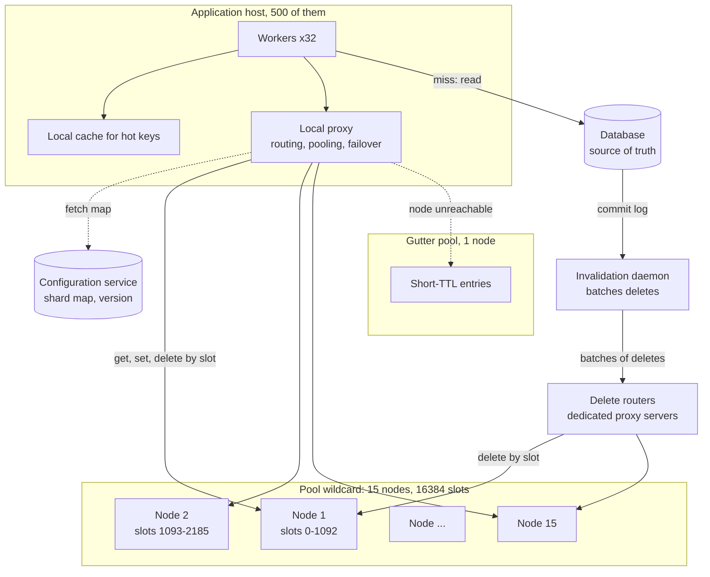
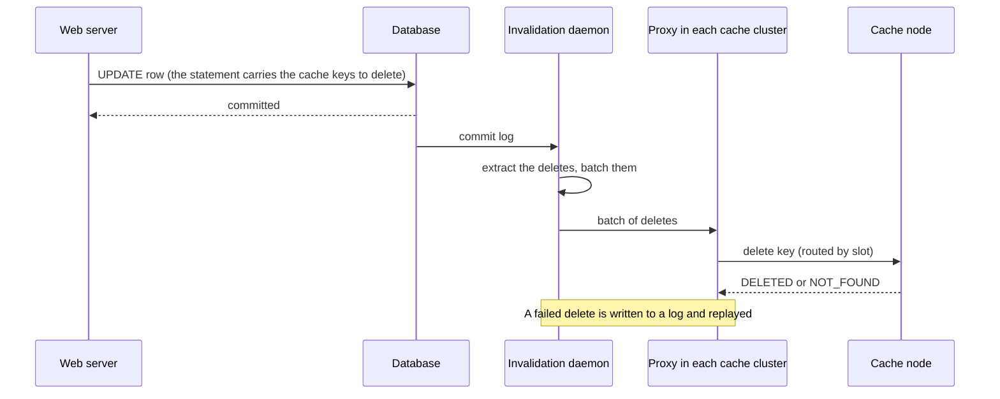

# Design a Distributed Cache

## Problem Statement

Design a distributed in-memory cache for a company with hundreds of application hosts. Services store and read key-value pairs with a time to live (TTL). The cache spreads the data over many nodes, answers most reads in under a millisecond of server time, survives the loss of a node without overloading the database behind it, and handles a key that receives far more traffic than the rest. This is the problem that Memcached at Facebook, Memcached with mcrouter or twemproxy, and Redis Cluster solve in different ways.

This page designs the cluster: sharding, routing, replication, failure handling, and consistency with the database. Two neighbouring pages hold the rest, and this page links to them instead of repeating them:

- [Caching](../fundamentals/03-caching.md) is the home of cache placement, the write strategies, invalidation races, stampede fixes, hot-key fixes, and the comparison of Redis and Memcached. This page applies those results to a cluster.
- The [LRU and LFU case study](../../lld/case-studies/02-lru-and-lfu-cache/README.md) designs the data structures of one node: the O(1) hash map plus doubly linked list for LRU, the frequency lists for LFU, and the locking of one cache. This page treats one node as that building block, and designs everything around it.

[Partitioning and sharding](../fundamentals/06-partitioning-and-sharding.md), [replication](../fundamentals/05-replication.md), and [consensus and leader election](../distributed-systems/02-consensus-and-leader-election.md) explain the building blocks. The in-process cache has one machine and one lock. The distributed cache has a network, many failure modes, and a database that it must protect.

## Clarifying Questions

Ask these in the first 5 minutes. Each row gives the answer that this design assumes.

| Question | Assumed answer |
|---|---|
| Is the cache the source of truth, or a copy of a database? | A copy. The design is a look-aside cache. The application reads the cache first, loads from the database on a miss, and fills the cache. A lost entry costs one database read, and no fact is lost |
| What operations? | `get` (also a multi-get of many keys), `set` with a TTL, `delete`, `incr`/`decr`, and `touch`. No transactions. No range scans |
| What scale? | Peak 1,000,000 gets each second. 500 million live keys. Average item 1,100 bytes (50-byte key, 1,000-byte value, 50 bytes of overhead). 50,000 database writes each second, and each write deletes one key |
| What hit ratio? | 95% at the peak (assumption). So the database serves 5% of the reads |
| What latency? | A get takes under 2 ms at p99 inside one region, measured at the client (an assumption, not a guarantee of any product) |
| How stale may a value be? | Seconds in the normal case. A TTL bounds the worst case. The design tolerates a short stale window but not a permanent one |
| What value size? | Up to 1 MB. Memcached stores items up to 1 MB by default and limits the key to 250 characters (Memcached protocol documentation) |
| Must the data survive a node failure? | No. The database must survive a node failure: the extra database load must stay within its capacity. Data that cannot be rebuilt (sessions, counters) needs a different design (see the follow-up questions) |
| One region or several? | One region. Multi-region is an extension (the Facebook design is in the Deep Dives) |
| Multi-tenant? | Yes. Several services share the cluster, so the design separates pools by access pattern |
| Is a loss of the entire cache acceptable? | No. A full outage sends 20 times the database load (at a 95% hit ratio). The design must avoid a full outage and must warm a new cache before it takes traffic |
| Where does the client logic live? | In a client library and a local proxy that this design chooses (see Deep Dive 1) |

## Requirements

### Functional

1. `get(key)` returns the value or a miss. `multiGet(keys)` returns the values of many keys in one call.
2. `set(key, value, ttl)` stores a value. After the TTL, the cache does not return the value.
3. `delete(key)` removes a value. A delete is idempotent.
4. The cache evicts entries when memory is full, so a write does not fail because of memory.
5. A client finds the node that owns a key with no central lookup per request.
6. An operator adds and removes nodes with no downtime.
7. The cache supports a protection against stampedes and stale sets (leases) and a protection for hot keys.

### Non-functional

| Requirement | Target |
|---|---|
| Throughput | 1,000,000 gets each second and 100,000 sets and deletes each second at the peak |
| Latency | Get below 2 ms at p99 at the client |
| Hit ratio | At least 95% at the peak |
| Availability | The loss of one node must not take the service down and must keep the database within capacity |
| Consistency | Eventual. The staleness after a write is bounded by the invalidation delay, and in the worst case by the TTL |
| Scalability | Add a node and lose about 1/(N + 1) of the entries to remapping (an expected value for a uniform hash, not a bound) |
| Isolation | One tenant cannot evict the working set of another tenant |

## Estimation

Inputs (assumptions): peak 1,000,000 gets each second, 95% hit ratio, 50,000 database writes each second (each causes one delete), 500 million live keys, 1,100 bytes for each item (50 bytes of key, 1,000 bytes of value, 50 bytes of overhead). The data needs 25% headroom (fragmentation, growth, and expiry lag). A cache node has 64 GB of memory, and 48 GB of it holds data (Assumption: the rest is for the operating system and the connections). Units are SI: 1 GB = 10^9 bytes. Per-node capacity: Assumption that one node sustains 150,000 operations each second with 1 KB values and pipelining. Measure the real number with `memtier_benchmark` or `redis-benchmark` on your hardware, as the [caching page](../fundamentals/03-caching.md) advises. There are 500 application hosts with 32 worker processes each. One hot key receives 200,000 gets each second, and its value is 100 KB.

| Step | Calculation | Result |
|---|---|---|
| Hits each second | 1,000,000 × 0.95 | 950,000 |
| Misses (database reads) each second | 1,000,000 − 950,000 | 50,000 |
| Sets each second (one after each miss) | = misses | 50,000 |
| Deletes each second | = database writes | 50,000 |
| Cache operations each second | 1,000,000 + 50,000 + 50,000 | 1,100,000 |
| Raw data | 500,000,000 × 1,100 B | 550 GB |
| Data with 25% headroom | 550 GB × 1.25 | 687.5 GB |
| Nodes | 687.5 GB / 48 GB = 14.3, rounded up | 15 |
| Nodes with one replica for each node | 15 × 2 | 30 |
| Gets for each node | 1,000,000 / 15 | 66,666 |
| Sets and deletes for each node | 100,000 / 15 | 6,666 |
| Utilization at the peak | (66,666 + 6,666) / 150,000 | 49% |
| Egress | 950,000 hits × 1,100 B | 1,045 MB/s (8.4 Gbit/s) |
| Egress for each node | 1,045 MB/s / 15 | 69.7 MB/s = 557 Mbit/s |
| Extra database reads when 1 node fails | 950,000 / 15 | 63,333 each second |
| Database reads during the failure | 50,000 + 63,333 | 113,333 each second (2.27 times) |
| Database reads at a 90% hit ratio | 1,000,000 × 0.10 | 100,000 each second (2 times) |
| Keys that move when node 16 joins | 1 / 16 | 6.25%, so 59,375 extra database reads each second |
| Connections to one node, every worker process connects | 500 hosts × 32 workers | 16,000 |
| Connections to one node, one proxy for each host | 500 hosts × 1 connection | 500 |
| Hot key traffic | 200,000 gets × 100 KB | 20,000 MB/s |
| 10 Gbit/s network cards for the hot key | 20,000 / 1,250 MB/s | 16 |
| Hot key traffic with a 1 s local cache on each host | 500 hosts × 100 KB for each second | 50 MB/s |

What the numbers decide:

- **Memory sets the node count, so 15 nodes is a small cluster.** The CPU of each node is at 49% of the assumed capacity. The network at 557 Mbit/s for each node fits a 10 Gbit/s card with a large margin. If the working set doubles, the node count doubles.
- **The database must survive the loss of one node.** One failed node out of 15 sends 6.7% of the hits to the database as misses. The read load goes from 50,000 to 113,333 each second. If the database has less than 2.3 times headroom for reads, one node failure takes the database down, and the cache becomes a hard dependency. The [caching page](../fundamentals/03-caching.md) states the rule: "The database must survive the cache's worst day".
- **A drop of the hit ratio from 95% to 90% doubles the database load.** The hit ratio, not the cache latency, is the number to watch.
- **Adding a node has a cost.** Node 16 takes 6.25% of the keys. Without migration, those keys miss until the cache refills them, which adds 59,375 database reads each second. This is a smaller step than a node failure, and it is a planned one. Warm the new node before it takes traffic.
- **A proxy for each host cuts the connections.** 16,000 connections for each node become 500. This is the reason that twemproxy exists: it "was built primarily to reduce the number of connections to the caching servers on the backend" (twemproxy README).
- **One hot key breaks the arithmetic of sharding.** A single 100 KB key with 200,000 gets each second produces 20 GB/s, which is 16 network cards. No cluster of 15 nodes serves it from one node. A local cache for 1 second on each application host turns it into 50 MB/s.

The program below checks the arithmetic. `main` comes first and the block has no imports, so you can copy it into `CacheSizing.java` and run `java CacheSizing.java` on JDK 21.

```java
public class CacheSizing {
    public static void main(String[] args) {
        // Inputs (assumptions). SI units: 1 KB = 1,000 B, 1 GB = 10^9 B.
        long peakGetsPerSec = 1_000_000;
        double hitRatio = 0.95;
        long keys = 500_000_000L;
        long itemBytes = 50 + 1_000 + 50;
        double headroom = 1.25;
        long cacheGbPerNode = 48;
        long appHosts = 500;
        long workersPerHost = 32;

        long rawGb = keys * itemBytes / 1_000_000_000L;
        double provisionedGb = rawGb * headroom;
        long nodes = (long) Math.ceil(provisionedGb / cacheGbPerNode);
        System.out.println("raw data GB: " + rawGb);
        System.out.println("GB with 25% headroom: " + provisionedGb);
        System.out.println("nodes with " + cacheGbPerNode + " GB of cache each: " + nodes);
        System.out.println("nodes with one replica for each node: " + nodes * 2);

        long hits = (long) (peakGetsPerSec * hitRatio);
        long misses = peakGetsPerSec - hits;
        long sets = misses;
        long deletes = 50_000;
        System.out.println("database reads per second at peak: " + misses);
        System.out.println("cache operations per second at peak: "
                + (peakGetsPerSec + sets + deletes));
        System.out.println("gets per node per second: " + peakGetsPerSec / nodes);
        System.out.println("sets and deletes per node per second: " + (sets + deletes) / nodes);

        long egressMb = hits * itemBytes / 1_000_000;
        System.out.println("egress MB/s: " + egressMb);
        System.out.println("egress Mbit/s per node: " + egressMb * 8 / nodes);

        long failedNodeReads = hits / nodes;
        System.out.println("extra database reads per second if one node fails: "
                + failedNodeReads);
        System.out.println("database reads per second during the failure: "
                + (misses + failedNodeReads));
        System.out.println("database reads per second at a 90% hit ratio: "
                + peakGetsPerSec / 10);

        System.out.println("connections to one node, every worker connects: "
                + appHosts * workersPerHost);
        System.out.println("connections to one node, one proxy per host: " + appHosts);

        long hotGetsPerSec = 200_000;
        long hotBytes = 100_000;
        long hotMbPerSec = hotGetsPerSec * hotBytes / 1_000_000;
        long nicMbPerSec = 1_250;
        System.out.println("hot key MB/s: " + hotMbPerSec);
        System.out.println("10 Gbit/s NICs needed for the hot key: "
                + (hotMbPerSec + nicMbPerSec - 1) / nicMbPerSec);
        System.out.println("hot key MB/s with a 1 s local cache on " + appHosts + " hosts: "
                + appHosts * hotBytes / 1_000_000);
    }
}
```

<!-- expected-output -->
```text
raw data GB: 550
GB with 25% headroom: 687.5
nodes with 48 GB of cache each: 15
nodes with one replica for each node: 30
database reads per second at peak: 50000
cache operations per second at peak: 1100000
gets per node per second: 66666
sets and deletes per node per second: 6666
egress MB/s: 1045
egress Mbit/s per node: 557
extra database reads per second if one node fails: 63333
database reads per second during the failure: 113333
database reads per second at a 90% hit ratio: 100000
connections to one node, every worker connects: 16000
connections to one node, one proxy per host: 500
hot key MB/s: 20000
10 Gbit/s NICs needed for the hot key: 16
hot key MB/s with a 1 s local cache on 500 hosts: 50
```

## API Design

### Data plane

The data plane follows the Memcached text protocol, because mcrouter and twemproxy speak it and a client library for it exists in every language. The commands below are from the Memcached protocol documentation (`doc/protocol.txt`).

| Operation | Command | Request | Response |
|---|---|---|---|
| Read one or many keys | `get <key>*` (or `gets` for the CAS ID) | One or more keys | For each hit: `VALUE <key> <flags> <bytes>` and the data. Then `END`. A miss returns no line for the key |
| Store | `set <key> <flags> <exptime> <bytes>` | Key, flags, TTL in seconds (0 means no expiry), value | `STORED` |
| Store if absent | `add <key> <flags> <exptime> <bytes>` | Same | `STORED`, or `NOT_STORED` if the key exists |
| Store if unchanged | `cas <key> <flags> <exptime> <bytes> <cas unique>` | Same, plus the CAS ID from `gets` | `STORED`, `EXISTS`, or `NOT_FOUND` |
| Remove | `delete <key>` | Key | `DELETED` or `NOT_FOUND` |
| Counter | `incr <key> <value>`, `decr <key> <value>` | Key, amount | The new value |
| Refresh the TTL | `touch <key> <exptime>` | Key, TTL | `TOUCHED` |

The key has at most 250 characters and no whitespace or control characters. The default item size limit is 1 MB (see the [caching page](../fundamentals/03-caching.md)).

**Lease and stale-item operations.** The anti-stampede features that this design needs are not in the classic commands. Facebook added *leases* to its Memcached fork: a miss returns a 64-bit token, and a `set` with the token succeeds only if no delete invalidated the token in between (Nishtala et al., section 3.2.1). The open-source Memcached meta protocol offers a similar mechanism with flags on `mg` (meta get), `ms` (meta set), and `md` (meta delete):

| Flag | Command | Meaning (Memcached meta protocol documentation) |
|---|---|---|
| `N<ttl>` | `mg` | Create an empty item on a miss ("vivify"). The client that creates it receives the `W` flag |
| `R<ttl>` | `mg` | If the remaining TTL is below the value, this client wins the right to recache the item |
| `W`, `Z` | `mg` response | `W`: this client won the recache. `Z`: another client already won |
| `X` | `mg` response | The item is stale |
| `I` | `md` | Mark the item stale and bump its CAS ID instead of removing it |
| `I` | `ms` | Set-to-invalid if the supplied CAS ID is older than the item's CAS ID |

The Java example in Deep Dive 4 implements the lease of the Facebook paper. The semantics, not the wire format, is what an interview asks for.

### Control plane

The control plane is the design's own HTTP API. Clients and proxies read the shard map from it. Operators change the map through it. The configuration service stores the map (see Data Model).

| Method and path | Request | Response |
|---|---|---|
| `GET /v1/pools/{pool}/map` | Header `If-None-Match: <version>` | `200` with `{ "version": 42, "slots": 16384, "nodes": [ { "id": "c07", "addr": "10.0.3.7:11211", "slotRanges": [[0, 1092]] } ] }`, or `304` if the version is current |
| `POST /v1/pools/{pool}/nodes` | `{ "addr": "10.0.3.9:11211" }` | `202` with a rebalance plan: the slots that move to the new node |
| `DELETE /v1/pools/{pool}/nodes/{id}` | none | `202`. The slots of the node move to the other nodes |
| `POST /v1/pools/{pool}/slots/{slot}/migrate` | `{ "to": "c09" }` | `202`. The migration of one slot starts |
| `GET /v1/pools/{pool}/hotkeys` | Query `limit=20` | The sampled keys with the highest request rates |

## Data Model

### On one node

A node stores items in memory. The design follows the Memcached structure that the Facebook paper describes (section 6.2). The page on [LRU and LFU caches](../../lld/case-studies/02-lru-and-lfu-cache/README.md) builds the eviction structure itself.

| Structure | Content | Reason |
|---|---|---|
| Hash table | Key to item. The table expands as the item count grows | O(1) lookup. The paper's first optimization was a table that expands "to avoid look-up times drifting to O(n)" |
| Item | Key, flags, expiry time, CAS ID, value, and the links for the LRU lists | One allocation for each item |
| Slab classes | Memory in chunks of fixed sizes. In Facebook's build, classes start at 64 bytes and grow by a factor of 1.07 up to 1 MB (Nishtala et al., section 6.2). Open-source Memcached uses a growth factor of 1.25 by default (`settings.factor` in `memcached.c`, changed with `-f`). Each class takes memory in 1 MB slabs. An item goes to the smallest class that fits it | No general-purpose allocator and no external fragmentation. The cost is the gap between the item and its chunk (internal waste) |
| LRU lists | One set of lists for each slab class. Memcached splits them into HOT, WARM, and COLD segments (see the [caching page](../fundamentals/03-caching.md)) | Eviction picks from the tail of the class that needs memory |
| Lease table | For each key with an open lease: the token and the time of issue | Rate limits the issue of tokens to one in 10 seconds for each key |

Redis stores values in typed data structures instead (the caching page compares them). This design keeps the plain key-value model, because it is what a look-aside cache needs.

### The cluster

| Data | Where it lives | Content |
|---|---|---|
| Shard map | A configuration service (etcd or ZooKeeper, see [consensus and leader election](../distributed-systems/02-consensus-and-leader-election.md)) | Pool name, map version, the owner node of each of 16,384 hash slots, the address and state of each node |
| Pool definitions | The same service | Pools by access pattern: `wildcard` (default), and separate pools for keys with different miss costs or churn (Nishtala et al., section 3.2.2). Each pool has its own nodes and its own map |
| Hot key set | The same service, written by the sampling job | Keys that the clients keep in a local cache |
| Routing and failover policy | The proxy configuration | For each pool: the hash function, the failover pool, the replication policy |

**Why 16,384 slots and not a plain ring.** The key maps to a slot with `slot = hash(key) mod 16384`, and the map assigns slots to nodes. A node holds a set of slots. With 15 nodes, 16,384 = 15 × 1,092 + 4, so 4 nodes own 1,093 slots and 11 nodes own 1,092. When a node joins, the operator moves a number of whole slots to it. Redis Cluster uses the same scheme: "HASH_SLOT = CRC16(key) mod 16384", with an upper limit of 16,384 masters and a suggested maximum of about 1,000 nodes (Redis Cluster specification). A ring with virtual nodes (see [partitioning and sharding](../fundamentals/06-partitioning-and-sharding.md)) gives the same property of moving about 1/(N + 1) of the keys, but a slot is a unit that you can count, migrate, monitor, and assign by hand. The configuration service holds the map, and the map has a version number. A client or proxy caches the map and refreshes it when it gets a redirect or a version mismatch.

**Why a configuration service and not gossip.** Redis Cluster nodes use a gossip protocol on a cluster bus to exchange the map. Memcached servers "do not communicate with each other" (Nishtala et al., section 3.1), and Facebook's clients keep "a map of all available servers, which is updated through an auxiliary configuration system". This design follows Facebook: the cache nodes stay simple and the configuration service (a small consensus-backed store) holds the map. The cost is one more system. The benefit is one source of truth for the map, with versions.

## High-Level Design



| Component | Responsibility |
|---|---|
| Client library | Serializes values, compresses large values, hashes the key to a slot, batches a multi-get by node, and applies timeouts. Holds the local cache for hot keys |
| Local proxy (a sidecar like mcrouter) | Speaks the cache protocol to the workers. Keeps one connection to each cache node for all workers of the host. Routes by slot, retries, fails over, and writes failed deletes to a log. Changes of routing policy happen here, with no application release |
| Cache node | Stores items in memory. Applies the eviction policy and the TTL. Issues leases. Does not talk to other cache nodes |
| Configuration service | Stores the shard map and the pool definitions with versions. Notifies the proxies of changes |
| Gutter pool | A few nodes (about 1% of the cluster in the Facebook design) that absorb the reads for a failed node |
| Invalidation daemon | Reads the database commit log, extracts the keys to delete, and sends them in batches to the delete routers. This closes the gap between a database commit and a cache delete |
| Delete routers | A few dedicated servers that run the proxy software (mcrouter at Facebook). They unpack each batch and route each delete to the node that owns the key. Facebook uses dedicated mcrouter servers for this, not the proxies on the web servers (Nishtala et al., section 4.1) |
| Database | The source of truth. Receives the reads that miss, and the writes |

## Deep Dives

### 1. Sharding and routing: library, proxy, or cluster

Three designs place the routing logic in three places. All of them map a key to a node with a hash function. The difference is who holds the map and who follows the redirects.

| | Smart client library | Proxy (twemproxy, mcrouter) | Cluster-aware server (Redis Cluster) |
|---|---|---|---|
| Where the map lives | In every application process | In the proxy, which can run on each host or as a shared tier | In every node, exchanged by gossip |
| Hops | One. The client talks to the owner | Two. Application to proxy to node. On the same host, the first hop uses loopback | One, plus redirects when the client's map is stale |
| Connections to a node | One for each client process | One for each proxy (or for each proxy thread) | One for each client process |
| Change of routing policy | A release of the application, in every language | A proxy configuration change. Mcrouter supports online reconfiguration | A new cluster protocol version |
| Language support | One implementation for each language | One implementation for all languages | A cluster-aware client for each language |
| Example | The Facebook client library (the first form of its client logic) | twemproxy, mcrouter | Redis Cluster |

**Twemproxy** (twemproxy README): a proxy for the Memcached and Redis protocols, "built primarily to reduce the number of connections to the caching servers on the backend". It keeps persistent server connections (one for each server by default, `server_connections`), pipelines requests, and shards data over the servers of a pool. The distribution modes are `ketama` (consistent hashing, the default and the recommended one), `modula` (hash modulo the server count), and `random`. The default hash function is `fnv1a_64`. A `hash_tag` (for example `{}`) hashes only the part of the key inside the tag, so related keys land on one server. Facts that matter in an interview:

- `auto_eject_hosts` defaults to `false`. When it is on, a server that fails `server_failure_limit` consecutive times (default 2) leaves the pool for `server_retry_timeout` (default 30,000 ms). The notes in the repository warn: "an ejected server will not be included in the hash ring for any requests until the retry timeout passes. This will lead to data partitioning as keys originally on the ejected server will now be written to a server still in the pool". So ejection remaps the keys of the failed node to the other nodes, which is the rehash that the Facebook paper rejects (see Deep Dive 3).
- "nutcracker itself does not retry a request" (nutcracker is the other name of twemproxy). The client must retry, and the client retry count must be greater than `server_failure_limit`, so that the original request reaches a live server.
- The proxy `timeout` defaults to waiting indefinitely. The repository notes recommend setting it for each pool, because a client-side timeout alone leaves the request pending on the proxy-to-server connection, and a client retry then adds more.
- Redis support is partial. The command table in `notes/redis.md` marks `MULTI` (transactions), the pub/sub commands, and `KEYS` as not supported. Multi-key commands such as `SINTER` and multi-key `EVAL` work only if all keys hash to one server through a hash tag, and twemproxy does not check this: it forwards the command to the server of the first key.

**Mcrouter** (mcrouter README and wiki): a Memcached protocol router. Facebook's README says it handles "almost 5 billion requests per second at peak" at Facebook and Instagram. The features that matter here:

- *Hashing.* Servers belong to *pools*. The default hash is `ch3`, a consistent hash. `wch3` adds weights from 0.0 to 1.0 for each host, to move traffic between hosts or to even out the load. `crc32` gives `crc32(key) % pool_size`. A `hash_salt` spreads the failed-over load of a host evenly over a backup pool.
- *Connections.* "Mcrouter will only open one TCP connection to a given destination per mcrouter thread", and requests share it.
- *Health.* After a number of timeouts in a row, a destination is marked "TKO" (technical knockout). Mcrouter sends `version` probes until one succeeds. If a failover route exists, requests go to the backup at once, with no further timeouts. A *hard* TKO (for example `ECONNREFUSED`) is a failure that the next request is unlikely to fix.
- *Reliable delete stream.* Mcrouter records every `delete` that it fails to deliver, and a separate process can replay the log. The client gets `NOT_FOUND`, not an error.
- *Errors.* By default, a failed `get` becomes a miss for the client, so a node failure looks like a miss and not an error.
- *Other routes.* Replicated pools, warm-up routes for cold nodes, production traffic shadowing, prefix routing, large value splitting, and multi-level caches.

**Redis Cluster** (Redis Cluster specification): "There are no proxies, asynchronous replication is used, and no merge operations are performed on values." The key space has 16,384 slots. A node that receives a command for a slot that it does not own answers `-MOVED <slot> <host:port>`, and the client updates its slot map. During a slot migration, the source node answers `-ASK` for the keys that moved already, and the client sends only that query to the target. Multi-key commands work only when all keys hash to one slot, which hash tags (`{user1000}.following`) force. The cluster supports only database 0. The nodes talk on a cluster bus and use gossip.

**Decision.** This design uses a client library for hashing and batching, and a local proxy on each host. The proxy gives connection pooling (500 connections for each node in the estimate, against 16,000), and it lets operators change failover and warm-up policy without an application release. Facebook made the same split: its client logic exists "as two components: a library that can be embedded into applications or as a standalone proxy named mcrouter", and the web servers send `set` and `delete` through a local mcrouter over TCP (Nishtala et al., section 3.1). The cost is a second hop on the host, and one more process to run.

**Multi-get and fan-out.** A web request fetches many keys. Facebook reports that loading one of its popular pages fetches an average of 521 distinct items, and that a batch has an average of 24 keys (Nishtala et al., section 3.1). The client groups the keys by node and sends the requests in parallel. The latency of the request is the latency of the slowest node. If each node answers slowly in 1% of the calls, and one request reaches 15 nodes, then the request is slow with probability 1 − 0.99^15 = 14% (derived). Two consequences follow. First, keep the fan-out low where you can, with batching by node, and put keys that are read together on one node with a hash tag. Second, limit the number of outstanding requests: Facebook's clients use a sliding window to avoid *incast congestion*, where many responses reach one client at the same time and overflow a switch (Nishtala et al., section 3.1).

**Adding a node.** The slot design makes this a planned operation.

1. The operator adds the node. The configuration service creates a plan that moves 1,024 slots (16,384 / 16) to it.
2. For each slot, the system copies the keys of the slot to the new node, and the old node redirects (`ASK` in Redis Cluster) the reads for the keys that moved.
3. After the copy, the map version increases, and the slot belongs to the new node. Clients that hold the old version get a redirect and refresh the map.
4. As an option, warm the new node with reads from the old owner before the switch (see Deep Dive 3).

Without migration, the same step remaps 6.25% of the keys at once, and those keys miss. That adds 59,375 database reads each second for a short time (see the estimate).

### 2. One node: memory, eviction, and concurrency

The [LRU and LFU case study](../../lld/case-studies/02-lru-and-lfu-cache/README.md) shows the O(1) structures. A real cache node needs four more decisions.

**Memory allocation.** A general-purpose allocator fragments memory when items of many sizes arrive and expire. Memcached uses a slab allocator (Nishtala et al., section 6.2): memory is divided into slab classes of fixed chunk sizes, and an item takes the smallest chunk that fits. Facebook's build uses classes from 64 bytes upward with a factor of 1.07 between classes, up to 1 MB. Open-source Memcached uses a factor of 1.25 by default (`-f`). When memory is full, the node evicts the least recently used item *within the slab class* that needs space. This has a known failure: if the workload shifts, the memory that was given to one class may no longer suit it, and the hit ratio falls. Facebook wrote an *adaptive* allocator that moves a slab from a class with old items to a class that evicts items that were used recently ("at least 20% more recently than the average of the least recently used items in other slab classes"), which approximates a single global LRU. The open-source community built a similar allocator (the paper says so). Redis uses jemalloc and typed values instead (see the caching page).

**Eviction.** The policy options (LRU, LFU, random, TTL-based) and the Redis and Memcached specifics are on the [caching page](../fundamentals/03-caching.md). Recommendation: use LRU, in the segmented form of current Memcached, so that a one-time scan does not flush the active items. Use a separate pool for a workload that scans, so that it cannot evict the working set of the other tenants (the pool idea of Nishtala et al., section 3.2.2: low-churn keys that are still valuable get evicted before high-churn keys that nobody reads any more, when they share a pool).

**Expiry.** A TTL does not free memory by itself. Memcached expires items lazily: it checks the expiry when a client reads the item, or when the item reaches the end of the LRU. A short-lived key that is used in one burst keeps its memory until the end of its LRU. Facebook added a *transient item cache* for such keys: a circular buffer of lists, indexed by the seconds until expiry, and the node evicts the list at the head every second. For one family of short-lived keys, this cut the share of the pool from 6% to 0.3% with no loss of hit rate (Nishtala et al., section 6.3). Redis does the same job with a lazy check on access and a background sampling process (see the caching page).

**Concurrency.** One node serves many clients with many threads. The design choices, with the Facebook numbers (approximate, on 2013 hardware, a 12-core Intel Xeon X5650 with gigabit Ethernet):

- A single global lock on all data structures works and does not scale. Facebook's multi-threaded server first used a global lock. Moving to fine-grained locking tripled the peak get rate for hits from 600,000 to 1.8 million items each second (Nishtala et al., section 6.1).
- The LLD page explains why even a `get` needs a lock in an LRU cache: a read changes the recency order. A segmented LRU reduces this cost, because an item in the WARM segment does not move on every read.
- Redis takes the other route: it runs commands on one main thread, so no lock is needed, and it adds nodes (a cluster) for more cores. Memcached uses worker threads, so one big node uses all its cores.
- *UDP for gets.* Facebook's clients use UDP for `get` requests to lower latency and overhead, treat a dropped or out-of-order packet as a miss, and use TCP for `set` and `delete`. The paper measures about 20% lower latency with UDP than with TCP through mcrouter, and a 0.25% loss rate of get requests at peak (Nishtala et al., section 3.1). This is a trade-off that suits Facebook's network. Start with TCP.

### 3. Failure handling and replication

A cache node fails. What happens next decides whether the database survives. There are four answers, and a design can combine them.

| Strategy | How it works | What it costs | Used by |
|---|---|---|---|
| Rehash the keys of the failed node onto the others | The proxy ejects the node, and the hash ring maps its keys to the remaining nodes | The nodes that inherit the keys also inherit the hot keys, and can fail in turn. Facebook notes that "a single key can account for 20% of a server's requests". Data partitions: the keys now live on a node that is not their old owner, and they return to the old owner after it recovers, with stale copies possible | twemproxy with `auto_eject_hosts` |
| Gutter pool | A small, separate pool takes the reads for the failed node. A miss goes to the database, and the result enters the gutter with a short TTL | A few extra nodes (about 1% of the cluster in the Facebook design). The data in the gutter can be stale for the short TTL, and nobody invalidates it | Facebook memcache (Nishtala et al., section 3.3) |
| Replicate | Every key lives on 2 or more nodes. Reads use any replica | Memory times the replica count (30 nodes instead of 15 in the estimate). Writes and deletes must reach every replica | mcrouter replicated pools, Redis replicas |
| Accept the misses | Do nothing. Let the database take the load | The database must have headroom for the extra reads (113,333 each second in the estimate) | The default of a plain look-aside cache |

**The gutter pool in numbers** (Nishtala et al., section 3.3). The client sends a failed `get` to the gutter pool. If the gutter misses, the client reads the database and stores the value in the gutter. The paper reports that the system "reduces the rate of client-visible failures by 99% and converts 10%–25% of failures into hits each day", and that when a memcached server fails entirely, the gutter hit rate "generally exceed[s] 35% in under 4 minutes and often approach[es] 50%". The paper's argument for the gutter against rehashing is the hot key cascade.

**Replication in mcrouter** (mcrouter wiki, replicated pools). The documented configuration sends `set`, `add`, and `delete` to all hosts of the pool (`AllSyncRoute`) and sends each `get` to one host (`LatestRoute`), chosen from the mcrouter's host ID. The wiki says: "to split the load, you'll need to run several mcrouter instances". If a `get` fails, mcrouter retries it on another host of the pool (5 retries by default). The wiki's assumption is stated: "the number of gets in your deployment is much higher than number of sets and deletes". The cost of this scheme is that a write goes to all replicas, and the replicas can disagree during a partial failure.

**Replication in Redis Cluster** (Redis Cluster specification). Replicas replicate asynchronously, and the implicit merge function is "last failover wins": the dataset of the last elected master replaces the others. The specification states the consequence: "Usually there are small windows where acknowledged writes can be lost", and the windows are larger when a client is in a minority partition. A master that the majority cannot reach for `NODE_TIMEOUT` is failed over to a replica. The minority side refuses writes after `NODE_TIMEOUT`, which bounds the loss window. For a *cache* this loss is acceptable. For a store of record it is not (see the follow-up questions).

**Cold start.** A new or restarted node is empty. Every request to it misses, and the clients load from the database. Two documented remedies:

- *Mcrouter warm-up route* (mcrouter wiki): the client sends a `get` to the cold node. On a miss, mcrouter asks a warm node (one with a filled cache) and writes the value into the cold node with an asynchronous request.
- *Cold cluster warmup at Facebook* (Nishtala et al., section 4.3): clients in a cold cluster read from a warm cluster instead of the database. Facebook states that a cold cluster reaches full capacity "in a few hours instead of a few days". The race in this design: a client updates the database, and another client then reads the stale value from the warm cluster before the warm cluster receives the invalidation, so the stale value stays in the cold cluster. Facebook handles this with a hold-off time on deletes: "all deletes to the cold cluster are issued with a two second hold-off". A hold-off rejects `add` operations for the key for 2 seconds. The warm-up client uses `add`, so the `add` fails if a delete came first, and the client re-reads the database. The paper admits a theoretical gap if a delete is delayed more than 2 seconds.

A planned restart is also a cold start. Facebook stored the cached data in System V shared memory so that a software upgrade keeps it, because a memcached server needs "a few hours" to reach 90% of its peak hit rate, and upgrading a fleet of servers could take over 12 hours (Nishtala et al., section 6.4).

**Regional pools** (Nishtala et al., section 4.2). Facebook runs several frontend clusters that share one storage cluster, and each cluster caches the data that its own traffic requests. If users reach all clusters at random, the clusters hold nearly the same data, so a cluster can go offline for maintenance with no loss of hit rate. The price is memory: large items that few users read sit in every cluster. Facebook lets several frontend clusters share one set of servers, a *regional pool*, for such items. Crossing a cluster boundary costs latency, and the paper reports "40% less average available bandwidth over cluster boundaries than within a single cluster". The paper compares two item families: family A (median value 10.7 kB, 3.26 million gets each second) stays replicated in each cluster, and family B (median value 4.34 kB, 458,000 gets each second, about an order of magnitude less traffic than A) moves to a regional pool. It would otherwise occupy 25% of the wildcard pool in each cluster. The decision "is currently based on a set of manual heuristics based on access rates, data set size, and number of unique users". The rule for this design: replicate across clusters the items that are read often, and keep one copy for each region of the items that are large and read rarely.

**Health detection.** Use timeouts with a failure count, as mcrouter does (TKO) and as twemproxy does (`server_failure_limit`). A single timeout is not a failure signal. Probe an ejected node with a cheap command (`version`) before it returns. Set a timeout in the proxy, and set it below the application's own timeout, so that a dead node does not tie up workers.

**This design's choice.** The cache holds data that the database can rebuild, so the design does not replicate the whole pool. It uses (1) the gutter pool for the failure of a node, (2) the warm-up route for a new node, (3) replication only for the small set of keys that are hot and cheap to copy (see the Bottlenecks), and (4) a database that is sized for the loss of one node. If a tenant needs its data to survive a node failure (a session store, a rate-limit counter), that tenant uses a replicated pool or a database, and accepts the cost.

### 4. Consistency with the database

The home of the invalidation races is the [caching page](../fundamentals/03-caching.md). That page shows why the writer *deletes* and does not *update* the cache (two updates can arrive in the reverse order, while deletes are idempotent), why the order is "update the database, then delete", and how the set-after-delete race leaves a stale value. This section adds what the distributed design needs: a pipeline that makes the delete reliable, and the lease that closes the race.

**The invalidation pipeline** (Nishtala et al., section 4.1). With many web servers writing, and many cache clusters, the delete must reach every cache that holds the key, even when a component fails.



Facebook amends each SQL statement that changes data with the cache keys to invalidate after the commit. A daemon (`mcsqueal`) on each database reads the statements that its database commits, extracts the deletes, and sends them in batches to "a set of dedicated servers running mcrouter instances in each frontend cluster" of its region. Those mcrouters unpack the batches and route each delete to the memcached server that owns the key. The batching gave an 18 times improvement in the median number of deletes for each packet. The paper compares this to deletes from the web servers: web servers batch less well, and they give "little recourse when a systemic invalidation problem arises", while deletes in the database log can be replayed. The paper also reports that only 4% of all deletes invalidate cached data. As an optimization, the web server that wrote also deletes the key in its own cluster, so that the same user reads the own write at once ("read-after-write semantics for a single user request"). The reliable delete log of mcrouter plays the same role for deletes that fail in transit.

**Leases close the stale-set race.** The race: a reader misses, reads the old row from the database, and stalls. A writer updates the database and deletes the key. The reader then sets the old value. The cache now holds a stale value until the TTL ends. A lease prevents it: on a miss the cache hands the reader a token, and a delete invalidates the open token, so the reader's `set` fails. A second use of the lease is the rate limit: the cache returns a token for a key once in 10 seconds (the Facebook default), and a request for the key inside this interval gets a "wait" answer. Facebook measured the effect on a set of keys that suffered thundering herds. For one week, without leases the peak database query rate was 17,000 each second, and with leases it was 1,300 (Nishtala et al., section 3.2.1).

The program below implements a single cache node with leases and an injected clock. It runs three scenarios: the stale set, the herd, and an expired lease. `main` comes first, and the block has its own imports. The paper states two lease rules. First, verification of a `set` "can fail if memcached has invalidated the lease token due to receiving a delete request for that item". Second, the server returns "a token only once every 10 seconds per key", and a request inside that interval gets a notice to wait. The paper does not say whether a delete restarts the 10-second interval, and it defines no expiry for a token. The demo makes two choices of its own and labels them: a delete removes the token and also clears the interval, so a reader that arrives after an invalidation can fill the cache at once (scenario 1); and a new token, issued after the interval, replaces the old one, so a late `set` with the old token fails (scenario 3).

```java
import java.util.HashMap;
import java.util.Map;

public class LeaseDemo {
    public static void main(String[] args) {
        Map<String, String> database = new HashMap<>();
        database.put("k", "v1");
        Clock clock = new Clock();
        LeaseCache cache = new LeaseCache(clock, 10_000);

        System.out.println("1. Stale set: the writer deletes while a reader holds a lease");
        Reply r1 = cache.get("k");
        System.out.println("   reader 1 get -> " + r1);
        String seen = database.get("k");
        database.put("k", "v2");
        cache.delete("k");
        System.out.println("   writer updated the database to v2 and deleted the key");
        System.out.println("   reader 1 set(" + seen + ") accepted: "
                + cache.set("k", seen, r1.token));
        Reply r2 = cache.get("k");
        System.out.println("   reader 2 get -> " + r2);
        System.out.println("   reader 2 set(v2) accepted: "
                + cache.set("k", database.get("k"), r2.token));
        System.out.println("   reader 3 get -> " + cache.get("k"));

        System.out.println("2. Thundering herd: one lease for each key in each 10 seconds");
        Reply a = cache.get("hot");
        clock.now += 5;
        Reply b = cache.get("hot");
        clock.now += 5;
        Reply c = cache.get("hot");
        System.out.println("   first miss -> " + a);
        System.out.println("   miss 5 ms later -> " + b);
        System.out.println("   miss 10 ms later -> " + c);
        cache.set("hot", "loaded", a.token);
        System.out.println("   after the leaseholder sets, a retry -> " + cache.get("hot"));

        System.out.println("3. A lease that nobody uses expires");
        Reply d = cache.get("lost");
        clock.now += 10_001;
        Reply e = cache.get("lost");
        System.out.println("   first miss -> " + d);
        System.out.println("   miss after 10,001 ms -> " + e);
        System.out.println("   late set with the old token accepted: "
                + cache.set("lost", "x", d.token));
    }

    static class Clock {
        long now;
    }

    record Reply(String kind, String value, long token) {
        @Override
        public String toString() {
            return switch (kind) {
                case "HIT" -> "HIT " + value;
                case "LEASE" -> "MISS, lease token " + token;
                default -> "MISS, wait and retry";
            };
        }
    }

    /** One cache server. A miss returns a lease token. A delete invalidates the token. */
    static class LeaseCache {
        final Map<String, String> items = new HashMap<>();
        final Map<String, Long> tokens = new HashMap<>();
        final Map<String, Long> issuedAt = new HashMap<>();
        final Clock clock;
        final long leaseIntervalMs;
        long nextToken = 1;

        LeaseCache(Clock clock, long leaseIntervalMs) {
            this.clock = clock;
            this.leaseIntervalMs = leaseIntervalMs;
        }

        Reply get(String key) {
            if (items.containsKey(key)) {
                return new Reply("HIT", items.get(key), 0);
            }
            Long last = issuedAt.get(key);
            if (last != null && clock.now - last <= leaseIntervalMs) {
                return new Reply("WAIT", null, 0);
            }
            long token = nextToken++;
            tokens.put(key, token);
            issuedAt.put(key, clock.now);
            return new Reply("LEASE", null, token);
        }

        boolean set(String key, String value, long token) {
            Long valid = tokens.get(key);
            if (valid == null || valid != token) {
                return false;
            }
            tokens.remove(key);
            items.put(key, value);
            return true;
        }

        void delete(String key) {
            items.remove(key);
            tokens.remove(key);
            issuedAt.remove(key);
        }
    }
}
```

<!-- expected-output -->
```text
1. Stale set: the writer deletes while a reader holds a lease
   reader 1 get -> MISS, lease token 1
   writer updated the database to v2 and deleted the key
   reader 1 set(v1) accepted: false
   reader 2 get -> MISS, lease token 2
   reader 2 set(v2) accepted: true
   reader 3 get -> HIT v2
2. Thundering herd: one lease for each key in each 10 seconds
   first miss -> MISS, lease token 3
   miss 5 ms later -> MISS, wait and retry
   miss 10 ms later -> MISS, wait and retry
   after the leaseholder sets, a retry -> HIT loaded
3. A lease that nobody uses expires
   first miss -> MISS, lease token 4
   miss after 10,001 ms -> MISS, lease token 5
   late set with the old token accepted: false
```

**Stale values on purpose.** When a key is deleted, Facebook's server keeps the old value in a structure for recently deleted items for a short time. A `get` can return a lease token or the data marked as stale. An application that can make progress with slightly old data does not wait for the new value. The paper observes that "the cached value tends to be a monotonically increasing snapshot of the database", so most applications use the stale value with no change. The Memcached meta protocol offers the same thing with the `X` flag and `md` with `I`.

**Across regions** (Nishtala et al., section 5). Facebook designates one region with the master databases and keeps read-only replica databases in the others, with MySQL replication. The replica can lag. Two problems follow. First, the invalidation must not arrive before the replicated data: an early delete lets a reader refill the cache from the lagging replica, which sets stale data. Facebook avoids this race by sending the invalidations from the databases, not from the web servers. An invalidation daemon runs on every database (section 4.1), and each daemon broadcasts the deletes of the statements that *its own* database commits to the frontend clusters of its region. A replica database commits a replicated statement only when the replication stream applies it, so in a replica region the delete follows the data. (The paper does not state this step in one sentence. It states the result: the daemon design "avoids a race condition in which an invalidation arrives before the data has been replicated from the master region", and it calls a web server's invalidation of a replica region "premature".) Second, a user who writes in a non-master region must read the own write. Facebook uses a *remote marker*: the writer sets a marker `r_k` in the region, writes to the master with `k` and `r_k` to be invalidated, and deletes `k` locally. A reader that misses `k` checks for `r_k`. If the marker exists, the reader reads from the master region, which costs latency, and otherwise reads the local replica. The paper trades "additional latency when there is a cache miss, for a decreased probability of reading stale data", and it notes that a marker is not a safe-to-evict cache entry, because a missing marker means a possible stale read. Facebook stores the markers in a regional pool. The paper warns that the mechanism "may reveal stale information during concurrent modifications to the same key", because one operation can delete a marker that another operation in flight still needs.

**The TTL is the last bound.** Every scheme above can fail: a delete is lost, a daemon is down, a lease interval expires. Set a TTL on each entry, and state it as the maximum staleness of the design.

## Bottlenecks and Scaling

| What fails first | Symptom | Fix |
|---|---|---|
| Hot key | One node at its network or CPU limit while the others idle. The example: 200,000 gets each second of a 100 KB value is 20 GB/s | A local cache on each application host for 1 to 5 seconds (50 MB/s in the example). Replicate a small, hot key set to several nodes (the Facebook rule: the data fits on one or two servers, the request rate is higher than one server handles, and clients fetch many of those keys together). Split a large value. Details on the [caching page](../fundamentals/03-caching.md) |
| Node failure | The database read rate rises 2.3 times (113,333 each second) | A gutter pool, a database sized for the loss of one node, and replication for the hot set only |
| Cache cold start | A new node or a restarted node misses on every request | A warm-up route (mcrouter `WarmUpRoute`, Facebook cold cluster warmup), and a hold-off on deletes. Warm a node before it takes its slots |
| Stampede on a hot key | A popular key expires and many clients load it at once | Leases (one token in 10 seconds for each key), single-flight in the client, probabilistic early refresh, and jittered TTLs (see the caching page) |
| Multi-get fan-out | The latency of a request equals the slowest of the nodes that it touches. 15 nodes with 1% slow calls each give 14% slow requests | Batch the keys by node, limit the window of outstanding requests (incast), keep related keys on one node with a hash tag, and set a deadline with a fallback to the database |
| Connections | 16,000 connections for each node in the example. Memory and CPU go to connection state | A proxy for each host (500 connections), and a pipelined protocol. Twemproxy reduces connections by design |
| Eviction churn | The hit ratio falls and the eviction rate rises | Add memory, separate pools by access pattern, check key design (no timestamps in keys), and give the slab allocator a chance to rebalance |
| Memory fragmentation and slab imbalance | The cache evicts although it has free memory in another slab class | An adaptive slab allocator (Facebook), or a different size class factor. Monitor the evictions for each class |
| A single-threaded node | One CPU core saturates (Redis) | More nodes (a cluster), pipelining, or Redis I/O threads for the network work (see the caching page) |
| Resharding | Adding a node remaps 6.25% of the keys and raises the database load | Migrate the slots, warm the node, and add nodes one at a time during a low-traffic window |
| The configuration service | Clients cannot refresh the map | Clients keep the last good map and work without the service. The service is not on the request path |
| Invalidation lag | Stale reads after a write grow | Monitor the delay between the database commit and the delete. Replay lost deletes from the log |

## Trade-offs

| Decision | Chosen | Rejected | Reason |
|---|---|---|---|
| Role of the cache | A look-aside cache of a database | The cache as the system of record | A lost entry costs one database read. No durability or replication of every key is needed |
| Key to node mapping | 16,384 slots with a versioned map | `hash(key) mod N`; a ring with virtual nodes only | Modulo remaps almost all keys when N changes (see [partitioning and sharding](../fundamentals/06-partitioning-and-sharding.md)). Slots give a countable unit for migration, and a version for clients |
| Where routing lives | A client library plus a local proxy | A library only; a shared proxy tier; Redis Cluster's cluster-aware clients | The proxy pools connections (500 against 16,000) and changes policy with no release. The price is a second hop on the host |
| Map distribution | A small configuration service with versions | Gossip between cache nodes | One source of truth, and simple cache nodes (Facebook's choice). The price is one more system to run |
| Write path | Update the database, then delete the key | Update the cache on write; delete before the write | Deletes are idempotent and order-independent. The order "database first" closes one race (see the caching page) |
| Stale-set race | Leases | Delayed double delete; versioned values | A lease is exact for the race, and it also limits the herd. The price is a server change or the meta protocol |
| Node failure | A gutter pool for reads, and a database with headroom | Rehash onto the surviving nodes; replicate all keys | Rehash moves hot keys onto nodes that can fail in turn. Full replication doubles the memory (30 nodes against 15) |
| Replication | None for the bulk. Replicas for a small hot key set | Primary-replica for every key | The cache holds rebuildable data. Replication costs memory and makes every delete go to all copies |
| Hot keys | A local cache with a short TTL, then key replication | Only more nodes | Adding nodes does not help, because the hash sends one key to one node |
| Consistency | Eventual, bounded by the delete pipeline and the TTL | Strong consistency between cache and database | Strong consistency needs coordination on every read and write, which removes the point of the cache. Facebook states that it exposes slightly stale data in exchange for "insulating a backend storage service from excessive load" |
| Eviction | Segmented LRU per slab class, with an adaptive allocator | A global LRU with one lock | Per-class LRU is cheap and the adaptive allocator approximates a global LRU. A single lock does not scale (600,000 against 1.8 million gets each second in the paper) |
| Gets over UDP | TCP first | UDP for gets | UDP gave Facebook about 20% lower latency, and it needs loss handling. Treat it as an optimization |

## Follow-up Questions

??? question "Where do you put the routing logic: in the client, in a proxy, or in the cluster?"

    The direct answer: a client library for the hashing and a local proxy on each host, for a cluster that many teams share.

    The reasons. A smart client has one hop and no extra process, but every language needs a full implementation, and a change of failover policy needs an application release. A proxy centralizes the policy and pools connections: with 500 hosts and 32 workers for each host, a node sees 16,000 connections without a proxy and 500 with one. Twemproxy was built to reduce connections, and mcrouter supports online reconfiguration, replicated pools, warm-up, and failover. Redis Cluster puts the logic in the servers and the clients: "there are no proxies", nodes answer `-MOVED` and `-ASK`, and a cluster-aware client keeps a slot map.

    The trade-off: the proxy adds a hop (loopback on the same host) and one more process to run and monitor. Facebook split the logic into a library and the mcrouter proxy for the same reasons. If the system has one language and a few hundred connections, a library alone is enough.

??? question "A cache node dies. What happens to the database, and how do you protect it?"

    Compute first. With 15 nodes and a 95% hit ratio, one node holds 1/15 of the keys. The hits for those keys become misses: 950,000 / 15 = 63,333 extra database reads each second, so the read load goes from 50,000 to 113,333 (2.27 times). If the database cannot take that, one failed node can take the database down, and the failure then spreads.

    The protections, in order. Size the database for the loss of one node. Use a gutter pool: a small pool (about 1% of the servers in Facebook's design) takes the reads of the failed node, the clients fill it from the database with a short TTL, and Facebook reports a gutter hit rate of more than 35% within 4 minutes. Do not rehash the failed node's keys onto the others: a hot key can account for 20% of a server's requests, and the server that inherits it can fail in turn. Use leases, so that the misses for one key become one database read. Shed load or degrade at the application if the database still runs hot. Replicate the hot key set if it is small.

    The edge case: a full cache outage (a bad deploy, a network fault) sends 20 times the database load at a 95% hit ratio. The design needs a circuit breaker and load shedding for this case (see [reliability patterns](../fundamentals/12-reliability-patterns.md)).

??? question "One key gets 200,000 requests each second. How do you serve it?"

    One node owns the key, so adding nodes does not help. In the example, a 100 KB value at 200,000 gets each second is 20 GB/s, which is 16 network cards of 10 Gbit/s, so no single node can serve it.

    First, a local cache on each application host with a TTL of 1 to 5 seconds. With 500 hosts and a 1-second TTL, the cache node sees 500 reads each second, which is 50 MB/s. The staleness bound is the local TTL, and the local copy is not invalidated by the cache cluster, so keep it short and state it. Second, replicate the key: store it under `k#0` to `k#N-1` on different nodes, read a random suffix, and write all copies. Facebook replicates a category of keys within a pool when the keys are read together, the whole set fits on one or two servers, and the request rate exceeds one server. Clients choose a replica by their IP address, and every invalidation must reach every replica. Third, Redis client-side caching with server-driven invalidation (`CLIENT TRACKING`) if you run Redis. Detect hot keys by sampling the request counts for each key, and keep the list in the control plane.

    The trade-off: a local cache gives up freshness and the cluster gives up nothing. Replication costs memory and write fan-out.

??? question "How do you keep the cache consistent with the database after a write?"

    The direct answer: the writer updates the database and then deletes the key. The reader fills the cache on a miss. A TTL bounds the damage of anything that goes wrong.

    The reason for a delete and not an update: two writers can update the database in the order A, B and the cache in the order B, A, which leaves the cache wrong until the TTL. Deletes are idempotent and order-independent. The order "database first" avoids the race where a reader refills the cache between the delete and the write.

    Two gaps remain. First, a crash between the commit and the delete loses the invalidation. Fix it with an invalidation pipeline that reads the database commit log (Facebook's `mcsqueal`), batches the deletes, and replays them, and with a reliable delete log in the proxy. Second, the set-after-delete race: a reader reads the old row, the writer commits and deletes, and the reader then sets the old value. A lease closes it, because the delete invalidates the reader's token and the reader's `set` fails.

    Across regions, delete after the replica has applied the change, and use a remote marker for the user who wrote in a non-master region. State the final guarantee: eventual consistency, with staleness bounded by the pipeline delay and, at worst, the TTL.

??? question "How do you add a node to a running cache cluster without a miss storm?"

    With 15 nodes, a new 16th node should own 1/16 of the keys, which is 1,024 of the 16,384 slots. If the system just remaps those keys, 6.25% of the keys miss at once and the database gets about 59,000 extra reads each second.

    So migrate the slots. Pick the slots to move. For each slot, copy its keys to the new node. During the copy, the old owner answers for keys that it still holds and redirects the others (Redis Cluster does this with `-ASK`). Then increase the map version, so that the slot belongs to the new node. A client with the old map gets `-MOVED` (or a version mismatch) and refreshes. Move the slots in small groups and in a low-traffic window, and watch the database read rate.

    If you cannot migrate keys, warm the node: put it behind a warm-up route, so that a miss on the new node reads from the old owner (mcrouter's `WarmUpRoute`), and use a hold-off on deletes to avoid the race with invalidations (Facebook uses 2 seconds). Facebook reports that a cold cluster reaches full capacity in a few hours with warm-up, against a few days without.

??? question "Why not use consistent hashing with a ring? Why 16,384 slots?"

    Both give the same property: when a node joins, about 1/(N + 1) of the keys move, against nearly all keys with `hash mod N`. A ring with virtual nodes does this by hashing nodes many times onto the ring. Mcrouter's default `ch3` and twemproxy's `ketama` are consistent hashes of this family.

    Slots add a unit that an operator can count and control. A node owns a list of slots. A migration moves whole slots, one at a time, and progress is a number. The map is a small table (16,384 entries) that gets a version. Redis Cluster uses `CRC16(key) mod 16384` for this and sets an upper limit of 16,384 masters, with about 1,000 nodes as the suggested maximum. The cost: the slot count is fixed, so it limits the cluster size, and an uneven slot assignment gives an uneven load, which the operator fixes by moving slots. A ring with virtual nodes balances statistically. Pick the slots for control and the ring for no coordination. Weighted hashing (mcrouter `wch3`) exists to correct an uneven ring.

??? question "Redis Cluster has replicas. Is it a safe place for data that must not be lost?"

    No. Redis Cluster replicates asynchronously, so a master acknowledges a write before the replicas have it. If the master fails in that window, a replica takes over and the write is lost. The specification says that "there are small windows where acknowledged writes can be lost", and that the windows are larger for a client in a minority partition: a minority master keeps accepting writes until `NODE_TIMEOUT` passes, and the majority side may have failed it over meanwhile. The merge rule is "last failover wins". The specification adds that nodes do not wait for replica acknowledgements unless the client asks for it with the `WAIT` command.

    For a cache, this is fine: a lost entry is rebuilt. For sessions, counters, or any record of truth, either accept the loss window and the rebuild (a user logs in again), or use a database with synchronous replication and a consensus protocol. Do not call a cache a database because it has replicas. The right framing in an interview: "which data can I rebuild, and what is the cost of a stale or lost entry?"

??? question "What do you do when the cache is too slow because multi-gets touch many nodes?"

    A request that reads many keys waits for the slowest node. If a node is slow in 1% of the calls, independently of the other nodes, and the request touches 15 nodes, then 1 − 0.99^15 = 1 − 0.860 = 14% of the requests are slow. Facebook reports that one of its popular pages fetches 521 distinct items on average, with 24 keys in an average batch, so the effect is real.

    The fixes: group the keys by node and send the requests in parallel, which the client library does. Reduce the number of nodes that a request touches by placing keys that are read together on one node (a hash tag), or by storing a pre-joined object under one key. Limit the outstanding requests with a sliding window, as Facebook does, because a large burst of responses overflows a switch buffer (incast congestion). Set a deadline and fall back to the database or to a default for the slow part. Use a replica or a hedged request for the slowest keys if the replicas exist.

??? question "When would you not add a distributed cache?"

    When the database is fast enough, a cache adds a second system, a second failure mode, and the invalidation problem. When the data changes on nearly every read, the hit ratio stays low. When the read must see the latest write (a balance for a payment decision), read from the primary database. When the database cannot survive the loss of the cache, and you cannot give it headroom, the cache is a hard dependency and you must pay for replication and a gutter pool.

    Try the cheaper steps first: an in-process cache for small and read-heavy data, a database index, a read replica, and an HTTP cache or CDN for public content. Then add the distributed cache for the data that many instances share and that is larger than one instance's memory.

## 45-Minute Plan

| Minutes | What to present |
|---|---|
| 0 to 5 | Clarify: look-aside cache or store of record, scale (gets each second, keys, item size), hit ratio, latency, staleness tolerance, one region or more. State the numbers |
| 5 to 10 | Estimation: the working set, node count, operations for each node, the database load during a node failure, connections, and a hot key |
| 10 to 15 | API: `get`, `multiGet`, `set` with TTL, `delete`, and the lease operations. The control plane map |
| 15 to 20 | Data model: the node structures (hash table, slab classes, LRU lists), and the cluster map with 16,384 slots in a configuration service |
| 20 to 25 | High-level diagram: application, local proxy, pool of nodes, gutter pool, configuration service, database, invalidation daemon |
| 25 to 38 | Deep dives. Routing: library, proxy, cluster (4 minutes). Failure handling: gutter, warm-up, replication (4 minutes). Consistency: delete, pipeline, leases (5 minutes) |
| 38 to 42 | Bottlenecks: the hot key with numbers, multi-get fan-out, resharding, and a full outage |
| 42 to 45 | Trade-offs and extensions: replication of non-rebuildable data, multi-region with remote markers, tiered local and remote caching. Ask which part the interviewer wants to examine |

## Further Reading

- Nishtala et al., "Scaling Memcache at Facebook", NSDI 2013: <https://www.usenix.org/conference/nsdi13/technical-sessions/presentation/nishtala> (the PDF is <https://www.usenix.org/system/files/conference/nsdi13/nsdi13-final170_update.pdf>). The primary source for the client library and mcrouter (section 3.1), leases (3.2.1), pools (3.2.2), replication within pools (3.2.3), the gutter pool (3.3), the invalidation pipeline (4.1), cold cluster warmup (4.3), remote markers (5), and the single-server changes (6).
- mcrouter, GitHub repository and wiki: <https://github.com/facebook/mcrouter> and <https://github.com/facebook/mcrouter/wiki>. The README lists the features and the request rate. The wiki pages "Features", "Pools", "Replicated pools setup", "Cold cache warm up setup", and "Error handling" give the health checks, hash functions, replication, warm-up, and error behavior.
- twemproxy (nutcracker), GitHub repository: <https://github.com/twitter/twemproxy>. The README gives the features and the configuration keys. The notes on recommendations (<https://github.com/twitter/twemproxy/blob/master/notes/recommendation.md>) explain liveness, timeouts, and hash tags. The Redis command table (<https://github.com/twitter/twemproxy/blob/master/notes/redis.md>) lists the supported and unsupported commands.
- Redis documentation, "Redis cluster specification": <https://redis.io/docs/latest/operate/oss_and_stack/reference/cluster-spec/>. The goals, the write-safety discussion, the 16,384 slots, hash tags, `MOVED` and `ASK`, and the availability analysis.
- Memcached protocol documentation, `doc/protocol.txt`: <https://github.com/memcached/memcached/blob/master/doc/protocol.txt>. The classic commands and the meta commands with the stale and recache flags.
- Memcached documentation: <https://docs.memcached.org/>. The meta protocol and the other features (the [caching page](../fundamentals/03-caching.md) lists the sections).
- Karger, Lehman, Leighton, Panigrahy, Levine, and Lewin, "Consistent Hashing and Random Trees: Distributed Caching Protocols for Relieving Hot Spots on the World Wide Web", STOC '97, pages 654 to 663: <https://doi.org/10.1145/258533.258660>. The consistent hashing paper (see [partitioning and sharding](../fundamentals/06-partitioning-and-sharding.md)).
- Related pages in this KB: [caching](../fundamentals/03-caching.md), [LRU and LFU cache (LLD)](../../lld/case-studies/02-lru-and-lfu-cache/README.md), [partitioning and sharding](../fundamentals/06-partitioning-and-sharding.md), [replication](../fundamentals/05-replication.md), [reliability patterns](../fundamentals/12-reliability-patterns.md), [consensus and leader election](../distributed-systems/02-consensus-and-leader-election.md), [key-value store](03-key-value-store.md), [distributed message queue](14-distributed-message-queue.md).
