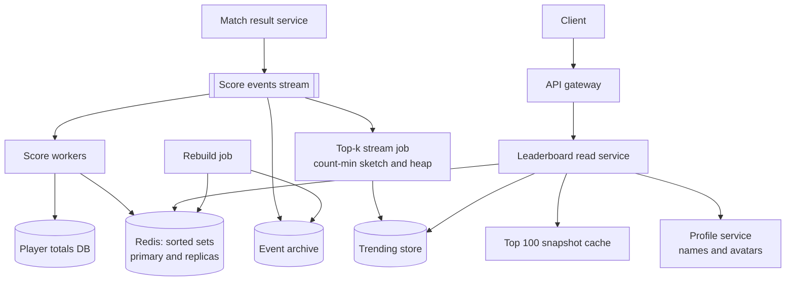
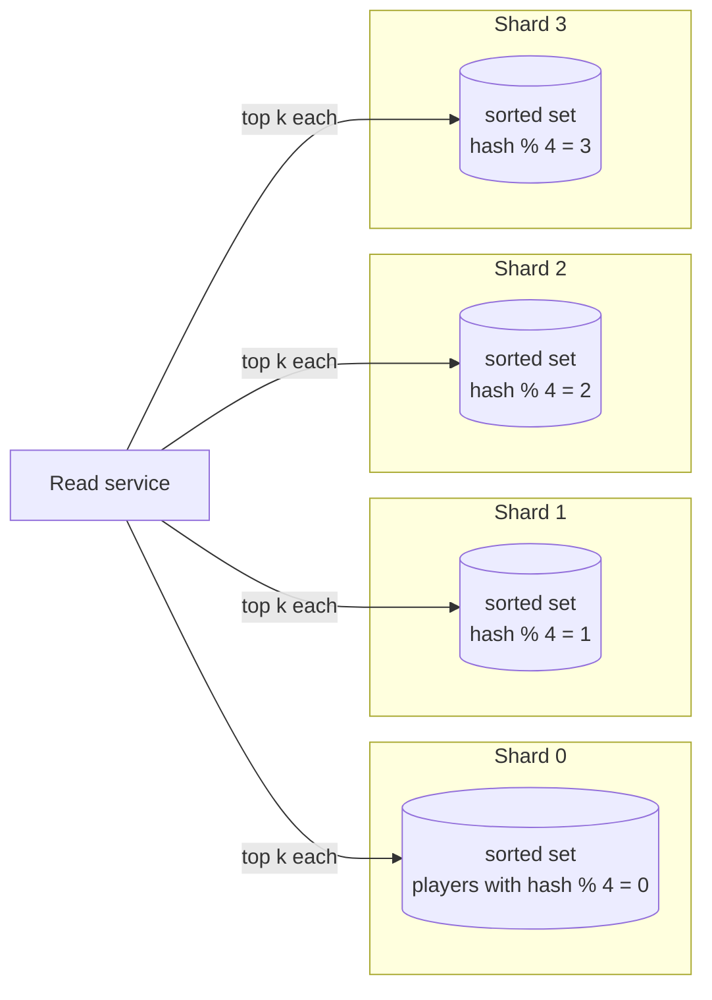

# Design a Leaderboard and Top-K System

A leaderboard ranks players by score. It answers three questions: who are the top 100, what is my rank, and who is around me. A top-k system is the same idea for a stream of events: which 10 hashtags, songs, or search queries are the most frequent right now. This case study gives the design that a strong candidate presents in 45 minutes. The exact leaderboard uses Redis sorted sets, and the design shows when one sorted set is enough, how to shard it when it is not, and why the merge of top-k lists is exact in one partitioning scheme and wrong in another. The approximate top-k uses a count-min sketch with a heap, and the design shows the error bound and when to accept it. Follow the steps in [how to approach an HLD interview](../how-to-approach-hld.md).

!!! note "About the sources"
    This page is a reference design. The facts about Redis come from its command documentation (`ZADD`, `ZINCRBY`, `ZRANGE`, `ZRANK`, `ZUNIONSTORE`, and the sorted-set and Redis Cluster pages). The facts about the sketch come from the count-min paper (Cormode and Muthukrishnan, 2005), and the page on [probabilistic data structures](../distributed-systems/04-probabilistic-data-structures.md) explains the math. A number without a source is an assumption of this page.

## Problem Statement

Design the leaderboard of an online game. Players earn points in matches. The game shows a global board with the top players, the rank and score of the current player, and the players just above and below the current player. There are daily, weekly, and all-time boards. A second feature shows the 10 most-played items in the last hour (top-k over a stream). The boards must reflect a score change within seconds, and they must stay correct when a score event arrives twice.

## Clarifying Questions

| Question | Assumed answer |
|---|---|
| How many players? | 100 million registered, 10 million daily active |
| How are scores produced? | A match-result service sends a score event to the leaderboard. A player sends about 20 events each day on average |
| What is the score? | Two board types: **cumulative points** (add each event) and **best score** (keep the maximum). The all-time and weekly boards use cumulative points. A "high score" board uses the maximum |
| Which boards? | Global all-time, weekly, and daily. Per-region and per-friends boards are extensions |
| What does a read return? | The top 100 with names, the rank and score of one player, and a window of players around one player |
| How exact must the rank be? | Exact for the top 1,000 and for a player's own rank at the scale of this design. Beyond a point (rank above 10 million) the app can show "top 12%" |
| How fresh? | A score appears on the board within 2 seconds at the 99th percentile |
| How are ties ordered? | The player who reached the score first ranks higher |
| Can scores go down? | Cumulative points do not. A fraud ban can remove points (a negative event) |
| Do we need history? | Yes: the all-time record of events for audit and to rebuild a board. The board itself is derived data |
| Cheating? | Out of scope except where it affects the design: the leaderboard accepts events only from the trusted match-result service |
| Top-k over a stream: what scale? | 10^9 events each day, 10^8 distinct items, a window of the last hour, a top-10 list, and an error that is small compared with the counts of the top items |

## Requirements

### Functional

1. Accept a score event for a player and a board. An event has a unique id.
2. Return the top N players of a board, with pagination.
3. Return the rank and score of one player.
4. Return the players around one player (for example, 5 above and 5 below).
5. Keep daily, weekly, and all-time boards, and start a new daily and weekly board automatically.
6. Return the top-k items of a stream for a time window (the trending feature).

### Non-functional

| Requirement | Target (assumption) |
|---|---|
| Freshness | A score is visible within 2 seconds at the 99th percentile |
| Read latency | Top 100: 50 ms at the 99th percentile. Rank of one player: 50 ms |
| Write throughput | 2,000 events each second on average, 10,000 at the peak (see the estimation) |
| Availability | 99.9% for reads. A board can serve a snapshot that is a few seconds old during a failure |
| Correctness | A score event counts once, also when the producer sends it twice. After a node loss, the board is rebuilt to the same state |
| Rank semantics | A total order: score descending, then the earlier achiever first. No two players have the same rank in the exact board |
| Durability | The event log is durable. The board in memory is a cache that can be rebuilt |

## Estimation

Rounding rule (the same as on the [estimation page](../back-of-envelope-estimation.md)): one day is 10^5 seconds.

Inputs (assumptions): 10 million daily active players. 20 score events for each player each day. 10 leaderboard views for each player each day. Peak factor 5. 100 million registered players on the all-time board. One score event of about 100 bytes in the log. About 100 bytes of Redis memory for each sorted-set entry (a member string, a score, a skip-list node, and a hash-table entry. Assumption: measure it with `MEMORY USAGE` on your data, because it depends on the member length and the Redis version).

| Step | Calculation | Result |
|---|---|---|
| Score events each day | 10,000,000 × 20 | 2 × 10^8 |
| Writes each second (average) | 2 × 10^8 / 10^5 | 2,000 |
| Writes each second (peak) | 2,000 × 5 | 10,000 |
| Board updates each second (peak), with 3 boards (daily, weekly, all-time) | 10,000 × 3 | 30,000 |
| Reads each day | 10,000,000 × 10 | 10^8 |
| Reads each second (average) | 10^8 / 10^5 | 1,000 |
| Reads each second (peak) | 1,000 × 5 | 5,000 |
| All-time board memory | 100,000,000 × 100 B | 10 GB |
| Weekly board memory (30 million active players, assumption) | 30,000,000 × 100 B | 3 GB |
| Daily board memory | 10,000,000 × 100 B | 1 GB |
| Comparisons in a balanced search over the all-time board | log2(10^8) = 26.6 | about 27 (a skip list has the same `O(log N)` order, with a different constant) |
| Event log each day | 2 × 10^8 × 100 B | 20 GB |

For the top-k feature (10^9 events each day, 10^8 distinct items):

| Step | Calculation | Result |
|---|---|---|
| Events each second (average) | 10^9 / 10^5 | 10,000 |
| Events each second (peak) | 10,000 × 5 | 50,000 |
| Exact counts for all items of a day | 10^8 × 24 B (an id and a counter) | 2.4 GB, before hash-table overhead |
| Exact counts for a one-hour window | at most 3.6 × 10^7 distinct items (one hour of events at the average rate) × 24 B | at most 864 MB, before hash-table overhead |
| Count-min sketch, ε = 0.001, δ = 0.01 | w = ⌈e / 0.001⌉ = 2,719 columns, d = ⌈ln 100⌉ = 5 rows | 13,595 counters |
| Sketch memory with 4-byte counters | 13,595 × 4 B | about 54 KB |
| Overestimate bound for one hour (3.6 × 10^7 events at 10,000 per second) | ε × N = 0.001 × 3.6 × 10^7 | at most 36,000, with probability at least 99% |

What the numbers decide:

- **One sorted set is enough at this scale.** The all-time board is 10 GB and fits in the memory of one node. 30,000 board updates each second at the peak is within what one Redis primary can do (Assumption: a single Redis node handles on the order of 10^5 simple commands each second. Measure it for your command mix and your hardware). The design starts with one sorted set for each board, and says what to do when this stops being true.
- The event log (20 GB each day) is larger than the boards. The boards are small views of a large log.
- The top-k feature is a different problem. Exact counts cost hundreds of megabytes for each hour window and gigabytes for a day, and every worker and every time bucket needs its own map. A sketch costs kilobytes. The price is an error bound, which is small compared with the counts of the heavy items (Assumption: a trending item gets at least 1% of the stream, which is 360,000 events in an hour).
- Reads are cheap: 5,000 reads each second at the peak, and the top 100 is the same for every player, so a cache absorbs almost all of them.

The program below checks the arithmetic and runs four ideas: the tie-break score, the merge of sharded top-k lists with the rank sum, the failure of the merge when events are split by event, and the count-min sketch with a heap. `main` comes first and the block has its own imports, so you can copy it into `LeaderboardCheck.java` and run `java LeaderboardCheck.java` on JDK 21.

```java
import java.util.ArrayList;
import java.util.Comparator;
import java.util.HashMap;
import java.util.List;
import java.util.Map;
import java.util.PriorityQueue;
import java.util.Random;
import java.util.TreeMap;

public class LeaderboardCheck {
    public static void main(String[] args) {
        estimation();
        tieBreakScore();
        shardedTopK();
        partitionPitfall();
        approximateTopK();
    }

    // ---------- 1. Estimation (1 day = 10^5 s) ----------
    static void estimation() {
        System.out.println("== Estimation ==");
        long events = 10_000_000L * 20;
        long avgWrites = events / 100_000L;
        long peakWrites = avgWrites * 5;
        long reads = 10_000_000L * 10;
        long avgReads = reads / 100_000L;
        long bytes = 100_000_000L * 100;
        System.out.println("score events per day: " + events);
        System.out.println("writes per second, average and peak: "
                + avgWrites + " and " + peakWrites);
        System.out.println("reads per second, average and peak: "
                + avgReads + " and " + avgReads * 5);
        System.out.println("all-time board memory in GB: " + bytes / 1_000_000_000L);
        System.out.println("log2 of 10^8 (comparisons of a balanced search): "
                + Math.round(Math.log(100_000_000.0) / Math.log(2)));
        double eps = 0.001;
        double delta = 0.01;
        long w = (long) Math.ceil(Math.E / eps);
        long d = (long) Math.ceil(Math.log(1 / delta));
        System.out.println("count-min width, depth, counters: " + w + ", " + d + ", " + w * d);
        System.out.println("count-min KB with 4-byte counters: " + w * d * 4 / 1000);
        System.out.println("exact counts for 10^8 items, MB at 24 bytes each: "
                + 100_000_000L * 24 / 1_000_000L);
    }

    // ---------- 2. One double holds points and a tie-break ----------
    static final int TIME_BITS = 23; // 2^23 = 8,388,608 s, about 97.09 days
    static final long MAX_T = (1L << TIME_BITS) - 1;
    static final long MAX_POINTS = (1L << (53 - TIME_BITS)) - 1; // 2^30 - 1

    static long encode(long points, long secondsSinceStart) {
        if (points < 0 || points > MAX_POINTS) {
            throw new IllegalArgumentException("points out of range: " + points);
        }
        if (secondsSinceStart < 0 || secondsSinceStart > MAX_T) {
            // a negative term would borrow from the points term
            throw new IllegalArgumentException("t out of range: " + secondsSinceStart);
        }
        long earlier = MAX_T - secondsSinceStart; // earlier gets a larger value
        return (points << TIME_BITS) + earlier;
    }

    static void tieBreakScore() {
        System.out.println("== Tie-break score ==");
        long a = encode(500, 100);
        long b = encode(500, 50);
        long c = encode(501, 9_000);
        System.out.println("order from high to low: "
                + (c > b && b > a ? "C (501), B (500 at 50 s), A (500 at 100 s)" : "wrong"));
        System.out.println("max points: " + MAX_POINTS + ", max t in seconds: " + MAX_T);
        System.out.println("max season in days: " + Math.round((MAX_T + 1) / 864.0) / 100.0);
        long max = encode(MAX_POINTS, 0);
        System.out.println("largest encoded value: " + max);
        System.out.println("2^53: " + (1L << 53));
        System.out.println("exact in a double: " + ((long) (double) max == max));
        System.out.println("500 points at the last second beat 499 points at second 0: "
                + (encode(500, MAX_T) > encode(499, 0)));
        try {
            encode(500, MAX_T + 1);
        } catch (IllegalArgumentException e) {
            System.out.println("rejected: " + e.getMessage());
        }
    }

    // ---------- 3. Sharded top-k and rank ----------
    static void shardedTopK() {
        System.out.println("== Sharded top-k ==");
        int users = 1000;
        int shards = 4;
        int k = 5;
        long[] score = new long[users];
        Random rnd = new Random(7);
        for (int u = 0; u < users; u++) {
            score[u] = rnd.nextInt(100_000) * 1000L + u; // unique scores
        }
        List<Integer> everyone = new ArrayList<>();
        for (int u = 0; u < users; u++) {
            everyone.add(u);
        }
        everyone.sort(Comparator.comparingLong((Integer u) -> score[u]).reversed());
        List<Integer> exact = new ArrayList<>(everyone.subList(0, k));

        List<Integer> candidates = new ArrayList<>();
        for (int s = 0; s < shards; s++) {
            final int shard = s;
            List<Integer> local = new ArrayList<>();
            for (int u = 0; u < users; u++) {
                if (u % shards == shard) {
                    local.add(u);
                }
            }
            local.sort(Comparator.comparingLong((Integer u) -> score[u]).reversed());
            candidates.addAll(local.subList(0, k));
        }
        candidates.sort(Comparator.comparingLong((Integer u) -> score[u]).reversed());
        List<Integer> merged = new ArrayList<>(candidates.subList(0, k));
        System.out.println("global top " + k + ":  " + exact);
        System.out.println("merged top " + k + ":  " + merged);
        System.out.println("equal: " + exact.equals(merged));
        System.out.println("candidates read: " + candidates.size() + " of " + users);

        int user = 123;
        int globalRank = 1;
        int[] higherInShard = new int[shards];
        for (int u = 0; u < users; u++) {
            if (score[u] > score[user]) {
                globalRank++;
                higherInShard[u % shards]++;
            }
        }
        int sum = 1;
        for (int count : higherInShard) {
            sum += count;
        }
        System.out.println("rank of user 123: " + globalRank + ", sum over shards: " + sum);
    }

    // ---------- 4. Local top-k loses an item that is split over shards ----------
    static void partitionPitfall() {
        System.out.println("== Partition pitfall ==");
        String[] heavy = { "A", "B", "C" };
        long[] heavyCount = { 100, 100, 100 };
        long xPerShard = 40;
        Map<String, Long> total = new TreeMap<>();
        List<String> localWinners = new ArrayList<>();
        for (int shard = 0; shard < 3; shard++) {
            total.merge(heavy[shard], heavyCount[shard], Long::sum);
            total.merge("X", xPerShard, Long::sum);
            localWinners.add(heavyCount[shard] > xPerShard ? heavy[shard] : "X");
        }
        String trueTop = total.entrySet().stream()
                .max(Map.Entry.comparingByValue()).orElseThrow().getKey();
        System.out.println("events split by event over 3 shards, local top-1: " + localWinners);
        System.out.println("true totals: " + total);
        System.out.println("true top-1: " + trueTop + ", reported by a shard: "
                + localWinners.contains(trueTop));
        // split by item: all events of X go to one shard, so that shard holds X's total
        System.out.println("split by item: " + trueTop + " has " + total.get(trueTop)
                + " on one shard, more than any heavy item (" + heavyCount[0] + ")");
    }

    // ---------- 5. Count-min sketch plus a heap of k candidates ----------
    static final long PRIME = 2_147_483_647L;

    static final class Sketch {
        final int w;
        final int d;
        final long[][] counts;
        final long[] a;
        final long[] b;

        Sketch(double eps, double delta, long seed) {
            w = (int) Math.ceil(Math.E / eps);
            d = (int) Math.ceil(Math.log(1 / delta));
            counts = new long[d][w];
            a = new long[d];
            b = new long[d];
            Random rnd = new Random(seed);
            for (int j = 0; j < d; j++) {
                a[j] = 1 + (rnd.nextLong() & Long.MAX_VALUE) % (PRIME - 1);
                b[j] = (rnd.nextLong() & Long.MAX_VALUE) % PRIME;
            }
        }

        int column(int row, long item) {
            return (int) (((a[row] * item + b[row]) % PRIME) % w);
        }

        void add(long item) {
            for (int j = 0; j < d; j++) {
                counts[j][column(j, item)]++;
            }
        }

        long estimate(long item) {
            long min = Long.MAX_VALUE;
            for (int j = 0; j < d; j++) {
                min = Math.min(min, counts[j][column(j, item)]);
            }
            return min;
        }
    }

    static void approximateTopK() {
        System.out.println("== Approximate top-k ==");
        int items = 20_000;
        int events = 200_000;
        int k = 10;
        Sketch sketch = new Sketch(0.002, 0.01, 99);
        long[] exact = new long[items];
        // heap of {estimate, item}, smallest estimate first
        PriorityQueue<long[]> heap = new PriorityQueue<>(Comparator.comparingLong(e -> e[0]));
        Map<Long, long[]> inHeap = new HashMap<>();
        Random rnd = new Random(11);
        for (int i = 0; i < events; i++) {
            int item = (int) (items * Math.pow(rnd.nextDouble(), 4));
            exact[item]++;
            sketch.add(item);
            long est = sketch.estimate(item);
            long[] entry = inHeap.get((long) item);
            if (entry != null) {
                heap.remove(entry); // O(k), and k is small
                entry[0] = est;
                heap.add(entry);
            } else if (heap.size() < k) {
                entry = new long[] { est, item };
                inHeap.put((long) item, entry);
                heap.add(entry);
            } else if (est > heap.peek()[0]) {
                long[] out = heap.poll();
                inHeap.remove(out[1]);
                entry = new long[] { est, item };
                inHeap.put((long) item, entry);
                heap.add(entry);
            }
        }
        List<Integer> truth = new ArrayList<>();
        for (int i = 0; i < items; i++) {
            truth.add(i);
        }
        truth.sort(Comparator.comparingLong((Integer i) -> exact[i]).reversed());
        List<long[]> found = new ArrayList<>(heap);
        found.sort(Comparator.comparingLong((long[] e) -> e[0]).reversed());
        int overlap = 0;
        long worst = 0;
        for (long[] e : found) {
            int item = (int) e[1];
            if (truth.subList(0, k).contains(item)) {
                overlap++;
            }
            worst = Math.max(worst, e[0] - exact[item]);
            System.out.println("item " + item + ": estimate " + e[0] + ", exact " + exact[item]);
        }
        System.out.println("overlap with the exact top " + k + ": " + overlap);
        System.out.println("largest overestimate: " + worst + ", bound eps*N = "
                + (long) (0.002 * events));
        System.out.println("sketch counters: " + sketch.w * sketch.d
                + ", exact counters: " + items);
    }
}
```

<!-- expected-output -->
```text
== Estimation ==
score events per day: 200000000
writes per second, average and peak: 2000 and 10000
reads per second, average and peak: 1000 and 5000
all-time board memory in GB: 10
log2 of 10^8 (comparisons of a balanced search): 27
count-min width, depth, counters: 2719, 5, 13595
count-min KB with 4-byte counters: 54
exact counts for 10^8 items, MB at 24 bytes each: 2400
== Tie-break score ==
order from high to low: C (501), B (500 at 50 s), A (500 at 100 s)
max points: 1073741823, max t in seconds: 8388607
max season in days: 97.09
largest encoded value: 9007199254740991
2^53: 9007199254740992
exact in a double: true
500 points at the last second beat 499 points at second 0: true
rejected: t out of range: 8388608
== Sharded top-k ==
global top 5:  [272, 843, 946, 507, 97]
merged top 5:  [272, 843, 946, 507, 97]
equal: true
candidates read: 20 of 1000
rank of user 123: 861, sum over shards: 861
== Partition pitfall ==
events split by event over 3 shards, local top-1: [A, B, C]
true totals: {A=100, B=100, C=100, X=120}
true top-1: X, reported by a shard: false
split by item: X has 120 on one shard, more than any heavy item (100)
== Approximate top-k ==
item 0: estimate 16877, exact 16800
item 1: estimate 3296, exact 3230
item 2: estimate 2185, exact 2120
item 3: estimate 1688, exact 1621
item 4: estimate 1395, exact 1332
item 5: estimate 1284, exact 1219
item 6: estimate 1125, exact 1064
item 7: estimate 1021, exact 947
item 9: estimate 877, exact 801
item 8: estimate 858, exact 782
overlap with the exact top 10: 10
largest overestimate: 77, bound eps*N = 400
sketch counters: 6800, exact counters: 20000
```

The program shows four facts. First, one 64-bit double holds both the points and the tie-break. It stays exact because the largest value, with 2^30 − 1 points, is 2^53 − 1, and `encode` rejects a time outside the season instead of letting it corrupt the points. Second, the top 5 from the merge of per-shard top 5 lists equals the global top 5, and the rank of one player is 1 plus the sum of the counts of higher scores in every shard. Third, when events are split by event, no shard reports the true top item. Fourth, the count-min sketch with a 10-entry heap finds the exact top 10 of a skewed stream, and its largest overestimate (77) is far below the bound εN (400).

## API Design

All endpoints use HTTPS and JSON. A board is named by a type and a window: `global:alltime`, `global:weekly:2026-W42`, `global:daily:2026-10-15`.

### Submit a score event (internal)

```text
POST /internal/v1/boards/{board}/scores
Authorization: Bearer <service token>

{
  "event_id": "evt_9f2c1b",
  "player_id": "p_1842",
  "points": 120,
  "occurred_at": "2026-10-15T09:30:12Z"
}
```

Response `202 Accepted` with `{"accepted": true}`. The call is idempotent on `event_id`: a repeated event returns `202` and changes nothing. In production the match-result service publishes the event to a stream (see the High-Level Design), and this endpoint is the HTTP form of that message.

### Read endpoints

| Method and path | Purpose | Response |
|---|---|---|
| `GET /v1/boards/{board}/top?limit=100&offset=0` | The top players, in order | `200` with `[{"rank": 1, "player_id": "...", "name": "...", "score": 5120}, ...]` and `as_of` |
| `GET /v1/boards/{board}/players/{player_id}` | Rank and score of one player | `200` with `{"rank": 18423, "score": 740, "percentile": 99.8}` or `404` if the player has no score |
| `GET /v1/boards/{board}/players/{player_id}/around?radius=5` | The players just above and below | `200` with up to 2 × radius + 1 rows, each with a rank |
| `GET /v1/trending?window=1h&k=10` | The top-k items of a stream for a window | `200` with `[{"item": "...", "count": 183400, "approximate": true}, ...]` and the error bound |

Rules for the read API:

- `offset` maps to an index range, `ZRANGE key offset offset+limit-1 REV`. An index range costs `O(log N + M)` at any depth, so a deep page is cheap for Redis. The `LIMIT offset count` form of `ZRANGE ... BYSCORE` is different: the Redis documentation says that it traverses `offset` elements first, which can add up to `O(N)`, so the design does not page by score with an offset. Cap `limit` at 100, and use `around` to jump to a player's position instead of letting a client page through 10 million rows.
- Return `as_of` (the time of the snapshot) so that a client knows how fresh the list is.
- The `rank` is computed on read. Do not store ranks, because one score change shifts the rank of many players.
- Mark approximate results (`"approximate": true`) and give the error bound. An exact value and an approximate value must not look the same.

## Data Model

### Redis for the boards

A Redis **sorted set** stores unique members, each with a floating-point score, ordered by score. The documentation says that the elements with the same score are ordered lexicographically, and that Redis implements a sorted set with a skip list and a hash table, so each add is `O(log N)` and the elements are already sorted when read.

| Key | Member | Score | Use |
|---|---|---|---|
| `lb:global:alltime` | player id | cumulative points (encoded with a tie-break) | All-time board |
| `lb:global:weekly:2026-W42` | player id | weekly points | Weekly board. Gets `EXPIRE` after the week, with a grace period |
| `lb:global:daily:2026-10-15` | player id | daily points | Daily board |
| `lb:snapshot:global:alltime:top100` | (a string value) | none | The cached top 100 with names, rewritten every second |

The commands that the design uses, with the complexity from the Redis documentation (N is the number of members, M the number of results):

| Task | Command | Complexity |
|---|---|---|
| Add points to a player | `ZINCRBY key increment member` | O(log N) |
| Set a player's score | `ZADD key score member` | O(log N) for each member |
| Keep the best score only | `ZADD key GT score member` (option since Redis 6.2.0): updates the member only if the new score is greater | O(log N) |
| Top 100 | `ZRANGE key 0 99 REV WITHSCORES` (`REV` since 6.2.0, replaces `ZREVRANGE`) | O(log N + M) |
| Rank of a player (0-based, high score first) | `ZREVRANK key member` | O(log N) |
| Score of a player | `ZSCORE key member` | O(1) |
| Players around rank r | `ZRANGE key max(0, r-5) r+5 REV WITHSCORES` (a negative index counts from the end, so clamp the start at 0) | O(log N + M) |
| Count players with a higher score | `ZCOUNT key (score +inf` | O(log N) |
| Remove a player | `ZREM key member` | O(M log N) for M members |
| Merge boards (for example weekly from daily) | `ZUNIONSTORE dest numkeys key... [WEIGHTS ...] [AGGREGATE SUM\|MIN\|MAX]` | O(N) + O(M log M), where N is the sum of the input sizes |

A few details that matter:

- The score is a double-precision float. Redis represents integers exactly between -2^53 and 2^53, so a score that encodes points and a tie-break must stay below 2^53 (about 9.007 × 10^15). The design below fits.
- The tie-break rule "the earlier achiever ranks higher" needs a score that encodes the time. Without it, Redis orders players with equal scores by member name, which is not what a player expects.
- `ZINCRBY` is not idempotent. Applying the same event twice adds the points twice. The design handles this in the first deep dive.

#### The score encoding

Let `points` be the cumulative points and `t` be the number of seconds since the start of the season. Define:

`score = points × 2^23 + (2^23 − 1 − t)`

The low 23 bits hold the inverted time, and the high bits hold the points. The encoding has three limits, and the code must check all three:

| Limit | Value | Why |
|---|---|---|
| `0 ≤ t ≤ 2^23 − 1` | 8,388,607 seconds. A season can last at most 2^23 seconds = 97.09 days | The time term `2^23 − 1 − t` must stay in `[0, 2^23 − 1]`. If `t` reaches 2^23, the term becomes negative and borrows from the points term: a player with 500 points at `t = 2^23` ties a player with 499 points at `t = 0`, and from `t = 2^23 + 1` ranks below that player |
| `0 ≤ points ≤ 2^30 − 1` | 1,073,741,823 points | The largest score is then `(2^30 − 1) × 2^23 + 2^23 − 1 = 2^53 − 1`. A double represents every integer up to 2^53 exactly, and the Redis documentation states the same range for sorted-set scores |
| `points ≥ 0` | No negative totals | A ban that removes points must stop at 0, or the encoding needs an offset |

A higher score means more points, because one point (2^23) is larger than the whole time term. With equal points, a smaller `t` gives a higher score, so the earlier achiever ranks higher. The Java program checks the boundary cases: the largest score is 2^53 − 1 and is exact in a double, 500 points at the last second of the season still beat 499 points at second 0, and `t = 2^23` is rejected. Here `t` is the time at which the player reached the current points. With cumulative points, every event changes `points` and `t`, so the application computes the new composite score from the stored total and writes it with `ZADD`. This is a read-modify-write on the total, which the next section puts into the database.

The all-time board has no 97-day season, so it cannot use seconds since the season start. Two options keep the 53-bit budget:

- **A coarser time unit.** Count minutes since the launch of the game. 2^23 minutes is about 15.96 years. Ties within the same minute fall back to the member order.
- **A different bit split.** If points never exceed 10^8, 27 bits hold them (2^27 = 134,217,728), and 26 bits remain for time: 2^26 seconds is about 777 days.

Choose the split from the product limits (the largest possible total and the longest window), write those limits down, and reject values outside them at the score worker.

### The database for the truth

Redis is a fast index, not the source of truth. The truth is the event log and the player totals.

| Table or topic | Key | Content |
|---|---|---|
| Score event log (Kafka topic `score-events`, and a table or object storage as the archive) | `event_id`, partitioned by `player_id` | One row for each event: player, board, points, time |
| `player_totals` | (`board`, `player_id`) | Current total, the time it last changed, a `last_event_seq` |
| `processed_events` or a unique key on the log | `event_id` | Deduplication |

The totals live in a database with row-level atomic updates (PostgreSQL, DynamoDB, or Cassandra counters), keyed by player. A write goes to the player's row, so the load spreads over all players. See [choosing a database](../fundamentals/04-choosing-a-database.md).

A SQL database can also compute a rank. The next blocks run on SQLite. This is the exact answer for small tables and for audits, and the next paragraph shows why it is not the live path.

```sql
CREATE TABLE player_totals (
    player_id TEXT PRIMARY KEY,
    points    INTEGER NOT NULL
);

INSERT INTO player_totals VALUES
    ('alice', 900), ('bob', 850), ('carol', 850), ('dave', 700), ('erin', 600);
```

```sql
SELECT player_id,
       points,
       RANK() OVER (ORDER BY points DESC) AS place_with_ties,
       ROW_NUMBER() OVER (ORDER BY points DESC, player_id) AS place
FROM player_totals
ORDER BY place;
```

<!-- sql-result -->
```text
player_id | points | place_with_ties | place
alice | 900 | 1 | 1
bob | 850 | 2 | 2
carol | 850 | 2 | 3
dave | 700 | 4 | 4
erin | 600 | 5 | 5
```

`RANK()` gives tied players the same place and leaves a gap after them (`bob` and `carol` share place 2, and `dave` has place 4). `ROW_NUMBER()` with a tie-break column gives a total order. This query needs a sort of all rows, `O(N log N)`, for each request. With 10^8 rows and 1,000 reads each second, a database cannot do this. An index on `points` helps the top 100, but the rank of one player is a count of the rows with higher points, which is `O(N)` in a B-tree index that does not store subtree counts. A skip list or a tree with subtree counts, as in a Redis sorted set, answers it in `O(log N)`. That is why the design puts the live ranking in Redis.

## High-Level Design



| Component | Responsibility |
|---|---|
| Match result service | Produces trusted score events with an `event_id` |
| Score events stream (Kafka) | A durable, ordered log, partitioned by `player_id`. It absorbs bursts and lets many consumers read the same events (see [message queues and streams](../fundamentals/08-message-queues-and-streams.md)) |
| Score workers | Read events, deduplicate, update the player total, compute the composite score, and write to the boards. One partition belongs to one worker at a time, so events of one player apply in order |
| Player totals DB | The truth for each player's cumulative points |
| Redis sorted sets | The live index. A primary with replicas, or a cluster of shards when the design needs it (deep dive 2) |
| Leaderboard read service | Reads the top list from the snapshot cache, reads the rank and neighbors from Redis, and joins player names from the profile service |
| Top 100 snapshot cache | A short-lived copy (1 to 2 seconds) of the top list with names, in the application and at the edge. All players see one list, so the hit ratio is near 100% (see [caching](../fundamentals/03-caching.md)) |
| Event archive and rebuild job | Rebuild any board from the log after a Redis loss or after a bug |
| Top-k stream job | Counts items with a count-min sketch and a heap, per shard and per time bucket, and writes the current top-k to a store (deep dive 4) |

### How a score reaches the board

1. The match service publishes `{event_id, player_id, points, occurred_at}` to the stream, partitioned by `player_id`.
2. The worker checks the event id (deduplication), and in one database transaction adds `points` to `player_totals` and records the event as processed.
3. The worker computes the new composite score from the new total and the event time, and runs `ZADD` on the daily, weekly, and all-time boards in a pipeline. On one Redis node, that is one round trip. In Redis Cluster, the three keys hash to different slots and can live on different nodes, so the three writes cannot share one pipeline on one connection. The Redis multi-key documentation lists pipelines as single-slot in an open-source cluster. The worker groups the writes by node. The three writes are not atomic as a group, and the design does not need them to be: each `ZADD` writes an absolute score, so a crash between them is repaired by the replay of the event.
4. A read for the top 100 comes from the snapshot cache. A read for a player's rank is `ZREVRANK` and `ZSCORE`.

Step 3 uses `ZADD` with an absolute score, not `ZINCRBY`. This makes the write idempotent: running it twice for the same event gives the same board. For a score that never decreases, `ZADD key GT score member` also protects the board against an old event that is replayed after a newer one (it updates the member only if the new score is greater).

## Deep Dives

### Deep Dive 1: One sorted set, ties, windows, and correct updates

**Why a sorted set.** The leaderboard needs insertion, update, top-N, and rank in `O(log N)`. A sorted set does all four. A sorted list in an array makes an update `O(N)`. A heap finds the top 1 but has no rank query. A database `ORDER BY` costs `O(N log N)` for each query, and a count for the rank costs `O(N)`. A balanced tree with subtree counts would also work, and a skip list gives the same bounds with a simpler implementation.

**Ties.** Redis orders equal scores by member, so the rank between tied players would follow the player id. Use the composite score so that the earlier achiever wins (see the Data Model). The alternative is to accept ties and show the same rank to tied players (the `RANK()` meaning). This is a product decision, and the design says which one it uses. With the composite score, ranks are unique.

**Windows (daily, weekly, all-time).** There are two ways to build a window board:

| Approach | How | Cost | Use |
|---|---|---|---|
| Write to each window key | One event writes to the daily, weekly, and all-time keys in a pipeline | 3 `ZADD` calls for each event (30,000 each second at the peak) | The default. The boards are always current |
| Compute a window from smaller parts | `ZUNIONSTORE` of seven daily keys into a weekly key | O(N) + O(M log M) for a big result, which blocks the node for a long time on 10-million-member sets. In Redis Cluster, the seven keys and the destination must share a hash tag (for example `lb:{2026-W42}:daily:2026-10-15`), or the command fails with `CROSSSLOT` | Only for rare, off-peak jobs, or a small board. The Redis documentation says that the union costs the sum of the input sizes |

A new day starts a new key (`lb:global:daily:2026-10-15`). The old key gets an `EXPIRE` after a grace period (for the reward calculation at the end of the day). A key that is created on the first write needs no setup. The job that closes a day freezes the final top list, stores it in a database table for rewards and history, and only then lets the key expire. The key name carries the window, so no job has to clear data at midnight.

A **sliding window** (the last 24 hours, rolling) cannot use one sorted set, because points must leave the window. Use hourly buckets: 24 sorted sets, one for each hour. The window board is the sum of the 24 buckets. This needs a union (expensive) for the full board, so apply it to the top part only: take the top 1,000 of each hour, sum the scores of those candidates, and accept a small error for players far down the list. Most products avoid a rolling window for the live board, and use fixed daily and weekly windows.

**Correct updates under retries.** The producer can send an event twice, and a worker can crash after it writes to Redis and before it commits the offset. `ZINCRBY` applied twice counts the points twice. The design avoids this in two steps:

1. The player's total is updated in a database transaction with a unique `event_id`. A repeated event inserts nothing and changes nothing.
2. The worker writes the absolute score to Redis with `ZADD`. A repeat gives the same score. If the worker crashes between steps 1 and 2, the replay repeats step 1 (a no-op) and runs step 2 (which fixes Redis).

If the board is cumulative and the writes can arrive out of order across workers, `ZADD ... GT` stops an old value from overwriting a newer one. Because one player's events go to one partition and one worker, the order is already kept in the normal case.

**Best-score boards** need no total. `ZADD key GT score member` keeps the maximum, and a replay is safe.

**Durability and rebuild.** Redis is an in-memory store. Its persistence (an append-only file or snapshots) reduces the loss but does not remove it, and its replication is asynchronous by default. The Redis Cluster documentation says that Redis Cluster does not guarantee strong consistency and can lose writes that it acknowledged, because it replicates asynchronously. For a board, this is acceptable, because the truth is the event log and the totals. A rebuild job reads the totals (or replays the archive) and writes the sorted set with batched `ZADD` calls. At 10^5 writes each second per node (assumption), 10^8 players need about 1,000 seconds, so rebuild into a new key and switch the read path with a config value that names the live key. `RENAME` also works on one node, but in Redis Cluster it needs both key names in one hash slot (a shared hash tag such as `{alltime}`), or Redis rejects it with a `CROSSSLOT` error. In the meantime, serve the cached snapshot and mark it with `as_of`.

### Deep Dive 2: Sharding the board and merging top-k

One sorted set lives on one node. In Redis Cluster, a key maps to one of 16,384 hash slots, and a slot belongs to one primary, so a single key never spreads over nodes. Two limits can force a split: the memory of one node (10 GB at 100 million players is fine, 1 TB is not), and the write rate to one key (one node, one core for the commands). Even before those limits, one key is a single point of load and failure. The design shards the board by **player**.

#### Scheme A: shard by player (hash of player id)



Each player lives on exactly one shard, so an update touches one shard, and shards scale the write rate.

**Key names and slots.** Redis Cluster maps each key to a slot with a hash of the key name. A hash tag (the part of the name between `{` and `}`) makes Redis hash only that part, so keys with the same tag share a slot. The shard keys of this scheme must not share a tag: `lb:alltime:{0}`, `lb:alltime:{1}`, and so on, so that the shards can spread over the nodes. A name such as `{lb:alltime}:0` puts every shard in one slot, on one node, and the sharding gains nothing. The cost of separate slots: the Redis Cluster specification says that multi-key commands such as unions work only when all keys hash to the same slot, and the multi-key documentation lists the same rule for `ZUNIONSTORE`, for `MULTI`/`EXEC` transactions, and for Lua scripts. A command that breaks it fails with a `CROSSSLOT` error. So the read service merges the shards in its own code, with one call to each shard, and never with one `ZUNIONSTORE` over all shards.

- **Top-k is exact.** Ask each shard for its top k (`ZRANGE ... REV` with the range `0 .. k-1`), put the S × k candidates together, and sort them. Why this is exact: the global top k contains at most k players of any one shard, and those players are in that shard's top k. So every member of the global top k is among the candidates. The Java program shows it: 4 shards, 5 per shard, 20 candidates out of 1,000 players, and the merged list equals the global list.
- **Rank is a sum.** The rank of a player with score s is 1 plus the number of players with a higher score in all shards. Ask each shard with `ZCOUNT key (s +inf` (`O(log N)`) and add the counts. The cost is S parallel calls for each rank request. The Java program checks that the sum of the per-shard counts equals the global rank.
- **Top-k is expensive for deep pages.** The top 100 needs 100 candidates from each shard. Cache the merged top list for a second.
- **Cost of S shards:** each read for a player's rank is S round trips (in parallel), and the latency is the slowest shard. Choose S as small as the write rate and memory allow. Rebalancing shards follows [partitioning and sharding](../fundamentals/06-partitioning-and-sharding.md): use a fixed number of logical shards (for example 64) mapped to nodes, so that adding a node moves whole shards.

#### Scheme B: shard by score range

Shard 0 holds scores in `[0, 1000)`, shard 1 holds `[1000, 5000)`, and so on. The top k comes from the top shard (and the next one if it has fewer than k members). The rank is the count of players in the higher shards, which the system keeps as a small table of shard sizes, plus the local rank. This gives a fast rank, but it has two problems: a score update can move a player to another shard (a delete on one shard and an add on another, which is not atomic), and the top shard is a hot spot, because the players with the highest scores update the most. Use Scheme B only when the exact rank of every player is required at a scale where Scheme A's fan-out is too slow, and plan the cross-shard move with an idempotent two-step write.

#### Scheme C: approximate rank for the tail

Most players do not need an exact rank of 48,201,337. Keep the exact sorted set for the top (for example, the top 1 million) and a **histogram of scores** for everyone: buckets of score ranges with the count of players in each. The approximate rank of a player is the sum of the counts of the higher buckets plus an interpolation inside the bucket. The product shows "top 12%" or "about 5.2 million". The histogram updates by one increment and one decrement for each score change. This design costs little and removes the largest part of the fan-out. Say which players get exact ranks and which get an estimate.

#### Why the merge is exact only for one partitioning

The merge of local top-k lists is exact when each **key** (a player or an item) lives on one shard. If the same key has partial counts on many shards (events split by event, not by key), the merge can be wrong. Example from the Java program: three shards, each with 100 events for one heavy item (`A`, `B`, `C`) and 40 events for item `X`. Each shard's top 1 is `A`, `B`, or `C` (100 against 40). The merge reports `A`, `B`, `C` (100 each). The true totals are `A` = 100, `B` = 100, `C` = 100, and `X` = 120, so `X` is the real top item and no shard reports it.

This matters for the trending feature: if the stream is spread over workers by event (round robin), the local top-k lists lose items that are medium on every worker. There are three fixes:

1. **Partition by item.** Route all events of an item to one worker with a hash of the item id (a Kafka key). Then every item's full count is on one worker, and the merge is exact. The risk is a hot item (one viral item sends all its events to one worker). Handle it with a pre-aggregation step: each producer or edge worker counts events for one second and sends `(item, count)` pairs. This lowers the message rate by the number of events per item per second.
2. **Merge sketches.** If workers keep count-min sketches with the same dimensions and hash functions, the sum of the arrays is the sketch of the combined stream (the paper's sketch is linear). Then query the candidate items on the merged sketch. The candidates are the union of the local heaps, and the combined estimate for each candidate is its estimate on the merged sketch. An item that is in no local heap is still missed, so keep a larger local heap (for example 10 × k) and accept the error.
3. **Threshold algorithms.** Distributed top-k algorithms such as the threshold algorithm (Fagin, Lotem, and Naor) or its distributed variants collect partial counts with a few rounds and a bound. They give exact results with more round trips. They are rare in system-design answers. Name them and say the partition-by-item route is simpler.

### Deep Dive 3: Real time or periodic

The question is how fresh the board must be, and what it costs.

| Option | How | Freshness | Cost | Fits |
|---|---|---|---|---|
| Real time | Every event runs `ZADD` on update, and reads query Redis | 1 to 2 seconds | One Redis write for each event on each board. Rank and neighbors are always current | In-game boards where a player expects to see a rank change after a match |
| Micro-batch | Workers sum events for 1 to 5 seconds per player and write one `ZADD` for each changed player | 5 to 10 seconds | Fewer Redis writes (a player with 5 events in 5 seconds makes 1 write) | High-volume boards where one player sends many events |
| Periodic | A batch job (Spark, Flink windows, or SQL) computes the board every minute or hour and writes it | Minutes to hours | The cheapest. No hot write path. Easy to compute rank with a full sort | Weekly or seasonal rewards, fairness reports, the top-k of a day |
| Hybrid | Real time for the top N and for the current player's rank, periodic for deep ranks and for the final result of a season | Mixed | Medium | The common product choice |

Recommendation: start with real-time `ZADD` on one sorted set (simple, and 30,000 writes each second is within one node by the estimate). Add micro-batching when the write rate or the player's event rate grows. Compute the final result of a season from the event log with a batch job and compare it with the live board, because a prize must not depend on a cache.

The top list itself is cached for 1 to 2 seconds. All players read the same list, so one refresh each second serves any number of readers (see [caching](../fundamentals/03-caching.md) for stampede protection: one worker refreshes, and the others use the old value). A cache of 2 seconds is within the freshness target.

Failure behavior: if Redis is down, the read service serves the last snapshot with `as_of`, and the score workers keep consuming the stream. Writes to the totals continue, and the board catches up when Redis returns (or after a rebuild). This is the benefit of the log in front of the board.

### Deep Dive 4: Approximate top-k with a count-min sketch and a heap

The trending feature counts items in a stream. The exact solution is a hash map from item to count, which costs memory in proportion to the number of distinct items (up to 864 MB for one hour, and 2.4 GB for the 10^8 items of a day, before overhead), and one hash map for each window and each worker. A count-min sketch estimates the count of any item in fixed memory (see [probabilistic data structures](../distributed-systems/04-probabilistic-data-structures.md) for the structure and the proof).

**The structure.** A d × w array of counters, and d hash functions. `add(x)` increments one counter in each row. `estimate(x)` returns the minimum of the d counters for `x`. Other items that share a counter only add to it, so the estimate is never below the true count. With `w = ⌈e/ε⌉` and `d = ⌈ln(1/δ)⌉`, the estimate is at most the true count plus `ε × N` with probability at least `1 − δ`, where N is the total count of events (Theorem 1 of Cormode and Muthukrishnan 2005). For ε = 0.001 and δ = 0.01, the sketch has 2,719 × 5 = 13,595 counters (about 54 KB).

**The heap.** The sketch answers "how many times did x occur", and it cannot list the items. For the top-k, keep a min-heap of the k best items with their estimates:

1. For each event for item x: `add(x)`, then `e = estimate(x)`.
2. If x is in the heap, update its estimate in the heap.
3. Else if the heap has fewer than k items, add x.
4. Else if `e` is greater than the smallest estimate in the heap, remove the smallest item and add x.

The cost of one event is `d` hash computations plus `O(log k)` for the heap. The memory is the sketch plus k entries. The Java program runs this on 200,000 events over 20,000 items: it finds the exact top 10, and the largest overestimate is 77, against the bound `ε × N = 0.002 × 200,000 = 400`.

**What the error means.**

- The error is absolute: at most `ε × N`, not a percentage of the item's own count. For the heavy items (counts in the hundreds of thousands) the relative error is small. For a rare item, an estimate can be far above its true count. So a count-min sketch finds heavy hitters (items above a fraction of the stream) well, and it measures rare items badly.
- The estimate is an overestimate only. The top-k list can contain an item whose true count is a little lower than that of an item left out, when the two counts are within the error. A product that shows "trending" accepts this. A product that pays money for rank does not.
- Choose ε relative to the gap between rank k and rank k + 1. If the 10th item has 50,000 events and the 11th has 49,990, no sketch of reasonable size separates them. For the product, that is fine.

**Alternatives.**

| Method | Idea | Guarantee | Notes |
|---|---|---|---|
| Exact hash map | One counter for each item | Exact | Memory grows with distinct items. Shard by item to scale (the right choice at small scale) |
| Count-min sketch plus heap | As above | Overestimate within ε × N with probability 1 − δ | Mergeable by addition. Needs the heap for the item names |
| Space-Saving (Metwally, Agrawal, and El Abbadi, 2005) | Keep k' counters for monitored items. A new item replaces the item with the smallest count and inherits its count | Deterministic: each counter overestimates by at most the minimum count, and any item above N / k' is monitored | No hashing and no failure probability. Merges are harder. Often the first choice for pure heavy hitters |
| Misra-Gries (1982) | k' counters. A new item decrements all counters when no slot is free | Deterministic underestimate of at most N / (k' + 1) | The origin of the family |
| Count sketch (Charikar, Chen, and Farach-Colton, 2002) | Like count-min, and each row also multiplies each update by a random sign (+1 or -1), then the query takes the median of the rows | Unbiased estimates, with an error in terms of the L2 norm of the counts instead of the total N | Can overestimate or underestimate. Handles negative updates. More complex than count-min |

**Windows for trending.** "The last hour" needs counts that expire. Keep one sketch for each time bucket (for example one for each minute, 60 buckets). The window sketch is the sum of the 60 sketches. Because the sketch is linear, sliding the window is a subtraction of the oldest bucket and an addition of the new one. After that, refresh the heap by querying the candidate items against the new window sketch. The candidate set is the union of the heaps of the buckets. This union has the weakness of the split-by-event merge in deep dive 2, split by time instead of by shard: an item that is steady at a medium rate can miss the heap of every minute and still be in the top 10 of the hour. Keep a larger heap for each bucket (for example 10 × k) to make this rare, and accept the remaining error, or keep one heap for the window that every event updates with its window estimate. An alternative is a decay: multiply all counts by a factor on a schedule, so that old events fade (exponential decay).

**Distributed.** Partition the stream by item (the Kafka key), keep a sketch and a heap on each worker, and merge the worker heaps for the global top-k. If the stream is not partitioned by item, merge the sketches as described in deep dive 2.

## Bottlenecks and Scaling

| Order | What fails first | Sign | Fix |
|---|---|---|---|
| 1 | The top-list read | Many identical reads each second | A cache of 1 to 2 seconds in the app and at the edge. One refresh for all readers |
| 2 | One hot sorted set | CPU of the one Redis node, memory above the node size | Replicas for reads, then shard by player (scheme A) with a merge |
| 3 | The rank read after sharding | S round trips for each rank request | Parallel calls, a small S, approximate rank for the tail (scheme C), cache the rank of a player for a few seconds |
| 4 | The write rate for one board | Redis latency under the peak load | Micro-batching, pipelining, shards |
| 5 | A hot player (one account that sends many events) | One partition and one row get most of the traffic | Pre-aggregate per player, per second, before the write. A single player cannot exceed what one row can take, and a real player does not send thousands of events each second, so look for a bot |
| 6 | Node loss | A shard disappears, the board shows a gap | Replicas with failover. The failover can lose the last writes (asynchronous replication), and the rebuild job and the log repair the board |
| 7 | Rebuild time | A rebuild takes minutes | Rebuild into a new key and switch. Keep a periodic snapshot (an RDB file or a copy of the totals) to shorten the replay |
| 8 | The trending stream | A hot item overloads one partition | Pre-aggregate with a one-second combiner at the edge. Then partition by item |

Observability: track the lag of the score workers (the stream consumer lag), the age of the top-list snapshot, the Redis memory and latency, the difference between a sample of players' Redis scores and their database totals (a drift check), and the sketch error on a sampled exact count. See [observability in design](../fundamentals/20-observability-in-design.md). The alert on the drift check is the one that finds bugs in the update path.

## Trade-offs

| Decision | Chosen | Rejected alternatives and the reason |
|---|---|---|
| Live ranking store | Redis sorted set | SQL with `ORDER BY` and counts: `O(N log N)` and `O(N)` for each query, too slow for 5,000 reads each second. An in-process tree: no sharing between servers, and a loss on restart. A custom service with a skip list: the same structure, with the work of building and operating it |
| Source of truth | Event log plus player totals in a database. Redis is derived | Redis as the only store: a node loss or an asynchronous failover loses scores with no way to rebuild |
| Update command | `ZADD` with an absolute score, derived from a deduplicated total | `ZINCRBY` per event: it is not idempotent, so a retry counts points twice. Use it only when the delivery is exactly once and the writes are local to Redis, which is not the case here |
| Ties | Composite score with a time tie-break | Ties ranked by player id (Redis default): arbitrary and unfair. Shared ranks (the `RANK()` meaning): fine for the product if the rewards allow ties, but the neighbor query gets harder |
| Sharding key | Player id (scheme A), exact merge | Score range (scheme B): a fast rank but cross-shard moves and a hot top shard. Both stay in the design as options for the larger scale |
| Rank for the tail | Approximate with a histogram | Exact rank for all 100 million players with S round trips for each request: costs latency for a number that players do not need |
| Freshness | Real time with a 1 to 2 second cached top list | Periodic only: simple and cheap, but a player does not see the result of a match. Per-request top list without a cache: the load of 5,000 sorted-set reads each second for one list that never differs |
| Top-k method | Partition by item, count-min sketch plus heap for the huge stream. Exact counts when the distinct items fit in memory | Exact everywhere: memory in proportion to the distinct items. A sketch everywhere: an error that a small stream does not need. A sample of events: biased against rare but rising items |
| Windows | Fixed daily and weekly keys written on every event | A rolling window with bucketed sets: 24 unions for each read, or a top-part approximation |

## Follow-up Questions

??? question "Why a Redis sorted set for a leaderboard? What are the complexities?"

    A leaderboard needs four operations: update a score, read the top N, read the rank of one player, and read the neighbors of one player. A sorted set stores unique members with a float score and keeps them ordered. The Redis documentation says that it uses a skip list and a hash table, and it gives `O(log N)` for `ZADD` and `ZINCRBY`, `O(log N)` for `ZRANK` and `ZREVRANK`, and `O(log N + M)` for `ZRANGE` (M is the number of results). `ZSCORE` is a hash lookup.

    A SQL table needs `ORDER BY` for the top N, which sorts the rows or scans an index, and the rank of one player is a `COUNT` of the rows with a higher score, which is `O(N)` in a B-tree index without subtree counts. A heap finds the top item but cannot give a rank. The sorted set gives all four in logarithmic time.

    The trade-off is memory (about 100 bytes for each member, an assumption to measure) and durability: Redis is an in-memory store with asynchronous replication, so the board is a derived index and the truth is an event log and a totals table. At 100 million players, the board is about 10 GB, which fits one node.

??? question "How do you get the rank of a player and the players around them, with 100 million players?"

    On one sorted set, `ZREVRANK key player` returns the 0-based rank, with the highest score first, in `O(log N)`. Add 1 for the 1-based rank. The neighbors are `ZRANGE key max(0, rank-5) rank+5 REV WITHSCORES`, in `O(log N + M)`. The start must be clamped at 0, because a negative index counts from the end of the set. The two calls are fast, and the neighbors need the rank first, so a second call, or a Lua script that does both so that no write moves the ranks between them. The script touches one key, so it also runs in Redis Cluster.

    If the board is sharded by player, the rank is 1 plus the sum over shards of `ZCOUNT shard_key (score +inf`, one `O(log N)` call to each shard, in parallel. The neighbors are harder across shards. Take a score window around the player's score on every shard (`ZRANGE ... BYSCORE`) and merge the results, or use approximate ranks for the neighbors.

    For players far down the list, I would not compute an exact rank at all. A histogram of score buckets gives "top 12%". The product decides which ranks must be exact. The trade-off is a small fan-out cost for the exact rank against the simplicity of an estimate for the tail.

??? question "Two players have the same score. How do you decide who ranks higher?"

    Redis orders members with equal scores lexicographically by member, so by default the order follows the player id, which is arbitrary. The usual rule is that the player who reached the score first ranks higher. I encode the time into the score: `score = points × 2^23 + (2^23 − 1 − t)`, where `t` is the seconds since the season start, and a season is shorter than 2^23 seconds (about 97 days). A larger score means more points, and with equal points, the smaller `t` gives the larger score.

    The double must stay exact. Redis represents integers exactly up to 2^53 (about 9.007 × 10^15). With 23 bits of time, points can go up to 2^30 − 1 (about 1.07 × 10^9), and the largest score is 2^53 − 1. The time term must stay in its 23 bits: if `t` reached 2^23, the term would go negative and borrow from the points, so 500 points would tie 499 points and then rank below them, so the worker rejects a time outside the season. For the all-time board, which has no 97-day season, I count minutes since launch (2^23 minutes is about 16 years) or move bits from points to time. If points could exceed 2^30, I would reduce the time resolution, or keep the tie-break in a second structure. The other option is to accept shared ranks and show the same rank to tied players, if the rewards allow ties. It is a product decision, and I would ask the interviewer.

??? question "One sorted set is too big or too hot. How do you shard it and still return the top 100?"

    I shard by player: a hash of the player id picks one of S shards, so each player has exactly one home, and an update touches one shard. For the top 100, I ask each shard for its top 100 and merge the S × 100 candidates. This is exact because the global top 100 has at most 100 players from any one shard, and those players are in that shard's top 100. For a rank, I sum the `ZCOUNT` of higher scores over all shards and add 1.

    The costs are S parallel calls for a rank, and a merge of S × 100 rows for the top list, which I cache for a second. I use a fixed number of logical shards (for example 64) mapped to nodes, so that I can add nodes by moving whole shards (see [partitioning and sharding](../fundamentals/06-partitioning-and-sharding.md)). Sharding by score range gives a faster rank but moves players between shards on each update, and the top shard becomes a hot spot. For the tail, I use a score histogram for an approximate rank.

    I would also say when I do not shard: at 10 GB and 30,000 writes each second, one primary with replicas is enough, and sharding adds complexity that the numbers do not need.

??? question "How do you make score updates correct when events can be duplicated or retried?"

    `ZINCRBY` is not idempotent: a replayed event adds the points twice. I make the update idempotent in two steps. First, the worker updates the player total in a database transaction that also records the `event_id` with a unique key. A repeated event inserts nothing and changes nothing. Second, the worker computes the new absolute score from the total and writes it to Redis with `ZADD`. Writing the same absolute value twice gives the same board.

    If the worker crashes between the steps, the stream redelivers the event. Step 1 does nothing (the event is recorded), and step 2 repairs Redis. For a cumulative score that never decreases, `ZADD ... GT` stops an old replay from lowering a newer score. Events of one player go to one stream partition and one worker, so their order is preserved.

    The trade-off is one database write for each event in addition to the Redis write, and I accept it, because the totals table is also what lets me rebuild the board. I would add a drift check that compares a sample of Redis scores with the totals.

??? question "Redis loses a node, or fails over to a replica that is behind. What happens to the board?"

    Redis replication is asynchronous by default, and the Redis Cluster documentation says that a cluster can lose writes that it acknowledged, for example when a primary fails before it propagates a write to its replicas. So a failover can drop the last moments of updates. The design treats Redis as a derived index. The truth is the stream, its archive, and the player totals.

    After a failover, the workers keep consuming the stream, and the lost updates come back in two ways. A reconciliation job compares the totals table with Redis and rewrites the players that differ. For a total loss of a shard, a rebuild job reads the totals (or replays the archive) and writes the sorted set with pipelined `ZADD` calls into a new key, then switches the read path to it. At about 10^5 writes each second (assumption) a rebuild of 10^8 players takes about 1,000 seconds. During the rebuild, the read service shows the cached snapshot with an `as_of` time.

    Because `ZADD` uses absolute scores, the rebuild and the live writes can overlap without double counting.

??? question "How would you build 'top 10 trending items in the last hour' over 10^9 events a day?"

    The exact solution counts each item in a hash map for each time bucket. One hour can hold up to 3.6 × 10^7 distinct items, which is up to 864 MB for each window and each worker, and a day of 10^8 items is 2.4 GB. A count-min sketch estimates counts in fixed memory: with ε = 0.001 and δ = 0.01, it has 2,719 × 5 counters (about 54 KB). I pair it with a min-heap of 10 candidates. For each event, I add the item to the sketch, read its estimate, and update the heap.

    I keep one sketch for each minute and sum 60 of them for the hour. A sketch is linear, so the window slides by subtracting the oldest minute and adding the newest. I partition the stream by item (the Kafka key), so that each item's counts are on one worker, and I merge the worker heaps for the global top 10. A one-second combiner at the edge handles a viral item.

    The error is an overestimate of at most ε × N with probability 99%. For one hour, N is 3.6 × 10^7, so the bound is 36,000. That is small against the counts of real trending items (Assumption: a trending item has at least 1% of the stream, or 360,000 events in the hour) and large against a rare item. If the 10th and 11th items are within the error, the order between them may be wrong, and a "trending" feature accepts that.

??? question "Why is merging each shard's top-k list sometimes wrong? When is it exact?"

    The merge is exact when each key lives on one shard. Then a key's whole value is on that shard, and the global top k is contained in the union of the local top k lists. The argument: the global top k has at most k keys from any one shard, so those keys are in that shard's top k.

    The merge is wrong when the same key has partial values on several shards, which happens when events are spread by event (for example round robin) and not by key. Example: three shards, each with item A, B, or C at 100 events and item X at 40 events. Each shard's top 1 is A, B, or C. The merge of the three lists is A, B, C. The true totals are 100, 100, 100, and X = 120, so X is the real top item and no shard shows it.

    The fixes are to partition by item, to merge count-min sketches (they add up) and query the candidates on the merged sketch, with larger local heaps, or to use a threshold-style algorithm with several rounds. I prefer partition by item with a pre-aggregation step for hot items.

??? question "What are the options between real-time and periodic updates, and which do you pick?"

    Real time: each event writes to the sorted set, and the board changes within a second or two. It gives the best player experience and costs one Redis write for each event on each board. Micro-batch: the workers sum a player's events for 1 to 5 seconds and write once, which cuts the writes when players send bursts. Periodic: a batch job (Spark or Flink windows or SQL) computes the board every minute or hour. It is cheapest and simplest, and the freshness is poor. Hybrid: real time for the top list and for the player's own rank, periodic for deep ranks and for the final season result.

    I pick real time on one sorted set for the live board, because 30,000 writes each second at the peak fits one node, and the product needs fast feedback. I add micro-batching if the write rate grows. For prizes, I compute the final result from the event log in a batch job and compare it with the live board, because a prize must not depend on a cache or on an asynchronous replica. I also cache the top list for 1 to 2 seconds, which is within the freshness target.

??? question "How do you build a friends-only leaderboard?"

    A global sorted set does not answer it. Three designs exist. First, compute on read: fetch the player's friend list (up to a few hundred or thousand ids), read each friend's score with pipelined `ZSCORE` calls (or from the totals store), and sort in the application. This costs `O(F)` for F friends and works for F up to a few thousand. It is the default, because a friend list is small. Second, keep a sorted set for each player with the scores of the friends, and update it when a friend's score changes. A change then writes to every follower's set, so the write cost is the number of friends of the player. This is the fan-out on write of the [news feed](05-news-feed.md) and it is costly for a player with many friends. Third, use `ZUNIONSTORE` of the friends' sets, which costs the sum of the input sizes and does not scale for a live read.

    I choose compute on read, with a cache of a few seconds for each player, and a cap on the friend list size. I would say that fan-out on write is the option if the friend lists were small and the reads very frequent.

??? question "How do you handle a daily, weekly, and all-time board, and the reset at the end of a window?"

    The key name carries the window: `lb:global:daily:2026-10-15`, `lb:global:weekly:2026-W42`, and `lb:global:alltime`. Each event writes to all three keys in one pipeline, so 30,000 `ZADD` calls each second at the peak. A new day creates a new key on its first write, so no job has to clear data at midnight. At the end of a window, a job freezes the final top list into a database table (for rewards and for history), and after a grace period the old key expires with `EXPIRE`.

    I do not build the weekly board with `ZUNIONSTORE` of daily keys during the day, because the Redis documentation gives the cost as the sum of the input sizes plus `O(M log M)` for the result, which blocks a node on 10-million-member sets. A union is fine for a rare off-peak job on a small board.

    A rolling window (the last 24 hours) needs points to leave the board. I would use hourly bucket sets and a top-part approximation, or avoid the rolling window for the live board. The trade-off is that fixed windows are simple and cheap but have a hard edge at the boundary, which players accept for a daily board.

??? question "Where does a bot or a cheater affect this design, and what do you do?"

    The leaderboard accepts events only from the trusted match-result service, which validates the match on the server, so a client cannot post a score. The design still has to handle a bad score that gets in. A ban or a correction is a negative event with its own id: it updates the total in the database, and the worker writes the new absolute score with `ZADD` (not `ZADD GT`, because the score goes down, so this board type needs plain `ZADD` and an order guarantee per player). A rebuild from the log with the bad events removed is also possible.

    A bot that sends many events creates a hot player. Pre-aggregate per player per second, rate limit per player (see [rate limiting algorithms](../fundamentals/13-rate-limiting-algorithms.md)), and flag outliers by comparing a player's rate with the distribution. For the trending feature, a coordinated burst can push an item into the top-k. Count distinct users, not events, for each item (a HyperLogLog for each item, see [probabilistic data structures](../distributed-systems/04-probabilistic-data-structures.md)), or cap the count that one user can add to one item in a window.

## 45-Minute Plan

| Minutes | What to present |
|---|---|
| 0 to 5 | Clarify: cumulative or best score, boards (global, daily, weekly), rank and neighbors, freshness, ties, trending feature. Write the requirements |
| 5 to 10 | Estimation: 2,000 and 10,000 writes each second, 5,000 reads each second at the peak, 10 GB for the all-time board. Say that one sorted set is enough, and what the limits are. Show the sketch size for the top-k feature |
| 10 to 15 | API: submit an event (idempotent), top N, rank, around, trending. Data model: sorted sets, the composite score, the event log and the totals as the truth |
| 15 to 21 | High-level diagram: stream, workers, totals DB, Redis, read service, snapshot cache, rebuild job, top-k job. Walk through one score event and one read |
| 21 to 36 | Deep dives: sorted-set operations and the idempotent update (about 4 minutes), sharding and the exact merge, with the pitfall (about 5 minutes), real time against periodic (about 2 minutes), count-min sketch and heap with its error (about 4 minutes) |
| 36 to 41 | Bottlenecks: top-list reads, a hot sorted set, rank fan-out, node loss and rebuild, a hot item |
| 41 to 45 | Trade-offs and a summary. Invite questions on friends boards, sliding windows, and cheating |

## Further Reading

- Redis documentation, ["Redis sorted sets"](https://redis.io/docs/latest/develop/data-types/sorted-sets/). The data type, the implementation note (skip list and hash table), the leaderboard use case, and the performance section.
- Redis command reference: [`ZADD`](https://redis.io/docs/latest/commands/zadd/) (options `NX`, `XX`, `GT`, `LT`, `CH`, and the exact range of integer scores, 2^53), [`ZINCRBY`](https://redis.io/docs/latest/commands/zincrby/), [`ZRANGE`](https://redis.io/docs/latest/commands/zrange/) (`REV`, `BYSCORE`, negative indexes, the `O(log N + M)` complexity, and the note that a large `LIMIT` offset traverses the skipped elements), [`ZCOUNT`](https://redis.io/docs/latest/commands/zcount/), [`ZSCORE`](https://redis.io/docs/latest/commands/zscore/), [`ZREM`](https://redis.io/docs/latest/commands/zrem/), [`ZRANK`](https://redis.io/docs/latest/commands/zrank/) (and `ZREVRANK`), and [`ZUNIONSTORE`](https://redis.io/docs/latest/commands/zunionstore/) (the cost and the `WEIGHTS` and `AGGREGATE` options).
- Redis documentation, ["Scale with Redis Cluster"](https://redis.io/docs/latest/operate/oss_and_stack/management/scaling/). The 16,384 hash slots, hash tags, and the statement that Redis Cluster can lose acknowledged writes because replication is asynchronous.
- Redis documentation, ["Redis cluster specification"](https://redis.io/docs/latest/operate/oss_and_stack/reference/cluster-spec/) and ["Multi-key operations"](https://redis.io/docs/latest/develop/using-commands/multi-key-operations/). Hash tags, the rule that multi-key commands, transactions, and Lua scripts need all keys in one slot, and the `CROSSSLOT` error.
- Graham Cormode and S. Muthukrishnan, ["An Improved Data Stream Summary: The Count-Min Sketch and its Applications"](https://www.cs.ox.ac.uk/people/graham.cormode/pubs/papers/cm-full.pdf), Journal of Algorithms 55(1), 2005. The structure, the error bound (Theorem 1), and the heavy-hitter and top-k applications.
- Ahmed Metwally, Divyakant Agrawal, and Amr El Abbadi, "Efficient Computation of Frequent and Top-k Elements in Data Streams", ICDT 2005. The Space-Saving algorithm and its deterministic guarantees.
- Jayadev Misra and David Gries, "Finding Repeated Elements", Science of Computer Programming 2(2), 1982. The deterministic frequent-items algorithm that the family of counter-based methods starts from.
- Moses Charikar, Kevin Chen, and Martin Farach-Colton, "Finding Frequent Items in Data Streams", ICALP 2002. The count sketch.
- Ronald Fagin, Amnon Lotem, and Moni Naor, "Optimal Aggregation Algorithms for Middleware", PODS 2001 (Journal of Computer and System Sciences 66(4), 2003). The threshold algorithm for top-k over several sorted lists.
- Related pages: [probabilistic data structures](../distributed-systems/04-probabilistic-data-structures.md), [partitioning and sharding](../fundamentals/06-partitioning-and-sharding.md), [caching](../fundamentals/03-caching.md), [message queues and streams](../fundamentals/08-message-queues-and-streams.md), [batch and stream processing](../fundamentals/17-batch-and-stream-processing.md), [choosing a database](../fundamentals/04-choosing-a-database.md), and the HLD case studies [search autocomplete](07-search-autocomplete.md) (top-k per prefix) and [news feed](05-news-feed.md) (fan-out on write).
