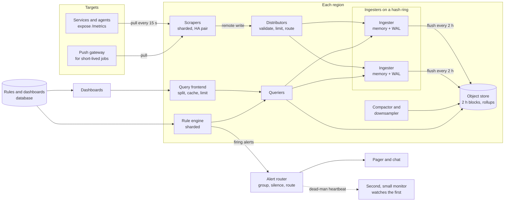
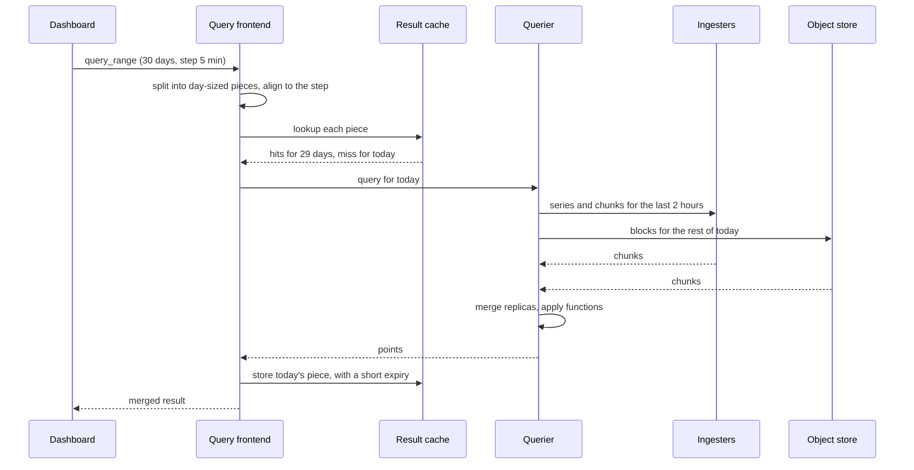

# Design a Metrics and Monitoring System

A metrics and monitoring system collects numbers from thousands of services and machines, stores them as time series, answers queries for dashboards, and sends an alert when a number shows a problem. This case study gives the design that a strong candidate presents in 45 minutes: collection with pull and push, time-series storage with the compression of the Gorilla paper, downsampling, the query path, and alerting. The page does not repeat what to measure in a service. That part is on [observability in system design](../fundamentals/20-observability-in-design.md), which covers the four golden signals, SLOs, and burn-rate alert rules. This page designs the system that carries those numbers. Follow the steps in [how to approach an HLD interview](../how-to-approach-hld.md). The estimation method is on [back-of-envelope estimation](../back-of-envelope-estimation.md).

!!! note "About the sources"
    Facebook published the design of Gorilla, its in-memory time-series database, in a VLDB 2015 paper. The Prometheus documentation describes a pull-based collector, a local time-series database, and the remote write protocol. This page combines both into one reference design. Each claim about Gorilla or Prometheus cites the paper or the documentation in "Further Reading". All inputs in the estimation are assumptions of this KB. The sizes of the components in the design are not the sizes of any real deployment.

## Problem Statement

"Design a monitoring system for a company with 100,000 service instances. Each instance exposes metrics such as request counts, latencies, and CPU use. Engineers build dashboards and write alert rules on these metrics. The system must show a new value within seconds, keep a year of history, and page the on-call engineer when a service fails. The monitoring system must keep working when the systems that it watches fail."

The key point of the problem: the monitoring system must be more reliable than the systems that it monitors. If the monitoring system fails in the same outage, nobody knows that a service is down. The Gorilla paper states the same priority. Its design stays available for writes and reads in the presence of failures, "at the expense of possibly dropping small amounts of data on the write path".

## Clarifying Questions

| Question | Answer that this design assumes |
|---|---|
| What is monitored? | 100,000 targets (service instances and machine agents). Each target exposes about 500 time series (Assumption) |
| Which signals? | Metrics only (numbers over time). Logs and traces are separate systems. See [observability in design](../fundamentals/20-observability-in-design.md) for how the three fit together |
| How often does the system sample? | Every 15 seconds. Some critical series use 5 seconds (Assumption) |
| How fresh must a value be? | A sample is visible to queries within 10 seconds after the target produced it. The first notification for a condition leaves the alert router within 90 seconds after the condition starts, not counting the `for` duration of the rule (Assumption) |
| How long is the history? | Raw samples for 15 days. Five-minute rollups for 90 days. One-hour rollups for 13 months (Assumption) |
| Who reads the data? | Engineers with dashboards (about 5,000 open dashboards at the peak of an incident) and the alert rule engine (20,000 rules, each evaluated every minute) (Assumption) |
| Which query features? | Selection by label, aggregation across series (sum, average, percentile estimate), rates of counters, and arithmetic between series. A query language such as PromQL (Assumption) |
| Multi-tenant? | Yes. Teams share the platform. A team must not break another team's dashboards (Assumption) |
| Multi-region? | Three regions. Each region monitors its own targets. A global dashboard reads from all regions (Assumption) |
| Consistency? | Eventual. A few lost samples are acceptable. A wrong alert is not (Assumption, from the Gorilla paper's priorities) |
| Exact or approximate? | Samples are exact at full resolution. Rollups and percentiles from histograms are approximate. Say so in the UI |
| Out of scope? | Log search, distributed tracing, anomaly detection by machine learning, and the instrumentation libraries |

## Requirements

### Functional

1. `collect`: the system gets samples from every target at its interval. A target that is down shows as down.
2. `store`: the system stores each sample with its labels and keeps it for the retention of its tier.
3. `query`: a user selects series by label and time range, applies functions, and receives points for a chart. A query for the last hour returns in under 1 second at p99.
4. `downsample`: the system reduces old data to coarser points to save space.
5. `alert`: the system evaluates rules every minute, sends notifications for firing alerts, groups related alerts, and lets users silence them.
6. `dashboard`: dashboards and rules are stored as configuration with a version history.

### Non-functional

| Requirement | Target |
|---|---|
| Ingest rate | 3.3 million samples each second on average (see Estimation) |
| Write availability | 99.99%. A failure of one node or one zone must not stop ingestion. The system may drop a few samples |
| Query latency | p99 below 1 second for a 1-hour range. Below 5 seconds for a 30-day range (Assumption) |
| Freshness | A sample is queryable within 10 seconds |
| Alert latency | The notification leaves the alert router within 90 seconds after the condition starts, not counting the `for` duration of the rule. See the time budget in Deep Dive 4 |
| Durability | Samples older than 2 hours survive the loss of a node. Samples in memory may be lost if all replicas fail at once |
| Retention | 15 days raw, 90 days at 5 minutes, 13 months at 1 hour |
| Isolation | One tenant's cardinality burst or heavy query does not slow other tenants |
| Independence | Alerting must run when the main platform is degraded. The monitoring system is monitored by a second, smaller system |

## Estimation

Rounding rule (the same as on the estimation page): one day is 10^5 seconds when a rate comes from a count per day. Here the sample rate comes from the scrape interval, so it is exact. The storage per day uses the exact day of 86,400 seconds.

Inputs (all are assumptions):

- 100,000 targets, each with 500 active series. A series is one metric name with one set of label values.
- Scrape interval 15 seconds.
- Raw size of one sample: 16 bytes (an 8-byte time stamp and an 8-byte value). The Gorilla paper uses the same 16 bytes.
- Compressed size: 1.5 bytes for each sample. The Gorilla paper reports an average of 1.37 bytes with two-hour blocks, and the Prometheus documentation says that it stores "an average of only 1-2 bytes per sample". The value 1.5 sits inside both ranges.
- Rollups store four values (minimum, maximum, sum, count) for each series in each interval, at 2 bytes for each value. A rollup value is less regular than a raw sample, so the assumption is higher than for raw data.
- Replication factor 2 for the stored data (the Gorilla paper runs two copies in different regions).
- One ingester (the node that receives samples and holds recent data) handles 300,000 samples each second. In memory, one active series costs 3 KB for labels, index, and the open chunk. Both numbers are assumptions that a load test must confirm.
- Remote write requests carry the full label set with samples. The Prometheus remote write specification (version 1.0) states that "the complete set of labels MUST be sent with each sample". After compression, the assumed average is 40 bytes for each sample on the wire.
- One scraper handles 2,000 targets. Each target group has an HA pair of two scrapers (Deep Dive 1). The distributor keeps the samples of one scraper of each pair and drops the other, so the ingesters see each sample once before replication.
- Each tier covers its whole retention, counted back from the present: the compactor writes the 5-minute and the 1-hour rollups for every block, so the tiers overlap. This makes the storage numbers an upper bound.
- Each alert rule reads 200 series over a 5-minute window. Each dashboard has 10 panels, refreshes every 30 seconds, and each panel reads 50 series over 1 hour.
- The cardinality accident: one team adds a label with 10 million user IDs to a histogram with 12 buckets.

| Step | Calculation | Result |
|---|---|---|
| Active series | 100,000 × 500 | 50 million |
| Samples each second | 50,000,000 / 15 s | 3.33 million |
| Samples each day | 3,333,333 × 86,400 s | 2.88 × 10^11 |
| Raw size each day | 2.88 × 10^11 × 16 B | 4.6 TB |
| Compressed size each day | 2.88 × 10^11 × 1.5 B | 432 GB |
| Ingest on the wire, one copy | 3,333,333 × 40 B | 133 MB/s, which is 1.07 Gbit/s for the fleet |
| Ingest on the wire, both scrapers of each HA pair send | 133 MB/s × 2, and / 3 regions | 267 MB/s, which is 2.13 Gbit/s for the fleet and about 0.71 Gbit/s for each region |
| Scrapers | 100,000 / 2,000 = 50 groups, × 2 for the HA pairs | 100, about 34 in each region |
| Samples into the distributors | 3,333,333 × 2 (both scrapers of each pair send) | 6.67 million/s, and 3.33 million/s after the distributor drops one copy |
| Tier 1: 15 days raw, 2 replicas | 432 GB × 15 × 2 | 13 TB |
| Rollup values each day, 5 minutes | 50 × 10^6 series × (86,400 / 300 = 288 intervals) × 4 values | 5.76 × 10^10 |
| Tier 2: 90 days, 2 replicas | 5.76 × 10^10 × 2 B × 90 × 2 | 20.7 TB |
| Rollup values each day, 1 hour | 50 × 10^6 × 24 × 4 | 4.8 × 10^9 |
| Tier 3: 395 days, 2 replicas | 4.8 × 10^9 × 2 B × 395 × 2 | 7.6 TB |
| Total with rollups | 13 + 20.7 + 7.6 | 41 TB |
| Raw only for 395 days, 2 replicas | 432 GB × 395 × 2 | 341 TB |
| Write load on ingesters | 3,333,333 (after the HA deduplication) × 2 replicas | 6.67 million samples/s |
| Ingesters by throughput | 6,666,667 / 300,000 | 23 |
| Ingesters with 2× headroom for catch-up after an outage | 6,666,667 × 2 / 300,000 = 44.4, rounded up | 45 |
| Memory for active series | 50 × 10^6 × 3 KB × 2 replicas | 300 GB, about 6.7 GB per ingester at 45 nodes |
| Rule evaluations each second | 20,000 / 60 s | 333 |
| Samples that rules read each second | 333 × 200 series × (300 s / 15 s = 20 samples) | 1.33 million |
| Dashboard queries each second | 5,000 dashboards × 10 panels / 30 s refresh | 1,667 |
| Samples that dashboards read each second | 1,667 × 50 series × (3,600 s / 15 s = 240 points) | 20 million |
| Cardinality accident | 10 million user IDs × 14 series for a histogram with 12 buckets, a sum, and a count | 140 million series, 2.8 times the whole fleet |
| Points of a 30-day chart at a 15 s step | 30 × 86,400 s / 15 s | 172,800 points for each series, above the limit of 11,000 points in the Prometheus API (see API Design) |
| Smallest step for a 30-day chart under that limit | 2,592,000 s / 11,000 | 236 s, so a 5-minute step |
| Fault to notification, worst case | 15 s scrape + 5 s ingest + 60 s evaluation + 30 s `group_wait` | 110 s, and 80 s with a 30 s evaluation (Deep Dive 4) |

What the numbers decide:

- **Writes dominate.** 3.3 million samples each second arrive (6.7 million before the HA deduplication), and the queries are only about 2,000 each second. The Gorilla paper says the same: the write rate may exceed tens of millions of points each second, and the read rate is "a couple orders of magnitude lower". So the design optimizes the write path first.
- **Compression decides the cost.** Without compression the data is 4.6 TB each day. With about 1.5 bytes each sample it is 432 GB. The next section shows how the paper gets there.
- **Rollups decide the retention.** Raw data for 13 months would be 341 TB. The three tiers need 41 TB, which is 8 times less.
- **Memory decides the shard count.** 300 GB of index and open chunks for active series do not fit on one machine. The series spread over ingesters.
- **Dashboards read more samples than the system ingests.** 20 million samples each second for 1,667 queries means that each query scans about 12,000 samples. A query frontend with a cache and recording rules (Deep Dive 3) is necessary at that load.
- **One label breaks the budget.** A single metric with a user ID label adds 2.8 times the fleet. Cardinality limits are a core feature of the design, not an option.
- **Sanity check against the paper.** Gorilla ingested about 12 million samples each second at Facebook in 2015 (700 million points each minute). The 3.3 million of this design is smaller by a factor of 3.6, and it is the same order of magnitude.

The two programs below check the arithmetic and the compression. Both have `main` first and their own imports, so you can copy them into a file and run `java File.java` on JDK 21. The first program checks the table.

```java
import java.util.Locale;

public class MetricsEstimate {
    public static void main(String[] args) {
        double targets = 100_000;
        double seriesPerTarget = 500;
        double interval = 15;
        double series = targets * seriesPerTarget;
        double samplesPerSecond = series / interval;
        double samplesPerDay = samplesPerSecond * 86_400;
        System.out.println(line("active series", series));
        System.out.println(line("samples per second", samplesPerSecond));
        System.out.println(line("samples per day (86,400 s)", samplesPerDay));
        System.out.println(line("raw TB per day at 16 B", samplesPerDay * 16 / 1e12));
        double compressedGbDay = samplesPerDay * 1.5 / 1e9;
        System.out.println(line("compressed GB per day at 1.5 B", compressedGbDay));
        System.out.println(line("wire MB/s at 40 B per sample", samplesPerSecond * 40 / 1e6));
        System.out.println(line("wire Gbit/s per region, both HA senders",
            samplesPerSecond * 2 * 40 * 8 / 1e9 / 3));
        System.out.println(line("scrapers (2,000 targets each, HA pairs)", targets / 2_000 * 2));

        double tier1Tb = compressedGbDay * 15 * 2 / 1e3;
        double rollupValues5m = series * (86_400 / 300.0) * 4;
        double tier2Tb = rollupValues5m * 2 * 90 * 2 / 1e12;
        double rollupValues1h = series * 24 * 4;
        double tier3Tb = rollupValues1h * 2 * 395 * 2 / 1e12;
        System.out.println(line("tier 1 TB (15 d raw, 2 replicas)", tier1Tb));
        System.out.println(line("tier 2 TB (5 min, 90 d, 2 replicas)", tier2Tb));
        System.out.println(line("tier 3 TB (1 h, 395 d, 2 replicas)", tier3Tb));
        System.out.println(line("total TB", tier1Tb + tier2Tb + tier3Tb));
        System.out.println(line("raw 395 d without rollups TB (2 replicas)",
            compressedGbDay * 395 * 2 / 1e3));

        double writes = samplesPerSecond * 2;
        System.out.println(line("ingester writes per second (2 replicas)", writes));
        System.out.println(line("ingesters at 300,000 samples/s", Math.ceil(writes / 300_000)));
        System.out.println(line("ingesters with 2x catch-up headroom",
            Math.ceil(writes * 2 / 300_000)));
        System.out.println(line("head memory GB (3 KB x 2 replicas)", series * 3_000 * 2 / 1e9));

        double ruleQueries = 20_000 / 60.0;
        double ruleSamples = ruleQueries * 200 * (300 / interval);
        double dashQueries = 5_000 * 10 / 30.0;
        double dashSamples = dashQueries * 50 * (3600 / interval);
        System.out.println(line("rule evaluations per second", ruleQueries));
        System.out.println(line("samples read by rules per second", ruleSamples));
        System.out.println(line("dashboard queries per second", dashQueries));
        System.out.println(line("samples read by dashboards per second", dashSamples));

        double userSeries = 10_000_000.0 * 14;
        System.out.println(line("series from a user_id label on a histogram", userSeries));
        System.out.println(line("as a share of the fleet", userSeries / series));
        double thirtyDays = 30 * 86_400;
        System.out.println(line("points of a 30-day chart at a 15 s step", thirtyDays / interval));
        System.out.println(line("smallest 30-day step under 11,000 points (s)",
            thirtyDays / 11_000));
        double groupWait = 30;
        System.out.println(line("fault to notification, 60 s evaluation (s)",
            interval + 5 + 60 + groupWait));
        System.out.println(line("fault to notification, 30 s evaluation (s)",
            interval + 5 + 30 + groupWait));
    }

    static String line(String name, double value) {
        return String.format(Locale.ROOT, "%-45s %,.2f", name, value);
    }
}
```

<!-- expected-output -->

```text
active series                                 50,000,000.00
samples per second                            3,333,333.33
samples per day (86,400 s)                    288,000,000,000.00
raw TB per day at 16 B                        4.61
compressed GB per day at 1.5 B                432.00
wire MB/s at 40 B per sample                  133.33
wire Gbit/s per region, both HA senders       0.71
scrapers (2,000 targets each, HA pairs)       100.00
tier 1 TB (15 d raw, 2 replicas)              12.96
tier 2 TB (5 min, 90 d, 2 replicas)           20.74
tier 3 TB (1 h, 395 d, 2 replicas)            7.58
total TB                                      41.28
raw 395 d without rollups TB (2 replicas)     341.28
ingester writes per second (2 replicas)       6,666,666.67
ingesters at 300,000 samples/s                23.00
ingesters with 2x catch-up headroom           45.00
head memory GB (3 KB x 2 replicas)            300.00
rule evaluations per second                   333.33
samples read by rules per second              1,333,333.33
dashboard queries per second                  1,666.67
samples read by dashboards per second         20,000,000.00
series from a user_id label on a histogram    140,000,000.00
as a share of the fleet                       2.80
points of a 30-day chart at a 15 s step       172,800.00
smallest 30-day step under 11,000 points (s)  235.64
fault to notification, 60 s evaluation (s)    110.00
fault to notification, 30 s evaluation (s)    80.00
```

## API Design

The system has four interfaces: the one that targets expose, the one that collectors use to write, the one that users use to query, and the one that manages rules. The names follow the Prometheus HTTP API and the remote write specification, which are the de facto standard.

| Method and path | Request | Response |
|---|---|---|
| `GET /metrics` (on each target) | none | `200` with text in the exposition format: lines such as `http_requests_total{route="/orders",status="200"} 1027`. The target serves the current values of its counters, gauges, and histogram buckets |
| `POST /api/v1/write` (remote write) | Body: a snappy-compressed protobuf message with series, each with its full label set and samples. Headers: `Content-Encoding: snappy`, `Content-Type: application/x-protobuf`, and a version header | A `2xx` code on success (the specification requires `2xx`). `400` for a request with invalid samples. `429` or `5xx` if the receiver is overloaded or failed. The sender retries on `5xx` with backoff and does not retry on other `4xx` codes |
| `GET /api/v1/query?query=<expr>&time=<t>` | An expression, and an evaluation time | `200 {status, data: {resultType: "vector", result: [{metric, value}]}}`. One value for each matching series at one instant |
| `GET /api/v1/query_range?query=<expr>&start=&end=&step=` | An expression, a time range, and a step in seconds | `200` with a `matrix`: for each series, a list of `[time, value]` points at the step interval |
| `GET /api/v1/series?match[]=<selector>` and `GET /api/v1/label/<name>/values` | Selectors | The series that match, and the values of a label. Dashboards use them for variable drop-downs |
| `PUT /v1/rules/{tenant}/{group}` | A group of alert and recording rules as YAML, each with `expr`, `for`, `labels`, `annotations` | `200`. Validated before it is stored. Versioned |
| `POST /api/v2/alerts` (to the alert router) | A list of alerts with labels, annotations, and start and end times | `200`. The rule engine sends the firing alerts and repeats them while they fire |
| `POST /v1/silences` | Matchers, a start and end time, a comment, an author | `200 {silence_id}`. Alerts that match are not notified until the end time |

Notes:

- The Prometheus remote write specification states that senders MUST send the samples of one series in time-stamp order, and MAY send requests for different series in parallel. It also states that senders MUST retry `5xx` responses with a backoff algorithm and MUST NOT retry `2xx` and `4xx` responses (except `429`, which they MAY retry).
- Query results are bounded: a maximum number of series, a maximum number of points for each series, and a timeout. The tenant gets an error, not a slow system. Prometheus itself rejects a `query_range` call when `(end - start) / step` is above 11,000 points for each series, with the error "exceeded maximum resolution of 11,000 points per timeseries" (source file `web/api/v1/api.go`, branch `main`, checked 2026-10-15). A comment in that file says that 11,000 points are enough for a 60 s resolution over a week or a 1 h resolution over a year. A 30-day chart at a 15 s step needs 172,800 points. If this design applies the same limit to the merged result of a query (the query frontend checks it before it splits the query by day), the dashboard must use a step of at least 236 s. The next standard step above 236 s is 5 minutes.
- Every write carries a tenant ID in a header. The gateway authenticates the tenant and applies its limits.

## Data Model

### Concepts

A **time series** is a sequence of samples that has one identity: a metric name and a set of label pairs, for example `http_requests_total{route="/orders", status="500", instance="10.0.0.7:8080"}`. A **sample** is a pair of a time stamp and a value (a 64-bit float). The label set is the identity: a different value for one label is a different series. A **target** is a process that exposes metrics. **Cardinality** is the number of series (see [observability in design](../fundamentals/20-observability-in-design.md)).

### Where each kind of data lives

| Data | Store | Why |
|---|---|---|
| Recent samples (the last 2 hours) | The memory of ingesters, protected by a write-ahead log (WAL) on local disk | Newest data has the highest value and the highest read rate. The Gorilla paper found that at least 85% of queries to its older system asked for data from the last 26 hours |
| Older samples | Immutable blocks of 2 hours in an object store, compacted into larger blocks | Cheap, durable, and the data does not change. See [storage types](../fundamentals/10-storage-types.md) |
| The series index | An inverted index inside each block (label pair to a sorted list of series IDs), and the same structure in memory for the open block | A query selects series by label. Intersecting sorted lists of IDs is fast |
| Rollups (5 minutes, 1 hour) | Blocks in the object store, written by the compactor | Same format as raw blocks, with fewer points |
| Rules, dashboards, alert routing | A relational database, with the source of truth in a Git repository | Small, relational, needs versions and review. See [choosing a database](../fundamentals/04-choosing-a-database.md) |
| Alert state and silences | The rule engine's memory, plus a replicated state in the alert router | Small and short-lived. The Alertmanager nodes replicate silences and the notification log (the record of sent notifications) to their peers by gossip (Deep Dive 4) |

### Series identity and the inverted index

Each ingester assigns a numeric **series ID** to each label set the first time it sees it. The ingester keeps a map from the label set to the series ID, and for each series an open chunk of compressed samples. For each label pair (`route="/orders"`) it keeps a **postings list**: the sorted IDs of the series that have that pair. The query `http_requests_total{route="/orders", status=~"5.."}` finds the postings of `__name__="http_requests_total"`, of `route="/orders"`, and of every `status` value that matches the regular expression (union), then intersects the lists. Prometheus uses this structure. The author of its TSDB describes it in "Writing a Time Series Database from Scratch" (2017).

### Block layout

```text
block (2 hours of data, immutable once closed)
  meta.json            time range, number of series and samples, compaction level
  index                label pairs -> postings, series -> chunk references
  chunks/000001        compressed sample chunks (delta-of-delta, XOR) for many series
  tombstones           deletions that are applied at the next compaction
```

The Prometheus documentation describes the same layout: samples are grouped in two-hour blocks, each block is a directory with chunks, an index, and metadata, and the current block is in memory with a WAL for crash safety.

### Database choice

A general database does not fit this workload. The Gorilla paper reports that Facebook's earlier system, a time-series store on HBase, could not scale to the read load: the 90th percentile query time rose to multiple seconds, and interactive queries on a few thousand series took tens of seconds. A relational database cannot take 3.3 million writes each second with an index on every label. A wide-column store takes the writes but has no label index and no compression of regular time stamps and floats.

The design uses a purpose-built time-series engine. Its properties follow from the workload:

- **Append-only writes in time order.** Each series receives one sample every 15 seconds. The open chunk is an append-only byte string.
- **Immutable closed blocks.** Compaction and downsampling write new blocks. Nothing updates in place. This suits an object store and replication by copy.
- **Compression that uses the regularity of the data.** Time stamps arrive at fixed intervals. Neighboring values are close.
- **A label index kept apart from the samples.** The query first finds the series, then reads their chunks.

## High-Level Design



### Components

| Component | Responsibility | Notes |
|---|---|---|
| Targets | Expose the current values of their metrics over HTTP | A client library keeps counters and histograms in memory, and the endpoint renders them. The target does not know who reads it |
| Scrapers | Discover targets (from a service registry or Kubernetes), pull each target every 15 seconds, attach labels, and send the samples by remote write | A scraper is stateless apart from a small queue. Targets are split among scrapers by a hash of the target address. Two scrapers form an HA pair for the same targets |
| Push gateway | Accepts pushes from short-lived batch jobs and exposes them for scraping | Only for jobs that end before a scrape. See Deep Dive 1 |
| Distributors | Authenticate the tenant, validate labels, apply limits, and send each series to its ingesters | Stateless. Place a series by a hash of its label set on the ring and write to two ingesters |
| Ingesters | Hold the open block of each series in memory, write each sample to a WAL, serve recent queries, and flush a block to the object store every 2 hours | Stateful. They own ranges of a hash ring ([partitioning and sharding](../fundamentals/06-partitioning-and-sharding.md)) |
| Object store | Holds closed blocks | Durable and cheap. The store-side index lets a querier load only the needed parts |
| Compactor and downsampler | Merge small blocks into larger ones, remove duplicate samples from replicas, and write the 5-minute and 1-hour rollups | A batch job over closed blocks. The path from the scraper to the rule engine is the continuous (stream) part of the system ([batch and stream processing](../fundamentals/17-batch-and-stream-processing.md)) |
| Query frontend | Splits a long range query into day-sized pieces, caches the results, limits the cost, and queues queries by tenant | Protects the queriers. See Deep Dive 3 |
| Queriers | Run the query: find series in the index, read chunks from ingesters and from the object store, merge replicas, and compute the functions | Stateless and scalable |
| Rule engine | Evaluates alert and recording rules every minute against the queriers | Sharded by rule group. Each shard runs as an HA pair, and both members send their alerts to every alert router node. The alert router removes the duplicates |
| Alert router | Groups alerts, deduplicates, silences, inhibits, and routes to a receiver (pager, chat, email) | Runs as a cluster of a few nodes. See Deep Dive 4 |
| Rules and dashboards database | Holds the configuration | Small. A relational database with the source in Git |
| Second monitor | A separate, small system in another failure domain that watches the platform and receives a heartbeat from the alert router | Detects a dead monitoring system |

### The life of a sample

1. The scraper requests `/metrics` from a target. The target answers with the current values.
2. The scraper attaches the target's labels (`job`, `instance`, region) and the scrape time stamp, and puts the samples into a queue.
3. The scraper sends batches by remote write to a distributor in its region. If the call fails with `5xx`, the scraper retries with backoff and keeps the queue in memory and on disk for a limited time.
4. The distributor checks the tenant's limits (series count, samples per second, label length). It hashes each series and sends it to two ingesters.
5. Each ingester appends the sample to the WAL, appends it to the open chunk of the series, and acknowledges. The write succeeds when one of the two ingesters acknowledges (see the trade-offs).
6. Every 2 hours, each ingester closes its block, writes it to the object store, writes a checkpoint, and deletes the old WAL.
7. The compactor merges the blocks of the two replicas, drops the duplicate samples, and later writes the rollups.

### The life of an alert

1. The rule engine runs `sum(rate(http_requests_total{status=~"5.."}[5m])) / sum(rate(http_requests_total[5m])) > 0.05` every minute through a querier.
2. The first evaluation with a result puts the alert in the *pending* state. If the condition holds for the `for` duration (for example 5 minutes), the alert becomes *firing*.
3. The rule engine sends the firing alert to the alert router, and repeats it every minute while it fires.
4. The router groups alerts with the same `cluster` and `alertname`, waits a short time to collect more, and sends one notification to the pager.
5. When the condition ends, the rule engine marks the alert resolved, and the router sends the resolution.

## Deep Dives

### Deep Dive 1: Collection, pull and push

**The two models.** In the pull model, the collector asks each target for its current values on a schedule. In the push model, each target sends its values to the collector. The Prometheus documentation chooses pull and lists the reasons in its FAQ: you can start extra monitoring instances as needed (for example on a laptop), you can more easily and reliably tell if a target is down, and you can go to a target and inspect its health with a browser. The FAQ also states: "Overall, we believe that pulling is slightly better than pushing, but it should not be considered a major point when considering a monitoring system."

| Aspect | Pull | Push |
|---|---|---|
| Who starts the connection | The collector | The target |
| Detecting a dead target | The failed scrape is the signal. The collector records `up = 0` for the target | Silence is ambiguous. A dead target and a broken network look the same. The collector needs a timeout rule |
| Discovery | The collector needs a list of targets (service discovery) | The target needs the address of the collector. No target list is needed |
| Firewalls and NAT | The collector must reach the targets. Hard across networks and for devices behind NAT | The target makes an outbound connection. Works through NAT |
| Short-lived jobs | A job can end before the scrape. Needs an intermediary | Natural: the job pushes before it exits |
| Load control | The collector decides the rate. A slow scrape is skipped. It cannot be overloaded by targets | Targets decide the rate. A deployment of 10,000 targets that restart together creates a burst |
| Time stamps | The collector gives the sample the scrape time. Clocks of targets do not matter | The target sets the time. Clock errors enter the data |
| Debugging | Open `/metrics` in a browser | Needs a log of what the target sent |
| Multi-tenant SaaS | Hard. The vendor cannot reach customer networks | Natural |
| Example | Prometheus | StatsD, Graphite, OpenTelemetry exporters, vendor agents |

**Recommendation:** pull for long-running services in networks that you control, because the `up` signal and the control of load matter most. Push for short-lived jobs (through a push gateway), for devices behind NAT, and for tenants that you cannot reach. The Prometheus Pushgateway documentation says that it exists for "short-lived service-level batch jobs". An interview answer that says "pull is always better" or "push is always better" loses points. Name the conditions.

**Service discovery.** A target list in a file does not work for 100,000 instances that start and stop all day. The scraper reads the list from a registry (a service registry, the Kubernetes API, a cloud API) and refreshes it. A new instance is scraped at the next interval. Each target carries labels from the registry (service, version, zone) that the scraper adds to every sample.

**Scale the collectors.** One scraper cannot pull 100,000 targets in 15 seconds with 500 series each. Assumption: one scraper handles 2,000 targets. Then 100,000 targets need 50 target groups. Split the targets with a hash of the target address, and reassign when a scraper dies. To avoid a gap, run two scrapers for each target group (an **HA pair**). That makes 100 scrapers, about 34 in each of three regions. Both scrapers of a pair scrape and send, so the distributors receive every sample twice (6.67 million samples each second). The platform removes the duplicates in one of two places: the distributor keeps the samples of one sender of the pair and drops the other (it switches to the second sender if the first stops), or the compactor and the querier merge identical series and drop equal time stamps. The estimation assumes the first option. With the second option, the ingesters receive 13.3 million samples each second (two senders × two replicas), and the ingester count doubles. Compare this with the two replicas of the ingesters: they both exist to survive a failure, and the platform pays double write cost for the safety.

**Staleness.** When a target stops, the last value must not look current forever. The scraper marks a series *stale* when a target disappears or stops exposing it. A query then ignores the series after the marker. Without this, a chart shows a flat line for a dead host.

**Buffering and backpressure.** The path from the scraper to the ingester must absorb short outages without loss and without slowing the targets. Each scraper keeps a bounded queue. If the platform returns `5xx`, the scraper retries with backoff, as the remote write specification requires. If the queue is full, the scraper drops the oldest samples and counts the drops in a metric. Data loss is bounded and visible. The Gorilla paper takes the same stance: it accepts dropping small amounts of data to stay available for writes. After an outage, the senders send their backlog, and the ingesters need the 2× headroom in the estimation to absorb it.

**Agent mode.** In a design with an agent on each region or each cluster, the agent scrapes locally and forwards by remote write without storing data locally. Prometheus has an agent mode for this. The advantage: the targets in a cluster are scraped over the local network, and only the compressed stream crosses the region boundary.

### Deep Dive 2: Time-series storage and compression

This part answers "how do you store 288 billion samples a day?" The answer is the Gorilla paper (Pelkonen et al., VLDB 2015).

**The Gorilla context.** Facebook had 2 billion unique time series and about 12 million points added each second in spring 2015. The paper states that at 16 bytes for each point, its more than 1 trillion points each day would need 16 TB of RAM, which is too much for practical deployment. The paper compresses a series to an average of 1.37 bytes for each point, which is a 12× reduction, and keeps the last 26 hours in memory. Gorilla is a write-through cache in front of a disk-based store (HBase). The paper reports 73× lower query latency and 14× higher query throughput than the HBase-backed system, and a size reduction of 10× in the abstract.

**Timestamps: delta of delta.** Samples arrive at fixed intervals. The delta is the difference between two neighboring time stamps. The **delta of delta** is the difference between neighboring deltas. For a series with a 15-second interval, the deltas are 15, 15, 15, and the deltas of deltas are 0, 0. The paper encodes the delta of delta with a variable-length code. The block header stores the start of the block, t(-1), aligned to a two-hour window. The encoder stores the first time stamp, t0, as a 14-bit delta from t(-1). A footnote of the paper explains the size: 14 bits span 16,384 seconds, a bit more than 4 hours. Every later time stamp t(n), from t1 on, is stored as the delta of delta D = (t(n) - t(n-1)) - (t(n-1) - t(n-2)). For t1, the previous delta is the 14-bit delta t0 - t(-1). The code for D:

| Delta of delta `D` | Bits stored |
|---|---|
| 0 | `0` (1 bit) |
| -63 to 64 | `10` and 7 bits of the value (9 bits) |
| -255 to 256 | `110` and 9 bits (12 bits) |
| -2047 to 2048 | `1110` and 12 bits (16 bits) |
| anything else | `1111` and 32 bits (36 bits) |

The paper reports that about 96% of the time stamps compress to a single bit. An example from the paper: the deltas 60, 60, 121, 59 give deltas of deltas 0, 61, -62. Both 61 and -62 fit in the smallest non-zero range (9 bits each), so one missing sample costs 18 bits, and the series then returns to 1-bit samples.

**Prometheus departs from the paper.** The Prometheus chunk encoder (`tsdb/chunkenc/xor.go`) stores the first time stamp of a chunk as a varint, and the second as a plain delta in an unsigned varint. It starts the delta of delta at the third sample. Prometheus time stamps are in milliseconds, not seconds, so the encoder uses wider ranges: 14, 17, and 20 bits after the prefixes `10`, `110`, and `1110`, and 64 bits after `1111`. A comment in the source states the reason: "Gorilla has a max resolution of seconds, Prometheus milliseconds." The value encoding (XOR) follows the paper, and it caps the count of leading zeros at 31 so that the count fits in 5 bits. The program below does the same for the values, and it follows the paper, not Prometheus, for the time stamps.

**Values: XOR with the previous value.** The paper observes that the value of most series does not change much between neighboring points, and many sources store integers. If two floating-point numbers are close, their sign, exponent, and first mantissa bits are the same. The XOR of the two 64-bit patterns then has many leading zeros and trailing zeros. The encoding:

1. The first value of a block is stored uncompressed (64 bits).
2. If the XOR with the previous value is 0, store a single `0` bit.
3. Otherwise store a `1` bit, then:
    - control bit `0`: the meaningful bits lie inside the window of the previous value (at least as many leading zeros and as many trailing zeros). Store only the meaningful bits.
    - control bit `1`: store the number of leading zeros in 5 bits, the length of the meaningful bits in 6 bits, and then the meaningful bits.

The paper reports that about 51% of the values compress to one bit (equal to the previous value), about 30% use the control bits `10` with an average of 26.6 bits, and about 19% use `11` with an average of 36.9 bits. Integer values compress well, because the one bits after the XOR sit in the same place in the whole series.

**Worked example from the paper (Figure 2).** The time stamps are 02:00:00 (block start), 02:01:02, and 02:02:02, so the deltas are 62 and 60, and the delta of delta is -2. It costs 9 bits: `10` and 7 bits. The values are 12.0 and 24.0. Their bit patterns are `0x4028000000000000` and `0x4038000000000000`, and the XOR is `0x0010000000000000`. It has 11 leading zeros and one meaningful bit. It costs 14 bits: the `1` for a non-zero XOR, the control bit `1`, 5 bits for 11, 6 bits for the length 1, and the one bit. The program below reproduces both numbers.

**Block size.** The paper compresses in blocks of two hours. A longer block gives a better ratio, but a short query must decode more data. The paper reports that blocks longer than two hours give "diminishing returns", and a two-hour block achieves 1.37 bytes for each point. A closed block never changes. Prometheus uses the same two hours for its blocks.

**Memory layout and failure handling in Gorilla.** Each series has a sequence of closed blocks and one open block, an append-only string. A host owns many shards. A shard maps series names to series. The paper stores each series on one host and writes it to two hosts in different regions, and it does not try to make the two copies consistent. The query goes to the nearest available instance, and if that fails, to the other region. Persistence uses a log (buffered up to 64 KB, about one or two seconds of data), a block file every two hours, and a checkpoint file. The paper states that the log is not a write-ahead log in the database sense: "a crash might result in the loss of small amounts of data". At launch, Gorilla held the 26 hours of data in 1.3 TB of RAM on 20 machines. The data grew, and the clusters doubled twice, to 80 machines in each cluster.

**What this design takes from Gorilla.** (1) Compress in streaming form with delta-of-delta time stamps and XOR values. (2) Keep the newest two hours in memory, in an append-only chunk for each series. (3) Write to two ingesters and accept that a crash can lose the last seconds. (4) Close a block every two hours, make it immutable, and move it to cheaper storage. (5) Treat monitoring data as less critical than user data: no ACID, availability first.

**What this design changes.** Gorilla identifies a series by a single string key and leaves the label model to higher-level tools. This design uses labels and an inverted index, as OpenTSDB and Prometheus do. The Gorilla paper notes that OpenTSDB has "a richer data model" with tags. Gorilla keeps 26 hours in memory. This design keeps 2 hours in memory and uses an object store for the rest, because 13 months of data would not fit in memory: Gorilla's own HBase tier stored the long-term data. The paper also notes that ODS rolls up old data to a coarser resolution to save space.

The program below implements the two encoders of the paper, as Section 4.1 describes them, writes a block of two hours (480 samples at 15 seconds), decodes it, and checks that the result is identical. It prints the cost in bits for three kinds of series. The data come from a generator with a fixed seed, so the output is the same on each run. The numbers are not the numbers of the paper: they show how the cost depends on the shape of the data.

```java
import java.util.Random;

public class GorillaCodec {
    public static void main(String[] args) {
        paperExample();
        series("steady gauge (same value)", 15, 0.0, 0);
        series("integer counter (requests_total)", 15, 0.02, 1);
        series("noisy gauge (cpu ratio)", 15, 0.02, 2);
    }

    // The example of Figure 2 in the paper: the delta of deltas is -2, and 12.0 -> 24.0.
    static void paperExample() {
        BitWriter w = new BitWriter();
        long[] ts = {0, 62, 122, 182}; // block start t(-1), then t0, t1, t2: deltas 62, 60, 60
        long delta = ts[1] - ts[0];
        long dod = (ts[2] - ts[1]) - delta;
        int before = w.bits();
        writeDod(w, dod);
        System.out.println("delta of delta " + dod + " costs " + (w.bits() - before) + " bits");
        long xor = Double.doubleToRawLongBits(12.0) ^ Double.doubleToRawLongBits(24.0);
        System.out.println("xor of 12.0 and 24.0 = 0x" + Long.toHexString(xor)
            + ", leading zeros " + Long.numberOfLeadingZeros(xor)
            + ", meaningful bits " + (64 - Long.numberOfLeadingZeros(xor)
                - Long.numberOfTrailingZeros(xor)));
        ValueEncoder ve = new ValueEncoder(w);
        ve.write(12.0);
        before = w.bits();
        ve.write(24.0);
        System.out.println("the value 24.0 after 12.0 costs " + (w.bits() - before) + " bits");
    }

    static void series(String name, int interval, double jitterRate, int kind) {
        int n = 480; // two hours at 15 s
        Random rnd = new Random(42);
        long[] ts = new long[n];
        double[] vs = new double[n];
        long t = 1_700_000_000L - (1_700_000_000L % 7200);
        long counter = 1_000_000;
        for (int i = 0; i < n; i++) {
            ts[i] = t;
            if (kind == 0) {
                vs[i] = 42.0;
            } else if (kind == 1) {
                counter += rnd.nextInt(8) == 0 ? 0 : 1 + rnd.nextInt(40);
                vs[i] = counter;
            } else {
                vs[i] = Math.round(rnd.nextDouble() * 10000) / 10000.0;
            }
            long step = interval;
            if (rnd.nextDouble() < jitterRate) {
                step += rnd.nextBoolean() ? 1 : -1;
            }
            t += step;
        }
        long blockStart = ts[0] - (ts[0] % 7200);
        BitWriter tw = new BitWriter();
        BitWriter vw = new BitWriter();
        encodeTimes(tw, blockStart, ts);
        ValueEncoder ve = new ValueEncoder(vw);
        for (double v : vs) {
            ve.write(v);
        }
        long[] backT = decodeTimes(new BitReader(tw.toBytes()), blockStart, n);
        double[] backV = decodeValues(new BitReader(vw.toBytes()), n);
        boolean ok = true;
        for (int i = 0; i < n; i++) {
            ok &= backT[i] == ts[i] && Double.doubleToRawLongBits(backV[i])
                == Double.doubleToRawLongBits(vs[i]);
        }
        double tb = tw.bits() / (double) n;
        double vb = vw.bits() / (double) n;
        System.out.println(name + ": roundtrip " + (ok ? "ok" : "FAILED"));
        System.out.printf("  time stamps %.2f bits, values %.2f bits, total %.2f bytes (raw 16)%n",
            tb, vb, (tw.bits() + vw.bits()) / 8.0 / n);
    }

    // ---- time stamps: delta of delta with the four ranges of the paper ----
    static void writeDod(BitWriter w, long d) {
        if (d == 0) {
            w.write(0, 1);
        } else if (d >= -63 && d <= 64) {
            w.write(0b10, 2);
            w.write(d & 0x7F, 7);
        } else if (d >= -255 && d <= 256) {
            w.write(0b110, 3);
            w.write(d & 0x1FF, 9);
        } else if (d >= -2047 && d <= 2048) {
            w.write(0b1110, 4);
            w.write(d & 0xFFF, 12);
        } else {
            w.write(0b1111, 4);
            w.write(d & 0xFFFFFFFFL, 32);
        }
    }

    // As in the paper: the header holds the block start t(-1), the first time stamp is a
    // 14-bit delta from it, and every later time stamp is a delta of delta.
    static void encodeTimes(BitWriter w, long blockStart, long[] ts) {
        long prevDelta = ts[0] - blockStart;
        w.write(prevDelta, 14);
        for (int i = 1; i < ts.length; i++) {
            long delta = ts[i] - ts[i - 1];
            writeDod(w, delta - prevDelta);
            prevDelta = delta;
        }
    }

    static long signed(long v, int bits) {
        return v > (1L << (bits - 1)) ? v - (1L << bits) : v; // range [-(2^(b-1)-1), 2^(b-1)]
    }

    static long[] decodeTimes(BitReader r, long blockStart, int n) {
        long[] ts = new long[n];
        long prevDelta = r.read(14);
        ts[0] = blockStart + prevDelta;
        for (int i = 1; i < n; i++) {
            long dod;
            if (r.read(1) == 0) {
                dod = 0;
            } else if (r.read(1) == 0) {
                dod = signed(r.read(7), 7);
            } else if (r.read(1) == 0) {
                dod = signed(r.read(9), 9);
            } else if (r.read(1) == 0) {
                dod = signed(r.read(12), 12);
            } else {
                dod = (int) r.read(32);
            }
            long delta = prevDelta + dod;
            ts[i] = ts[i - 1] + delta;
            prevDelta = delta;
        }
        return ts;
    }

    // ---- values: XOR with the previous value ----
    static class ValueEncoder {
        final BitWriter w;
        long prev;
        int prevLead = -1;
        int prevTrail;
        boolean first = true;

        ValueEncoder(BitWriter w) {
            this.w = w;
        }

        void write(double value) {
            long bits = Double.doubleToRawLongBits(value);
            if (first) {
                w.write(bits, 64);
                first = false;
                prev = bits;
                return;
            }
            long x = bits ^ prev;
            prev = bits;
            if (x == 0) {
                w.write(0, 1);
                return;
            }
            w.write(1, 1);
            int lead = Math.min(Long.numberOfLeadingZeros(x), 31);
            int trail = Long.numberOfTrailingZeros(x);
            if (prevLead >= 0 && lead >= prevLead && trail >= prevTrail) {
                w.write(0, 1); // reuse the previous window
                w.write(x >>> prevTrail, 64 - prevLead - prevTrail);
            } else {
                int sig = 64 - lead - trail;
                w.write(1, 1);
                w.write(lead, 5);
                w.write(sig & 63, 6); // 64 meaningful bits are stored as 0
                w.write(x >>> trail, sig);
                prevLead = lead;
                prevTrail = trail;
            }
        }
    }

    static double[] decodeValues(BitReader r, int n) {
        double[] out = new double[n];
        long prev = r.read(64);
        out[0] = Double.longBitsToDouble(prev);
        int lead = 0;
        int trail = 0;
        for (int i = 1; i < n; i++) {
            if (r.read(1) == 0) {
                out[i] = Double.longBitsToDouble(prev);
                continue;
            }
            if (r.read(1) == 1) {
                lead = (int) r.read(5);
                int sig = (int) r.read(6);
                if (sig == 0) {
                    sig = 64;
                }
                trail = 64 - lead - sig;
            }
            long x = r.read(64 - lead - trail) << trail;
            prev ^= x;
            out[i] = Double.longBitsToDouble(prev);
        }
        return out;
    }

    // ---- a minimal bit stream ----
    static class BitWriter {
        private byte[] buf = new byte[64];
        private int bits;

        int bits() {
            return bits;
        }

        void write(long value, int count) {
            for (int i = count - 1; i >= 0; i--) {
                if (bits / 8 == buf.length) {
                    buf = java.util.Arrays.copyOf(buf, buf.length * 2);
                }
                if (((value >>> i) & 1) != 0) {
                    buf[bits / 8] |= (byte) (0x80 >>> (bits % 8));
                }
                bits++;
            }
        }

        byte[] toBytes() {
            return java.util.Arrays.copyOf(buf, (bits + 7) / 8);
        }
    }

    static class BitReader {
        private final byte[] buf;
        private int pos;

        BitReader(byte[] buf) {
            this.buf = buf;
        }

        long read(int count) {
            long v = 0;
            for (int i = 0; i < count; i++) {
                v = (v << 1) | ((buf[pos / 8] >>> (7 - pos % 8)) & 1);
                pos++;
            }
            return v;
        }
    }
}
```

<!-- expected-output -->

```text
delta of delta -2 costs 9 bits
xor of 12.0 and 24.0 = 0x10000000000000, leading zeros 11, meaningful bits 1
the value 24.0 after 12.0 costs 14 bits
steady gauge (same value): roundtrip ok
  time stamps 1.04 bits, values 1.13 bits, total 0.27 bytes (raw 16)
integer counter (requests_total): roundtrip ok
  time stamps 1.38 bits, values 12.73 bits, total 1.76 bytes (raw 16)
noisy gauge (cpu ratio): roundtrip ok
  time stamps 1.24 bits, values 57.62 bits, total 7.36 bytes (raw 16)
```

Read the output. The steady gauge costs about one bit for the time stamp and one bit for the value. The integer counter costs about 12.7 bits for the value, because the increments vary, and the XOR of two close integers has a few meaningful bits. The noisy gauge, with random four-digit decimals, costs about 58 bits for the value: the XOR has no pattern, so compression gains little. This is why monitoring systems store counters and gauges with limited precision, and why a metric that holds a random float is expensive. The time stamps stay near one bit in all three cases, because the interval is regular.

### Deep Dive 3: Cardinality, downsampling, and the query path

**Cardinality.** The cost of a metric is the number of its series, not the number of its samples. Each series needs an entry in the index, an open chunk in memory, and a postings entry for each label pair. The Prometheus instrumentation guidelines say: "try to keep the cardinality of your metrics below 10", and "if you have a metric that has a cardinality over 100 or the potential to grow that large, investigate alternate solutions". The estimation shows the failure: a histogram with a `user_id` label creates 140 million series, which is 2.8 times the whole fleet. The defenses, from cheapest to most complete:

1. **Review in code.** Labels have bounded values: route template (`/orders/{id}`), not the URL; status class; region. User IDs, request IDs, and e-mail addresses belong to logs and traces (see [observability in design](../fundamentals/20-observability-in-design.md)).
2. **Limits at the distributor.** Each tenant has a maximum number of active series, a maximum number of labels for each series, and a maximum label length. The distributor rejects a write that would pass the limit and returns an error that names the metric. The tenant sees the rejection in its own metrics, and other tenants are not affected.
3. **Detection.** A job counts series for each metric name and each tenant, and alerts when the count grows faster than a threshold. A dashboard of "top metrics by series" finds the offender.
4. **Drop at the scraper.** A relabeling rule removes a label or a whole metric before the data leaves the collector.
5. **Churn awareness.** A new pod name or version label makes new series for the same metric on each deployment. The old series become inactive but stay in the index until their block ends. A rolling deployment of 100,000 targets with a new `pod` label each time creates 50 million new series within hours. Prefer stable labels, and use the `version` label only where you need to compare versions.

**Histograms and percentiles.** A percentile that each instance computes cannot be averaged across instances. The Prometheus documentation on histograms and summaries says that you cannot aggregate summary quantiles, for example to compute a 90th percentile over several instances, and that histograms can be aggregated and allow any quantile to be calculated later. So services expose a histogram, with a counter per bucket (`le="0.1"`, `le="0.25"`, and so on), and the query sums the buckets over instances and estimates the quantile from the sums. The cost is accuracy within a bucket and 12 or so series for each label set. Choose bucket boundaries around the SLO threshold. A bucket at the SLO threshold gives an exact answer for the question "how many requests were faster than the threshold?".

**Downsampling.** A rollup replaces many samples by a few aggregate values for each interval. The compactor reads closed raw blocks and writes, for each series and each interval (5 minutes, and in a second pass 1 hour), the minimum, the maximum, the sum, and the count of the samples. Each resolution keeps its own retention (15 days, 90 days, 13 months). With these four values, a query can compute an average (sum / count) correctly, and can still show the peaks (maximum). Storing only the average loses the peaks: a 30-second spike of CPU use disappears in a 5-minute average. Two rules for rollups:

- **Average of averages is wrong.** If one interval has 20 samples and another has 2, their average values do not combine by a plain average. Store the sum and the count, and divide at query time.
- **Counters need a different treatment.** A counter only increases (and resets to 0 when a process restarts). The rollup stores the last value in the interval, and the rate function handles the resets. Taking the sum of a counter's samples is meaningless.

The query path chooses the tier from the requested step and range: a 7-day chart with a 1-hour step reads the 5-minute tier, and a 6-month chart reads the 1-hour tier. The ODS system at Facebook also rolled up old data. The Gorilla paper notes that this gives cheaper long-range queries and space savings at the price of lost precision, and that Facebook found the trade-off worth it.

**Recording rules.** A dashboard that sums 10,000 series for each refresh is expensive. A **recording rule** evaluates the expensive expression once each minute and stores the result as a new series (for example `job:http_requests:rate5m`). The dashboards then read one series. The Prometheus documentation recommends the naming form `level:metric:operations`. The cost of a recording rule is storage for the new series and the loss of flexibility, because the aggregation is fixed.

**The query path.**



1. The **frontend** splits a long range into pieces of one day and aligns the start of each piece to the step, so that two dashboards that ask for the same range share cache entries. It returns finished days from the cache and queries only the missing piece. The current day is cached for a short time, because it still changes.
2. The **querier** finds series with the inverted index (postings), reads the chunks for the range from the ingesters (recent data) and from the object store (older blocks), and merges the two replicas (equal time stamps collapse).
3. The querier decodes the chunks and applies the functions. Gorilla returns whole compressed blocks to the client and decodes outside the database, which moves CPU work off the storage nodes. The same choice applies here: decode in the queriers, which scale horizontally.
4. **Limits** protect the system: a maximum number of series for each query, a maximum time range, a maximum samples scanned, and a timeout. A fair queue gives each tenant a share, so one tenant's expensive query waits behind its own other queries, not behind everyone's.
5. **Multi-region.** A global dashboard queries each region and merges the results. Compare: a central store that receives all data costs cross-region bandwidth and makes the central store a single point of failure. Regional stores keep each region independent, which matches the requirement that each region keeps monitoring when the others fail. Gorilla's design also keeps the data of a region in that region and writes a second copy in another region for disaster recovery.

**Late and out-of-order samples.** A scraper that recovers from an outage sends samples with old time stamps. The remote write specification requires time-stamp order for each series, so the scraper sends a series in order. An ingester accepts a sample that is older than its newest sample only within a window, if it supports out-of-order writes, and rejects it otherwise. A backfill of old data goes through a separate path that writes complete blocks directly to the object store (Prometheus offers a block-creation tool for this).

### Deep Dive 4: Alerting and monitoring the monitor

**Rule evaluation.** The rule engine evaluates each rule group on a schedule (every minute here). The evaluation is a query. 20,000 rules at one evaluation each minute is 333 queries each second. The engine shards the rule groups across instances by a hash of the group name, and a failed instance's groups move to others. An evaluation reads recent data from the ingesters, not from the object store, so it sees samples that are a few seconds old.

**Alert states.** The Prometheus documentation defines the states. An alert whose condition is true is *pending* until the condition has held for the rule's `for` duration, and then it is *firing*. The `for` clause suppresses short blips. The optional `keep_firing_for` clause keeps an alert firing for a time after the condition stops, to prevent flapping and false resolutions that come from missing data. Prometheus also writes a synthetic series `ALERTS{alertname=..., alertstate="pending|firing"}` so that alert history is queryable like any other metric.

**What to alert on.** Alert on symptoms with burn rates against an SLO. That topic has its home on [observability in design](../fundamentals/20-observability-in-design.md): the multiwindow, multi-burn-rate rules, the four golden signals, and the rules for a page. This design supplies the engine that evaluates those rules. One implication for the platform: a burn-rate rule over 3 days and 6 hours reads many samples, so the platform runs those rules from recording rules that pre-aggregate the error ratio.

**The alert router.** The router receives alerts from many rule engines and does four jobs. The Prometheus documentation names them:

| Job | What it does | Why it matters |
|---|---|---|
| Deduplicating | One alert that arrives from several rule engines becomes one | The HA pair of rule engines sends every alert twice |
| Grouping | Alerts of similar nature become one notification. The documentation example: a network partition makes hundreds of instances fail at once, and the operator wants one page, with the list of affected instances | Protects the on-call engineer from hundreds of pages |
| Inhibition | If a cluster-down alert is firing, the router mutes the other alerts of that cluster | One root cause gives one page |
| Silencing | Mutes alerts that match given labels for a given time | A planned maintenance does not page |

**High availability of the router.** The Alertmanager runs as a cluster for high availability. The Alertmanager README states: "Do not load balance traffic between Prometheus and its Alertmanagers, but instead point Prometheus to a list of all Alertmanagers. The Alertmanager implementation expects all alerts to be sent to all Alertmanagers to ensure high availability." The Alertmanager "High Availability" documentation describes the mechanism:

- **Gossip.** The nodes form a peer-to-peer mesh with the HashiCorp memberlist library. The gossip layer replicates the silences and the **notification log** (the record of which notifications each node sent). The state is eventually consistent.
- **Staggered sending.** Every node receives every alert and evaluates the same groups. Before it sends, each node waits for its position in the sorted list of peers multiplied by the peer timeout (default 15 seconds): position 0 waits 0 seconds, position 1 waits 15 seconds, position 2 waits 30 seconds. A later node then finds the entry of the first node in the replicated notification log and does not send again.
- **Fail open.** The design goals in the documentation say that during a network partition, the Alertmanager "prefers to send duplicate notifications rather than miss critical alerts", and that delivery is at least once. In a partition, each side has its own node at position 0, so each side sends: the on-call engineer gets a duplicate page. After the partition heals, the nodes merge their notification logs and silences.
- **Settling.** A node that starts or rejoins waits for the gossip to settle before it sends, so that it does not send with incomplete silences.

This design takes the same position: a duplicate page costs less than a lost page.

**Time budget from fault to page.** The requirement is that the notification leaves the router within 90 seconds after the condition starts, not counting the `for` duration of the rule:

| Step | Time | Note |
|---|---|---|
| The fault starts, and the next scrape sees it | 0 to 15 s | Scrape interval |
| The scraper sends the sample and the ingester makes it queryable | up to 5 s | Batch and queue time (Assumption) |
| The next rule evaluation | 0 to 60 s | Evaluation interval |
| The router waits to group (the `group_wait` setting) | 30 s | The Alertmanager default for `group_wait` is 30 s. The wait collects related alerts into one notification |
| Total, worst case | 15 + 5 + 60 + 30 = 110 s | Above the 90 s target |

The total of 110 seconds is above the target. To reach 90 seconds, shorten the evaluation interval for critical rules to 30 seconds, which gives 15 + 5 + 30 + 30 = 80 seconds. The cost is twice the evaluation load for those rules. Another option is a shorter `group_wait` (for example 10 seconds) for the critical route. The cost is more notifications, because fewer related alerts arrive inside the wait. This is a design step to show an interviewer: add up the steps, compare with the target, and change the step that costs the least.

The budget has one condition. If the Alertmanager node at position 0 is down and the others have not yet marked it as failed, the node at position 1 waits 15 seconds before it sends. The worst case is then 80 + 15 = 95 seconds, which misses the 90-second target. This case needs a dead node that the cluster has not yet detected. For critical alerts, the design either accepts the 95 seconds in that case or lowers the peer timeout. A lower peer timeout gives more duplicate notifications during short network delays.

**Who monitors the monitor?** Four layers:

1. **A dead-man's switch.** One alert rule fires all the time (its expression is always true). The router sends it every minute to an external service in another failure domain. If the external service does not receive the heartbeat for 3 minutes, it pages. This detects a dead rule engine, a dead router, and a broken network path to the pager.
2. **A second, smaller monitor.** A separate instance in another region, with its own storage, scrapes the platform's own metrics: ingest rate, WAL errors, rule evaluation failures, queue depth of the scrapers, and the age of the last flushed block. It uses a different deployment, so a bad release of the main platform does not break both.
3. **Black-box probes.** An outside probe measures a fake service that the platform scrapes, and checks that the sample appears in a query within 10 seconds. This is an end-to-end freshness test.
4. **Self-metrics on every component.** Each component exposes its own metrics (`up`, request rate, errors, queue depth), and the second monitor scrapes them. Alerts on the platform itself page a different on-call rota than alerts on the services.

The SRE book chapter "Monitoring Distributed Systems" gives the rule that every page should be actionable and should need intelligence. A router that groups and inhibits well keeps the number of pages small, and that matters more at 3 a.m. than a low detection time.

## Bottlenecks and Scaling

| What fails first | Symptom | Fix |
|---|---|---|
| Cardinality growth | Memory of ingesters grows, ingestion slows, queries time out | Limits for each tenant, relabeling, detection, labels with bounded values |
| Ingester memory and WAL disk | An ingester restarts and replays a long WAL, so it is unavailable for minutes | Shorter head block, WAL compression, more ingesters with fewer series each, a replica serves while one replays |
| Write burst after an outage | Scrapers send their backlog at once, and ingesters reject with `429` | 2× headroom, rate limits on retry, backoff with jitter, drop the oldest samples if the backlog is too large |
| Hot series or hot tenant | One ingester gets more load than its peers | Hash by the full label set (not by the tenant), shuffle sharding of tenants over a subset of ingesters |
| Expensive queries | Queriers use all CPU, other tenants wait | Query frontend with splitting, caching, limits, and fair queuing. Recording rules for dashboards |
| Object store reads | Long-range queries are slow | Compaction into larger blocks, a block index cache, the rollup tiers |
| Rule engine lag | Evaluations take longer than the interval, so alerts are late | Shard rule groups across more engines, move heavy expressions to recording rules, alert on evaluation duration |
| Floods of alerts | One incident causes thousands of notifications | Grouping, inhibition, rate limit of notifications for each receiver |
| Compactor backlog | Blocks stay small, queries open too many files | More compactor workers, split by tenant and time |
| Scraper capacity | Scrape durations approach the interval | More scrapers (a shard has about 2,000 targets), a longer interval for low-value targets |
| A region fails | Its targets are not monitored | Each region has its own full stack. The global view reads the other regions. The second monitor sits outside |

The first limit to reach, for this workload, is memory in the ingesters (cardinality), then the cost of queries, then the cost of storage. The throughput of writes scales out by adding ingesters, because each series has a fixed home on the ring.

## Trade-offs

| Decision | Chosen | Rejected | Reason |
|---|---|---|---|
| Collection model | Pull for services, push through a gateway for short jobs | Push only | The `up` signal, control of load, and no clock trust. Push covers the cases where pull cannot reach |
| Storage engine | A purpose-built time-series store with immutable blocks | A general NoSQL or relational store | Compression, the label index, and the write rate. The Gorilla paper reports that its HBase-backed predecessor had multi-second p90 queries |
| Write acknowledgement | Success when one of two ingesters acknowledges | Wait for both, or for a quorum | Availability of writes is the priority. A second ingester gives redundancy for the crash of the first. The cost is that a sample can exist on only one replica until the compactor merges |
| Durability of the head | WAL buffered for a short time, loss of seconds on a crash | Synchronous write for each sample | The paper accepts the loss of seconds for higher write throughput |
| Memory for recent data | The newest 2 hours in memory | 26 hours as in Gorilla, or all data on disk | 2 hours bounds memory, and the object store serves the rest. Gorilla's 26 hours reflects its own query pattern (85% of queries in 26 hours) |
| Long-term data | Rollups in tiers | Raw data for 13 months | 8× less storage (41 TB against 341 TB). Loss of detail on old data |
| Rollup content | Minimum, maximum, sum, count | Average only | Averages lose peaks and cannot be recombined |
| Percentiles | Histogram buckets | Client-side summaries | Buckets aggregate across instances. Summaries do not |
| Cardinality control | Limits at the distributor and relabeling | Accept all labels | One bad label can cost more than the whole fleet |
| Multi-region | A stack in each region, global queries fan out | One central store | Regional independence and less cross-region traffic. Global queries are slower |
| HA of scrapers | Two scrapers per target group, with deduplication | One scraper per group with failover | No gap in data. Double the scrape load on targets and double the write load |
| Alert evaluation | Rule engine queries the store | Evaluate in the stream before storage | Rules use the full query language and history. Stream evaluation is faster but limited. See the follow-up question |
| Alert router | Cluster that prefers duplicates | A single node | A lost page costs more than a duplicate |

## Follow-up Questions

??? question "Push or pull? Defend your choice for a company with 100,000 service instances."

    I choose pull for the services and push through a gateway for the few cases where pull cannot work. The reasons come from the Prometheus documentation and from the operation of the system. First, a failed scrape is a direct signal that the target is down (`up = 0`). With push, silence is ambiguous: it can mean a dead target or a broken network, so the collector needs a timeout rule for each target. Second, the collector sets the rate. A burst of 10,000 targets that restart together cannot overload a pull collector, because it scrapes at its own pace. Third, the collector writes the time stamp, so the clocks of the targets do not enter the data. Fourth, engineers debug a target by opening `/metrics`.

    The costs of pull: the collector must reach every target (service discovery, network access), it is hard through NAT and across customer networks, and a short-lived job can end before the next scrape. For those cases I add a push gateway for batch jobs, and I use push for devices behind NAT. The Prometheus FAQ itself says that pull is "slightly better" and "should not be considered a major point". So in an interview I state the conditions: a platform team that owns the network picks pull, and a SaaS vendor that cannot reach customers picks push.

??? question "How do you store 3.3 million samples each second at a reasonable cost?"

    I use three things. First, compression with the scheme of the Gorilla paper: delta-of-delta for time stamps and XOR for values. Fixed intervals make about 96% of the time stamps compress to one bit, and values that change little make about half of the values compress to one bit. The paper reports an average of 1.37 bytes for each sample, against 16 bytes raw. At 2.88 × 10^11 samples each day, that is 432 GB at 1.5 bytes instead of 4.6 TB. Second, an append-only head in memory with a short WAL, and immutable two-hour blocks in an object store. Third, tiered retention: raw for 15 days, 5-minute rollups for 90 days, and 1-hour rollups for 13 months, which is 41 TB instead of 341 TB for raw data over the whole period.

    The trade-offs: compression gains little on random floats, so I check the series that cost the most. Rollups lose detail, so I store the minimum, maximum, sum, and count. The loss of seconds of data on a crash is accepted by the paper and by me, because monitoring data has no transactions and availability of writes matters more.

??? question "A team adds a `user_id` label to a latency histogram. What happens, and how do you prevent it?"

    The number of series equals the product of the label values. A histogram with 12 buckets, a sum, and a count has 14 series for each label set. With 10 million user IDs that makes 140 million series, 2.8 times the 50 million of the whole fleet. The ingesters run out of memory, because each active series costs memory for its index entry and its open chunk, and the postings lists grow. Queries slow down for every tenant.

    Prevention in layers. In code review: labels have bounded values, and identifiers go to logs and traces. The Prometheus guidelines say to keep the cardinality of a metric below 10 in most cases, and to look for another solution above 100. At the distributor: a limit of active series for each tenant, a limit of labels for each series, and a rejection that names the metric. In detection: a job that counts series by metric and alerts on fast growth. At the scraper: relabeling that drops the label. The tenant gets an error and fixes its code, and other tenants see no change, because each tenant's limit and shuffle sharding keep the blast radius small.

??? question "How do you compute a p99 latency across 1,000 instances?"

    I cannot average the p99 values of the instances. A percentile is not additive: an instance with 10 requests and one with 10,000 count the same in an average. So I expose a histogram in each instance, with a counter for each latency bucket. The query sums the bucket counters over all instances, and then estimates the quantile from the summed histogram by interpolation inside the bucket that contains the quantile. The Prometheus documentation states this: histograms aggregate, and summaries with pre-computed quantiles do not.

    The cost is accuracy. The estimate has an error of up to the width of the bucket, and each histogram adds about a dozen series. I put bucket boundaries around the SLO threshold, so that "the share of requests faster than 300 ms" is exact when 300 ms is a boundary. If the bucket error is too large, I use a mergeable quantile sketch instead of fixed buckets. A sketch is still approximate, but its error is bounded. DDSketch (Masson, Rim, and Lee, VLDB 2019) guarantees a relative error: for a sketch with a relative accuracy of 1%, the estimate of the p99 latency is within 1% of the true p99 value. A t-digest (Dunning and Ertl) is most accurate near the tails, such as p99 and p99.9. Both merge across instances, so the query merges the sketches of 1,000 instances and reads the p99 from the result. The cost is a custom data type in the store and the query engine, outside the standard exposition format. Only a query over all the raw latencies gives the exact p99, and at this scale nobody keeps them in the metrics system.

??? question "Your monitoring system goes down during an outage. How do you know, and what do you do?"

    I design for this case from the start. A dead-man's switch: an alert that always fires, sent every minute through the whole path (rule engine, router) to an external service in another failure domain. If the external service misses the heartbeat for 3 minutes, it pages a person. That covers the rule engine, the router, and the path to the pager. Second, a smaller independent monitor in another region watches the platform's own metrics (ingest rate, rule evaluation failures, the age of the last flushed block). Third, a black-box probe checks end to end that a known sample is queryable within 10 seconds.

    The platform itself degrades on purpose. Writes take priority, as in the Gorilla paper: if the query path fails, ingestion continues, and the data is available later. Each region runs a full stack, so a regional failure affects only that region. The rule engine reads from the ingesters in its region and does not depend on the global query layer. During the outage, the on-call engineer uses the second monitor and the logs. After it, I review which signals were missing.

??? question "How do you keep 13 months of history without keeping 341 TB?"

    I downsample. The compactor writes rollups of every block: for each series, for each 5-minute interval and for each hour, it stores the minimum, maximum, sum, and count. Each resolution has its own retention: raw blocks for 15 days, the 5-minute tier for 90 days, and the hourly tier for 13 months. The tiers overlap, so the newest data exists at all three resolutions, and the estimate is an upper bound. The tiers need 13 TB for raw data, 20.7 TB for the 5-minute tier, and 7.6 TB for the hourly tier, which is 41 TB with two replicas. A query picks the tier from the range and step, so a 6-month chart reads the hourly tier.

    I store four values, not the average. The sum and count give a correct average, because the average of averages is wrong when the intervals have different numbers of samples. The minimum and maximum keep the peaks that an average hides. Counters keep the last value, and the rate function handles resets. The cost is that old data cannot answer a question about a 30-second spike. For debugging detail of an old incident, I keep the logs and traces, and I can keep raw data longer for a small list of critical series by a rule.

??? question "Why not store the metrics in Cassandra, or in PostgreSQL, or in Elasticsearch?"

    Each can store the data, and none fits the cost and the query pattern without a lot of extra work. The problem has 3.3 million writes each second, regular time stamps, values that change little, a label-based selection, and range aggregation. A relational database with an index on the labels cannot sustain that write rate on a single node, and its row format spends tens of bytes for each sample instead of 1.5. A wide-column store such as Cassandra takes the writes and sorts by time within a partition, but it has no label index and no time-series compression, so I would build both on top of it. Without that compression, each sample costs tens of bytes (Assumption: the key, the time stamp, the value, and the row overhead) against 1.5 bytes, so the storage is about ten times larger. A search engine indexes each sample as a document, which makes the index larger than the data. The Gorilla paper shows the cost of a general store: Facebook's HBase-based system had p90 query times of several seconds and could not scale to the read load.

    The workload is append-only and time-ordered, so a purpose-built engine with immutable blocks, an inverted index for labels, and delta-of-delta and XOR compression is simpler and, by the same estimate, about ten times cheaper in storage. A managed or open-source time-series database gives the same properties. I would not write the engine myself in a real project.

??? question "How do you handle a scraper that crashes or loses its connection for 10 minutes?"

    Two layers. First, scrapers form an HA pair for each target group, so the second scraper continues, and the platform deduplicates the samples. Second, each scraper has a bounded queue, with a short disk spool, between the scrape and the remote write. If the platform returns `5xx` or `429`, the scraper retries with exponential backoff, as the remote write specification requires for `5xx`. The samples of a series stay in time-stamp order. After 10 minutes the queue holds 40 samples for each series, and the scraper sends them when the platform recovers. If the queue passes its limit, the scraper drops the oldest samples and increments a drop counter that the second monitor watches.

    The platform must absorb the catch-up: the 2× headroom in the estimation covers it. Senders add jitter to their backoff, so that 50 scrapers do not retry at the same instant. Samples older than the out-of-order window of the ingester are rejected, so the sender drops what is too old, which keeps the freshness of the head. The loss is bounded and visible, which matches the availability-first priority of the Gorilla paper.

??? question "Should alert rules run in the stream, before the storage, or against the stored data?"

    The usual design evaluates rules against the stored data, through the query engine. The rule can use the full query language, and it can look back over hours or days (a burn-rate rule over 3 days needs history). One system defines the rules and the dashboards, so an engineer can paste the alert expression into a chart to see what it does. The cost: the alert latency includes the ingest delay and the evaluation interval, and the rule engine puts a load of 333 queries each second on the query path.

    A stream evaluator sees each sample as it arrives and fires in a few seconds, so it fits rules with a short window and low latency, for example a "service down" rule. It needs state per rule and a rule language that the stream engine supports, which is limited. I would use the stored-data approach for almost all rules, shorten the evaluation interval for the critical ones (30 seconds), and consider a stream path only if 80 seconds from the fault to the notification is too slow. I would say that the choice depends on the latency requirement, and that Gorilla itself mentions that the ability to show state transitions within tens of seconds is "particularly prized" because it lets automation remediate problems before they spread.

??? question "How do you give each team its own isolation on a shared platform?"

    I use tenants with limits, and I isolate failures. Each request carries a tenant ID. The gateway authenticates the tenant and applies limits for the ingest rate, the active series, the label size, the query range, the number of series and samples for each query, and the number of concurrent queries. A tenant that passes a limit receives an error. The other tenants see no effect.

    For the shared resources, I use **shuffle sharding**: each tenant uses a random subset of the ingesters and queriers (for example 5 of 45). A tenant that sends a bad burst degrades only its own subset. The chance that another tenant shares the whole subset is small. In the query frontend, I give each tenant a fair share of queue slots. I also keep a separate rule engine pool for critical rules. The trade-off is lower utilization (the subsets leave capacity unused) and more complex placement, and I accept it because one tenant's burst would otherwise degrade the platform for all tenants.

??? question "How would you add a global view across three regions without a single point of failure?"

    Each region runs a full stack: scrapers, ingesters, object store, rules, and alerts. A global query layer fans a query out to the three regions in parallel, adds a `region` label if needed, and merges the results. The user sees one dashboard. If a region is unreachable, the answer says "no data from region B", and the other two regions still work. The alerts run inside the region, so a loss of the global layer or of the network between regions does not stop paging.

    The alternative, a central store that receives all the data, makes it easy to run global queries and global recording rules. It costs cross-region bandwidth (about 0.36 Gbit/s of remote write from each region at 40 bytes for each sample after the HA deduplication, and 0.71 Gbit/s if both scrapers of each HA pair send across the region boundary), and it creates one failure point for the whole company. I would use a hybrid: regional stores for alerts and for queries of one region, and a small number of global recording rules that each region computes locally and forwards as aggregated series (for example, the total request rate for each service). This gives a global view of the aggregates with fewer series than the raw data. For example (Assumption), 2,000 services with 50 aggregated series each make 100,000 series, which is 500 times fewer than the 50 million raw series. Gorilla follows the same idea: each region holds its data, and a second copy in another region exists for disaster recovery.

## 45-Minute Plan

| Minutes | What to present |
|---|---|
| 0 to 5 | Clarify: 100,000 targets, 500 series each, 15-second interval, freshness and alert latency targets, retention tiers, multi-tenant, metrics only. State that the monitoring system must be more reliable than the systems that it watches |
| 5 to 10 | Estimation: 50 million series, 3.3 million samples each second, 4.6 TB raw against 432 GB compressed each day, 41 TB with rollups, 45 ingesters, 20 million samples read each second by dashboards. State the conclusions: writes dominate, compression and rollups decide the cost, cardinality is the main risk |
| 10 to 15 | API (target endpoint, remote write, query and query_range, rules, silences) and data model (series identity, labels, the inverted index, blocks, where each kind of data lives). Say why a purpose-built store |
| 15 to 22 | High-level diagram: scrapers, distributors, ingesters on a ring, object store, compactor, query frontend, queriers, rule engine, alert router. Walk the life of a sample and the life of an alert |
| 22 to 38 | Deep dives. Pull and push, and the HA scrapers (about 3 minutes). Gorilla compression with the worked example (about 5 minutes). Cardinality, rollups, and the query path (about 4 minutes). Alerting, the time budget, and who monitors the monitor (about 4 minutes) |
| 38 to 42 | Bottlenecks: cardinality, ingester memory, catch-up bursts, expensive queries. Isolation of tenants |
| 42 to 45 | Trade-offs and a summary. Invite questions: multi-region, percentiles, the choice of database |

## Further Reading

- Pelkonen, Franklin, Teller, Cavallaro, Huang, Meza, and Veeraraghavan, ["Gorilla: A Fast, Scalable, In-Memory Time Series Database"](https://www.vldb.org/pvldb/vol8/p1816-teller.pdf), Proceedings of the VLDB Endowment, Vol. 8, No. 12, 2015. The primary source for delta-of-delta time stamps, XOR values, the two-hour block, the 1.37 bytes for each point, the in-memory layout, and the failure handling. Read Sections 4.1, 4.3, and 4.4.
- Prometheus documentation, [Overview](https://prometheus.io/docs/introduction/overview/) and [FAQ: "Why do you pull rather than push?"](https://prometheus.io/docs/introduction/faq/). The pull model, the architecture, and the reasons given for pull.
- Prometheus documentation, [Storage](https://prometheus.io/docs/prometheus/latest/storage/). Two-hour blocks, the WAL, compaction, retention, the 1 to 2 bytes for each sample, and the remote storage integrations.
- Prometheus documentation, [Remote Write specification](https://prometheus.io/docs/specs/remote_write_spec/). The wire format, the full label set for each sample, ordering, retries, and backoff.
- Prometheus documentation, [Pushing metrics](https://prometheus.io/docs/instrumenting/pushing/) and [Instrumentation best practices](https://prometheus.io/docs/practices/instrumentation/). The Pushgateway for short-lived jobs, and the guideline on label cardinality.
- Prometheus documentation, [Histograms and summaries](https://prometheus.io/docs/practices/histograms/) and [Recording rules](https://prometheus.io/docs/practices/rules/). Why quantiles of summaries cannot be aggregated, and the naming of recording rules.
- Prometheus documentation, [Alerting rules](https://prometheus.io/docs/prometheus/latest/configuration/alerting_rules/), [Alertmanager](https://prometheus.io/docs/alerting/latest/alertmanager/), and [Alertmanager configuration](https://prometheus.io/docs/alerting/latest/configuration/). The pending and firing states, `for` and `keep_firing_for`, grouping, inhibition, silences, and the defaults of `group_wait` (30 s), `group_interval` (5 min), and `repeat_interval` (4 h).
- Prometheus documentation, [Alertmanager High Availability](https://prometheus.io/docs/alerting/latest/high_availability/), and the [Alertmanager README](https://github.com/prometheus/alertmanager/blob/main/README.md#high-availability). Gossip with memberlist, the replicated silences and notification log, the staggered wait of `position × peer_timeout`, and the fail-open behavior that sends duplicates during a partition.
- Prometheus source, [`web/api/v1/api.go`](https://github.com/prometheus/prometheus/blob/main/web/api/v1/api.go) and [`tsdb/chunkenc/xor.go`](https://github.com/prometheus/prometheus/blob/main/tsdb/chunkenc/xor.go) (branch `main`, checked 2026-10-15). The limit of 11,000 points for each series in a range query, and the Prometheus version of the Gorilla encoding with millisecond time stamps.
- Fabian Reinartz, "Writing a Time Series Database from Scratch", 20 April 2017, first published at `fabxc.org/tsdb/`, which no longer serves it. Read the [archived copy](https://web.archive.org/web/2019/https://fabxc.org/tsdb/). The design of the Prometheus 2 storage engine: blocks of about two hours, the WAL, compaction, the inverted index with intersection of postings lists, and why the author left the earlier design.
- Beyer, Jones, Petoff, and Murphy (eds.), *Site Reliability Engineering*, O'Reilly, 2016, chapter 6, "Monitoring Distributed Systems". The four golden signals, symptoms and causes, and the rules for pages. Free at [sre.google/sre-book](https://sre.google/sre-book/monitoring-distributed-systems/).
- Beyer, Murphy, Rensin, Kawahara, and Thorne (eds.), *The Site Reliability Workbook*, O'Reilly, 2018, chapter 5, "Alerting on SLOs". The burn-rate alert rules that the rule engine of this design evaluates.
- Colm MacCárthaigh, ["Workload isolation using shuffle-sharding"](https://aws.amazon.com/builders-library/workload-isolation-using-shuffle-sharding/), Amazon Builders' Library (the URL now redirects to `builder.aws.com`). The technique that the isolation answer uses.
- Masson, Rim, and Lee, ["DDSketch: A Fast and Fully-Mergeable Quantile Sketch with Relative-Error Guarantees"](https://www.vldb.org/pvldb/vol12/p2195-masson.pdf), Proceedings of the VLDB Endowment, Vol. 12, No. 12, 2019. A mergeable percentile sketch with a relative-error guarantee, the alternative to histogram buckets.
- Dunning and Ertl, ["Computing Extremely Accurate Quantiles Using t-Digests"](https://arxiv.org/abs/1902.04023), arXiv, 2019. The t-digest, a mergeable sketch that is most accurate near the tails of a distribution.
- Related pages: [observability in system design](../fundamentals/20-observability-in-design.md), [partitioning and sharding](../fundamentals/06-partitioning-and-sharding.md), [storage types](../fundamentals/10-storage-types.md), [batch and stream processing](../fundamentals/17-batch-and-stream-processing.md), [choosing a database](../fundamentals/04-choosing-a-database.md), [caching](../fundamentals/03-caching.md), [back-of-envelope estimation](../back-of-envelope-estimation.md), and the full practice in `kb/engineering-practice/08-observability.md`.
