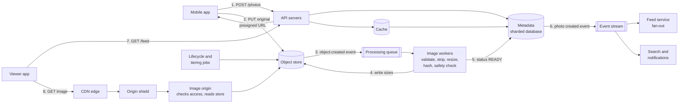
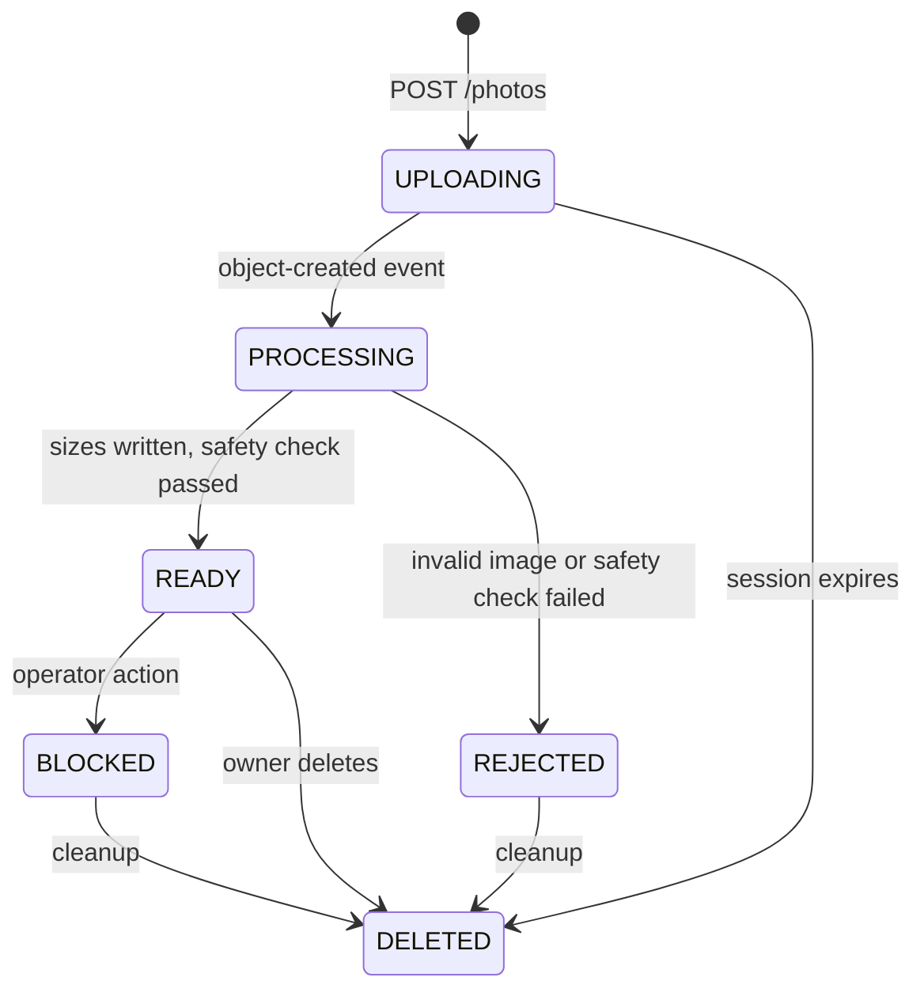

# Design a Photo Sharing Service

A photo sharing service lets users upload photos, follow other users, and view photos on any device. This case study gives the design that a strong candidate presents in 45 minutes: the numbers, the upload path, the image processing pipeline that makes thumbnails, photo storage and the lessons of Facebook's Haystack and f4 systems, the CDN, photo IDs, and the metadata store. The home feed has its own case study, [news feed](05-news-feed.md). This page gives the interface to the feed and does not repeat its design. Follow the steps in [how to approach an HLD interview](../how-to-approach-hld.md). The estimation method is on [back-of-envelope estimation](../back-of-envelope-estimation.md).

!!! note "About the sources"
    Facebook published the design of its photo storage in two papers: Haystack (OSDI 2010) and f4 (OSDI 2014). Instagram Engineering published the layout of its photo IDs and its logical shards in the post "Sharding & IDs at Instagram" (2012). Deep Dive 4 uses the same 41/13/10-bit layout and cites the post. No company publishes its complete design, so this page is a reference design that uses the published building blocks. Each claim about a real company cites its paper or post in "Further Reading". All inputs in the estimation are assumptions of this KB, and the sizes of the images are examples.

## Problem Statement

"Design a photo sharing service like Instagram. Users upload photos with a caption. Other users view the photos in a feed and on profile pages. Photos must load fast on phones, on fast and slow networks. The service must not lose a photo. A user who deletes a photo expects it to disappear."

The core of the problem is a large amount of immutable binary data (photos) that users write once and read thousands of times, plus a small amount of metadata. Most of the design follows from that ratio.

## Clarifying Questions

| Question | Answer that this design assumes |
|---|---|
| How many users? | 200 million daily active users (DAU). 10% of them upload one photo each day. Each user opens the feed 5 times each day and sees 20 photos each time (Assumption) |
| Photo size? | The app compresses on the phone: the upload is a JPEG or HEIC image of about 2 MB (Assumption). The service accepts up to 20 MB and 100 megapixels |
| Which sizes does the service show? | Four display sizes: 1080 px, 640 px, 320 px, and a 150 px thumbnail (Assumption, in the same style as Haystack, which stored four sizes of each photo) |
| Video? | Out of scope. See [video streaming](09-video-streaming.md) |
| Feed? | An interface only. The feed service keeps photo IDs, and this service serves the photo and its metadata. See [news feed](05-news-feed.md) |
| Privacy? | Public and private accounts. A photo of a private account is visible only to approved followers (Assumption) |
| Deletion? | A deleted photo disappears from the app at once. The bytes are physically removed within 30 days (Assumption) |
| How soon is an upload visible? | Within 5 seconds for the main sizes. The photo appears in followers' feeds within 1 minute (Assumption) |
| Durability and availability? | Durability: a stored photo is not lost. Viewing: 99.99%. Upload: 99.9% (Assumption) |
| Likes and comments? | Counters and lists exist. This page covers the counters briefly. Comments are out of scope |
| Moderation? | Each upload passes an automated check before it is visible (Assumption) |
| Regions? | Users worldwide. The first design runs in one primary region with a CDN. Multi-region is a follow-up |

## Requirements

### Functional

1. `upload`: a user uploads a photo with a caption and a visibility setting. The upload resumes after a network failure, and a repeated request does not create a second photo.
2. `process`: the service validates the image, removes private data (location in the image's EXIF header), fixes the orientation, and makes the display sizes.
3. `view`: any allowed viewer fetches a photo in a size that fits the device.
4. `list`: a viewer lists the photos of a user (the profile grid) with pagination. The feed service lists the photos of followed users by ID.
5. `delete`: the owner deletes a photo. The service stops serving it, and removes it from caches and from storage.
6. `react`: a user likes a photo. The service shows the like count.
7. Safety: the service checks each upload against policy and against lists of known abusive images, and lets an operator block a photo.

### Non-functional

| Requirement | Target |
|---|---|
| Image delivery latency | p50 below 100 ms and p99 below 500 ms for a photo from the nearest CDN node (Assumption) |
| Feed and profile API | p99 below 300 ms for the metadata of 20 photos |
| Upload to visible | The main sizes ready within 5 seconds at p95 |
| Durability | Originals survive the loss of a disk, a machine, a rack, and a data center. Erasure coding or replication in several zones ([storage types](../fundamentals/10-storage-types.md)) |
| Availability | Viewing 99.99% (about 52.6 minutes of downtime each year). Upload 99.9% |
| Scale | 200 uploads each second on average and 600 at the peak. 200,000 photo views each second on average and 600,000 at the peak (see Estimation) |
| Cost | Storage is the largest cost. The design uses tiers and erasure coding |
| Privacy | The service removes the location from the stored images. A private photo is not served to a non-follower, even with a leaked URL after it expires |

## Estimation

Rounding rule (the same as on the estimation page): one day is 10^5 seconds. The exact day has 86,400 seconds, so the rates are 13.6% lower than the exact rates.

Inputs (all are assumptions):

- 200 million DAU. 10% upload one photo each day. 5 feed opens for each DAU each day. 20 photos in each feed page, so one photo view is one image request. Peak factor 3.
- The original is 2 MB (2,000 KB). The four display sizes are 300 KB (1080 px), 100 KB (640 px), 30 KB (320 px), and 8 KB (150 px). The sum of the sizes is 438 KB.
- Storage: 3 replicas for hot data (first 90 days), and erasure coding with an overhead of 1.5 (for example RS(6,3), see [storage types](../fundamentals/10-storage-types.md)) for older data.
- The average image that the CDN delivers is 100 KB (the 640 px size, which most feed views use). The CDN serves 95% of the requests from its caches.
- Processing one upload costs 2.5 CPU-seconds (decode a 12-megapixel image, make four sizes, compute hashes, run the safety check).
- A photo record in the metadata database is 500 bytes.

| Step | Calculation | Result |
|---|---|---|
| Uploads each day | 200 × 10^6 × 10% | 20 × 10^6 |
| Uploads each second, average and peak | 20 × 10^6 / 10^5 and × 3 | 200 and 600 |
| Feed reads each second | 200 × 10^6 × 5 / 10^5 | 10,000 |
| Photo views each second, average and peak | 10,000 × 20 and × 3 | 200,000 and 600,000 |
| Views for each uploaded photo each day | 2 × 10^10 / 2 × 10^7 | 1,000 |
| Stored bytes for one photo | 2,000 KB + 438 KB | 2.44 MB |
| Stored each day | 20 × 10^6 × 2.44 MB | 48.8 TB |
| Stored each year, one copy | 48.8 TB × 365 | 17.8 PB |
| Stored each year, 3 replicas | 17.8 PB × 3 | 53.4 PB |
| Stored each year, erasure coding 1.5 | 17.8 PB × 1.5 | 26.7 PB |
| Year 1 with tiers (90 days at 3×, the rest at 1.5×) | 48.8 TB × 90 × 3 + 48.8 TB × 275 × 1.5 | 13.2 PB + 20.1 PB = 33.3 PB |
| Upload bandwidth, average and peak | 200 × 2 MB = 400 MB/s, × 8, and × 3 | 3.2 Gbit/s and 9.6 Gbit/s |
| Image egress, average | 200,000 × 100 KB | 20 GB/s = 160 Gbit/s |
| Image egress at the peak | 160 Gbit/s × 3 | 480 Gbit/s |
| Origin requests each second (5% CDN miss) | 200,000 × 5% | 10,000 |
| Origin traffic, average and peak | 160 Gbit/s × 5% and × 3 | 8 Gbit/s and 24 Gbit/s |
| Processing cores, average and peak | 200 × 2.5 CPU-s and × 3 | 500 and 1,500 |
| Metadata each day | 20 × 10^6 × 500 B | 10 GB |
| Metadata each year | 10 GB × 365 | 3.65 TB, for 7.3 billion photos |
| Index of a Haystack-style store | 40 bytes for each image with 4 sizes × 10^9 images | 40 GB for each billion images |
| Lifetime of the photo ID (Deep Dive 4) | 2^41 ms and 2^40 ms / (1000 × 86,400 × 365.25) | 69.7 years of distinct values, but 34.8 years before an ID is negative in a signed 64-bit column |

What the numbers decide:

- **Storage and egress decide the architecture.** 49 TB each day is 53 PB each year with replication. The photos go to an object store, not to a database. Tiers and erasure coding cut the first year from 53 PB to 33 PB, and the cut grows each year because old photos are the majority.
- **The ratio of 1,000 views for each upload decides the processing model.** The cost of making four sizes (2.5 CPU-seconds) is paid once, and each of the 1,000 views saves bytes. So the service makes the common sizes at upload time (eagerly) and not at view time. A rare size is made on demand and cached.
- **The CDN is not optional.** 160 Gbit/s average and 480 Gbit/s peak cannot leave one origin. With a 95% hit ratio, the origin serves 8 Gbit/s on average. Each point of hit ratio changes the origin traffic by 1.6 Gbit/s.
- **Uploads are small.** 200 uploads each second is a low request rate. The upload bandwidth of 3.2 Gbit/s is modest, but it must not pass through the application servers. Presigned URLs send the bytes straight to the object store.
- **Processing is a small fleet.** 500 cores on average and 1,500 at the peak are 16 to 47 machines with 32 cores each. The pipeline needs a queue and an autoscaler, and it does not need special hardware.
- **Metadata is small.** 3.65 TB each year fits a sharded relational database. The load is reads: 10,000 feed reads each second, each for 20 photos, so a cache in front of the database is necessary ([caching](../fundamentals/03-caching.md)).

The first program checks the arithmetic of the table. `main` comes first, and the block has its own imports, so you can copy it into `PhotoEstimate.java` and run `java PhotoEstimate.java` on JDK 21.

```java
import java.util.Locale;

public class PhotoEstimate {
    public static void main(String[] args) {
        double dau = 200e6;
        double uploads = dau * 0.10;
        double feedOpens = dau * 5;
        double views = feedOpens * 20;
        double peak = 3;
        System.out.println(line("uploads per day", uploads));
        System.out.println(line("uploads per second", uploads / 1e5));
        System.out.println(line("peak uploads per second", uploads / 1e5 * peak));
        System.out.println(line("feed reads per second", feedOpens / 1e5));
        System.out.println(line("photo views per second", views / 1e5));
        System.out.println(line("peak photo views per second", views / 1e5 * peak));
        System.out.println(line("views per uploaded photo per day", views / uploads));

        double[] sizeKb = {300, 100, 30, 8};
        double derivedKb = 0;
        for (double kb : sizeKb) {
            derivedKb += kb;
        }
        double originalKb = 2000;
        double perPhotoMb = (originalKb + derivedKb) / 1000;
        System.out.println(line("variants (KB)", derivedKb));
        System.out.println(line("stored MB per photo", perPhotoMb));
        double tbPerDay = uploads * perPhotoMb / 1e6;
        System.out.println(line("stored TB per day", tbPerDay));
        System.out.println(line("PB per year, 1x", tbPerDay * 365 / 1e3));
        System.out.println(line("PB per year, 3 replicas", tbPerDay * 365 * 3 / 1e3));
        System.out.println(line("PB per year, erasure 1.5", tbPerDay * 365 * 1.5 / 1e3));
        double hotDays = 90;
        double hotPb = tbPerDay * hotDays * 3 / 1e3;
        double warmPb = tbPerDay * (365 - hotDays) * 1.5 / 1e3;
        System.out.println(line("tiered PB, year 1 (90 d hot x3, rest x1.5)", hotPb + warmPb));
        System.out.println(line("untiered PB, year 1 (all x3)", tbPerDay * 365 * 3 / 1e3));

        double uploadMBs = uploads / 1e5 * 2;
        System.out.println(line("upload MB/s", uploadMBs));
        System.out.println(line("upload Gbit/s", uploadMBs * 8 / 1e3));
        System.out.println(line("peak upload Gbit/s", uploadMBs * 8 / 1e3 * peak));
        double egressGBs = views / 1e5 * 100 / 1e6;
        System.out.println(line("egress GB/s at 100 KB per view", egressGBs));
        System.out.println(line("egress Gbit/s", egressGBs * 8));
        System.out.println(line("peak egress Gbit/s", egressGBs * 8 * peak));
        System.out.println(line("origin requests/s at 95% hit", views / 1e5 * 0.05));
        System.out.println(line("origin Gbit/s at 95% hit", egressGBs * 8 * 0.05));
        System.out.println(line("peak origin Gbit/s", egressGBs * 8 * 0.05 * peak));
        double cpuSeconds = 2.5;
        double cores = uploads / 1e5 * cpuSeconds;
        System.out.println(line("processing cores, average", cores));
        System.out.println(line("processing cores, peak", cores * peak));
        System.out.println(line("metadata GB per day (500 B)", uploads * 500 / 1e9));
        System.out.println(line("metadata TB per year", uploads * 365 * 500 / 1e12));
        System.out.println(line("photos per year (billions)", uploads * 365 / 1e9));
        System.out.println(line("index MB per 1 billion photos at 40 B", 1e9 * 40 / 1e6));
        System.out.println(line("max ids per ms per shard (10 bits)", Math.pow(2, 10)));
        System.out.println(line("ids per second per shard", Math.pow(2, 10) * 1000));
        System.out.println(line("logical shards (13 bits)", Math.pow(2, 13)));
        double msPerYear = 1000 * 86_400 * 365.25;
        System.out.println(line("years of 41-bit ms time stamp", Math.pow(2, 41) / msPerYear));
        System.out.println(line("years until the sign bit is set (2^40 ms)",
            Math.pow(2, 40) / msPerYear));
    }

    static String line(String name, double value) {
        return String.format(Locale.ROOT, "%-46s %,.2f", name, value);
    }
}
```

<!-- expected-output -->

```text
uploads per day                                20,000,000.00
uploads per second                             200.00
peak uploads per second                        600.00
feed reads per second                          10,000.00
photo views per second                         200,000.00
peak photo views per second                    600,000.00
views per uploaded photo per day               1,000.00
variants (KB)                                  438.00
stored MB per photo                            2.44
stored TB per day                              48.76
PB per year, 1x                                17.80
PB per year, 3 replicas                        53.39
PB per year, erasure 1.5                       26.70
tiered PB, year 1 (90 d hot x3, rest x1.5)     33.28
untiered PB, year 1 (all x3)                   53.39
upload MB/s                                    400.00
upload Gbit/s                                  3.20
peak upload Gbit/s                             9.60
egress GB/s at 100 KB per view                 20.00
egress Gbit/s                                  160.00
peak egress Gbit/s                             480.00
origin requests/s at 95% hit                   10,000.00
origin Gbit/s at 95% hit                       8.00
peak origin Gbit/s                             24.00
processing cores, average                      500.00
processing cores, peak                         1,500.00
metadata GB per day (500 B)                    10.00
metadata TB per year                           3.65
photos per year (billions)                     7.30
index MB per 1 billion photos at 40 B          40,000.00
max ids per ms per shard (10 bits)             1,024.00
ids per second per shard                       1,024,000.00
logical shards (13 bits)                       8,192.00
years of 41-bit ms time stamp                  69.68
years until the sign bit is set (2^40 ms)      34.84
```

## API Design

The control APIs use HTTPS and JSON. The photo bytes do not pass through the API servers. The client sends the upload straight to the object store with a presigned URL ([storage types](../fundamentals/10-storage-types.md)), and the client reads images from the CDN.

| Method and path | Request | Response |
|---|---|---|
| `POST /v1/photos` | `{client_upload_id, content_type, size_bytes, caption, visibility}` | `201 {photo_id, upload: {url, method: "PUT", headers, expires_at}, status: "UPLOADING"}`. If `client_upload_id` was used before by this user, the response repeats the first answer |
| `PUT <presigned url>` (to the object store) | The image bytes | `200` from the object store. The API servers do not see the request |
| `GET /v1/photos/{photo_id}` | none | `200 {photo_id, owner, caption, visibility, status, width, height, placeholder, variants: [{size, format, url, bytes}], like_count, created_at}`. Status `404` if the viewer may not see it |
| `GET /v1/users/{user_id}/photos?cursor=<token>&limit=30` | A cursor from the previous page | `200 {photos: [...], next_cursor}`. The profile grid. Newest first |
| `PATCH /v1/photos/{photo_id}` | `{caption?, visibility?}` | `200`. The image bytes cannot change. A new image is a new photo |
| `DELETE /v1/photos/{photo_id}` | none | `202`. The photo is hidden at once. Removal from storage follows |
| `PUT /v1/photos/{photo_id}/likes` and `DELETE` | none | `204`. Idempotent. The service stores one like for each user and photo |
| `GET {cdn}/p/{photo_id}/{size}.{format}` | none | The image. `Cache-Control: public, max-age=31536000, immutable` for a public photo. Served by the CDN |
| `GET /v1/feed?cursor=<token>&limit=20` | A cursor | Served by the feed service, which returns photo IDs and metadata. See [news feed](05-news-feed.md) |

Notes:

- The upload has no `complete` call. The object store emits an event when the object exists, and the event starts the processing. The client reads the status with `GET /v1/photos/{photo_id}` (with backoff), or receives a push notification when the status is `READY`. This follows the guidance of [storage types](../fundamentals/10-storage-types.md): the object-created event, not the client's word, marks the upload complete.
- `client_upload_id` is an idempotency key that the app generates. A retry after a timeout does not create a second photo ([reliability patterns](../fundamentals/12-reliability-patterns.md)).
- The image URL contains the photo ID, the size, and the format. In this design the bytes under one URL do not change, so the URL can have a one-year lifetime in every cache. An edit that changes the image creates a new photo ID.
- `photo_id` is a 64-bit time-ordered ID that contains a shard number (see Deep Dive 4), encoded for URLs.
- Private photos use signed URLs with a short expiry, or signed cookies, instead of the public form (see Deep Dive 2).

## Data Model

### Where each kind of data lives

| Data | Store | Why |
|---|---|---|
| Originals and display sizes | Object store (S3-style, erasure coded, tiered) | Large immutable blobs, written once and read many times. Cheap and durable. The CDN reads it as the origin |
| Photo metadata | Sharded relational database (for example PostgreSQL or MySQL), with a cache in front | Point reads by `photo_id`, a list by owner, status changes in transactions. 3.65 TB each year |
| Follow graph | Same database family, or a graph or key-value store | See [news feed](05-news-feed.md) |
| Feed lists | Cache (Redis), lists of photo IDs | See [news feed](05-news-feed.md) |
| Likes | A table keyed by `(photo_id, user_id)`, and counters in the cache that a job folds into the table | A like is one row. The counter is a hot key for a viral photo |
| Processing jobs | A queue, and the `status` column | The queue gives retries. The column gives the state |
| Content hashes and moderation results | A key-value table keyed by hash | Duplicate detection, matching against lists of abusive content |

The database choice follows the access pattern ([choosing a database](../fundamentals/04-choosing-a-database.md)). The metadata is read by key, written by one owner at a time, and updated through a small state machine, so a relational database with sharding is enough. A DynamoDB or Cassandra table works as well. The decision rule: choose the store that your team operates well, because this access pattern does not need a special engine.

### Tables

`photos` (sharded by the owner's logical shard, which is inside `photo_id`):

| Column | Type | Notes |
|---|---|---|
| `photo_id` | bigint, primary key | Time-ordered ID with the shard number inside (Deep Dive 4) |
| `owner_id` | bigint | Index `(owner_id, photo_id desc)` for the profile grid. The IDs are time-ordered, so the sort by ID is the sort by time, and the grid needs no extra column |
| `caption` | text | Search indexing reads a change stream |
| `status` | enum | `UPLOADING`, `PROCESSING`, `READY`, `REJECTED`, `BLOCKED`, `DELETED` |
| `visibility` | enum | `PUBLIC`, `FOLLOWERS`, `PRIVATE` |
| `width`, `height` | ints | After the orientation fix |
| `placeholder` | short string | A tiny encoded preview (about 20 to 30 bytes, Assumption) that the app draws as a blurred image while the real image loads |
| `original_key` | string | Object key of the original, `p/{photo_id}/orig` |
| `content_sha256` | bytes | Hash of the original. Used for duplicate detection |
| `variants` | JSON | For each size and format: width, height, bytes, object key |
| `created_at`, `deleted_at` | timestamps | `deleted_at` starts the physical removal |

`upload_sessions`: `(owner_id, client_upload_id)` primary key, `photo_id`, `object_key`, `expires_at`. It makes `POST /v1/photos` idempotent. A job removes expired sessions and the incomplete objects.

`likes`: `(photo_id, user_id)` primary key, `created_at`. Sharded with the photo. A secondary table `(user_id, photo_id)` answers "what did I like".

`content_hashes`: `(content_sha256)` primary key, `first_photo_id`, `owner_id`, `moderation_result`. Used for duplicates inside one owner's photos, and for matching against known-bad lists.

The object keys are deterministic: `p/{photo_id}/orig`, `p/{photo_id}/640.webp`. A retried task writes the same key, so a retry replaces the output of the failed attempt and does not create a second copy. The design does not reuse a key for different content, which keeps CDN copies valid.

## High-Level Design



### Components

| Component | Responsibility | Notes |
|---|---|---|
| API servers | Authenticate, authorize, create photo records, issue presigned URLs, serve metadata | Stateless. Behind a load balancer ([load balancing, DNS, and CDN](../fundamentals/02-load-balancing-dns-cdn.md)) |
| Metadata database | Photo records, likes, upload sessions | Sharded by owner. Primary with replicas in each shard |
| Cache | Photo records and counters | Cache-aside ([caching](../fundamentals/03-caching.md)). The hot photos of popular accounts are the main load |
| Object store | Originals and display sizes | Erasure coded. Lifecycle rules move old objects to cheaper tiers |
| Processing queue | Holds one job for each uploaded photo | At-least-once delivery with a dead-letter queue ([message queues and streams](../fundamentals/08-message-queues-and-streams.md)) |
| Image workers | Validate, clean, resize, hash, check | Stateless, autoscaled on the age of the oldest job. They run in a sandbox |
| Event stream | Announces `photo.created`, `photo.deleted` | Consumers: feed fan-out, search, notifications, analytics ([event-driven architecture](../fundamentals/16-event-driven-architecture.md)) |
| Feed service | Puts the photo ID into the feeds of followers | A separate system. See [news feed](05-news-feed.md) |
| CDN and origin shield | Serve images close to the viewer. Shield consolidates misses | Pull CDN with the object store behind an image origin |
| Image origin | Checks that the viewer may see a private photo, then reads the store. Makes a rare size on demand | A thin stateless service in front of the object store |
| Lifecycle and tiering jobs | Move aged photos to warm storage, remove deleted photos | Batch jobs and store lifecycle rules |

### The life of an upload

1. The app compresses and resizes the photo on the phone. It calls `POST /v1/photos` with a new `client_upload_id`. The API checks the quota and writes a row with status `UPLOADING`, and returns a presigned `PUT` URL for a new object key.
2. The app uploads the bytes straight to the object store. A broken upload restarts, or continues if the file is large enough for multipart upload (see [storage types](../fundamentals/10-storage-types.md)).
3. The object store emits an object-created event into the queue.
4. A worker reads the original, validates it, removes private data, fixes the orientation, makes the sizes, and computes the hashes. It writes each size to the object store under its deterministic key.
5. The worker updates the row: `READY`, the sizes, the placeholder, and the hashes. If the safety check fails, the status is `REJECTED`.
6. The row change emits `photo.created`. The feed service adds the ID to the feeds of the followers.

### The life of a view

1. The app opens the feed. The feed service returns 20 photo IDs. The API returns the metadata of each photo from the cache, with the image URLs and the placeholders.
2. The app draws the placeholders. It requests the images from the CDN, one URL for each photo, in the size that fits the screen.
3. A CDN edge with the image answers at once. On a miss, the edge asks the origin shield, and the shield asks the image origin, which reads the object store.
4. The CDN caches the image for one year. The next viewers in that region get it from the edge.

## Deep Dives

### Deep Dive 1: The upload and the processing pipeline

**Reduce the work before the upload.** The app resizes the photo to at most 2048 pixels on the long side and compresses it. A 12-megapixel camera photo of 4 to 6 MB becomes about 2 MB (Assumption), which saves upload time on a slow network and storage cost. Compression on the device costs battery, and the quality setting is a product choice. The server still treats the upload as untrusted input, because anyone can call the API without the app.

**Direct upload with a presigned URL.** The API authorizes the user and returns a presigned URL for one object key, with a short expiry (minutes), the content type in the signature, and a size limit (see [storage types](../fundamentals/10-storage-types.md) for the details and the limits of a presigned `PUT`). A presigned `PUT` does not limit the size by itself, so use a presigned `POST` with a size condition, or check the size in the first processing step and delete oversized objects. The app generates `client_upload_id`, and the API stores it, so a retry after a timeout gets the same photo ID and the same key.

**Validate as untrusted input.** A worker does these checks before it trusts the file:

1. **Size and type.** Check the size against the limit. Read the first bytes (the magic number) and compare them with the declared content type. Do not trust the file extension or the `Content-Type` header.
2. **Dimensions before decoding.** Read the image header and check the width and height. A small file can describe an image of 100,000 × 100,000 pixels, and decoding it needs tens of gigabytes of memory (a decompression bomb). Reject an image above the pixel limit (100 megapixels here), before the decoder allocates memory.
3. **A sandboxed decoder.** Image decoders parse complex binary formats and have had security flaws. Run the decoders in a sandbox with no network, a read-only file system, and limits on memory, CPU time, and processes (for example in a container with a seccomp profile). A crash or a hang kills the sandbox, and the queue retries the job a limited number of times before the job goes to the dead-letter queue.
4. **Re-encode.** The service does not serve the uploaded bytes to other users. It decodes the image and encodes new files. This removes appended payloads and unusual metadata (a file that is both a valid image and a valid script).

**Clean the image.** The worker removes metadata that the user did not intend to share. The EXIF header of a phone photo can contain the GPS position, the device model, and the time. The worker applies the EXIF orientation flag to the pixels (so every viewer sees the photo upright) and then removes the EXIF block. It converts the color profile to a standard one (sRGB) so that colors look the same on all devices. The worker keeps the original file in the store, because the product may re-process it. The original is private: only the processing role can read it, and it is not served by the CDN. If the product promises to remove the location, the worker also strips it from the stored original, or the service stores the original only after the strip.

**Make the sizes.** The worker writes the four sizes in JPEG and a second set in a modern format such as WebP (Deep Dive 2). A resize uses the original, not a smaller size, so the quality does not degrade.

**Compute hashes.** The worker computes a SHA-256 hash of the original (an exact-duplicate key) and a perceptual hash of the image (similar images give similar hashes). Services use hashes to match uploads against lists of known abusive images, and to detect re-uploads. Treat the matching as an input to a moderation decision, not as the final answer.

**Run the safety check.** An automated classifier scores the image. A high score sets the status to `REJECTED` or sends it to human review. The photo is not visible until the check ends. This puts the check inside the 5-second budget (Assumption): the classifier runs in parallel with the resize.

**State machine.**



Each transition is a conditional update on the row (`UPDATE ... SET status = 'READY' WHERE photo_id = ? AND status = 'PROCESSING'`), so a duplicate event from the queue does nothing the second time.

**Failure handling.**

| Failure | Result | Design response |
|---|---|---|
| A worker crashes during processing | The job is not acknowledged and returns to the queue | The retry is idempotent: the output keys are deterministic, so it overwrites a partial output |
| The same event arrives twice | Two workers process the same photo | The conditional status update lets one win. The other writes the same bytes to the same keys |
| A poison image crashes the decoder every time | The job retries forever | A retry limit sends the job to the dead-letter queue and sets the photo to `REJECTED`. An alert shows the queue depth |
| The queue backs up after a burst | Photos wait before they are visible | Autoscale on the age of the oldest job. The app shows "processing" and the owner sees the photo at once, with the local copy |
| The upload does not complete | A row stays in `UPLOADING` | A job removes sessions that expired, and aborts incomplete multipart uploads |

**Capacity.** The estimation gives 500 cores on average and 1,500 at the peak. The workers scale on the age of the oldest job in the queue (saturation of asynchronous work, see [observability in design](../fundamentals/20-observability-in-design.md)), with a target such as "the oldest job is younger than 3 seconds".

### Deep Dive 2: Sizes, thumbnails, and delivery through the CDN

**Why several sizes.** A phone screen of 400 points shows a feed photo of about 640 pixels. A 2 MB original would waste bandwidth and battery, and would load slowly on a poor network. A 150-pixel thumbnail serves a profile grid, where each screen shows dozens of photos. Facebook's Haystack paper describes the same decision: Facebook "generates and stores four images of different sizes" for each uploaded photo.

| Size | Long side | Example use | Approximate bytes (Assumption) |
|---|---|---|---|
| Original | up to 2048 px | Re-processing. Not served to users | 2,000 KB |
| Large | 1080 px | Full-screen view on a large phone | 300 KB |
| Medium | 640 px | Feed | 100 KB |
| Small | 320 px | Small list and notifications | 30 KB |
| Thumbnail | 150 px | Profile grid, search results | 8 KB |

**Eager or on-demand.** There are two ways to produce a size.

| Aspect | Eager (at upload) | On demand (at the first view) |
|---|---|---|
| When the work happens | In the pipeline, once for each photo | In the image origin, at the first miss of each size |
| Latency of the first view | Low. The file exists | High for the first viewer. The origin decodes and resizes |
| Cost | The work for every photo, including photos that nobody views | The work only for sizes that someone requests |
| Storage | All sizes for all photos | Only the requested sizes |
| Flexibility | A new size needs a batch job over all photos | A new size appears with the next request |
| Failure mode | A backlog delays publication | A burst of misses overloads the origin CPU (needs request coalescing) |
| Example | Haystack: four sizes at upload | f4 has a transformer tier that resizes and crops the retrieved photo |

**Recommendation:** make the four main sizes eagerly. The estimation shows 1,000 views for each upload, so every main size is requested many times, and an eager size costs 2.5 CPU-seconds once. Make unusual sizes on demand, with request coalescing (one resize for many simultaneous requests for the same missing size) and a store of the result. The f4 paper says that its transformer tier "handles a set of transformations on the retrieved BLOB", for example resizing and cropping, which shows that a large service uses both patterns.

**Formats.** A modern format (WebP, AVIF) gives a smaller file than JPEG at the same visual quality. The size gain depends on the image and the encoder settings, so measure it on your own photos. The cost is encoding time (AVIF encodes slowly) and device support. Two ways to deliver:

1. **The server picks the format by the `Accept` header.** One URL serves different bytes, and the CDN cache key must include the format. The CDN page ([load balancing, DNS, and CDN](../fundamentals/02-load-balancing-dns-cdn.md)) explains that the key should use a few normalized values of `Accept-Encoding`; the same idea applies to `Accept`: normalize the header to a few values (for example `avif`, `webp`, `jpeg`) before it enters the key, or the hit ratio falls.
2. **The API picks the format.** The app tells the API what it supports, and `GET /v1/photos/{id}` returns URLs with the format in the path. The URLs are plain and cache well, and the CDN needs no special logic. This design uses option 2.

**Responsive loading.** The metadata response contains a `placeholder`: a tiny encoded image (about 20 to 30 bytes, Assumption) that the app decodes into a blurred preview. The app shows the placeholder at once and swaps in the real image when it arrives. The user sees no empty rectangle, and the layout does not jump, because the response also has the width and height. For the JPEG sizes, a progressive encoding shows a rough image early.

**Delivery path.** The CDN is a pull CDN with the object store as origin, through a thin image origin service ([load balancing, DNS, and CDN](../fundamentals/02-load-balancing-dns-cdn.md)).

- **Public photos:** the URL is `https://img.example.com/p/{photo_id}/{size}.{format}`. The origin sets `Cache-Control: public, max-age=31536000, immutable` (RFC 9111 and RFC 8246). The bytes under a URL never change, so no cache needs to revalidate.
- **Cache key:** the host and the path only. No query string, no cookies.
- **Origin shield:** requests for a new photo come from many edges at once (a popular account posts). The shield consolidates them into one request to the origin. See the origin shield part of the CDN page.
- **Hit ratio:** the estimation assumes 95%. The long tail of old photos misses often, because a photo that nobody views for a month is not in an edge cache. The Haystack paper states the same problem: requests for the long tail "typically miss in the CDN", and caching all of those photos "would not be cost effective because of the very large cache sizes required". That is why the origin store must be fast on its own.
- **Origin:** 10,000 requests and 8 Gbit/s on average, 30,000 requests and 24 Gbit/s at the peak. The object store serves this directly. A cache in front of the store would help only for photos that are hot and new.

**Private photos.** A private photo must not be served from a public, immutable URL, because anyone who gets the URL can use it forever. Two options:

- **Signed URLs with a short expiry** (minutes to hours): the API checks the viewer's right, and returns a URL with a signature and an expiry that the CDN verifies at the edge. The URL is a bearer token. A leaked URL works until it expires. The cache policy keys on the host and the path only (as for public photos), so the signature is not part of the cache key, and cached bytes serve all valid signatures. CloudFront also removes its signature parameters (`Expires`, `Key-Pair-Id`, `Policy`, `Signature`) from the URL before it forwards a request to the origin.
- **Signed cookies** for a whole session, with the same short lifetime.

The cost is a lower browser cache lifetime for private photos and more work at the API: it signs a URL for each private photo in each feed page. The cost is small, because signing is a local computation. See [storage types](../fundamentals/10-storage-types.md) for the presigned-URL facts.

### Deep Dive 3: Photo storage, Haystack, f4, and tiers

**The default answer.** Use an object store. It provides durability, erasure coding, lifecycle rules, and presigned URLs. At 20 million photos each day and 7.3 billion each year, an object store such as S3 handles the volume without a custom storage system. A custom system makes sense only at a scale where the cost of the object store passes the cost of building and running your own.

**Why Facebook built Haystack.** The Haystack paper (Beaver et al., OSDI 2010) explains the reason. Facebook stored photos on network-attached storage over NFS, and found that the metadata was the bottleneck. A POSIX file system needs several disk operations to read one photo: one or more to translate the file name into an inode number, one to read the inode, and one to read the file. The paper states: "using disk IOs for metadata was the limiting factor for our read throughput". At the scale of the paper (more than 260 billion images, over 20 PB, one billion new photos each week, and over a million images served each second at the peak), the metadata could not stay in memory.

**How Haystack works.** The paper describes three components:

- **Store:** machines with large volumes. A **physical volume** is one very large file (the paper's example is 100 GB). A machine with 10 TB holds about 100 volumes. Photos are appended to the volume file as **needles**. Table 1 of the paper lists the fields of a needle: a header magic number (for recovery), a **cookie**, the key (the 64-bit photo ID), the alternate key (a 32-bit ID for the size of the photo), flags (the deleted status), the data size, the data, a footer magic number, a data checksum, and padding that aligns the needle to 8 bytes. The cookie is a random number that the Directory assigns at upload and that the photo URL contains. The Store compares it after it reads the needle, and the paper says that it "effectively eliminates attacks aimed at guessing valid URLs for photos". A cookie stops a guess of a URL. It does not decide who may see a photo, so it is not access control for private photos (Deep Dive 2). A **logical volume** groups physical volumes on different machines, and a write goes to all of them.
- **Directory:** the mapping from logical volumes to physical volumes, and the information about which logical volumes have free space. It decides where to write and which machine to read from.
- **Cache:** an internal cache (the paper says that it "functions as our internal CDN") that shields the Store from requests for popular photos, and from refetches after a CDN failure. It caches a photo only if the request comes directly from a user, not from the CDN, and the photo is on a write-enabled Store machine. The paper gives the reasons: "post-CDN caching is ineffective", because a request that misses in the CDN is unlikely to hit in an internal cache, and new photos receive the most reads. The paper also names a planned optimization: push recently uploaded photos into the Cache.

The central idea: each Store machine keeps an in-memory index that maps a photo (key, size) to its offset in the volume file. A read looks up the offset in memory and then does one disk read at that offset, so "at most one disk operation per read". The paper reports that Haystack uses about 10 bytes of main memory for each photo, which is 40 bytes for the four sizes of one image, against 536 bytes for one inode in Linux (xfs). A delete sets a flag in the needle and in the in-memory mapping, and the space returns later by **compaction**, which copies the live needles into a new volume file and skips deleted and duplicate needles. A photo cannot change in place: a modified photo is a new needle with the same key and alternate key, and the needle at the highest offset is the current one. The paper reports that about 25% of the photos get deleted over the course of a year, so compaction matters. After a crash, a Store machine rebuilds the index from the volume file, and an index file speeds this up. The paper reports that each usable terabyte cost about 28% less and handled about 4 times more reads per second than an equivalent terabyte on a NAS appliance.

The program below is a small model of one volume. It appends needles for 3 photos with 4 sizes each, reads a photo with one volume read, deletes by flag, compacts, and rebuilds the index by scanning the file. The model is in memory. Its needle has only the key, the alternate key (the variant), the flags, and the size. It leaves out the magic numbers, the cookie, the checksum, the padding, the superblock, and the index file of the paper. It shows the idea.

```java
import java.nio.ByteBuffer;
import java.util.Arrays;
import java.util.HashMap;
import java.util.Map;

public class NeedleVolume {
    public static void main(String[] args) {
        Volume v = new Volume();
        String[] variants = {"orig", "large", "medium", "thumb"};
        int[] sizes = {2000, 300, 100, 8};
        for (long photo = 1; photo <= 3; photo++) {
            for (int i = 0; i < variants.length; i++) {
                v.append(photo, i, payload(photo, i, sizes[i]));
            }
        }
        System.out.println("needles in index: " + v.indexSize());
        System.out.println("volume bytes: " + v.length());

        byte[] thumb = v.read(2, 3);
        System.out.println("read photo 2 thumb: " + thumb.length + " bytes, reads on volume: "
            + v.volumeReads());

        v.delete(2, 0);
        System.out.println("after delete of photo 2 orig, read gives "
            + (v.read(2, 0) == null ? "not found" : "data"));
        System.out.println("volume bytes after delete (unchanged): " + v.length());

        Volume compacted = v.compact();
        System.out.println("volume bytes after compaction: " + compacted.length());
        System.out.println("needles in index after compaction: " + compacted.indexSize());

        Volume recovered = Volume.fromBytes(compacted.bytes());
        System.out.println("index rebuilt from the volume file: " + recovered.indexSize());
        boolean same = Arrays.equals(recovered.read(3, 1), compacted.read(3, 1));
        System.out.println("photo 3 large identical after rebuild: " + same);
    }

    static byte[] payload(long photo, int variant, int size) {
        byte[] b = new byte[size];
        for (int i = 0; i < size; i++) {
            b[i] = (byte) (photo * 31 + variant * 7 + i);
        }
        return b;
    }

    // Needle: key (8) | variant (4) | flags (1) | size (4) | data (size)
    static class Volume {
        static final int HEADER = 17;
        static final int FLAGS_OFFSET = 12; // after the key (8 bytes) and the variant (4 bytes)
        record Location(int offset, int size) {}

        private byte[] buf = new byte[1024];
        private int length;
        private final Map<String, Location> index = new HashMap<>();
        private int reads;

        static String key(long photo, int variant) {
            return photo + "/" + variant;
        }

        // Append only: a needle is never overwritten. A newer needle for the same key wins.
        void append(long photo, int variant, byte[] data) {
            int offset = length;
            ensureCapacity(length + HEADER + data.length);
            ByteBuffer.wrap(buf, offset, HEADER)
                .putLong(photo).putInt(variant).put((byte) 0).putInt(data.length);
            System.arraycopy(data, 0, buf, offset + HEADER, data.length);
            length += HEADER + data.length;
            index.put(key(photo, variant), new Location(offset, data.length));
        }

        private void ensureCapacity(int needed) {
            if (needed > buf.length) {
                buf = Arrays.copyOf(buf, Math.max(needed, buf.length * 2));
            }
        }

        byte[] bytes() {
            return Arrays.copyOf(buf, length);
        }

        int length() {
            return length;
        }

        int indexSize() {
            return index.size();
        }

        int volumeReads() {
            return reads;
        }

        // One lookup in memory, then one read of the volume at a known offset.
        byte[] read(long photo, int variant) {
            Location loc = index.get(key(photo, variant));
            if (loc == null) {
                return null;
            }
            reads++;
            int start = loc.offset() + HEADER;
            return Arrays.copyOfRange(buf, start, start + loc.size());
        }

        // A delete sets the flag in the volume and drops the index entry. The bytes stay.
        void delete(long photo, int variant) {
            Location loc = index.remove(key(photo, variant));
            if (loc != null) {
                buf[loc.offset() + FLAGS_OFFSET] = 1;
            }
        }

        // Compaction copies only the live needles: the ones that the index points to.
        // Deleted needles and older duplicates of a key are skipped.
        Volume compact() {
            Volume next = new Volume();
            int pos = 0;
            while (pos < length) {
                ByteBuffer b = ByteBuffer.wrap(buf, pos, HEADER);
                long photo = b.getLong();
                int variant = b.getInt();
                b.get(); // flags
                int size = b.getInt();
                Location live = index.get(key(photo, variant));
                if (live != null && live.offset() == pos) {
                    next.append(photo, variant,
                        Arrays.copyOfRange(buf, pos + HEADER, pos + HEADER + size));
                }
                pos += HEADER + size;
            }
            return next;
        }

        // After a crash, one sequential scan of the volume rebuilds the index.
        static Volume fromBytes(byte[] all) {
            Volume v = new Volume();
            v.buf = Arrays.copyOf(all, all.length);
            v.length = all.length;
            int pos = 0;
            while (pos < all.length) {
                ByteBuffer b = ByteBuffer.wrap(all, pos, HEADER);
                long photo = b.getLong();
                int variant = b.getInt();
                byte flags = b.get();
                int size = b.getInt();
                if (flags == 0) {
                    v.index.put(key(photo, variant), new Location(pos, size)); // later wins
                } else {
                    v.index.remove(key(photo, variant));
                }
                pos += HEADER + size;
            }
            return v;
        }
    }
}
```

<!-- expected-output -->

```text
needles in index: 12
volume bytes: 7428
read photo 2 thumb: 8 bytes, reads on volume: 1
after delete of photo 2 orig, read gives not found
volume bytes after delete (unchanged): 7428
volume bytes after compaction: 5411
needles in index after compaction: 11
index rebuilt from the volume file: 11
photo 3 large identical after rebuild: true
```

The output shows each property: 12 needles for 3 photos, a read that costs one volume read after one memory lookup, a delete that leaves the volume the same size, a compaction that returns the space (7,428 bytes become 5,411, which is 2,017 bytes less, the size of one needle with a 2,000-byte original), and an index that a scan rebuilds.

**Why not Haystack for this design.** The problem that Haystack solved (file-system metadata cost on NAS) does not exist in an object store, because the object store already keeps its metadata in its own index and spreads the objects. The lesson to take from the paper is the principle: keep the per-object metadata small, keep it in memory, and make a read cost one disk operation. A candidate who says "I would use S3, and here is why Facebook did not" shows more than one who describes Haystack from memory.

**Tiers: hot, warm, and cold.** The f4 paper (Muralidhar et al., OSDI 2014) shows that the access rate of a photo falls fast with age. The paper reports that for all nine BLOB types, content less than one day old receives more than 100 times the request rate of one-year-old content. For eight of the nine types, the request rate drops by an order of magnitude in less than a week. For six, it drops by 100 times in less than 60 days. Facebook called the old, rarely read content *warm* and built f4 for it:

- Haystack keeps 3 replicas, and each replica uses hardware RAID-6, which costs a factor of 1.2. The effective replication factor is 3 × 1.2 = 3.6.
- f4 uses Reed-Solomon(10,4) erasure coding inside a data center, with the blocks spread over racks. That costs a factor of 1.4. The paper first doubled the f4 cells across two data centers, which gives 1.4 × 2 = 2.8. It then describes geo-replicated XOR coding, which stores the XOR of blocks of two volumes in a third data center and gives 2.1. The paper says that Facebook was deploying the XOR coding at the time of writing.
- f4 held over 65 PB of logical BLOBs and saved over 53 PB of storage at the time of the paper.
- A router tier hides the storage system from clients, so a volume can move from hot to warm storage without a change for the clients.

**This design's tier policy.** (Recommendation, with assumptions.)

| Age | Storage | Redundancy | Reason |
|---|---|---|---|
| 0 to 90 days | Standard tier of the object store (or Haystack-style hot storage) | 3 replicas across zones | Highest request rate. Fast repair |
| 90 days to 1 year | A cheaper tier of the object store, or an own warm tier | Erasure coding, overhead 1.5 | The request rate is much lower. Storage cost dominates |
| Older than 1 year | Infrequent-access or archive class for originals. Display sizes stay in the warm tier | Erasure coding | The originals are rarely read. The CDN serves the long tail from the warm sizes |

The estimation shows the effect: 33 PB in the first year with tiers, against 53 PB with 3 replicas for everything. The cost of a tier is a slower first byte for a cold photo, and the transition work. The store's lifecycle rules do the transition, and the request metrics decide the age threshold. Use access data to set it: if few photos older than 90 days are read, the threshold is right.

**Durability and replication across regions.** The original is the most valuable object, because the service can recreate every size from it. Replicate the originals to a second region, and write the sizes to one region (they can be recreated). Erasure coding spreads fragments over separate failure domains, as the [storage types](../fundamentals/10-storage-types.md) page describes.

**Deletion in storage.** A delete flips the status to `DELETED` and publishes `photo.deleted`. The image origin stops serving the photo at once, and a purge request removes it from the CDN. A job deletes the objects (the original and all sizes) and the lifecycle rule or the compaction removes the bytes within the 30-day limit. In a Haystack-style store, the needle flag and the next compaction do the same. Keep the delete log, so that a restore from a backup does not bring back a deleted photo: after a restore, replay the deletes.

### Deep Dive 4: Photo IDs, metadata sharding, and the feed interface

**Requirements for the ID.** The ID of a photo must be unique without a central counter, sort by time (so the profile grid is "order by ID"), fit in 64 bits (for compact storage and indexes), and tell the system which shard owns the photo. See [unique ID generation](../fundamentals/15-unique-id-generation.md) for the general methods: auto-increment, UUID, Snowflake, and ULID.

**The layout.** The ID has 64 bits: 41 bits for milliseconds since a custom epoch, 13 bits for the logical shard ID, and 10 bits for a sequence number of the shard. This is the layout that Instagram Engineering published in "Sharding & IDs at Instagram" (2012). The post gives these facts:

- Instagram sharded its data over a set of PostgreSQL servers. It used "several thousand 'logical' shards that are mapped in code to far fewer physical shards". Each logical shard is a PostgreSQL schema, and a set of logical shards moves from one database server to another without a change to the data.
- Each ID has "41 bits for time in milliseconds", "13 bits that represent the logical shard ID", and "10 bits that represent an auto-incrementing sequence, modulus 1024".
- A PL/pgSQL function inside each shard makes the ID at insert time, from the clock, the shard number of the schema, and `nextval` of a sequence of the table, modulo 1,024. The team chose this over Snowflake, because a Snowflake service adds "moving parts" (ZooKeeper and the Snowflake servers).
- The worked example shards by user ID: with 2,000 logical shards, user 31341 is on shard 31341 % 2000 = 1341.

Two details of the post matter in an interview. First, the sequence is a counter of the table, taken modulo 1,024. It does not restart each millisecond. The IDs stay unique only if one shard inserts fewer than 1,024 rows in one millisecond. Second, the post says that 41 bits give "41 years of IDs". The arithmetic gives a different number, in the table below.

This design uses the same layout: 8,192 logical shards (the maximum of 13 bits), mapped to a smaller number of physical servers, so moving a logical shard to another server needs no change of IDs.

| Field | Bits | Capacity | Calculation |
|---|---|---|---|
| Time | 41 | 69.7 years of distinct values from the epoch, but only 34.8 years before the IDs become negative in a signed column | 2^41 ms and 2^40 ms / (1000 × 86,400 × 365.25) |
| Logical shard | 13 | 8,192 shards | 2^13 |
| Sequence | 10 | 1,024 IDs for each millisecond in each shard, 1,024,000 each second | 2^10 |

**The sign bit.** 41 + 13 + 10 = 64, so this layout has no sign bit. Snowflake keeps the top bit at 0 and uses 41 + 10 + 12 = 63 bits ([unique ID generation](../fundamentals/15-unique-id-generation.md)). A Java `long` and a PostgreSQL `bigint` are signed. When the time field reaches 2^40 ms, about 34.8 years after the epoch, the top bit becomes 1 and the ID becomes negative. From then on, a new ID sorts before all the old IDs, and `ORDER BY photo_id` no longer gives the time order. Choose the epoch so that 34.8 years is enough, or store the time in 40 bits and give the spare bit to the sequence.

At 600 uploads each second at the peak and 8,192 logical shards, one shard makes fewer than one photo each second on average, so the 1,024 IDs each millisecond are far above the need. The program below shows the layout with a fixed clock. It makes an ID, decodes the shard and the day from it, checks that IDs sort by time, and refuses a time that would set the sign bit.

```java
public class PhotoId {
    static final long EPOCH_MS = 1_700_000_000_000L; // custom epoch (Assumption)
    static final int TIME_BITS = 41;
    static final int SHARD_BITS = 13;
    static final int SEQ_BITS = 10;

    public static void main(String[] args) {
        long ownerId = 987_654_321L;
        int logicalShard = (int) (ownerId % (1 << SHARD_BITS));
        long nowMs = EPOCH_MS + 90L * 86_400_000L; // 90 days after the epoch
        System.out.println("owner " + ownerId + " lives on logical shard " + logicalShard);

        long first = make(nowMs, logicalShard, 5);
        long second = make(nowMs, logicalShard, 6);
        long later = make(nowMs + 1, logicalShard, 0);
        System.out.println("photo id " + first);
        System.out.println("decoded shard " + shardOf(first)
            + ", sequence " + sequenceOf(first) + ", day " + dayOf(first));
        System.out.println("ids sort by time: " + (first < second && second < later));
        System.out.println("same ms, same shard, next id differs by " + (second - first));

        long otherShard = make(nowMs, logicalShard + 1, 5);
        System.out.println("shard bits sit above the sequence: " + (otherShard - first));
        System.out.println("max ids per ms per shard: " + (1 << SEQ_BITS));
        System.out.println("8,192 logical shards on 64 servers: "
            + (1 << SHARD_BITS) / 64 + " logical shards for each server");

        long lastPositive = make(EPOCH_MS + (1L << (TIME_BITS - 1)) - 1, logicalShard, 0);
        System.out.println("last id before the sign bit is positive: " + (lastPositive > 0));
        try {
            make(EPOCH_MS + (1L << (TIME_BITS - 1)), logicalShard, 0);
        } catch (IllegalArgumentException e) {
            System.out.println("refused: " + e.getMessage());
        }
    }

    // 41 bits of milliseconds | 13 bits of logical shard | 10 bits of sequence
    static long make(long timeMs, int shard, int sequence) {
        long elapsed = timeMs - EPOCH_MS;
        if (elapsed < 0 || elapsed >= 1L << (TIME_BITS - 1)) {
            throw new IllegalArgumentException("time is outside the 40-bit range");
        }
        if (shard < 0 || shard >= 1 << SHARD_BITS) {
            throw new IllegalArgumentException("shard out of range: " + shard);
        }
        long seq = sequence & ((1 << SEQ_BITS) - 1); // a counter taken modulo 1,024
        return (elapsed << (SHARD_BITS + SEQ_BITS)) | ((long) shard << SEQ_BITS) | seq;
    }

    static int shardOf(long id) {
        return (int) ((id >>> SEQ_BITS) & ((1 << SHARD_BITS) - 1));
    }

    static int sequenceOf(long id) {
        return (int) (id & ((1 << SEQ_BITS) - 1));
    }

    static long dayOf(long id) {
        return (id >>> (SHARD_BITS + SEQ_BITS)) / 86_400_000L;
    }
}
```

<!-- expected-output -->

```text
owner 987654321 lives on logical shard 2225
photo id 65229815810278405
decoded shard 2225, sequence 5, day 90
ids sort by time: true
same ms, same shard, next id differs by 1
shard bits sit above the sequence: 1024
max ids per ms per shard: 1024
8,192 logical shards on 64 servers: 128 logical shards for each server
last id before the sign bit is positive: true
refused: time is outside the 40-bit range
```

**Which shard owns a photo.** The design makes the photo's ID with the logical shard of its owner (the owner ID modulo 8,192 in the program). All photos of a user live on the user's shard. The profile grid `(owner_id, photo_id desc)` reads one shard. A request for one photo reads the shard number from the ID, with no lookup service. The cost: a very large account puts all its photos on one shard, and a hot account makes a hot shard (see Bottlenecks). A logical shard moves between physical servers by copying its data and changing the map ([partitioning and sharding](../fundamentals/06-partitioning-and-sharding.md)), and the IDs stay valid.

**Metadata reads.** 10,000 feed reads each second read 20 photo records each. That is 200,000 record reads each second at the average and 600,000 at the peak. The database cannot take that load directly. A cache-aside cache ([caching](../fundamentals/03-caching.md)) holds the records, with a hit ratio above 95% (Assumption), so the database sees about 10,000 to 30,000 reads each second. The records of a photo change rarely (the caption, the visibility, the like count). The invalidation rule: delete the cache entry on update, and give each entry a TTL as a safety net. A like counter is not part of the cached record: it is a separate counter that a job folds into the database.

**The interface to the feed.** The feed service stores `(photo_id, author_id, score)` entries, not photo data ([news feed](05-news-feed.md)). It reads `photo.created` from the event stream. When a client asks for the feed, the API reads the IDs from the feed service, groups them by logical shard (read from the ID), and fetches the records from the cache and the shards in parallel. A deleted or private photo is filtered at read time, because the feed cache can hold an ID that is no longer visible. The visibility check runs at read time against the current record. This keeps the feed from showing a deleted photo, and it is why delete must be fast and safe at the metadata layer first.

**Likes and counters.** A like is a row in `likes`. A hot photo gets thousands of likes each second, so a counter row in the database is a hot key. The design counts in the cache with an atomic increment, flushes the totals to the database every few seconds, and shows the cached count. The count can lag by seconds. For exact counts, the batch job counts the `likes` rows. See [leaderboard and top-k](16-leaderboard-and-top-k.md) for counters and sharded counters.

**Deletion and the right to erasure.** The delete path has four steps, in this order: (1) set `status = DELETED` in the metadata and clear the cache entry, so every API call hides the photo at once; (2) purge the image URLs from the CDN (the one-year `immutable` lifetime means that purge is the only way to remove edge copies); (3) delete the objects in storage; (4) remove the derived data: feed entries, search entries, hash records, and counters. Steps 3 and 4 run asynchronously and finish within the 30-day limit (Assumption). Backups and the lifecycle of old versions must follow the same limit, and the page for this limit is part of a privacy review, not only of engineering.

## Bottlenecks and Scaling

| What fails first | Symptom | Fix |
|---|---|---|
| Origin egress after a burst of CDN misses | A new popular photo is requested from every edge at once | Origin shield, request coalescing, push recent photos to the CDN when a popular account posts |
| Image origin CPU | A burst of requests for a rare size triggers many resizes | Make the main sizes eagerly. Coalesce on-demand resizes. Rate-limit them |
| Processing backlog | The queue age grows after a burst of uploads, for example at midnight on New Year's Eve | Autoscale on the age of the oldest job. Keep a reserve of workers. The app shows the local copy while the photo processes |
| Hot account | One account's photos (millions of views, many likes) overload one shard and one cache key | Cache the record in the CDN and in the application with a short TTL. Spread the counters. Local cache in the API servers for the hottest keys ([caching](../fundamentals/03-caching.md)) |
| Hot metadata shard | A shard of a large account has more writes and reads than its peers | Move the logical shard to its own server. Replicas for reads |
| Burst of metadata cache misses | A cache restart sends 600,000 reads each second to the database | Stampede protection ([caching](../fundamentals/03-caching.md)), warm the cache, replicas |
| Storage cost | 53 PB each year with replication | Tiers, erasure coding, a retention rule for abandoned and rejected uploads, delete the unreferenced originals of deleted photos |
| Object store request rate | A prefix receives more requests than the store allows | Spread the keys over several prefixes. The S3 documentation states that an application can achieve "at least 3,500 PUT/COPY/POST/DELETE or 5,500 GET/HEAD requests per second per partitioned Amazon S3 prefix", with no limit on the number of prefixes. Use the CDN for reads |
| Upload from a bad network | Many failed uploads and retries | Resumable multipart upload, a nearby upload endpoint, retries with backoff in the app |
| Region failure | The primary region is down | Replicate originals and metadata to a second region. See [multi-region design and disaster recovery](../fundamentals/19-multi-region-and-disaster-recovery.md). The CDN keeps serving cached photos in the meantime |

The first limit to reach is the egress of the origin (the CDN hit ratio), then the cost of storage, then the metadata read load. Processing scales out by adding workers.

## Trade-offs

| Decision | Chosen | Rejected | Reason |
|---|---|---|---|
| Where the bytes live | Object store with erasure coding | A relational database, a distributed file system, or a custom Haystack-style store | Cost and simplicity. The object store already has the properties that Haystack built. A custom store is worth its cost at Facebook's scale |
| Upload path | Direct upload with a presigned URL | Upload through the API servers | The API servers do not carry 3.2 Gbit/s of uploads. The cost: a URL is a bearer token, and completion arrives by event |
| Variant creation | Eager for four sizes, on demand for rare sizes | All on demand, or a very large set of sizes in advance | 1,000 views for each upload. A first view does not pay for a resize |
| Format negotiation | The API returns URLs by format | `Accept` header negotiation at the CDN | Plain URLs with a high hit ratio. The cost: the API needs to know the device |
| Image URL | Immutable, versioned by photo ID, one-year lifetime | Short TTL with revalidation | A high hit ratio and no revalidation traffic. The cost: a delete needs a CDN purge |
| Private photos | Short-lived signed URLs | Public URLs with obscure IDs | A leaked URL stops working. Obscure IDs are not access control |
| Metadata store | Sharded relational database with a cache | One large database, or a document store | Point reads and transactions on a small state machine. Sharding scales it |
| Shard in the ID | Logical shard inside the photo ID | A lookup table from photo to shard | No lookup. A move is a change of the shard map. The cost: shard count fixed at 8,192, and a large account lives on one shard |
| Sorting | Time-ordered IDs and `order by id` | A separate `created_at` index | One index fewer. The ID order is the time order to the millisecond. IDs from the same millisecond sort by shard and then by sequence. The order holds for 34.8 years after the epoch (the sign bit) |
| Tiering | Age-based, with erasure coding for warm data | All data at 3 replicas | 33 PB against 53 PB in the first year. A slower first byte for a cold photo |
| Deduplication | Hash index per owner, and for abuse matching | Global deduplication of identical files across users | Cross-user deduplication leaks whether another user has uploaded the same file (a side channel), and the saving is small for photos taken on phones |
| Moderation | Automatic check before the photo is visible | Check after publication | No harmful image is visible before the check. The cost: up to a few seconds of delay |
| Like counters | Cache counter flushed to the database | A database counter row | A viral photo has thousands of likes each second. The count can lag |

## Follow-up Questions

??? question "Do you make thumbnails when the photo is uploaded, or when someone first requests them?"

    I make the main sizes at upload, and the rare sizes on demand. The numbers decide. The service serves about 1,000 views for each upload in my estimate (2 × 10^10 views each day for 2 × 10^7 uploads each day). Making four sizes costs about 2.5 CPU-seconds once, so the cost for each view is almost zero, and the first viewer gets a file that already exists. On-demand creation would put a resize in the path of the first view of each size, and a viral photo would send many simultaneous requests for the same missing size to the origin.

    Eager creation costs storage for all sizes of all photos, including photos that no one views, and it needs a batch job when I add a new size. So for an unusual size (a new device, a crop for a new layout) I use on-demand creation in the image origin, with request coalescing (many simultaneous requests wait for one resize) and a store of the result under a deterministic key. Facebook's papers show both: Haystack stored four sizes of each photo at upload, and f4 has a transformer tier that resizes and crops the photo it retrieves.

??? question "A user uploads an image that is 100,000 by 100,000 pixels but only 50 KB. What happens?"

    The file is a decompression bomb. The compressed file is small, but the decoded bitmap needs 100,000 × 100,000 × 4 bytes, which is 40 GB. A worker that decodes it without a check runs out of memory and crashes, and the queue retries the job and crashes the next worker.

    The defense has layers. First, the worker reads only the image header and checks the width and height against a limit (100 megapixels in this design) before the decoder allocates anything. Second, the decoder runs in a sandbox with a memory limit, a CPU time limit, and no network access, so a failure kills the sandbox and nothing else. Third, the queue has a retry limit and a dead-letter queue, so a poison file stops after a few attempts and the photo gets the status `REJECTED`. Fourth, the API checks the declared size, and the app is the first place to enforce limits, but the server never trusts it. I also alert on the rate of rejected and crashed jobs, because a spike can be an attack.

??? question "How do you delete a photo so that it is really gone, including from the CDN?"

    I do it in four steps, in order. First, in the metadata: set the status to `DELETED` and clear the cache entry. From this moment every API call hides the photo, and the feed filters the ID at read time. This is the step the user sees. Second, the CDN: the image URLs have a one-year `immutable` lifetime, so edges keep copies, and a purge by URL or by tag is the only way to remove them. Assumption: a purge reaches all edges in seconds to minutes (check the CDN's documentation), and browsers keep their own copy until it expires, so a user who already loaded the photo may still have it. For a private or sensitive photo the signed URL with a short expiry limits this. Third, storage: a job deletes the original and the sizes, and the lifecycle rule or the compaction removes the bytes. Fourth, derived data: feed entries, search index, hash records, and counters.

    I set a limit, for example 30 days, for the full removal, including backups. The risks: a restore from a backup that brings back a deleted photo (so I keep a delete log and replay it), and a purge that fails (so I retry it, and the image origin checks the status on a miss, so a stale CDN copy is the only exposure). The product and the law decide the limit, and I would ask the interviewer.

??? question "How do you serve a private photo through a CDN without leaking it?"

    A public, immutable URL is a permanent capability: anyone who gets it can use it forever. For a private photo I use a signed URL. The API checks that the viewer may see the photo (an approved follower), and returns a URL with a signature and an expiry, for example 1 hour. The CDN edge verifies the signature and the expiry, and then serves the cached bytes or fetches them from the origin. CloudFront uses a key pair: the API signs with the private key, and CloudFront verifies with the public key, so the edge holds no secret that can sign. The cache policy keys on the host and the path only, so the signature parameters are not part of the cache key, all valid signatures share one cached copy, and the hit ratio stays high.

    The URL is a bearer token, so a leak works until the expiry. A short expiry limits the damage, and the app asks for a new URL when needed. Signed cookies work the same way for a whole session. The costs: the API signs a URL for each private photo in each response (a local computation), and the browser cache lifetime is shorter. If the account turns private, I also purge the public URLs of its photos, because the old public URLs have a one-year lifetime in the caches. I would not rely on obscure IDs for access control.

??? question "How do you store 50 PB a year without a huge bill?"

    I attack the three factors: the copies, the age, and the waste. Copies: use erasure coding such as RS(6,3) for older data, with an overhead of 1.5 instead of 3. Age: the f4 paper shows that content less than one day old gets more than 100 times the request rate of one-year-old content, and for six of nine BLOB types the request rate falls by 100 times in under 60 days. So I keep the first 90 days at 3 replicas in a fast tier, move the rest to erasure-coded storage, and move old originals to an archive class. In my numbers that is 33 PB in the first year instead of 53 PB. Waste: delete abandoned uploads, rejected photos, and the objects of deleted photos, and avoid keeping sizes that nobody requests.

    The trade-off is repair traffic and CPU for erasure coding (a repair reads many fragments), and a slower first byte for a cold photo. The Facebook papers make the same trade: f4 reports an effective replication factor of 2.1 to 2.8, against 3.6 for Haystack. I also consider storing the original at a lower quality, but that is a product decision.

??? question "A celebrity with 100 million followers posts a photo. What happens to your system?"

    There are two loads. The first is image delivery. The photo is new, so no edge has it, and millions of viewers request it in minutes. The origin shield consolidates the misses of all edges into one request for each size, and request coalescing at the edge does the same inside a PoP. After the first request, the edges serve the photo from cache, with a one-year lifetime. I can also push the sizes to the CDN when a very large account posts, before the followers see it.

    The second is the metadata and the feed. The record of the photo is a hot key: millions of reads in minutes. The cache serves it, and the API servers keep it in a short-lived local cache, so the shared cache does not become the hot key. The like counter is a hot write key, so I count in the cache and flush every few seconds. For the feed, the fan-out of one post to 100 million followers is the problem of [news feed](05-news-feed.md): the hybrid design does not push the photo to every follower, and merges it at read time for accounts above a follower threshold. The design degrades by lag, not by failure: a count that is a few seconds old, or a feed that shows the photo a minute later.

??? question "Why not store the images in the database?"

    A database is the wrong place for large immutable blobs. At 49 TB each day, the volume would dominate the database's storage, backups, and replication, so every replica copies bytes that the database cannot query. Large rows disturb the buffer pool: the pages hold 2 MB blobs, and the pages of the small hot metadata rows get evicted. Backups and restores take days. A relational database also costs much more for each terabyte than an object store with erasure coding, and it does not serve HTTP range requests, presigned URLs, or lifecycle tiers.

    So the database holds the metadata (500 bytes each) and a key that points to the object. The cost of this split is that the two stores can disagree: a row without an object, or an object without a row. The state machine and the cleanup jobs handle it: the row starts at `UPLOADING`, the object-created event moves it forward, and a job removes objects that no row references. See the pattern of metadata in a database and blobs in an object store on [storage types](../fundamentals/10-storage-types.md).

??? question "How do you handle an upload from a phone on a poor network?"

    The upload is resumable, and the app does the work. The app first compresses the photo to about 2 MB, so the transfer is short. It asks for a presigned URL and sends the bytes straight to the object store. For a larger file, the app uses a multipart upload with parts of 5 to 8 MB, sends a few parts in parallel, keeps a local record of the finished parts, and resends only the missing parts after a break. A failed part retries with backoff. The app stores the `client_upload_id`, so a retry of `POST /v1/photos` returns the same photo ID, not a second photo. The upload continues in the background with the operating system's transfer API, and the app shows progress and the local photo at once.

    On the server, an upload session expires after a limit, and a job aborts the incomplete multipart uploads, because incomplete parts cost money. A regional upload endpoint (or the accelerated endpoint of the object store) cuts the round-trip time for users far from the region. The trade-off is that the service shows the photo as "posting" until the object-created event and processing finish, and the product accepts that.

??? question "How do you detect duplicates and known abusive images?"

    Two hashes with two jobs. A cryptographic hash (SHA-256) of the original finds exact duplicates: the same bytes. I use it to avoid storing a second copy of the same file for the same owner, and to find a known file in a block list at once. A perceptual hash gives similar images similar hashes, so it finds a copy that was resized, re-compressed, or lightly edited. I compare it against lists of known abusive images, using a distance threshold, with an index structure for nearest-neighbor search. A match is an input to a decision (block, send to review), not the decision.

    I do not deduplicate across users for storage. If upload of a file that the service already has returned faster, an attacker could test whether another user has a given file, which is a privacy leak. The saving is small for photos that phones take, which are unique. So I deduplicate within one owner and use the cross-user hashes only for safety matching. The cost of the perceptual hash matching is the CPU in the pipeline (part of the 2.5 CPU-seconds) and a rate of false matches, so human review handles the borderline scores.

??? question "How would you change a billion existing photos from JPEG to a newer format?"

    I would not convert all of them. The access data tells me which photos matter: most views go to recent photos, and the f4 paper shows that the request rate of older content falls by 100 times. So I convert in order of value. First, new uploads get both formats in the pipeline. Second, a background job converts the photos that the CDN requests most (from the access logs), and the API starts to return the new URLs for them. The old photos stay in JPEG, and the API returns the JPEG URL for them. The API decides by the `variants` JSON of the record, so a photo gains a new format with an update of one row and no change to the URLs of the other formats.

    The cost to compare: encoding CPU and storage for a second copy, against the bandwidth saved for each view. If a photo gets 1,000 views and the new format saves 30% of 100 KB, the job saves 30 MB of egress for that photo. If the photo gets 3 views, it saves less than the cost of the conversion. A newer format with slow encoding (AVIF) makes the compute cost matter more, so I convert only the hot set. I measure the real saving on a sample first, because it depends on the images and the encoder settings.

??? question "How do you extend this design to users in many regions?"

    Reads are already global: the CDN serves images, and the origin shield sits in front of one origin region. For worldwide users I add three things. First, upload endpoints in each region (or an accelerated endpoint), so the upload is near the user. The original goes into a regional bucket, and replication copies it to the home region of the owner. Second, the metadata: each user has a home region with the primary of the user's shard, and the other regions have read replicas, with the lag effects that [replication](../fundamentals/05-replication.md) describes (a user must see their own new photo, so reads of the owner go to the home region, or the app shows the local copy). Third, the processing: workers run in the region of the upload, so the pipeline does not move the 2 MB original across the world before the work starts.

    The trade-offs: cross-region replication costs bandwidth and money, and a photo is visible in a distant region a few seconds later. The failure case: if the home region is down, I fail over the shard's primary to another region and accept the loss of the most recent writes (the RPO), as [multi-region design and disaster recovery](../fundamentals/19-multi-region-and-disaster-recovery.md) explains. Photos already in the CDN stay visible.

## 45-Minute Plan

| Minutes | What to present |
|---|---|
| 0 to 5 | Clarify: 200 million DAU, 10% upload each day, 5 feed opens, four sizes, private accounts, delete, feed as an interface, no video. Write functional and non-functional requirements |
| 5 to 10 | Estimation: 200 uploads each second, 200,000 views each second, 1,000 views for each upload, 49 TB each day, 53 PB a year with replication, 160 Gbit/s egress. State the conclusions: the object store carries the data, the CDN carries the traffic, eager sizes pay off |
| 10 to 15 | API (create with presigned URL, status, profile list, delete, likes, image URL) and data model (metadata in a sharded database, bytes in an object store, IDs with the shard inside). Say why |
| 15 to 22 | High-level diagram: upload path, queue and workers, object store, event stream to the feed, CDN with shield and origin. Walk the life of an upload and of a view |
| 22 to 38 | Deep dives. Upload and processing pipeline, with validation and the state machine (about 5 minutes). Sizes and CDN delivery, including private photos (about 4 minutes). Storage, Haystack and f4, tiers (about 4 minutes). IDs, sharding, feed interface, and deletion (about 3 minutes) |
| 38 to 42 | Bottlenecks: origin egress, processing backlog, hot account, metadata cache, storage cost |
| 42 to 45 | Trade-offs and a summary. Invite questions: multi-region, format migration, abuse detection |

## Further Reading

- Beaver, Kumar, Li, Sobel, and Vajgel, ["Finding a Needle in Haystack: Facebook's Photo Storage"](https://www.usenix.org/legacy/event/osdi10/tech/full_papers/Beaver.pdf), OSDI 2010. The primary source for the needle and its cookie, the volume, the in-memory index, the Directory, the Cache, compaction, and the numbers quoted above (260 billion images, four sizes, 10 bytes of memory for each photo, 25% of photos deleted in a year).
- Muralidhar, Lloyd, Roy, Hill, Lin, Liu, Pan, Shankar, Sivakumar, Tang, and Kumar, ["f4: Facebook's Warm BLOB Storage System"](https://www.usenix.org/system/files/conference/osdi14/osdi14-paper-muralidhar.pdf), OSDI 2014. The temperature of photos by age, Reed-Solomon(10,4) coding, XOR across data centers, the effective replication factor of 3.6, 2.8, and 2.1, and the router and transformer tiers.
- Instagram Engineering, ["Sharding & IDs at Instagram"](https://instagram-engineering.com/sharding-ids-at-instagram-1cf5a71e5a5c) (2012; the Medium copy is dated 30 December 2012). If the page does not load, read the [archived copy](https://web.archive.org/web/2020/https://instagram-engineering.com/sharding-ids-at-instagram-1cf5a71e5a5c). The source of the 41/13/10-bit layout, of the logical shards as PostgreSQL schemas, and of the ID function in PL/pgSQL.
- Amazon S3 User Guide, ["Download and upload objects with presigned URLs"](https://docs.aws.amazon.com/AmazonS3/latest/userguide/using-presigned-url.html) (a URL made with the SDK or the CLI is valid for up to 7 days with Signature Version 4, and one made in the console for 1 minute to 12 hours), ["Uploading and copying objects using multipart upload"](https://docs.aws.amazon.com/AmazonS3/latest/userguide/mpuoverview.html), ["Amazon S3 multipart upload limits"](https://docs.aws.amazon.com/AmazonS3/latest/userguide/qfacts.html) (parts of 5 MiB to 5 GiB, at most 10,000 parts), ["Best practices design patterns: optimizing Amazon S3 performance"](https://docs.aws.amazon.com/AmazonS3/latest/userguide/optimizing-performance.html) (request rates for each prefix), and ["Amazon S3 Event Notifications"](https://docs.aws.amazon.com/AmazonS3/latest/userguide/EventNotifications.html) (the object-created event). The upload path used here.
- Amazon CloudFront Developer Guide, ["Understand the cache key"](https://docs.aws.amazon.com/AmazonCloudFront/latest/DeveloperGuide/understanding-the-cache-key.html), ["Use Amazon CloudFront Origin Shield"](https://docs.aws.amazon.com/AmazonCloudFront/latest/DeveloperGuide/origin-shield.html), ["Use signed URLs"](https://docs.aws.amazon.com/AmazonCloudFront/latest/DeveloperGuide/private-content-signed-urls.html), and ["Invalidate files to remove content"](https://docs.aws.amazon.com/AmazonCloudFront/latest/DeveloperGuide/Invalidation.html). The delivery path, private photos, and the purge.
- RFC 9111, ["HTTP Caching"](https://www.rfc-editor.org/rfc/rfc9111) and RFC 8246, ["HTTP Immutable Responses"](https://www.rfc-editor.org/rfc/rfc8246). The headers of an image that never changes.
- Related pages: [news feed](05-news-feed.md), [video streaming](09-video-streaming.md), [file storage and sync](10-file-storage-and-sync.md), [storage types](../fundamentals/10-storage-types.md), [load balancing, DNS, and CDN](../fundamentals/02-load-balancing-dns-cdn.md), [caching](../fundamentals/03-caching.md), [partitioning and sharding](../fundamentals/06-partitioning-and-sharding.md), [unique ID generation](../fundamentals/15-unique-id-generation.md), [message queues and streams](../fundamentals/08-message-queues-and-streams.md), [event-driven architecture](../fundamentals/16-event-driven-architecture.md), [reliability patterns](../fundamentals/12-reliability-patterns.md), [back-of-envelope estimation](../back-of-envelope-estimation.md).
