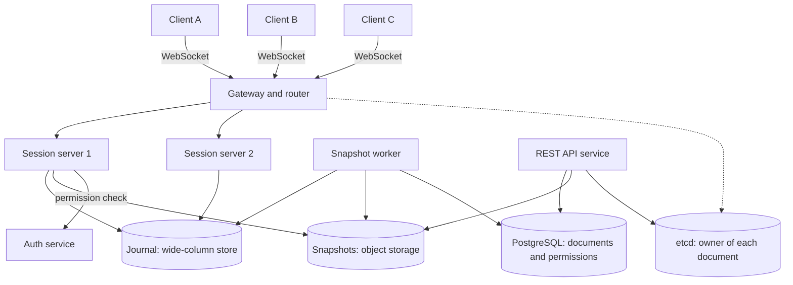
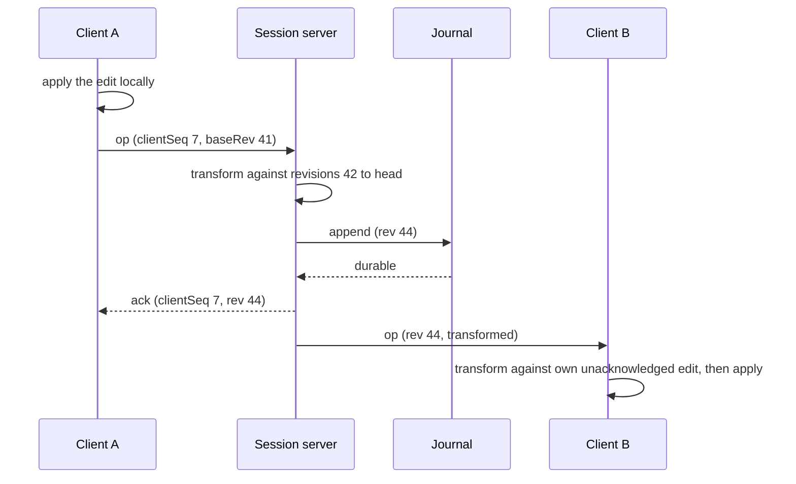

# Design a Collaborative Editor

A collaborative editor lets many people edit one document at the same time and see each other's changes within a fraction of a second. The hard part is not the transport. It is the merge: two people type at the same place at the same moment, and every screen must end with the same text that keeps both intentions. This case study gives the design that a strong candidate presents in 45 minutes: a server-ordered operational transformation (OT) protocol, one session server that owns each active document, a write-ahead journal with snapshots, and a presence channel for cursors. It compares the design with CRDTs and with the approach that Figma documents.

The merge theory (version vectors, CRDTs, OT, the Jupiter algorithm) has its home in [CRDTs and conflict resolution](../distributed-systems/06-crdts-and-conflict-resolution.md). This page links to it and uses its results. The chat design in [Design a Chat System](06-chat-system.md) solves the connection and fan-out part for messages. This page solves a harder problem on top of the same connections: concurrent edits to one shared state.

!!! note "About the sources"
    Figma documents its multiplayer system in two engineering posts, which this page cites. Google Docs, Notion, and Microsoft publish less detail, and this page does not claim how they work. Where the text says "Assumption" or "Recommendation", the choice belongs to this design, not to a source.

## Problem Statement

The interviewer says: "Design a collaborative document editor like Google Docs. Many users open the same document, type at the same time, and see each other's cursors. No edit is lost, and all users see the same text. The document is saved all the time."

The interviewer tests four skills: choosing a merge algorithm and defending it, keeping one consistent order of edits for each document, handling disconnects and a crashed server without losing data, and reasoning about the load that one hot document puts on one machine.

## Clarifying Questions

Ask these in the first 5 minutes. Each row gives the answer that this design assumes.

| Question | Assumed answer |
|---|---|
| What is in the document? | Rich text: paragraphs, inline formatting, lists, links. Tables, drawings, and embedded objects are out of scope. The text model is a sequence of characters with attributes |
| How many people edit one document? | Up to 100 editors at the same time. A document can also have viewers, who only read live (a follow-up covers 10,000 viewers) |
| Is there a server in the middle? | Yes. Users work through our servers. Peer-to-peer editing is out of scope |
| Offline editing? | Short disconnects (seconds to minutes): the client keeps editing and syncs on reconnect. Offline editing for days is a follow-up |
| How fast must a remote edit appear? | p99 below 500 ms between two users in the same region. The local edit appears at once |
| How much data may a server crash lose? | No acknowledged edit. The server acknowledges an edit only after it is durable |
| Do we keep version history? | Yes. Named versions and automatic versions. A user can view and restore an old version |
| What about permissions? | Owner, editor, commenter, viewer. The session server enforces them for each connection |
| Are comments and suggestions in scope? | Comments are a follow-up (they anchor to text ranges). Suggestions mode is out of scope |
| Who counts as the user base? | 10 million daily active users (DAU), each editing 20 minutes a day on average |
| Regions? | One region for the core design. Multi-region is a follow-up |
| Undo and redo? | Each user undoes only their own edits. This design describes the approach and leaves the details to a follow-up |

## Requirements

### Functional

1. A user creates, opens, and shares a document.
2. Several users edit the text at the same time. Every client converges to the same text.
3. A user sees the edits of others in real time, and sees the cursors and selections of others (presence).
4. The system saves the document continuously. A user who closes the tab and returns finds all acknowledged edits.
5. A user who loses the connection for a short time continues to edit. The client syncs on reconnect and no edit is lost or applied twice.
6. A user lists the versions of a document, views one, and restores it.
7. The system checks permissions on every connection and on every change of permission.

### Non-functional

| Requirement | Target |
|---|---|
| Convergence | After the clients stop typing and all messages arrive, every client holds the same text as the server |
| Local latency | The local edit shows at once (no wait for the network) |
| Remote latency | p99 below 500 ms in one region |
| Durability | An acknowledged edit survives the crash of any one server or storage node |
| Availability | 99.9% for editing. A failed session server is replaced within 15 seconds (assumption: a 10-second lease TTL plus the reconnect) |
| Scale | 480,000 concurrent editing sessions at the peak, and up to 100 editors in one document |
| Intent preservation | Concurrent inserts and deletes keep each user's meaning (see Deep Dives) |

## Estimation

Rounding rule: one day is 10^5 seconds (see the [estimation page](../back-of-envelope-estimation.md)).

Assumptions (each is a design input, not a measured fact): 10 million DAU, each editing 20 minutes (1,200 seconds) a day. The peak is 4 times the average. Each editing session sends 0.5 edit messages each second on average. The client batches keystrokes, so one message holds several characters. An edit message has 100 bytes. 60% of the sessions are alone in their document. The other 40% are in a shared document. Averaged over all sessions, a message goes to 1.5 other editors, so a session in a shared document sends each message to 1.5 / 0.4 = 3.75 other editors, and a shared document has 4.75 editors on average. Each session in a shared document sends 0.5 cursor messages each second of 50 bytes. One session server holds 50,000 connections and handles 20,000 incoming messages each second (assumption: for each message, one transform, one journal append, and a fan-out to about 4 connections). The journal keeps 30 days of operations, with 100 bytes for each. The system has 200 million documents with a 50 KB snapshot each. Storage keeps 3 replicas. An active document takes 1 MB of server memory (text, the retained history window, and presence). One hot document has 100 editors. Each editor sends 5 edit messages and 10 cursor messages each second (the client throttles the cursor to one message every 100 ms). The session server batches its outgoing messages for each connection in 50 ms windows (assumption).

| Step | Calculation | Result |
|---|---|---|
| Average concurrent sessions | 10,000,000 × 1,200 s / 10^5 s | 120,000 |
| Peak concurrent sessions | 120,000 × 4 | 480,000 |
| Edit messages in at the peak | 480,000 × 0.5 | 240,000 each second |
| Edit messages out | 240,000 × 1.5 | 360,000 each second |
| Edit bandwidth in | 240,000 × 100 B × 8 | 192 Mbit/s |
| Edit bandwidth out | 360,000 × 100 B × 8 | 288 Mbit/s |
| Presence in (shared sessions only) | 480,000 × 0.4 × 0.5 | 96,000 each second |
| Presence out | 96,000 × 3.75 | 360,000 each second (144 Mbit/s at 50 B) |
| Servers by connections | 480,000 / 50,000 | 10 |
| Servers by message rate | (240,000 + 96,000) / 20,000 | 16.8, so 17 |
| Servers needed | max(10, 17) | 17, so 34 with 2x headroom |
| Operations each day | 10,000,000 × 1,200 × 0.5 | 6 billion |
| Journal for each day | 6 × 10^9 × 100 B | 600 GB |
| Journal for 30 days | 600 GB × 30 | 18 TB |
| Journal for 30 days, 3 replicas | 18 TB × 3 | 54 TB |
| Snapshots | 200 × 10^6 × 50 KB | 10 TB |
| Snapshots, 3 replicas | 10 TB × 3 | 30 TB |
| Journal item writes at the peak | One item for each edit message | 240,000 each second |
| Single-editor documents at the peak | 480,000 × 0.6 | 288,000 |
| Shared documents at the peak | 480,000 × 0.4 / 4.75 editors each | About 40,421 |
| Active documents at the peak | 288,000 + 40,421 | About 328,421 (about 1.5 editors each on average) |
| Memory | 328,421 × 1 MB / 34 servers | About 9.7 GB for each server |
| One hot document, messages in | 100 × (5 edits + 10 cursors) | 1,500 each second (500 of them edits) |
| One hot document, messages out without batching | 1,500 × 99 | 148,500 each second (79.2 Mbit/s) |
| One hot document, frames out with 50 ms batching | 100 connections × 20 windows each second | 2,000 each second, each with about 75 messages |

What the numbers decide:

- **The message rate decides the server count, not the connection count.** 480,000 connections need only 10 servers, but the edit and presence messages need 17. Each message is cheap, and there are many of them.
- **The journal is the largest data set.** The 30-day journal holds 18 TB (54 TB with 3 replicas), against 10 TB of snapshots (30 TB with 3 replicas) for 200 million documents. A compaction job that turns old operations into snapshots is part of the core design, not an extra.
- **The journal takes one item write for each edit message.** A session server can put the items of many documents into one request to the store, which saves round trips. The store still writes, bills, and checks the condition of each item, so the store must absorb 240,000 item writes each second at the peak. Batching inside one document gives little: at 0.5 messages each second, a 20 ms window of one document holds 0.01 messages on average.
- **One document cannot be split, and the hot document needs batched fan-out.** The edits of one document must have one order, so one thread orders them. Ordering is cheap: 500 edits each second. The fan-out is the problem: without batching, the hot document sends 148,500 messages each second, which is 7 times the 20,000 messages each second that one server handles. The design resolves this with two rules. (1) The server batches its outgoing messages for each connection in 50 ms windows: each connection gets 20 frames each second, whatever the message rate, so the hot document costs 100 × 20 = 2,000 frame writes each second, which is 10% of one server's budget. The bandwidth stays 79.2 Mbit/s, which a server's network card carries. The window adds at most 50 ms to the remote latency, inside the 500 ms target. (2) The design caps a document at 100 editors. Above the cap, or for viewers, the owner publishes each batch once to a broadcast tier, and the broadcast servers hold the connections (Deep Dive 4).
- **Most documents have one editor.** 288,000 of the 328,421 active documents at the peak (88%) have one editor, so the average is about 1.5 editors for each active document. The design must make the one-editor case cheap: the session server still orders and saves the edits, and the fan-out is zero.

The program below recomputes the table. `main` comes first and the block has its own imports, so you can copy it into `EditorEstimate.java` and run `java EditorEstimate.java` on JDK 21.

```java
import java.util.Locale;

public class EditorEstimate {
    public static void main(String[] args) {
        double dau = 10_000_000;
        double editSecondsPerDay = 20 * 60;
        double dayUnits = 1e5;
        double avgConcurrent = dau * editSecondsPerDay / dayUnits;
        double peakFactor = 4;
        double peakSessions = avgConcurrent * peakFactor;
        System.out.println("== Sessions ==");
        System.out.println(line("average concurrent sessions", avgConcurrent));
        System.out.println(line("peak concurrent sessions (x4)", peakSessions));

        double opsPerSession = 0.5;
        double msgBytes = 100;
        double fanOut = 1.5;
        double opsIn = peakSessions * opsPerSession;
        double opsOut = opsIn * fanOut;
        System.out.println("== Edit traffic at the peak ==");
        System.out.println(line("edit messages in per second", opsIn));
        System.out.println(line("edit messages out per second", opsOut));
        System.out.println(line("inbound Mbit/s", opsIn * msgBytes * 8 / 1e6));
        System.out.println(line("outbound Mbit/s", opsOut * msgBytes * 8 / 1e6));

        double sharedShare = 0.4;
        double sharedFanOut = fanOut / sharedShare;
        double presencePerSession = 0.5;
        double presenceBytes = 50;
        double presenceIn = peakSessions * sharedShare * presencePerSession;
        double presenceOut = presenceIn * sharedFanOut;
        System.out.println("== Presence at the peak ==");
        System.out.println(line("presence messages in per second", presenceIn));
        System.out.println(line("presence messages out per second", presenceOut));
        System.out.println(line("presence outbound Mbit/s", presenceOut * presenceBytes * 8 / 1e6));

        double connPerServer = 50_000;
        double opsPerServer = 20_000;
        double byConnections = Math.ceil(peakSessions / connPerServer);
        double byOps = Math.ceil((opsIn + presenceIn) / opsPerServer);
        double needed = Math.max(byConnections, byOps);
        System.out.println("== Session servers ==");
        System.out.println(line("servers by connections", byConnections));
        System.out.println(line("servers by message rate", byOps));
        System.out.println(line("servers needed (max)", needed));
        System.out.println(line("servers with 2x headroom", needed * 2));

        double opsPerDay = dau * editSecondsPerDay * opsPerSession;
        double journalGbPerDay = opsPerDay * msgBytes / 1e9;
        double retentionDays = 30;
        double replicas = 3;
        System.out.println("== Storage ==");
        System.out.println(line("edit operations per day", opsPerDay));
        System.out.println(line("journal GB per day", journalGbPerDay));
        System.out.println(line("journal TB for 30 days", journalGbPerDay * retentionDays / 1000));
        System.out.println(line("journal TB with 3 replicas", journalGbPerDay * retentionDays
                * replicas / 1000));
        double docs = 200e6;
        double snapshotKb = 50;
        double snapshotTb = docs * snapshotKb * 1000 / 1e12;
        System.out.println(line("snapshot TB (200M docs x 50 KB)", snapshotTb));
        System.out.println(line("snapshot TB with 3 replicas", snapshotTb * replicas));

        System.out.println(line("journal item writes per second at the peak", opsIn));

        double soloDocs = peakSessions * (1 - sharedShare);
        double editorsPerSharedDoc = 1 + sharedFanOut;
        double sharedDocs = peakSessions * sharedShare / editorsPerSharedDoc;
        double activeDocs = soloDocs + sharedDocs;
        double memoryPerDocMb = 1;
        System.out.println("== Documents and memory ==");
        System.out.println(line("single-editor documents", soloDocs));
        System.out.println(line("shared documents", sharedDocs));
        System.out.println(line("active documents at the peak", activeDocs));
        System.out.println(line("average editors per active document", peakSessions / activeDocs));
        System.out.println(line("memory GB (1 MB per active document)", activeDocs * memoryPerDocMb
                / 1000));
        System.out.println(line("memory GB per server (34 servers)", activeDocs * memoryPerDocMb
                / 1000 / 34));

        double hotEditors = 100;
        double hotEdits = hotEditors * 5;
        double hotCursors = hotEditors * 10;
        double hotIn = hotEdits + hotCursors;
        double hotOut = hotIn * (hotEditors - 1);
        double hotMbit = (hotEdits * msgBytes + hotCursors * presenceBytes) * (hotEditors - 1) * 8
                / 1e6;
        double windowSeconds = 0.05;
        double framesOut = hotEditors / windowSeconds;
        System.out.println("== One hot document (100 editors, 5 edits + 10 cursors/s each) ==");
        System.out.println(line("messages in per second", hotIn));
        System.out.println(line("messages out per second, no batching", hotOut));
        System.out.println(line("outbound Mbit/s", hotMbit));
        System.out.println(line("frames out per second (50 ms windows)", framesOut));
        System.out.println(line("messages in each frame", hotIn * windowSeconds));
        System.out.println(line("share of one server's 20,000/s budget (%)",
                framesOut / opsPerServer * 100));
    }

    static String line(String label, double value) {
        return String.format(Locale.ROOT, "%-48s %,.1f", label, value);
    }
}
```

<!-- expected-output -->
```text
== Sessions ==
average concurrent sessions                      120,000.0
peak concurrent sessions (x4)                    480,000.0
== Edit traffic at the peak ==
edit messages in per second                      240,000.0
edit messages out per second                     360,000.0
inbound Mbit/s                                   192.0
outbound Mbit/s                                  288.0
== Presence at the peak ==
presence messages in per second                  96,000.0
presence messages out per second                 360,000.0
presence outbound Mbit/s                         144.0
== Session servers ==
servers by connections                           10.0
servers by message rate                          17.0
servers needed (max)                             17.0
servers with 2x headroom                         34.0
== Storage ==
edit operations per day                          6,000,000,000.0
journal GB per day                               600.0
journal TB for 30 days                           18.0
journal TB with 3 replicas                       54.0
snapshot TB (200M docs x 50 KB)                  10.0
snapshot TB with 3 replicas                      30.0
journal item writes per second at the peak       240,000.0
== Documents and memory ==
single-editor documents                          288,000.0
shared documents                                 40,421.1
active documents at the peak                     328,421.1
average editors per active document              1.5
memory GB (1 MB per active document)             328.4
memory GB per server (34 servers)                9.7
== One hot document (100 editors, 5 edits + 10 cursors/s each) ==
messages in per second                           1,500.0
messages out per second, no batching             148,500.0
outbound Mbit/s                                  79.2
frames out per second (50 ms windows)            2,000.0
messages in each frame                           75.0
share of one server's 20,000/s budget (%)        10.0
```

## API Design

Two interfaces serve the editor. REST handles document management and history. A WebSocket carries the live editing protocol (see [communication patterns](../fundamentals/09-communication-patterns.md) for the choice of WebSocket and for connection scale).

### REST

| Method and path | Request | Response |
|---|---|---|
| `POST /v1/docs` | `{title, templateId?}` | `201 {docId, rev: 0}` |
| `GET /v1/docs/{docId}` | none | `200 {docId, title, headRev, role}` |
| `GET /v1/docs/{docId}/session` | none | `200 {wsUrl, token, headRev}`. The URL points to the session server that owns the document. The token is short-lived and carries `docId`, `userId`, and the role |
| `GET /v1/docs/{docId}/snapshot?rev={n}` | none | `200 {rev, content}` or a `302` to a signed object-store URL for a large snapshot |
| `GET /v1/docs/{docId}/versions?cursor=...` | none | `200 {versions: [{rev, name, author, createdAt}], next}` |
| `POST /v1/docs/{docId}/restore` | `{rev}` | `200 {newRev}`. The restore is a new edit that sets the content of the old version, so history only grows |
| `PUT /v1/docs/{docId}/permissions` | `{principal, role}` | `204`. The server then tells the session server to re-check its connections |

### WebSocket protocol

All messages are JSON (or a compact binary form). A **revision** (`rev`) is the position of an operation in the document's one global order. A **site** is one client connection. A **client sequence number** (`clientSeq`) counts the messages that one site sent.

| Direction | Message | Fields | Meaning |
|---|---|---|---|
| Client to server | `hello` | `token, clientId, lastRev, unacked[]` | Open or reopen the session. `unacked` lists the operations that the client sent and did not see acknowledged |
| Server to client | `welcome` | `rev, snapshot` or `rev, catchUp[]` | The state to start from. A client that is only a few revisions behind gets the missing operations. Others get a snapshot |
| Client to server | `op` | `clientSeq, baseRev, ops[]` | One edit, made on the document state at revision `baseRev` |
| Server to client | `ack` | `clientSeq, rev` | The server accepted the edit and gave it revision `rev` |
| Server to client | `op` | `rev, site, ops[]` | The edit of another site, already transformed to apply on the state at revision `rev - 1` |
| Both | `presence` | `cursor, selection, name, color` | Ephemeral. Not saved |
| Server to client | `resync` | `reason` | The client must discard its state and reload (for example, its `baseRev` is older than the retained history) |

Rules: the client sends one `op` at a time and waits for its `ack` (the Deep Dives explain why). The server keeps the last accepted `clientSeq` for each site. It does not apply an `op` whose `clientSeq` is not higher, and it answers it with the `ack` again, so a client that resent a message does not wait forever. The client sends heartbeats, and the server closes a silent connection after 30 seconds (assumption).

## Data Model

| Store | Content | Key | Why |
|---|---|---|---|
| PostgreSQL (sharded by `docId` hash, or a managed relational service) | `documents(doc_id PK, owner_id, title, head_rev, snapshot_rev, snapshot_key, created_at)` and `permissions(doc_id, principal, role)` with primary key `(doc_id, principal)` and an index on `(principal)` for "shared with me" | `doc_id` | Metadata is small, relational, and needs transactions for sharing and ownership. The write rate is low |
| Wide-column or key-value store (DynamoDB or Cassandra) | The **journal**: one row for each accepted edit. Columns: `doc_id, rev, site, client_seq, ops, created_at` | Partition key `doc_id`, sort key `rev` | The journal is append-only and takes 240,000 item writes each second at the peak. It is read as a range (`rev > n`) for one document. A conditional write (`rev` must not exist) makes a second writer for the same revision fail |
| Object storage (S3 or similar) | **Snapshots**: the full document at a revision. Key: `docs/{doc_id}/{rev}.snap` | Object key | Snapshots are large, immutable, and read whole (see [storage types](../fundamentals/10-storage-types.md)) |
| etcd or ZooKeeper | **Ownership**: `/docs/{doc_id}/owner` holds the id of the session server, attached to a lease | Key | The one place that says which server orders a document. It is small and needs consensus (see [consensus and leader election](../distributed-systems/02-consensus-and-leader-election.md)) |
| Session server memory | The live document, the recent operations, the connections, the presence | `doc_id` | Presence is short-lived and does not need storage |

Why this split: the document state is rebuilt from the latest snapshot plus the journal rows after it. The metadata database never sees the edit rate. Figma's engineering post on multiplayer reliability describes the same shape: the multiplayer process holds the file in memory, writes periodic checkpoints to S3, and writes changes to a write-ahead journal in DynamoDB. It reports that the journal handles more than 2.2 billion received changes each day, and that 95% of edits are saved within 600 ms. (Figma chose DynamoDB because the write volume called for a horizontally scalable database, and it rejected PostgreSQL for the journal for that reason.)

An alternative is to keep the journal in the same PostgreSQL shards. PostgreSQL can insert the rows of many documents in one transaction (one commit for many rows), so a sharded cluster can hold 240,000 row inserts each second with enough shards, and the design then has one store fewer. This page picks the wide-column store because the access pattern (append, then read a range for one key) matches its model, and it separates the journal's growth from the metadata database.

## High-Level Design



| Component | Responsibility |
|---|---|
| Client | Holds the local copy of the document. Applies the user's edit at once, sends it to the server, and transforms incoming edits against its unacknowledged edits. Renders cursors |
| Gateway and router | Ends TLS, authenticates the token, and routes the WebSocket to the session server that owns the document. It reads the owner from etcd (and caches it). If no server owns the document, it asks a server to take it |
| Session server | The single writer for each document that it owns. It orders edits (assigns revisions), transforms them against concurrent edits, writes them to the journal, acknowledges, and broadcasts. It also keeps presence and enforces permissions |
| Journal | The durable, ordered record of all edits of all documents |
| Snapshot worker | Turns the journal into snapshots at fixed intervals (for example every 1,000 operations or 5 minutes), updates `snapshot_rev` in the metadata database, and deletes old journal rows after the retention period |
| REST API service | Document management, version listing, restore, and sharing |
| etcd | Ownership leases. One owner for each active document |
| Auth service | Validates tokens and answers permission checks |

**Flow of one edit.**



The client does not wait for the `ack` to show its own edit. It waits only before it sends the next edit.

## Deep Dives

### 1. The merge algorithm: server-ordered OT, and why not a CRDT

**The problem.** Alice and Bob both see `hello`. Alice inserts `!` at position 5. Bob deletes the character at position 0. Without a merge rule, Alice's screen ends with `ello!` and Bob's screen ends with `ello` followed by an insert at a position that now points past the end of the text. The positions that clients send refer to different document states.

**The options.**

| Option | How it merges | Needs a central order | Fits |
|---|---|---|---|
| Locks (one editor at a time, or one paragraph) | Prevents the conflict | Yes | Simple documents. It blocks collaboration and the lock holder can disconnect |
| Last-writer-wins on the whole document | Keeps the last save | No | Never for text. It loses all concurrent work |
| OT with a central server (Jupiter style) | The server orders edits. A function transforms an edit against edits that it did not see | Yes, one server for each document | Real-time text with a server in the path |
| Sequence CRDT (RGA, Yjs, Automerge) | Each character has a unique identifier, and an insert names its left neighbor | No | Peer-to-peer, offline-first, long divergence |
| Property-level last-writer-wins (Figma) | For each object property, the last value that the server received wins | Yes, the server | Structured documents (design files), not text inside one property |

The theory of OT and CRDTs, with the Jupiter paper's `xform` function and a runnable transform, is in [CRDTs and conflict resolution](../distributed-systems/06-crdts-and-conflict-resolution.md). Summary: OT keeps positions as numbers and changes (transforms) an operation so that it has the intended effect after the concurrent operations ran. The Jupiter paper (Nichols, Curtis, Dixon, and Lamping, 1995) simplified OT by routing every client through a central server over a two-party protocol, because a fully distributed algorithm "must be prepared to handle a change from any participant at any time".

**Recommendation: server-ordered OT.** The reasons for this design:

1. The server is in the path anyway: it authenticates, authorizes, saves, and keeps the history. A central order costs nothing extra.
2. Each client needs only a two-party transform against the server. The hard part of OT (many sites, any order) goes away.
3. Metadata stays small. A sequence CRDT stores an identifier for each character and a tombstone for each deleted character, until garbage collection. OT stores only the operation history, which the server already keeps in the journal.
4. A global revision number gives history, restore, and "who changed what" for free.

**What the design pays.** OT needs correct transform functions for every pair of operation types (insert, delete, format, and so on). The number of pairs grows with each new operation. A bug in one pair makes the clients diverge, so the test plan must include a fuzz test that applies random concurrent operations in random orders and checks convergence. Offline editing for long periods is expensive: a client that has `m` unacknowledged operations and a server that has `n` newer operations need `m × n` transforms (see the follow-up on offline editing).

**When a CRDT is better.** The product must work peer-to-peer, or offline for days, or without a server that you run. Then use a sequence CRDT. Yjs describes itself as "a high-performance CRDT for building collaborative applications that sync automatically" and says that updates can be applied in any order. Automerge documents offline edits that merge later with no central server, and also states that a centralized server "works fine too". Kleppmann, Wiggins, van Hardenberg, and McGranaghan argue for CRDTs as a base for local-first software (see the CRDT page). A newer line of work, Eg-walker (Gentle and Kleppmann, EuroSys 2025), targets the weak points of both families. Its abstract says that OT is slow to merge documents that diverged through long offline editing, and CRDTs are slow to load and use much memory. The abstract reports that, compared with existing CRDTs, Eg-walker "consumes an order of magnitude less memory in the steady state" and loads a document from disk orders of magnitude faster, and that, compared with OT, "merging long-running branches is orders of magnitude faster". The paper is a recent result. A design for an interview does not need it, and it shows that the choice is still an active one.

**Interleaving.** Convergence alone does not make a CRDT usable. Kleppmann, Gomes, Mulligan, and Beresford ("Interleaving anomalies in collaborative text editors", PaPoC 2019) show that several published algorithms can interleave two concurrently inserted words character by character, which gives an unreadable jumble. The paper proposes a specification that rules the anomaly out. If an interviewer asks about CRDT text, name this anomaly and say that you would pick a library that handles it.

**What Figma does.** Figma's post "How Figma's multiplayer technology works" (2019) says that Figma chose not to use OT and is "inspired by" CRDTs, and "Figma isn't using true CRDTs though". The document is a tree of objects. Each object has an ID and a set of property values, which the post compares to a `Map<ObjectID, Map<Property, Value>>`. The server tracks the latest value for each property of each object, so edits to different properties never conflict. For the same property, the document ends with the last value that the server received. Child order uses fractional indexing: a position is a fraction between 0 and 1, and an object goes between two others by taking the average of their positions. The server rejects a parent change that would make a cycle. The post notes a result of this choice: text edits are atomic at the property level, so simultaneous edits of one text property cannot merge. A rich-text editor needs a merge inside the text, so it needs OT or a sequence CRDT, which is why this page does not copy Figma's rule for text.

**Intent preservation.** The merge must keep what each user meant, not only produce equal text. Example: Alice inserts at position 3 while Bob inserts at position 3. The transform needs a tie-break rule (for example, the lower site number goes first) so that both orders produce the same text. The delete-delete case needs a rule too: both users deleted the same character, and the second delete becomes a no-op. The CRDT page shows both rules in runnable code.

### 2. The client-server protocol

This is the part of the design that interviewers ask a candidate to write on the whiteboard. The protocol uses Jupiter's two-party transform, with one restriction that Google Wave added: each client has at most one message in flight. Jupiter itself does not wait. A Jupiter site sends each operation at once, keeps the sent operations in an outgoing queue until the other side acknowledges them, and transforms each incoming message against that queue. Then the server must keep a separate state space for each client. The Google Wave OT whitepaper (Wang, Mah, and Lassen) describes the change: Wave "modifies the basic theory of OT by requiring the client to wait for acknowledgement from the server before sending more operations". With that rule, "the server only needs to have a single state space, which is the history of operations it has applied". This design uses the Wave rule, because one history for each document is also the journal.

**Server.** The server keeps a log of accepted operations. The log position is the revision. A client message carries `baseRev`, the revision of the document state that the client had applied when it made the edit. The server transforms the operation against every log entry from `baseRev` to the head, one after the other, then applies it, appends it, and broadcasts it. The server only transforms against operations that it already ordered, so the transforms are two-party.

**Client.** The client keeps three things: the document, the revision of the last server operation that it applied, and the operations that the server has not acknowledged. It holds one in-flight message and a buffer of later edits.

1. The user edits. The client applies the edit to its document at once. If nothing is in flight, the edit becomes the in-flight message with `baseRev = rev`. If a message is in flight, the edit goes into the buffer.
2. The server sends an operation from another site. The client transforms it against the in-flight operation, then against each buffered operation, and at each step also transforms its own operation against the incoming one. The client applies the result to its document. The in-flight message on the wire stays as it was sent, because the server transforms it by itself. The client keeps the transformed copy only to transform later incoming operations.
3. The server sends the `ack` for the in-flight message. The client sets `rev` to the acknowledged revision and sends the whole buffer as the next message (the `ops[]` field holds several operations), with `baseRev = rev`. The Wave whitepaper describes the same step: the client caches its edits while it waits and sends them in bulk. A fast typist then needs one round trip for each batch, not for each keystroke. The demo below sends one buffered operation at a time to keep the code short.

One message in flight keeps the server simple: every client message is defined on a state that is in the server's history (revision `baseRev`), so the server transforms it against one list of operations. The incoming operation at the client can only be concurrent with the in-flight operation and the buffer, and the buffer is defined on the state after the in-flight operation. With several messages in flight (plain Jupiter), a client message can be defined on a state that mixes the client's own unacknowledged operations with server operations, and that state is not in the server's history. The server must then keep a state space for each client, as Jupiter does.

The program below runs this protocol. Two clients edit `hello` at the same time. Bob makes two edits while his first is in flight, so the second waits in the buffer. The program delivers messages in a fixed order and prints the log and the final text of each site. It also sends one message twice, to show that the server applies it once. (A production server answers the duplicate with the `ack` to the sender. The demo shows only that no second broadcast and no second change happen.) The transform functions are the ones of the CRDT page, with one more rule: an operation that is a no-op stays a no-op. `main` comes first, and the block has its own imports, so you can copy it into `OtSessionDemo.java` and run `java OtSessionDemo.java` on JDK 21.

```java
import java.util.ArrayList;
import java.util.List;

public class OtSessionDemo {
    public static void main(String[] args) {
        System.out.println("== Two clients edit at the same time ==");
        Server server = new Server("hello");
        Client alice = new Client(1, server.text());
        Client bob = new Client(2, server.text());
        alice.edit(Op.insert(5, '!', 1));
        bob.edit(Op.delete(0, 2));
        bob.edit(Op.insert(0, 'J', 2));
        System.out.println("alice sees " + alice.text() + ", bob sees " + bob.text()
                + ", server has " + server.text());

        Msg fromBob = bob.takeOutgoing();
        Msg fromAlice = alice.takeOutgoing();
        System.out.println("server receives bob's " + fromBob.op() + " at base "
                + fromBob.baseRev());
        List<Broadcast> b1 = server.receive(fromBob);
        System.out.println("server receives alice's " + fromAlice.op() + " at base "
                + fromAlice.baseRev());
        List<Broadcast> b2 = server.receive(fromAlice);
        System.out.println("server log: " + server.log());
        deliver(b1, alice, bob);
        deliver(b2, alice, bob);
        Msg next = bob.takeOutgoing();
        System.out.println("bob sends buffered " + next.op() + " at base " + next.baseRev());
        deliver(server.receive(next), alice, bob);
        System.out.println("alice: " + alice.text() + " rev " + alice.rev());
        System.out.println("bob:   " + bob.text() + " rev " + bob.rev());
        System.out.println("server: " + server.text() + " rev " + server.rev());
        System.out.println("converged: " + (alice.text().equals(server.text())
                && bob.text().equals(server.text())));

        System.out.println("== A resent message is applied once ==");
        Server s2 = new Server("ab");
        Client c = new Client(3, s2.text());
        c.edit(Op.insert(2, 'c', 3));
        Msg m = c.takeOutgoing();
        s2.receive(m);
        List<Broadcast> again = s2.receive(m);
        System.out.println("server text " + s2.text() + ", rev " + s2.rev()
                + ", duplicate answered with " + again.size() + " broadcast");
    }

    static void deliver(List<Broadcast> list, Client... clients) {
        for (Broadcast b : list) {
            for (Client c : clients) {
                c.receive(b);
            }
        }
    }
}

/** An operation on a text. Positions start at 0. Position -1 means a no-op. */
record Op(boolean isInsert, int pos, char ch, int site) {
    static Op insert(int pos, char ch, int site) {
        return new Op(true, pos, ch, site);
    }

    static Op delete(int pos, int site) {
        return new Op(false, pos, '-', site);
    }

    String apply(String text) {
        if (pos < 0) {
            return text;
        }
        return isInsert
                ? text.substring(0, pos) + ch + text.substring(pos)
                : text.substring(0, pos) + text.substring(pos + 1);
    }

    /** Returns this operation, changed so that it has the same effect after other ran. */
    Op transformAgainst(Op other) {
        if (pos < 0 || other.pos < 0) {
            return this;
        }
        if (isInsert && other.isInsert) {
            boolean shift = pos > other.pos || (pos == other.pos && site > other.site);
            return new Op(true, shift ? pos + 1 : pos, ch, site);
        }
        if (isInsert) {
            return new Op(true, pos <= other.pos ? pos : pos - 1, ch, site);
        }
        if (other.isInsert) {
            return new Op(false, pos < other.pos ? pos : pos + 1, ch, site);
        }
        if (pos == other.pos) {
            return new Op(false, -1, ch, site);
        }
        return new Op(false, pos < other.pos ? pos : pos - 1, ch, site);
    }

    @Override
    public String toString() {
        if (pos < 0) {
            return "no-op";
        }
        return isInsert ? "ins(" + pos + "," + ch + ")" : "del(" + pos + ")";
    }
}

/** A client message: one operation, the server revision it was made on, and a sequence number. */
record Msg(int site, int clientSeq, int baseRev, Op op) {}

/** The server's answer for one accepted operation. The revision is the position in the log. */
record Broadcast(int rev, int site, int clientSeq, Op op) {}

/** The session server. It is the single writer of one document. */
class Server {
    private String text;
    private final List<Op> log = new ArrayList<>();
    private final List<Broadcast> sent = new ArrayList<>();

    Server(String text) {
        this.text = text;
    }

    List<Broadcast> receive(Msg msg) {
        for (Broadcast done : sent) {
            if (done.site() == msg.site() && done.clientSeq() == msg.clientSeq()) {
                return List.of();
            }
        }
        Op op = msg.op();
        for (int i = msg.baseRev(); i < log.size(); i++) {
            op = op.transformAgainst(log.get(i));
        }
        text = op.apply(text);
        log.add(op);
        Broadcast out = new Broadcast(log.size(), msg.site(), msg.clientSeq(), op);
        sent.add(out);
        return List.of(out);
    }

    String text() {
        return text;
    }

    int rev() {
        return log.size();
    }

    List<Op> log() {
        return log;
    }
}

/**
 * A client. One message is in flight at a time. Later edits wait in a buffer. The message that
 * was sent stays as it was sent (for a resend). The field inFlightNow holds the same edit,
 * transformed against the server operations that arrived since.
 */
class Client {
    private final int site;
    private String text;
    private int rev = 0;
    private int nextSeq = 1;
    private Msg inFlight = null;
    private Op inFlightNow = null;
    private final List<Op> buffer = new ArrayList<>();

    Client(int site, String text) {
        this.site = site;
        this.text = text;
    }

    void edit(Op op) {
        text = op.apply(text);
        if (inFlight == null) {
            inFlight = new Msg(site, nextSeq++, rev, op);
            inFlightNow = op;
        } else {
            buffer.add(op);
        }
    }

    /** Returns the message to send now, or null if nothing waits for the server. */
    Msg takeOutgoing() {
        return inFlight;
    }

    void receive(Broadcast b) {
        if (b.site() == site) {
            rev = b.rev();
            inFlight = null;
            inFlightNow = null;
            if (!buffer.isEmpty()) {
                inFlightNow = buffer.remove(0);
                inFlight = new Msg(site, nextSeq++, rev, inFlightNow);
            }
            return;
        }
        Op incoming = b.op();
        if (inFlight != null) {
            Op mine = inFlightNow;
            inFlightNow = mine.transformAgainst(incoming);
            incoming = incoming.transformAgainst(mine);
        }
        for (int i = 0; i < buffer.size(); i++) {
            Op mine = buffer.get(i);
            buffer.set(i, mine.transformAgainst(incoming));
            incoming = incoming.transformAgainst(mine);
        }
        text = incoming.apply(text);
        rev = b.rev();
    }

    String text() {
        return text;
    }

    int rev() {
        return rev;
    }
}
```

<!-- expected-output -->
```text
== Two clients edit at the same time ==
alice sees hello!, bob sees Jello, server has hello
server receives bob's del(0) at base 0
server receives alice's ins(5,!) at base 0
server log: [del(0), ins(4,!)]
bob sends buffered ins(0,J) at base 1
alice: Jello! rev 3
bob:   Jello! rev 3
server: Jello! rev 3
converged: true
== A resent message is applied once ==
server text abc, rev 1, duplicate answered with 0 broadcast
```

Points to notice:

- Alice's `ins(5,!)` was made on revision 0, but Bob's `del(0)` got revision 1 first. The server transforms Alice's operation against it and stores `ins(4,!)`.
- Bob's buffered `ins(0,J)` leaves the client only after the `ack`, with `baseRev` 1. The transformed `ins(4,!)` reaches Bob after his own insert, and Bob's client moves it to position 5 before it applies it.
- All three copies are `Jello!`. The server log has three entries, and the revision is the log length.
- The duplicate message produced no second broadcast and no second change.

**Reconnect.** A client that loses its connection keeps editing, and its new edits go into the buffer. On reconnect it sends `hello` with `lastRev` and its in-flight message, unchanged (same `clientSeq` and `baseRev`). The server compares the `clientSeq` with the last one that it accepted from that site. If the server already accepted it (the server crashed or the connection broke after the journal write), the server sends the `ack` with its revision. If not, the server transforms the message against the operations since `baseRev` and accepts it. Then the server sends the operations that the client missed after `lastRev`, or a snapshot if the gap is larger than the retained history window. The client transforms its buffer against the missed operations, as in step 2, and continues with step 3. A client that is too far behind (`resync`) reloads, and keeps its unsent edits as a local copy for the user to apply again.

**What the server must not do.** It must not apply an operation before it has transformed it against all operations since `baseRev`. It must not accept an operation with a `baseRev` that is higher than its head (a bug or an attack, so close the connection).

### 3. Session ownership, persistence, and failover

**One owner for each document.** The order of edits exists only if one process orders them. The session server that owns a document keeps the document in memory and runs its operations in one thread (an actor or a single-threaded executor for each document). Figma's post says that its servers "spin up a separate process for each multiplayer document", and this design uses the same principle, with many documents for each server.

**How a document finds its owner.** A client calls `GET /v1/docs/{id}/session`. The API service reads `/docs/{id}/owner` from etcd. If a server holds a live lease, it returns that server's URL. If not, it picks a server by load (or consistent hashing of `docId`) and asks it to claim the document: the server creates the key with a lease and keeps the lease alive. The etcd lease and revision, and the leader election pattern, are in [consensus and leader election](../distributed-systems/02-consensus-and-leader-election.md). Figma's reliability post describes a similar ownership check: it locks the file "via a new table in DynamoDB".

**The stale owner problem.** A session server can pause (a long garbage collection, a network cut), lose its lease, and wake up while another server owns the document. Both would write to the journal. Fencing stops this (see [distributed locks and leases](../distributed-systems/05-distributed-locks-and-leases.md)). The ownership key's etcd revision increases with each new owner, so it serves as an **epoch**. The journal enforces the order with two rules:

1. Each journal append is a conditional write: it succeeds only if the row for `(doc_id, rev)` does not exist (`attribute_not_exists` in DynamoDB, `IF NOT EXISTS` in Cassandra).
2. A new owner, after it loads the journal tail up to revision `h`, writes a marker row at `h + 1` with its epoch, with the same condition, before it accepts edits. If the write fails, an old owner appended in the meantime: the new owner reads the tail again and retries at the next revision. The marker is a no-op operation in the log, so the revisions stay contiguous, and clients that catch up receive it as a no-op.

The old owner's next append targets the revision that the marker holds, so it fails, and the old owner closes its connections. An append of the old owner that succeeded before the marker is in the journal, and the new owner loaded it, so the old owner's acknowledged edits stay valid. An alternative is a fence item with the current epoch for each document, and an append that is a transaction: a `ConditionCheck` on the fence item and the `Put` of the row (`TransactWriteItems` in DynamoDB, which costs two write units for each item). Figma's reliability post describes the second shape: journal writes are "conditional on the lock UUID matching in the other table", with strongly consistent reads.

**Durable before acknowledged.** The server writes an operation to the journal before it sends the `ack` and the broadcast. A group commit collects the operations of all the documents on one server that arrive in a short window (assumption: up to 20 ms) and sends them to the journal in one request, so the round trip is shared. One server takes about 240,000 / 34 = 7,000 edit messages each second, so a 20 ms window holds about 140 items. The store still writes and checks each item, so the item rate (240,000 each second) is what the journal must absorb. A conditional write in DynamoDB needs one `PutItem` for each item, or a `TransactWriteItems` call (the conditional checks do not work in `BatchWriteItem`), so the group commit saves round trips and connections, not item writes.

Recommendation: acknowledge and broadcast only after the journal write succeeds. The reason: if the server broadcasts first and then crashes before the write, other clients have applied an operation that no longer exists in history. The clients diverge from the server and can only recover by reloading. The cost of the rule is one journal round trip (a few milliseconds in one region, approximate) on the path of each remote edit. Figma's reliability post shows a different choice: the journal is "asynchronously written to as multiplayer accepts incoming changes", and the goal is "<1s of data loss". The post illustrates the gain as writes "every 0.5 seconds vs. every 60 seconds", against the earlier checkpoints of the whole file every 30 to 60 seconds. That choice trades a short loss window for lower latency, and it fits an editor where a client can resend the lost edits. State both options in an interview and pick one with the reason.

**Snapshots and compaction.** Replaying a long journal on every load is slow. The snapshot worker writes a snapshot at a revision, records `snapshot_rev` in the metadata database, and keeps journal rows for the retention window (30 days in the estimation). A load reads the latest snapshot and the journal rows after it. Named versions point to a snapshot revision. A restore creates a new revision that sets the old content, so history only grows.

**Failover.** If the session server dies, its etcd lease expires after the lease TTL (assumption: 10 seconds). The clients see the closed connection and reconnect with backoff and jitter (see [reliability patterns](../fundamentals/12-reliability-patterns.md)). The new owner loads the snapshot and the journal tail, and the clients run the `hello` flow. Edits that were acknowledged are in the journal. Edits that were not acknowledged are in the clients' in-flight message and buffer, and the clients resend them. Nothing acknowledged is lost, and nothing is applied twice, because of the `(site, clientSeq)` check.

### 4. Presence, fan-out, and the hot document

**Presence** is the cursor, the selection, and the name and color of each user. It changes often and has no value after the session ends, so the design does not store it. The session server keeps it in memory and broadcasts it. The client throttles cursor messages (assumption: at most one every 100 ms). A user who disconnects disappears after the heartbeat timeout.

A cursor is a position in the text, and the text changes under it. The server stores each cursor as a position and transforms it with every operation, exactly as it transforms an insert: an insert before the cursor moves it right, a delete before it moves it left. In a CRDT, the cursor attaches to a character identifier instead, and it moves with that character. Comment anchors and bookmarks have the same shape (see the follow-up on comments).

**Fan-out for one document.** The server sends each operation to every other connection of the document. A document with 100 editors, each sending 5 edits and 10 cursor messages each second, gives 148,500 outbound messages each second and 79.2 Mbit/s (see Estimation). That is 7 times the 20,000 messages each second that one server handles, so the server must not send them one by one. The fan-out cost grows with the square of the editor count: doubling the editors quadruples the outbound messages. The design uses three rules:

1. **Batch for each connection.** The server keeps an outgoing buffer for each connection and flushes it every 50 ms as one frame. A connection gets 20 frames each second, whatever the message rate. The hot document then costs 100 × 20 = 2,000 frame writes each second (10% of one server's budget), each frame with about 75 messages. The server can also merge the cursor messages of one user in a window and send only the last position. The window adds at most 50 ms to the remote latency.
2. **Cap the editors** at 100 for each document. The cap bounds the square term. A user above the cap joins as a viewer.
3. **Broadcast tier above the cap.** If a product needs more active participants, the owner publishes each batch once to a topic for the document, and broadcast servers hold the connections (the same tier as for viewers, below). The owner then sends one copy of each batch, and the broadcast tier does the fan-out.

The one-message-in-flight rule also has a cost for a fast typist: an editor who sends 5 messages each second needs a round trip of at most 200 ms. If the round trip is longer, the client batches more keystrokes into each message, and the message rate falls. Nothing is lost.

**Viewers.** A webinar document can have 10,000 viewers who only read. The session server should not hold them. Recommendation: the session server publishes each accepted operation to a topic for the document, and a tier of fan-out servers holds the viewers' connections and subscribes to the topic, as in the chat design (see [Design a Chat System](06-chat-system.md) and [communication patterns](../fundamentals/09-communication-patterns.md)). Viewers use SSE or WebSocket and receive operations in revision order. If a viewer misses a revision, it fetches the gap from the journal. The owner then sends each operation once to the topic, and the number of viewers does not load it.

**Permissions.** The session server checks the token's role at `hello`. If the owner changes a permission, the API service sends a message to the session server that owns the document, and the server downgrades or closes the affected connections. A viewer's connection must reject `op` messages.

## Bottlenecks and Scaling

| What fails first | Why | Fix |
|---|---|---|
| The message rate on a session server (17 servers needed at the peak against 10 for connections) | Each edit and cursor message costs a transform, a journal write, and a fan-out | Add servers, batch journal writes, batch outgoing messages in 20 to 50 ms windows, and throttle presence |
| One hot document | One thread orders one document. The fan-out grows with the square of the editor count: 148,500 messages each second for 100 editors without batching | Batch outgoing messages for each connection in 50 ms windows (2,000 frames each second). Cap the editors at 100. Send viewers, and any participants above the cap, through a broadcast tier. Give the document a dedicated server if needed |
| The journal write rate | 240,000 item writes each second at the peak | Partition by `doc_id`. Send the items of many documents in one request (group commit). Merge the keystrokes of one user into fewer messages on the client. A wide-column store scales horizontally |
| Journal growth (600 GB each day) | Every operation is stored | Compact into snapshots. Expire raw operations after the retention window. Merge adjacent single-character operations of one user into one journal entry |
| Reconnect storms | A failed session server or a deploy disconnects thousands of clients at once | Clients reconnect with exponential backoff and jitter. Drain a server gradually during a deploy. The new owner loads documents on demand |
| Memory on a session server | About 328,000 active documents at 1 MB each (9.7 GB for each of 34 servers) | Unload a document when its last editor leaves (after a short delay). Keep the retained history window small |
| etcd write load | Each document claim and lease renewal is a write to a consensus group | Use one lease for each session server and attach many ownership keys to it. etcd supports many keys on one lease |
| Slow transforms for a client that was offline | `m × n` transforms for `m` pending and `n` newer operations | Limit the offline window (for example 24 hours). Beyond it, the client reloads and keeps its edits as a separate suggestion, or the design moves to a CRDT or to Eg-walker |
| Region failure | One region owns the documents | See the multi-region follow-up and [multi-region and disaster recovery](../fundamentals/19-multi-region-and-disaster-recovery.md) |

## Trade-offs

| Decision | Chosen | Rejected | Reason |
|---|---|---|---|
| Merge algorithm | Server-ordered OT | Sequence CRDT | A server is in the path. Metadata stays small. History comes with the order. A CRDT fits better for peer-to-peer and offline-first products |
| Order of edits | One session server for each document | Several writers with a distributed order | One writer gives a total order with no consensus on the hot path. The cost is a cap on the editors of one document and a failover step |
| Durability | Journal write before ack | Asynchronous journal write (Figma's choice, from its reliability post) | No client ever holds an operation that history lacks. The cost is a journal round trip on each remote edit |
| Journal store | Wide-column or key-value store | The same PostgreSQL as the metadata | The access pattern is append and range read. The write volume is high and grows with usage. PostgreSQL shards would also work |
| Snapshots | Object storage plus a pointer in PostgreSQL | Rebuild from the journal on each load | A load reads one snapshot and a short journal tail |
| Messages in flight | One at a time for each client (Google Wave's rule) | Several, as in plain Jupiter | The server keeps one history for each document instead of a state space for each client. The cost is one round trip between two sends from a client. The client buffers meanwhile and sends the buffer as one message |
| Presence | In memory on the session server, not stored | Stored in the journal or a database | Presence has no value after the session. Storage would add write load for nothing |
| Offline | A bounded offline window | Unbounded offline editing | OT cost grows with the history to transform. A CRDT handles long divergence better |
| Undo | Per user, with inverse operations that are transformed | One global undo | Users expect to undo their own edits only |
| Viewers | A separate fan-out tier | The session server holds them | The owner sends each operation once to the topic |

## Follow-up Questions

??? question "A user edits offline for two days and then reconnects. What happens?"

    **Direct answer:** with server-ordered OT, the client has a long list of unacknowledged operations and the server has a long list of newer operations. The server must transform each pending operation against each newer one, which costs `m × n` transforms and can take a long time or a lot of memory for large `m` and `n`. For a short offline period, the cost is small.

    **Design choices:** (1) Limit the offline window (assumption: 24 hours) and keep the server's retained history for that window. A client that is older than the window gets `resync`, and the app keeps the offline edits as a separate copy that the user merges by hand. (2) Use a sequence CRDT for the document, because it merges long divergence by construction (Yjs and Automerge document this use). (3) Use a newer algorithm such as Eg-walker, whose paper reports faster merges of long-running branches than OT. The CRDT costs metadata for each character and needs garbage collection of tombstones.

    **Recommendation:** for a product with occasional short disconnects, (1). For an offline-first product, (2).

??? question "The session server crashes while 50 users edit one document. What do users see and what is lost?"

    **Direct answer:** the users see a disconnect for about the lease TTL plus the reconnect time (assumption: 10 to 15 seconds). They lose no acknowledged edit. They keep typing locally during the outage, and their clients resend the unacknowledged edits after the reconnect.

    **Mechanism:** the server acknowledged an edit only after the journal write succeeded, so every acknowledged edit is in the journal. The etcd lease expires, a new server claims the document with a higher epoch, loads the latest snapshot and the journal tail, and accepts the `hello` messages. Each client sends `lastRev` and its in-flight operation. The server skips operations that it already has (`(site, clientSeq)` is in the journal) and transforms the others against the operations since `baseRev`.

    **Edge case:** the old server may not be dead, only paused. When it wakes, its journal writes fail the epoch check. Without fencing, two servers could write different operations for the same revision.

??? question "Why do you use a central server for OT? Can the clients exchange operations with each other?"

    **Direct answer:** a central server makes the transform two-party and gives one total order. Peer-to-peer OT must transform an operation against concurrent operations from any number of sites in any order, and the transform functions must satisfy extra properties for that. The Jupiter paper says that getting all the cases right in a distributed algorithm is "very difficult", and it uses a server to avoid that.

    **Trade-off:** the server is a single point of ordering for each document (made safe by failover), and users cannot work without it. A CRDT gives up the central order and the cost is metadata for each character. For a product that needs a server anyway (authentication, storage, history), the central order costs nothing extra.

??? question "How do you test that the merge algorithm is correct?"

    **Direct answer:** with a convergence fuzz test, in addition to unit tests for each pair of operation types.

    **Method:** generate random documents and random concurrent operations for two or three simulated clients. Deliver the messages in random orders that respect each client's own order. Check that every client and the server end with the same text, and that the text contains each user's inserted characters unless another user deleted them. Run millions of cases in CI. Add the failing case as a regression test each time the fuzz finds one. Also test reconnect (duplicate messages, resends) and an operation with a stale `baseRev`.

    **Why it matters:** OT bugs appear only for rare pairs and orders. The tests on common paths do not find them. The Jupiter paper notes that "the best transformations are not always obvious", so the test must check the result, not the code.

??? question "How do you add 10,000 read-only viewers to a document with 5 editors?"

    **Direct answer:** do not connect the viewers to the session server. The session server publishes each accepted operation to a pub-sub topic for the document. A fan-out tier subscribes to the topic and holds the viewers' connections.

    **Mechanism:** the owner sends each operation once. A fan-out server sends it to all the viewers that it holds. A viewer that misses a revision (a gap in the numbers) fetches the missing operations from the journal through the REST API. Viewers only receive, so SSE is enough. The load on the owner is independent of the number of viewers.

    **Numbers:** 5 editors at 5 messages each second give 25 operations each second. 10,000 viewers receive 250,000 messages each second at the fan-out tier. At 100 bytes this is 200 Mbit/s, spread over several fan-out servers.

??? question "How does undo work when other users are editing?"

    **Direct answer:** each user undoes their own last operation, not the last operation in the document. The inverse of the user's operation is transformed against all later operations from other users, and then applied as a new operation.

    **Example:** Alice typed `abc` at position 0. Bob then inserted `XY` at position 0. Alice presses undo. The inverse, "delete 3 characters at position 0", must become "delete 3 characters at position 2", so the document keeps `XY`. The client keeps an undo stack of inverse operations, and it transforms the stack against each incoming operation, as it does for the buffer. Undo is a normal edit with a new revision, so it syncs and appears in history.

    **Limit:** an undo can conflict with a concurrent edit of the same text (Bob edited inside what Alice's undo deletes). The transform defines a result, and the product decides if it matches what users expect.

??? question "How do you anchor comments to a range of text?"

    **Direct answer:** store the comment's anchor as a start position and an end position, and transform both positions with every operation, as for cursors.

    **Detail:** an insert before the range shifts both ends. An insert inside the range extends it. A delete that covers the range collapses it to a point, and the product decides whether the comment stays, becomes orphaned, or is resolved. Store the anchors in the session server's memory and in the journal as part of the document state (or in a separate comments table that the server updates with the same transform). In a CRDT, an anchor refers to character identifiers, which stay valid.

??? question "Two users type at the same position at the same time. How does the system decide the order?"

    **Direct answer:** the server order decides. The server takes the operations in the order that they arrive and gives each a revision. The transform for two inserts at one position uses a tie-break (for example the lower site number first) so that all sites choose the same order in every case. A client sees its own text immediately, and the other user's text appears next to it after the transform.

    **For a CRDT:** each inserted character has a unique identifier that orders it, and a published algorithm defines the tie-break. The interleaving paper shows that a poor rule can mix two words character by character. Choose a library that guarantees that concurrent runs of text stay together.

??? question "How do you serve users in two regions?"

    **Direct answer:** give each document a home region where its session server runs. A user in another region connects to that session server over the long path. The extra round trip is the latency between regions (tens to about a hundred milliseconds, approximate), and the user's own edits still show at once because the client applies them locally.

    **Why not several owners:** two owners for one document would need a distributed order, which gives up the cheap total order. Active-active editing would need a CRDT that merges across regions (see [CRDTs and conflict resolution](../distributed-systems/06-crdts-and-conflict-resolution.md)). Recommendation: a home region for each document. Choose the region by the document owner's location, or move the home region to where most editors are (a document migrates when its owner changes and the session is idle). For disaster recovery, replicate the journal and snapshots to a second region, and promote it on failure (see [multi-region and disaster recovery](../fundamentals/19-multi-region-and-disaster-recovery.md)).

## 45-Minute Plan

| Minutes | Part | What to present |
|---|---|---|
| 0-5 | Clarify | Ask the questions of the table above. State the assumptions: rich text, up to 100 editors, one region, short disconnects, no loss of acknowledged edits |
| 5-10 | Estimate | 480,000 sessions at the peak. Message rate decides the server count (17, so 34). Journal 600 GB each day and 240,000 item writes each second. State that one document cannot be split, and that the hot document needs batched fan-out (148,500 messages each second become 2,000 frames) |
| 10-14 | API | The WebSocket messages (`hello`, `op`, `ack`, `op`, `presence`) and the REST endpoints. Say what `baseRev` and `clientSeq` mean |
| 14-20 | Diagram | Draw client, gateway, session server, journal, snapshots, etcd. Walk through one edit from keystroke to remote screen |
| 20-30 | Merge deep dive | State the conflict with the `hello` example. Compare OT and CRDT. Choose server-ordered OT and give three reasons. Explain one message in flight, the buffer, and the transform on each side |
| 30-36 | Ownership and persistence | One owner for each document, etcd lease, fencing with an epoch, journal before ack, snapshots, failover walk-through |
| 36-40 | Presence and scale | Presence in memory, cursors transformed like inserts, the hot document (batched frames, the cap, the broadcast tier), viewers on a fan-out tier |
| 40-43 | Trade-offs and bottlenecks | The table of decisions. What fails first: message rate, then the hot document |
| 43-45 | Questions | Offer offline editing, undo, or multi-region as the next topic |

## Further Reading

- Wallace, Evan. "How Figma's multiplayer technology works". Figma blog, 2019. The data model, property-level last-writer-wins, fractional indexing, cycle prevention, and one process for each document. <https://www.figma.com/blog/how-figmas-multiplayer-technology-works/>
- Tsung, Darren. "Making multiplayer more reliable". Figma blog, 2022. The checkpoint interval, the write-ahead journal in DynamoDB, the ownership lock table, and the numbers cited on this page. <https://www.figma.com/blog/making-multiplayer-more-reliable/>
- Nichols, Curtis, Dixon, and Lamping. "High-Latency, Low-Bandwidth Windowing in the Jupiter Collaboration System". UIST 1995. OT with a central server and the two-party `xform` function. <https://lively-kernel.org/repository/webwerkstatt/projects/Collaboration/paper/Jupiter.pdf>
- Ellis and Gibbs. "Concurrency Control in Groupware Systems". ACM SIGMOD 1989. The first OT algorithm. <https://dl.acm.org/doi/10.1145/66926.66963>
- Kleppmann, Gomes, Mulligan, and Beresford. "Interleaving anomalies in collaborative text editors". PaPoC 2019. Why convergence alone does not make a text CRDT usable. <https://doi.org/10.1145/3301419.3323972>
- Gentle and Kleppmann. "Collaborative Text Editing with Eg-walker: Better, Faster, Smaller". EuroSys 2025 (arXiv 2409.14252). A recent algorithm that targets the weak points of OT and CRDTs. <https://arxiv.org/abs/2409.14252>
- Kleppmann, Wiggins, van Hardenberg, and McGranaghan. "Local-first software: You own your data, in spite of the cloud". Onward! 2019. Why CRDTs suit software that works offline. <https://www.inkandswitch.com/essay/local-first/>
- Yjs documentation. A CRDT library: shared types, updates that apply in any order, and state vectors for sync. <https://docs.yjs.dev/> and <https://docs.yjs.dev/api/document-updates>
- Automerge documentation. "Welcome to Automerge". Offline edits, merge with no central server, and use with a central server. <https://automerge.org/docs/hello/>
- Wang, Mah, and Lassen. "Google Wave Operational Transformation". Google Wave whitepaper. Why the client waits for the acknowledgement, and why the server then keeps one history. <https://svn.apache.org/repos/asf/incubator/wave/whitepapers/operational-transform/operational-transform.html>
- etcd documentation. "etcd API": leases, keep-alive, and revisions for the ownership record. <https://etcd.io/docs/v3.5/learning/api/>
- In this knowledge base: [CRDTs and conflict resolution](../distributed-systems/06-crdts-and-conflict-resolution.md), [distributed locks and leases](../distributed-systems/05-distributed-locks-and-leases.md), [consensus and leader election](../distributed-systems/02-consensus-and-leader-election.md), [communication patterns](../fundamentals/09-communication-patterns.md), [reliability patterns](../fundamentals/12-reliability-patterns.md), [multi-region and disaster recovery](../fundamentals/19-multi-region-and-disaster-recovery.md), [Design a Chat System](06-chat-system.md), and [how to approach HLD](../how-to-approach-hld.md).
