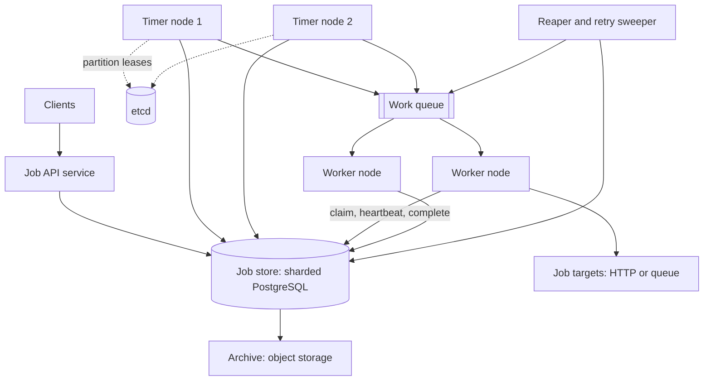
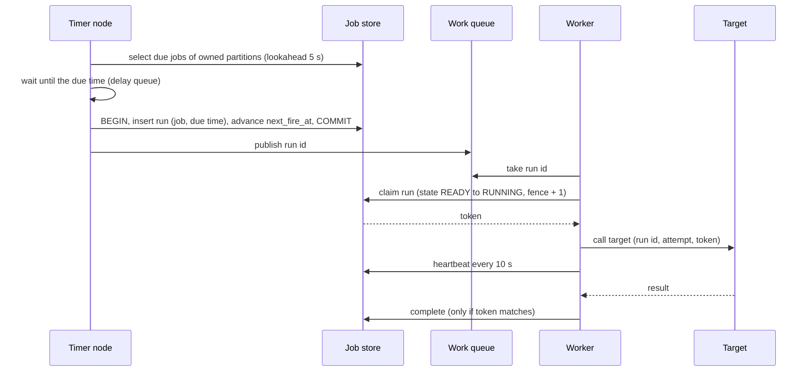

# Design a Distributed Job Scheduler

A distributed job scheduler runs work at a given time or on a repeating schedule, for many teams, across many machines. A client registers "run this every weekday at 09:00 in the Kolkata time zone" or "run this once, tomorrow at 14:30", and the scheduler starts the job on time, retries it when it fails, and records every run. The hard parts are not the timer. They are the questions that start when machines fail: which node fires a job, what happens when two nodes fire it, what happens when a worker dies in the middle of a run, and how a schedule behaves when the clock changes. This case study gives the design that a strong candidate presents in 45 minutes.

The in-process version of this problem (a priority queue, one dispatcher thread, a worker pool) is the LLD page [Design a Task Scheduler](../../lld/case-studies/16-task-scheduler/README.md). It ends with an extension "Distributed scheduler" that points here. The timer node in this design runs that LLD design on a partition of the jobs. The delay-queue limits of brokers (SQS, RabbitMQ, Kafka) that make a database-backed store necessary are in [message queues and streams](../fundamentals/08-message-queues-and-streams.md). The lock and lease theory is in [distributed locks and leases](../distributed-systems/05-distributed-locks-and-leases.md).

!!! note "About the sources"
    The design is a reference design. It cites what the documentation of Google's distributed cron (the SRE book), Quartz, Apache Airflow, and Kubernetes CronJobs state. It does not claim that any company runs this exact design. Where the text says "Assumption" or "Recommendation", the choice belongs to this design, not to a source.

## Problem Statement

The interviewer says: "Design a distributed job scheduler. Teams register jobs that run once at a time or repeat on a cron schedule. The system must start each job on time even when machines fail, never lose a job, and avoid running a job twice when that would cause harm. It must scale to millions of jobs."

The interviewer tests four skills: how to find due jobs among millions without scanning them, how to share the work among nodes without two nodes doing the same fire, how to handle the failure of a worker in the middle of a job, and how to reason about what "exactly once" can and cannot mean.

## Clarifying Questions

Ask these in the first 5 minutes. Each row gives the answer that this design assumes.

| Question | Assumed answer |
|---|---|
| What kinds of schedules? | Recurring jobs with a cron expression and a time zone, and one-time jobs with a fixed run time. A "delay" is a one-time job whose run time is now plus the delay |
| What does a job do? | The scheduler does not run business logic itself. It calls a target: an HTTP endpoint, or a message on a queue topic. A fleet of workers makes the calls and tracks the run |
| How precise must the start be? | Normal load: p99 lateness below 1 second. At a burst (the top of the hour), up to 60 seconds late is acceptable |
| What delivery guarantee? | At-least-once by default. A job can choose at-most-once. Exactly-once effect is the job's own duty, with an idempotency key that the scheduler supplies (see Deep Dives) |
| How long do jobs run? | From milliseconds to hours. The average is 5 seconds. Long jobs send heartbeats |
| What if a run is still going when the next fire is due? | The job chooses a concurrency policy: `allow`, `forbid` (skip the new run), or `replace`. The default is `forbid` |
| What if the scheduler was down at the fire time? | The job chooses a misfire policy: `fire_once` (run once now, the default), `skip`, or `fire_all` |
| Retries? | The job sets a maximum number of attempts and a backoff. Default: 3 attempts, exponential backoff with jitter |
| How many jobs? | 5 million recurring jobs and 20 million one-time jobs each day |
| Who are the users? | Many teams (tenants). The system must give each tenant a fair share and a quota |
| Cron dialect? | The five fields of the POSIX `crontab` entry (minute, hour, day of month, month, day of week), plus the step syntax (`*/15`) that most tools accept |
| Regions? | One region for the core design. Multi-region is a follow-up |
| Job dependencies (run B after A)? | Out of scope. A workflow engine handles them. A follow-up mentions it |

## Requirements

### Functional

1. A client creates a job with a schedule (cron with a time zone, or a run time), a target, and the policies for retry, concurrency, misfire, and delivery.
2. The scheduler starts each job at each due time.
3. A client pauses, resumes, updates, deletes, and manually triggers a job.
4. The scheduler retries a failed run with a backoff, up to the maximum number of attempts.
5. A client lists the runs of a job and reads the state of one run.
6. A client cancels a run that has not finished.
7. The scheduler passes each target a run id, the scheduled time, the attempt number, and a fencing token.

### Non-functional

| Requirement | Target |
|---|---|
| No lost fire | A due fire is never skipped because a node failed. Only the job's own `skip` policy skips it |
| Fire once | One scheduled time of one job creates one run. Two scheduler nodes cannot create two |
| Lateness | p99 below 1 second at normal load. A burst of 1.25 million due jobs drains in under 60 seconds |
| Failover | A failed scheduler node's work moves to another node within 15 seconds (assumption) |
| Durability | A job definition and a run record survive the loss of any one storage node |
| Scale | 5 million recurring jobs, 140 million fires each day, a peak of 25,000 fires each second |
| Fairness | One tenant cannot use all the workers |

## Estimation

Rounding rule: one day is 10^5 seconds (see the [estimation page](../back-of-envelope-estimation.md)).

Assumptions (design inputs): 5 million recurring jobs with 24 fires each day on average. 20 million one-time jobs each day. 25% of the recurring jobs (1.25 million) are due at the first second of an hour (hourly jobs and daily jobs at `hh:00`). The scheduler dispatches at most 25,000 fires each second at a burst. An average run takes 5 seconds, and one worker node has 200 slots. Each fire costs 3 database writes (create the run and advance the job, claim the run, complete the run). One database shard takes 5,000 writes each second (assumption: label it as a design input and measure it). A one-time job waits 1 day on average between its creation and its fire, so about 20 million one-time jobs are pending at any time. A job definition has 1 KB and a run record 200 bytes. The system keeps run records for 14 days, with 3 replicas. The design uses 1,024 partitions, 16 database shards, and 16 timer nodes (assumption: one timer node for each shard's worth of partitions, with standby capacity to take over a failed node's partitions).

| Step | Calculation | Result |
|---|---|---|
| Recurring fires each day | 5,000,000 × 24 | 120,000,000 |
| All fires each day | 120,000,000 + 20,000,000 | 140,000,000 |
| Average fires each second | 140,000,000 / 10^5 | 1,400 |
| Jobs due at second 0 of an hour | 5,000,000 × 0.25 | 1,250,000 |
| Time to drain the burst | 1,250,000 / 25,000 | 50 seconds |
| Peak to average ratio | 25,000 / 1,400 | About 17.9 |
| Average running jobs (Little's law: rate × duration) | 1,400 × 5 | 7,000 |
| Peak running jobs | 25,000 × 5 | 125,000 |
| Worker nodes at the average | 7,000 / 200 | 35 |
| Worker nodes at the peak | 125,000 / 200 | 625 |
| Peak database writes each second | 25,000 × 3 | 75,000 |
| Shards needed | 75,000 / 5,000 | 15, so 16 (about 4,688 writes each second for each shard at the burst, 94% of the assumed budget) |
| Average database writes each second | 1,400 × 3 | 4,200 |
| Job rows (recurring plus pending one-time) | 5,000,000 + 20,000,000 | 25,000,000 |
| Job table | 25,000,000 × 1 KB | 25 GB |
| Run records each day | 140,000,000 × 200 B | 28 GB |
| Run records for 14 days, 3 replicas | 28 GB × 14 × 3 | 1.2 TB |
| Partitions for each shard | 1,024 / 16 | 64 |
| Job rows for each partition | 25,000,000 / 1,024 | About 24,414 |
| Partitions for each timer node | 1,024 / 16 | 64 |
| Fires for each timer node at the burst | 25,000 / 16 | About 1,563 each second |
| Burst backlog with only the average fleet | 1,250,000 × 5 s / (35 × 200 slots) | About 893 seconds to drain |

What the numbers decide:

- **The average is small and the burst is large.** 1,400 fires each second is little work. The burst at the top of the hour is 18 times larger. The system must be sized for the burst, or it must smooth the burst. A drain time of 50 seconds meets the 60-second target, so sizing to 25,000 fires each second is enough. Google's SRE book describes the same problem for its cron service: people commonly configure a daily job to run at midnight, and even after the service spreads jobs with a "?" field whose value comes from a hash of the job configuration, "the load caused by the cron jobs is still very spiky".
- **The storage is small.** 25 GB of job definitions fit on one machine, and 1.2 TB of run history fits on a few. The design splits the store by write rate (75,000 writes each second at the burst), not by size.
- **Workers dominate the cost.** 625 worker nodes at the peak against 35 on average. A queue between the scheduler and the workers absorbs the burst, but the queue alone does not meet the 60-second target: with only the average fleet of 35 nodes, the burst takes about 893 seconds to drain. An auto-scaler that reacts to the queue depth starts too late, because a node takes longer than the burst to start. The burst comes at a known time, so the system scales the worker fleet up a few minutes before each hour (assumption: the scheduler counts the jobs due in the next window with the `next_fire_at` index and asks for the capacity), and scales it down after the burst drains.
- **A partition is small.** About 24,414 job rows for each partition, and 64 partitions for each timer node, give 1.56 million rows for each node in the database. Only the rows due in the next 5 seconds go into memory: about 1,400 × 5 / 16 = 438 entries for each node at the average rate, and about 78,000 for each node at the top of the hour (1,250,000 / 16), which the node reads in batches.

The program below recomputes the table. `main` comes first and the block has its own imports, so you can copy it into `SchedulerEstimate.java` and run `java SchedulerEstimate.java` on JDK 21.

```java
import java.util.Locale;

public class SchedulerEstimate {
    public static void main(String[] args) {
        double dayUnits = 1e5;
        double recurringJobs = 5_000_000;
        double firesPerJobPerDay = 24;
        double oneOffPerDay = 20_000_000;
        double recurringPerDay = recurringJobs * firesPerJobPerDay;
        double firesPerDay = recurringPerDay + oneOffPerDay;
        double avgRate = firesPerDay / dayUnits;
        System.out.println("== Fire rate ==");
        System.out.println(line("recurring fires per day", recurringPerDay));
        System.out.println(line("all fires per day", firesPerDay));
        System.out.println(line("average fires per second", avgRate));

        double topOfHourJobs = recurringJobs * 0.25;
        double dispatchCapacity = 25_000;
        double drainSeconds = topOfHourJobs / dispatchCapacity;
        System.out.println("== Top of the hour ==");
        System.out.println(line("jobs due at second 0 of the hour", topOfHourJobs));
        System.out.println(line("dispatch capacity per second", dispatchCapacity));
        System.out.println(line("seconds to drain the backlog", drainSeconds));
        System.out.println(line("peak to average ratio", dispatchCapacity / avgRate));

        double runSeconds = 5;
        double slotsPerWorker = 200;
        double avgRunning = avgRate * runSeconds;
        double peakRunning = dispatchCapacity * runSeconds;
        System.out.println("== Workers (Little's law: running = rate x duration) ==");
        System.out.println(line("average running jobs", avgRunning));
        System.out.println(line("peak running jobs", peakRunning));
        System.out.println(line("worker nodes at the average",
                Math.ceil(avgRunning / slotsPerWorker)));
        System.out.println(line("worker nodes at the peak",
                Math.ceil(peakRunning / slotsPerWorker)));
        double avgSlots = Math.ceil(avgRunning / slotsPerWorker) * slotsPerWorker;
        System.out.println(line("burst drain seconds with the average fleet",
                topOfHourJobs * runSeconds / avgSlots));

        double writesPerFire = 3;
        double peakWrites = dispatchCapacity * writesPerFire;
        double writesPerShard = 5_000;
        System.out.println("== Database writes ==");
        System.out.println(line("peak writes per second", peakWrites));
        System.out.println(line("shards needed at 5,000 writes/s each", Math.ceil(peakWrites
                / writesPerShard)));
        System.out.println(line("average writes per second", avgRate * writesPerFire));

        double jobBytes = 1000;
        double runBytes = 200;
        double retentionDays = 14;
        double replicas = 3;
        double pendingOneOff = oneOffPerDay * 1;
        double jobRows = recurringJobs + pendingOneOff;
        double jobGb = jobRows * jobBytes / 1e9;
        double runGbPerDay = firesPerDay * runBytes / 1e9;
        System.out.println("== Storage ==");
        System.out.println(line("job rows (recurring + pending one-time)", jobRows));
        System.out.println(line("job table GB (1 KB each)", jobGb));
        System.out.println(line("run rows GB per day (200 B each)", runGbPerDay));
        System.out.println(line("run rows GB for 14 days", runGbPerDay * retentionDays));
        System.out.println(line("run rows TB for 14 days, 3 replicas", runGbPerDay * retentionDays
                * replicas / 1000));

        double partitions = 1024;
        double shards = 16;
        double timerNodes = 16;
        System.out.println("== Partitions and timer nodes ==");
        System.out.println(line("partitions per shard", partitions / shards));
        System.out.println(line("job rows per partition", jobRows / partitions));
        System.out.println(line("partitions per timer node", partitions / timerNodes));
        System.out.println(line("fires per timer node per second at the burst",
                dispatchCapacity / timerNodes));
    }

    static String line(String label, double value) {
        return String.format(Locale.ROOT, "%-44s %,.1f", label, value);
    }
}
```

<!-- expected-output -->
```text
== Fire rate ==
recurring fires per day                      120,000,000.0
all fires per day                            140,000,000.0
average fires per second                     1,400.0
== Top of the hour ==
jobs due at second 0 of the hour             1,250,000.0
dispatch capacity per second                 25,000.0
seconds to drain the backlog                 50.0
peak to average ratio                        17.9
== Workers (Little's law: running = rate x duration) ==
average running jobs                         7,000.0
peak running jobs                            125,000.0
worker nodes at the average                  35.0
worker nodes at the peak                     625.0
burst drain seconds with the average fleet   892.9
== Database writes ==
peak writes per second                       75,000.0
shards needed at 5,000 writes/s each         15.0
average writes per second                    4,200.0
== Storage ==
job rows (recurring + pending one-time)      25,000,000.0
job table GB (1 KB each)                     25.0
run rows GB per day (200 B each)             28.0
run rows GB for 14 days                      392.0
run rows TB for 14 days, 3 replicas          1.2
== Partitions and timer nodes ==
partitions per shard                         64.0
job rows per partition                       24,414.1
partitions per timer node                    64.0
fires per timer node per second at the burst 1,562.5
```

## API Design

### Job management

| Method and path | Request | Response |
|---|---|---|
| `POST /v1/jobs` (header `Idempotency-Key`) | `{name, schedule, target, payload, retry, concurrency, misfire, delivery, timeoutSeconds}` | `201 {jobId, nextFireAt}`. A repeat with the same key returns the first response. Returns `422` if the cron expression is invalid or never fires |
| `GET /v1/jobs/{jobId}` | none | `200` the job and `nextFireAt` |
| `PATCH /v1/jobs/{jobId}` | `{schedule?, target?, state?: "PAUSED" or "ACTIVE", version}` | `200`. Returns `409` if `version` is stale (optimistic locking) |
| `DELETE /v1/jobs/{jobId}` | none | `204`. The job state becomes `DELETED`, and the run history stays |
| `POST /v1/jobs/{jobId}/trigger` | `{}` | `202 {runId}`. A manual run with its own run id |
| `GET /v1/jobs/{jobId}/runs?status=...&cursor=...` | none | `200 {runs: [...], next}` |
| `GET /v1/runs/{runId}` | none | `200 {state, attempt, scheduledTime, startedAt, finishedAt, result}` |
| `POST /v1/runs/{runId}/cancel` | none | `202`. The run stops if it has not started. A running run gets a cancel signal |

A schedule is `{"type": "cron", "expr": "0 9 * * 1-5", "timezone": "Asia/Kolkata"}` or `{"type": "once", "runAt": "2026-10-16T14:30:00Z"}`. A target is `{"type": "http", "url": "...", "method": "POST"}` or `{"type": "queue", "topic": "..."}`.

### Worker interface

If a worker runs the job code itself, it uses these calls. Each call carries the fencing token that the claim returned.

| Method and path | Request | Response |
|---|---|---|
| `POST /v1/runs/{runId}/claim` | `{worker}` | `200 {token, leaseSeconds}` or `409` if another worker holds the run |
| `POST /v1/runs/{runId}/heartbeat` | `{token}` | `200`, or `409` if the lease expired or the token is stale. The worker must stop |
| `POST /v1/runs/{runId}/complete` | `{token, status, result}` | `200`, or `409` if the token is stale |

For an HTTP target, the worker sends the request with the headers `X-Run-Id`, `X-Scheduled-Time`, `X-Attempt`, and `X-Fencing-Token`. The target uses `X-Run-Id` as its idempotency key (see [reliability patterns](../fundamentals/12-reliability-patterns.md)).

## Data Model

### Tables

```text
job
  job_id          bigint primary key
  tenant_id       bigint
  name            text
  schedule_kind   text        -- 'cron' or 'once'
  cron_expr       text
  timezone        text        -- an IANA name such as 'Asia/Kolkata'
  run_at          timestamptz -- for 'once' jobs
  target          jsonb
  retry           jsonb       -- max attempts, backoff base, cap
  concurrency     text        -- 'allow', 'forbid', 'replace'
  misfire         text        -- 'fire_once', 'skip', 'fire_all'
  delivery        text        -- 'at_least_once' or 'at_most_once'
  state           text        -- 'ACTIVE', 'PAUSED', 'DELETED'
  next_fire_at    timestamptz -- the next due time, in UTC
  partition_id    smallint    -- hash(job_id) mod 1024
  version         bigint      -- optimistic locking
  index (partition_id, next_fire_at) where state = 'ACTIVE'

run
  run_id          text        -- '<job_id>@<scheduled_time>', the same for every attempt
  job_id          bigint
  scheduled_time  timestamptz -- the due time, not the start time
  trigger_kind    text        -- 'schedule' or 'manual'
  state           text        -- READY, RUNNING, DONE, FAILED, UNKNOWN, CANCELLED, SKIPPED
  attempt         int
  max_attempts    int
  fence           bigint      -- increases at each claim
  owner           text
  lease_expiry    timestamptz
  next_attempt_at timestamptz -- for a retry with backoff
  started_at, finished_at, result
  primary key (job_id, scheduled_time, trigger_kind)
  unique (run_id)
  index (state, lease_expiry)       -- the reaper
  index (state, next_attempt_at)    -- the retry sweeper and the READY sweeper
```

**The key of a scheduled run is the pair `(job_id, scheduled_time)`.** This unique key is the core of the "fire once" rule: a second insert for the same job and the same due time fails or does nothing. The `run_id` is derived from the key (for example `7@2026-10-16T03:30:00Z`), so it stays the same for every attempt of the run, and the target can use it as an idempotency key. A retry is a new attempt of the same run, not a new run. A manual trigger (`POST /v1/jobs/{jobId}/trigger`) creates a run with `trigger_kind = 'manual'` and the request time as `scheduled_time`, and its `run_id` has a different form (`7@manual@<request id>`), so it can never collide with a scheduled fire. The trigger endpoint takes an `Idempotency-Key` header, so a client that repeats the request gets the same run.

### Choice of database

| Option | Fit |
|---|---|
| Sharded PostgreSQL or MySQL, sharded by `job_id` | **Chosen.** The fire step needs a transaction (create the run and advance `next_fire_at` together), a unique key, conditional updates, an index range scan on the due time, and row locks with `SKIP LOCKED`. PostgreSQL provides all of them. The write rate of 75,000 each second at the burst needs 16 shards, which is a normal size |
| Cassandra or another wide-column store | A conditional update (a lightweight transaction) costs a consensus round. There are no cheap multi-row transactions. A time-ordered index across all jobs becomes a hot partition |
| DynamoDB | Conditional writes work. A global index on the due time needs a time-bucket partition key, and one bucket is hot at the top of the hour. Possible, with care |
| Redis sorted set (`ZADD` score = due time) | Fast range reads. Durability and failover can lose entries. Good as a cache of the next few seconds, not as the source of truth |
| A message queue with delayed delivery | SQS limits a delay to 15 minutes. RabbitMQ has no per-message delay in its core queues. Kafka has no per-record delay (see [message queues and streams](../fundamentals/08-message-queues-and-streams.md)). A year-long delay needs a database anyway |

The partitions sit on top of the shards: `partition_id = hash(job_id) mod 1024`, and the shard is `partition_id mod 16`. A partition is the unit of ownership for the scheduler nodes (see Deep Dives), and a shard is the unit of storage.

## High-Level Design



| Component | Responsibility |
|---|---|
| Job API service | Validates a job (parses the cron expression, checks that it fires), computes the first `next_fire_at`, and writes the job. Handles pause, update, delete, trigger, and history |
| Job store | The source of truth for jobs and runs. Sharded PostgreSQL |
| Timer node | Owns a set of partitions through leases in etcd. Loads the jobs that are due within a short lookahead window into an in-memory delay queue, waits until each is due, then runs the fire step: create the run and advance the job in one transaction. Publishes the run id to the work queue |
| Work queue | Carries run ids from the timer nodes to the workers. It smooths the burst. It has one queue for each priority class |
| Worker node | Takes a run id, claims the run with a lease, calls the target, sends heartbeats, and completes the run |
| Reaper and sweepers | The reaper finds runs whose lease expired and marks them `READY`, `FAILED`, or `UNKNOWN`. The retry sweeper republishes runs whose retry time has come. The READY sweeper republishes runs that stayed `READY` too long (a lost publish) |
| etcd | Holds the partition leases (see [consensus and leader election](../distributed-systems/02-consensus-and-leader-election.md)) |
| Archive | After 14 days, run records move from the database to object storage or a columnar store for audit |

**Flow of one fire.**



## Deep Dives

### 1. Finding due jobs and sharing the work among nodes

**The problem.** With 5 million jobs, a loop that scans all jobs each second does not work. Several nodes must also share the work, and no two nodes may fire the same job.

**Index and lookahead.** The index on `(partition_id, next_fire_at)` lets a node read only the jobs of its partitions that are due soon. Each timer node runs one query for all its partitions every second (assumption), for the jobs due within the next 5 seconds. The query reads without locks. It puts them in an in-memory delay queue ordered by due time and sleeps until the earliest is due. The LLD page [Design a Task Scheduler](../../lld/case-studies/16-task-scheduler/README.md) builds this queue: one dispatcher thread waits for the earliest task and a pool runs the work. The timer node reuses that design, with two differences: a due job runs the fire step in the database instead of calling code, and the queue holds only the next few seconds of jobs. The lookahead means the scheduler reads from the database ahead of time, so that a slow read does not delay a fire. One node with 64 partitions has about 64 × 24,414 = 1.56 million job rows in the database, and only the ones due in the next 5 seconds are in memory: about 438 entries at the average rate. At the burst, a node reads its due jobs in batches of 500 with `LIMIT`.

**The fire step.** The timer node reads ahead without locks, waits until a job is due, and then runs the fire step in one short transaction. In PostgreSQL syntax:

<!-- sql-skip: postgresql -->
```sql
-- PostgreSQL syntax (interval, ANY, ON CONFLICT). SQLite does not run it.
-- 1. Lookahead, every second, with no locks. The node keeps the rows in its delay queue.
SELECT job_id, cron_expr, timezone, next_fire_at, concurrency, version
FROM job
WHERE partition_id = ANY(:owned_partitions)
  AND state = 'ACTIVE'
  AND next_fire_at <= now() + interval '5 seconds'
ORDER BY next_fire_at
LIMIT 500;

-- 2. At the due time, for each due job (a batch of jobs can share one transaction).
BEGIN;

-- Advance the job only if nobody advanced it since the lookahead.
-- The application computes :following_fire_at from the cron expression.
UPDATE job
SET next_fire_at = :following_fire_at, version = version + 1
WHERE job_id = :job_id AND next_fire_at = :due AND state = 'ACTIVE';

-- If the UPDATE changed 0 rows, another node fired the job or a user changed it:
-- the node rolls back and drops the job from its delay queue.
INSERT INTO run (run_id, job_id, scheduled_time, trigger_kind, state, attempt,
                 max_attempts, fence, next_attempt_at)
VALUES (:job_id || '@' || :due, :job_id, :due, 'schedule', 'READY', 0, :max_attempts, 0,
        :due)
ON CONFLICT (job_id, scheduled_time, trigger_kind) DO NOTHING;

COMMIT;
```

The `UPDATE` and the `INSERT` are in one transaction. Either both happen or neither does, so a job never advances without a run, and never has a run without advancing. The `UPDATE` is a compare-and-set on `next_fire_at`: it locks the job row, and a second node that runs the same fire step waits for that lock, then finds `next_fire_at` already advanced, changes 0 rows, and stops. The transaction holds the row lock only for the two statements, not during the wait for the due time. The lookahead does not lock rows, because a lock held for up to 5 seconds would block the API's updates of the job.

`FOR UPDATE SKIP LOCKED` is the other common shape: several competing nodes run `SELECT ... WHERE next_fire_at <= now() ... FOR UPDATE SKIP LOCKED` on the same table, and a row that one node has locked is skipped by the others. The PostgreSQL documentation says that skipping locked rows gives an inconsistent view of the data and fits queue-like tables with several consumers. This design does not need it on the job table, because each partition has one owner, but the workers can use it if they poll the `run` table instead of a queue (see [distributed locks and leases](../distributed-systems/05-distributed-locks-and-leases.md)).

**A crash between the commit and the publish.** The timer node publishes the run id to the work queue after the commit. If the node dies between the two steps, the run is `READY` in the database and no message exists. The READY sweeper finds runs that are `READY` for more than 30 seconds (assumption) with the index on `(state, next_attempt_at)`, where `next_attempt_at` is set to the due time at creation, and publishes them again. A run can then have two messages in the queue. The claim is a conditional update (`WHERE state = 'READY'`), so only one worker gets the run, and the other drops the message. This is the outbox pattern, with the run table as the outbox (see [distributed transactions](../distributed-systems/03-distributed-transactions.md)).

**Two ways to share the work.**

| Approach | How it works | Facts and limits |
|---|---|---|
| Competing nodes (no ownership) | Every node scans every partition and relies on row locks to avoid duplicates | Simple. The contention grows with the node count. Quartz's clustering documentation says that nodes share one database, that "the first node to acquire it (by placing a lock on it) is the node that will fire it", and that the cluster-wide lock "degrades performance as you add more nodes" beyond about three nodes, depending on the database. For thousands of short-running jobs, it suggests "partitioning the set of jobs by using multiple distinct schedulers", which is the partition idea of this design |
| Row-level locks with several schedulers | Each scheduler locks the rows it works on | Apache Airflow's documentation describes this: schedulers coordinate through "database row-level locks (using `SELECT ... FOR UPDATE`)" and use no consensus algorithm between schedulers. It states that the scheduler "scales almost linearly with several instances" |
| One leader (Paxos) | One replica of a small group owns all scheduling | Google's distributed cron: the replicas use Paxos, the leader launches jobs, and followers track state so that one can take over. The SRE book says that failover stays "well within a generally tolerable one-minute failover time". One leader limits the throughput to one node |
| **Partition ownership (chosen)** | Each timer node owns a set of partitions through an etcd lease. Only the owner fires jobs of those partitions | Scales with the number of partitions. Contention is near zero. If a node dies, its partitions move after the lease expires |

**Ownership is an optimization, and correctness comes from the unique key.** The partition lease keeps nodes from doing the same work. It is not what keeps a job from firing twice. If two nodes both believe that they own a partition (a paused node wakes up late), both run the fire step for the same job. The first transaction advances `next_fire_at` and inserts the run. The second waits for the row lock, and then its compare-and-set `UPDATE` changes 0 rows, because `next_fire_at` no longer equals the due time. If a bug skipped that check, its `INSERT` would still hit the unique key `(job_id, scheduled_time)` and do nothing. The database enforces "fire once", and the lease only makes it rare to need that. This follows the rule of the [locks page](../distributed-systems/05-distributed-locks-and-leases.md): use a lease for efficiency, and make the resource check for correctness.

**Partition leases.** A timer node claims partitions with leases (an etcd key with a lease for each partition, or one lease for the node and one key for each partition). Nodes rebalance: when a node joins or leaves, the partitions are redistributed, and the new owner starts from the database, so no state moves. The failover time is the lease TTL (assumption: 10 seconds) plus the next lookahead query. The 5-second lookahead hides part of that delay for jobs that were already loaded. The old owner stops firing when its lease expires, and the unique key stops it if it does not.

**The burst at the top of the hour.** 1.25 million jobs are due at second 0. The timer nodes insert runs at the database's write rate, and publish run ids to the work queue. The queue holds the backlog and the workers drain it. Three tools reduce the burst: (1) a per-job `jitter` setting that spreads the fire time by a hash of the job id over a window (Google's cron does a similar thing: a "?" in a field gets a value from a hash of the job configuration over the field's range); (2) priority classes, so that a latency-sensitive job does not wait behind a million routine jobs; (3) per-tenant rate limits on dispatch (see [rate limiting algorithms](../fundamentals/13-rate-limiting-algorithms.md)).

### 2. Execution: leases, retries, and "exactly-once"

**What can fail.** A worker can crash before it calls the target, during the call, or after the call and before it records completion. The scheduler cannot tell these cases apart from the outside. This is the "two generals" gap between an effect and its record, and it has no perfect fix.

**The claim with a lease and a fencing token.** A worker takes a run id from the queue and claims the run with one conditional update:

1. `UPDATE run SET state='RUNNING', owner=?, fence=fence+1, attempt=attempt+1, lease_expiry=now()+30s WHERE job_id=? AND scheduled_time=? AND state='READY'`. If no row changes, another worker holds the run, and this worker drops the message.
2. The worker calls the target and sends a heartbeat every 10 seconds (assumption: lease 30 seconds, renewal every third of the lease). A heartbeat updates `lease_expiry` only if `fence` still equals the worker's token.
3. The worker completes the run with `UPDATE ... SET state='DONE' WHERE ... AND fence=? AND state='RUNNING'`. If zero rows change, the lease was lost and a newer attempt exists.

The fence increases with each claim, as in the [fencing token](../distributed-systems/05-distributed-locks-and-leases.md) design. The token goes to the target in the `X-Fencing-Token` header. A target that can check it (a database row, a conditional write) rejects a stale worker. A target that cannot check it must be idempotent, using `X-Run-Id` as the idempotency key. The lease time comes from the database clock (`now()` in the SQL), not from the worker's clock, so the clock skew among workers does not matter.

**The reaper.** A reaper scans `(state, lease_expiry)` for runs that are `RUNNING` and whose lease expired. For each, it checks `attempt` against `max_attempts` and the job's `delivery` policy:

| Condition | Action |
|---|---|
| `at_least_once` and attempts left | Set `READY`, set `next_attempt_at` to now plus a backoff with jitter, republish |
| `at_least_once` and no attempts left | Set `FAILED`, raise an alert |
| `at_most_once` | Set `UNKNOWN`. Do not retry. A person or an automatic check decides |

The program below runs this logic on an in-memory table with a manual clock, as a model of the conditional updates: two timer nodes try to create the same run, a worker pauses and loses its lease, a second worker takes over, and the paused worker's heartbeat, write, and completion are all rejected. Last, an `at_most_once` job (an email newsletter) loses its lease, and the reaper marks it `UNKNOWN` instead of a retry. `main` comes first, and the block has its own imports, so you can copy it into `LeaseDemo.java` and run `java LeaseDemo.java` on JDK 21.

```java
import java.util.LinkedHashMap;
import java.util.Map;

public class LeaseDemo {
    public static void main(String[] args) {
        RunTable runs = new RunTable();
        long now = 0;

        System.out.println("== Two scheduler nodes materialize the same fire ==");
        String run = "report-7@2026-10-16T09:00";
        System.out.println("node 1 inserts the run: " + runs.insert(run, 3, false));
        System.out.println("node 2 inserts the run: " + runs.insert(run, 3, false));

        System.out.println("== A paused worker loses its lease ==");
        Resource store = new Resource();
        long tokenA = runs.claim(run, "worker-a", now, 30);
        System.out.println("worker-a claims: token " + tokenA + ", attempt " + runs.attempt(run));
        System.out.println("worker-b claims at t=10: " + runs.claim(run, "worker-b", 10, 30));
        now = 31;
        System.out.println("reaper at t=31 requeues: " + runs.reap(now));
        long tokenB = runs.claim(run, "worker-b", now, 30);
        System.out.println("worker-b claims: token " + tokenB + ", attempt " + runs.attempt(run));
        System.out.println("worker-b writes: " + store.write("b-result", tokenB));
        now = 35;
        System.out.println("worker-a heartbeat at t=35: " + runs.heartbeat(run, tokenA, now, 30));
        System.out.println("worker-a writes: " + store.write("a-result", tokenA));
        System.out.println("worker-a completes: " + runs.complete(run, tokenA));
        System.out.println("worker-b completes: " + runs.complete(run, tokenB));
        System.out.println("state " + runs.state(run) + ", stored " + store.value());

        System.out.println("== An at-most-once job is not retried after a crash ==");
        String newsletter = "newsletter-1@2026-10-31T18:00";
        runs.insert(newsletter, 1, true);
        runs.claim(newsletter, "worker-a", 100, 30);
        System.out.println("reaper at t=131 requeues: " + runs.reap(131));
        System.out.println("state " + runs.state(newsletter));
    }
}

/** The run table of the job store. Every method is one conditional update in a real database. */
class RunTable {
    private static final class Row {
        String state = "READY";
        long fence = 0;
        int attempt = 0;
        int maxAttempts;
        boolean atMostOnce;
        long expiry = 0;
    }

    private final Map<String, Row> rows = new LinkedHashMap<>();

    /** INSERT with a unique key on (job, scheduled time). A second insert fails. */
    boolean insert(String runId, int maxAttempts, boolean atMostOnce) {
        if (rows.containsKey(runId)) {
            return false;
        }
        Row row = new Row();
        row.maxAttempts = maxAttempts;
        row.atMostOnce = atMostOnce;
        rows.put(runId, row);
        return true;
    }

    /** UPDATE ... SET fence = fence + 1 WHERE state = 'READY'. Returns the token, or -1. */
    long claim(String runId, String worker, long now, long ttl) {
        Row row = rows.get(runId);
        if (row == null || !row.state.equals("READY")) {
            return -1;
        }
        row.state = "RUNNING";
        row.fence++;
        row.attempt++;
        row.expiry = now + ttl;
        return row.fence;
    }

    boolean heartbeat(String runId, long token, long now, long ttl) {
        Row row = rows.get(runId);
        if (row == null || !row.state.equals("RUNNING") || row.fence != token) {
            return false;
        }
        if (row.expiry <= now) {
            return false;
        }
        row.expiry = now + ttl;
        return true;
    }

    boolean complete(String runId, long token) {
        Row row = rows.get(runId);
        if (row == null || !row.state.equals("RUNNING") || row.fence != token) {
            return false;
        }
        row.state = "DONE";
        return true;
    }

    /**
     * Handles runs whose lease expired. An at-most-once run becomes UNKNOWN for a person to check.
     * An at-least-once run goes back to READY if it has attempts left, and becomes FAILED if not.
     */
    int reap(long now) {
        int requeued = 0;
        for (Row row : rows.values()) {
            if (!row.state.equals("RUNNING") || row.expiry > now) {
                continue;
            }
            if (row.atMostOnce) {
                row.state = "UNKNOWN";
            } else if (row.attempt < row.maxAttempts) {
                row.state = "READY";
                requeued++;
            } else {
                row.state = "FAILED";
            }
        }
        return requeued;
    }

    String state(String runId) {
        return rows.get(runId).state;
    }

    int attempt(String runId) {
        return rows.get(runId).attempt;
    }
}

/** A resource that keeps the highest fencing token that it has seen and rejects lower ones. */
class Resource {
    private long highest = 0;
    private String value = "none";

    boolean write(String newValue, long token) {
        if (token < highest) {
            return false;
        }
        highest = token;
        value = newValue;
        return true;
    }

    String value() {
        return value;
    }
}
```

<!-- expected-output -->
```text
== Two scheduler nodes materialize the same fire ==
node 1 inserts the run: true
node 2 inserts the run: false
== A paused worker loses its lease ==
worker-a claims: token 1, attempt 1
worker-b claims at t=10: -1
reaper at t=31 requeues: 1
worker-b claims: token 2, attempt 2
worker-b writes: true
worker-a heartbeat at t=35: false
worker-a writes: false
worker-a completes: false
worker-b completes: true
state DONE, stored b-result
== An at-most-once job is not retried after a crash ==
reaper at t=131 requeues: 0
state UNKNOWN
```

The same claim and fence logic in SQL (SQLite syntax), so that you can see that each step is one statement:

```sql
-- A model of the run table, reduced to the columns of the claim. The key is the pair
-- (job_id, scheduled_time) of a scheduled run.
CREATE TABLE run (
    job_id         INTEGER NOT NULL,
    scheduled_time TEXT    NOT NULL,
    state          TEXT    NOT NULL DEFAULT 'READY',
    attempt        INTEGER NOT NULL DEFAULT 0,
    max_attempts   INTEGER NOT NULL,
    fence          INTEGER NOT NULL DEFAULT 0,
    owner          TEXT,
    lease_expiry   INTEGER,
    PRIMARY KEY (job_id, scheduled_time)
);

-- Two timer nodes create the same run. The second insert changes nothing.
INSERT OR IGNORE INTO run (job_id, scheduled_time, max_attempts)
VALUES (7, '2026-10-16T09:00', 3);
INSERT OR IGNORE INTO run (job_id, scheduled_time, max_attempts)
VALUES (7, '2026-10-16T09:00', 3);

-- Worker a claims the run at t=100 with a lease of 30.
UPDATE run
SET state = 'RUNNING', owner = 'a', fence = fence + 1, attempt = attempt + 1,
    lease_expiry = 130
WHERE job_id = 7 AND scheduled_time = '2026-10-16T09:00' AND state = 'READY';

-- Worker b tries to claim at t=110. The state is RUNNING, so no row changes.
UPDATE run
SET state = 'RUNNING', owner = 'b', fence = fence + 1, attempt = attempt + 1,
    lease_expiry = 140
WHERE job_id = 7 AND scheduled_time = '2026-10-16T09:00' AND state = 'READY';

-- The reaper at t=131 requeues the run because the lease expired.
UPDATE run SET state = 'READY'
WHERE state = 'RUNNING' AND lease_expiry <= 131 AND attempt < max_attempts;

-- Worker b claims at t=131.
UPDATE run
SET state = 'RUNNING', owner = 'b', fence = fence + 1, attempt = attempt + 1,
    lease_expiry = 161
WHERE job_id = 7 AND scheduled_time = '2026-10-16T09:00' AND state = 'READY';

-- Worker a wakes up and completes with its old fence 1. No row changes.
UPDATE run SET state = 'DONE'
WHERE job_id = 7 AND scheduled_time = '2026-10-16T09:00'
  AND fence = 1 AND state = 'RUNNING';

-- Worker b completes with fence 2.
UPDATE run SET state = 'DONE'
WHERE job_id = 7 AND scheduled_time = '2026-10-16T09:00'
  AND fence = 2 AND state = 'RUNNING';
```

```sql
SELECT state, fence, attempt, owner FROM run;
```

<!-- sql-result -->
```text
state | fence | attempt | owner
DONE | 2 | 2 | b
```

**What "exactly-once" means here.** The design gives three separate guarantees:

| Layer | Guarantee | Mechanism |
|---|---|---|
| Fire | One run for each scheduled time | Unique key `(job_id, scheduled_time)` |
| Claim | One worker holds a run at a time, and a stale worker is detectable | Conditional update, lease, fencing token |
| Effect | One effect on the target | The target's own idempotency (`X-Run-Id` as the key) or a fencing check |

The first two are inside the scheduler. The third is outside it. A scheduler that retries after an uncertain failure delivers at-least-once, and it cannot also deliver at-most-once for the same job (see [distributed transactions](../distributed-systems/03-distributed-transactions.md) on exactly-once claims). The design gives the job the choice. Google's SRE chapter on distributed cron describes the same choice. Some jobs, such as garbage collection, are idempotent and can be launched again after a failure. A job that sends an email newsletter to a wide distribution "should not be launched more than once". Other jobs must not be skipped: the chapter's example is a monthly payroll job. The chapter states "we favor skipping launches rather than risking double launches", because recovery from a skipped launch is easier, and that the service prefers to "fail closed". The `at_most_once` policy is that choice: a run whose lease expired becomes `UNKNOWN` and is never retried automatically. `UNKNOWN` also raises an alert, because a silent skip is not acceptable for a job like payroll: a person or an automatic check finds out whether the effect happened, and runs the job again if it did not. Kubernetes states the same limit for its CronJobs: "there are certain circumstances where two Jobs might be created, or no Job might be created", and "the Jobs that you define should be idempotent".

**Retries.** A failed attempt (the target returned an error or timed out) sets `next_attempt_at = now + backoff` with exponential backoff and jitter, and the sweeper republishes it (see [reliability patterns](../fundamentals/12-reliability-patterns.md) for the formulas and the retry budget). Only retry errors that can succeed later: a `5xx` or a timeout, not a `4xx`. After the maximum number of attempts, the run is `FAILED`, and the system alerts the job's owner. A **poison job** (one that always fails) must not retry forever and must not take all the workers: the attempt limit and a per-job failure rate that pauses the job automatically bound the damage.

**Concurrency policy.** When a fire is due while the previous run of the same job is still running, the policy decides. Kubernetes CronJobs define the same three values: `Allow` (concurrent runs), `Forbid` ("if it is time for a new Job run and the previous Job run hasn't finished yet, the CronJob skips the new Job run"), and `Replace` (the new run replaces the running one). The fire step checks for an active run of the job and applies the policy. The CronJob also has `startingDeadlineSeconds`: if the controller cannot start a Job within that many seconds after the schedule, "the CronJob skips that instance of the Job". The `misfire` policy in this design has the same purpose.

**Timeouts.** A run has a timeout. The lease keeps alive as long as the worker is alive, so a hung call would hold the lease forever. The worker enforces the timeout and fails the run, and the reaper also treats a run that exceeds `timeoutSeconds` as failed.

### 3. Cron parsing and time zones

**The format.** The POSIX `crontab` entry has five fields: minute [0,59], hour [0,23], day of month [1,31], month [1,12], day of week [0,6] with 0 for Sunday. Each field holds a number, a range with a hyphen (an inclusive range), or a comma-separated list of those. The POSIX text does not define step values such as `*/15`. Most cron implementations add them, and Kubernetes documents that "steps are also permitted after an asterisk" and treats `?` as `*`. Decide the dialect you support and state it (a seconds field, names such as `MON`, and symbols for "last day" differ between tools). The parser in this page supports lists, ranges, and steps, and rejects everything else.

**The day rule.** If both the day-of-month and the day-of-week fields are restricted, POSIX says that "any day matching either the month and day of month, or the day of week" matches. The standard's example, `0 0 1,15 * 1`, "would run a command on the first and fifteenth of each month, as well as on every Monday". This is an OR, and it surprises many users, who expect an AND. POSIX also says that "to specify days by only one field, the other field should be set to '*'". The POSIX wording groups the month with the day-of-month branch ("the month and day of month"), so a literal reading of `0 0 * 6 1` matches every day of June (month 6 and any day of month) and every Monday of the year.

Implementations do not follow the literal reading. The cron of most Linux distributions, cronie (derived from Vixie cron), sets a flag for a day field whose text starts with `*`. Its `find_jobs` function then requires both day sets to match (AND) if either flag is set, and either set (OR) if neither flag is set. It tests the month separately, so the month applies to both branches. For `0 0 * 6 1`, cronie fires only on Mondays in June. A step on a day field also starts with `*`: cronie reads `0 0 */2 * 1` as "odd days of the month that are Mondays" (AND), not as an OR. The parser below follows the cronie rule, and the output shows both the OR case and the `0 0 * 6 1` case. If you must match an existing cron exactly, test it.

**Computing the next fire time.** Do not add the period to the last fire time. Compute the next matching calendar time in the job's time zone:

1. Take the time after the previous scheduled time (not after "now", so that a late fire does not shift the schedule).
2. Go to the next minute. Walk the days from that date. Skip a day if the month or the day rule does not match.
3. On a matching day, take the first hour and minute in the sets that is later than the start.
4. Convert the local date and time to an instant in the job's zone.
5. Store the instant in UTC in `next_fire_at`.

The search is bounded (8 years in the code), because an expression such as `0 0 30 2 *` (30 February) never fires. The API rejects it with `422`.

**Daylight saving time.** A local time can fail to exist (clocks jump forward) or happen twice (clocks go back). `java.time.ZonedDateTime.ofLocal` documents the resolution: in a gap, it moves the time forward by the length of the gap, and in an overlap, it uses the earlier offset by default. The program below prints both cases for New York in 2026. A job at `30 2 * * *` runs at 03:30 on the day that the clock jumps forward, and a job at `30 1 * * *` runs once, at the earlier 01:30, on the day that the clock goes back. State the policy for your product. A job that must run every 15 minutes regardless of the clock needs a fixed interval in UTC, not a cron expression in a local zone.

**Time zones in Kubernetes.** A CronJob without `.spec.timeZone` uses the local time zone of the kube-controller-manager. The `.spec.timeZone` field takes an IANA name, for example `"Etc/UTC"`, and it is stable since Kubernetes v1.27. This design stores the zone with each job for the same reason.

**Time zone data changes.** Governments change the rules. Store the IANA zone name, not an offset, and recompute `next_fire_at` for jobs in a zone when the time zone database updates.

The program below parses five-field expressions and computes the next fire times. It prints the cases of this section. `main` comes first, and the block has its own imports, so you can copy it into `CronDemo.java` and run `java CronDemo.java` on JDK 21.

```java
import java.time.Instant;
import java.time.LocalDate;
import java.time.LocalDateTime;
import java.time.ZoneId;
import java.time.ZoneOffset;
import java.time.ZonedDateTime;
import java.time.format.DateTimeFormatter;
import java.time.temporal.ChronoUnit;
import java.util.ArrayList;
import java.util.List;

public class CronDemo {
    static final DateTimeFormatter FORMAT = DateTimeFormatter.ofPattern("EEE yyyy-MM-dd HH:mm xxx");

    public static void main(String[] args) {
        ZoneId india = ZoneId.of("Asia/Kolkata");
        ZoneId newYork = ZoneId.of("America/New_York");

        System.out.println("== Weekdays at 09:00 ==");
        Instant fridayEvening = ZonedDateTime.of(2026, 10, 16, 18, 0, 0, 0, india).toInstant();
        show("0 9 * * 1-5", india, fridayEvening, 3);

        System.out.println("== Every 20 minutes between 09:00 and 10:59 ==");
        Instant morning = ZonedDateTime.of(2026, 10, 16, 8, 0, 0, 0, india).toInstant();
        show("*/20 9-10 * * *", india, morning, 7);

        System.out.println("== Day of month or day of week (the POSIX example) ==");
        Instant start = Instant.parse("2026-10-01T00:00:00Z");
        show("0 0 1,15 * 1", ZoneOffset.UTC, start, 5);

        System.out.println("== Day of week with a month: cronie gives only Mondays in June ==");
        show("0 0 * 6 1", ZoneOffset.UTC, start, 2);

        System.out.println("== A local time that does not exist (New York, 2026-03-08) ==");
        Instant beforeGap = ZonedDateTime.of(2026, 3, 7, 12, 0, 0, 0, newYork).toInstant();
        show("30 2 * * *", newYork, beforeGap, 3);

        System.out.println("== A local time that happens twice (New York, 2026-11-01) ==");
        Instant beforeOverlap = ZonedDateTime.of(2026, 10, 31, 12, 0, 0, 0, newYork).toInstant();
        show("30 1 * * *", newYork, beforeOverlap, 3);

        System.out.println("== Day 31 skips short months ==");
        Instant feb = ZonedDateTime.of(2026, 1, 31, 12, 0, 0, 0, ZoneOffset.UTC).toInstant();
        show("0 0 31 * *", ZoneOffset.UTC, feb, 4);

        System.out.println("== Rejected expressions ==");
        for (String bad : List.of("61 * * * *", "* * * *", "*/0 * * * *", "1- * * * *",
                "0 0 30 2 *")) {
            try {
                CronExpr cron = CronExpr.parse(bad);
                cron.next(start, ZoneOffset.UTC);
                System.out.println(bad + " -> accepted");
            } catch (IllegalArgumentException e) {
                System.out.println(bad + " -> " + e.getMessage());
            }
        }
    }

    static void show(String expression, ZoneId zone, Instant after, int count) {
        CronExpr cron = CronExpr.parse(expression);
        List<String> times = new ArrayList<>();
        Instant at = after;
        for (int i = 0; i < count; i++) {
            at = cron.next(at, zone);
            times.add(at.atZone(zone).format(FORMAT));
        }
        System.out.println(expression + " in " + zone);
        for (String t : times) {
            System.out.println("  " + t);
        }
    }
}

/** A five-field cron expression: minute, hour, day of month, month, day of week (0 = Sunday). */
class CronExpr {
    private final boolean[] minutes;
    private final boolean[] hours;
    private final boolean[] daysOfMonth;
    private final boolean[] months;
    private final boolean[] daysOfWeek;
    private final boolean dayOfMonthStar;
    private final boolean dayOfWeekStar;

    private CronExpr(String[] f) {
        minutes = field(f[0], 0, 59);
        hours = field(f[1], 0, 23);
        daysOfMonth = field(f[2], 1, 31);
        months = field(f[3], 1, 12);
        daysOfWeek = field(f[4], 0, 6);
        dayOfMonthStar = f[2].startsWith("*");
        dayOfWeekStar = f[4].startsWith("*");
    }

    static CronExpr parse(String expression) {
        String[] fields = expression.trim().split("\\s+");
        if (fields.length != 5) {
            throw new IllegalArgumentException("need 5 fields, found " + fields.length);
        }
        return new CronExpr(fields);
    }

    /** Parses a list of elements. Each element is *, a number, a range, with an optional step. */
    private static boolean[] field(String text, int min, int max) {
        boolean[] set = new boolean[max + 1];
        for (String element : text.split(",")) {
            String range = element;
            int step = 1;
            int slash = element.indexOf('/');
            if (slash >= 0) {
                step = Integer.parseInt(element.substring(slash + 1));
                range = element.substring(0, slash);
                if (step < 1) {
                    throw new IllegalArgumentException("step must be at least 1 in '" + text + "'");
                }
            }
            int from;
            int to;
            if (range.equals("*")) {
                from = min;
                to = max;
            } else if (range.contains("-")) {
                String[] ends = range.split("-", -1);
                if (ends.length != 2 || ends[0].isEmpty() || ends[1].isEmpty()) {
                    throw new IllegalArgumentException("bad range '" + range + "'");
                }
                from = Integer.parseInt(ends[0]);
                to = Integer.parseInt(ends[1]);
            } else {
                from = Integer.parseInt(range);
                to = slash >= 0 ? max : from;
            }
            if (from < min || to > max || from > to) {
                throw new IllegalArgumentException("'" + text + "' is outside " + min + "-" + max);
            }
            for (int v = from; v <= to; v += step) {
                set[v] = true;
            }
        }
        return set;
    }

    /** The cronie rule: AND if either day field starts with *, OR if both are restricted. */
    private boolean dayMatches(LocalDate d) {
        boolean domOk = daysOfMonth[d.getDayOfMonth()];
        boolean dowOk = daysOfWeek[d.getDayOfWeek().getValue() % 7];
        if (dayOfMonthStar || dayOfWeekStar) {
            return domOk && dowOk;
        }
        return domOk || dowOk;
    }

    /** Returns the first fire time that is later than after. Throws if none exists in 8 years. */
    Instant next(Instant after, ZoneId zone) {
        LocalDateTime from = after.atZone(zone).toLocalDateTime()
                .truncatedTo(ChronoUnit.MINUTES).plusMinutes(1);
        LocalDate day = from.toLocalDate();
        for (int i = 0; i < 366 * 8; i++, day = day.plusDays(1)) {
            if (!months[day.getMonthValue()] || !dayMatches(day)) {
                continue;
            }
            for (int h = 0; h < 24; h++) {
                for (int m = 0; m < 60; m++) {
                    if (!hours[h] || !minutes[m]) {
                        continue;
                    }
                    LocalDateTime local = day.atTime(h, m);
                    if (local.isBefore(from)) {
                        continue;
                    }
                    Instant fire = ZonedDateTime.ofLocal(local, zone, null).toInstant();
                    if (fire.isAfter(after)) {
                        return fire;
                    }
                }
            }
        }
        throw new IllegalArgumentException("the expression never fires");
    }
}
```

<!-- expected-output -->
```text
== Weekdays at 09:00 ==
0 9 * * 1-5 in Asia/Kolkata
  Mon 2026-10-19 09:00 +05:30
  Tue 2026-10-20 09:00 +05:30
  Wed 2026-10-21 09:00 +05:30
== Every 20 minutes between 09:00 and 10:59 ==
*/20 9-10 * * * in Asia/Kolkata
  Fri 2026-10-16 09:00 +05:30
  Fri 2026-10-16 09:20 +05:30
  Fri 2026-10-16 09:40 +05:30
  Fri 2026-10-16 10:00 +05:30
  Fri 2026-10-16 10:20 +05:30
  Fri 2026-10-16 10:40 +05:30
  Sat 2026-10-17 09:00 +05:30
== Day of month or day of week (the POSIX example) ==
0 0 1,15 * 1 in Z
  Mon 2026-10-05 00:00 +00:00
  Mon 2026-10-12 00:00 +00:00
  Thu 2026-10-15 00:00 +00:00
  Mon 2026-10-19 00:00 +00:00
  Mon 2026-10-26 00:00 +00:00
== Day of week with a month: cronie gives only Mondays in June ==
0 0 * 6 1 in Z
  Mon 2027-06-07 00:00 +00:00
  Mon 2027-06-14 00:00 +00:00
== A local time that does not exist (New York, 2026-03-08) ==
30 2 * * * in America/New_York
  Sun 2026-03-08 03:30 -04:00
  Mon 2026-03-09 02:30 -04:00
  Tue 2026-03-10 02:30 -04:00
== A local time that happens twice (New York, 2026-11-01) ==
30 1 * * * in America/New_York
  Sun 2026-11-01 01:30 -04:00
  Mon 2026-11-02 01:30 -05:00
  Tue 2026-11-03 01:30 -05:00
== Day 31 skips short months ==
0 0 31 * * in Z
  Tue 2026-03-31 00:00 +00:00
  Sun 2026-05-31 00:00 +00:00
  Fri 2026-07-31 00:00 +00:00
  Mon 2026-08-31 00:00 +00:00
== Rejected expressions ==
61 * * * * -> '61' is outside 0-59
* * * * -> need 5 fields, found 4
*/0 * * * * -> step must be at least 1 in '*/0'
1- * * * * -> bad range '1-'
0 0 30 2 * -> the expression never fires
```

Points to notice:

- `0 9 * * 1-5` from Friday evening gives Monday 09:00.
- `0 0 1,15 * 1` fires on Monday the 5th, 12th, 19th, and 26th, and on Thursday the 15th: the OR rule. (October 1 also matches, but the search starts after 2026-10-01 00:00.)
- `0 0 * 6 1` fires only on Mondays in June (from 2027-06-07), because the day-of-month field is `*`.
- On 2026-03-08 the local time 02:30 does not exist in New York, and the job fires at 03:30 (-04:00). The next day it fires at 02:30 as usual.
- On 2026-11-01 the local time 01:30 happens twice, and the job fires once, at the earlier offset (-04:00). The same rule applies to a job such as `*/15 1 * * *`: after the fire at 01:45 -04:00, the next local time to search is 01:46, so the parser skips the repeated hour (01:00 to 01:59 at -05:00). A job that must also run in the repeated hour needs a schedule in UTC.
- `0 0 31 * *` skips months with fewer than 31 days.

**Misfires.** A misfire is a fire whose due time has passed by more than a limit when the scheduler gets to it (the scheduler was down, or the system was overloaded). The `misfire` policy decides: `fire_once` runs the job once now and then continues with the next future fire time, `skip` drops the missed fires, and `fire_all` runs every missed fire in order (use it only for jobs that process a time window and need each one). The run key `(job_id, scheduled_time)` makes `fire_all` safe: each missed time has its own run. Cap `fire_all` (assumption: at most 100 missed fires for each job, then an alert), so that a job every minute that was down for a week does not create 10,080 runs at once. Kubernetes has a similar guard: the CronJob controller counts the schedules that it missed since the last scheduled time (or within the last `startingDeadlineSeconds`, if that field is set), and "if there are more than 100 missed schedules, then it does not start the Job and logs the error".

### 4. Failure, fairness, and the burst

**Timer node failure.** A timer node dies at 08:59:58. Its partition leases expire after the TTL (assumption: 10 seconds). Other nodes acquire the partitions, run the lookahead query, find the jobs due at 09:00:00, and fire them. The lateness is the lease TTL plus the query time, so about 10 to 12 seconds for the jobs of those partitions. The failover target of 15 seconds is met, and the burst target of 60 seconds is met. To cut the lateness, shorten the TTL (more false failovers) or keep a warm standby for each partition that loads the lookahead window and fires if the owner's lease lapses.

**Database shard failure.** Each shard has a primary and synchronous replicas. A failover promotes a replica (see [replication](../fundamentals/05-replication.md)). During the failover, the partitions on that shard cannot fire. The runs that are due fire late, after the shard returns, according to their misfire policy. Because the design stores the schedule in the database, no fire is lost when a timer node is lost, and a fire can only be late.

**Fairness.** One tenant that registers 10 million jobs at `0 0 * * *` can starve the others at midnight. Controls: a quota on the number of jobs for each tenant, a per-tenant dispatch rate (a token bucket for each tenant, see [rate limiting algorithms](../fundamentals/13-rate-limiting-algorithms.md)), weighted fair queuing between tenants in the work queue, and separate worker pools for large tenants. Each priority class gets its own queue and its own worker capacity.

**Clock skew.** Timer nodes use their own clocks to decide that a job is due. A node with a fast clock fires early, and a node with a slow clock fires late. The unique key keeps the effect safe. Quartz's clustering documentation requires that clocks on separate machines are within a second of each other, with a time-sync service. Use NTP on all nodes, and use the database clock for lease times (see Deep Dive 2).

**Monitoring.** The key signals: fire lateness (the start time minus the scheduled time, p50 and p99), the count of runs in each state, the age of the oldest `READY` run, the count of `UNKNOWN` runs, the rate of lease expiry, and the lag of the lookahead query. A rising lateness is the first sign of an overloaded shard or a starved worker pool (see [observability in design](../fundamentals/20-observability-in-design.md)).

## Bottlenecks and Scaling

| What fails first | Why | Fix |
|---|---|---|
| Database writes at the burst | 75,000 writes each second at the top of the hour | 16 shards. Smooth the burst with jitter and priority. Batch the fire step (500 jobs in one transaction) |
| The due-time index at the burst | 1.25 million rows share one due time, so the index range is one large run | Query by partition with `LIMIT`, so no query reads the whole run. Spread `next_fire_at` by a jitter window for jobs that allow it |
| Worker capacity | 625 worker nodes at the peak against 35 on average. With the average fleet, the burst takes about 893 seconds to drain | Scale the fleet up a few minutes before each hour, from the count of jobs due in the next window, because a reactive auto-scaler on the queue depth starts too late. Keep a priority queue for urgent jobs |
| A hot tenant or a hot job | One tenant or one frequent job fills the queue | Per-tenant quotas, rate limits, and weighted fair queuing |
| Lease heartbeat load | 125,000 running jobs that heartbeat every 10 seconds would be 12,500 writes each second | Heartbeat only runs that last longer than the lease. Most runs (5 seconds on average) finish before the first renewal |
| Run history growth | 28 GB each day | Archive after 14 days. Partition the run table by day and drop old partitions |
| Timer node failover | Lease TTL delays the fires of a dead node's partitions | A short TTL with a standby, or accept 10 to 12 seconds of lateness |
| A very large number of one-time jobs far in the future | They sit in the table with a far `next_fire_at` | They cost only storage. The index range and the lookahead read only the near future |
| Region failure | One region holds the store | See the multi-region follow-up |

## Trade-offs

| Decision | Chosen | Rejected | Reason |
|---|---|---|---|
| Source of truth | Sharded relational database | Message queue with delays, Redis, Cassandra | Transactions, unique keys, conditional updates, and an index on the due time. Queues have delay limits |
| Work sharing | Partition leases plus a unique key | One global leader, or all nodes competing | No single-node limit, little contention, and safety from the database |
| Delivery | At-least-once by default, at-most-once as a choice | Promise exactly-once | An uncertain failure forces a choice. The job knows which risk it can accept |
| Run identity | `(job_id, scheduled_time)` | A random run id | The key makes the fire idempotent |
| Fence on every claim | Yes, a token from the database | A lease only | A paused worker can wake up after the lease expired. The token makes it detectable |
| Lookahead window | 5 seconds, in memory | Query at the exact due time | A slow query does not delay a fire. The cost is memory for a few thousand entries |
| Lease time source | The database clock | The worker clock | One clock for all comparisons. No skew between workers |
| Queue between timers and workers | Yes | Timers call workers directly | The queue absorbs the burst and decouples scaling |
| Cron dialect | Five fields with steps | Seconds field, names, special symbols | Simpler to validate and test. Extensions can come later |
| Time zone | Store the zone name, compute in the zone | Store a UTC offset | The offset changes with daylight saving time and rule changes |
| Misfire | A per-job policy | One global rule | A cleanup job and a billing job need different behavior |

## Follow-up Questions

??? question "Can the scheduler guarantee that a job runs exactly once?"

    **Direct answer:** it can guarantee that one scheduled time creates one run, and that one worker holds that run at a time. It cannot guarantee that the effect on the target happens exactly once, because a worker can fail after the target changed state and before the worker recorded it.

    **Mechanism:** the unique key `(job_id, scheduled_time)` gives one run for each fire. The claim with a lease and a fencing token gives one active holder, and a stale holder is detectable. For the effect, the scheduler gives the target a run id as an idempotency key, and a token to check. An idempotent target gives an exactly-once effect on top of an at-least-once delivery.

    **Trade-off:** for a job that must not run twice (an email newsletter), the `at_most_once` policy never retries after an uncertain failure: the run becomes `UNKNOWN` and a person decides. Google's distributed cron makes the same choice for non-idempotent jobs ("we favor skipping launches rather than risking double launches"). State which risk each job accepts.

??? question "A timer node dies at 08:59:58. What happens to the 09:00:00 jobs?"

    **Direct answer:** they fire late, by about the lease TTL plus a query, and none is lost.

    **Mechanism:** the schedule is in the database, not in the node. The dead node's partition leases in etcd expire after the TTL (assumption: 10 seconds). Other nodes take over the partitions, run the lookahead query, find the jobs with `next_fire_at` at or before now, and run the fire step. The lateness is 10 to 12 seconds, which is within the 60-second target for a burst. The misfire policy of each job decides whether a late fire runs.

    **Edge case:** the dead node may be paused, not dead. It can wake and fire the same jobs. The unique key on `(job_id, scheduled_time)` makes the second attempt do nothing.

??? question "A worker is running a job and its machine freezes for 60 seconds. What does the scheduler do?"

    **Direct answer:** the lease expires after 30 seconds, the reaper makes the run `READY`, and another worker claims it with a higher fencing token (for `at_least_once` jobs). When the first worker wakes, its heartbeat and completion fail, and the target rejects its requests if it checks the token.

    **Detail:** the frozen worker may have already sent the request to the target, and the second worker sends it again. The run id lets an idempotent target ignore the repeat. A target that cannot check the token or the run id sees two executions. That is the at-least-once guarantee. For a job that must not repeat, use `at_most_once`: the run becomes `UNKNOWN` and nobody retries it automatically.

??? question "How do you hold 20 million pending one-time jobs, some due next year, without loading them all into memory?"

    **Direct answer:** keep them in the database with `next_fire_at`, and load only the near future.

    **Mechanism:** the index on `(partition_id, next_fire_at)` gives a range read of the jobs due within the lookahead window. A job due next year costs only a row. Only the jobs due in the next few seconds are in the memory of a timer node. A message queue does not fit: SQS limits a delay to 15 minutes, and the other brokers have no per-message delay. If you need millions of in-memory timers, use a hashed or hierarchical timing wheel (Varghese and Lauck, 1987), which gives constant-time insert and cancel (see the extensions of the [LLD task scheduler](../../lld/case-studies/16-task-scheduler/README.md)).

??? question "A job runs for 10 minutes and its schedule is every 5 minutes. What happens?"

    **Direct answer:** the concurrency policy decides. The default is `forbid`: the fire at minute 5 sees a running run and is skipped (it creates a run record with state `SKIPPED`, so the history shows it). `allow` starts a second run in parallel. `replace` cancels the running run and starts a new one.

    **Reason:** Kubernetes CronJobs define the same three values, and the documentation says that the policy applies only to the Jobs that the same CronJob creates. For jobs that must not overlap, `forbid` is the safe default. Overlap of a job that writes the same data needs a lock or a fencing check in the job.

??? question "How do you handle daylight saving time and time zones?"

    **Direct answer:** store the IANA zone name and the cron expression. Compute each next fire time in that zone, and store it in UTC.

    **Rules to state:** a local time that does not exist (the clock jumps forward) runs at the shifted time (03:30 for a 02:30 job in New York), and a local time that happens twice runs once, at the earlier offset. This is what `java.time.ZonedDateTime.ofLocal` does by default. A job that must run on an exact interval needs a fixed period in UTC, not a cron expression. When the time zone database changes, recompute `next_fire_at` for the affected jobs.

??? question "One tenant creates 10 million midnight jobs. How do you protect the other tenants?"

    **Direct answer:** quotas, rate limits on dispatch, and fair queuing.

    **Mechanism:** a quota caps the number of jobs for each tenant at creation. A token bucket for each tenant limits how fast the timer nodes publish its runs to the work queue. The work queue uses weighted fair queuing between tenants, or a queue and a worker pool for each priority class, so that a large tenant fills only its own share. A per-job jitter setting spreads the midnight fires over a window. The metrics of lateness for each tenant show a starved tenant early.

??? question "Why not use Kafka or Redis as the schedule store?"

    **Direct answer:** the store needs a query by due time, a transaction, and a unique key. A log does not give them.

    **Reasons:** Kafka has no per-record delay and no index by due time. A Redis sorted set gives the query by due time, and a failure or a failover can lose entries unless you add persistence and a second record, which is the job store again. Both work as a part: Redis as a cache of the next few seconds, and Kafka or SQS as the work queue between timers and workers. The source of truth stays in the database.

??? question "How do you change a job's schedule while a fire is in progress?"

    **Direct answer:** use a version column for optimistic locking, and compute `next_fire_at` again in the same transaction.

    **Mechanism:** the update `UPDATE job SET cron_expr=?, next_fire_at=?, version=version+1 WHERE job_id=? AND version=?` fails with `409` if a timer node advanced the job in the meantime (the node increments `version` in the fire step). The client reads the job again and retries. A run that is already created is not affected: it has its own `(job_id, scheduled_time)` and keeps the old schedule's target and policies, which the run row can copy at creation.

??? question "How do you support jobs that depend on other jobs?"

    **Direct answer:** that is a workflow engine on top of the scheduler, not part of it.

    **Design:** a workflow (a directed acyclic graph of tasks) is a set of runs with dependency edges. When a task completes, the engine marks the downstream tasks `READY` if all their upstream tasks are `DONE`, and the work queue dispatches them. The scheduler supplies the trigger for the workflow's start and the retry and lease machinery for each task. Airflow is an example of a scheduler with this model, with several schedulers that coordinate through row-level locks in the database.

??? question "How would you extend the design to two regions?"

    **Direct answer:** give each job a home region where its partitions are owned, and replicate the store to a second region for disaster recovery.

    **Reason:** two regions that both fire the same job would need the unique key to be global, which needs a cross-region write on every fire. A home region keeps the fire step local. On a region failure, promote the replica in the second region, accept that the replication lag can lose the last runs (RPO), and use the misfire policy to catch up (see [multi-region and disaster recovery](../fundamentals/19-multi-region-and-disaster-recovery.md)). The runs created in the lost window have a state in the lost region that the new region cannot know, so jobs that cannot repeat should use `at_most_once` and be checked after the failover.

## 45-Minute Plan

| Minutes | Part | What to present |
|---|---|---|
| 0-5 | Clarify | Ask the questions of the table above. State the assumptions: cron with time zones and one-time jobs, at-least-once by default, p99 lateness below 1 second, 5 million jobs |
| 5-10 | Estimate | 1,400 fires each second on average, 25,000 at the burst of the top of the hour (1.25 million due at once, 50-second drain). 16 shards, 625 workers at the peak, scaled up before the hour |
| 10-14 | API and data model | Create a job, list runs, claim, heartbeat, complete. The `job` and `run` tables. Explain the key `(job_id, scheduled_time)` |
| 14-20 | Diagram | Timer nodes, job store, work queue, workers, reaper, etcd. Walk through one fire |
| 20-30 | Deep dive 1 and 2 | Finding due jobs (index, partitions, lookahead). Partition leases as an optimization and the unique key for correctness. Claim, lease, fence, reaper. What exactly-once means here |
| 30-36 | Deep dive 3 | Cron fields, the OR rule for the day fields, the next-fire algorithm, DST gap and overlap, misfire policy |
| 36-41 | Failure and fairness | Timer node failure, a frozen worker, shard failure, tenant fairness, the burst |
| 41-43 | Trade-offs | Database against queue, leader against partitions, at-least-once against at-most-once |
| 43-45 | Questions | Offer multi-region, workflows, or the timing wheel as the next topic. Link the LLD task scheduler for the in-process part |

## Further Reading

- Google. "Distributed Periodic Scheduling with Cron". In *Site Reliability Engineering* (O'Reilly, 2016), chapter 24. Paxos replicas, the leader, two synchronization points for each launch, idempotent and non-idempotent jobs, and the hashed "?" field. <https://sre.google/sre-book/distributed-periodic-scheduling/>
- Quartz Scheduler documentation. "Configuration, Resource Usage and SchedulerFactory: JDBC-JobStore clustering". Nodes share one database and a lock decides which node fires. Clock and scale limits. <https://www.quartz-scheduler.org/documentation/quartz-2.3.0/configuration/ConfigJDBCJobStoreClustering.html>
- Apache Airflow documentation. "Scheduler" (high availability). Several schedulers that coordinate through database row-level locks. <https://airflow.apache.org/docs/apache-airflow/stable/administration-and-deployment/scheduler.html>
- Kubernetes documentation. "CronJob". The schedule syntax, `concurrencyPolicy`, `startingDeadlineSeconds`, the rule for more than 100 missed schedules, `timeZone`, and why Jobs should be idempotent. <https://kubernetes.io/docs/concepts/workloads/controllers/cron-jobs/>
- The Open Group Base Specifications (POSIX). "crontab". The five fields and the day-of-month and day-of-week rule. <https://pubs.opengroup.org/onlinepubs/9799919799/utilities/crontab.html>
- PostgreSQL documentation. "The Locking Clause" of `SELECT` (`FOR UPDATE`, `SKIP LOCKED`). <https://www.postgresql.org/docs/current/sql-select.html#SQL-FOR-UPDATE-SHARE>
- Varghese, George, and Tony Lauck. "Hashed and Hierarchical Timing Wheels: Data Structures for the Efficient Implementation of a Timer Facility". *Proceedings of the 11th ACM Symposium on Operating Systems Principles* (SOSP 1987), pages 25-38. O(1) start and stop of timers within the range of a wheel, and the hashed and hierarchical extensions for longer intervals. <https://doi.org/10.1145/41457.37504>
- Kleppmann, Martin. "How to do distributed locking". 2016. Why a lease needs a fencing token. <https://martin.kleppmann.com/2016/02/08/how-to-do-distributed-locking.html>
- Kleppmann. *Designing Data-Intensive Applications* (2017), chapters 8 and 11: unreliable clocks, process pauses, and exactly-once processing.
- In this knowledge base: [Design a Task Scheduler](../../lld/case-studies/16-task-scheduler/README.md), [distributed locks and leases](../distributed-systems/05-distributed-locks-and-leases.md), [consensus and leader election](../distributed-systems/02-consensus-and-leader-election.md), [distributed transactions](../distributed-systems/03-distributed-transactions.md), [message queues and streams](../fundamentals/08-message-queues-and-streams.md), [reliability patterns](../fundamentals/12-reliability-patterns.md), [rate limiting algorithms](../fundamentals/13-rate-limiting-algorithms.md), [replication](../fundamentals/05-replication.md), and [how to approach HLD](../how-to-approach-hld.md).
