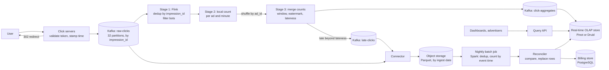
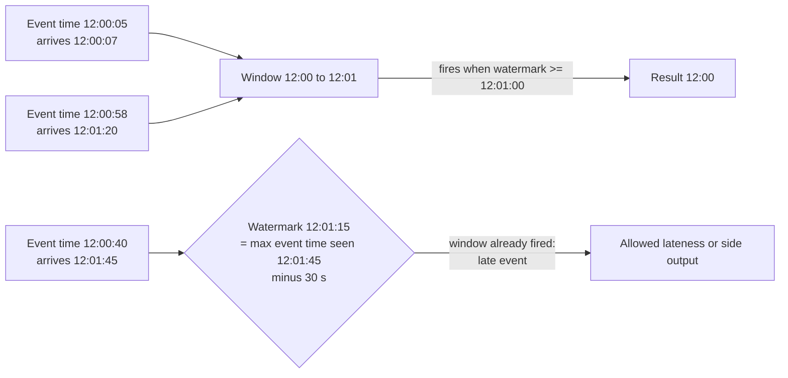
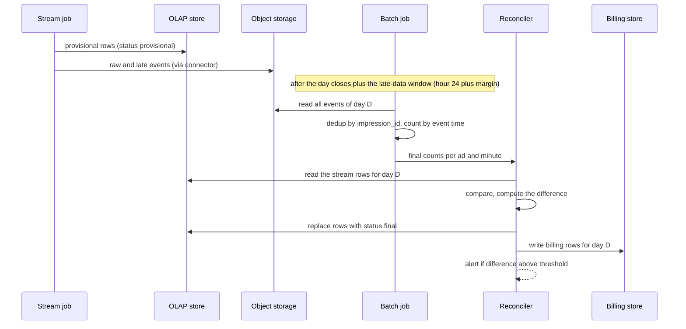

# Design an Ad Click Aggregation System

An ad platform shows ads and records clicks. Advertisers pay for clicks, so the platform must count them correctly and show the counts quickly. This case study designs the pipeline that turns a stream of click events into per-ad counts per minute. The hard parts are not the counting. They are the time of an event (events arrive late and out of order), duplicate events (retries and restarts repeat them), and money (a wrong count is a wrong invoice). The design uses a log, a stream job with event-time windows and a watermark, and a nightly batch job that reconciles the numbers. Follow the steps in [how to approach an HLD interview](../how-to-approach-hld.md).

!!! note "About the sources"
    This page is a reference design. The facts about windows, watermarks, and late data come from the Dataflow paper (Akidau et al., VLDB 2015) and the [batch and stream processing page](../fundamentals/17-batch-and-stream-processing.md). The facts about one production system come from the Uber engineering post "Real-time Exactly-Once Ad Event Processing with Apache Flink, Kafka, and Pinot" (cited in Further Reading). A number without a source is an assumption of this page. The page marks each such number.

## Problem Statement

Design a system that collects ad click events and answers two kinds of query. The first kind is "how many clicks did ad X get in each minute of the last hour or the last day". The second is "which are the 100 ads with the most clicks in the last hour". The platform bills advertisers by clicks, so the totals must be exact for billing, and the dashboard must be fresh within a few minutes. The system must not lose a click, must not count a click twice, and must handle events that arrive minutes or hours late.

## Clarifying Questions

| Question | Assumed answer |
|---|---|
| How many clicks? | 1 billion clicks each day, 2 million active ads, 100,000 advertisers |
| What is a click? | A user action on an ad that the click server records. The server writes one event with a unique `impression_id` (the id of the ad display that the click belongs to) |
| What counts as one click? | One click for each `impression_id`. A second click on the same display is a duplicate and is not billed |
| Which time do we aggregate by? | Event time: the time at which the click server received the click. The server writes the time. The system does not trust the device clock |
| Which granularity? | 1 minute. Hour and day roll-ups come from the minute rows |
| How fresh must the dashboard be? | Within 3 minutes at the 99th percentile |
| How exact must billing be? | Exact. Billing reads the reconciled numbers, which are final after the nightly batch job |
| How late can an event be? | Most events arrive within 30 seconds. A few arrive after hours (mobile app buffers, partner feeds). The system accepts them for 24 hours |
| Fraud and bots? | A filter stage removes clicks that break simple rules (rate per device, known bot lists). The rules are out of scope. The pipeline keeps the rejected events for audit |
| Which queries? | Clicks per ad per minute, per hour, per day for a time range. Top 100 ads in the last hour. Filter by country is an extension |
| Unique users? | Approximate unique clickers per ad per day (extension, see the HyperLogLog follow-up) |
| Multi-region? | Two regions, one active pipeline in each, as the Uber post describes. The design shows the idea and does not go deep |
| Retention? | Raw events: 7 days in the log and 1 year in object storage. Minute rows: 90 days. Hour rows: 2 years |

## Requirements

### Functional

1. Record each click event from the click servers.
2. Aggregate clicks by ad and by 1-minute event-time window.
3. Serve clicks per ad for a time range at minute, hour, and day granularity.
4. Serve the top N ads by clicks in the last hour.
5. Remove duplicate events, so that one `impression_id` counts once.
6. Correct the numbers for late events.
7. Reconcile the stream numbers against a batch recomputation, and publish the final numbers for billing.

### Non-functional

| Requirement | Target (assumption) |
|---|---|
| Ingest throughput | 10,000 events per second on average, 50,000 per second at the peak (see Estimation) |
| Freshness | A click appears in the minute row within 3 minutes at the 99th percentile |
| Accuracy for billing | The final number equals the batch number: zero lost, zero duplicate events |
| Durability | No acknowledged click is lost. The log stores events with 3 replicas |
| Recovery | After a job failure, the job resumes from the last checkpoint and loses no data. The recovery time is under 5 minutes |
| Availability | 99.9% for queries. Ingest keeps accepting events while the stream job is down, because the log buffers them |
| Query latency | 200 ms at the 99th percentile for one ad and one day |
| Late data | Events up to 24 hours late change the final numbers |

## Estimation

Rounding rule (the same as on the [estimation page](../back-of-envelope-estimation.md)): one day is 10^5 seconds.

Inputs (assumptions): 10^9 clicks each day, peak factor 5, event size 100 bytes (ids, ad and advertiser ids, event time, country, device type, and a signature, in a binary format such as Avro or Protobuf), 2 million ads, 300,000 ads with at least one click in a given minute, 50 bytes for each aggregate row, 100,000 advertisers who run 50 queries each day.

**Ingest.**

| Step | Calculation | Result |
|---|---|---|
| Events each second (average) | 10^9 / 10^5 | 10,000 |
| Events each second (peak) | 10,000 × 5 | 50,000 |
| Ingest bandwidth (average) | 10,000 × 100 B | 1 MB/s |
| Ingest bandwidth (peak) | 50,000 × 100 B | 5 MB/s |
| Raw data each day | 10^9 × 100 B | 100 GB |
| Log storage, 7 days, 3 replicas | 100 GB × 7 × 3 | 2,100 GB = 2.1 TB |
| Object storage for one year (uncompressed) | 100 GB × 365 | 36.5 TB |

**Stream job partitions.** Assumption: one stream task processes 5,000 events per second, including the deduplication lookup and the checkpoint cost. Tasks for the peak: 50,000 / 5,000 = 10. With a factor 2 for headroom: 20. The log topic gets 32 partitions (a round number above 20, so that the job can scale out). Check: a partition receives 50,000 / 32 = about 1,560 events per second at the peak, which is 156 KB/s, far below the throughput of a Kafka partition.

**Aggregates.**

| Step | Calculation | Result |
|---|---|---|
| Minute rows each day | 300,000 ads × 1,440 minutes | 4.32 × 10^8 |
| Minute-row storage each day | 4.32 × 10^8 × 50 B | 21.6 GB |
| Minute-row storage, 90 days | 21.6 GB × 90 | 1.94 TB |
| Upserts each second (average) | 300,000 rows each minute / 60 s | 5,000 |
| Hour rows each day (upper bound) | 2,000,000 ads × 24 | 4.8 × 10^7 |
| Hour-row storage each day | 4.8 × 10^7 × 50 B | 2.4 GB |
| Hour-row storage, 2 years | 2.4 GB × 730 | 1.75 TB |
| Query rate | 100,000 × 50 / 10^5 s | 50 per second (peak with factor 5: 250) |
| Rows scanned by one query for one day | 1,440 minute rows | 1,440 |

**State in the stream job.**

| Step | Calculation | Result |
|---|---|---|
| Deduplication horizon | 10 minutes = 600 s | 600 s |
| Remembered ids at the peak | 50,000 × 600 | 3 × 10^7 |
| Bytes per id (assumption: 16 B id, 8 B time, hash-map overhead) | | 64 B |
| Deduplication state at the peak | 3 × 10^7 × 64 B | 1.92 GB |
| State per task (20 tasks) | 1.92 GB / 20 | 96 MB |
| Open windows per ad (60 s window, 30 s watermark bound, 5 min allowed lateness) | (60 + 30 + 300) / 60, rounded up | 7 |
| Window state | 7 × 300,000 ads × 64 B | 134 MB |

The state is small. One machine holds it, and the checkpoint is fast. The Flink documentation names RocksDB for state larger than memory. This design does not need it for the deduplication state, and it needs it only if the horizon grows to many hours.

**Batch reconciliation.** The batch job reads 100 GB each day. A Spark cluster reads that in minutes. The cost of the batch job is small next to the stream job. The batch job also replays the raw data of any day after a bug fix.

**Takeaway.** The volume is moderate (50,000 events per second at the peak, 100 GB each day). The difficulty is correctness: late events, duplicates, and billing. The design spends its effort there.

## API Design

Three groups of interfaces: the click endpoint, the query API, and the internal event contract.

### Click endpoint (ingest)

| Method and path | Request | Response |
|---|---|---|
| `GET /v1/click?t=<token>` | `t` is a signed token that the ad server put into the ad link. The token holds `impression_id`, `ad_id`, `advertiser_id`, and an expiry time. The server checks the signature | `302 Found` with `Location:` the advertiser's landing page. The server writes the click event to the log before it answers |

The click server does three things: validate the token (reject forged and expired tokens), write the event with the server time to the log, and redirect. A redirect through the platform is the usual way to count clicks, because the platform sees the click before the user reaches the advertiser. If the log write fails after a retry, the server still redirects the user and stores the event in a local buffer. The user experience has priority, and the buffer replays the event. Recommendation: acknowledge to the log with `acks=all` (see [message queues and streams](../fundamentals/08-message-queues-and-streams.md)) and set a short timeout, so that a slow log does not slow the redirect.

### Query API

| Method and path | Request | Response |
|---|---|---|
| `GET /v1/ads/{adId}/clicks?from=<iso>&to=<iso>&granularity=minute\|hour\|day` | Time range and granularity. `from` and `to` are ISO 8601 times in UTC | `200` with `{"adId": "...", "granularity": "minute", "status": "provisional", "points": [{"start": "...", "clicks": 120}, ...]}` |
| `GET /v1/ads/top?window=1h&limit=100` | The window and the number of ads | `200` with `{"windowEnd": "...", "ads": [{"adId": "...", "clicks": 9100}, ...]}` |
| `GET /v1/advertisers/{id}/usage?date=<yyyy-mm-dd>` | One day | `200` with the reconciled click count for billing. `409` with `{"status": "not_final"}` if the batch job has not finished that day |

The `status` field tells the caller whether the number is `provisional` (from the stream job, can change) or `final` (reconciled by batch). The API never hides this difference, because the two numbers differ.

### Event contract

The raw event (a Protobuf or Avro message on the topic `raw-clicks`):

| Field | Type | Purpose |
|---|---|---|
| `impression_id` | 16 bytes | The deduplication key. One click for each impression |
| `ad_id`, `advertiser_id`, `campaign_id` | 8 bytes each | Aggregation and billing keys |
| `event_time_ms` | 8 bytes | The server time of the click. The event-time axis of all windows |
| `ingest_time_ms` | 8 bytes | The time that the log accepted the event. Used to measure lateness |
| `device_hash`, `ip_hash`, `country`, `os` | small | Filtering and fraud rules, and the country breakdown |
| `schema_version` | 2 bytes | Schema evolution |

The aggregate record (topic `click-aggregates`):

| Field | Purpose |
|---|---|
| `ad_id`, `window_start_ms` | The key of the row |
| `clicks` | The count for the window. The record holds the whole count, not a delta, so that an upsert is idempotent |
| `version` | A number that grows with each update of the same window (late events cause updates) |
| `record_id` | A deterministic id (a hash of `ad_id`, `window_start_ms`, and `version`). It is the idempotency key for every consumer. The Uber post uses a record UUID in the same role. Uber's UUID is random, which is safe there because its transactional sink discards the uncommitted output of a failed attempt. A deterministic id also stays the same when a non-transactional sink writes a record again after a restart |

## Data Model

There are four stores. Each has one job.

| Store | Holds | Key and layout | Why this store |
|---|---|---|---|
| Log (Kafka) | `raw-clicks` (7 days), `click-aggregates`, `late-clicks` (side output) | Partition `raw-clicks` by `impression_id`, so that the load is even and the events of one impression stay in order | A durable, replayable buffer between ingest and the job. See [message queues and streams](../fundamentals/08-message-queues-and-streams.md) |
| Object storage (S3 or similar), Parquet files | All raw events for 1 year, partitioned by ingest date | `dt=YYYY-MM-DD/hour=HH/part-N.parquet` (`dt` is the ingest date) | The source of truth for the batch job. Cheap and replayable. See [storage types](../fundamentals/10-storage-types.md) |
| Real-time OLAP store (Apache Pinot, Druid, or ClickHouse) | Minute rows for 90 days, hour rows for 2 years, with a `status` column | Primary key (`ad_id`, `window_start`). Sort by `window_start`. Upsert on the primary key | The queries are time-range filters and group-bys on a few columns. A columnar store with an upsert key fits. Uber chose Pinot for ad results |
| Billing store (PostgreSQL) | One row for each advertiser, campaign, and day: the final count and the amount | Primary key (`advertiser_id`, `campaign_id`, `date`) | Billing needs transactions, constraints, and audit. The volume is small (100,000 advertisers) |

**Why not a key-value store for the minute rows?** A wide-column store such as Cassandra can hold the rows with the key (`ad_id`, day) and the clustering key `minute`. It serves "one ad, one day" fast. It serves "top 100 ads in the last hour" badly, because that query reads all ads. An OLAP store serves both. Choose the wide-column option if the only query is per ad and the team already runs Cassandra. See [choosing a database](../fundamentals/04-choosing-a-database.md).

**The row has two sources.** The stream job writes the row first with `status = provisional`. The batch job later writes it again with `status = final`. The primary key is the same, so the second write replaces the first. The `version` and `status` columns tell which one is stored.

## High-Level Design



**Click servers.** Stateless servers behind a load balancer (see [load balancing](../fundamentals/02-load-balancing-dns-cdn.md)). Each server validates the signed token, stamps the event time with its own clock, produces the event to `raw-clicks`, and redirects. A click server cannot count, because counting needs state across servers.

**`raw-clicks` topic.** The durable buffer. Replication factor 3, 32 partitions, 7 days of retention. The producer uses the idempotent producer setting, so that its own retries do not add duplicates inside Kafka. The topic key is `impression_id`: all events of one impression land in one partition, in order, and a hot ad spreads over all partitions. The key does not save the network shuffle in Flink: `keyBy` assigns each key to a Flink key group by its own hash, so the deduplication operator receives its records over the network whatever the Kafka partition is. (Kafka Streams, whose tasks map one to one to topic partitions, would deduplicate locally.)

**Stage 1: deduplication and filtering.** A keyed Flink operator keyed by `impression_id`. It keeps the ids it saw in state, drops a repeat, and applies the bot rules. Deep dive 2 explains the state and its expiry.

**Stage 2 and 3: two-phase aggregation.** Stage 2 counts events by (`ad_id`, window) on each task before the shuffle (the combiner idea from [batch and stream processing](../fundamentals/17-batch-and-stream-processing.md)). Stage 3 receives the partial counts keyed by `ad_id`, merges them, and fires the window when the watermark passes its end. This protects against a hot ad (deep dive 4).

**`click-aggregates` topic and OLAP store.** Stage 3 writes one record for each (ad, window, version). A consumer upserts the records into the OLAP store by the primary key.

**Object storage sink.** A connector copies every raw event, and every late event, to Parquet files on object storage. This copy is the source of truth for the batch job and for any later replay.

**Batch job and reconciler.** The nightly job recomputes the counts for the previous day from the Parquet files, with full deduplication and event-time windows over complete data. The reconciler compares the result with the stream rows, replaces the rows with `final` ones, writes the billing rows, and raises an alert if the difference is larger than a threshold.

**Query API.** Reads the OLAP store. For the top-N query, it sums the 60 minute rows of the last hour for each ad, or reads a pre-computed top list (see the follow-up questions).

**One click, step by step.**

1. The user clicks. The click server validates the token, stamps `event_time_ms`, and writes the event to `raw-clicks` with `acks=all`. It redirects the user.
2. Stage 1 reads the event. If the `impression_id` is new, it stores the id and passes the event on. If not, it drops the event.
3. Stage 2 and 3 add the event to the count of (`ad_id`, minute). When the watermark passes the end of the minute, Stage 3 emits the count to `click-aggregates`.
4. The consumer upserts the row in the OLAP store. The dashboard shows the minute about 1 to 3 minutes after it ended.
5. If the event arrives after the watermark but within the allowed lateness (5 minutes), Stage 3 emits an updated count with a higher `version`. If it arrives later, Stage 3 sends it to `late-clicks`.
6. At night, the batch job counts all events of the day, including the late ones, and replaces the stream rows with final rows.

## Deep Dives

### Deep Dive 1: Event Time, Watermarks, and Late Events

**Use event time.** A click has two times: the time of the click (event time) and the time that the job sees it (processing time). They differ because of network delay, retries, and backlogs. If the job windows by processing time, then a backlog after a restart moves clicks into the wrong minute, and a replay gives different numbers. Event time gives the same answer on a replay. The definitions are on the [batch and stream processing page](../fundamentals/17-batch-and-stream-processing.md).

**Which event time?** The device clock can be wrong, or forged by a bot. This design uses the time that the click server stamps when it receives the click. That choice has a consequence: lateness in the pipeline is only the delay between the click server and the job (seconds, except during an outage). Events that were buffered on a device and sent later (a mobile app) carry the time of the upload, not of the tap. Assumption: the business accepts that, because it bills for the click when the platform saw it. If the business wants the tap time, the click event carries a second field, `client_time_ms`, with a bound check against the server time, and the lateness grows to hours.

**The window.** A tumbling window of 1 minute. Tumbling means fixed size, no overlap, and one window for each event. The window of a click is `floor(event_time / 60 s) × 60 s`.

**The watermark.** The job tracks the largest event time that it has seen in each input partition, and subtracts a bound. The bound here is 30 seconds. The Flink documentation describes this as the bounded-out-of-orderness strategy. The watermark of the operator is the minimum over its input partitions. A window `[s, s+60)` fires when the watermark reaches `s + 60`.



**How to pick the bound.** Measure `ingest_time - event_time` of past events. Take the 99th percentile. A larger bound delays every result by the same amount. A smaller bound makes more events late. In this design the freshness target is 3 minutes. A window ends, then 30 seconds of watermark delay, then the checkpoint and the sink delay (a few seconds to 2 minutes, see Deep Dive 2). The sum stays under 3 minutes. Recommendation: set the bound from the measured percentile and publish the late-event rate as a metric (see [observability in design](../fundamentals/20-observability-in-design.md)).

**Three layers for late events.**

1. **Inside the bound** (watermark): the event counts in its window before the window fires. No special handling.
2. **Allowed lateness** (5 minutes, assumption): the job keeps the window state after it fires. A late event updates the window and the job emits a new count with a higher `version`. The sink upserts. The cost is state: 7 windows for each ad instead of 2 (see Estimation).
3. **Side output** (beyond 5 minutes, up to 24 hours): the job does not update the window. It writes the event to `late-clicks`. The connector stores it in object storage. The nightly batch job counts it. The dashboard stays slightly low for that minute, and the final number is exact.

The Dataflow paper gives the reason for the layers. A watermark is only an estimate. It can be too fast (late data arrives behind it) or too slow (one slow input holds back every window). A system needs triggers and several results for one window, so that it gets low latency and later correctness. This design uses three panes for a window: the on-time pane at the watermark, late panes during the allowed lateness, and the batch pane as the final one.

**Idle partitions.** If one partition of `raw-clicks` receives no events (a quiet night, or a broken click server), its watermark does not move, and the operator takes the minimum. Every window waits. The Flink documentation describes `withIdleness` for this: the job marks an input as idle after a timeout, so the other inputs move the watermark. The cost is that events that arrive on the idle input later may be late.

**Sliding windows for "last hour".** A sliding window of 1 hour with a 1-minute slide puts each event into 60 windows, so state and compute grow by a factor of 60. Instead, store 1-minute tumbling counts and sum the last 60 rows at query time. This is exact and cheap, because the sum reads 60 rows for each ad.

Run the program below to see windows, a watermark, deduplication, a late side output, and the batch comparison. It uses 10-second windows and a 5-second bound, so that the numbers stay small. The stream result for window `[0,10)` of ad `a1` is 3. The batch result is 4. The difference is the late event `c7`, which arrived after the window fired.

```java
import java.util.ArrayList;
import java.util.HashMap;
import java.util.List;
import java.util.Map;
import java.util.TreeMap;

public class Main {
    record Click(String eventId, String adId, long eventTimeSec) { }

    /** Tumbling event-time windows per ad, a watermark, deduplication, and a late side output. */
    static class ClickAggregator {
        private final long windowSec;
        private final long boundSec;
        private long maxEventTime = Long.MIN_VALUE;
        // window start -> (ad id -> count). TreeMap keeps windows and ads in order.
        private final TreeMap<Long, TreeMap<String, Long>> open = new TreeMap<>();
        // dedup state: event id -> event time. The job evicts an id when its window has fired.
        private final Map<String, Long> seen = new HashMap<>();
        final TreeMap<String, Long> fired = new TreeMap<>();   // "start|ad" -> count
        final List<Click> late = new ArrayList<>();
        int duplicates = 0;

        ClickAggregator(long windowSec, long boundSec) {
            this.windowSec = windowSec;
            this.boundSec = boundSec;
        }

        long watermark() {
            return maxEventTime == Long.MIN_VALUE ? Long.MIN_VALUE : maxEventTime - boundSec;
        }

        void process(Click c) {
            long start = c.eventTimeSec() - Math.floorMod(c.eventTimeSec(), windowSec);
            if (start + windowSec <= watermark()) {
                late.add(c);          // the window fired already: side output for the batch job
                return;
            }
            if (seen.putIfAbsent(c.eventId(), c.eventTimeSec()) != null) {
                duplicates++;         // same event id seen before: drop
                return;
            }
            open.computeIfAbsent(start, k -> new TreeMap<>()).merge(c.adId(), 1L, Long::sum);
            maxEventTime = Math.max(maxEventTime, c.eventTimeSec());
            while (!open.isEmpty() && open.firstKey() + windowSec <= watermark()) {
                fire(open.pollFirstEntry());
            }
            long wm = watermark();
            seen.values().removeIf(t -> t - Math.floorMod(t, windowSec) + windowSec <= wm);
        }

        private void fire(Map.Entry<Long, TreeMap<String, Long>> window) {
            window.getValue().forEach((ad, n) -> fired.put(window.getKey() + "|" + ad, n));
        }

        void flush() {
            open.entrySet().forEach(this::fire);
            open.clear();
        }
    }

    public static void main(String[] args) {
        List<Click> arrival = List.of(
                new Click("c1", "a1", 1), new Click("c2", "a1", 3),
                new Click("c2", "a1", 3),    // retry of c2: duplicate
                new Click("c3", "a2", 4), new Click("c4", "a1", 12),
                new Click("c5", "a1", 9),    // out of order, window [0,10) still open
                new Click("c6", "a2", 21),   // watermark 16: window [0,10) fires
                new Click("c7", "a1", 8),    // late: window [0,10) fired
                new Click("c4", "a1", 12),   // duplicate of c4, window [10,20) still open
                new Click("c8", "a2", 14),
                new Click("c9", "a1", 33));  // watermark 28: window [10,20) fires

        ClickAggregator job = new ClickAggregator(10, 5);
        arrival.forEach(job::process);
        job.flush();
        System.out.println("duplicates dropped: " + job.duplicates);
        System.out.println("late events: " + job.late);

        // Batch reconciliation: count unique event ids by event time over the complete input.
        Map<String, Click> unique = new HashMap<>();
        arrival.forEach(c -> unique.putIfAbsent(c.eventId(), c));
        TreeMap<String, Long> batch = new TreeMap<>();
        for (Click c : unique.values()) {
            long start = c.eventTimeSec() - Math.floorMod(c.eventTimeSec(), 10);
            batch.merge(start + "|" + c.adId(), 1L, Long::sum);
        }
        System.out.println("window|ad  stream batch");
        for (String key : batch.keySet()) {
            long s = job.fired.getOrDefault(key, 0L);
            long b = batch.get(key);
            String note = s == b ? "" : "  <- corrected by batch";
            System.out.printf("%-10s %6d %5d%s%n", key, s, b, note);
        }
    }
}
```

<!-- expected-output -->
```text
duplicates dropped: 2
late events: [Click[eventId=c7, adId=a1, eventTimeSec=8]]
window|ad  stream batch
0|a1            3     4  <- corrected by batch
0|a2            1     1
10|a1           1     1
10|a2           1     1
20|a2           1     1
30|a1           1     1
```

Assumption: the program uses one global watermark and one thread. A real job keeps one watermark per input partition and takes the minimum. The deduplication state expires when the window of the event has fired. This is safe, because a duplicate of an event in a fired window is itself late. The late check sends it to the side output and does not count it, and the batch job removes it when it deduplicates the full day.

### Deep Dive 2: Deduplication and Exactly-Once Counting

**Where duplicates come from.** There are four sources.

| Source | Example | Defense |
|---|---|---|
| The user | A double click | Business rule: one click per `impression_id` |
| The click server | A retry after a timeout: the first write succeeded but the acknowledgment was lost | Idempotent Kafka producer (removes duplicates from the producer client's own internal retries only), and deduplication by `impression_id` in the job (catches a new send after a timeout and a replay from the local buffer) |
| The stream job | After a crash, the job restores a checkpoint and processes some events again | Checkpointed state, and a transactional or idempotent sink |
| The sink | A retry writes the same aggregate twice | Upsert by the primary key (`ad_id`, `window_start`) with the whole count, not a delta |

**What "exactly-once" means here.** No network delivers a message exactly once. The pipeline delivers at least once and makes the effect equal to one. The [batch and stream processing page](../fundamentals/17-batch-and-stream-processing.md) explains the two techniques: idempotent writes and an atomic commit of state, output, and input position. This design uses both.

1. **Inside the job.** Flink checkpoints keyed state and source offsets together. After a failure, the job restores the checkpoint and reads again from the saved offsets. The state is as if each event counted once.
2. **At the sink.** Two choices. (a) A transactional Kafka sink: Flink writes aggregate records inside a Kafka transaction and commits it with the checkpoint (two-phase commit), and downstream consumers read with `read_committed`. The Uber post uses this, with a checkpoint every 2 minutes. (b) An idempotent upsert: the sink writes the whole count with the key (`ad_id`, `window_start`). A repeated write sets the same value. Choice (b) needs no transaction support in the sink, but it needs the count in the row to be the full count.
3. **At each consumer.** Every record has a deterministic `record_id`. The budget service, the OLAP upsert, and the warehouse use it as the idempotency key. The Uber post gives each aggregate a random record UUID for this role: the ad-budget service uses it as an idempotency key, Hive uses it to deduplicate, and Pinot uses it for upserts. A random UUID is safe only with the transactional sink of choice (a). With the idempotent upsert of choice (b), use a deterministic id, because a replay after a restart must produce the same id. See [reliability patterns](../fundamentals/12-reliability-patterns.md) for idempotency keys.

**The deduplication operator.** Key by `impression_id`. State per key: a flag and the event time (a 16-byte id and an 8-byte time, about 64 bytes with overhead, as the estimation assumes). The Uber post says its aggregation job uses Flink keyed state to drop duplicate raw events.

**State expiry.** The state must not grow without bound. Two rules.

- Expire an id when the watermark passes `event_time + window + allowed lateness + safety margin`. After that point, a duplicate event would be too late for the window anyway.
- As a backstop, set a time-to-live on the state (10 minutes in the estimation). Flink offers a state TTL.

The cost of expiry: a duplicate that arrives after the expiry counts twice in the stream job. The batch job fixes this at night, because it deduplicates over the whole day. This is the first reason for the reconciliation in Deep Dive 3.

**Why deduplicate by `impression_id` and not by a click id?** A click id that the server generates for each request differs between a retry and the original, so it does not catch a retry. The `impression_id` comes from the ad server and is the same for all clicks on one display. It is the natural business key. Recommendation: define the duplicate in business terms first ("one billable click per impression"), then pick the technical key.

**What exactly-once does not cover.** The charge to the advertiser's budget is a side effect outside the stream job. The budget service must be idempotent by `record_id`. If it is not, a restart double-charges.

### Deep Dive 3: Reconciliation With Batch

**Why the stream numbers are provisional.** The stream job is an estimate that later events can change. The reasons:

- Events beyond the allowed lateness did not update the windows.
- Deduplication state expired, so a very late duplicate counted twice.
- A bug in a filter rule or a deploy that dropped events for a few minutes.
- A change of the fraud rules: the batch job applies the new rules to old data.
- Window boundaries and time zones: a bug that put events into the wrong window.

The Dataflow paper makes the same point for the Lambda architecture: the stream layer gives a low-latency estimate, and a batch layer gives the correct answer later.

**The design: a stream layer for freshness and a batch layer for truth.**



**Steps of the nightly job.**

1. Wait until the day and the late window are closed. With a 24-hour lateness limit, day D closes at the end of day D plus a few hours of margin. The batch job runs for day D at about 04:00 UTC of day D+1 (assumption), after the object-storage copy of the late events completes.
2. Read all Parquet files for the ingest dates D and D+1 (late events land in the later file), and keep the events whose `event_time` falls on day D.
3. Deduplicate by `impression_id` (a group-by with the first event kept). The batch job has no expiry limit, so the deduplication is complete.
4. Apply the current filter rules. Count by `ad_id` and the 1-minute event-time window.
5. Compare with the stream rows. Record the difference for each ad and minute, and the totals. Write the diff to a table for audit.
6. Upsert the final rows over the provisional rows. Write the billing rows in one transaction for each advertiser and day.
7. If the total difference exceeds a threshold (assumption: 0.1%), alert an engineer. A large diff points to a bug in the stream job.

**What the diff tells.** A small, steady positive difference (batch higher) means late events: the normal case. A small negative difference means duplicates that the stream job counted twice. A large difference in one window means an incident (a broken job, a lost partition). Track the diff as a data-quality metric.

**Billing reads only final numbers.** The usage endpoint returns `409` until the batch job finishes day D. Recommendation: bill on the final numbers, and show provisional numbers on the dashboard with a label. A provisional dashboard number can be a little lower than the final one, and the advertiser sees the final one on the invoice.

**Kappa alternative.** The Kappa architecture runs one stream path and replays the log to fix bugs (see the [batch and stream processing page](../fundamentals/17-batch-and-stream-processing.md)). It fits when log retention covers the horizon. Here the horizon is long (24 hours for lateness, and corrections after a bug can reach weeks). The design keeps raw events in object storage and uses a batch engine, which handles the full-scan deduplication without huge state. The batch job shares the counting logic (the window function and the filter rules) as a library with the stream job, to reduce drift between the two (Kreps's objection to Lambda). Flink can also run the same program in batch mode, and that is a way to share code (the `execution.runtime-mode` setting).

**Photon.** Google's Photon paper (Ananthanarayanan et al., SIGMOD 2013) describes the joining of search queries and ad clicks. The system keeps an `IdRegistry` that stores the ids of the events that it joined in the last N days, and it replicates the registry synchronously across data centers with Paxos. A worker must insert the event id into the `IdRegistry` before it writes the joined event to the output. The paper states three guarantees: at-most-once output at any point in time, near-exact output in real time, and exactly-once output eventually. It shows that the problem of "count a click once, across data centers" is an old and central problem in ad tech. This page's design keeps the same idea in a lighter form: a keyed state for deduplication in the stream job and a complete deduplication in the batch job.

### Deep Dive 4: Hot Ads and Skew

**The problem.** After the shuffle by `ad_id`, all clicks of one ad go to one task. A viral ad can get a large share of the clicks. Assumption: one ad gets 10% of the peak, which is 5,000 events per second. A task that handles 5,000 events per second only for this ad is fully loaded, and other ads on that task are starved. The Spark rules on the [batch and stream processing page](../fundamentals/17-batch-and-stream-processing.md) describe the same skew problem.

**Defenses, in order.**

1. **Do not partition ingest by `ad_id`.** The log is partitioned by `impression_id`. A hot ad spreads over all 32 partitions. The ingest side has no hot spot.
2. **Local pre-aggregation (Stage 2).** Each task counts (ad, minute) pairs locally and emits one partial count for each pair each second, not one event for each click. The hot ad gives at most one partial count each second from each Stage 2 task (20 partial counts for the 20 tasks of the estimation), instead of 5,000 events each second. This is the combiner idea. It works because addition is associative and commutative.
3. **Salting.** For an ad that is still hot, key the shuffle by (`ad_id`, salt) with a salt of 0 to 7. Stage 3 first merges the partial counts of one salt, then a short last stage merges the eight salted counts. The cost is one more stage and a few hundred milliseconds of delay. Detect hot ads from the counts of the previous minute, and apply the salt only to them.
4. **The OLAP store.** The upserts of the hot ad are one row each minute, so the store sees no hot key. The query for a hot ad reads 1,440 rows, the same as any ad.

**Hot rows and the query side.** The top-N query does not scan all 2 million ads. Keep a small materialized view of the minute sums for the last hour, or run a periodic job (each minute) that computes the top 100 and stores it as one row in a cache. For approximate top-k over a stream, a count-min sketch with a heap works (see [the leaderboard case study](16-leaderboard-and-top-k.md) and [probabilistic data structures](../distributed-systems/04-probabilistic-data-structures.md)). For billing, exactness matters, so the sketch serves only the dashboard top list, and never the invoice.

**Unique clickers.** Count distinct users per ad per day with HyperLogLog sketches: one sketch for each (ad, minute) row, merged by the register-wise maximum for hour and day roll-ups. The HyperLogLog is safe for repeated events, because adding an item twice changes nothing. See [probabilistic data structures](../distributed-systems/04-probabilistic-data-structures.md).

## Bottlenecks and Scaling

| What fails first | Why | Fix |
|---|---|---|
| A hot ad on one task | Shuffle by `ad_id` | Local pre-aggregation, then salting for the hot ad |
| Stalled watermark | One idle or slow partition holds back every window | `withIdleness`, alerts on watermark lag, fix the broken producer |
| Checkpoint time grows | Large deduplication state, slow storage | A shorter deduplication horizon, RocksDB with incremental checkpoints, a faster checkpoint store, more parallelism |
| Consumer lag after an outage | The job restarts and the log holds a backlog | The job reads the backlog at full speed. Size the job for 2 to 3 times the peak rate, so that it catches up. Watermarks jump forward after the backlog, so late handling must not mark the backlog as late. Event-time windows handle this correctly, because the order is by event time |
| Log disk full | Retention of 7 days at 3 replicas | Alert on disk use, tiered storage (Kafka KIP-405) for older segments, shorter retention while the object-store copy exists |
| OLAP upsert load | 5,000 upserts each second plus late updates | Batch the upserts, partition the table by time, add servers. Pinot and Druid scale out by segment |
| Query load | Dashboards ask the same query often | Cache results for provisional ranges for 30 to 60 seconds. Final ranges never change, so a long TTL fits |
| Batch job too slow | Data grows | More executors, partition pruning by date, incremental processing by hour and a daily compare |
| Region failure | One region holds the pipeline | Run the pipeline in two regions with their own logs, and merge into the store, as the Uber post describes. See [multi-region and disaster recovery](../fundamentals/19-multi-region-and-disaster-recovery.md) |
| Click-server overload | A traffic spike or an attack | Autoscale the stateless servers. The token check rejects forged links before the log write. Apply [rate limits](../fundamentals/13-rate-limiting-algorithms.md) per IP and per device |
| Fraud inflates counts | Bots click | Filter stage in the pipeline, and the batch job applies the current rules. Keep the rejected events for audit |

**Scale with the load.** At 10 times the load (500,000 events per second at the peak), the design changes in three places: 320 log partitions, 200 stream tasks, and the deduplication state of about 19 GB (spread over 200 tasks, still under 100 MB each). The shape of the design stays the same. This is because each stage partitions by a key.

## Trade-offs

| Decision | Chosen | Rejected alternative | Reason |
|---|---|---|---|
| Time domain | Event time with a server-stamped time | Processing time, or the device clock | Replays and backlogs give the same result. The device clock is untrusted |
| Window | 1-minute tumbling, sum minutes for longer ranges | Sliding windows for each range | A sliding hour window multiplies state by 60. Summing minute rows is exact and cheap |
| Watermark bound | 30 s plus 5 min allowed lateness plus side output | A large bound (hours) | A large bound delays every result by hours. Layers give freshness and correctness |
| Source of truth | Raw events in object storage plus nightly batch | Only the stream (Kappa) | Corrections can reach back weeks. Full-scan deduplication needs no expiring state |
| Billing | From final batch numbers only | From the stream numbers | A stream number is an estimate. An invoice must be exact |
| Duplicate handling | Keyed-state deduplication by `impression_id` with expiry, then complete batch deduplication | Unbounded state, or no deduplication | Unbounded state grows forever. No deduplication overbills |
| Exactly-once | At-least-once delivery, checkpoints, transactional or idempotent sink, idempotent consumers | Claiming exactly-once delivery | No network gives exactly-once delivery. The effect is what matters |
| Sink writes | Whole count with a version, upsert by key | Increment (`+n`) | An increment is not idempotent. A retry counts twice |
| Log partition key | `impression_id` | `ad_id` | `ad_id` creates a hot partition for a hot ad. `impression_id` spreads the load evenly and keeps the events of one impression in order |
| Hot ads | Pre-aggregation, then salt for the hot ones | Always salt everything | Salting adds a stage and delay for all ads. Most ads are not hot |
| Serving store | Real-time OLAP with upsert | Cassandra, or a relational database | Time-range group-bys and top-N fit a columnar store. A relational database does not scale to 4 × 10^8 rows each day on one node |
| Stream engine | Flink | Spark Structured Streaming, or Kafka Streams | Record-by-record processing, event-time features, and large keyed state. Kafka Streams is a good fit if the team wants a library, and it supports `exactly_once_v2`. Spark micro-batches add a latency floor |
| Unique users | HyperLogLog (approximate) | Exact distinct sets | Exact sets need memory in proportion to users. 1% error is fine for reach, and wrong for billing |

## Follow-up Questions

??? question "How do you count unique users per ad per day?"

    Exact distinct counts need a set of user ids for each ad and day, which is too large for 2 million ads. Use a HyperLogLog sketch for each (ad, minute) row. A sketch with 16,384 registers (12 KB in Redis, 0.81% standard error) is more than the minute row needs, so use a smaller sketch for the minute rows (for example 1,024 registers, 3.25% error) and merge them for hour and day roll-ups. The merge is the register-wise maximum, and the merged sketch is the sketch of the union.

    Trade-off: the sketch is approximate and cannot list users, so it serves reach reports, not billing. For billing, the batch job can compute exact distinct counts when the contract needs them. See [probabilistic data structures](../distributed-systems/04-probabilistic-data-structures.md).

??? question "The stream job was down for 2 hours. What happens to the numbers when it restarts?"

    The click servers keep writing to the log, so no click is lost, as long as the retention covers the outage (7 days). After the restart, the job restores the last checkpoint and reads the backlog from the saved offsets. It aggregates by event time, so each click goes into its correct minute. The dashboard shows a gap for 2 hours, and then it fills in the minutes as the job catches up.

    Two details matter. First, the watermark jumps forward as the job reads the backlog in order, so the late handling must work from event time, not from the wall clock. Second, the job needs spare capacity to catch up (2 to 3 times the peak rate). The nightly batch job corrects any remaining error. To reduce the gap in the dashboard, alert on consumer lag and on watermark lag.

??? question "How do you make sure an advertiser is never billed for a duplicate click?"

    Four layers. The business key is the `impression_id`, so a double click counts once. The click server uses an idempotent producer, so the client's internal retries do not add duplicates in the log. A new send after a timeout, or a replay from the local buffer, can still add a duplicate, and the next layer catches it. The stream job deduplicates by the key in keyed state. The batch job deduplicates the full day without an expiry limit, and billing uses only the batch numbers. Each consumer of an aggregate uses the deterministic `record_id` as an idempotency key, so that a repeated record changes nothing.

    The limit: the stream job's deduplication state expires, so a very late duplicate can count twice in the provisional number. The batch job removes it before billing. Final numbers equal the unique impressions that the batch job sees.

??? question "Why not make the stream job exactly right and skip the batch job?"

    A stream job cannot know that a window is complete. The watermark is an estimate, so some events arrive late. Allowed lateness and a side output reduce the error, but each costs state or time. Dedup state must expire. A bug fix or a rule change needs a recomputation over old data, and a batch job over stored raw events does that without a huge replay state. The nightly job also checks the stream job: a large difference raises an alert.

    If the business accepts a small error and the log retention covers the correction horizon, the Kappa design (stream only, replay to fix) is simpler. For billing, I keep the batch job, because correctness has priority over simplicity.

??? question "How would you change the window logic after a bug, for the last 3 days?"

    Fix the logic in the shared counting library. Run the batch job for the 3 days over the raw events in object storage, with the fixed logic. The reconciler replaces the rows with `final` rows, and it recomputes the billing rows if the invoices are not closed. If the log still holds the data, I can instead start a second copy of the stream job from the old offsets and write to a new table. When it catches up, I switch the query API to the new table and stop the old job. The second approach is the Kappa method. Both need immutable, retained raw events.

??? question "What happens if one Kafka partition has no events for a while?"

    The watermark of the window operator is the minimum over its input partitions. A partition with no events keeps its last watermark value, so the minimum does not move, and no window fires. The dashboard freezes while other partitions keep receiving clicks. The fix in Flink is `withIdleness`: after a timeout without events, the job marks that input idle, and the watermark follows the other inputs. The cost: if events arrive on that partition later, they can be late. With 32 partitions keyed by `impression_id` and 50,000 events per second at the peak, an empty partition is rare, so it is a night-time and a failure case. I alert on watermark lag in any case.

??? question "How do you serve the top 100 ads of the last hour?"

    The query sums the 60 minute rows of each ad for the last hour, and takes the largest 100. An OLAP store runs this as a group-by with a limit over a time filter. At 300,000 active ads, that scans 1.8 × 10^7 rows, which a columnar store handles in less than a second, but not at high query rates. So a job computes the top 100 each minute and stores the result in a cache. The query API reads the cache. If a stream-only approximation is enough, a count-min sketch with a heap per window gives an approximate top list in small memory (see [the leaderboard case study](16-leaderboard-and-top-k.md)). Billing never uses the approximate list.

??? question "How would you handle two regions?"

    Run a full pipeline in each region: click servers, log, stream job, and OLAP store. A click goes to the nearest region, so each click enters one pipeline only. A union job (the Uber post uses one) loads the results of both regions into the serving store, so that the query sees the global count. The batch job reads the object-storage copies of both regions. If one region fails, DNS or the load balancer moves the traffic to the other region, and the failed region's backlog is replayed later from its log when it recovers. The cost is duplicated infrastructure. See [multi-region and disaster recovery](../fundamentals/19-multi-region-and-disaster-recovery.md).

??? question "Why partition the raw topic by `impression_id` and not by `ad_id`?"

    The main reason is load. A hot ad would put a large share of all events into one partition, one broker, and one source task. With `impression_id`, the load is even across the 32 partitions. A second effect: the events of one impression stay in order in one partition.

    A common wrong reason is that the topic key makes Flink's deduplication local. It does not. `keyBy(impression_id)` hashes each key into a Flink key group, and that mapping has no relation to the Kafka partition, so the records cross the network to the deduplication operator anyway. (Flink has an experimental `reinterpretAsKeyedStream`, which requires the upstream partitioning to match Flink's key-group assignment exactly. Kafka's default partitioner does not match it.) In Kafka Streams, where a task owns one partition, the topic key does make deduplication local.

    The cost of either key: the job needs a shuffle by `ad_id` before it can count. The local pre-aggregation in Stage 2 keeps that shuffle small: it moves partial counts and not events.

??? question "What do you monitor?"

    Pipeline health: consumer lag per partition, watermark lag (wall clock minus watermark), checkpoint duration and failures, late-event rate, deduplication hit rate (the share of dropped duplicates), and state size. Data quality: the stream-versus-batch difference for each day, the click-to-impression ratio, and the share of clicks that the fraud filter rejects. Service health: click-server error rate and latency, log produce latency, OLAP upsert lag, and query latency. Alert on watermark lag above 3 minutes (the freshness target) and on a daily difference above 0.1%. See [observability in design](../fundamentals/20-observability-in-design.md).

??? question "A click arrives with an event time of three days ago. What do you do?"

    The click server stamps the event time, so this should not happen from the servers. If it comes from a partner feed, the job sees an event far behind the watermark. It is beyond the allowed lateness, so it goes to `late-clicks`. The batch job for the day of its event time counts it, if that day is not yet closed. If the invoice of that day is final, a policy decides: add the click to the current day as an adjustment line, or drop it. I choose one policy with the business, because reopening a closed invoice has legal effects. I also alert on events older than 24 hours, because they point to a bug or abuse.

## 45-Minute Plan

| Minutes | What to present |
|---|---|
| 0 to 5 | Clarify: what is a click, which time, freshness, exactness for billing, lateness, queries. Write the requirements |
| 5 to 10 | Estimation: 10,000 and 50,000 events each second, 100 GB each day, 4.3 × 10^8 minute rows each day, state under 2 GB. Say that the volume is moderate and correctness is the problem |
| 10 to 15 | API: the click endpoint, the query API with the provisional and final status, the event contract. Data model: log, object storage, OLAP store, billing store |
| 15 to 21 | High-level diagram: click servers, log, three stages, aggregates, OLAP, object storage, batch, reconciler. Walk one click through |
| 21 to 38 | Deep dives: event time, watermark, and late layers (about 5 minutes). Deduplication and exactly-once (about 5 minutes). Reconciliation with batch (about 4 minutes). Hot ads with two-phase aggregation (about 3 minutes) |
| 38 to 43 | Bottlenecks: stalled watermark, checkpoint size, backlog after an outage, region failure, fraud |
| 43 to 45 | Trade-offs and a summary. Invite questions on unique users, top-N, and backfill |

## Further Reading

- Akidau et al., ["The Dataflow Model: A Practical Approach to Balancing Correctness, Latency, and Cost in Massive-Scale, Unbounded, Out-of-Order Data Processing"](https://www.vldb.org/pvldb/vol8/p1792-Akidau.pdf), Proceedings of the VLDB Endowment 8(12), 2015. Event time, windows, watermarks, triggers, and accumulation modes. The basis of the late-event layers in this design.
- Uber Engineering, ["Real-Time Exactly-Once Ad Event Processing with Apache Flink, Kafka, and Pinot"](https://www.uber.com/blog/real-time-exactly-once-ad-event-processing/), 2021. A production ad-event pipeline: Flink aggregation with 1-minute tumbling windows, keyed-state deduplication, transactional Kafka sinks with a 2-minute checkpoint, random record UUIDs as idempotency keys, two regions joined by a union job, and Pinot for serving.
- Ananthanarayanan et al., ["Photon: Fault-tolerant and Scalable Joining of Continuously Flowing Data Streams"](https://research.google/pubs/photon-fault-tolerant-and-scalable-joining-of-continuously-flowing-data-streams/), SIGMOD 2013. Google's ad system: joining queries and clicks with an `IdRegistry` that gives at-most-once output across data centers.
- Gupta et al., ["Mesa: Geo-Replicated, Near Real-Time, Scalable Data Warehousing"](https://research.google/pubs/mesa-geo-replicated-near-real-time-scalable-data-warehousing/), VLDB 2014. Google's warehouse for advertising metrics: batched updates, versions, and consistent queries across data centers.
- Apache Flink documentation: ["Generating Watermarks"](https://nightlies.apache.org/flink/flink-docs-stable/docs/dev/datastream/event-time/generating_watermarks/) (bounded out-of-orderness, idleness), ["Windows"](https://nightlies.apache.org/flink/flink-docs-stable/docs/dev/datastream/operators/windows/) (tumbling windows, allowed lateness, side outputs), and ["Fault Tolerance Guarantees of Data Sources and Sinks"](https://nightlies.apache.org/flink/flink-docs-stable/docs/connectors/datastream/guarantees/) (which sinks give exactly-once).
- Apache Kafka documentation, ["Kafka Streams"](https://kafka.apache.org/documentation/streams/) and the design section on message delivery semantics (idempotent producer, transactions, `read_committed`). The alternative library and the delivery guarantees.
- Jay Kreps, ["Questioning the Lambda Architecture"](https://www.oreilly.com/radar/questioning-the-lambda-architecture/), O'Reilly Radar, 2014. The cost of two code paths and the replay alternative.
- Cormode and Muthukrishnan, "An Improved Data Stream Summary: The Count-Min Sketch and its Applications", Journal of Algorithms 55(1), 2005, and Flajolet et al., "HyperLogLog: the analysis of a near-optimal cardinality estimation algorithm", 2007. The sketches for approximate top-N and unique counts.
- Related pages: [batch and stream processing](../fundamentals/17-batch-and-stream-processing.md), [message queues and streams](../fundamentals/08-message-queues-and-streams.md), [partitioning and sharding](../fundamentals/06-partitioning-and-sharding.md), [reliability patterns](../fundamentals/12-reliability-patterns.md), [event-driven architecture](../fundamentals/16-event-driven-architecture.md), [probabilistic data structures](../distributed-systems/04-probabilistic-data-structures.md), [failures and time](../distributed-systems/01-failures-and-time.md), [distributed transactions](../distributed-systems/03-distributed-transactions.md), [back-of-envelope estimation](../back-of-envelope-estimation.md), and the case studies [leaderboard and top-k](16-leaderboard-and-top-k.md) and [metrics and monitoring](17-metrics-and-monitoring.md).
