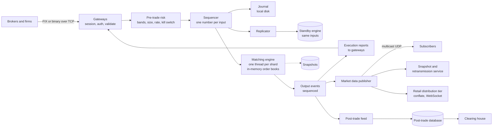
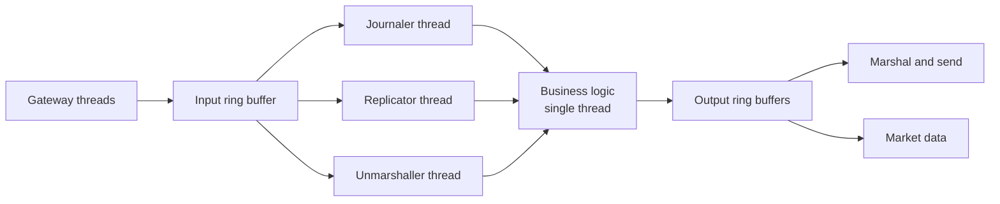

# Design a Stock Exchange

A stock exchange matches buy orders and sell orders for listed shares. Brokers send orders. The exchange keeps an order book for each stock, matches orders by price and arrival time, and publishes each trade and each change of the book to all market participants. The design problem is different from most case studies in this knowledge base. The load is moderate (hundreds of thousands of messages each second), and the requirements are strict: every order is processed in one fixed order, no acknowledged order is lost, the result is the same on every replay, and the delay is measured in microseconds. This case study designs a single-venue equity exchange. It shows the order book, the single-threaded matching engine behind a sequencer, the durability and failover design, the risk checks, and the market data fan-out. Follow the steps in [how to approach an HLD interview](../how-to-approach-hld.md).

!!! note "About the sources"
    This page is a reference design. The architecture of the matching core follows the LMAX architecture article by Martin Fowler (2011) and the Disruptor technical paper (Thompson et al., 2011). The facts about the market data protocol come from the Nasdaq TotalView-ITCH specification. The facts about order entry come from the FIX protocol standard. All sources are in Further Reading. A number without a source is an assumption or a design target of this page, and the page marks it. The page does not describe the internals of any real exchange beyond what these sources state.

## Problem Statement

Design the trading system of a stock exchange. Brokers connect and send orders to buy or sell shares of a stock at a limit price, or at the market price. The exchange keeps a book of waiting orders for each stock. When a buy order and a sell order can trade, the exchange matches them, records the trade, and tells both brokers. The exchange publishes the state of the book and each trade to everyone, in real time. The exchange applies risk checks to every order. It must run for the whole trading day without losing an order, and it must give every participant fair treatment: the order that arrives first at the same price trades first.

## Clarifying Questions

| Question | Assumed answer |
|---|---|
| Which market? | One venue, equities (shares). 5,000 listed symbols. Derivatives, auctions across venues, and routing between venues are out of scope |
| Who sends orders? | Brokers and trading firms, over a network connection that the exchange authenticates. Retail investors reach the exchange through a broker |
| Which order types? | Limit and market orders, with time in force `DAY` and `IOC` (immediate or cancel). Cancel and replace (modify). Stop, iceberg, and fill-or-kill orders are extensions |
| Which matching rule? | Price-time priority: the best price first, and at the same price the earliest order first. This is the common rule for equity markets. Pro-rata is an alternative (see Trade-offs) |
| Which session phases? | Continuous trading from open to close. The opening and closing auctions are an extension (see the follow-up questions) |
| Volume? | 5 × 10^8 order events each day (new orders, cancels, and replaces), over a 6.5-hour session. Most events are cancels. The peak at the open is 10 times the average |
| Latency target? | Matching engine: a few microseconds per order. From the gateway to the acknowledgment: under 100 microseconds at the 99th percentile. These are design targets, not measurements |
| Durability? | An acknowledged order must survive a failure of any single machine. The recovery point is zero |
| Availability? | 99.99% during the trading session. A failover completes in under 1 second |
| Fairness? | One total order of all inputs. The same input sequence gives the same output on every replay and on every replica |
| Market data? | Every participant gets every book change and every trade, with the same content, as a numbered stream |
| Risk checks? | Pre-trade checks at the exchange: price bands, size limits, rate limits, duplicate order ids, and a kill switch. Credit checks of the broker's own clients are the broker's job, and the exchange checks only the broker's limits |
| Settlement? | After the trade, a clearing house settles. The exchange only sends the trade records to a post-trade system. Clearing is out of scope |
| Regions? | One primary site, and a disaster-recovery site that receives the same input stream |

## Requirements

### Functional

1. A participant connects, authenticates, and sends a new order, a cancel request, or a replace request.
2. The exchange keeps an order book for each symbol and matches orders by price-time priority.
3. The exchange sends an execution report to the sender for each state change of an order: accepted, partially filled, filled, cancelled, rejected.
4. The exchange publishes a market data feed: each order added, executed, cancelled, and replaced, and each trade.
5. The exchange rejects an order that fails a risk check, with a reason code.
6. The exchange records each trade and sends it to the post-trade system.
7. Operations staff can halt a symbol or a participant (a kill switch) and can cancel all orders of a participant.

### Non-functional

| Requirement | Target (assumption) |
|---|---|
| Throughput | 21,000 events each second on average, 210,000 each second at the peak (see Estimation) |
| Latency | Gateway to acknowledgment under 100 µs at the 99th percentile. Matching step 1 to 5 µs |
| Determinism | One total order of inputs. The same inputs give the same trades, on every replica and on every replay |
| Durability | No acknowledged order is lost after a single machine failure (recovery point objective zero) |
| Availability | 99.99% in the session. Failover under 1 second (recovery time objective) |
| Fairness | At the same price, the earlier order trades first. Every subscriber gets the same market data messages |
| Integrity | A trade happens once. An order never fills for more than its quantity |
| Auditability | Every input and output is kept with its sequence number, so that a regulator can replay the day |

## Estimation

Rounding rule (the same as on the [estimation page](../back-of-envelope-estimation.md)). The session is 6.5 hours, which is 6.5 × 3,600 = 23,400 seconds.

Inputs (assumptions): 5 × 10^8 order events each day, peak factor 10, one hot symbol that gets 5% of the peak, 10 million resting orders at one time, 64 bytes of internal state for each order, 36 bytes for each market data message (the size of an ITCH Add Order message, offsets 0 to 35 in the specification), 64 bytes for each journal record, one matching thread handles 500,000 events each second (assumption).

**Order flow.**

| Step | Calculation | Result |
|---|---|---|
| Events each second (average) | 5 × 10^8 / 23,400 | 21,368, about 2.1 × 10^4 |
| Events each second (peak, at the open) | 2.1 × 10^4 × 10 | 2.1 × 10^5 |
| Hot symbol at the peak | 2.1 × 10^5 × 0.05 | 10,500, about 10^4 |
| Time budget for each event, if one thread handled the whole peak | 1 s / 2.1 × 10^5 | 4.8 µs |
| Load on one thread, whole venue at the peak | 2.1 × 10^5 / 500,000 | 42% |
| Matching shards (symbol partitions) | 8 shards, 5,000 / 8 | about 625 symbols for each shard |
| Load on one shard at the peak, if load is even | 42% / 8 | about 5% |

The Fowler article reports a business logic processor that handles 6 million orders each second on one thread, on one commodity server. This design assumes a rate 12 times lower (500,000 each second), because a real engine does more work for each event: risk, several order types, and many output messages. The result: **one thread has enough capacity for the peak of this venue**. The design still uses 8 shards. The reasons are isolation (a fault or a slow symbol hurts one shard) and headroom, not raw capacity.

**Storage and bandwidth.**

| Step | Calculation | Result |
|---|---|---|
| Journal each day | 5 × 10^8 × 64 B | 3.2 × 10^10 B = 32 GB |
| Journal write rate at the peak | 2.1 × 10^5 × 64 B | 13.4 MB/s |
| Resting-order memory | 10^7 × 64 B | 640 MB |
| Market data each day | 5 × 10^8 × 36 B | 18 GB |
| Market data rate at the peak | 2.1 × 10^5 × 36 B | 7.56 MB/s = 60.5 Mbit/s |
| Same feed by unicast TCP to 1,000 subscribers | 60.5 Mbit/s × 1,000 | 60.5 Gbit/s |
| Same feed by multicast | One copy on the wire | 60.5 Mbit/s |
| Output messages for each input event (ack, market data, execution reports), assumption | 3 | 6.3 × 10^5 per second at the peak |

The book fits in the memory of one machine with a large margin. The journal write rate is small, so the journal is not a bandwidth problem. It is a latency problem (see Deep Dive 2). The market data rate is small for one feed, and the cost appears only when the exchange sends it separately to each subscriber. This is why the design uses multicast inside the data center.

**Recovery time.** Assumption: an engine replays 500,000 events each second. A snapshot of the book is taken every hour. At the average rate, one hour holds 2.1 × 10^4 × 3,600 = 7.6 × 10^7 events. Replay time is 7.6 × 10^7 / 500,000 = 152 seconds, about 2.5 minutes. This is the time to rebuild a *cold* machine. A failover uses a *hot* standby that already processed the same input, so it does not replay (see Deep Dive 2). The Fowler article reports that a full restart, which loads a snapshot and replays the journals of a day, takes under a minute on the LMAX system.

**Retail market data fan-out.** Assumption: 10^6 retail clients, each watching 5 symbols, with updates for each symbol conflated (merged) to 1 per second, 100 bytes each.

| Step | Calculation | Result |
|---|---|---|
| Messages each second | 10^6 × 5 × 1 | 5 × 10^6 |
| Bandwidth | 5 × 10^6 × 100 B | 500 MB/s = 4 Gbit/s |
| Connection servers, 20,000 connections each (assumption) | 10^6 / 20,000 | 50 |

**Latency budget (design targets).**

| Stage | Budget |
|---|---|
| Network and gateway: decode, authenticate, session checks | 10 to 20 µs |
| Pre-trade risk | 2 to 5 µs |
| Sequencer, journal, and replication to the standby | 20 to 50 µs |
| Matching | 1 to 5 µs |
| Output: execution report and market data | 10 µs |
| Total, gateway to acknowledgment | under 100 µs at the 99th percentile |

The budget shows the shape of the problem. The matching step is the smallest part. The journal and the replication, which protect durability, take the largest share.

## API Design

An exchange has three interfaces: order entry, market data, and an administrative and query interface.

### Order entry (FIX)

Brokers send orders over a FIX session (Financial Information eXchange, the standard messaging protocol for electronic trading, maintained by the FIX Trading Community). A FIX message is a list of `tag=value` fields separated by the SOH character (byte 0x01). Each message has a type in tag 35 and a sequence number in tag 34. The session layer uses the sequence numbers to detect gaps and to ask for a resend.

| Message | Type (35) | Direction | Purpose |
|---|---|---|---|
| Logon | `A` | Both | Start a session. The broker authenticates |
| Heartbeat, Test Request | `0`, `1` | Both | Detect a dead session |
| Resend Request | `2` | Both | Ask for messages after a gap in the sequence numbers |
| Sequence Reset | `4` | Both | Reset or skip sequence numbers |
| Logout | `5` | Both | End a session |
| New Order Single | `D` | Broker to exchange | Send a new order |
| Order Cancel Request | `F` | Broker to exchange | Cancel an order |
| Order Cancel/Replace Request | `G` | Broker to exchange | Change the price or quantity of an order |
| Execution Report | `8` | Exchange to broker | The state of an order: new, partial fill, fill, cancelled, rejected |
| Order Cancel Reject | `9` | Exchange to broker | Reject a cancel or replace request |

Main fields of a New Order Single: `ClOrdID` (11, the broker's order id, unique for each session and day), `Symbol` (55), `Side` (54: 1 is buy, 2 is sell), `OrderQty` (38), `OrdType` (40: 1 is market, 2 is limit), `Price` (44), `TimeInForce` (59: 0 is day, 3 is immediate or cancel). An Execution Report carries `OrderID` (37, the exchange's id), `ExecType` (150), `OrdStatus` (39), `LastQty` (32), `LastPx` (31), `LeavesQty` (151), and `CumQty` (14).

Example of a limit order, with `|` standing for the SOH byte (the second line continues the first):

```text
8=FIX.4.4|35=D|49=BROKER1|56=EXCH|34=102|11=ord-7731|55=ACME|54=1|
38=100|40=2|44=101.50|59=0|
```

Many venues also offer a binary order-entry protocol with a fixed layout, because it parses faster than text. The FIX Trading Community publishes a binary encoding (Simple Binary Encoding). The design uses a binary protocol on the internal path and FIX at the gateway edge, where a broker needs it.

**Idempotence and recovery on the session.** The order id `ClOrdID` is unique, and the exchange rejects a duplicate. If the connection drops, the broker reconnects, sends a Logon, and the two sides compare sequence numbers and replay the missing messages (Resend Request). The broker never sends an order twice by guessing. This is the idempotency-key idea from [reliability patterns](../fundamentals/12-reliability-patterns.md), built into the session.

**Cancel on disconnect.** If a session drops, the exchange can cancel the open orders of that session automatically (a setting that the broker chooses). This protects a trading firm whose connection fails while it holds many quotes.

### Market data

Market data is a one-way stream of numbered binary messages. The design follows the order-by-order model of Nasdaq TotalView-ITCH. The specification lists these message types (the letter is the message type):

| Type | Message | Meaning |
|---|---|---|
| `A`, `F` | Add Order | A new order entered the displayed book. It has an order reference number, side, shares, stock, and price |
| `E`, `C` | Order Executed, Order Executed With Price | An order on the book traded in whole or in part |
| `X` | Order Cancel | Some shares of an order were cancelled |
| `D` | Order Delete | An order was removed |
| `U` | Order Replace | An order was replaced with a new reference number, shares, and price |
| `P` | Trade | A trade of a hidden order, or a trade that did not use a displayed order |
| `S`, `H`, `h` | System Event, Trading Action, Operational Halt | Session start and end, and trading status of a symbol |

Each message has a timestamp in nanoseconds since midnight, a stock locate code (a small integer that serves as an array index to find the instrument), and a day-unique order reference number. A subscriber builds the book by applying the messages in order. The specification says that the effects of several modify messages on one order are cumulative, and that an order with zero displayed shares is dead and leaves the book. The messages travel over a lower protocol that gives sequencing and delivery: the specification lists SoupBinTCP (over TCP) and MoldUDP64 (over UDP) as the delivery options.

| Channel | Purpose |
|---|---|
| Incremental feed (multicast UDP) | Every book change, in sequence. The main real-time feed |
| Snapshot feed or request service | The current book for a symbol with the sequence number it reflects. A new subscriber, or a subscriber that missed messages, starts here |
| Retransmission service (unicast) | Resend a range of missed sequence numbers |
| Retail distribution tier | A fleet of servers that conflates the feed and pushes updates over WebSocket to retail clients |

### Administrative and query API (REST, for brokers and operators)

| Method and path | Request | Response |
|---|---|---|
| `GET /v1/symbols/{symbol}/book?depth=10` | Depth of the book | `200` with the best 10 price levels on each side and the sequence number of the snapshot (delayed or conflated, for display) |
| `GET /v1/orders/{orderId}` | The exchange order id | `200` with the order state and its fills. Broker authentication required |
| `GET /v1/trades?symbol=&from=&to=` | A symbol and a time range | `200` with the trades (post-trade store, not the matching engine) |
| `POST /v1/admin/halts` | `{"symbol": "ACME", "reason": "news pending"}` | `202`. The halt is a command that enters the input sequence like an order. See Deep Dive 2 |
| `POST /v1/admin/participants/{id}/kill` | `{"cancelOpenOrders": true}` | `202`. The kill switch is also a sequenced command |

The matching engine does not serve queries. Reads use the post-trade store and the market data tier. This keeps the engine's thread for one job.

## Data Model

The data model has five parts. The first part is unusual: **the matching state is not in a database**.

### The order book (in memory, per symbol)

An order book holds all waiting limit orders of one symbol. The book has two sides.

```text
Buy side (bids)                      Sell side (asks)
price   orders (oldest first)        price   orders (oldest first)
100.00  [#7 200] [#9 50]             100.10  [#3 100]
 99.99  [#2 500]                     100.11  [#5 300] [#8 40]
 99.95  [#6 100]                     100.20  [#1 1000]
best bid = 100.00                    best ask = 100.10   spread = 0.10
```

| Structure | Role | Cost |
|---|---|---|
| Sorted price levels on each side (a tree map, or an array indexed by price tick, because prices are bounded and have a fixed tick size) | Find the best price, find a level, insert a new level | The best price: O(1) with a cached pointer. A new level in a tree: O(log L) for L levels. In an array: O(1) |
| A FIFO queue at each level (a doubly linked list) | Time priority: the oldest order is at the head | Append at the tail: O(1). Take from the head: O(1) |
| A hash map from order id to the order node | Cancel and replace without a search | Lookup: O(1). Unlink from the list: O(1) |

Prices are integers in ticks (for example, a price of 101.50 with a tick of 0.01 is 10,150). The engine never uses floating point for money, because rounding errors break the rule "a trade happens at exactly the price of the resting order". Quantities are integers.

The Java program in Deep Dive 1 implements this structure with a `TreeMap` of queues and a hash map.

### The input journal (append-only log)

Each input to the engine is one journal record: the sequence number, the receive timestamp that the sequencer assigned, the message type (new, cancel, replace, halt, kill, administrative), the participant, the symbol, and the order fields. The journal is a sequential file on fast local storage, replicated to the standby (see Deep Dive 2). The journal and the snapshots are the **source of truth**. This is event sourcing (see [event-driven architecture](../fundamentals/16-event-driven-architecture.md)). The Fowler article states the consequence: the state of the business logic processor "is entirely derivable by processing the input events".

### Reference data and participant data

| Data | Fields | Store |
|---|---|---|
| Symbol | Symbol, tick size, lot size, price band parameters, reference price, trading status | Loaded into the engine at the start of the day. Changes are sequenced commands |
| Participant | Id, credentials, order and rate limits, kill state | A relational database. A copy loaded at the start of the day into the gateways and the risk stage |

### Post-trade store (relational database)

| Table | Key | Content |
|---|---|---|
| `orders` | `order_id` | Participant, symbol, side, quantity, price, type, final state, sequence number of the accepted input |
| `executions` | `execution_id` | Trade id, buy order, sell order, price, quantity, sequence number |
| `trades_daily` | (`symbol`, `trade_date`) | Volume, open, high, low, close for reports |

A relational database fits here because the data is a ledger of facts with constraints, and the volume of trades is much smaller than the volume of order events (most events are cancels). The sink is fed from the output stream, not from the engine thread. See [choosing a database](../fundamentals/04-choosing-a-database.md). The case study on [payment system](13-payment-system.md) explains the ledger ideas that settlement builds on.

### Market data history (time-series or columnar store)

The market data messages are stored by symbol and sequence number for charts, surveillance, and replay for regulators. An append-only columnar store fits. The data is write-once and read in ranges.

## High-Level Design



**Gateways.** A fleet of servers that terminate the connections. A gateway owns the session: logon, authentication, sequence numbers, heartbeats, and resend. It decodes the message, checks the syntax and the fields (a known symbol, a positive quantity, a valid price tick), applies the per-session rate limit (see [rate limiting algorithms](../fundamentals/13-rate-limiting-algorithms.md)), and forwards a compact binary message. A gateway holds no trading state, so the exchange adds gateways to add connections.

**Pre-trade risk.** The stage that applies the risk checks of Deep Dive 3 to each order before it reaches the book.

**Sequencer.** The one component that gives every input a unique, increasing sequence number and fixes the global order. Everything downstream is a deterministic function of the numbered input stream.

**Journal and replicator.** The sequencer writes each input to the journal and sends it to the standby. The system sends the acknowledgment to the broker only after the input is journaled and replicated (Deep Dive 2).

**Matching engine.** A single thread for each shard. It reads inputs in sequence order, applies them to the in-memory order books, and writes output events: acknowledgments, rejects, fills, and book changes. Each shard handles a fixed set of symbols (a symbol never moves between shards during the day).

**Output events.** The engine writes each output event with its own sequence number. Three consumers read them: the gateways (execution reports), the market data publisher, and the post-trade feed. They read in parallel and never block the engine.

**Market data publisher.** Turns book changes into numbered binary messages and sends them to a multicast group. The snapshot and retransmission services keep a recent copy of the book and of the messages. The retail tier conflates updates and serves WebSocket clients.

**Standby and DR.** A standby engine reads the same input stream and keeps an identical book. A third copy at a disaster-recovery site reads the stream with a delay of milliseconds. This is the arrangement that the Fowler article describes for LMAX: two processors in the main data center and a third at a disaster-recovery site, all processing the same input events.

**One order, step by step.**

1. A broker sends `NewOrderSingle` for a buy of 100 shares of ACME at 101.50. The gateway checks the session sequence number, decodes the message, and checks the fields.
2. The risk stage checks the price against the band of ACME, the size limit, and the broker's limits.
3. The sequencer assigns the next sequence number (for example 4,000,017) and a timestamp. It appends the input to the journal and sends it to the standby.
4. When the journal write and the standby acknowledgment are done, the matching thread reads input 4,000,017 from the shard's ring buffer (the engine can read in parallel with the journal and replication; the *output* waits for them, see Deep Dive 2).
5. The engine matches the order against the best asks. Suppose it fills 60 shares against two resting orders. It rests the remaining 40 shares at 101.50 on the bid side.
6. The engine writes output events: an acknowledgment for the new order, two executions for the broker, two executions for the two sellers, and the market data changes (two executed and one added order).
7. The gateways send Execution Reports to the three brokers. The publisher sends the market data messages to the multicast group.
8. The post-trade feed writes the two trades to the database. Clearing reads them later.

## Deep Dives

### Deep Dive 1: The Order Book and the Matching Algorithm

**The rule.** Price-time priority has two parts. *Price priority*: a buy order with a higher price, and a sell order with a lower price, has the better position. *Time priority*: among orders with the same price, the order that arrived first trades first. The engine uses the arrival order that the sequencer fixed.

**Matching a new order.**

1. Take the best price level of the opposite side. A buy order meets the lowest ask. A sell order meets the highest bid.
2. If the order is a limit order and its limit price does not cross the best price (a buy below the best ask, a sell above the best bid), stop matching. If it is a market order, it always crosses.
3. Take the oldest order at that price level (the head of the queue). Trade the smaller of the two remaining quantities. **The trade price is the price of the resting order**, the one that waited in the book. The new order gets the better price if its limit was more aggressive.
4. Reduce both quantities. Remove an order that has quantity zero. Remove an empty price level.
5. Repeat from step 1 until the new order is filled or does not cross any more.
6. If quantity remains, then: for a limit order with `DAY`, add the remainder to the book at its limit price, at the tail of the queue; for `IOC` and for a market order, cancel the remainder and report it.

**Cancel.** Look up the order id in the hash map, unlink the order from its queue, and remove the level if it is empty. The cost is O(1). Cancels are the largest part of the load (the estimation assumes most of the 5 × 10^8 events are cancels), so cancel speed matters as much as match speed. A list without an id map would scan the queue.

**Replace (modify).** The usual convention keeps time priority if the quantity goes down at the same price, and it gives the order a new position at the tail if the price changes or the quantity goes up. Exchanges document their own rule. This design applies this convention. The reason is fairness: an order must not jump ahead of the orders that already waited at that price by increasing its size. The Nasdaq ITCH feed shows the same idea: an Order Replace message creates a new order reference number, so the replaced order is a new order in the book.

**Order types in short.**

| Type | Behavior |
|---|---|
| Limit | Trades at the limit price or better. The remainder rests in the book |
| Market | Trades at the best prices until filled. It never rests. If the book is empty, it is rejected or cancelled. Many venues add a protection so that a market order cannot sweep the book to a price far from the last trade |
| IOC (immediate or cancel) | Trades what it can now, and cancels the rest |
| FOK (fill or kill) | Trades the full quantity now, or does nothing. The engine checks the available quantity before it trades |
| Post-only | Rests in the book, and is rejected if it would trade at once. Used by market makers who want to add liquidity |
| Stop | Waits outside the book until the market reaches the trigger price, then becomes a market or limit order. The engine keeps a separate structure of stop orders sorted by trigger price |
| Iceberg | Shows a small part of the quantity. The hidden part refills the displayed part after each fill. The refill goes to the tail of the queue |

**Self-trade prevention.** A firm must not trade with itself. If the incoming order would match a resting order of the same participant, the engine applies the firm's chosen rule: cancel the incoming order, cancel the resting order, or cancel both. This is a check inside the matching loop.

**Test it.** The program below is a small engine with price-time priority, limit and IOC orders, and cancel. A `Sequencer` numbers each command. The `MatchingEngine` has no locks, because one thread calls it. After the run, a second engine replays the journal and the program checks that it produces the same trades. Read the output:

- Order 5 buys 70 at 101. It trades 50 with order 1 and 20 with order 2. Order 1 was first at 101, so it trades first (time priority). Both trades happen at 101, the price of the resting orders.
- Order 6 is an `IOC` buy of 100 at 103. It takes the 10 shares that are left of order 2 at 101, then 40 shares of order 3 at 102 (price priority: 101 before 102). It cancels the remaining 50 shares.
- The cancel of order 1 is rejected, because order 1 is already filled.

```java
import java.util.ArrayDeque;
import java.util.ArrayList;
import java.util.Comparator;
import java.util.HashMap;
import java.util.List;
import java.util.Map;
import java.util.TreeMap;

public class Main {
    enum Side { BUY, SELL }

    enum Type { LIMIT, IOC }

    /** One input command. The sequencer assigns seq. Prices are integer ticks. */
    record Command(long seq, String action, long orderId, Side side, long price, long qty,
                   Type type) { }

    record Trade(long takerSeq, long makerId, long takerId, long price, long qty) {
        @Override public String toString() {
            return "TRADE taker=" + takerId + " maker=" + makerId + " qty=" + qty + " @" + price;
        }
    }

    static class Resting {
        final long id;
        final Side side;
        final long price;
        long qty;

        Resting(long id, Side side, long price, long qty) {
            this.id = id;
            this.side = side;
            this.price = price;
            this.qty = qty;
        }
    }

    /** A price-time priority book. One thread calls apply. No locks. */
    static class MatchingEngine {
        // best bid first, best ask first. Each level is a FIFO queue (time priority).
        private final TreeMap<Long, ArrayDeque<Resting>> bids =
                new TreeMap<>(Comparator.reverseOrder());
        private final TreeMap<Long, ArrayDeque<Resting>> asks = new TreeMap<>();
        private final Map<Long, Resting> byId = new HashMap<>();
        final List<Trade> trades = new ArrayList<>();
        final List<String> events = new ArrayList<>();

        void apply(Command c) {
            if (c.action().equals("CANCEL")) {
                cancel(c);
            } else {
                submit(c);
            }
        }

        private void submit(Command c) {
            TreeMap<Long, ArrayDeque<Resting>> opposite = c.side() == Side.BUY ? asks : bids;
            long left = c.qty();
            while (left > 0 && !opposite.isEmpty()) {
                Map.Entry<Long, ArrayDeque<Resting>> level = opposite.firstEntry();
                boolean crosses = c.side() == Side.BUY ? c.price() >= level.getKey()
                                                       : c.price() <= level.getKey();
                if (!crosses) {
                    break;
                }
                ArrayDeque<Resting> queue = level.getValue();
                Resting maker = queue.peekFirst();               // oldest order at the best price
                long fill = Math.min(left, maker.qty);
                trades.add(new Trade(c.seq(), maker.id, c.orderId(), level.getKey(), fill));
                events.add(trades.get(trades.size() - 1).toString());
                maker.qty -= fill;
                left -= fill;
                if (maker.qty == 0) {
                    queue.pollFirst();
                    byId.remove(maker.id);
                    if (queue.isEmpty()) {
                        opposite.remove(level.getKey());
                    }
                }
            }
            if (left > 0 && c.type() == Type.LIMIT) {
                Resting r = new Resting(c.orderId(), c.side(), c.price(), left);
                (c.side() == Side.BUY ? bids : asks)
                        .computeIfAbsent(c.price(), k -> new ArrayDeque<>()).addLast(r);
                byId.put(r.id, r);
                events.add("REST  order=" + r.id + " " + r.side + " " + left + " @" + r.price);
            } else if (left > 0) {
                events.add("IOC   order=" + c.orderId() + " cancelled remainder " + left);
            }
        }

        private void cancel(Command c) {
            Resting r = byId.remove(c.orderId());
            if (r == null) {
                events.add("REJECT cancel order=" + c.orderId() + " (unknown or filled)");
                return;
            }
            TreeMap<Long, ArrayDeque<Resting>> side = r.side == Side.BUY ? bids : asks;
            ArrayDeque<Resting> queue = side.get(r.price);
            queue.remove(r);
            if (queue.isEmpty()) {
                side.remove(r.price);
            }
            events.add("CANCEL order=" + r.id + " removed " + r.qty + " @" + r.price);
        }

        String depth() {
            StringBuilder sb = new StringBuilder();
            asks.descendingMap().forEach((p, q) -> sb.append("  ASK ").append(p).append(" x ")
                    .append(q.stream().mapToLong(o -> o.qty).sum()).append('\n'));
            bids.forEach((p, q) -> sb.append("  BID ").append(p).append(" x ")
                    .append(q.stream().mapToLong(o -> o.qty).sum()).append('\n'));
            return sb.toString();
        }
    }

    /** The sequencer gives every command one number. The number is the only source of order. */
    static class Sequencer {
        private long next = 1;
        final List<Command> journal = new ArrayList<>();

        Command stamp(String action, long id, Side side, long price, long qty, Type type) {
            Command c = new Command(next++, action, id, side, price, qty, type);
            journal.add(c);
            return c;
        }
    }

    public static void main(String[] args) {
        Sequencer seq = new Sequencer();
        MatchingEngine engine = new MatchingEngine();
        List<Command> input = List.of(
                seq.stamp("NEW", 1, Side.SELL, 101, 50, Type.LIMIT),
                seq.stamp("NEW", 2, Side.SELL, 101, 30, Type.LIMIT),   // same price, later in time
                seq.stamp("NEW", 3, Side.SELL, 102, 40, Type.LIMIT),
                seq.stamp("NEW", 4, Side.BUY, 99, 60, Type.LIMIT),
                seq.stamp("NEW", 5, Side.BUY, 101, 70, Type.LIMIT),    // fills 50 of #1, 20 of #2
                seq.stamp("CANCEL", 4, null, 0, 0, null),
                seq.stamp("NEW", 6, Side.BUY, 103, 100, Type.IOC),     // sweeps #2 and #3
                seq.stamp("CANCEL", 1, null, 0, 0, null),              // #1 is already filled
                seq.stamp("NEW", 7, Side.SELL, 105, 20, Type.LIMIT),
                seq.stamp("NEW", 8, Side.BUY, 98, 15, Type.LIMIT));
        input.forEach(engine::apply);
        engine.events.forEach(System.out::println);
        System.out.print("book after the run:\n" + engine.depth());

        // Recovery: a fresh engine that replays the journal reaches the same trades.
        MatchingEngine replica = new MatchingEngine();
        seq.journal.forEach(replica::apply);
        boolean same = engine.trades.equals(replica.trades);
        System.out.println("replay produces identical trades: " + same);
    }
}
```

<!-- expected-output -->
```text
REST  order=1 SELL 50 @101
REST  order=2 SELL 30 @101
REST  order=3 SELL 40 @102
REST  order=4 BUY 60 @99
TRADE taker=5 maker=1 qty=50 @101
TRADE taker=5 maker=2 qty=20 @101
CANCEL order=4 removed 60 @99
TRADE taker=6 maker=2 qty=10 @101
TRADE taker=6 maker=3 qty=40 @102
IOC   order=6 cancelled remainder 50
REJECT cancel order=1 (unknown or filled)
REST  order=7 SELL 20 @105
REST  order=8 BUY 15 @98
book after the run:
  ASK 105 x 20
  BID 98 x 15
replay produces identical trades: true
```

Assumption: the program keeps the book of one symbol. A real engine has one book for each symbol, 64-bit integer fields instead of objects on the hot path, and no allocation while it matches (see Deep Dive 2). The program shows the logic, not the speed.

The case study of the [online auction](../../lld/case-studies/22-online-auction/README.md) uses a related idea: it accepts bids in strict order and keeps one highest bid. An order book is a two-sided, continuous version of that problem, where each new order can trade with many resting orders.

### Deep Dive 2: The Single-Threaded Sequencer, Low Latency, and Failover

**Why one thread.** The obvious design takes a lock on the order book. With many threads, two orders for the same symbol must be matched in some order, and the threads need locks or compare-and-swap loops to get it. Locks cost time (a contended lock can cost microseconds, and the thread context switch more) and they make the order depend on the thread schedule, so the result is not repeatable. The LMAX architecture takes the other path: one thread runs all the business logic. Fowler's article reports that this thread, the *business logic processor*, handles 6 million orders each second on one commodity server, and that it runs entirely in memory with no database. The reasons for the speed, from the article and the Disruptor paper:

- No lock, because one thread owns the data. The Disruptor paper states the principle: data owned by one thread for write access removes write contention.
- No I/O inside the thread. The thread does not read from a disk or a database. The thread works on memory. Journaling and replication run in other threads, in parallel.
- Cache-friendly memory use. The data of the working set fits in the CPU caches. The Fowler article describes custom collections that use primitive `long` keys (a `LongToObjectHashMap`), to avoid boxing and pointer chasing.
- Careful memory management in Java. The Fowler article says that short-lived objects are cheap and permanent objects are fine, and that the problem is objects that live long enough to move to the old generation and then die, which fragments the old generation and triggers compaction. The system also restarts nightly, which clears memory. A design aim for the hot path: allocate no objects while it matches.

**Determinism is a design requirement, not a side effect.** A single thread that reads a sequenced input stream is a deterministic state machine. Equal input gives equal output. The rules that keep it so:

1. All time comes from the input. The sequencer stamps each input with a time. The engine never reads the clock.
2. No randomness, and no iteration over a hash set whose order can vary between runs or between JVM versions.
3. No input from outside the stream: no network read, no file read, no thread race.
4. The same code version on the primary and the standby for the same day.

The payoff is large. A standby that processes the same inputs reaches the same state without a copy of the state. A bug reproduces: copy the input sequence to a development machine and replay it (the Fowler article describes this use). The regulator replays the day. The Java program above checks the property in miniature.

**The Disruptor.** The threads need a fast way to pass messages. A bounded queue (for example `ArrayBlockingQueue`) uses locks, and it suffers cache-line contention between the head and tail. The Disruptor is a ring buffer that LMAX built for this. The key facts, from the paper and the article:

- A pre-allocated ring buffer with a size that is a power of two. Each producer and each consumer has a sequence number (a 64-bit counter that increases forever and maps to a slot by a bit mask). A consumer waits until the cursor passes its own sequence. No lock is needed.
- Several consumers read the same slots in parallel. The input disruptor at LMAX has consumers for unmarshalling, journaling, and replication, which run in parallel before the business logic processor takes the message. The article says the input buffer has 20 million slots, and each output buffer has 4 million slots.
- Batching: a consumer that falls behind reads all the slots up to the cursor in one step, so it catches up fast. The paper notes that this keeps latency close to constant under load.
- False sharing avoidance: independent variables that different threads write must not share a cache line.
- The paper's measurement (a three-stage pipeline, on the hardware of the paper): a mean latency of 52 ns per hop for the Disruptor against 32,757 ns for `ArrayBlockingQueue`. Treat these as approximate numbers for that benchmark and that machine. The ratio, not the absolute value, is the lesson.



The figure follows the article's description: the journaler, the replicator, and the unmarshaller process each input before the business logic processor reads it, and the single business logic thread produces output for the output disruptors.

**The sequencer.** The sequencer is the point where many gateway threads become one ordered stream. In the input ring buffer, a producer claims the next sequence number, writes its message into the slot, and publishes it. The claim is the only point of contention (in the Disruptor, a multi-producer claim uses an atomic increment). The sequence number is the order. Two producers that claim at nearly the same time get different numbers, and everyone agrees on that order because it is the number. Fairness means: the order is the order in which the sequencer accepted the messages. It does not depend on the order of the TCP packets at the exchange's network card, which the network decides. The design states this limit openly.

**Scaling beyond one thread: shard by symbol.** Orders for different symbols do not interact. A shard is one sequencer, one engine thread, and one journal for a set of symbols. The router in the gateway sends an order to its shard by the symbol (the symbol-to-shard map is fixed for the day). A shard has its own sequence numbers. The cost: no single total order across symbols. This is fine for single-symbol orders, because no rule needs to compare two symbols. A product that links symbols (a spread, a basket, or an index future) needs a cross-shard order. The design then puts the linked symbols in one shard, or uses a dedicated shard for such products. See [partitioning and sharding](../fundamentals/06-partitioning-and-sharding.md) for the general idea of choosing the key. With 5,000 symbols and 8 shards, a hot symbol (10^4 events each second at the peak) can have a shard of its own.

**Durability: the journal.** The rule: **do not acknowledge an order before the journal holds it.** An engine that acknowledges first and journals later can lose an accepted order if it crashes between the two steps. The sequence for each input:

1. The sequencer assigns the sequence number.
2. The journaler appends the input to a file (sequential write, with batching of many inputs for each flush to the storage device).
3. The replicator sends the input to the standby, and the standby journals it.
4. Output events for that input (the acknowledgment, the executions, and the market data) are released only when steps 2 and 3 are done for the input.

The matching thread may *match* the input in parallel with steps 2 and 3, because matching is deterministic and its output is held until the journal and the standby acknowledge. If the primary crashes before the output is released, the input is either in the standby's journal (the standby processes it and sends the result) or it was never acknowledged (the broker times out and asks by sequence number, which the session protocol supports). This is a form of *speculative execution with a delayed output*. The cost of the durability is the journal write and the replication round trip. Both are inside the 20 to 50 µs budget only on fast hardware (in-rack network, and storage with low flush latency). The estimation made this an assumption.

**Failover: hot standby.** Fowler's article describes the LMAX design: all processors receive and process all inputs, a leader sends the input stream to the followers (the replicator uses IP multicast), and if the leader stops sending heartbeats, another processor takes over. The article says the switch takes microseconds, which is possible because the followers are already at the same state. Our design copies the method and adds the controls that a production design needs:

- **Leader election and fencing.** Use a consensus service ([consensus and leader election](../distributed-systems/02-consensus-and-leader-election.md)) to choose the leader and to give an *epoch* number to each leadership term. The gateways and the standby accept outputs only from the current epoch. A paused old leader that wakes up is ignored (see the fencing token idea in [distributed locks and leases](../distributed-systems/05-distributed-locks-and-leases.md)). Without this, a network partition can create two leaders, and two leaders produce two different trade histories.
- **Replication by consensus is an alternative.** Raft or Paxos replicates the input log with a majority commit. It gives safety without a separate election, and it costs a network round trip to a majority for each commit (or each batch). With a three-node group in one rack, the round trip is tens of microseconds (assumption). Some designs accept that cost. The leader-with-hot-standby design above keeps the common path lower and uses consensus only for the rare election.
- **Failure detection.** A missing heartbeat is the trigger. The timeout is a trade-off: a short timeout fails over fast and risks a false failover on a pause (a garbage collection pause, a busy network), and a long timeout is slow. See [failures and time](../distributed-systems/01-failures-and-time.md). Fencing makes a false failover safe.
- **Snapshots and cold recovery.** Every hour (assumption) the engine writes a snapshot of its books and the last sequence number it processed. A cold machine loads the snapshot and replays the journal after that sequence number. The estimation gave about 2.5 minutes for one hour of events at 500,000 events per second. The cold recovery serves a lost standby or a rebuild. It is not in the failover path.
- **Gaps.** A gateway that loses a connection to the sequencer resends the unacknowledged inputs by session sequence number. The sequencer deduplicates by (`session`, `ClOrdID`), which makes the resend safe.

**Latency engineering (what a strong candidate names).** The following are standard practice in low-latency systems. The sources for the LMAX design cover the single thread, the in-memory state, the Disruptor, and the garbage collection care. The other items are general techniques that this page lists without a source for a specific exchange.

- Pin the engine thread to one CPU core and keep other work off that core. The thread may busy-spin while it waits for input, because a thread that sleeps needs microseconds to wake up.
- Co-locate the gateways, the sequencer, and the engine in one data center, and use one network hop between them. Use kernel-bypass networking or a tuned stack for the gateways.
- Use binary protocols with fixed-size fields. Avoid text parsing and object allocation on the hot path.
- Measure latency at high percentiles (p99, p99.9), with the coordinated-omission problem in mind. A tail event costs more than the average. See [scalability and availability](../fundamentals/01-scalability-and-availability.md) for percentiles.

**Why Java works here.** LMAX wrote its exchange in Java. The Java Virtual Machine garbage collector is a risk for tail latency. The design handles it as the article says: avoid long-lived garbage, keep memory use steady, and restart the process at night. The alternative is a language without a collector (C++, Rust). The choice depends on the team and on the tail latency target.

### Deep Dive 3: Risk Checks

A risk check protects the exchange, the market, and the participant from a wrong or runaway order. Checks come in two tiers.

**Tier 1: in the gateway (stateless or per session).** These checks use only the message and the session. They run in parallel across many gateways and add 2 to 5 µs.

| Check | Rule | Reason |
|---|---|---|
| Syntax and fields | Known symbol, quantity greater than zero and a multiple of the lot size, price on the tick grid | Reject garbage before it enters the sequence |
| Duplicate `ClOrdID` | Reject an id that the session already used today | Idempotence for resends |
| Message rate | A limit for each session (a token bucket, see [rate limiting algorithms](../fundamentals/13-rate-limiting-algorithms.md)) | A faulty program that sends thousands of orders must not harm others |
| Authorization | The session may trade this symbol | Entitlements |
| Order size | A maximum quantity and a maximum notional value (price times quantity) for one order | A "fat finger" error (an extra zero) |

**Tier 2: in the risk stage before the sequencer or inside the engine (stateful).** These checks need the current state of the book or of the participant.

| Check | Rule | Why it needs state |
|---|---|---|
| Price band (collar) | Reject a limit order whose price is more than a set percentage from a reference price (the last trade or the previous close) | The reference price changes. The engine owns it |
| Participant limits | A cap on open order count, on open notional value, and on net position | The sum over all orders and fills of the participant |
| Self-trade prevention | The matching loop checks the owner of the resting order | The book state |
| Market-wide and symbol controls | Trading halts, circuit breakers, and limit-up limit-down bands | A command changes the symbol state for all |

The ITCH specification shows that venues publish such controls as market data: it defines messages for Trading Action (halts and trading states), market-wide circuit breaker decline levels and status, and a Limit Up Limit Down auction collar. The exchange must therefore carry these states in the engine and in the feed.

**Where the stateful checks run.** Two options, with the same result and different cost.

1. *Inside the engine thread*, as the first step of processing an input. The check sees exactly the state that the sequence defines, so it is deterministic. It costs a few hundred nanoseconds of the engine's time. This is the choice that keeps the single order of events simple.
2. *In a stage before the sequencer*, with a copy of the participant state that the output stream updates. The copy can lag behind the engine by a few messages, so the check is approximate for rapid sequences. The engine remains lean.

Recommendation: put the checks that need the book (price bands, self-trade prevention, halts) inside the engine. Put the checks that only need the session and a participant limit in the gateway or in the risk stage, and accept a small lag for the position limits, with a margin. A late reject at the engine remains possible, and it is the final guard.

**Kill switch and cancel-on-disconnect.** An operator command or a risk system sends "cancel all orders of participant P" and "block P". The command goes into the input sequence like an order. It then has an exact position in the order of events: all orders that were sequenced before it are cancelled, and all that come after are rejected. The result is the same on the standby and on replay. A command that goes around the sequence would race with the orders and break determinism.

**The broker's own risk.** In the US, a broker that gives a customer market access must run its own pre-trade risk controls (SEC Rule 15c3-5, the Market Access Rule). The exchange's checks are a second layer, and they do not replace the broker's controls.

### Deep Dive 4: Market Data Fan-Out

**The goal.** All subscribers receive every change of the book and every trade, in the same order, with the same content, and as close in time as possible. A subscriber must be able to detect and repair a loss.

**Multicast.** The exchange publishes each message once to a multicast group. The network copies it to each subscriber. The estimation showed the reason: 1,000 TCP subscribers at 60.5 Mbit/s need 60.5 Gbit/s at the publisher, and multicast needs 60.5 Mbit/s. Multicast works inside a data center or on a dedicated network. It does not work across the public internet. UDP gives no delivery guarantee, so the feed carries its own sequence numbers.

**Numbered messages and gap repair.** The feed is a numbered stream (MoldUDP64 is an example that the ITCH specification lists, as an option next to SoupBinTCP). Each packet carries the sequence number of its first message and the count of messages. A subscriber that sees a gap does three things:

1. Stop applying messages to its book (a book built on missing messages is wrong).
2. Ask the *retransmission service* (unicast) for the missing range.
3. If the gap is large, request a *snapshot* of the book with its sequence number, replace the local book, and continue with the incremental messages after that number.

A subscriber that starts late also uses the snapshot. The snapshot service keeps a recent copy of every book by applying the same feed, so it does not load the engine.

**Redundant feeds.** Many venues send the same feed on two independent network paths, and the subscriber merges them by sequence number. The first copy of each message wins. A loss on one path is invisible on the other. This is a general practice in market data distribution. This page lists it as a design choice and cites no source for a specific venue.

**Book building by the subscriber.** A subscriber applies the messages to its own book. The ITCH specification gives the rules: Add Order adds an order with its reference number, Order Executed and Order Cancel reduce its shares, Order Delete removes it, and Order Replace removes the old reference and adds a new one. The effects of several modify messages for one order are cumulative. The messages identify the instrument with a stock locate code, which is a small integer that serves as an array index. A consumer can filter at the lowest level by reading this field first.

**Levels of data.** Level 1: the best bid and the best ask, and the last trade. Level 2: the quantity at each price level (aggregated depth). Level 3 (ITCH is of this kind): each order. The order-by-order feed lets a subscriber build any of the other levels. It costs more bandwidth, and it exposes more information. The exchange sells the levels as separate products.

**Fairness and the order of publication.** The market data for a trade should reach the participants as soon as the execution reports reach the two parties, and not later than them, because otherwise one participant learns about a price change before others. The output stage publishes from the same output event, in parallel, and the sequence number of the event is in both. How closely the physical delivery times match depends on the network. This page does not describe the network design that real exchanges use for equal delivery times, and it lists that as unverified.

**The retail tier.** Retail clients do not read the multicast feed. A distribution tier reads the feed, keeps the latest state for each symbol, and sends *conflated* updates (at most one per symbol per second or per 100 ms) to clients over WebSocket (see [communication patterns](../fundamentals/09-communication-patterns.md)). Conflation drops intermediate states and sends only the latest, which is correct for display and wrong for trading logic. The estimation gave 4 Gbit/s and 50 connection servers for 10^6 clients. A client that reconnects asks for the current state of its symbols and then receives the updates. This tier can lag, and it can be delayed by design (many venues offer delayed data to the public at a lower price or free of charge), because it is not the real-time product for trading firms.

**Slow consumers.** A subscriber that cannot keep up must not slow the exchange. With multicast, the publisher does not know about it. The subscriber detects its own loss and repairs from the retransmission service. The retransmission service rate-limits each subscriber. A subscriber that keeps losing messages is cut from the retransmission service.

## Bottlenecks and Scaling

| What fails first | Why | Fix |
|---|---|---|
| The journal write and replication delay | Every acknowledgment waits for the storage flush and the standby | Batch many inputs for each flush, use low-latency storage, keep the standby in the same rack or building, and overlap matching with journaling (the output waits) |
| The engine thread of a hot symbol | All orders of one symbol go to one thread | Give the hot symbol its own shard and core. The estimation shows 10^4 events each second for the hot symbol against a capacity of 500,000 |
| Garbage collection pause | The JVM stops the thread for the collection | No allocation on the hot path, pre-sized collections, a tuned collector, and restart at night. The failover covers an unexpected long pause |
| A cancel storm | After news, many participants cancel at once. Cancels are most of the load | O(1) cancel by id lookup. Size the peak for cancels, not for trades |
| Gateway capacity | Many connections and many logons at the open | Add gateways, which are stateless. Throttle logons. Stagger the connection start |
| Reconnect storm | After an outage, all sessions reconnect and ask for resends | Rate-limit the resend service, and replay from memory. Cancel-on-disconnect cleans the book first |
| Market data bandwidth | A busy day multiplies messages | Multicast, conflation for retail, separate channels for snapshots and retransmissions |
| Slow consumers of the output | A slow post-trade database | The post-trade feed is a separate consumer with its own buffer. The engine never waits for it. A lag raises an alert |
| Post-trade database | Many trades and reports at the close | Batch inserts, partition by date, and read replicas for reports |
| Single site failure | The data center is lost | The disaster-recovery site has a copy of the journal. Practice the switch. The recovery point depends on the replication delay to that site (milliseconds, so the last few inputs may be missing, and the broker's session sequence numbers reveal them) |
| Clock and ordering disputes | Participants argue about who was first | The sequence number is the answer. Timestamps from the sequencer's clock are informational. See [failures and time](../distributed-systems/01-failures-and-time.md) |
| Software bug in the engine | A deterministic engine has a deterministic bug, and the standby has it too | Run the new version in shadow mode on the live input stream and compare the outputs before release. Keep a kill switch and a halt |

**Scaling the number of symbols.** Add shards. The symbol-to-shard map is fixed for the day and changes between sessions. A shard needs its own standby and journal.

**Scaling the throughput of one symbol.** One thread gives up to hundreds of thousands of events each second for the symbol. Beyond that, the design has no easy answer, because the order of events in one book is the problem. Real venues limit the message rate for each participant and for each symbol, so the load stays within the capacity of the single thread. This is a business and a technical decision.

## Trade-offs

| Decision | Chosen | Rejected alternative | Reason |
|---|---|---|---|
| Concurrency model | One thread for each shard, with a sequencer | Many threads with locks on the book | No lock cost, repeatable order, cache-friendly. The article reports 6 million orders each second on one thread |
| State | In memory, rebuilt from a journal and snapshots | A database for the order book | A database round trip costs far more than the whole matching step. The journal gives durability and replay |
| Sharding | By symbol | By participant, or by price range | Symbols are independent. A participant's orders touch many symbols. A price range splits one book across threads, which brings back the ordering problem |
| Replication | Hot standby that processes the same inputs, with an epoch fence | A cold standby that loads a snapshot after a crash | A hot standby fails over in microseconds to milliseconds. A cold standby needs minutes |
| Replication protocol | Leader sends inputs to followers. Consensus for election and fencing | Consensus replication of every input | A lower common-path latency. The consensus alternative is simpler to reason about and costs a majority round trip |
| Acknowledgment time | After the journal and the standby hold the input | Before the journal | No acknowledged order is lost. The cost is tens of microseconds |
| Matching rule | Price-time (FIFO) | Pro-rata | FIFO is simple, fair by arrival, and common in equities. Pro-rata (split a fill in proportion to the size at the level) encourages large resting orders and is common where the tick size is large compared with the price. The matching code changes, the architecture does not |
| Input order | The sequencer's order | The timestamp of arrival at the NIC | Clocks differ and a network reorders packets. The sequence number is the one order that everyone can verify |
| Risk checks | Book-dependent checks in the engine. Session checks in the gateway | All checks in one central service | Each check runs where its data lives. The engine stays deterministic |
| Market data | Multicast with numbered messages, a snapshot channel, and retransmission | TCP to each subscriber | Bandwidth at the publisher does not grow with the number of subscribers |
| Protocol | FIX at the edge, binary inside | FIX everywhere | Brokers expect FIX. Binary parses faster for internal links |
| Post-trade store | Relational database, fed from the output stream | The engine writes to the database | The engine thread must not wait for I/O |
| Language | Java with allocation-free hot path (as LMAX) | C++ or Rust | The article shows that Java can serve. The team skill and the tail latency target decide. A language without a collector removes pauses |
| Cloud versus bare metal | Dedicated machines in a controlled data center for the matching path | A shared cloud | Latency variance. Cloud fits the parts that are not latency critical (post-trade, analytics, retail distribution) |

## Follow-up Questions

??? question "Why does the matching engine run on a single thread? Does that not limit throughput?"

    The direct answer: a single thread removes locks and makes the order of events repeatable, and one thread is fast enough for the load of one symbol or one shard.

    The reasons. Matching orders for one symbol is an ordered process: each order sees the book that all earlier orders left. A multi-threaded design needs locks or compare-and-swap loops, which cost more than the matching step itself, and it makes the result depend on the thread schedule. A single thread has no contention, keeps the book in the CPU caches, and is deterministic. The LMAX article reports 6 million orders each second on one thread on commodity hardware. My estimate for this venue is 500,000 events each second for each thread (a conservative figure), against a venue peak of 210,000 events each second and a hot-symbol peak of 10,000 events each second.

    The scaling answer: shard by symbol. Each shard has its own thread, sequencer, and journal. Symbols do not interact, so no ordering across shards is needed. The limit: products that link symbols must share a shard.

??? question "What does it mean that the engine is deterministic, and why do you need it?"

    A deterministic engine produces the same output for the same input sequence, always. The engine reads time only from the input (the sequencer stamps it), uses no randomness, and does not depend on the order of a hash iteration or on a thread race.

    Three benefits. First, replication is cheap: a standby that gets the same inputs reaches the same state, so I send inputs and not state. Second, recovery is simple: load a snapshot and replay the journal. Third, audit and debugging: a regulator or a developer replays the day and sees the same trades. The risk is a deterministic bug: the standby has the same bug. I reduce that risk with shadow runs of the new version on live inputs before a release. I test determinism in the build: run a recorded day twice and compare the outputs byte by byte (the sample program does this on a small scale).

??? question "What happens if the primary matching engine crashes in the middle of an order?"

    The acknowledgment rule makes this safe. The sequencer journals each input and replicates it to the standby before the output for that input is released. Case 1: the input was journaled and replicated. The standby has it. It processes the input, reaches the same state as the primary would have, and sends the output. Case 2: the input did not reach the standby. Nobody acknowledged it, because the output waits for the replication. The broker's gateway sees no acknowledgment, reconnects to the new leader, and compares session sequence numbers. It resends the order, and the deduplication by `ClOrdID` prevents a double order.

    The new leader starts after a missed heartbeat. An epoch number fences the old leader: if the old primary is only paused, its outputs are ignored. The failover takes microseconds to milliseconds, because the standby already holds the state. A rebuilt machine loads the latest snapshot and replays the journal.

??? question "How do you guarantee fairness: that the earlier order trades first?"

    The sequencer decides the order. It gives each input a unique, increasing number, and the engine processes inputs in that order. At one price level, the order with the lower sequence number is closer to the head of the queue. The sequence number is a fact that every replica and every auditor can check, so no clock dispute exists.

    The limit: the sequence order is the order in which the sequencer accepted the messages. The exchange can not decide the order in which packets leave the broker's machine and cross the network. To limit unfairness, the exchange gives all participants equal access (the same type of connection and the same gateway design), and it measures and publishes its own latency. A participant's gain from a faster network is a market-structure question and not a software one.

??? question "How would you add an opening auction?"

    An auction collects orders for a period and then matches them all at one price that maximizes the traded volume. The engine gets a new state for the symbol: `OPENING_AUCTION`. In this state, orders enter the book, but no matching happens. The book can be crossed (the best bid above the best ask). At the end of the period, a sequenced command triggers the uncross: the engine computes the price that maximizes the matched volume (with tie rules, for example the price nearest to the reference price), matches all crossing orders at that one price by price-time priority, and switches the symbol to `CONTINUOUS`. The market data feed carries an indicative price and the imbalance during the auction (the ITCH specification has a Net Order Imbalance Indicator message for this purpose, and cross trade messages for the result). The state change is a command in the input sequence, so replays and standbys behave the same. The extra work is in the uncross algorithm, and the architecture is the same.

??? question "How do you handle a market order when the book has no liquidity?"

    A market order has no price limit, so it can trade at a bad price if the book is thin. The engine applies a protection before it matches: a price collar around the last trade or the reference price. The order trades up to the collar and the remainder is cancelled (or rests as a limit order at the collar, depending on the venue's rule). If the book is empty, the engine rejects the order or cancels it at once. The venue publishes the rule, because participants must know it. This is a risk and market-quality rule, and it is a deterministic rule in the engine.

??? question "How do you store and query trade history? The engine does not serve queries."

    The engine writes output events. A consumer reads them from the output ring buffer, and writes trades to the post-trade relational database in batches. The database serves the broker's queries, reports, and clearing. Because the consumer is separate, a slow database never slows the engine, and a lag only delays reports. The market data history goes to a columnar store by symbol and sequence number. The journal is the complete record and can rebuild any of these stores. See [choosing a database](../fundamentals/04-choosing-a-database.md).

??? question "How do you prevent a broker's faulty program from flooding the exchange with orders?"

    Three controls. A per-session message rate limit in the gateway (a token bucket) rejects or throttles the excess before the sequencer. A limit on open orders and on open notional value for each participant stops a growing position. An operator kill switch, and an automatic one that a risk monitor triggers when the rate or the loss crosses a threshold, cancels all open orders of the participant. The kill command enters the input sequence, so its effect is exact: orders before it are cancelled and orders after it are rejected. The gateway also supports cancel-on-disconnect when the session drops.

??? question "How would you test a matching engine?"

    Four layers. Unit tests for the rules: price priority, time priority, partial fills, the trade price, cancel, replace, IOC, and self-trade prevention, each with a small book. Property tests: for random sequences, check the invariants (a quantity is never negative, the sum of fills equals the sum of reductions, the best bid is below the best ask after each step, no order fills above its quantity). Determinism tests: replay a recorded day twice and compare the output bytes. A shadow test before release: run the new version on the live input stream next to the old version and compare the outputs, trade by trade. I also test failure paths: kill the primary during a load test and check that no acknowledged order is lost and that no trade is duplicated.

??? question "How does the design change for a crypto exchange or a cloud deployment?"

    The matching design stays the same: a sequenced input, a single-threaded deterministic engine for each market, a journal, and a replicated standby. Differences: crypto venues run continuously, so there is no nightly restart or session boundary, and the engine needs rolling upgrades with a replay or a handover between versions. In a cloud deployment, network latency and its variance are higher and less controlled, so the targets move from microseconds to hundreds of microseconds or milliseconds. Replication across zones costs more time, and a consensus-replicated log (Raft) becomes a more natural choice. Market data uses a pub-sub service and WebSocket instead of multicast, because most clouds do not give multicast to customers by default.

## 45-Minute Plan

| Minutes | What to present |
|---|---|
| 0 to 5 | Clarify: one venue, equities, order types, price-time priority, latency and durability targets, fairness, market data, risk. Write the requirements |
| 5 to 10 | Estimation: 21,000 and 210,000 events each second, 4.8 µs per event if one thread took it all, 640 MB of book, 32 GB of journal each day, 60 Mbit/s of market data. State the key insight: one thread has enough capacity, so the design is about correctness and latency |
| 10 to 15 | API: FIX order entry (`D`, `F`, `G`, `8`), the market data message types, a small query API. Data model: the in-memory book, the journal, the post-trade database |
| 15 to 22 | High-level diagram: gateways, risk, sequencer, journal and replicator, engine, output, market data, post-trade. Walk one order from the gateway to the execution report and the feed |
| 22 to 38 | Deep dives: the order book and the matching rule (about 4 minutes). Single thread, sequencer, determinism, journal, and failover (about 6 minutes). Risk checks (about 3 minutes). Market data fan-out (about 3 minutes) |
| 38 to 43 | Bottlenecks: journal latency, hot symbol, garbage collection, cancel storm, reconnect storm, disaster recovery |
| 43 to 45 | Trade-offs and a summary. Invite questions on auctions, testing, and the cloud |

## Further Reading

- Martin Fowler, ["The LMAX Architecture"](https://martinfowler.com/articles/lmax.html), 2011. The single-threaded business logic processor (6 million orders each second), the input and output disruptors, the journaler, the replicator, and the unmarshaller, snapshots and replay, the hot standby and the failover, and the care for garbage collection.
- Thompson, Farley, Barker, Gee, and Stewart, ["Disruptor: High Performance Alternative to Bounded Queues for Exchanging Data Between Concurrent Threads"](https://lmax-exchange.github.io/disruptor/disruptor.html), LMAX, 2011. The ring buffer, sequence numbers, batching, false sharing, the single-writer idea, and the latency and throughput measurements.
- LMAX Disruptor, [project page and source](https://lmax-exchange.github.io/disruptor/) (and the repository `github.com/LMAX-Exchange/disruptor`). The implementation that the paper describes.
- Nasdaq, ["TotalView-ITCH"](https://www.nasdaqtrader.com/content/technicalsupport/specifications/dataproducts/NQTVITCHspecification.pdf) data feed specification. The order-by-order market data messages, nanosecond timestamps, stock locate codes, and the delivery options (SoupBinTCP and MoldUDP64).
- FIX Trading Community, [FIX standards](https://www.fixtrading.org/standards/). The FIX protocol: session layer, message types and tags for order entry (New Order Single, Cancel, Cancel/Replace, Execution Report), and the binary encodings. Consult the specification of the FIX version that your counterparty uses for the full tag list.
- Apache Kafka documentation, the sections on the log and on replication, and Raft (Ongaro and Ousterhout, "In Search of an Understandable Consensus Algorithm", USENIX ATC 2014). The consensus-replicated log alternative. See the page on [consensus and leader election](../distributed-systems/02-consensus-and-leader-election.md).
- U.S. Securities and Exchange Commission, Rule 15c3-5 (17 CFR 240.15c3-5), "Risk Management Controls for Brokers or Dealers with Market Access". The broker-side pre-trade risk requirement. This page did not open the rule text, and it states only its name and purpose.
- Kleppmann, *Designing Data-Intensive Applications*, chapters 7, 9, and 11. Event sourcing, total order broadcast, and consensus.
- Related pages: [scalability and availability](../fundamentals/01-scalability-and-availability.md), [replication](../fundamentals/05-replication.md), [partitioning and sharding](../fundamentals/06-partitioning-and-sharding.md), [message queues and streams](../fundamentals/08-message-queues-and-streams.md), [communication patterns](../fundamentals/09-communication-patterns.md), [reliability patterns](../fundamentals/12-reliability-patterns.md), [rate limiting algorithms](../fundamentals/13-rate-limiting-algorithms.md), [event-driven architecture](../fundamentals/16-event-driven-architecture.md), [failures and time](../distributed-systems/01-failures-and-time.md), [consensus and leader election](../distributed-systems/02-consensus-and-leader-election.md), [distributed locks and leases](../distributed-systems/05-distributed-locks-and-leases.md), [back-of-envelope estimation](../back-of-envelope-estimation.md), the LLD [online auction](../../lld/case-studies/22-online-auction/README.md), and the case studies [ad click aggregation](21-ad-click-aggregation.md) and [payment system](13-payment-system.md).
