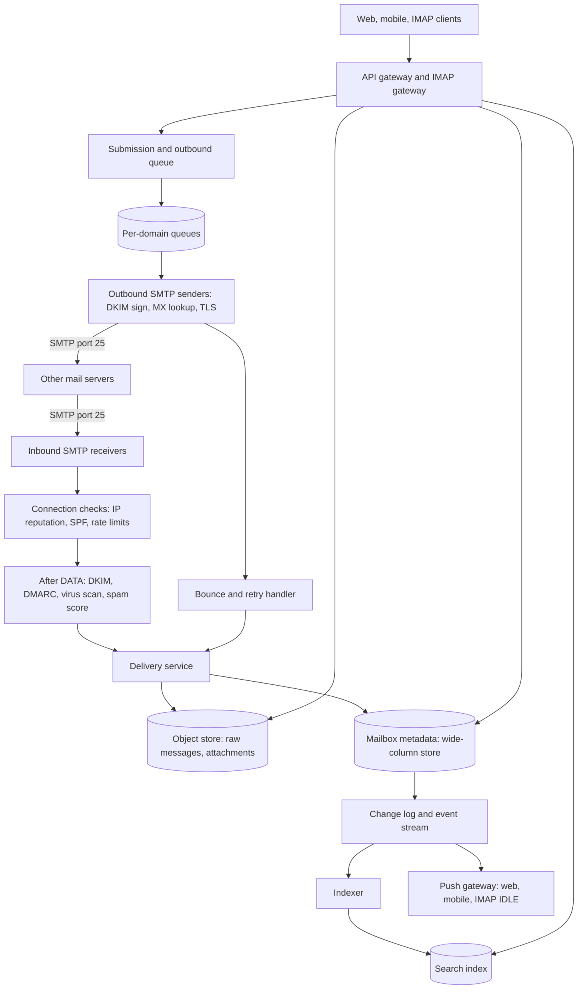
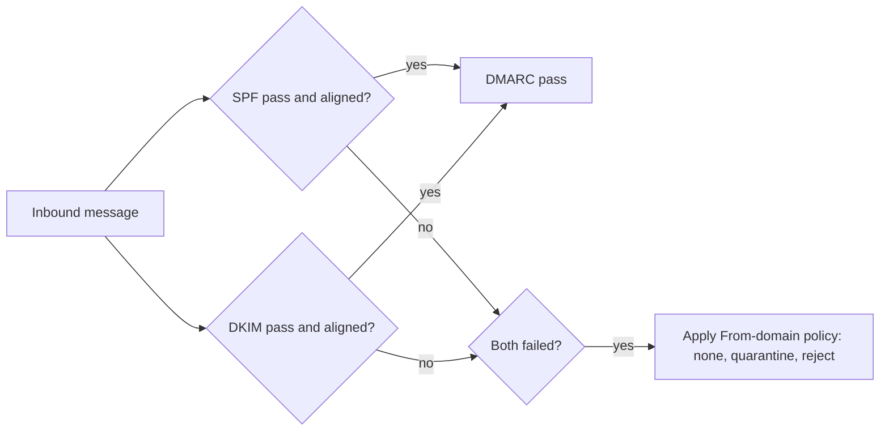

# Design an Email Service

An email service lets users send and receive messages with any other email service in the world. Two things make the problem different from a chat system. First, the sending and receiving servers speak a public protocol (SMTP) that the service does not control, and the service must interoperate with every other implementation. Second, most of the inbound traffic is abuse, so the design spends as much effort on rejecting mail as on storing it. This page gives the design that a strong candidate presents in 45 minutes: SMTP receivers and senders, a durable mailbox store, search, a layered spam defense, and attachments.

The system that sends one notification email on behalf of an application (templates, preferences, provider failover) is a different problem. It is the outbound half of [Design a Notification System](04-notification-system.md), and its classes are on the LLD page [Design a Notification Service](../../lld/case-studies/24-notification-service/README.md). This page designs the mailbox provider: the system that owns the user's inbox.

!!! note "About the sources"
    The protocol facts come from the RFCs (5321, 5322, 6409, 3501 and 9051, 7208, 6376, 7489). The RFC text is the primary source. The sizes, rates, and costs on this page are assumptions for a 100-million-mailbox service, and each is labeled. Gmail and Microsoft have not published a full design of their mailbox systems, so this page names no internal design of theirs. The only vendor source is Google's public sender guidelines. The storage design (metadata in a wide-column store, bodies in an object store, search in an index) is this page's own design, not a published design of a named provider.

## Problem Statement

Design an email service for 100 million mailboxes. A user sends messages to any address on the internet and receives messages from any address. The user reads, searches, and organizes messages in folders and labels from a web client, a mobile app, and standard IMAP clients. The service must not lose accepted mail, must keep spam out of the inbox, and must keep other providers from marking its outbound mail as spam.

The interviewer tests four skills: knowledge of how email moves between servers (the SMTP envelope, MX records, queues, retries), the design of a store for many small, mostly immutable items per user, the use of the authentication standards (SPF, DKIM, DMARC) to fight spoofing, and the choice of what to do synchronously (before the SMTP `250` reply) and what to do after it.

## Clarifying Questions

Ask these in the first 5 minutes. Each row gives the answer that this design assumes.

| Question | Assumed answer |
|---|---|
| Is this a mailbox provider or an application that sends email? | A mailbox provider (like Gmail or Outlook). The notification sender is a separate page |
| How many mailboxes and how much mail? | 100 million mailboxes. Each receives 40 accepted messages and sends 5 each day (Assumption) |
| How much unwanted mail arrives at the edge? | Assumption: half of all inbound delivery attempts are spam or abuse, so 80 million attempts for every 40 million accepted. The spam filter rejects or files most of it |
| Which access methods? | A web client and a mobile app (our own HTTP API), plus IMAP for third-party clients. POP3 is out of scope. SMTP submission for sending |
| Message size limit? | 25 MB for the whole message, including attachments (Assumption) |
| Is search required? | Yes. Full-text search over headers and body, and by sender, date, label, and attachment name. Search within one user's mailbox only |
| Storage per user? | 15 GB quota (Assumption) |
| Is end-to-end encryption in scope? | No. The service reads messages to filter and index them. Encryption in transit (STARTTLS) and at rest is in scope |
| What delivery guarantee? | After the receiver sends `250` to the end of the data, the message is durable. It is never lost. Delivery to the inbox is not guaranteed: the spam filter may file it as spam |
| Contacts, calendar, and rules? | Out of scope. Filters (rules) are a follow-up |
| Regions? | One home region for each mailbox. Replicated to a second region for disaster recovery. Inbound SMTP is served in every region |

## Requirements

### Functional

1. **Receive.** Accept mail from other servers for the local domains over SMTP. Store it in the right mailbox.
2. **Send.** A user composes a message and sends it. The service delivers it to the recipient's server, retries on temporary failure, and tells the user about a permanent failure.
3. **Read and organize.** List messages in a folder or label, open a message, mark it read, star it, move it, delete it. Show messages in threads.
4. **Search.** Find messages by words, sender, recipient, date, label, and attachment.
5. **Attachments.** Send and receive attachments up to the size limit, with a virus check.
6. **Spam and authentication.** Check SPF, DKIM, and DMARC on inbound mail. Sign outbound mail with DKIM. Keep spam out of the inbox.
7. **Sync.** A client that was offline for a week catches up with the changes (new, changed, deleted messages) without a full download.

### Non-functional

| Requirement | Target |
|---|---|
| Durability of accepted mail | No loss after `250`. Replicated in 3 zones before the reply (or erasure-coded, with the same fault tolerance) |
| Inbound capacity | 40,000 accepted messages each second on average, 120,000 at the peak. 240,000 delivery attempts each second at the peak |
| Delivery latency | A message reaches the inbox and is visible in the client in under 5 seconds at p99 (after the sender's server hands it over) |
| Search freshness | A new message is searchable within 30 seconds (Assumption) |
| Mailbox list latency | p99 below 200 ms for the first page of a folder |
| Availability | 99.95% for read and send. Inbound SMTP must keep accepting. If the service is down, the sender's server retries |
| Spam | Under 0.1% of the mail in the inbox is spam, and under 0.01% of legitimate mail goes to spam (Assumption: targets, not measured values) |
| Abuse resistance | A compromised account cannot send unbounded mail. Per-account send limits |

## Estimation

Rounding rule: one day is 10^5 seconds (see the [estimation page](../back-of-envelope-estimation.md)). The peak factor is 3.

Inputs (all are assumptions): 100 million mailboxes. 40 accepted messages and 5 sent messages each day for each mailbox. The accepted mail is half of the delivery attempts. An average stored message has 50 KB (most are small text and HTML, and a minority carry attachments). A message needs 1 KB of metadata. The indexable text of a message is 5 KB, and its index entries use 50% of that size. A user opens the mailbox 10 times each day (one list request for each) and reads 30 messages each day. The spam filter uses 5 ms of one CPU core for each delivery attempt.

| Step | Calculation | Result |
|---|---|---|
| Accepted messages each day | 100,000,000 × 40 | 4 billion |
| Delivery attempts each day | 4 billion × 2 | 8 billion |
| Attempts each second, average | 8,000,000,000 / 10^5 | 80,000 |
| Attempts each second, peak | 80,000 × 3 | 240,000 |
| Accepted each second, average | 4,000,000,000 / 10^5 | 40,000 |
| Accepted each second, peak | 40,000 × 3 | 120,000 |
| Sent each second, average | 100,000,000 × 5 / 10^5 | 5,000 |
| Sent each second, peak | 5,000 × 3 | 15,000 |
| Raw mail each day | 4,000,000,000 × 50 KB | 200 TB |
| Raw mail in 5 years | 200 TB × 1,825 days | 365 PB |
| Stored with erasure coding (1.5 times) | 365 PB × 1.5 | 548 PB |
| Metadata each day | 4,000,000,000 × 1 KB | 4 TB |
| Search index each day | 4,000,000,000 × 5 KB × 0.5 | 10 TB |
| Inbound bandwidth, average | 40,000 × 50 KB × 8 bits | 16 Gbit/s |
| Inbound bandwidth, peak | 120,000 × 50 KB × 8 bits | 48 Gbit/s |
| Mailbox list requests each second | 100,000,000 × 10 / 10^5 | 10,000 |
| Message fetches each second | 100,000,000 × 30 / 10^5 | 30,000 |
| Spam-filter CPU at the peak | 240,000 × 0.005 core-seconds | 1,200 cores |
| MIME size of a 25 MB file | 25 MB × 78/76 × 4/3 | 34 MB |
| Retry count over the give-up time | 5 days × 48 attempts each day (30-minute interval) | 240 attempts at most |

What the numbers decide:

- **The system is write-heavy and read-light on the message body.** 40,000 writes each second against 30,000 body reads each second. Most mail is read once or never. This fits an append-mostly store, and it argues for cheap storage of old mail.
- **Storage dominates the cost.** 548 PB after 5 years (Assumption on sizes) is the main bill. Three decisions reduce it: erasure coding for the blobs (1.5 times, against 3 times for replication; see [storage types](../fundamentals/10-storage-types.md)), deduplication of attachments by content hash, and rejection of spam before storage (half the attempts never reach the store).
- **Spam filtering is a large compute job.** 1,200 cores at the peak is small for the cluster, but the filter must run before the `250` reply. Cheap checks (the connection IP, SPF) run first so that expensive content scoring runs on fewer messages.
- **Metadata is small.** 4 TB each day (about 7 PB in 5 years) is 1.3% of the blob volume. It is the data that the client reads all the time, so it lives in a fast partitioned database, and bodies live in the object store.
- **MIME costs 37% more than the file.** Base64 turns 3 bytes into 4 characters, and the 76-character lines add 2 bytes (CRLF) for each 76 (RFC 2045). A 25 MB file becomes a 34 MB message. The limit applies to the encoded message. This is why users cannot attach a 25 MB file under a 25 MB limit.
- **Retries are bounded by the RFC advice.** RFC 5321 section 4.5.4.1 says the retry interval should be at least 30 minutes and the give-up time generally needs to be at least 4 to 5 days. The sender keeps a message for up to 240 attempts at that interval. This is the reason a receiver that is down for hours loses no mail from compliant senders.

The program checks the arithmetic.

```java
import java.util.Locale;

public class EmailCheck {
    public static void main(String[] args) {
        double users = 100e6;
        double day = 1e5;
        double accepted = users * 40;
        double attempts = accepted * 2;
        double sent = users * 5;
        p("accepted messages per day", accepted);
        p("inbound attempts per day (50% spam)", attempts);
        p("inbound attempts per second, avg", attempts / day);
        p("inbound attempts per second, peak x3", attempts / day * 3);
        p("accepted per second, avg", accepted / day);
        p("outbound per second, avg", sent / day);
        p("outbound per second, peak x3", sent / day * 3);
        double sizeKb = 50;
        double tbDay = accepted * sizeKb * 1e3 / 1e12;
        p("raw mail TB per day (50 KB)", tbDay);
        p("PB in 5 years, raw", tbDay * 1825 / 1e3);
        p("PB in 5 years, erasure coded x1.5", tbDay * 1825 * 1.5 / 1e3);
        p("metadata TB per day (1 KB per message)", accepted * 1e3 / 1e12);
        p("inbound Gbit/s, avg", accepted / day * sizeKb * 1e3 * 8 / 1e9);
        p("inbound Gbit/s, peak x3", accepted / day * 3 * sizeKb * 1e3 * 8 / 1e9);
        p("index TB per day (5 KB text, 50% index)", accepted * 5e3 * 0.5 / 1e12);
        p("list requests per second (10 per user per day)", users * 10 / day);
        p("fetches per second (30 per user per day)", users * 30 / day);
        p("spam filter cores, peak (5 ms each)", attempts / day * 3 * 0.005);
        p("base64 expansion with 76-char lines", (78.0 / 76) * 4 / 3);
        p("25 MB file as MIME, MB", 25 * (78.0 / 76) * 4 / 3);
        p("retry: attempts in 5 days at 30 min", 5 * 24 * 2);
    }

    static void p(String label, double v) {
        System.out.println(String.format(Locale.ROOT, "%-50s %,.2f", label, v));
    }
}
```

<!-- expected-output -->
```text
accepted messages per day                          4,000,000,000.00
inbound attempts per day (50% spam)                8,000,000,000.00
inbound attempts per second, avg                   80,000.00
inbound attempts per second, peak x3               240,000.00
accepted per second, avg                           40,000.00
outbound per second, avg                           5,000.00
outbound per second, peak x3                       15,000.00
raw mail TB per day (50 KB)                        200.00
PB in 5 years, raw                                 365.00
PB in 5 years, erasure coded x1.5                  547.50
metadata TB per day (1 KB per message)             4.00
inbound Gbit/s, avg                                16.00
inbound Gbit/s, peak x3                            48.00
index TB per day (5 KB text, 50% index)            10.00
list requests per second (10 per user per day)     10,000.00
fetches per second (30 per user per day)           30,000.00
spam filter cores, peak (5 ms each)                1,200.00
base64 expansion with 76-char lines                1.37
25 MB file as MIME, MB                             34.21
retry: attempts in 5 days at 30 min                240.00
```

## API Design

Email has two kinds of interface. The first is the protocols that other servers and third-party clients speak. The service must implement them as the RFCs define them. The second is the HTTP API for the service's own web and mobile clients.

### Protocol interfaces

| Interface | Port and standard | Who uses it | Notes |
|---|---|---|---|
| SMTP (server to server) | Port 25. RFC 5321 | Other mail servers send mail for our domains | No login. Anyone can connect, so every check is ours. Opportunistic STARTTLS (RFC 3207) |
| SMTP submission | Port 587. RFC 6409 | Our users' clients send mail | Login required. TLS expected. The server may fix and sign the message |
| IMAP | Port 993 (TLS). RFC 3501 (IMAP4rev1), RFC 9051 (IMAP4rev2) | Third-party clients read mail | Stateful session. `IDLE` (RFC 2177) pushes new-mail events |
| MX lookup (DNS) | RFC 5321 section 5.1 | Senders find our SMTP servers | MX records name our receivers with preferences. Falls back to an address record if there is no MX record |

An SMTP session in outline (RFC 5321). The client opens a TCP connection. The server sends `220` and its name. The client sends `EHLO`. The client starts TLS with `STARTTLS`. Then the client gives the envelope and the data:

```text
S: 220 mx1.example.net ESMTP ready
C: EHLO sender.example.org
S: 250-mx1.example.net
S: 250-SIZE 35651584
S: 250-STARTTLS
S: 250 ENHANCEDSTATUSCODES
C: MAIL FROM:<alice@example.org> SIZE=48211
S: 250 2.1.0 OK
C: RCPT TO:<bob@example.net>
S: 250 2.1.5 OK
C: DATA
S: 354 End data with <CR><LF>.<CR><LF>
C: (header lines, a blank line, the body, then a line with a single dot)
S: 250 2.0.0 queued as 7f3a
C: QUIT
S: 221 2.0.0 bye
```

The envelope (`MAIL FROM`, `RCPT TO`) is not the same as the header (`From:`, `To:` in the message, RFC 5322). The envelope drives routing. The header is what the user sees. A sender can put different addresses in each. This difference is the root of spoofing, and SPF and DKIM protect different parts of it (see deep dive 2).

The reply code classes carry the retry rule (RFC 5321 section 4.2). A `2xx` code is success. A `4xx` code is a temporary failure: the sender keeps the message and retries. A `5xx` code is a permanent failure: the sender stops and sends a bounce to the original sender. The receiver chooses the class on purpose. For a mailbox that is full or a database that is down, the receiver sends `4xx` (`452`, `451`) so the sender holds the mail. For an unknown user or a message that the filter rejects, it sends `550` or `554`.

| Code | Meaning (RFC 5321) | Our use |
|---|---|---|
| `250` | Requested action completed. After the end of data, the receiver takes responsibility for the message | Sent only after the message is durable |
| `354` | Start mail input | Normal answer to `DATA` |
| `421` | Service not available, closing the channel | Sent when the server is overloaded or shuts down |
| `450`, `451`, `452` | Temporary failure (mailbox busy, local error, insufficient storage) | Back pressure and greylisting |
| `550` | Mailbox unavailable (no such user, or policy refusal) | Unknown recipient, authentication policy rejection |
| `552` | Message exceeds the size limit | Over 25 MB |
| `554` | Transaction failed | Spam rejected at the end of data |

### HTTP API for the service's own clients

Authentication is a bearer token on every call (see [security in design](../fundamentals/21-security-in-design.md)). Lists use cursors, not page numbers.

#### `GET /v1/mailbox/folders`

Response `200`: the folders and labels with unread and total counts, and the mailbox's current `changeSeq`.

#### `GET /v1/messages?folder=INBOX&cursor=...&limit=50`

Response `200`: `{ "messages": [{ "id", "threadId", "from", "subject", "snippet", "date", "flags", "hasAttachment" }], "nextCursor", "changeSeq" }`. This reads metadata only. It never touches the body store.

#### `GET /v1/messages/{id}`

Response `200`: the parsed message (headers, text and HTML parts, an attachment list with sizes). The attachment bytes are not inline.

#### `GET /v1/messages/{id}/attachments/{partId}`

Response `302` to a short-lived signed URL of the object store (see [storage types](../fundamentals/10-storage-types.md)). The client downloads the bytes from the object store, not from the API servers.

#### `POST /v1/messages/send`

Request: `{ "to": [...], "cc": [...], "bcc": [...], "subject", "body", "attachmentIds": [...], "idempotencyKey" }`. Response `202` with `{ "messageId" }`. The call returns when the service has stored the message in the outbound queue and the Sent folder. Delivery happens after the response. A repeat call with the same `idempotencyKey` returns the same `messageId` (see [reliability patterns](../fundamentals/12-reliability-patterns.md)).

#### `POST /v1/attachments` (resumable upload)

Request: the file in chunks (`PUT` with `Content-Range`), or a presigned multipart upload to the object store. Response `201` with `{ "attachmentId", "sha256", "size" }`. The send call refers to the attachment by ID.

#### `POST /v1/messages/{id}:modify`

Request: `{ "addLabels": [...], "removeLabels": [...], "markRead": true }`. Response `200` with the new `changeSeq`. A flag or label change is a metadata write only.

#### `GET /v1/search?q=...&cursor=...`

Response `200`: matching message summaries, ordered by date, with `nextCursor`. The `q` string supports `from:`, `to:`, `has:attachment`, `before:`, `after:`, and `label:`.

#### `GET /v1/changes?since={changeSeq}`

Response `200`: the list of message IDs that were added, changed, or deleted after `changeSeq`, and the new `changeSeq`. If the sequence is older than the retained change log, the response is `410 Gone` and the client does a full resync. This is the sync endpoint (see deep dive 3).

## Data Model

| Data | Needs | Store |
|---|---|---|
| Message bodies and attachments | Large, immutable, written once, read rarely. Very cheap per GB | An object store with erasure coding. The key is the SHA-256 of the content (content-addressed) |
| Mailbox metadata (one row for each message: folder, flags, subject, sender, date, thread) | Partition by user. Range read of one folder in order. High write rate. No cross-user transactions | A wide-column store (Cassandra, Bigtable, or HBase style) partitioned by `user_id` |
| Per-user counters and the change log | Atomic increment of a sequence for each user. Ordered read after a sequence number | The same wide-column store, in the same partition, with a lightweight transaction or a single-writer for the sequence |
| Search index | Inverted index per user. Near-real-time. Rebuildable | An index cluster (OpenSearch or Elasticsearch style), routed by `user_id` (see [search and indexing](../fundamentals/11-search-and-indexing.md)) |
| Outbound queue | Durable. A queue for each destination domain. Delays and retries | A message log (Kafka) plus a delay-and-retry store (see [message queues and streams](../fundamentals/08-message-queues-and-streams.md)) |
| Domain and account directory | Small, read-heavy, strong consistency on change | A relational database with a cache |
| Reputation and spam data (IP scores, sender scores, URL blocklists) | Very fast reads on the SMTP path. Updated by a pipeline | An in-memory store (Redis style) next to each receiver, loaded from a batch and stream pipeline |

### Mailbox tables

`message_meta`, partition key `user_id`, clustering key `(folder_id, uid)` (descending):

| Column | Note |
|---|---|
| `user_id` | Partition key. All of one user's data is on the same replicas |
| `folder_id`, `uid` | `uid` is a per-folder number that only increases. IMAP requires it (RFC 3501 section 2.3.1.1). A message keeps its `uid` for the life of the folder |
| `message_id` | The `Message-ID` header (RFC 5322). Used for threading and for deduplication of repeated deliveries |
| `blob_key` | SHA-256 of the raw message in the object store |
| `from`, `to`, `subject`, `snippet`, `date`, `size` | Copied from the header, so a list needs no body read |
| `flags`, `labels` | Read, starred, answered, and user labels |
| `thread_id` | Derived from the `In-Reply-To` and `References` headers and the subject |
| `change_seq` | The value of the user's counter when this row last changed |
| `has_attachment`, `auth_results` | A flag for the list view. The SPF, DKIM, DMARC result and the spam score, kept for later analysis |

`folder`: `(user_id, folder_id, name, uidvalidity, next_uid, total, unread)`. If a folder is deleted and re-created, `uidvalidity` changes, and an IMAP client discards its cache (RFC 3501 section 2.3.1.1).

`change_log`: partition `user_id`, clustering `change_seq`, columns `(message_id, kind)`. It keeps 30 days (Assumption). It powers `GET /v1/changes` and IMAP sync.

`attachment_ref`: `(sha256, ref_count, size, scan_state)`. The object store keeps one copy of each distinct attachment. The count lets the cleanup job delete a blob when no mailbox refers to it.

`outbound`: `(message_id, recipient, domain, state, attempts, next_attempt_at, last_reply)`.

### Database choice

The access pattern decides. Every read and write has a `user_id`. There are no joins across users. A user's folder list is a range read in uid order. The write rate is 40,000 rows each second. This fits a wide-column store partitioned by user: it scales by adding nodes, and it makes a folder list one partition read (see [choosing a database](../fundamentals/04-choosing-a-database.md) and [partitioning and sharding](../fundamentals/06-partitioning-and-sharding.md)). A relational database sharded by user would work, and it would give transactions across folders (a move is delete plus insert). The design rejects it for the cost of operating thousands of shards and for the lack of a use for cross-user transactions. The move is a conditional batch in one partition, which the wide-column store supports.

Recommendation: keep the heavy bytes out of the metadata store. A row holds the 1 KB of header data and a blob key. The body, which is 50 KB on average, lives in the object store. This keeps partitions small and the list query fast.

## High-Level Design



### Components

- **Inbound SMTP receivers.** Stateless servers that listen on port 25 in every region. They are the public edge, so they enforce a connection limit for each IP, a time limit for each command, and a message size limit (`SIZE`, `552`). DNS (MX records, with several preference values) points senders to them. A receiver never writes mailbox state directly. It hands the message to the delivery service.
- **Pre-DATA checks.** Before the receiver accepts a message body, it uses the cheap facts: the connecting IP (blocklists and its own reputation score), the `HELO` name, the `MAIL FROM` domain and its SPF record, and the recipient (does the mailbox exist and have quota?). A rejection here saves the bandwidth of the body. An unknown recipient gets `550` during `RCPT TO`.
- **Post-DATA filters.** After the body arrives, the receiver verifies DKIM signatures, evaluates DMARC, scans attachments for viruses, and computes the spam score. The result is one of three actions: reject (`554`), accept into the inbox, or accept into the spam folder.
- **Delivery service.** Writes the raw message to the object store (content-addressed, so a message with the same hash is stored once), then writes the `message_meta` row and the change-log entry for each local recipient. It returns success to the receiver only after both writes are durable. Then the receiver sends `250`. The delivery service is the only writer of mailbox state, so the rules for `uid` and `change_seq` live in one place.
- **Change log and event stream.** Each mailbox change goes into a log (the Kafka topic is partitioned by `user_id`, so one user's events keep their order). The indexer, the push gateway, and the analytics jobs consume it (see [event-driven architecture](../fundamentals/16-event-driven-architecture.md)).
- **Indexer.** Reads the change log, extracts text (headers, body, text of attachments), and writes the per-user index. It runs after the `250`, so a slow index never delays acceptance.
- **API gateway and IMAP gateway.** The API gateway serves the web and mobile clients. The IMAP gateway translates IMAP commands (a stateful, long-lived session) into the same internal calls. IMAP is an adapter on top of the same mailbox service, so a feature exists once.
- **Push gateway.** Tells connected clients about new mail through WebSocket, mobile push, or IMAP `IDLE` (see [communication patterns](../fundamentals/09-communication-patterns.md)).
- **Submission and outbound queue.** The submission server authenticates the user, checks the per-account send limit, stores the message in the Sent folder, and puts one queue entry for each recipient domain into the outbound log.
- **Outbound SMTP senders.** Take entries from the per-domain queue, look up the MX records, open a TLS session when the peer offers it, sign with DKIM, and send. They apply a rate limit for each destination domain. They classify the reply code: success, retry later, or bounce.
- **Bounce and retry handler.** Computes the next attempt time and, after the give-up time or a `5xx`, generates a delivery status notification with an empty envelope sender (RFC 5321 section 6.1).

### Flow: one inbound message

1. The sender's server looks up the MX records for `example.net` and connects to a receiver on port 25.
2. The receiver checks the IP reputation and the connection rate. It accepts `EHLO`, runs `STARTTLS`, and takes `MAIL FROM`. It starts the SPF check.
3. For each `RCPT TO`, it checks that the mailbox exists and has quota. Unknown mailbox: `550`. Mailbox over quota: `452` (temporary, insufficient storage).
4. After `DATA`, the receiver reads the message up to the size limit, verifies DKIM, evaluates DMARC, scans for viruses, and scores for spam.
5. If the score is above the reject threshold, the receiver sends `554`, and the sender bounces to its own user. No message is stored.
6. Otherwise the delivery service stores the raw message, writes the metadata rows (the Inbox or the Spam folder for each recipient), and appends to the change log.
7. The receiver sends `250`. From this point the service is responsible for the message.
8. The push gateway notifies the client. The indexer makes the message searchable in about 30 seconds or less.

### Flow: one outbound message

1. The client calls `POST /v1/messages/send`. The submission service validates the message, applies the account limits, and writes the message to the object store and the Sent folder.
2. It writes the queue entries (one for each recipient domain) and returns `202`.
3. A sender takes the entry, resolves the MX, connects, signs the message with DKIM, and sends it.
4. On `250`, the sender marks the recipient as delivered. On `4xx`, it sets `next_attempt_at` by a backoff and keeps the entry. On `5xx`, or after the give-up time, it creates a bounce message in the sender's mailbox.

## Deep Dives

### Deep dive 1: Receiving mail durably, and what happens before `250`

**The rule.** The `250` reply after the end of data transfers responsibility (RFC 5321 section 4.1.1.4 says the receiver "takes full responsibility for the message"). If the receiver sends `250` and then loses the message, the sender has deleted its copy, and the mail is gone with no bounce. So the receiver sends `250` only after the message is durable in the store.

**What must happen before `250`.** The raw message in the object store, and the metadata rows and the change-log entries for each recipient. Everything else can wait: indexing, push notification, thread grouping, analytics. The line between the two groups is the line between "can lose the message" and "can fix it later". The indexer is the clear example: a lost index entry is rebuilt from the message, a lost message cannot be rebuilt.

**Many recipients.** A message with 50 local recipients is one body and 50 metadata rows. The content-addressed blob is stored once. The delivery service writes the rows in parallel and succeeds only if every recipient row is durable. For a partial failure the receiver can answer each recipient (this needs the LMTP protocol, RFC 2033, where the final reply is per recipient) or answer `4xx` for the whole message. With `4xx` the sender retries the whole message. Recipients that already have it would get a duplicate. The delivery service avoids this with a deduplication key `(user_id, message_id header, blob_key)`: a second write for the same key is a no-op.

**Back pressure.** If the metadata store or the object store is slow, the receivers return `451` or `421`. Compliant senders hold the mail and retry (RFC 5321 section 4.5.4.1: at least 30 minutes between attempts). The queue of mail is then the sender's, not ours. This is the main reason the inbound side is simple to protect: the internet's mail queues absorb our outage, for up to 4 to 5 days. Recommendation: use `4xx`, not `5xx`, for every internal fault. A `5xx` bounces legitimate mail.

**Quota.** A mailbox over quota returns `452`. Use a `4xx` code at first, so that a user who frees space receives the mail that waits at the senders.

**Duplicates and loops.** The same message can arrive twice (a sender retries after a lost `250`). The deduplication key above handles it. A forwarding loop is stopped by counting `Received` headers (RFC 5321 section 6.3 recommends a limit; a typical limit is a few dozen hops, Assumption).

**The line limit and the size limit.** RFC 5321 requires an implementation to accept text lines of 1,000 bytes (including the CRLF), a message of at least 64 KB, and at least 100 recipients for one message (section 4.5.3.1). RFC 5322 recommends lines of at most 78 characters and requires at most 998. The receiver advertises its own limit in the `SIZE` extension (RFC 1870) so that a sender with an oversized message gets a refusal before the transfer.

### Deep dive 2: Authentication and the spam defense

Email was designed without sender verification. Anyone can write any `From:` header. Three standards add verification, and a layered filter uses them with other signals.

**SPF (RFC 7208).** The domain owner publishes in DNS (a TXT record) the IP addresses that may send mail for the domain. The receiver checks the connecting IP against the record of the domain in the envelope `MAIL FROM` (or in `HELO` if `MAIL FROM` is empty). Results: `pass`, `fail`, `softfail`, `neutral`, `none`, `temperror`, `permerror`. SPF limits the evaluation to 10 DNS-querying mechanisms (RFC 7208 section 4.6.4), so a record with too many `include:` entries returns `permerror`. What it checks: the envelope sender, not the `From:` header the user sees. Its weakness: forwarding changes the connecting IP, so SPF fails for forwarded mail.

**DKIM (RFC 6376).** The sending domain signs selected headers and a hash of the body with a private key. The signature is in a `DKIM-Signature` header with these tags: `d=` (the signing domain), `s=` (the selector), `h=` (the signed header names), `bh=` (the body hash), and `b=` (the signature). The receiver fetches the public key from the DNS TXT record at `<selector>._domainkey.<domain>` and verifies. Selectors allow key rotation. A valid signature proves that the signing domain sent the message and that the signed parts did not change. Its weakness: a mailing list that adds a footer or rewrites the subject invalidates the signature. The `c=` tag (canonicalization, `simple` or `relaxed`) sets how much whitespace change the signature tolerates.

**DMARC (RFC 7489).** DMARC ties the two to the visible `From:` domain. The domain owner publishes a policy at `_dmarc.<domain>`. A message passes DMARC if SPF passes with a domain that aligns with the `From:` domain, or DKIM passes with a signing domain that aligns with it. Alignment is the new rule: SPF alone could pass for an unrelated envelope domain. The policy tells the receiver what to do on a failure: `p=none` (only report), `p=quarantine` (treat as suspicious), or `p=reject` (refuse). The `rua` tag gives an address for aggregate reports, so the domain owner sees who sends mail in its name. RFC 7489 is an Informational RFC from the Independent Submission stream, not an IETF standards-track document.



**Our own outbound mail.** The service signs every outbound message with DKIM (one key per hosted domain, with rotation by selector), publishes SPF records for its sending IPs, and publishes a DMARC policy for the domains it hosts. Other providers decide the reputation of the service from this mail. Google's sender guidelines require SPF or DKIM from all senders, and SPF, DKIM, and DMARC from bulk senders that send more than 5,000 messages each day to Gmail, with a one-click unsubscribe for marketing mail. Google states that a spam rate reported in Postmaster Tools below 0.10% is the goal, and that a rate of 0.30% or more harms delivery. These rules apply to us when we send to Gmail, and they show how receivers weigh the same standards.

**The layered filter.** Each layer is cheaper than the next, and each removes mail before the next layer runs.

| Layer | Input | Cost | What it removes |
|---|---|---|---|
| 1. Connection | IP reputation, blocklist (DNSBL) lookups, connection rate, `HELO` name, TLS | Microseconds (in-memory) | Known spam sources and bot connections |
| 2. Envelope | SPF result, recipient exists, recipient rate | Under 1 ms plus one DNS lookup (cached) | Spoofed senders, address harvesting |
| 3. Authentication | DKIM, DMARC policy, ARC chain for forwarded mail (RFC 8617) | Milliseconds (one DNS lookup for the key, one signature check) | Spoofing of a domain that publishes `p=reject` |
| 4. Content | Text and HTML features, URLs against a blocklist, attachment type and hash, a trained model | Milliseconds to tens of milliseconds | Spam that is authenticated but unwanted, phishing |
| 5. Behavior and feedback | The user's "report spam" and "not spam" actions, per-sender complaint rate, past mail between the two addresses | Offline pipeline | Adapts all layers. A sender whose mail users report is scored down for everyone |

A single score combines the layers (a weighted sum or a trained model). Two thresholds follow. Above the high threshold: reject with `554` (the sender knows). Between the two: accept into the spam folder. Below the low threshold: the inbox. Recommendation: reject at the SMTP session instead of accepting and bouncing later. A bounce for forged mail goes to an innocent person whose address was forged. This is the unwanted "backscatter". RFC 5321 section 6.1 requires bounces to use a null envelope sender, so a bounce does not cause another bounce, and it still reaches that innocent person.

**Greylisting.** The receiver answers the first delivery from an unknown (IP, sender, recipient) with `451`. A real mail server retries after the interval. Many spam tools do not. The cost is a delay of several minutes for the first message from a new sender. Use it as a signal for suspicious traffic only, not for all mail.

**The attachment path.** Executable and archive types are scanned in a sandbox (the code judge on this KB uses the same isolation ideas: see `kb/hld/case-studies/25-online-code-judge.md`). The scan is part of the content layer for small files. For large files, the delivery service stores the message with a `scan_state` of `pending`, the client shows the attachment as unavailable until the scan finishes, and the scanner updates the state. If the scan finds malware, the service quarantines the message.

**What to measure.** The false positive rate (legitimate mail filed as spam) matters more than the false negative rate, because a user does not see mail in the spam folder. Sample a share of rejected and spam-filed mail for review, and track the user actions "not spam" and "report spam" as the labels.

### Deep dive 3: The mailbox store, sync, and search

**Layout.** One user's metadata lives in one partition, ordered by `(folder, uid)`. The first page of the inbox is one range read of 50 rows. A user's folder list, counters, and change log are in the same partition (or in tables with the same partition key). This makes the common read a single-node read and keeps one user's data together for backup and for moving between shards.

**Hot and large mailboxes.** A mailbox with 5 million messages is a large partition. The mitigation is to split the clustering range into buckets by month: `(user_id, folder_id, month)`. A list reads the newest bucket first and continues to the older one when it needs more rows. The bucket is part of the cursor.

**The change log and sync.** Each mailbox has a counter `change_seq`. Each mutation (a new message, a flag change, a move, a delete) increments it and appends `(change_seq, message_id, kind)` to the change log. A client that stores the last `changeSeq` it saw asks `GET /v1/changes?since=…` and receives only the changes. The cost of a reconnect is proportional to the number of changes, not to the mailbox size. IMAP has the same idea in extensions (the per-message `MODSEQ` of RFC 7162, CONDSTORE). Without extensions, IMAP clients use `UID` and `UIDVALIDITY` and compare flags for all messages, which is more expensive. If the client is older than the log retention (30 days in the assumption), the service answers `410` and the client resyncs from the folder lists.

**The sequence counter.** The counter is the one write in the system with an ordering rule, and two deliveries to the same user at the same time must not take the same number. Options: a lightweight transaction (compare-and-set) on the counter row, or a single writer for each user. Recommendation: route each user's writes to one delivery-service instance (the partition owner, selected by consistent hashing on `user_id`, the same idea as the partitions of the log), so that the counter increments in memory and flushes with the row. If the owner fails, another instance takes over after a lease and reads the counter from the store (see [distributed locks and leases](../distributed-systems/05-distributed-locks-and-leases.md) for the fencing token that makes the takeover safe). The alternative, a compare-and-set on every delivery, costs an extra round trip but has no owner to fail over.

**Threads.** The delivery service assigns a `thread_id` at delivery: if `In-Reply-To` or `References` matches an existing `Message-ID` in the mailbox, the new message joins that thread. Otherwise it starts a new one. A thread view reads the rows for one `thread_id` through a secondary lookup table `(user_id, thread_id) → message keys`.

**Search.** Search over one user's mail is a small-index problem times 100 million users. Two designs:

1. **A shared index with routing by user.** One large Elasticsearch-style cluster, an index sharded with `user_id` as the routing key, so each query touches one shard. The shard size is a tuning decision: a shard holds many users. A filter on `user_id` is part of every query for isolation. This design uses a standard system, and it has the operations cost of a very large cluster.
2. **A per-user (or per-user-group) index built by a purpose-built engine.** More work, and cheaper to run for the use. Recommendation: start with design 1. Move to design 2 only when the cost forces it.

The indexer reads the change log, so the index follows the store in seconds, and it is rebuilt from the log and the blobs if it is lost. Search is eventually consistent: a message may be absent from search for up to 30 seconds. The client hides this for the user's own actions (it merges recent local changes into the result). The index holds terms and positions of the text. It stores no body, so a hit loads the metadata row for display (see [search and indexing](../fundamentals/11-search-and-indexing.md)). Attachments are included by extracting text (PDF, Office) in a separate worker pool, because extraction is slow and can fail for some files. A failed extraction does not block the message.

**Deletion.** A delete moves the message to Trash and sets a purge time. The purge removes the metadata row and decrements the blob reference. When the count is zero and a grace period has passed, the cleanup job deletes the blob. The delay protects against a race where a new delivery references the same content-addressed blob.

### Deep dive 4: Outbound delivery and sender reputation

**Queues for each domain.** The outbound log holds one entry for each (message, recipient domain). Workers group entries by destination domain. A queue for each domain lets the service control the rate for each destination: a destination that answers `421` or slows down gets fewer connections, and the delay for one domain does not block mail for others. This is head-of-line blocking avoided by partitioning the queue.

**Retries.** The entry carries `attempts` and `next_attempt_at`. RFC 5321 says the retry interval should be at least 30 minutes. A provider that wants the user to see a delivery within minutes may retry sooner at the start (for example after 5 minutes), which departs from that advice. Assumption: this design uses 5 minutes for the first retry, then 30 minutes and longer, with jitter (see [reliability patterns](../fundamentals/12-reliability-patterns.md)). The give-up time is at least 4 to 5 days. After that, the sender creates a bounce. A warning notice to the user after 4 hours is a product choice and is not in the RFC.

**Classification of the reply.** `2xx`: delivered. `4xx`: retry. `5xx`: permanent failure for that recipient: bounce. Some receivers send a `5xx` for a temporary problem (a rate limit), and some send `4xx` forever. A real system keeps a table of patterns for large providers. It is operational knowledge, not part of the RFC.

**MX lookup and failover.** The sender resolves the MX records of the destination, sorts them by preference (lowest first), and tries them in order. If the first host is unreachable it tries the next one. If a domain has no MX record, the sender uses the domain's address record (RFC 5321 section 5.1).

**TLS.** The sender offers STARTTLS (RFC 3207) and uses it if the peer supports it. Opportunistic TLS can be downgraded by an attacker who removes the STARTTLS offer. MTA-STS (RFC 8461) lets a destination domain publish a policy that requires TLS, and the sender caches it. It closes the downgrade attack for the domains that publish it.

**Reputation.** Receivers score each sending IP and domain by its history: the complaint rate, the share of unknown-user errors, the volume, and authentication results. A new IP with a high volume looks like a spammer. So the service warms up new IPs with a slowly increasing volume, and it keeps separate IP pools: one for user mail, one for bulk or transactional mail, one for suspected abuse. A compromised account that sends spam can reduce the reputation of the shared pool. The per-account limits and the outbound spam filter (the same filter as the inbound one, run on outbound mail) keep the pool clean. Recommendation: apply the limit by account and by recipient count (for example 500 recipients each day for a new account, growing with age; Assumption), with an alert on a sudden change.

**Feedback loops.** Large receivers send complaint reports about messages that users marked as spam (the ARF format, RFC 5965). The service processes them: it sees which account sent the mail and reduces its limits.

**Bounces.** A bounce (delivery status notification) is a message sent to the envelope sender with an empty `MAIL FROM:<>` (RFC 5321 section 6.1). The RFC 3464 format has a machine-readable part with the status of each recipient. The service puts the bounce into the sender's mailbox through the normal delivery path, so the user sees why a message failed.

## Bottlenecks and Scaling

| What fails first | Symptom | Fix |
|---|---|---|
| A spam wave | Receivers hit the connection limit, filter CPU saturates | Layered filtering with cheap rejection first. Rate limits for each IP. Scale the receivers (stateless). Use `421`/`451` to shed load: legitimate senders retry |
| Metadata write rate (40,000 each second average, 120,000 at the peak) | Write latency on partitions | The store scales by partitions. Batch writes. Use the log as a buffer in front of the indexer, not in front of the metadata |
| One huge mailbox or one hot recipient (a mailing list with a very large number of members) | A hot partition. One message fans out to millions of rows | Bucket large mailboxes by month. Expand a list in a background fan-out service with a rate limit, and spread it over time. Treat a list as a separate path |
| Object store throughput (48 Gbit/s inbound at the peak) | Slow `250` | Write blobs in parallel. Use several object-store buckets or prefixes. Erasure coding with a write quorum, not all fragments |
| Search index lag | New mail missing from search | Add indexer partitions. Keep the change log long enough to rebuild. Prioritize recent messages |
| DNS for SPF, DKIM, and DMARC | Slow checks, failed lookups | A shared caching resolver near the receivers. Cache by the record's TTL. On a DNS timeout, treat the check as `temperror` (not a failure) and let other layers decide |
| IMAP connections | Millions of idle long-lived sessions | A separate gateway fleet. Use `IDLE` with the push gateway, not polling. Limit sessions for each account |
| A single region fails | Loss of the mailbox service for the users homed there | Replicate the metadata and the blobs to the second region. The MX records for each region have the same preference, so inbound mail goes to the healthy one and is stored in the failover region (see [multi-region and disaster recovery](../fundamentals/19-multi-region-and-disaster-recovery.md)) |

**Cost, not speed, limits storage.** At 548 PB the problem is the price per GB. Tier the data: recent mail (30 days) on fast storage, older mail on cheaper erasure-coded storage, and mail in the spam folder and trash deleted after 30 days. Deduplicate attachments by hash. Keep the metadata and the index on faster storage, and keep them small.

## Trade-offs

| Decision | Chosen | Rejected | Why |
|---|---|---|---|
| Store bodies | Object store, content-addressed, erasure coded | Bodies inside the wide-column rows | Large values hurt partitions and compaction. Deduplication of attachments needs a content key. Cost per GB is lower |
| Mailbox metadata store | Wide-column, partitioned by user | Relational, sharded by user | No cross-user transactions needed. Scales by adding nodes. Lower operations cost |
| When to send `250` | After the message is durable (blob and metadata) | After a queue write only, with processing later | A lost message after `250` has no bounce. The cost is a few milliseconds more in the session |
| Spam handling | Reject at SMTP for clear spam, spam folder for uncertain | Accept everything and filter later | Rejection avoids storage and avoids backscatter. The spam folder keeps legitimate mail that the filter doubts |
| Internal fault handling | `4xx` for every internal error | `5xx` | `4xx` makes the sender hold the mail. `5xx` bounces legitimate mail |
| Search | Eventual, built from the change log | Synchronous index write before `250` | A slow or failed index would delay or reject mail. The index can be rebuilt. The message cannot |
| Per-user sequence | A single owner for each user's writes | Compare-and-set on each delivery | Fewer round trips. More failover logic. Either is correct |
| Attachment limit | 25 MB, larger files by link to storage | Allow very large attachments in SMTP | Many receivers refuse large messages. Base64 adds 37%. A link avoids the limit |
| Authentication | Check SPF, DKIM, DMARC and use them as signals with a policy | Block any message that fails SPF | SPF fails on forwarding. DMARC with alignment and the owner's policy is more precise |
| IMAP | A gateway over the same mailbox service | A separate IMAP storage | One feature set. One data store. IMAP only translates |

## Follow-up Questions

??? question "A message was accepted with 250 and the user never sees it. Where do you look?"

    Walk the path in order and stop at the first missing step. First the SMTP log of the receiver: did the session end with `250`, and with which queue ID? Second, the delivery service log for that ID: did it write the blob and the metadata row for that recipient? Third, the folder: the spam filter may have filed it in Spam, so check the stored spam score and the `auth_results` of the row. Fourth, the change log: the row exists, but the client may be behind. Compare the client's `changeSeq`. Fifth, rules: a user filter may have moved or deleted it. Sixth, the search index: the message may be present in the folder and missing from search, which is a different problem (index lag).

    The design supports this with an identifier for each message that appears in every log, and with the stored authentication and spam results in the row. If the delivery service has no row for a message that got `250`, that is a durability bug and the top-severity incident: it breaks the rule that the receiver sends `250` only after the data is durable.

??? question "How do you stop a spammer from sending mail as your user's domain, and how do you keep your own outbound mail out of the spam folders of others?"

    For spoofing of domains we host, publish SPF with our sending IPs, sign all outbound mail with DKIM, and publish a DMARC policy. Start with `p=none` and read the aggregate reports (`rua`) to find legitimate senders that are not yet covered. Then move to `p=quarantine` and `p=reject`. A receiver that follows DMARC then rejects a forged message that fails both aligned SPF and aligned DKIM.

    For our reputation, send DKIM-signed, SPF-aligned mail. Keep the complaint rate low (Google's guidance is a spam rate below 0.10%, and it states that 0.30% causes harm). Separate IP pools. Limit and filter outbound mail so that a compromised account does not spoil the pool. Process feedback-loop reports. Warm up new IPs. Provide a one-click unsubscribe on bulk mail. Trade-off: strict DMARC (`p=reject`) breaks mail that passes through mailing lists that change the message, so a domain that its users use on public lists needs care (ARC, RFC 8617, lets an intermediary record the authentication result it saw).

??? question "Why does SMTP retry by the sender, and how long does the sender keep trying?"

    SMTP moves the responsibility for a message from one server to the next. The sender keeps the message until the receiver sends `250`. A `4xx` reply means "try again later", so the sender queues the message and retries. RFC 5321 section 4.5.4.1 says the retry interval should be at least 30 minutes, and the give-up time generally needs to be at least 4 to 5 days. After the give-up time, the sender returns a bounce to the original sender, with an empty envelope sender so that the bounce cannot itself bounce in a loop.

    The consequence for our design: if our receivers are down or slow, compliant senders hold the mail. We answer `4xx` for every internal fault, not `5xx`, and the outage costs delay and no loss. The opposite also holds: we must not send `250` and then fail, because the sender has deleted its copy.

??? question "How would you design search for 100 million mailboxes?"

    Search is per user, so the data is many small indexes, not one big index. Route every document and every query by `user_id`, so a query touches one shard. An Elasticsearch or OpenSearch style cluster with `user_id` as the routing key does this. Each query adds a filter on `user_id`, so one user never sees another's mail, even through a bug.

    Build the index from the mailbox change log, not from the SMTP path. The receiver then never waits for the index, and an index failure loses no mail. The index is rebuildable from the log and the blobs. Search is eventually consistent. A new message appears within about 30 seconds, and the client merges the user's own recent actions into the results to hide the delay.

    Index tokenized text of headers, body, and extracted attachment text. Do not store the body in the index. A hit returns a message ID, and the service reads the metadata row. Extraction of text from attachments runs in a separate pool, because it is slow and can fail. At the scale of the estimate the index grows 10 TB each day, so the cost of the index decides whether to move to a purpose-built per-user engine later.

??? question "How do attachments work, and why can a 25 MB limit reject a 20 MB file?"

    The attachment is part of the message in MIME (RFC 2045 to 2049). Binary data is encoded in base64 to pass through text-only SMTP. Base64 turns 3 bytes into 4 characters, and the lines of 76 characters add a CRLF each, so the size grows by about 37%. A 20 MB file becomes about 27 MB, which is above a 25 MB limit that applies to the whole encoded message. The receiver states its limit in the `SIZE` extension, and a sender that sees it can refuse before the transfer.

    In the design, the client uploads the attachment on its own through the resumable upload API to the object store, with a hash. The send call refers to it by ID, and the submission service builds the MIME message. On the receiving side, the delivery service keeps the raw message as it arrived. It also decodes each attachment and stores each distinct file once, with a reference count, so the web client downloads an attachment without parsing the raw message. Files above the limit are shared as links to a stored file. The recipient downloads the file over HTTPS, and the mail carries only the link.

??? question "How does IMAP sync work, and how would you make a mobile client sync cheaply?"

    IMAP identifies a message by a `UID` that increases within a folder, and a `UIDVALIDITY` value. If `UIDVALIDITY` changes, the client must discard its cache (RFC 3501 section 2.3.1.1). A client without extensions fetches the UIDs and the flags of all messages to find changes, and this cost grows with the folder size. IMAP `IDLE` (RFC 2177) lets the server push new-mail events on an open connection. The CONDSTORE extension (RFC 7162) adds a modification sequence to each message, so the client asks only for messages changed since the last value.

    For our own mobile client, use the HTTP change log. The client keeps the last `changeSeq` and calls `GET /v1/changes?since=…`. It receives the list of changed message IDs, and then fetches their metadata. The cost is proportional to the changes. A push notification (APNs or FCM) says "something changed" and carries no content, so the client syncs on demand. If the client is older than the 30-day retention, the server answers `410` and the client resyncs by folders.

??? question "How do you keep the same message from being delivered twice, or two messages from getting the same UID?"

    For duplicates: the sender may retry after a `250` that it did not receive (a network failure after the data arrived). The receiver then sees the same message again. The delivery service computes a deduplication key from the recipient, the `Message-ID` header, and the content hash. A repeat write with the same key does nothing and still returns success. Because the content hash is part of the key, two different messages that share a `Message-ID` header are both kept.

    For UIDs: the `uid` comes from a per-folder counter. Two concurrent deliveries to the same folder must not read the same value. The design routes all writes of a user to one delivery-service instance and increments the counter there, or uses a compare-and-set on the counter row. After a failover, the new owner reads the counter from the store, and a fencing token on the writes stops the old owner (see [distributed locks and leases](../distributed-systems/05-distributed-locks-and-leases.md)). A gap in UIDs is allowed. A repeated UID is not.

??? question "What changes if the service must also act as a marketing and transactional email sender for customers?"

    The two products share the SMTP sender fleet and differ in almost everything else, so build the second as a separate product on shared parts. The customer brings a domain and sets up SPF and DKIM records in DNS (the service gives the DKIM selector and the key). Traffic runs on separate IP pools, so a bulk sender with a high complaint rate cannot reduce the reputation of the mailbox users. The service adds tracking for each recipient (delivery, bounce, complaint, open, click), an unsubscribe and suppression list (never send to an address that bounced permanently or complained), and per-customer rate limits. The call from the customer is an HTTP API with an idempotency key, and the structure is the notification system of [Design a Notification System](04-notification-system.md): a queue, templates, retries, provider-style status tracking. Google's sender guidelines make the one-click unsubscribe and the DMARC policy mandatory at volume, so the product must enforce them for its customers.

## 45-Minute Plan

| Minutes | What to present |
|---|---|
| 0 to 5 | Clarify: mailbox provider or application sender, 100 million mailboxes, 40 received and 5 sent a day, 25 MB limit, search, IMAP. Write the requirements. State the key rule: after `250`, the message is durable |
| 5 to 10 | Estimation: 80,000 attempts a second (240,000 at the peak), 40,000 accepted, 200 TB a day, 548 PB in 5 years with erasure coding, 1,200 cores of spam filtering. State what it decides: object store for bodies, wide-column store for metadata, cheap filters first |
| 10 to 15 | The protocol interfaces (SMTP, submission, IMAP, MX) with a short SMTP dialog, the reply-code classes, and the HTTP API (list, send, changes, search). The data model: `message_meta` by user, blobs by content hash |
| 15 to 22 | Diagram: receivers, filters, delivery service, object store, metadata, change log, indexer, push, submission, per-domain queues, senders. Walk through one inbound message and one outbound message |
| 22 to 36 | Deep dives: durability before `250` and `4xx` for faults (4 minutes). SPF, DKIM, DMARC, and the layered filter (5 minutes). The mailbox store, sync, and search (4 minutes). Outbound queues, retries, and reputation, as time allows |
| 36 to 41 | Bottlenecks: spam waves, hot mailboxes and list fan-out, storage cost, DNS, IMAP connections, region failure |
| 41 to 45 | Trade-offs and a summary. Invite questions: attachments, bulk sending, deliverability, encryption |

## Further Reading

- [RFC 5321](https://www.rfc-editor.org/rfc/rfc5321), Simple Mail Transfer Protocol. The commands, the reply codes, the transfer of responsibility at `250` (sections 2.1 and 4.1.1.4), the minimum limits (4.5.3.1), the retry and give-up advice (4.5.4.1), MX resolution (5.1), and bounces with a null sender (6.1).
- [RFC 5322](https://www.rfc-editor.org/rfc/rfc5322), Internet Message Format. The header fields, the line-length limits, and the `Message-ID`, `In-Reply-To`, and `References` fields that the threading uses.
- [RFC 6409](https://www.rfc-editor.org/rfc/rfc6409), Message Submission for Mail. Why users send on port 587 with authentication.
- [RFC 3501](https://www.rfc-editor.org/rfc/rfc3501) (IMAP4rev1) and [RFC 9051](https://www.rfc-editor.org/rfc/rfc9051) (IMAP4rev2). UIDs, UIDVALIDITY, flags, and the session states.
- [RFC 2177](https://www.rfc-editor.org/rfc/rfc2177), IMAP4 IDLE, and [RFC 7162](https://www.rfc-editor.org/rfc/rfc7162), IMAP CONDSTORE and QRESYNC. Push and cheap resynchronization.
- [RFC 2045](https://www.rfc-editor.org/rfc/rfc2045) (MIME part one). Base64 and the 76-character line limit behind the 37% growth.
- [RFC 7208](https://www.rfc-editor.org/rfc/rfc7208), Sender Policy Framework. The record syntax, the result values, and the 10-lookup limit.
- [RFC 6376](https://www.rfc-editor.org/rfc/rfc6376), DomainKeys Identified Mail Signatures. The signature tags, canonicalization, and the DNS key record.
- [RFC 7489](https://www.rfc-editor.org/rfc/rfc7489), DMARC. Alignment, policies, and aggregate reports. The RFC is Informational.
- [RFC 8617](https://www.rfc-editor.org/rfc/rfc8617), Authenticated Received Chain, and [RFC 8461](https://www.rfc-editor.org/rfc/rfc8461), MTA-STS. Authentication for forwarded mail, and enforced TLS between servers.
- Google, ["Email sender guidelines"](https://support.google.com/a/answer/81126). The public requirements for SPF, DKIM, DMARC, one-click unsubscribe, and the spam-rate thresholds (checked 2026-10-15).
- Related pages: [storage types](../fundamentals/10-storage-types.md), [search and indexing](../fundamentals/11-search-and-indexing.md), [message queues and streams](../fundamentals/08-message-queues-and-streams.md), [reliability patterns](../fundamentals/12-reliability-patterns.md), [security in design](../fundamentals/21-security-in-design.md), [partitioning and sharding](../fundamentals/06-partitioning-and-sharding.md), [Design a Notification System](04-notification-system.md), and [estimation](../back-of-envelope-estimation.md).
