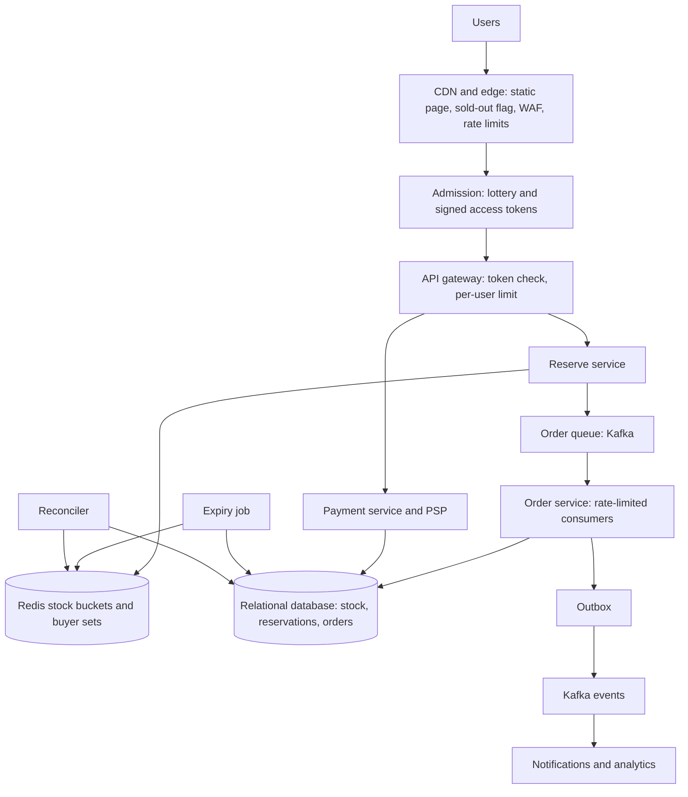
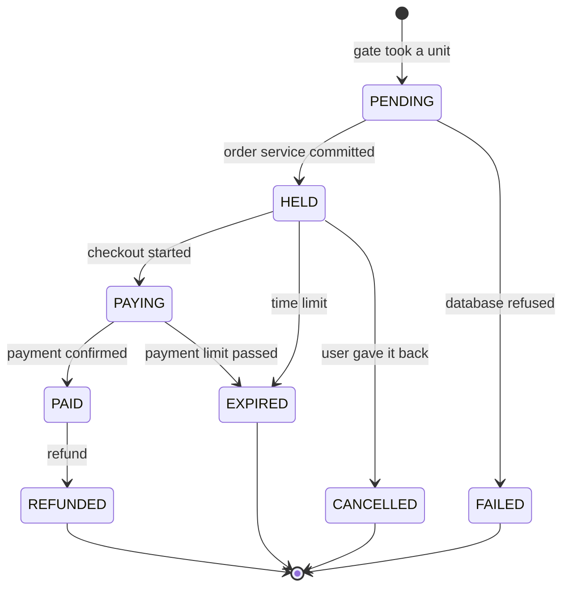

# Design an E-commerce Flash Sale

A flash sale sells a small, fixed stock of a product at a low price, starting at an announced second. Millions of users press "buy" in the same few seconds, and only a few thousand can succeed. The system has one hard rule (never sell more units than exist) and one hard load problem (the request rate for one product is hundreds of times higher than anything the database can serve). This page gives the design that a strong candidate presents in 45 minutes: a funnel that removes traffic layer by layer, an atomic in-memory stock gate in front of an authoritative database, queue-based order creation, and a reservation that expires.

The shop itself (catalog, cart, checkout, orders) is a normal e-commerce system. The class-level design of the cart, the stock claim, and the idempotent checkout is the LLD page [Design a Shopping Cart and Order System](../../lld/case-studies/18-shopping-cart-and-orders/README.md), and its closing section points to this page for stock under extreme load. The problem has the same shape as the on-sale in [Design a Ticket Booking System](12-ticket-booking.md): a scarce resource, a spike, a hold with a time limit, and payment. This page reuses the ideas of that page (the virtual waiting room, the hold, the conditional update, the fencing token) and links to them, and it spends its space on what differs: a single counter instead of many seats, no seat choice, and bots as the main enemy.

!!! note "About the sources"
    The database hot-row techniques come from an Alibaba Cloud engineering article by Hu Wei and from the Alibaba Cloud PolarDB-X documentation (see Further Reading). The atomicity of Redis scripts comes from the Redis documentation. Alibaba has not published a full design of its Singles' Day inventory system that this page could cite, so the design below is this page's own, built from those documented parts. All sizes, rates, and ratios are assumptions, labeled as such.

## Problem Statement

Design the backend for a flash sale on a large e-commerce site. At 12:00:00 the shop opens a sale for 10,000 units of one product at a deep discount. About 2 million users are online at the start, from a base of 5 million registered users who asked to be notified. Each user may buy at most one unit. The system must sell each unit exactly once, never sell the 10,001st unit, hold a unit for a buyer for 10 minutes to pay, give a unit back if the buyer does not pay, and stay up while 2 million people refresh the page.

The interviewer tests four skills: handling a load that is far above capacity (a funnel), correctness under contention for one counter (oversell prevention), the division of work between a fast in-memory store and a durable database, and the handling of the many failures around a purchase (a retry, a duplicate click, an unpaid order, a crash of the cache).

## Clarifying Questions

Ask these in the first 5 minutes. Each row gives the answer that this design assumes.

| Question | Assumed answer |
|---|---|
| How many products and how much stock? | One hot product with 10,000 units is the main case. A day can have 100 such products. Multi-product bundles are a follow-up |
| How many users? | 5 million registered for the sale, 2 million online at the start (Assumption) |
| How many units can one user buy? | One. The limit is checked for each account (and the system also checks for the same payment method or address as a fraud rule, which this page does not design) |
| Is overselling allowed? | No. The system sells at most 10,000 units. (Some retailers oversell by policy and cancel orders. This design treats overselling as a defect) |
| Is underselling allowed? | Briefly. A unit that a user holds and does not pay for returns to the pool, and the next user can buy it. The sale is complete only when all units are paid, or the sale ends |
| How long does a reservation last? | 10 minutes to pay (Assumption). The ticket page uses 5 minutes for seats. A shop that supports bank redirects needs a longer hold |
| Who takes the payment? | An external payment service provider (PSP) through the payment service (see [Design a Payment System](13-payment-system.md)) |
| Is the order of arrival important? | The system should be fair. A first-come order rewards bots and the fastest connection. The design uses a random lottery among the users who are present at the start, as the ticket page's waiting room does |
| What do users see when they cannot buy? | A clear "sold out" or a queue position, within a second. A spinner that hangs is a failure |
| How fresh must the stock number be? | The product page shows "available" or "sold out", with up to 1 second of delay. It does not show an exact count. The buy step is exact |
| Bots and scalpers? | In scope at the basic level: login, one entry for each account, rate limits, challenge for suspicious traffic. Advanced fraud scoring is out of scope |
| Regions? | One region owns the sale's inventory. Users elsewhere reach it through the edge |

## Requirements

### Functional

1. A user sees the sale page with a countdown, the price, and the state (not started, open, sold out).
2. When the sale opens, a user requests one unit. The system either reserves a unit for the user or answers "sold out" or "you already have one".
3. A reservation lasts 10 minutes. In that time the user pays. After a successful payment, the order is confirmed.
4. If the user does not pay in time, or cancels, the unit returns to the pool, and the next waiting user can get it.
5. Every call that changes state is safe to retry, so a double click or a retry after a timeout does not create a second order.
6. The operators can pause, stop, or change the stock of a sale during the event.

### Non-functional

| Requirement | Target |
|---|---|
| No oversell | Zero. Confirmed plus reserved units never exceed the stock |
| One unit for each user | Zero violations |
| Traffic at the start | 600,000 requests each second at the edge for 10 seconds (Assumption: 2 million users, 3 clicks each). The core sees under 10,000 each second |
| Response time | The reserve call answers in under 200 ms at p99, including "sold out" |
| Fairness | Every user who is present at the start has the same chance. No advantage for a faster client |
| Availability | The sale page stays up. If a component fails, the system refuses requests (fail closed for the reserve step) and does not oversell |
| Durability | A paid order is never lost. A reservation that the system acknowledged survives a crash of the cache |
| Consistency | The stock count in the database is the truth. The in-memory count may allow slightly more traffic through than the stock, and never more orders than the stock |

## Estimation

Rounding rule: one day is 10^5 seconds (see the [estimation page](../back-of-envelope-estimation.md)).

Inputs (all are assumptions): stock 10,000 units. 2 million users online at the start. Each user sends 3 buy requests in the first 10 seconds. A buy call and its response carry about 1 KB. One Redis shard serves about 100,000 simple operations each second (approximate. The Redis benchmark page shows about 180,000 `SET` calls each second on one instance with 50 clients and no pipelining, and about 72,000 with random keys. A script with four commands costs more than one `SET`, so the real rate of the gate script is lower. The number depends on the hardware, the command, and the network, so measure it). A row update in the database holds its row lock for 1 ms. The admission step lets in 2 times the stock (20,000 users) in the first wave. 60% of the reservations get paid. An order row has 2 KB.

| Step | Calculation | Result |
|---|---|---|
| Edge requests each second | 2,000,000 users × 3 requests / 10 s | 600,000 |
| Edge bandwidth for the calls | 600,000 × 1 KB × 8 bits | 4.8 Gbit/s |
| Redis shards if every request reached one stock key | 600,000 / 100,000 | 6 (and one key lives on one shard, so one key still caps at 100,000 each second) |
| Admission tokens in the first wave | 10,000 × 2 | 20,000 |
| Reserve attempts each second at the stock gate | 20,000 users × 3 requests / 10 s | 6,000 |
| Time for the stock to run out | 10,000 units / 6,000 each second | About 1.7 seconds |
| Single-row database throughput | 1 s / 1 ms lock hold | 1,000 updates each second |
| Time to write 10,000 deductions to one row | 10,000 / 1,000 | 10 seconds |
| Payments each second (10-minute hold) | 10,000 / 600 s | 17 |
| Units returned by unpaid reservations | 10,000 × (1 − 0.6) | 4,000 |
| Share of online users who get a unit | 10,000 / 2,000,000 | 0.5% |
| Order storage | 10,000 × 2 KB | 20 MB |

What the numbers decide:

- **The volume of data is tiny. The contention is the problem.** 20 MB of orders fits anywhere. The trouble is 600,000 requests each second for 10,000 units. The design is a funnel that cuts the load by about 100 times before the stock counter (from 600,000 to 6,000 requests each second). The queue then lowers the rate about 12 times more, to about 500 writes each second at the database.
- **One counter cannot take the raw traffic.** 600,000 requests each second on one key is 6 times what one Redis shard serves, and a single key lives on one shard. The funnel removes most requests, and the stock key is split into buckets for the rest.
- **The database row is a serial resource.** A row lock held for 1 ms serializes updates at about 1,000 each second, so 10,000 deductions on one row take 10 seconds, and a lock held for 5 ms (a slow transaction with several statements) makes it 50 seconds. The article from Alibaba Cloud (see Further Reading) says the same thing: if the transaction holds the lock for a shorter time, the throughput of a hot row approaches 1 second divided by the transaction's response time. So the database does the final, authoritative deduction at a rate that a queue sets, and the in-memory gate takes the burst.
- **The stock runs out in about 2 seconds.** After that, the system's main job is to answer "sold out" cheaply to everyone else, and to keep the 4,000 units that unpaid reservations return available for the next users in line.
- **99.5% of the users do not get a unit.** The design is judged by how it treats them: a fast, truthful answer.

The program checks the arithmetic, and then runs a small experiment that mimics the stock gate: 200 users with 5 tries each compete for 150 units in 4 buckets with a compare-and-set, and a user who tries a bucket that is empty falls through to the next one. The result must be exactly 150 units sold, each to a different user, with none left.

```java
import java.util.ArrayList;
import java.util.List;
import java.util.Locale;
import java.util.concurrent.ConcurrentHashMap;
import java.util.concurrent.atomic.AtomicIntegerArray;

public class FlashCheck {
    public static void main(String[] args) throws Exception {
        funnel();
        reserveRace();
    }

    static void funnel() {
        System.out.println("== Funnel ==");
        double stock = 10_000;
        double online = 2_000_000;
        double edge = online * 3 / 10;
        p("edge requests per second (3 clicks in 10 s)", edge);
        p("edge Gbit/s at 1 KB per call", edge * 1000 * 8 / 1e9);
        p("Redis shards needed without admission (100k/s)", Math.ceil(edge / 100_000));
        double tokens = stock * 2;
        double reserve = tokens * 3 / 10;
        p("admission tokens (2 x stock)", tokens);
        p("reserve attempts per second at Redis", reserve);
        p("seconds to sell out at that rate", stock / reserve);
        p("single-row DB updates per second (1 ms lock)", 1000.0 / 1.0);
        p("seconds to write 10,000 deductions on one row", stock / 1000.0);
        p("payments per second over a 10 minute hold", stock / 600);
        p("unpaid units returned at 60% payment", stock * 0.4);
        p("share of online users who get a unit (%)", stock / online * 100);
        p("order table MB (2 KB each)", stock * 2000 / 1e6);
    }

    static void reserveRace() throws Exception {
        System.out.println("== 200 users, 150 units in 4 buckets, 5 tries each ==");
        int buckets = 4;
        AtomicIntegerArray stock = new AtomicIntegerArray(buckets);
        int[] initial = {38, 38, 37, 37};
        for (int i = 0; i < buckets; i++) stock.set(i, initial[i]);
        ConcurrentHashMap<Integer, Integer> bought = new ConcurrentHashMap<>();
        List<Thread> threads = new ArrayList<>();
        for (int u = 0; u < 200; u++) {
            final int user = u;
            Thread t = new Thread(() -> {
                for (int attempt = 0; attempt < 5; attempt++) {
                    if (bought.containsKey(user)) break;
                    for (int k = 0; k < buckets; k++) {
                        int b = (user + k) % buckets;
                        if (take(stock, b)) {
                            bought.merge(user, 1, Integer::sum);
                            break;
                        }
                    }
                }
            });
            threads.add(t);
            t.start();
        }
        for (Thread t : threads) t.join();
        int left = 0;
        for (int i = 0; i < buckets; i++) left += stock.get(i);
        int max = bought.values().stream().mapToInt(Integer::intValue).max().orElse(0);
        System.out.println("units sold " + bought.values().stream().mapToInt(i -> i).sum());
        System.out.println("distinct buyers " + bought.size());
        System.out.println("most units for one user " + max);
        System.out.println("units left " + left);
    }

    static boolean take(AtomicIntegerArray stock, int b) {
        while (true) {
            int cur = stock.get(b);
            if (cur <= 0) return false;
            if (stock.compareAndSet(b, cur, cur - 1)) return true;
        }
    }

    static void p(String label, double v) {
        System.out.println(String.format(Locale.ROOT, "%-50s %,.2f", label, v));
    }
}
```

<!-- expected-output -->
```text
== Funnel ==
edge requests per second (3 clicks in 10 s)        600,000.00
edge Gbit/s at 1 KB per call                       4.80
Redis shards needed without admission (100k/s)     6.00
admission tokens (2 x stock)                       20,000.00
reserve attempts per second at Redis               6,000.00
seconds to sell out at that rate                   1.67
single-row DB updates per second (1 ms lock)       1,000.00
seconds to write 10,000 deductions on one row      10.00
payments per second over a 10 minute hold          16.67
unpaid units returned at 60% payment               4,000.00
share of online users who get a unit (%)           0.50
order table MB (2 KB each)                         20.00
== 200 users, 150 units in 4 buckets, 5 tries each ==
units sold 150
distinct buyers 150
most units for one user 1
units left 0
```

## API Design

All calls carry a bearer token from login (see [security in design](../fundamentals/21-security-in-design.md)). The calls that change state carry an idempotency key.

#### `GET /v1/sales/{saleId}`

Response `200`: `{ "state": "UPCOMING|OPEN|SOLD_OUT|ENDED", "opensAtServerTime", "serverTime", "price", "product": {...} }`. This response is cacheable at the CDN for 1 second. `serverTime` lets the client compute its clock offset, so the countdown follows the server clock and not the device clock.

#### `POST /v1/sales/{saleId}/entries`

Joins the lottery before the sale opens, or the queue after it opens. Request: empty body, `Idempotency-Key` header. Response `200`: `{ "ticket": "<signed>", "status": "WAITING|ADMITTED|SOLD_OUT" }`. The ticket is a signed value over `{saleId, accountId, rank}` (the same signed-ticket idea as the ticket booking page's waiting room).

#### `GET /v1/sales/{saleId}/entries/me`

Response `200`: `{ "status", "retryAfterSeconds", "accessToken" }`. The edge answers this call from a cached `servingRank`, so the origin does not see it.

#### `POST /v1/sales/{saleId}/reservations`

The reserve call. Request headers: `Authorization`, `X-Access-Token` (from the admission step), `Idempotency-Key`. Request body: `{ "skuId", "quantity": 1 }`. Responses:

| Status | Body | Meaning |
|---|---|---|
| `202` | `{ "reservationId", "status": "PENDING" }` | The in-memory gate took a unit. The order service is creating the order |
| `200` | `{ "reservationId", "status": "HELD", "expiresAt" }` | The same call after the order exists (idempotent repeat) |
| `409` | `{ "reason": "ALREADY_RESERVED" }` | This account already holds or bought a unit |
| `410` | `{ "reason": "SOLD_OUT" }` | No unit is left. The edge caches this answer for 1 to 2 seconds for all users |
| `429` | `Retry-After` header | Too many requests from this user, IP, or token |
| `403` | `{ "reason": "NO_ADMISSION" }` | No valid access token |
| `403` | `{ "reason": "NOT_OPEN" }` | The request arrived before the opening time by the server clock |

#### `GET /v1/reservations/{reservationId}`

Response `200`: `{ "status": "PENDING|HELD|PAYING|PAID|EXPIRED|CANCELLED|FAILED", "expiresAt", "orderId" }`. The client polls (with `retryAfterSeconds`) or listens on a push channel. The system never returns `HELD` until the database has recorded the reservation. `PENDING` means that the gate took a unit and the order service has not committed yet.

#### `POST /v1/reservations/{reservationId}/checkout`

Starts the payment. Request: the payment method token, `Idempotency-Key`. Response `200`: `{ "paymentUrl" | "status" }`. This call extends the reservation to the payment limit, as in the ticket booking design (see that page's deep dive on payment and the race with expiry).

#### `DELETE /v1/reservations/{reservationId}`

The user gives the unit back. Response `204`. A repeat returns `204`.

#### Payment webhook from the PSP

`POST /internal/payments/webhook`. It is idempotent by the PSP's event ID. See [Design a Payment System](13-payment-system.md).

#### Operator API

`POST /internal/sales/{saleId}:pause`, `:resume`, `:close`, and `PUT /internal/sales/{saleId}/stock`. These work through the same stock store as the buyers, with an audit record for each call.

## Data Model

| Data | Needs | Store |
|---|---|---|
| Stock gate (counters and the set of buyers) | Atomic check-and-decrement. About 100,000 operations each second for each shard. Loss tolerated with repair | Redis, split into buckets across shards, loaded from the database before the sale |
| Authoritative stock | A conditional update. A constraint that stock is not negative. Durable | A relational database (PostgreSQL or MySQL), one row for each SKU for each sale |
| Reservations and orders | Transactions with the stock. Unique `(sale_id, user_id)`. Idempotency keys | The same relational database, partitioned by sale |
| Admission tickets and the serving counter | A counter, a signed ticket, millions of entries | Redis for the counter. The ticket is a signed value, so it needs no lookup |
| Order events | A reliable publish to the notification, the payment, and the analytics consumers | An outbox table and Kafka (see [message queues and streams](../fundamentals/08-message-queues-and-streams.md)) |
| Product page | A static, read-heavy object | CDN, with an in-process cache in the web tier |

### Tables

`sale_stock`: `(sale_id, sku_id, total, available, version)`, primary key `(sale_id, sku_id)`, `CHECK (available >= 0)`.

`reservation`: `(reservation_id PK, sale_id, user_id, sku_id, state, expires_at, created_at)`, a unique key on `(sale_id, user_id)`. The state is `HELD`, `PAYING`, `PAID`, `EXPIRED`, `CANCELLED`, or `FAILED`. (`PENDING` exists only before this row exists: the reserve service reports it from the idempotency record in Redis.)

`orders`: `(order_id PK, reservation_id UNIQUE, user_id, amount_cents, psp_payment_id UNIQUE, state)`.

`idempotency`: `(user_id, key) PK, response_json, created_at`, kept for 24 hours.

`outbox`: `(id, topic, payload, created_at, published_at)`.

### The stock rule, runnable

The rule from the LLD page (a conditional update for the stock claim) in SQL. The reservation insert enforces one unit for each user. The stock update succeeds only if a unit is left. The application commits only if both statements changed a row. The statements run on SQLite with fixed values. In PostgreSQL the same logic runs in one transaction, with `INSERT ... ON CONFLICT DO NOTHING` in place of the SQLite `INSERT OR IGNORE`, and with the row count that the driver returns (for example, the return value of JDBC `executeUpdate`) in place of `changes()`.

```sql
CREATE TABLE sale_stock (
  sku_id TEXT PRIMARY KEY,
  available INTEGER NOT NULL CHECK (available >= 0));
CREATE TABLE reservation (
  sku_id TEXT, user_id TEXT, state TEXT,
  PRIMARY KEY (sku_id, user_id));
INSERT INTO sale_stock VALUES ('phone-x', 2);
```

User `u1` reserves. The insert changes one row.

```sql
INSERT OR IGNORE INTO reservation VALUES ('phone-x', 'u1', 'HELD');
SELECT changes() AS rows_changed;
```

<!-- sql-result -->
```text
rows_changed
1
```

The stock update for `u1` changes one row, because a unit is left.

```sql
UPDATE sale_stock SET available = available - 1
WHERE sku_id = 'phone-x' AND available >= 1;
SELECT changes() AS rows_changed;
```

<!-- sql-result -->
```text
rows_changed
1
```

`u2` reserves the second unit in the same way. Then `u3` arrives. The reservation insert works, and the stock update changes zero rows, so the application rolls back the transaction and answers "sold out".

```sql
INSERT OR IGNORE INTO reservation VALUES ('phone-x', 'u2', 'HELD');
UPDATE sale_stock SET available = available - 1
WHERE sku_id = 'phone-x' AND available >= 1;
BEGIN;
INSERT OR IGNORE INTO reservation VALUES ('phone-x', 'u3', 'HELD');
UPDATE sale_stock SET available = available - 1
WHERE sku_id = 'phone-x' AND available >= 1;
SELECT changes() AS rows_changed;
ROLLBACK;
```

<!-- sql-result -->
```text
rows_changed
0
```

`u1` clicks again. The unique key stops the second reservation, so no row changes and the application does not touch the stock.

```sql
INSERT OR IGNORE INTO reservation VALUES ('phone-x', 'u1', 'HELD');
SELECT changes() AS rows_changed;
```

<!-- sql-result -->
```text
rows_changed
0
```

`u2` does not pay. The expiry job moves the reservation from `HELD` to `EXPIRED` and returns the unit only if that update changed a row. A second run of the job changes nothing, so the unit returns once.

```sql
UPDATE reservation SET state = 'EXPIRED'
WHERE sku_id = 'phone-x' AND user_id = 'u2' AND state = 'HELD';
SELECT changes() AS rows_changed;
```

<!-- sql-result -->
```text
rows_changed
1
```

The job adds one unit back, because the state change affected a row. A repeat of the state change would show 0, and the job would skip the stock update.

```sql
UPDATE sale_stock SET available = available + 1 WHERE sku_id = 'phone-x';
SELECT sku_id, available FROM sale_stock;
```

<!-- sql-result -->
```text
sku_id | available
phone-x | 1
```

### Database choice

The truth about stock and orders needs a conditional update, a unique constraint, and transactions across a reservation row and a stock row. A relational database gives all three, so the authoritative path uses PostgreSQL or MySQL (see [choosing a database](../fundamentals/04-choosing-a-database.md)). MySQL enforces `CHECK` constraints only from version 8.0.16. Earlier versions parse the constraint and ignore it, so on those versions the conditional `WHERE available >= 1` is the only guard. The limit of one row is the serial update rate, and the design keeps the database below that limit with the queue and the in-memory gate, instead of replacing the database. A key-value store with conditional writes (DynamoDB `UpdateItem` with a condition expression) has the same hot-key limit for one item: one item lives in one partition, and AWS designs each partition for at most 1,000 write units each second. So it does not change the design.

Recommendation: the in-memory gate is a performance device and not a source of truth. If Redis loses data, the system repairs it from the database, and it never trusts Redis for money or for the final stock.

## High-Level Design



### Components

- **CDN and edge.** Serve the static sale page, images, and scripts. Keep a copy of the sale state (`UPCOMING`, `OPEN`, `SOLD_OUT`) with a TTL of 1 second. When the sale sells out, the origin publishes the state, and the edge answers every reserve call with `410` without reaching the origin. The edge also applies the WAF rules, per-IP rate limits, and the bot challenge (see [load balancing, DNS, and CDN](../fundamentals/02-load-balancing-dns-cdn.md)).
- **Admission (waiting room).** Before the sale opens, users join a lottery. At the start, the system draws a random order and admits users in that order at a controlled rate. An admitted user gets a signed access token. The design is the one in the ticket booking page's deep dive on the virtual waiting room. The differences for a flash sale are in deep dive 1.
- **API gateway.** Verifies the access token without a lookup (it checks the signature), applies a limit for each user (one reserve call each second) and for each token, and rejects calls without a token.
- **Reserve service.** Stateless. For one call it runs one Lua script on one Redis bucket (deep dive 2). On success it puts a message on the order queue and returns `202`. On "sold out", it returns `410` and tells the edge to cache the state.
- **Redis stock buckets.** The stock is split over K keys on different shards. Each bucket has a set of buyers that took a unit from it. Before the sale, a loader writes the stock from the database into the buckets.
- **Order queue and order service.** A Kafka topic holds the accepted reservations. The order service consumes it at a rate that the database sustains (deep dive 3). For each message it runs one transaction in the database: the reservation insert, the conditional stock update, and an outbox row. The queue turns a burst into a steady stream ("peak shaving").
- **Relational database.** The truth: the stock row with its check, the reservation rows with the unique key, and the orders.
- **Payment service.** Takes the payment through the PSP. The flow after `checkout` is the same as in the ticket booking design (see [Design a Payment System](13-payment-system.md)).
- **Expiry job.** Finds `HELD` reservations past `expires_at`, moves them to `EXPIRED`, and returns the unit to the database and to Redis (deep dive 4).
- **Reconciler.** Compares the database stock with the Redis counters, and fixes a difference (deep dive 2).
- **Operator console.** Pauses, resumes, or closes a sale and changes the stock, through the same stock path.

### Flow: one buy

1. Before 12:00, the user opens the sale page from the CDN and joins the lottery. The client shows a countdown by the server time.
2. At 12:00:00 the system fixes the lottery order, and the first 20,000 users get access tokens. The other users see "waiting" with a retry time from the edge.
3. An admitted user calls `POST /reservations` with the token. The gateway checks the token and the rate limit.
4. The reserve service picks the user's home bucket by a hash of the user ID and runs the Lua script. The script returns `1` (a unit taken), `-1` (the user has one), or `0` (the bucket is empty). On `0`, the service tries the next bucket. If all buckets return `0`, the sale is sold out.
5. On `1`, the service writes a message `(reservationId, userId, skuId)` to the order queue, and answers `202`.
6. The order service consumes the message. One transaction inserts the reservation (the unique key blocks a duplicate), decreases `available` with the condition, and writes the outbox row. Three outcomes need care. If the insert fails on the unique key and the existing row has the same `reservation_id`, the message is a duplicate delivery: the order service treats it as success and returns nothing. If the existing row has a different `reservation_id` (the user already holds another unit), the transaction rolls back, the new reservation becomes `FAILED`, and the order service returns the unit to its Redis bucket, because the unit is real. If the stock update changes zero rows, the database has no unit left. The transaction rolls back and the reservation becomes `FAILED`, but the order service returns nothing to Redis, because the Redis count was too high. It reports the difference to the reconciler.
7. The client polls the reservation and sees `HELD` with `expiresAt`. The user pays. The payment webhook marks the reservation `PAID` and creates the order.
8. If the user does not pay by `expiresAt`, the expiry job frees the unit, and the next user in the queue receives it.

## Deep Dives

### Deep dive 1: The funnel: cut the load before it reaches the stock

The goal is to turn 600,000 requests each second at the edge into under 10,000 each second at the core. Each layer removes a share of the traffic, and each is cheaper than the one after it.

| Layer | What it does | What it removes |
|---|---|---|
| Static page and countdown | The page, images, and scripts come from the CDN. The client computes the opening time from the server's `serverTime`, so the buy button is inactive until then | Page loads and early clicks. The most common cause of a flash-sale outage is the page itself |
| Pre-registration and login | Only logged-in, verified accounts can join. One entry for each account | Anonymous scripts |
| Edge rate limits and bot challenge | A limit for each IP and each account (see [rate limiting algorithms](../fundamentals/13-rate-limiting-algorithms.md)). A challenge (CAPTCHA or proof of work) for suspicious clients | Most bot traffic |
| Admission lottery | Only the admitted users get a token. 20,000 in the first wave (2 times the stock) | 99% of the users from the reserve path |
| Sold-out flag at the edge | After the sale is sold out, the edge answers `410` without the origin | All requests after the first 2 seconds |
| Gateway token check and per-user limit | The signature check costs microseconds. One call each second for each user | Replays and retries that hit too often |
| Reserve service and Redis | The atomic gate | Everything past the stock |

**Why a lottery and not first-come.** In a flash sale of 2 million users and 10,000 units, the first-come order is decided by network latency and by automation. A human on a mobile network loses to a script in a data center. A random draw among all users who joined before the start gives each the same chance, and it removes the reward for hitting the server in the first millisecond. The ticket booking page describes the mechanics in detail: a pre-queue, a random rank at the opening time, a rank counter that rises at the admission rate, a signed ticket, and an edge that answers status polls (see [Design a Ticket Booking System](12-ticket-booking.md), deep dive 2). A flash sale differs in three ways.

1. **The resource is one counter.** The admission rate is set by what the stock gate and the order service handle, and the number of admitted users is a multiple of the stock (here 2 times). In ticket booking, the rate comes from Little's law for the number of concurrent shoppers.
2. **The admitted wave is small and short.** Most of the 20,000 learn within 2 seconds whether they have a unit. The rest of the lottery order is the waiting list for returned units. When 4,000 unpaid units return (Assumption), the system admits the next users in the list in order.
3. **There is no seat map and no browsing.** The user presses one button. The page can be nearly static.

**The time-sync problem.** The client's clock can be wrong by seconds. The page fetches `serverTime` and keeps the offset. The server decides when the sale opens. A client that sends a request before the opening time gets `403 NOT_OPEN`, and the server does not trust any client timestamp.

**Cheap sold-out answers.** When the stock reaches zero, the reserve service writes `SOLD_OUT` to the state store, and the edge picks it up in 1 to 2 seconds. From then on, the 600,000 requests each second end at the edge. Until the edge picks it up, the origin answers `410` from Redis, and that answer is cheap, because the Lua script returns at once.

**Bots.** The funnel is the main defense, because most abuse is automation. Rate limits for each account and each IP, a challenge before the lottery join, one entry for each verified account, a limit of one unit for each account, and a check of the payment method and the delivery address for repeats. Scalpers use many real accounts, so the design lowers their advantage, and it does not remove it. (For the security view, see [security in design](../fundamentals/21-security-in-design.md).)

**Reads.** The sale page and the sale state are cache objects with a short TTL. The in-process cache of the web tier and the CDN absorb the reads. A cache stampede on the first request after the TTL ends is prevented with request coalescing (see [caching](../fundamentals/03-caching.md)). The page does not show an exact stock count, so there is no hot read of the counter. A product that does not exist must be rejected at the edge from a list of valid sale IDs, so that random IDs do not reach the database (cache penetration).

### Deep dive 2: Oversell prevention: an in-memory gate in front of an authoritative database

The rule: a unit is sold at most once, and a user gets at most one. The design defends this at four places. Each place catches errors that the earlier ones can miss.

| Layer | Mechanism | What it catches |
|---|---|---|
| 1. Admission | Only 2 times the stock may try | Load. It does not guarantee correctness |
| 2. Redis gate | One Lua script checks the buyer set, checks the counter, and decrements. Redis runs a script as one atomic unit | Concurrent buyers for the same unit |
| 3. Database stock row | `UPDATE sale_stock SET available = available - 1 WHERE sale_id = ? AND sku_id = ? AND available >= 1`, plus `CHECK (available >= 0)` | A wrong Redis count (a restore from an old copy, a failover that lost writes) |
| 4. Database unique key | `UNIQUE (sale_id, user_id)` on the reservation | A user who got two units through two buckets, or through a replayed message |

**The script.** The atomic gate for one bucket. In Redis Cluster, a command or script that uses several keys works only if all the keys hash to the same slot (the cluster specification states this rule). So the counter and the buyer set of one bucket share a hash tag, for example `stock:{phone-x:3}` and `buyers:{phone-x:3}`.

```lua
-- KEYS[1] = stock counter of the bucket, KEYS[2] = buyer set of the bucket
-- ARGV[1] = user id
-- returns 1 = unit taken, 0 = bucket empty, -1 = user already has a unit here
if redis.call('SISMEMBER', KEYS[2], ARGV[1]) == 1 then
  return -1
end
local left = tonumber(redis.call('GET', KEYS[1]) or '0')
if left <= 0 then
  return 0
end
redis.call('DECR', KEYS[1])
redis.call('SADD', KEYS[2], ARGV[1])
return 1
```

The Redis documentation states that a script runs atomically: "While executing the script, all server activities are blocked during its entire runtime." So two buyers cannot both see `left = 1` and both decrement. This is why the gate uses a script and not separate `GET` and `DECR` calls, which would race. A shorter script is `DECR` with a check on the result (if the value is below 0, `INCR` it back). The script form also holds the buyer set, so one round trip does both checks.

**Why buckets.** One key lives on one shard, so one key caps at the throughput of one shard (about 100,000 operations each second in the estimate), however many shards exist. The design splits the stock of 10,000 units into K buckets (for example 8 buckets of 1,250), on different shards. The reserve service sends each user to a home bucket by a hash of the user ID, so one user's calls reach the same bucket and the same buyer set. If the home bucket is empty, the service tries the next bucket, and so on, before it answers "sold out". Without the fall-through, a user whose bucket is empty would see "sold out" while another bucket still has units. The experiment in the Estimation section runs this fall-through with 4 buckets and shows that all units sell.

**The cost of buckets.** Two. First, the check of "sold out" for the whole sale is the sum of the buckets, so a background aggregator reads all counters and sets the sale state, and the reserve service sets it when its own walk through all buckets fails. Second, a user can get a second unit if a unit returns to a bucket that the user's walk reaches earlier than the bucket that holds the user's first unit. The unique key in the database (layer 4) catches this: the second reservation (with a different `reservation_id`) fails, and the order service returns that unit to its bucket. This is a rare path, so the design accepts the extra step.

**Redis is not the truth.** Redis can lose data. With asynchronous replication, a primary that fails can lose its last writes, and the promoted replica then has counters that are too high (it lost some decrements). That allows more users through the gate than the stock. The database stock row (layer 3) then refuses the excess: the update changes zero rows, the order is `FAILED`, and the user sees a rejection, which is a bad experience but a correct result (see [replication](../fundamentals/05-replication.md)). The reverse error (counters too low, for example a lost return of a unit) causes under-selling, and the reconciler repairs it.

**Reconciliation.** A job compares, for each sale: the database `available`, the count of `HELD` and `PAYING` reservations that the database knows, and the Redis counters. The invariant is `available (database) = total − held − paying − paid`. Redis should hold `available` minus the messages in flight on the queue. The reconciler recalculates the Redis counters from the database when no messages are in flight, or after a pause of the sale. It is also the repair path after a Redis restart: pause the sale for a moment, reload the counters from the database, and resume. Recommendation: build the pause switch before the sale.

**What if Redis is down?** The reserve service fails closed: it returns `503` and no one reserves. Overselling is worse than a short outage. The alternative, a fallback to the database for every request, would send the burst to one row, so the design does not use it for the burst. For a small sale (a few hundred each second), the fallback to the database is acceptable.

**The distributed lock is not the tool.** A lock on the SKU would serialize the buyers and add a network round trip for each. A lock with a lease also needs a fencing token to be safe (see [distributed locks and leases](../distributed-systems/05-distributed-locks-and-leases.md)). The atomic script and the conditional update give the same exclusion for one operation, with no lease to expire.

### Deep dive 3: The hot row, queue-based order creation, and idempotency

**The hot row.** The authoritative deduction touches one row for one SKU. The row lock is held for the length of the transaction. If the transaction has five statements and nine network round trips, the lock is held for many milliseconds, and the throughput falls to a few hundred updates each second. The article by Hu Wei of Alibaba Cloud describes the hot-row problem for e-commerce inventory and lists these remedies (see Further Reading):

| Remedy | What it does | Cost |
|---|---|---|
| Shorter lock time | Merge statements and cut network round trips. Update the row near the end of the transaction. Return the result from the update itself (one statement that updates and returns) | Needs care in the code. Cheapest |
| Limit concurrency | A thread pool limits the sessions that touch the database, so the lock queue stays short | Lower peak parallelism. Stable latency |
| Queue updates for the same row | The database queues the transactions that update the same row, which reduces the overhead of InnoDB lock wake-ups | A database feature (the article describes it in AliSQL), not available in every engine |
| Group commit for hot rows | A leader thread collects concurrent updates to the same row, applies them as one group update under one lock, and commits the batch. The followers get their results without taking the lock themselves. PolarDB-X documents this feature (an "inventory hint") | Engine-specific. The PolarDB-X documentation lists these limits: Enterprise Edition (MySQL 5.7) only, a single shard, an equality condition on a primary key or unique key, no global indexes, and the XA transaction policy |
| Optimistic, no-wait updates | A transaction that finds the row locked fails at once instead of waiting. The article names the no-wait function of AliSQL and MySQL 8.0 (in MySQL 8.0, `SELECT ... FOR UPDATE NOWAIT`) | The application retries. Fits a gate that already filtered the traffic |

This design uses the first two, and it does not depend on an engine-specific feature. The in-memory gate and the queue keep the update rate for one row below about 1,000 each second.

**Splitting the stock row.** The same split as in Redis. The database holds the stock of one SKU in N rows (`sale_stock` with a `bucket` column), and a reservation updates its home bucket. A row update then does not wait for the other buckets' updates. The cost is the same as in Redis: a sum to find the total, and a fall-through when a bucket is empty. Use it when one row is not enough (a sale with 1 million units, not 10,000).

**Peak shaving with a queue.** The reserve service does not write to the database. It writes the accepted reservation to a Kafka topic, and the order service reads it at the rate that the database sustains. The queue holds the burst: 10,000 messages that arrive in 2 seconds are written in 20 seconds at 500 each second. The user sees `PENDING` for a few seconds, which is why the reserve call returns `202`. Partition the topic by `sku_id` for one hot product (so the messages for one row come to one consumer in order and the lock does not see contention from many consumers), or by `user_id` for a sale with many SKUs (see [message queues and streams](../fundamentals/08-message-queues-and-streams.md) for ordering and consumer groups).

**Why the queue is safe.** A message in the queue represents a unit that the gate already took. If the order service fails, the message stays, and another consumer takes it. If a message is delivered twice (at-least-once delivery), the order service must not create two reservations: the unique key on `(sale_id, user_id)` makes the second insert fail, and the transaction treats "already exists with the same reservation ID" as success. This is the idempotent consumer from [message queues and streams](../fundamentals/08-message-queues-and-streams.md).

**Idempotency on the client path.** A double click or a retry sends the same `Idempotency-Key`. Before it runs the script, the reserve service stores the key in Redis with a new reservation ID (`SET key id NX EX 86400`). After the script, it replaces the value with the final response (`202` with the ID, `409`, or `410`). A repeat with the same key returns the stored response and does not run the script again. If the repeat finds only the ID and no final response (the first call is still running, or its process crashed), the service returns `202` with that ID, and the client polls the reservation. The reconciler marks a reservation `FAILED` if the database has no row for it after a timeout longer than the maximum queue lag (for example 1 minute). The database also keeps the key table for the order path (see [reliability patterns](../fundamentals/12-reliability-patterns.md)).

**The outbox.** The order transaction writes an outbox row. A publisher sends it to Kafka. This way "order created" events reach the notification and the analytics services even if the process crashes after the commit. The pattern is in [message queues and streams](../fundamentals/08-message-queues-and-streams.md) and [distributed transactions](../distributed-systems/03-distributed-transactions.md).

**Order of the writes.** The gate decrements Redis first, and then the queue, and then the database. If the process crashes between the Redis decrement and the queue write, the Redis count is one unit too low, and the user's ID stays in the bucket's buyer set without a reservation (the user saw a timeout). Until the repair, a retry by that user gets `-1` from the script. The reconciler restores the unit, and it removes from the buyer sets each user who still has no reservation row in the database after that timeout. The opposite order (queue first, Redis later) can overshoot the stock. The design prefers a temporary under-count to an over-count.

### Deep dive 4: Reservation, payment, expiry, and backfill

A unit that a user holds and does not pay for must return to the pool. The state machine is the one from the ticket booking page, with a counter in place of seats:



**Return of a unit.** Each of the ending states `EXPIRED` and `CANCELLED` must return the unit exactly once. (`FAILED` follows a rolled-back transaction, so the database stock never changed. Step 6 of the flow says when the order service gives the unit back to Redis.) The rule is a guarded state change: `UPDATE reservation SET state = 'EXPIRED' WHERE reservation_id = ? AND state = 'HELD'` (or `state = 'PAYING'` after the payment limit). The job returns the unit (`available + 1`, and a Redis `INCR` plus the removal of the user from the buyer set) only if the update changed one row. A second run of the job, or a concurrent cancel, finds no `HELD` row and returns nothing. The SQL in the Data Model section shows both outcomes. This is the same idea as the hold ID on the seat in the ticket design.

**Expiry mechanisms.** Two, as on the ticket page. A delay queue or a sorted set of `(expires_at, reservationId)` triggers the expiry at the time (the system reads due items every second). A sweeper job every minute finds any `HELD` row past `expires_at`, which repairs a lost trigger.

**The race with payment.** A user pays in the last second, and the expiry runs at the same moment. The rules from the ticket booking page apply: the checkout moves the reservation to a `PAYING` state with a later limit, and the expiry job skips `PAYING` reservations until that payment limit passes. If the PSP confirms the payment after the unit went to another user, the payment service refunds it (see [Design a Ticket Booking System](12-ticket-booking.md), deep dive 3, and [Design a Payment System](13-payment-system.md)).

**Backfill.** When a unit returns, the system can sell it again. Two options. The simple option: put the unit back into a Redis bucket, and the next lottery winners who are still waiting reserve it. A short scheduled wave admits the next users from the lottery order (for example 1,000 each minute) so a returned unit does not start a second stampede. The strict option: give the unit directly to the next user in the waiting list and notify them, with a new 10-minute hold. The strict option is fairer, and it needs the waiting list to be a durable ordered structure. Recommendation: use scheduled waves for the first version. In both options, the reserve service clears the `SOLD_OUT` flag at the edge when it admits a new wave, so that reserve calls with a valid access token reach it again. The state becomes final only when no `HELD` or `PAYING` reservation is left, or when the sale ends.

**Multi-item orders.** A cart with several flash-sale items needs several units at once. A reservation of unit A and unit B in two systems is a saga: reserve A, reserve B, and if B fails, release A (see [distributed transactions](../distributed-systems/03-distributed-transactions.md)). To avoid deadlock-like waits, reserve in a fixed order (by SKU ID). Many flash sales limit the sale to one item for one order for this reason.

**Price and coupons.** The price for the sale is part of the reservation and does not change. Coupons for a flash sale are rare. The LLD page shows the pricing classes (see [Design a Shopping Cart and Order System](../../lld/case-studies/18-shopping-cart-and-orders/README.md)). The price must be written in the order at checkout, so a price change after the reservation does not change an old order.

## Bottlenecks and Scaling

| What fails first | Symptom | Fix |
|---|---|---|
| The sale page | CDN origin overload, slow page | Static page on the CDN, pre-warm the cache before the sale, a small API for the state. Test the CDN with a rehearsal |
| The edge and the gateway | 600,000 requests each second, connection limits | Edge rate limits and the sold-out flag. Add gateway instances (stateless). Shed load with `429` and `503` and a `Retry-After` |
| One Redis key | CPU of one shard saturates | Split the stock into buckets on different shards. The admission lottery lowers the rate |
| Redis failure | Reserve calls fail | Fail closed. Replicas with a quick failover. Reconcile from the database after the failover. A pause switch |
| One database row | Lock waits, rising latency | Short transactions, a limit on concurrency, a queue with a controlled rate, optional split rows, and the hot-row features of the engine |
| The order queue | Lag grows | More partitions only help for many SKUs. For one SKU, the rate is set by the row. Show `PENDING` honestly. The queue lag is a metric with an alert |
| The PSP | Slow or failing payments | A timeout and a retry with the same idempotency key. A longer hold. A circuit breaker (see [reliability patterns](../fundamentals/12-reliability-patterns.md)) |
| Bots and scalpers | Real users lose to automation | The funnel, the challenge, one entry for each account, and a review of orders after the sale |
| Notification burst | 2 million "sold out" or "you won" messages | Show the result on the page. Send the notification only to the 10,000 winners, with a rate limit (see [Design a Notification System](04-notification-system.md)) |
| Too many sales on the same cluster | One sale harms others | Give each hot sale its own Redis group, queue, and database partition. The cell-based design limits the blast radius |

**Observe the sale.** Watch the edge request rate, the share of `429` and `410`, the reserve latency, the Redis bucket counters against the database stock, the order queue lag, the lock wait time in the database, and the number of `HELD` and `PAYING` reservations. An alert on the invariant (paid plus paying plus held above the total) is the most important one (see [observability in design](../fundamentals/20-observability-in-design.md)).

**Rehearse.** Run a load test at 2 times the expected traffic, with realistic retries. Kill a Redis primary during the test. Check the invariants after every test: no oversell, no user with two units, every paid order has a payment, every unit is `available`, `HELD`, `PAYING`, or `PAID`.

## Trade-offs

| Decision | Chosen | Rejected | Why |
|---|---|---|---|
| Admission | A random lottery among the users present at the start | First-come order | First-come rewards bots and fast networks. A lottery is fair, and it spreads the arrivals |
| Where to deduct first | An in-memory atomic gate, then the database | Only the database | One hot row caps at about 1,000 updates each second. The gate takes the burst |
| Source of truth | The database | Redis | Redis can lose writes on failover. The database has constraints and durability |
| Gate primitive | A Lua script on the bucket | A distributed lock on the SKU, or `GET` then `DECR` | The script is atomic with one round trip. A lock adds a round trip and a lease. Separate commands race |
| Stock layout | K buckets with fall-through | One key | One key caps at one shard. Buckets cost a sum for the total and a rare duplicate repair |
| Order creation | Asynchronous through a queue | A synchronous database write in the reserve call | The queue shapes the burst. The user waits a few seconds for `HELD` |
| Failure mode | Fail closed (refuse) | Fall back to the database for all traffic | Overselling is a defect. A short outage is not. The fallback overloads the one row |
| Duplicate protection | Buyer set in Redis plus a unique key in the database | Only the Redis set | Redis can lose the set. The unique key is durable |
| Unit return | A guarded state change, then a stock update | A blind `available + 1` | A repeat of the job or a race would add the unit twice |
| Reservation time | 10 minutes | 2 minutes | A short hold frees units faster. It fails users with a slow payment method. The choice depends on the payment methods |
| Reads | Cached sale state, no exact stock count | Show the exact count in real time | An exact count makes a hot read and invites bots to time their purchase |
| Overselling by policy | No oversell | Oversell by a margin and cancel later | Cancelled orders hurt the trust of buyers. A margin is a business choice, and the design supports it with a different total |

## Follow-up Questions

??? question "Why not just use a database transaction with SELECT FOR UPDATE on the stock row?"

    It is correct, and it does not scale to this load. `SELECT ... FOR UPDATE` and then `UPDATE` holds the row lock while the application runs the code between the two statements, and the time between them includes network round trips. All buyers queue on that one row, and the throughput is about one over the lock time. With a 5 ms lock, that is 200 each second, against 600,000 requests each second at the edge. The queue of waiting transactions also holds connections, and the connection pool runs out, which takes down the other parts of the shop.

    A single conditional `UPDATE ... WHERE available >= 1` is better: one statement, a short lock. It is still one row, and a serial resource, so about 1,000 each second. The design keeps it as the final guard and puts an atomic in-memory gate and a queue in front of it, so the row sees a few hundred updates each second at a steady rate.

??? question "Your Redis primary fails in the middle of the sale. What happens to correctness and to the user experience?"

    Correctness: the system does not oversell. Redis replication is asynchronous, so the promoted replica may lack the last few decrements, and its counters may be too high. The gate then lets slightly more users through than the stock. The database stock row refuses the excess with the conditional update (`available >= 1`, and the `CHECK` constraint), so the order service marks those reservations `FAILED`. It does not return those units to Redis, because the database never had them. The unique key on the reservation stops a duplicate for a user. The invariant holds because the database is the truth.

    User experience: during the failover, which takes seconds, the reserve service fails closed with `503`, and clients retry with backoff and jitter. After the failover, a reconciler pauses the sale for a moment, recomputes the Redis counters from the database (total minus held, paying, and paid, minus the messages in flight on the queue), and resumes. A few users who got `PENDING` (a `202`) from the gate and then `FAILED` from the database see a message that the unit was not available. This is a rare path that the design accepts. The alternative, a `WAIT` for a replica acknowledgement after every decrement, adds a round trip to every call, and the Redis documentation states that even `WAIT` does not make Redis strongly consistent: an acknowledged write can still be lost in a failover. If the business cannot accept the rare rejection, the reserve step goes through the database for a lower throughput.

??? question "How do you make the sale fair, and how do you handle bots?"

    Fair means that every real user who is present at the start has the same chance. First-come is not fair: the winners are the ones with the shortest network path and automation. The design draws a random order among all users who joined before the opening, admits them at a controlled rate with signed tokens, and handles the users who join later after them, in order of arrival. The mechanics are the ones in the ticket booking page's waiting room.

    Bots: no single control stops them, so the design stacks controls. A verified account with login is required to join. One entry and one unit for each account. Per-IP and per-account rate limits at the edge. A challenge (CAPTCHA or proof of work) before the lottery join, which is the point where the system sees every user once. A check of the payment method and the shipping address for repeats across accounts. A review of the orders after the sale, with cancellation of the ones that break the rules, and a refund. The design lowers the scalper's advantage. It cannot make it zero, because a scalper can use many real accounts, and the answer to the interviewer says that.

??? question "A user clicks the buy button three times, and the mobile client retries after a timeout. How do you make sure one unit is reserved?"

    Three layers. First, the client sends one `Idempotency-Key` for one intent, and reuses the same key for the retries. The reserve service stores the key with the result (`SET key value NX EX 86400`) and returns the stored result for a repeat. Second, the Redis script returns `-1` if the user is already in the buyer set of the bucket, so a second call without a key (a different client) does not take a second unit. Third, the database has a unique key on `(sale_id, user_id)`, so even if the Redis set is lost, the second reservation fails at the insert, and the transaction rolls back.

    The key point for the answer: the idempotency key protects against the same request repeated, and the unique key protects the business rule "one for each user", which also covers two different requests. A system needs both. See [reliability patterns](../fundamentals/12-reliability-patterns.md) for the idempotency key store.

??? question "What happens to the 4,000 units whose reservations expire, and how do you avoid a second stampede?"

    The expiry job moves each `HELD` reservation past its time to `EXPIRED` with a guarded update, and it returns the unit only if the update changed a row. That makes the return happen once, even if the job runs twice. The unit goes back to the database stock and to a Redis bucket.

    A second stampede happens if the system opens the gate to everyone again. Instead, the system keeps the lottery order as a waiting list, and it admits the next users in small waves (for example 1,000 each minute, or in proportion to the units that returned), each with a new token. The sale page tells waiting users that units may become available. Over 10 minutes the 4,000 units return in a stream, so a steady admission fits. When all units are paid, or the sale's end time passes, the system closes the sale and the edge returns `SOLD_OUT` for everyone.

??? question "How would you sell 1 million units of an item in a sale, not 10,000?"

    The volume changes the hot-row arithmetic. At 1,000 updates each second on one row, 1 million deductions take 1,000 seconds, so one row is not enough, and one Redis key is not enough either. The design uses more buckets (for example 64 in Redis and 64 rows in the database, one bucket to a row) so that the rate for each row falls to about 100 to 200 each second. Each reservation goes to a home bucket, and the fall-through covers empty buckets. The order topic is partitioned by bucket, and the order service runs one consumer group with one consumer for each partition.

    The lottery becomes less important when the stock is large, because a larger share of the users get a unit, so admission can use a steady rate instead of a draw. The payment path also carries more load: 1 million orders in an hour is about 280 each second, which the payment service must handle, so its PSP limits become the next bottleneck. The reconciler compares 64 buckets with the database totals. The principle stays the same: the in-memory gate takes the burst, the database holds the truth, and the work is spread over buckets so that no single key or row sees the whole rate.

??? question "How do you test a flash-sale system before the event?"

    Test the layers and the invariants, not only the speed. Load test the edge and the CDN at 2 times the expected request rate, with clients that retry as real clients do. Load test the reserve path with a high conflict rate: all users hit the same SKU. Test failures during the load: kill a Redis primary, stop an order-service consumer, slow the database, and make the PSP time out. After each test, check the invariants: paid plus paying plus held never exceeds the stock, no user has two units, every paid order has one payment, and the Redis counters equal the database after reconciliation. Run a small real sale as a rehearsal, with a kill switch that closes the sale. The invariants matter more than the throughput numbers, because a fast system that oversells has failed.

??? question "How does this design differ from the ticket booking design?"

    Both have a scarce resource, a spike, a hold with an expiry, payment, and a waiting room. The differences follow from the shape of the resource. Tickets are many distinct seats. The hot spots are the popular seats, a buyer chooses seats on a map, and a multi-seat hold can deadlock, so the design uses one conditional update across rows with a fixed lock order. A flash sale is one fungible counter. The hot spot is a single key and a single row, no one chooses, and the design splits the counter into buckets and uses an atomic script. Tickets run at a few hundred holds each second against a waiting room. A flash sale runs at a high rate against a stock that disappears in two seconds, so the main tools are the funnel, the sold-out flag at the edge, and the lottery. Both use a guarded state change for the expiry and a unique key for idempotency (see [Design a Ticket Booking System](12-ticket-booking.md)).

## 45-Minute Plan

| Minutes | What to present |
|---|---|
| 0 to 5 | Clarify: one hot product with 10,000 units, 2 million users at the start, one unit for each user, no oversell, a 10-minute hold, fairness. Write the requirements. Say the central point: the data is small, the contention is large |
| 5 to 10 | Estimation: 600,000 requests each second at the edge, 6,000 at the stock gate after admission, one row at about 1,000 updates each second, the stock runs out in about 2 seconds, 99.5% of users get nothing. State what it decides: a funnel, an in-memory gate, a queue, and the database as the truth |
| 10 to 15 | API (sale state, entries, reserve with idempotency, reservation status, checkout) and the data model (`sale_stock` with a check, `reservation` with a unique key). Show the conditional update in SQL |
| 15 to 22 | Diagram: CDN and edge, admission, gateway, reserve service, Redis buckets, order queue, order service, database, payment. Walk through one buy |
| 22 to 36 | Deep dives. The funnel and the lottery (4 minutes). The Redis script, buckets, and the four layers of oversell protection (5 minutes). The hot row, the queue, and idempotency (3 minutes). Expiry, backfill, and the payment race as time allows |
| 36 to 41 | Bottlenecks: the page, the edge, one Redis key, Redis failure, one database row, the PSP, bots. The invariants and the rehearsal |
| 41 to 45 | Trade-offs and a summary. Invite questions: 1 million units, multi-item carts, Redis failure, comparison with ticket booking |

## Further Reading

- Hu Wei, Alibaba Cloud, ["How to Process Hot Spot Data in E-commerce Scenarios"](https://www.alibabacloud.com/blog/how-to-process-hot-spot-data-in-e-commerce-scenarios_596491). Hot-row updates in an e-commerce database: shorter lock time, a limit on concurrency, queuing, group commit, and optimistic updates with `no_wait`. The article says the hot-spot update feature is widely used within Alibaba. It is not a full description of the Singles' Day inventory system.
- Alibaba Cloud, PolarDB-X documentation, ["How to optimize hotspot updates?"](https://www.alibabacloud.com/help/en/polardb/polardb-for-xscale/update-hot-rows). The group-commit mechanism for hot rows (a leader thread applies a batch of updates under one lock) and its documented limits.
- Redis documentation, ["Scripting with Lua"](https://redis.io/docs/latest/develop/programmability/eval-intro/). Atomic execution of a script, and the rule that a script names every key it accesses as an input key argument.
- Redis documentation, ["Redis cluster specification"](https://redis.io/docs/latest/operate/oss_and_stack/reference/cluster-spec/). Hash slots, hash tags, and the rule that a multi-key operation works only when all its keys hash to the same slot: the basis of the bucket layout.
- Redis documentation, ["Redis replication"](https://redis.io/docs/latest/operate/oss_and_stack/management/replication/). Asynchronous replication, and the statement that even `WAIT` does not prevent the loss of acknowledged writes on a failover: the reason Redis is not the truth.
- Redis documentation, ["Redis benchmark"](https://redis.io/docs/latest/operate/oss_and_stack/management/optimization/benchmarks/). Example throughput of one Redis instance, and the factors (network, CPU, pipelining, connections) that change it. The source of the order of magnitude in the estimate.
- AWS documentation, ["Best practices for designing and using partition keys effectively in DynamoDB"](https://docs.aws.amazon.com/amazondynamodb/latest/developerguide/bp-partition-key-design.html). The per-partition limit of 1,000 write units each second, the reason one hot item has the same limit as one hot row.
- MySQL 8.0 Reference Manual, ["CHECK Constraints"](https://dev.mysql.com/doc/refman/8.0/en/create-table-check-constraints.html). MySQL enforces `CHECK` from 8.0.16, and earlier versions ignore it.
- Queue-it developer documentation, ["How Queue-it works"](https://queue-it.com/developers/how-queue-it-works). The waiting-room model: random placement for a scheduled sale and rate-based admission.
- Brandur Leach, Stripe Engineering, ["Designing robust and predictable APIs with idempotency"](https://stripe.com/blog/idempotency) (2017). Idempotency keys for a call that must not run twice.
- PostgreSQL documentation, ["SELECT: The Locking Clause"](https://www.postgresql.org/docs/current/sql-select.html#SQL-FOR-UPDATE-SHARE). `FOR UPDATE`, `NOWAIT`, and `SKIP LOCKED`, the locking behavior of the hot row.
- Garcia-Molina and Salem, "Sagas", ACM SIGMOD 1987. The compensating steps for a multi-item reservation.
- Related pages: [Design a Ticket Booking System](12-ticket-booking.md), [Design a Payment System](13-payment-system.md), [Design a Notification System](04-notification-system.md), [caching](../fundamentals/03-caching.md), [replication](../fundamentals/05-replication.md), [partitioning and sharding](../fundamentals/06-partitioning-and-sharding.md), [message queues and streams](../fundamentals/08-message-queues-and-streams.md), [rate limiting algorithms](../fundamentals/13-rate-limiting-algorithms.md), [reliability patterns](../fundamentals/12-reliability-patterns.md), [distributed locks and leases](../distributed-systems/05-distributed-locks-and-leases.md), [distributed transactions](../distributed-systems/03-distributed-transactions.md), [estimation](../back-of-envelope-estimation.md), and the LLD page [Design a Shopping Cart and Order System](../../lld/case-studies/18-shopping-cart-and-orders/README.md).
