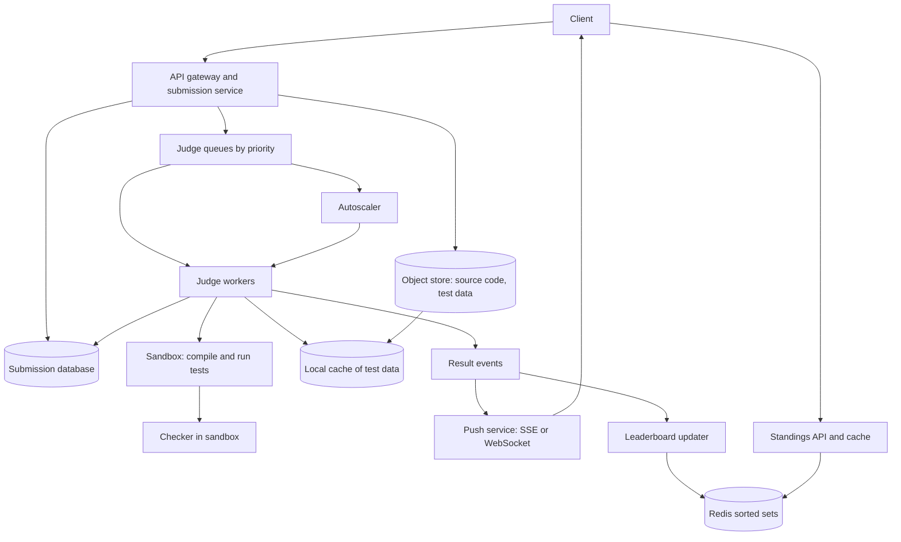

# Design an Online Code Judge

An online code judge accepts source code from users, compiles and runs it against hidden test cases, and returns a verdict (accepted, wrong answer, time limit exceeded, and so on). LeetCode, Codeforces, and HackerRank work this way. The system runs code that strangers wrote, and some of that code is hostile on purpose. So the problem is mainly one of isolation and of fair resource accounting, and only second one of scale. This page gives the design that a strong candidate presents in 45 minutes: a submission queue, a pool of judge workers that run each submission in a sandbox, a verdict store, and a contest layer with a live leaderboard.

!!! note "About the sources"
    The sandbox facts come from the documentation of the Linux kernel (control groups version 2), of gVisor, of Firecracker (including its NSDI 2020 paper), and of Judge0 and its sandbox, isolate. The sizes and rates are assumptions for a contest platform with 50,000 participants, and each is labeled. Judge0's configuration file and its hosted API documentation give different default limits, and each operator can change them (see deep dive 1). The statements about how LeetCode or Codeforces run their judges are not on this page, because those companies have not published their designs.

## Problem Statement

Design an online judge. A user opens a problem, writes a solution in one of several languages, and submits it. The system compiles the code, runs it against the problem's test cases with a time limit and a memory limit, compares the output with the expected output, and shows the verdict, the run time, and the memory use. The platform hosts contests: many users solve the same problems in a fixed time window, and a leaderboard ranks them in real time. The system must keep the platform safe from the code that it runs.

The interviewer tests four skills: the threat model for running untrusted code and the layers of the sandbox, the queue and worker design for jobs with unequal durations, the correctness of resource measurement (a fair time limit), and the contest load (a spike at the start and a leaderboard that many users read).

## Clarifying Questions

Ask these in the first 5 minutes. Each row gives the answer that this design assumes.

| Question | Assumed answer |
|---|---|
| Which languages? | C++, Java, Python, Go, and JavaScript. Compiled and interpreted languages. Adding a language must be a configuration change |
| What is the scale? | A contest with 50,000 participants over 2 hours, about 8 submissions each. Practice traffic of 3 million submissions each day (Assumption) |
| Which limits? | Per test: 2 seconds of CPU time, 5 seconds of wall time, 256 MB of memory. Compile: 10 seconds. Each problem can set its own limits. Output at most 64 KB |
| How many tests for each problem? | About 20 to 30, from 1 KB to a few MB each. The tests are hidden from the user |
| How do we compare outputs? | Exact match after trimming trailing whitespace, a token-by-token compare, or a checker program for problems with several valid answers. The checker runs in a sandbox too |
| Is the verdict immediate? | The user waits for the result. The target is a verdict within 10 seconds for most submissions at p95, even at the contest peak |
| Is there a "run with my own input" button? | Yes. It has a lower priority than submissions in a contest |
| How is a contest scored? | ICPC style: rank by the number of problems solved, then by the penalty time. Each accepted problem adds its solve minute plus 20 minutes for each earlier wrong attempt. A compile error has no penalty (Assumption. Each contest publishes its own rules: the CERC 2025 rules give no penalty for a compilation error, and some other contests count it as a rejected run) |
| What is the threat model? | The user is hostile. The code can loop, allocate without limit, fork, open sockets, read files, call dangerous system calls, and try to read the test data or the answers |
| Is cheating (plagiarism) in scope? | Out of scope. The page notes where a similarity check attaches |
| Regions? | One region for judging. A second region for failover. The judge needs low latency to the user less than it needs stable timing |

## Requirements

### Functional

1. A user submits source code for a problem in a language. The service stores it and returns a submission ID.
2. The system compiles the code, and for each test runs it in a sandbox with the limits, and compares the output.
3. The system returns a verdict: `AC` (accepted), `WA` (wrong answer), `TLE` (time limit exceeded), `MLE` (memory limit exceeded), `RE` (runtime error), `CE` (compilation error), `OLE` (output limit exceeded), or `IE` (internal error), with the time and memory of the run.
4. The user sees the status change (`QUEUED`, `COMPILING`, `RUNNING`, final verdict) without reloading.
5. A contest has a start and an end, a problem set, and a live leaderboard. The leaderboard may freeze in the last hour (Assumption: the ICPC style. The CERC 2025 rules, for example, freeze the ranking during the last hour).
6. Operators can rejudge a submission, a problem, or a whole contest after a fix to a test or a checker.
7. A user can run the code on custom input, without a verdict.

### Non-functional

| Requirement | Target |
|---|---|
| Isolation | Submitted code cannot read another submission, a test answer, or the host. It cannot use the network. It cannot affect the timing of other submissions |
| Verdict latency | p95 under 10 seconds at the contest peak. p99 under 30 seconds |
| Throughput | 278 submissions each second at the contest peak (Assumption: 5 times the average) |
| Fair timing | The same correct program gets the same verdict on any worker. Run time measured to 10 ms |
| Durability | A submission that the API accepted is never lost. It reaches a final verdict or `IE` |
| Availability | Submission and status 99.9%. A judge worker can fail at any time without losing a submission |
| Scoreboard freshness | At most 5 seconds old. A frozen board does not change until the unfreeze |
| Cost control | The judge fleet scales with the queue. Idle workers outside a contest are few |

## Estimation

Assumptions: 50,000 participants, 8 submissions each, over a contest of 7,200 seconds. The peak is 5 times the average (the start and the last 15 minutes are the busiest). A submission uses 2 seconds to compile, 20 tests of 0.3 seconds each, and 1 second of overhead (fetch, copy, compare, write the result): 9 seconds of sandbox time. One judge slot is one CPU core. A judge host has 64 cores, and 48 of them are judge slots (the rest serve the operating system, the sandbox manager, and the network). The platform has 1 million active users and 3 million practice submissions each day. A source file is 3 KB and a result record is 2 KB. A scoreboard page of 50 rows is 5 KB.

| Step | Calculation | Result |
|---|---|---|
| Submissions in the contest | 50,000 × 8 | 400,000 |
| Average rate | 400,000 / 7,200 s | 56 each second |
| Peak rate | 56 × 5 | 278 each second |
| Sandbox time of one submission | 2 + 20 × 0.3 + 1 | 9 seconds |
| Busy cores at the peak (Little's law: concurrency = rate × time) | 278 × 9 | 2,500 |
| Hosts | 2,500 / 48 | 53 |
| Hosts with 30% headroom | 53 × 1.3 | 69 |
| Open result streams | 278 each second × 15 s of wait | About 4,200 |
| Startup cost if each test got its own microVM | 20 tests × 125 ms | 2.5 seconds for each submission |
| Practice rate at its peak | 3,000,000 / 10^5 s × 3 | 90 each second |
| Test data to cache on one worker for a contest | 10 problems × 30 tests × 0.5 MB | 150 MB |
| Contest record storage | 400,000 × (3 KB + 2 KB) | 2 GB |
| Practice record storage | 3,000,000 × 5 KB | 15 GB each day, 5.5 TB each year |
| Scoreboard reads | 50,000 viewers / 10 s refresh | 5,000 each second |
| Scoreboard bandwidth | 5,000 × 5 KB × 8 bits | 200 Mbit/s |

What the numbers decide:

- **The cost is CPU time in sandboxes.** 2,500 busy cores at the peak is about 69 hosts. Storage and bandwidth are small by comparison. Judging is a compute-capacity problem with a spike, so the design must scale workers by the queue depth and must pre-scale before a contest.
- **Little's law sets the fleet size.** 278 submissions each second, each using 9 sandbox seconds, keep 2,500 cores busy. If the fleet is smaller, the queue grows without limit, and the verdict latency grows with it. The number to monitor is the queue wait, not the CPU use.
- **The sandbox must start once for each submission, not once for each test.** If every test used a new 125 ms microVM, the start cost would be 2.5 seconds, which is 28% of the 9 seconds. Run all tests of a submission in one sandbox and reset the working directory between tests. (The 125 ms boot time is the Firecracker specification's figure, with a minimal kernel and root file system.)
- **Reads are small, and a cache serves them.** 200 Mbit/s for the scoreboard comes from a cache with a TTL of a few seconds, not from the database.
- **The practice peak (90 each second) is below the contest peak (278).** The fleet that is sized for a contest handles the practice traffic. The contest has the higher priority when both run.

The program checks the arithmetic, then it shows the verdict rules from the limits, and then it builds a contest scoreboard with the ICPC rules and a single numeric key, which is what a Redis sorted set stores.

```java
import java.util.ArrayList;
import java.util.Comparator;
import java.util.HashMap;
import java.util.HashSet;
import java.util.List;
import java.util.Locale;
import java.util.Map;
import java.util.Set;

public class JudgeCheck {
    public static void main(String[] args) {
        capacity();
        verdicts();
        scoreboard();
    }

    static void capacity() {
        System.out.println("== Capacity ==");
        double submissions = 50_000 * 8;
        double seconds = 7_200;
        double avg = submissions / seconds;
        double peak = avg * 5;
        double sandboxSeconds = 2 + 20 * 0.3 + 1;
        double cores = peak * sandboxSeconds;
        double hosts = Math.ceil(cores / 48);
        p("submissions in the contest", submissions);
        p("average per second", avg);
        p("peak per second (x5)", peak);
        p("sandbox seconds per submission", sandboxSeconds);
        p("busy cores at the peak (Little's law)", cores);
        p("hosts at 48 judge slots each", hosts);
        p("hosts with 30% headroom", Math.ceil(hosts * 1.3));
        p("open result streams (15 s wait each)", peak * 15);
        p("per-test sandbox start cost at 125 ms, 20 tests (s)", 20 * 0.125);
        p("contest data to cache per worker, MB", 10 * 30 * 0.5);
        p("practice submissions per second, peak", 3_000_000 / 1e5 * 3);
        p("scoreboard bandwidth, Mbit/s (5,000 reads, 5 KB)", 5_000 * 5_000 * 8 / 1e6);
    }

    static String verdict(int exit, int signal, double cpuMs, double wallMs, double memKb,
                          boolean oom, boolean outputOk) {
        if (oom || memKb > 262_144) return "MLE";
        if (cpuMs > 2_000 || wallMs > 5_000) return "TLE";
        if (signal != 0) return "RE(signal " + signal + ")";
        if (exit != 0) return "RE(exit " + exit + ")";
        return outputOk ? "AC" : "WA";
    }

    static void verdicts() {
        System.out.println("== Verdicts ==");
        System.out.println(verdict(0, 0, 120, 150, 20_000, false, true));
        System.out.println(verdict(0, 0, 120, 150, 20_000, false, false));
        System.out.println(verdict(0, 0, 100, 6_000, 20_000, false, true));
        System.out.println(verdict(0, 0, 2_500, 2_600, 20_000, false, true));
        System.out.println(verdict(0, 9, 300, 320, 262_000, true, false));
        System.out.println(verdict(0, 11, 50, 60, 10_000, false, false));
        System.out.println(verdict(1, 0, 50, 60, 10_000, false, false));
    }

    record Sub(String team, String problem, int minute, boolean accepted) {}

    static long key(int solved, int penalty) {
        return solved * 1_000_000L - penalty;
    }

    static void scoreboard() {
        System.out.println("== Scoreboard ==");
        List<Sub> subs = List.of(
            new Sub("alpha", "A", 10, false), new Sub("alpha", "A", 25, true),
            new Sub("alpha", "B", 60, true),
            new Sub("beta", "A", 5, true), new Sub("beta", "B", 30, false),
            new Sub("beta", "B", 90, true), new Sub("beta", "C", 100, true),
            new Sub("gamma", "A", 8, true), new Sub("gamma", "B", 40, true),
            new Sub("gamma", "A", 50, false), new Sub("gamma", "C", 70, false));
        Map<String, Integer> solved = new HashMap<>();
        Map<String, Integer> penalty = new HashMap<>();
        Map<String, Integer> wrong = new HashMap<>();
        Set<String> done = new HashSet<>();
        for (Sub s : subs) {
            solved.putIfAbsent(s.team(), 0);
            penalty.putIfAbsent(s.team(), 0);
            String k = s.team() + "/" + s.problem();
            if (done.contains(k)) continue;
            if (s.accepted()) {
                done.add(k);
                solved.merge(s.team(), 1, Integer::sum);
                penalty.merge(s.team(), s.minute() + 20 * wrong.getOrDefault(k, 0), Integer::sum);
            } else {
                wrong.merge(k, 1, Integer::sum);
            }
        }
        List<String> teams = new ArrayList<>(solved.keySet());
        Comparator<String> byKey =
            Comparator.comparingLong(t -> key(solved.get(t), penalty.get(t)));
        teams.sort(byKey.reversed().thenComparing(Comparator.naturalOrder()));
        int rank = 1;
        for (String t : teams) {
            System.out.println(rank++ + " " + t + " solved=" + solved.get(t)
                + " penalty=" + penalty.get(t) + " key=" + key(solved.get(t), penalty.get(t)));
        }
    }

    static void p(String label, double v) {
        System.out.println(String.format(Locale.ROOT, "%-52s %,.2f", label, v));
    }
}
```

<!-- expected-output -->
```text
== Capacity ==
submissions in the contest                           400,000.00
average per second                                   55.56
peak per second (x5)                                 277.78
sandbox seconds per submission                       9.00
busy cores at the peak (Little's law)                2,500.00
hosts at 48 judge slots each                         53.00
hosts with 30% headroom                              69.00
open result streams (15 s wait each)                 4,166.67
per-test sandbox start cost at 125 ms, 20 tests (s)  2.50
contest data to cache per worker, MB                 150.00
practice submissions per second, peak                90.00
scoreboard bandwidth, Mbit/s (5,000 reads, 5 KB)     200.00
== Verdicts ==
AC
WA
TLE
TLE
MLE
RE(signal 11)
RE(exit 1)
== Scoreboard ==
1 beta solved=3 penalty=215 key=2999785
2 gamma solved=2 penalty=48 key=1999952
3 alpha solved=2 penalty=105 key=1999895
```

The verdict function shows the order of the checks. Memory and time are checked first, because a killed program also has a non-zero exit status, and the verdict must name the resource. The program that the kernel killed with signal 9 (`SIGKILL`) after it hit the memory limit is `MLE`, not `RE`. In the scoreboard, `beta` solved 3 problems with 215 penalty minutes: A at minute 5, B at minute 90 plus 20 for one earlier wrong attempt (110), and C at minute 100. The key `solved × 1,000,000 − penalty` makes a higher key a better rank, so one `ZADD` per update keeps the board ordered. The demo sorts a list of teams with a comparator, so two teams with the same key both stay on the board. (A map keyed by the score would keep only one of them.)

## API Design

#### `POST /v1/submissions`

Request: `{ "problemId", "language", "sourceCode", "contestId" (optional) }`, `Idempotency-Key` header. Response `202`: `{ "submissionId", "status": "QUEUED" }`. The call returns after the source code and a `QUEUED` row are stored and the job is in the queue. A rate limit applies for each user (for example one submission each 5 seconds in a contest; see [rate limiting algorithms](../fundamentals/13-rate-limiting-algorithms.md)), and the limit returns `429` with `Retry-After`. The source is limited to 64 KB (`413` above that).

#### `GET /v1/submissions/{submissionId}`

Response `200`: `{ "status": "QUEUED|COMPILING|RUNNING|DONE", "verdict", "timeMs", "memoryKb", "failedTest" (index only), "compileOutput" (truncated), "tests": [...] }`. For a hidden test the response gives the verdict and the index, never the input or the expected output. A user sees only the first failing test, in the contest style (Assumption).

#### `GET /v1/submissions/{submissionId}/events`

A Server-Sent Events stream of status changes, which ends at the final verdict (see [communication patterns](../fundamentals/09-communication-patterns.md)). A client that cannot use SSE polls `GET /v1/submissions/{id}` with an interval that grows (2, 4, then 8 seconds).

#### `POST /v1/runs`

Request: `{ "language", "sourceCode", "stdin" }`. Response `202` with `{ "runId" }`. A run uses the same sandbox, a smaller limit (for example 5 seconds in total), and a lower queue priority. `GET /v1/runs/{runId}` returns the output (truncated to 64 KB).

#### `GET /v1/problems/{problemId}`

Response `200`: the statement (Markdown), the limits, the examples, and the supported languages. A CDN caches it. In a contest, the statements become visible at the start time, and the CDN honors the start time with a short TTL.

#### `GET /v1/contests/{contestId}/standings?cursor=&limit=50`

Response `200`: rows `{ "rank", "user", "solved", "penalty", "problems": [{ "id", "state", "minute", "attempts" }] }`, `frozen` (boolean), and `asOf`. Cacheable for 5 seconds.

#### `POST /internal/submissions/{submissionId}:rejudge`

Starts a new judging attempt (admin only). Bulk forms exist for a problem and for a contest.

#### Judge0's API, for comparison

Judge0, an open-source judge, has `POST /submissions` that returns a token and puts the submission in a queue, `GET /submissions/{token}` for the result, a `callback_url` that Judge0 calls with `PUT` when the submission finishes, and status IDs (1 In Queue, 2 Processing, 3 Accepted, 4 Wrong Answer, 5 Time Limit Exceeded, 6 Compilation Error, 7 to 10 runtime errors by signal (SIGSEGV, SIGXFSZ, SIGFPE, SIGABRT), 11 runtime error by a non-zero exit code (NZEC), 12 other runtime error, 13 Internal Error, 14 Exec Format Error). Its documentation says "We do not recommend the use of wait=true feature because it does not scale well", which matches this design: the call returns at once, and the result comes later by stream, poll, or callback.

## Data Model

| Data | Needs | Store |
|---|---|---|
| Submissions (metadata and verdict) | One row for each submission. Many reads of recent rows for each user and contest. Single-row state changes | A relational database (PostgreSQL), partitioned by time and by contest |
| Source code | 3 KB average, immutable | In the same row if small, or in object storage by content hash. Kept for later rejudge |
| Test data (inputs, expected outputs, checkers) | Large, immutable per version, read by many workers | Object storage. Versioned by content hash. Cached on workers |
| Judge queue | Durable. Visibility timeout. Priorities. Redelivery on worker failure | A message queue (SQS or RabbitMQ style), several queues by priority |
| Problems, contests, users | Small. Read-heavy | A relational database and a cache |
| Leaderboard | Ranked reads. Frequent score updates | Redis sorted set for each contest, rebuilt from the database |
| Result stream | Short-lived status events | Redis pub/sub or a stream, with the database as the source of truth |
| Judge logs and outputs | Debugging. Truncated | Object storage with a retention of 30 days |

### Tables

`submission`: `(submission_id PK, user_id, problem_id, contest_id, language, source_blob_key, source_sha256, state, attempt, verdict, time_ms, memory_kb, failed_test, compile_output, judged_by, created_at, judged_at)`. Indexes: `(user_id, created_at DESC)`, `(contest_id, created_at)`, `(problem_id, verdict)`. The `state` is `QUEUED`, `JUDGING`, or `DONE`. The `attempt` number increases at each rejudge.

`test_result`: `(submission_id, attempt, test_index, verdict, time_ms, memory_kb)`. A compact JSON column in `submission` is enough if the system does not query individual tests.

`problem`: `(problem_id, statement_key, time_limit_ms, memory_limit_kb, checker_type, test_version)`. `test_version` is the content hash of the test bundle. A change to a test creates a new version, so a worker cache never serves stale tests.

`contest`, `contest_problem`, `contest_participant`: the usual fields, plus the `frozen_at` time.

`scoreboard_entry`: `(contest_id, user_id, solved, penalty_min, last_solve_min)` and `problem_state(contest_id, user_id, problem_id, wrong_attempts, accepted_at_min)`. These tables are derived from `submission`, so the system can rebuild the leaderboard from them.

### Database choice

The data is relational and modest: 5.5 TB each year of practice records, and the access paths are by user, by contest, and by ID. The state change of one submission needs a conditional update (`WHERE state = 'JUDGING' AND attempt = ?`), which a relational database gives (see [choosing a database](../fundamentals/04-choosing-a-database.md)). Partition by month to keep recent data small and old data easy to archive. The hot data of a contest (400,000 rows) is small enough for one primary with read replicas.

## High-Level Design



### Components

- **API gateway and submission service.** Authenticates the user, applies the rate limit, validates the size and the language, stores the source code, inserts the `QUEUED` row, and enqueues the job in one flow (the outbox pattern in [message queues and streams](../fundamentals/08-message-queues-and-streams.md) keeps the row and the message consistent). It returns `202`.
- **Judge queues.** Separate queues (or priorities) for contest submissions, practice submissions, custom runs, and rejudges. Workers take from the contest queue first. A message is delivered to one worker with a visibility timeout, and it returns to the queue if the worker does not finish.
- **Judge workers.** Hosts with 48 judge slots each. A worker pulls a job when it has a free slot (pull, not push, so a slow worker takes fewer jobs). It fetches the source, makes sure the test bundle is in the local cache, runs the job in a sandbox, and writes the result.
- **Sandbox.** One isolated environment for each submission, with limits, no network, and a read-only language runtime. It runs the compile step and then the tests (deep dive 1).
- **Checker.** For problems with several valid answers, a trusted checker program compares the output with the expected output. It also runs in a sandbox, because the problem setter's code is also not fully trusted.
- **Test data cache.** A local disk cache on each worker, keyed by the content hash of the test bundle. A contest pre-loads its problems onto the workers before the start.
- **Result events and push service.** The worker publishes status events (`COMPILING`, `RUNNING`, `DONE`). The push service sends them to the clients' SSE streams.
- **Leaderboard updater.** Consumes `DONE` events of contest submissions, updates the scoreboard state and the Redis sorted set (deep dive 4).
- **Autoscaler.** Adds workers when the queue wait grows, and pre-scales before a contest (deep dive 3).

### Flow: one submission

1. The user submits. The service stores the source, inserts the row (`QUEUED`), and puts a job in the contest queue. It answers `202`.
2. A worker with a free slot receives the job. It sets the row to `JUDGING` with a conditional update, and it records its ID and the attempt number.
3. The worker prepares a sandbox, copies the source in, and compiles with a compile limit. If the compile fails, the verdict is `CE`, and the worker stops.
4. For each test, the worker runs the program with the test input, measures the CPU time, the wall time, and the peak memory, and captures the output with the output limit.
5. It compares the output (directly or with the checker). At the first failing test, it stops (ICPC style) and records the verdict and the test index. If all pass, the verdict is `AC` with the maximum time and memory.
6. The worker destroys the sandbox. It writes the final state with a conditional update (`WHERE state = 'JUDGING' AND attempt = ?`), and publishes the `DONE` event. It acknowledges the queue message.
7. The push service tells the client. The leaderboard updater applies the result to the contest.

## Deep Dives

### Deep dive 1: The sandbox

**The threat model.** The code is written by the user, and some users are hostile. The attacks, in the order a judge must expect them:

| Attack | Example | Defense |
|---|---|---|
| CPU exhaustion | An infinite loop | A CPU-time limit that kills the process (`RLIMIT_CPU`, or a supervisor that reads the cgroup's `cpu.stat`), plus a wall-clock limit |
| Memory exhaustion | Allocate until the host swaps | A hard memory limit with the kernel's out-of-memory kill inside the sandbox |
| Process exhaustion | A fork bomb | A limit on the number of processes |
| Disk exhaustion | Write a huge file | A limit on file size, a small writable temporary file system |
| Output flood | Print gigabytes | Capture at most 64 KB and kill the program above that |
| Network use | Send the test data out, attack other hosts | No network namespace, no interfaces |
| Reading secrets | Read the expected output, other submissions, the host's keys | A private root file system with only the runtime, no test files visible to the program |
| System call abuse | A kernel bug exploited through a rare call | A filter on system calls, and a layer between the program and the real kernel |
| Timing side channel | Measure the cache to infer the neighbor | Pin each submission to its own cores, and do not run submissions of different users at the same time on shared cores |
| Escape to the host | A kernel or runtime vulnerability | A strong boundary: a user-space kernel or a virtual machine, not a plain container alone |

**Layer 1: Linux primitives.** Process isolation on Linux uses these kernel features, and a judge such as Judge0 relies on a sandbox (isolate) that uses them (isolate's documentation says it takes advantage of namespaces and control groups, and it started in the Moe Contest Environment and is used by contest systems such as CMS).

- **Namespaces.** Separate views of process IDs, the mount table, the network, inter-process communication, host names, and user IDs. The program sees only its own processes and its own file system, and an empty network namespace has no route out.
- **Control groups version 2 (cgroups).** Limits and accounting for a group of processes. The kernel documentation defines `memory.max` (the hard limit: if usage reaches it and cannot be reduced, the out-of-memory killer runs in the group), `memory.high` (a throttle, with no kill, so it is not a limit for a judge), `cpu.max` (the form `$MAX $PERIOD`: the group may use up to `$MAX` in each `$PERIOD`. It throttles the group and never kills it, so it keeps a submission inside its share of a core, and it does not enforce the time limit), `pids.max` (a hard limit on the number of processes), `memory.swap.max` (set to 0 so a program cannot hide behind swap), `io.max`, and the `cpuset` controller to pin the group to given cores. The counters give the measured numbers: `memory.peak` for the maximum memory (Linux 5.19 and later), `memory.events` with `oom_kill` for the verdict, and `cpu.stat` with `usage_usec` for the CPU time.
- **Resource limits and a changed identity.** `rlimit` values for CPU time, file size, stack, and the number of processes. At the soft `RLIMIT_CPU` limit the kernel sends `SIGXCPU`, and at the hard limit it sends `SIGKILL`, so this limit kills a busy loop. The program runs as an unprivileged user with all capabilities dropped and with `no_new_privs` set.
- **seccomp-bpf.** A filter loaded in the process that decides for each system call whether to allow it, deny it with an error, or kill the process. A judge uses an allowlist for each language: a C++ program needs few system calls (read, write, mmap, exit and a handful more), while a Java program needs more (threads, futex, and others). The filter cuts the kernel's attack surface for this program. It is a reduction and not a barrier: a bug in an allowed system call is still a bug in the host kernel.

**Layer 2: a stronger boundary.** A container is a process group with namespaces and cgroups, and it shares the host kernel. The attack surface is the kernel's system call interface. For a platform where any user can send code, a second boundary is worth its cost. Two options, both documented:

| Option | How it works | Benefit | Cost |
|---|---|---|---|
| gVisor (`runsc`) | The Sentry, "a Go-based, from-scratch reimplementation of the Linux system call interface" (gVisor's documentation), handles the program's system calls in user space. The documentation states that gVisor never passes a system call of the program through to the host. The Sentry itself runs with a restricted set of host system calls. A Gofer process serves file access. `runsc` is an OCI-compliant runtime, so Docker and Kubernetes can start it. Two platforms intercept calls: systrap (the default, uses seccomp, needs no virtualization support) and KVM (needs virtualization) | The program does not talk to the host kernel directly. Starts like a container. Works inside a cloud VM without nested virtualization (systrap) | Each system call costs more than in a plain container. If a Linux feature is not reimplemented in gVisor, the program cannot use it, so compatibility must be tested for each language runtime |
| Firecracker microVM | A virtual machine monitor on top of KVM with a small device model (VirtIO network and block devices, vsock, a serial console, and a partial keyboard controller). Each microVM has its own guest kernel. The Firecracker documentation states that the process is itself confined: a `jailer` sets up cgroups and a chroot and drops privileges, and seccomp filters limit the host system calls that Firecracker can use | The strongest boundary here: hardware virtualization plus a confined VMM. The specification states a boot time of at most 125 ms (with a minimal kernel and root file system) and a memory overhead of at most 5 MiB for a 1-vCPU, 128 MiB microVM. The NSDI 2020 paper reports up to 150 microVMs created each second on one host | Needs KVM (bare metal or a cloud instance with nested virtualization). A guest kernel to maintain. A start cost that matters if it repeats for every test |

Recommendation: layer the two levels. The inner level is a per-submission sandbox with namespaces, cgroups, rlimits, and seccomp (isolate-style, which is what Judge0 uses). The outer level is a gVisor sandbox or a microVM that holds the worker's sandboxes, or one microVM for each submission. The choice between gVisor and a microVM depends on the infrastructure: a fleet on bare metal can use Firecracker, and a fleet on ordinary cloud VMs without nested virtualization uses gVisor with the systrap platform. Say in the interview what each costs. A plain container alone is a trade of cost for risk, and the interviewer wants to hear that the risk is the shared kernel.

**One sandbox for each submission, destroyed after.** The sandbox is created fresh from a read-only image (the language runtime), the code runs, and the whole thing is deleted. No state passes from one submission to the next, so a program that planted a file or a process cannot affect the next user. The sandbox runs all tests of one submission, with the working directory cleaned between tests, because a start for each test would cost 2.5 seconds in the estimate. Warm pools help: a worker keeps a few ready sandboxes (a restored snapshot, or a started empty container) so a submission does not wait for the creation.

**Test data must not be visible.** The worker copies the input of one test into the sandbox just before the run, and removes it after. The expected output stays outside the sandbox: the worker compares the captured output with it. A checker runs in a second sandbox with the input, the output, and the answer, and it returns a verdict. The user program never sees the answer file.

**Measuring time and memory.** The time limit applies to CPU time (the sum of user and system time from the cgroup's `cpu.stat` or from `rusage`). The supervisor kills the program when the CPU time crosses the limit (`RLIMIT_CPU`, or a poll of `cpu.stat`). A separate wall-clock limit catches a program that sleeps or blocks, because its CPU time does not grow. Judge0 works the same way. Its API documentation defines the wall limit as the time from the start of the program to its exit, and it recommends the CPU limit as the main limit, with a much higher wall limit "as a precaution against sleeping programs". The defaults differ by source. Judge0's configuration file `judge0.conf` gives 5 seconds of CPU time, 10 seconds of wall time, and 128,000 KB of memory (version 1.8.0 raised the CPU and wall defaults to these values). The configuration example in the hosted API documentation shows 2 and 5 seconds. Judge0's memory limit caps the address space of the program, which is a different measure from the cgroup memory that this design uses. Memory is the peak of the cgroup (`memory.peak`), not the size reported by the program, and the memory limit is `memory.max`, so the kernel itself stops a program that crosses it. If `memory.events` shows an `oom_kill`, the verdict is `MLE`.

**Fair timing.** The same program must get the same verdict on any worker, so the worker controls the noise:

1. Pin each submission to its own physical core with a `cpuset`, and do not put two submissions on the two hyper-threads of one core.
2. Keep the host's frequency policy fixed, and do not oversubscribe cores.
3. Measure CPU time, not wall time, for the main limit.
4. Give the language a multiplier where the platform's rules say so (a Java or Python program has a start cost that a C++ program does not have). Each problem has its limits for each language, or a global multiplier (Assumption).
5. For a result close to the limit (above 90% of it), judge again on a different worker, and take the lower measurement (Recommendation, with the cost of one more run for a small share of submissions).
6. Warm up the JVM's start cost out of the measurement by measuring user code time, or give the Java time limit an allowance. This is a policy that the platform states to its users.

**Compilation is also untrusted.** A compiler can be abused with template recursion, or include directives that read files. The compile step runs in the same sandbox, with its own limits (10 seconds, 512 MB, an output limit on the diagnostics), and no network. A compile bomb returns `CE` or `TLE`.

**Output flood and special cases.** The worker reads the output through a pipe and stops at 64 KB (verdict `OLE`). A program that closes standard input early, or reads more than the input, gets `RE` or `WA`. A program that prints a huge number of small lines costs wall time, which the wall limit bounds.

### Deep dive 2: The queue, the workers, and exactly-once-ish judging

**Why a queue, and which kind.** Judging jobs vary in duration (from 100 ms to 15 seconds). A log with fixed partitions (Kafka) lets one slow job delay the jobs behind it in the same partition (head-of-line blocking), and it assigns a partition to one consumer. A work queue with a visibility timeout (SQS or RabbitMQ style) hands each job to any free worker and redelivers a job whose worker disappeared. That fits long, uneven jobs (see [message queues and streams](../fundamentals/08-message-queues-and-streams.md)).

**Priorities.** Four queues: `contest`, `practice`, `run` (custom input), and `rejudge`. Workers poll in this order, with a minimum share for the lower queues, so that no queue starves. A rejudge of a whole contest (400,000 jobs) runs at the lowest priority, or it would block live users.

**Pull and capacity.** A worker pulls a job only when it has a free slot. This is back pressure by design: if workers are slow, jobs wait in the queue, and the queue depth is the signal for the autoscaler. A push design would need the scheduler to track each worker's load. A worker that holds a job extends the visibility timeout while it runs (a heartbeat). If the worker dies, the heartbeat stops, the timeout ends, and the queue gives the job to another worker.

**Idempotence and fencing.** A job can run twice: a slow worker that looks dead, and a second worker that takes the job. Both could write a verdict. The design defends with two rules. First, a worker takes ownership with a conditional update `UPDATE submission SET state = 'JUDGING', judged_by = ?, attempt = attempt + 1 WHERE submission_id = ? AND state IN ('QUEUED', 'JUDGING') RETURNING attempt`. The returned attempt number is a fencing token. Second, the final write says `WHERE submission_id = ? AND attempt = ?`, so the older worker's write changes zero rows and is dropped (the same idea as the fencing token in [distributed locks and leases](../distributed-systems/05-distributed-locks-and-leases.md)). Judging is deterministic enough that a repeat run gives the same verdict, so a duplicate run wastes CPU and cannot corrupt the result.

**Poison submissions.** A submission that crashes the worker (a sandbox escape attempt, a bug in the runtime) would crash each worker that takes it. The queue counts deliveries. After 3 deliveries, the job moves to a dead-letter queue, the verdict is `IE`, and an operator looks at it (see the dead-letter section in [message queues and streams](../fundamentals/08-message-queues-and-streams.md)). The worker also isolates the damage: it runs the sandbox as a child, and a crash of the sandbox does not crash the worker's agent.

**Test data distribution.** A worker that starts a job checks its cache for the problem's `test_version`. A miss downloads the bundle from the object store and stores it on local disk (an LRU cache with a size limit). Before a contest, a pre-warm step sends the contest's problem list to every worker, so the first submissions find the data in the cache. A new `test_version` has a different key, so the cache cannot serve stale data.

**Autoscaling.** A pull system scales on queue wait time and queue depth. The rule: if the p95 wait in the contest queue exceeds 5 seconds, add hosts. A host takes minutes to start, so reaction alone is late for a contest. Pre-scale by the schedule: the contest's registration count and the estimate in this page give the fleet size, and the fleet is ready 15 minutes before the start. Scale in after the contest, and drain: a worker stops pulling, finishes its jobs, and exits (see [reliability patterns](../fundamentals/12-reliability-patterns.md)).

**What if the fleet is too small?** The queue grows and the verdict latency grows. The contest queue has a maximum age. Above a threshold, the system shows users "judging is delayed" on the contest page, and it slows the intake by the per-user rate limit. Judge0 shows the same idea in its API: it has a `max_queue_size` setting, and when the queue is full the API returns `503` with "queue is full" (from its documentation). A fast refusal is better than an unbounded wait.

### Deep dive 3: Contests: the spike, results, and fairness

**The spike.** A contest starts at one second for all participants. The traffic has three peaks: the problem statements at the start (read traffic), the first submissions in the first 10 minutes (easy problems), and the last 15 minutes (all remaining attempts). The statements are static and cacheable: publish them to the CDN at the start time (the object has a start time, and the CDN's TTL is 1 second near the start, so users do not see a statement early or late). The submissions peak is the 278 each second in the estimate. Pre-scale for it.

**Fairness.** Participants in one contest must get the same judge conditions. All contest submissions use the same queue and priority, so a user with more submissions does not crowd out the others (per-user rate limit: one submission every 5 seconds in the assumption, and a maximum number of pending submissions for each user, for example 3). Time limits are fixed for the contest. The scoring time of a submission is the time of the submission (the `created_at` time), not the time the verdict arrives, so a slow queue does not cost a user penalty minutes. This rule is the important one: the penalty uses the submission minute.

**Rejudge.** A wrong test or a bad checker makes the verdicts wrong, and the operator fixes it and rejudges. A rejudge creates a new `attempt` for each affected submission at low priority. The new verdict replaces the old one, the scoreboard is recomputed from the database (deep dive 4), and the change is logged. The `test_version` of the problem changes, and each result keeps the version it used.

**Plagiarism and cheating.** Out of scope. Attach a similarity check to the `DONE` event stream for contest submissions, as an offline consumer. It does not run in the judging path.

**Freeze.** In the last hour, the public scoreboard stops updating (ICPC style). The submissions are still judged, and users see their own verdicts. The leaderboard updater keeps updating the true standings in a separate sorted set, and the public standings read a snapshot set. At the end, the operator unfreezes and the public set copies the true set.

### Deep dive 4: The leaderboard

The ranking problem is the one in [Design a Leaderboard and Top-K System](16-leaderboard-and-top-k.md). This page covers what is specific to a contest.

**The score.** An ICPC rank orders by the number of solved problems (more is better), then by the total penalty (less is better). The penalty is the sum of the solve minutes plus 20 minutes for each wrong attempt before the solve of that problem. Compile errors do not count, and wrong attempts on a problem that the team never solves do not count. A sorted set stores one number for each member, so the design encodes the two criteria in one number: `key = solved × 1,000,000 − penalty`. A higher key is a better rank. The values are exact in the 64-bit floating-point score of a Redis sorted set (integers up to 2^53 are exact), and the key stays below 2^53 as long as the penalty stays below 1,000,000 minutes. A second tie-break (the time of the last solve) can go into the lower digits in the same way.

**The update path.** The leaderboard updater consumes the `DONE` events of contest submissions in order for each participant (partition the event stream by `user_id`). For an `AC` of a problem that the user has not yet solved: add the solve minute and the wrong attempts' penalty, increment `solved`, and write the new key with `ZADD contest:{id}:board key user`. For a `WA`, `TLE`, `MLE`, or `RE` of an unsolved problem: increment the wrong-attempt count for that problem (the penalty applies only when the problem is solved later). A `CE` and an `IE` do not count. An `AC` for a solved problem is ignored. The state per user and problem lives in the database (`problem_state`), so the updater is idempotent: it computes the key from the database rows, and writes the key. A replayed event gives the same key.

**Reads.** `ZREVRANGE board 0 49 WITHSCORES` returns the top 50 with the scores (Redis 6.2 and later mark `ZREVRANGE` as deprecated in favor of `ZRANGE ... REV`, which does the same), and `ZREVRANK` gives the rank of one user, which is the "your rank" display. `ZREVRANGE` orders members with equal scores in descending order of member name, so a board that shows equal ranks for equal scores computes the shared rank from the score. 50,000 viewers that refresh every 10 seconds make 5,000 reads each second. The standings API caches the first pages for 5 seconds, so Redis sees a few reads each second for each page. The cache is the main read path. Push the page to the clients with the same SSE channel as the verdicts, or let them poll (see [communication patterns](../fundamentals/09-communication-patterns.md)).

**Durability and rebuild.** Redis holds a derived view. If it is lost, a job rebuilds each contest's sorted set from `problem_state` (a scan of 50,000 users). A rejudge recomputes `problem_state` for the changed submissions and rewrites the keys. The database is the source of truth.

**Other leaderboards.** A global ranking (rating, problems solved) is a different workload: more users, slower updates, and approximate rank is acceptable. The patterns in the [leaderboard page](16-leaderboard-and-top-k.md) apply there (sharded sorted sets, a periodic batch).

## Bottlenecks and Scaling

| What fails first | Symptom | Fix |
|---|---|---|
| Judge CPU at the contest start | The queue wait grows past 10 seconds | Pre-scale by schedule. Autoscale on queue wait. Rate limit users. Show "judging is delayed". Sandbox warm pools |
| Cold test data | The first submissions are slow | Pre-warm the contest's tests on all workers. Content-addressed cache |
| Sandbox creation time | A large share of the 9 seconds | One sandbox for each submission, not each test. Pre-created sandboxes. Snapshot restore |
| A noisy neighbor on a host | The same program gets different times | Pin submissions to dedicated cores. Do not oversubscribe. Re-judge near the limit |
| A slow or stuck job | A worker slot is held | A wall-time limit for each test, a total limit for the submission, and a watchdog that kills the sandbox |
| Queue and database writes | Write latency on `submission` | Partition by time. Keep writes to a few for each submission (a state change at the start and one at the end). Move the per-test detail into one JSON column |
| Compile load | Many large compiles | Cache compile results by the source hash, the language, and the compiler flags: the same three give the same result. A compile limit |
| The leaderboard reads | 5,000 reads each second | A cache with a TTL of 5 seconds. A snapshot for the frozen board. CDN for the public board |
| A hostile submission | Sandbox escape attempt, a host that goes bad | Layered isolation. A host that reports a sandbox violation is drained and rebuilt from the image. Workers have no credentials beyond the queue, the test cache, and the result write |
| A region fails | No judging | A second region with its own queue. Submissions are stored in the database that replicates across regions. The workers in the surviving region take the jobs |

**Operating the workers.** Treat a worker as disposable. Build it from an image, give it only the permissions to fetch tests, write results, and pull the queue, and rebuild it often. A compromised sandbox then reaches nothing of value. A worker that shows an unusual signal (an out-of-memory in the sandbox manager, a kernel warning) is removed from the pool.

## Trade-offs

| Decision | Chosen | Rejected | Why |
|---|---|---|---|
| Isolation | Layered: namespaces, cgroups, seccomp, plus gVisor or a microVM | A plain container only | A container shares the host kernel. A kernel bug is a host escape |
| Outer boundary | gVisor on ordinary cloud VMs, Firecracker on bare metal | One fixed choice for all | The choice depends on the cost of system calls, the need for nested virtualization, and the compatibility of the runtimes |
| Sandbox granularity | One for each submission, all tests inside | One for each test | A start for each test costs 2.5 seconds for 20 tests. One for each submission keeps isolation between users |
| Time limit | CPU time as the limit, wall time as a safety net | Wall time only | Wall time includes the noise of the host. CPU time is more stable. Wall time still catches a sleeping program |
| Queue | A work queue with a visibility timeout | A log with partitions | Jobs vary in length, and any free worker should take the next job. A log's partition blocks the jobs behind a slow one |
| Dispatch | Workers pull | A scheduler pushes | Pull gives back pressure and needs no load tracking. The queue depth drives autoscaling |
| Result consistency | A conditional write with an attempt number | Last write wins | A slow duplicate worker could overwrite a newer verdict. The attempt number is a fencing token |
| Verdict policy | Stop at the first failing test (ICPC style) | Run all tests | Saves the CPU time of the remaining tests for each wrong submission. Partial scoring needs all tests, so it is a per-problem setting |
| Test data | Content-addressed bundles on a local cache | Download for each job | Contest data is 150 MB. A cache with a version hash cannot go stale |
| Leaderboard | A Redis sorted set with a numeric key, rebuilt from the database | Query the database for each read | Rank queries on a sorted set are fast. The database stays the truth |
| Result delivery | SSE with a polling fallback | Long polling only | One stream for each pending submission is cheap (4,200 at the peak). Polling is the fallback |
| Penalty time | The submission time | The verdict time | Queue delay must not cost the user. The rule keeps the contest fair under load |

## Follow-up Questions

??? question "A user submits a fork bomb, an infinite loop, and a program that tries to open a socket. What stops each one?"

    Each attack meets a different control, and the answer lists them. The fork bomb hits `pids.max` in the cgroup (a hard limit on the number of processes) and the `RLIMIT_NPROC` value, so `fork` fails after the limit, and the wall-time limit then kills the group. The infinite loop uses CPU time, and the CPU-time limit kills it (`RLIMIT_CPU` sends `SIGXCPU` and then `SIGKILL`, or the supervisor reads the cgroup's `cpu.stat` and kills the group). The wall limit is the safety net. The verdict is `TLE`. Note that the cgroup's `cpu.max` only throttles, so it alone never ends the loop. The network attempt fails because the sandbox has an empty network namespace with no interface and no route, so a `connect` call returns an error. Seccomp can also deny the `socket` system call itself. The program gets an error, and the verdict is `RE` or `WA`.

    The deeper point: these controls limit the resources and the reach of the program, and a kernel bug could still let it out. That is why the design adds a second boundary, gVisor or a microVM, so that the program's system calls do not go to the host kernel directly. And the sandbox is destroyed after one submission, so nothing persists.

??? question "Why is a Docker container alone not enough to run untrusted code, and what would you add?"

    A container is a set of processes with namespaces, cgroups, and often a seccomp profile, and it shares the host kernel with every other container. Every system call the program makes goes to the host kernel. A bug in the kernel's handling of one of the allowed calls can give the program control of the host. Namespaces and cgroups limit what the program sees and uses. They do not remove the shared kernel from the attack surface.

    Two additions reduce that risk. gVisor runs a user-space kernel (the Sentry, written in Go) that handles the program's system calls, so the program reaches the host kernel only through the Sentry's much smaller set of calls. Its documentation also states the cost: system calls are slower, and a Linux feature that gVisor does not implement is not available to the program. A Firecracker microVM gives the program its own guest kernel in a hardware-virtualized machine, and Firecracker confines its own process with a jailer, cgroups, and seccomp. Its specification states a boot time of at most 125 ms and a memory overhead of at most 5 MiB for a small microVM. The cost is the need for KVM, and the start time if the microVM is created too often. The decision depends on the threat and the budget: a contest platform with prizes and public sign-up needs one of them.

??? question "How do you make the time measurement fair across workers, and what do you do for Java and Python?"

    Fairness means that the same program gets the same verdict on any worker at any load. The controls: measure CPU time from the cgroup or `rusage`, with a wall limit as a second guard. Pin each submission to its own physical core (a `cpuset`), and never put two untrusted programs on the two hyper-threads of one core. Do not run more judge slots than physical cores. Keep the host's frequency settings fixed. For a verdict near the limit (for example above 90%), run the test again on another worker and use the lower time.

    For managed runtimes, the start cost of the JVM or the interpreter is part of the run, and it is the same for each test. The platform states a policy: either a per-language multiplier on the time limit (for example 2 times for Java, an assumption), or a separate limit for each language set by the problem setter. The policy is part of the problem statement, so users know the rule. For memory, count the cgroup's peak. The JVM's behavior depends on the kind of memory limit. Under an address-space limit (`RLIMIT_AS`, which isolate's `--mem` option and Judge0's `memory_limit` use), the JVM reserves a large virtual range for its heap and other areas at start, so it can fail to start even for a small program. Under a cgroup `memory.max` limit, only the pages that the JVM touches count. A container-aware JVM can also size its default heap from the cgroup limit (cgroup v1 from JDK 10, cgroup v2 from JDK 15), but only if the sandbox exposes the cgroup file system to it, so the design does not depend on it. In both cases, set the heap with `-Xmx` below the memory limit. Then a program that allocates too much gets an `OutOfMemoryError` from the JVM (a clean `RE` or `MLE` verdict), and not a kill from the kernel.

??? question "A judge worker dies in the middle of a submission. What happens, and how do you avoid a wrong or duplicate verdict?"

    The queue delivers a job to one worker with a visibility timeout, and the worker extends it with a heartbeat while it runs. If the worker dies, the heartbeat stops, the timeout ends, and the queue gives the job to another worker. The new worker takes ownership with a conditional update that increments an `attempt` number and returns it. The final write of a verdict says `WHERE attempt = ?` with the worker's own attempt number. If the first worker was only slow and wakes up later, its write changes zero rows. The attempt number acts as a fencing token (see [distributed locks and leases](../distributed-systems/05-distributed-locks-and-leases.md)).

    The result is at-least-once execution and exactly-one recorded verdict. Judging a submission twice wastes CPU, and the design accepts it. A job that fails to finish three times goes to a dead-letter queue with the verdict `IE` and an alert, because a job that kills many workers may be an attack or a bug.

??? question "How do you build the contest leaderboard so that it is correct, fast, and cheap to read?"

    Keep the truth in the database and the ranking in Redis. For each user and problem the database stores the number of wrong attempts and the minute of the first accepted submission. The ICPC rank is the number of solved problems, then the penalty (solve minutes plus 20 for each earlier wrong attempt). Encode both in one number, `solved × 1,000,000 − penalty`, and store it as the score of the user in a sorted set for the contest. A `ZADD` updates one user, `ZREVRANGE` reads a page, and `ZREVRANK` gives one user's rank, all in logarithmic time.

    The updater consumes the `DONE` events in order for each user. It computes the key from the database rows and writes it, so a replayed or duplicated event gives the same key. A rejudge recomputes the rows and rewrites the keys. Reads go through a cache with a 5-second TTL, so 5,000 reads each second become a few Redis reads each second. For the freeze, the public page reads a snapshot, and the true standings continue in another set. If Redis is lost, rebuild from the database. Scoring uses the submission time, so queue delay never changes a rank.

??? question "How would you add a new language, such as Rust, and how would you handle a language that needs a runtime like the JVM?"

    A language is configuration: a read-only image that holds the compiler and the runtime, a compile command, a run command, the limits (with a multiplier), and a seccomp profile. Adding Rust means building an image with the toolchain, writing the two commands, and running the language's profile against a test set to find the system calls that the runtime needs and to confirm that nothing outside the allowlist is required. A new language never changes the queue, the workers, or the data model, which is why the design keeps the language in the job message and the image name.

    A managed runtime needs more care. The JVM starts threads, reserves memory, and uses more system calls, so its seccomp profile is wider and its `pids.max` must allow the JVM's own threads. Set the heap from the memory limit. Treat the JVM start time as part of the language's multiplier. Test the image in the sandbox that the platform uses (gVisor or a microVM), because a runtime can depend on a Linux feature that gVisor does not implement.

??? question "What changes if you need to run untrusted code for an interactive notebook or a cloud function, instead of a judge?"

    The threat model is the same, and the usage pattern differs. A judge runs short, batch jobs with no network and a clean exit. A notebook runs long sessions, needs the network (or a controlled egress), keeps state between cells, and needs more memory and a longer time. So the sandbox lives for a session and not for one job, with snapshots for state, and an egress proxy with an allowlist. Resource limits are larger, with billing based on use. A cloud function platform needs fast starts for many small tenants: Firecracker was built for this use (the NSDI 2020 paper describes its use in AWS Lambda and reports starts in under 125 ms and up to 150 microVMs created each second on one host), with snapshots and pools to hide the start time. The isolation layers, the cgroup limits, and the disposable worker stay the same.

??? question "How would you detect and handle cheating in a contest at the system level?"

    The judge itself is not a cheating detector, so the design adds consumers on the event stream and keeps them off the judging path. A similarity service compares each accepted solution with the others for the same problem and flags pairs above a threshold for a human review. The common tool is MOSS (Measure Of Software Similarity) from Stanford, which fingerprints programs with the winnowing algorithm: it hashes every k-gram (a substring of length k) and keeps the minimum hash in each window of hashes, so two programs that share a long enough passage share fingerprints. The MOSS page states that a similarity score is not proof of plagiarism, and a human must look at the matching code and decide. A log of submission time, IP, and account supports a review of shared accounts and of suspicious timing (a solution that arrives a few seconds after another user's). The platform blocks known leaks by changing problems and tests. After a review, an operator can disqualify a user. That removes the user from the scoreboard, and a recomputation from the database updates the ranks. The sandbox keeps the test data hidden, so a user cannot learn the tests by reading them, and the rate limits stop a user from probing the tests with many submissions (the verdict shows only the first failing test index, not the data).

## 45-Minute Plan

| Minutes | What to present |
|---|---|
| 0 to 5 | Clarify: languages, limits (2 s CPU, 256 MB), 50,000-person contest, ICPC scoring, hostile users. State the central point: the system runs untrusted code, so isolation comes first |
| 5 to 10 | Estimation: 278 submissions each second at the peak, 9 sandbox seconds each, 2,500 busy cores (Little's law), about 69 hosts. State what it decides: a queue with autoscaling, one sandbox for each submission |
| 10 to 15 | API (submit with idempotency, status with SSE, run, standings) and the data model (`submission` with `attempt`, tests in the object store by hash) |
| 15 to 22 | Diagram: API, queue, workers, sandbox, checker, test cache, database, events, leaderboard. Walk through one submission |
| 22 to 36 | Deep dives. The sandbox: threat model, namespaces, cgroups, seccomp, then gVisor or Firecracker (7 minutes). The queue, workers, fencing, and autoscaling (4 minutes). The leaderboard and the contest rules (3 minutes) |
| 36 to 41 | Bottlenecks: contest start, cold data, noisy neighbors, hostile code, region failure |
| 41 to 45 | Trade-offs and a summary. Invite questions: a new language, fair timing, rejudge, notebooks |

## Further Reading

- Linux kernel documentation, ["Control Group v2"](https://docs.kernel.org/admin-guide/cgroup-v2.html). The definitions of `memory.max`, `memory.high`, `memory.peak`, `memory.events`, `cpu.max`, `cpu.stat`, `pids.max`, `io.max`, and `cpuset.cpus` that the sandbox uses for limits and for measurement.
- Linux kernel documentation, ["Seccomp BPF (SECure COMPuting with filters)"](https://docs.kernel.org/userspace-api/seccomp_filter.html). How a filter decides for each system call, and the actions it can take.
- Linux manual pages, [`namespaces(7)`](https://man7.org/linux/man-pages/man7/namespaces.7.html). The kinds of namespaces and what each isolates.
- gVisor documentation, ["What is gVisor?"](https://gvisor.dev/docs/) and ["Architecture Guide: Introduction"](https://gvisor.dev/docs/architecture_guide/intro/). The Sentry, the Gofer, `runsc`, the systrap and KVM platforms, and the stated trade-offs in performance and compatibility.
- Firecracker, ["Specification"](https://github.com/firecracker-microvm/firecracker/blob/main/SPECIFICATION.md) and ["Design"](https://github.com/firecracker-microvm/firecracker/blob/main/docs/design.md). The boot time of at most 125 ms and the overhead of at most 5 MiB for the stated configuration, and the jailer, seccomp, cgroups, and KVM design.
- Agache et al., ["Firecracker: Lightweight Virtualization for Serverless Applications"](https://www.usenix.org/system/files/nsdi20-paper-agache.pdf), NSDI 2020. The reasoning behind a minimal virtual machine monitor, the start time, and the creation rate of up to 150 microVMs each second on one host.
- Judge0, [API documentation](https://ce.judge0.com/), [source](https://github.com/judge0/judge0), [`judge0.conf`](https://github.com/judge0/judge0/blob/master/judge0.conf), and [CHANGELOG](https://github.com/judge0/judge0/blob/master/CHANGELOG.md). A working open-source judge: the submission API, status IDs, callbacks, the `max_queue_size` limit (default 100) and its `503` answer, and its configurable CPU, wall-time, and memory limits. The configuration file gives the shipped defaults (5 s CPU, 10 s wall, 128,000 KB), and the CHANGELOG records the change to them in version 1.8.0.
- [isolate](https://github.com/ioi/isolate), the sandbox that Judge0 and contest systems such as CMS use. A small sandbox built on namespaces and control groups, from the IOI contest tooling.
- Redis documentation, ["Sorted sets"](https://redis.io/docs/latest/develop/data-types/sorted-sets/). `ZADD`, `ZREVRANGE`, `ZREVRANK`, and the score as a 64-bit floating-point number.
- CERC 2025 (an ICPC regional contest), ["General rules"](https://cerc25.ii.uni.wroc.pl/grules.html). An example of published ICPC-style rules: the ranking by problems solved and then by total time, 20 penalty minutes for each rejected run of a solved problem, no penalty for a compilation error, and a ranking frozen in the last hour. Each ICPC contest publishes its own rules, so read the rules of the contest in question.
- Stanford, ["Moss: A System for Detecting Software Similarity"](https://theory.stanford.edu/~aiken/moss/). The plagiarism-detection service, and its warning that a similarity score is not proof.
- Schleimer, Wilkerson, and Aiken, ["Winnowing: Local Algorithms for Document Fingerprinting"](https://theory.stanford.edu/~aiken/publications/papers/sigmod03.pdf), SIGMOD 2003. The fingerprinting algorithm behind MOSS.
- Little, "A Proof for the Queuing Formula: L = λW", *Operations Research* 9(3), 1961. The law behind the fleet-size calculation.
- Related pages: [Design a Leaderboard and Top-K System](16-leaderboard-and-top-k.md), [message queues and streams](../fundamentals/08-message-queues-and-streams.md), [reliability patterns](../fundamentals/12-reliability-patterns.md), [rate limiting algorithms](../fundamentals/13-rate-limiting-algorithms.md), [communication patterns](../fundamentals/09-communication-patterns.md), [storage types](../fundamentals/10-storage-types.md), [distributed locks and leases](../distributed-systems/05-distributed-locks-and-leases.md), [security in design](../fundamentals/21-security-in-design.md), and [estimation](../back-of-envelope-estimation.md).
