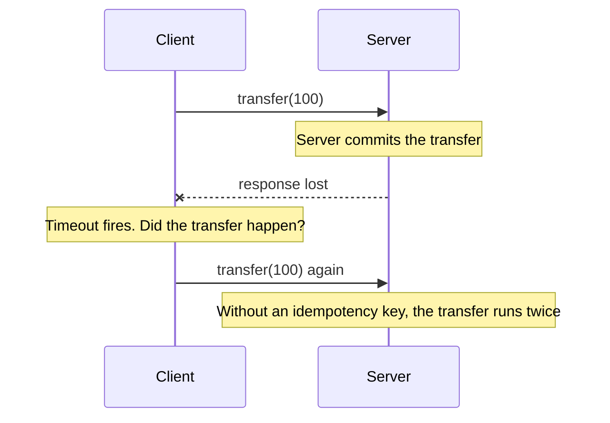
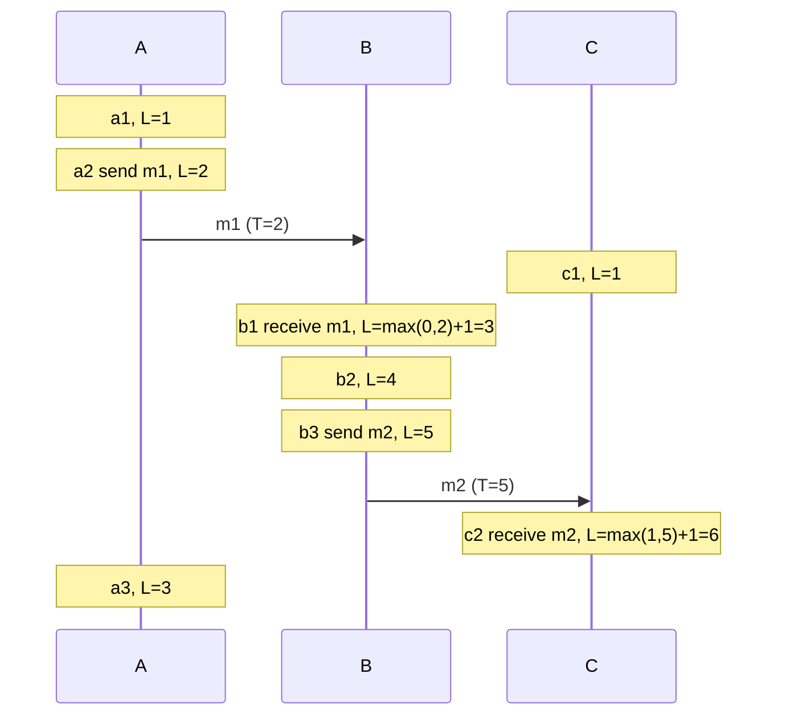

# Failures and Time in Distributed Systems

A distributed system runs on several machines that talk over a network. Two facts make it harder than a program on one machine: parts of it fail while other parts keep running, and the machines do not share a clock. This page explains partial failure, the network assumptions that break designs (Deutsch's fallacies), timeouts and failure detection (including the phi accrual detector), the difference between wall-clock and monotonic clocks, and the ways that clocks drift. It then explains how to order events without a trusted clock: Lamport clocks, vector clocks, and hybrid logical clocks, each with a runnable Java program, and it ends with Google's TrueTime. Consensus, which builds on these ideas, has its home in [consensus and leader election](02-consensus-and-leader-election.md). Replication, which uses version vectors, is in [replication](../fundamentals/05-replication.md). The consistency models that these clocks help to implement are in [consistency and CAP](../fundamentals/07-consistency-and-cap.md).

## Why It Matters

Interviewers use this topic to test whether a candidate designs for failure. Questions such as "what happens if this call times out?", "how do you order events from two data centers?", and "why not use timestamps to resolve conflicts?" all lead here. A candidate who answers "use a timestamp" without saying whose clock it is loses points. On the job, the same ideas explain duplicate payments after a timeout, a lock that two clients hold at the same time, a cache that expires too early after a clock step, and a database that loses a write because of last-write-wins with skewed clocks. This page is P2: the ideas appear in the replication, consensus, and lock pages of this subject, and a short, exact vocabulary here makes those pages easier to answer in an interview.

## Core Concepts

**Node**: one process or machine in the system. A node has its own memory, its own clock, and its own failures.

**Partial failure**: some parts of a system fail while other parts keep working, and the surviving parts may not know which parts failed. A program on one machine usually either works or crashes as a whole. A distributed program has no such guarantee.

**Asynchronous network**: a network model in which a message can take any amount of time to arrive, or can be lost, and in which no bound on processing speed exists. The model is a safe assumption for the Internet and for a data center under load. A *synchronous* model has known bounds on message delay and processing time. A *partially synchronous* model has bounds that hold most of the time but are not known in advance (Dwork, Lynch, and Stockmeyer, 1988).

**Network partition**: a failure in which the network splits the nodes into groups that cannot exchange messages. See [consistency and CAP](../fundamentals/07-consistency-and-cap.md) for its effect on the CAP trade-off.

**Fault model**: a statement of how nodes may fail. In the *crash-stop* model, a node works correctly until it crashes and then stays down. In the *crash-recovery* model, a crashed node may restart, and it keeps what it wrote to disk. In the *Byzantine* model, a node may behave in any way, including lying. Most systems in this KB (Raft, Paxos, Dynamo-style stores) assume crash-recovery and no Byzantine faults.

**Timeout**: the maximum time that a node waits for a response. When the time passes, the node treats the request as failed. A timeout is a guess, because a late response and a lost response look the same.

**Failure detector**: a component that decides which other nodes have failed. A failure detector in an asynchronous system can be wrong. It may suspect a live node (a false positive) or may take a long time to suspect a dead node.

**Heartbeat**: a small message that a node sends at a fixed interval to show that it is alive.

**Wall clock (time-of-day clock)**: a clock that returns the date and time, for example the Unix time in milliseconds. A synchronization protocol can set it forward or backward. Java: `System.currentTimeMillis()` and `Instant.now()`.

**Monotonic clock**: a clock that only moves forward and that measures elapsed time on one machine. Its absolute value has no meaning. Java: `System.nanoTime()`.

**Clock drift**: the rate at which a clock gains or loses time compared with true time. A quartz clock in a server drifts by an amount that depends on temperature and load. **Clock skew** is the difference between the readings of two clocks at the same instant.

**NTP (Network Time Protocol)**: a protocol that synchronizes a machine's clock with a time server over the network. RFC 5905 specifies version 4.

**Happened-before** (written `a → b`): a partial order on events. Event `a` happened before event `b` if (1) `a` and `b` ran on the same node and `a` ran first, or (2) `a` is the sending of a message and `b` is the receiving of that message, or (3) a chain of such steps links `a` to `b`. If neither `a → b` nor `b → a`, the events are **concurrent**. Concurrent here does not mean "at the same instant". It means that no message chain connects them, so neither event can have affected the other.

**Logical clock**: a counter that orders events by causality instead of by physical time.

**Lamport clock**: a logical clock with one integer per node. If `a → b`, the timestamp of `a` is smaller than the timestamp of `b`.

**Vector clock**: a logical clock with one integer per node, kept as a vector. The vectors show whether two events are ordered or concurrent.

**Hybrid logical clock (HLC)**: a timestamp that has a physical part, close to wall-clock time, and a logical counter. It keeps the causal order and stays near real time.

**TrueTime**: Google's clock API for Spanner. It returns a time interval, and the real time is inside the interval.

## How It Works

### Partial failure and why it is hard

A client sends a request to a server and receives no response. Four causes give the same observation, and the client cannot tell them apart:

1. The request was lost on the way to the server. The server did nothing.
2. The server crashed before it processed the request. The server did nothing.
3. The server processed the request, and then it crashed or the response was lost. The server did the work.
4. The server is slow, and the response will arrive later.



The client has only one safe action: retry in a way that does no harm if the first request succeeded. That is the reason for idempotency keys (see `kb/hld/fundamentals/12-reliability-patterns.md`) and for the design of exactly-once claims (see [distributed transactions](03-distributed-transactions.md)).

A timeout also does not say that the work was undone. The node that timed out may keep running the request. If the system gives the work to another node, two nodes may run the same work. This is the root of the split-brain problem in [replication](../fundamentals/05-replication.md) and of the lock problem in [distributed locks and leases](05-distributed-locks-and-leases.md).

### The fallacies of distributed computing

L. Peter Deutsch and others at Sun Microsystems listed assumptions that developers make about networks and that are false. The list has eight items. Each wrong assumption leads to a specific design defect.

| Fallacy | What is true | Design consequence |
|---|---|---|
| The network is reliable | Packets are lost, duplicated, reordered, and delayed | Use timeouts, retries with backoff, idempotent operations, and acknowledgements |
| Latency is zero | A call over the network takes orders of magnitude longer than a local call (see `kb/hld/back-of-envelope-estimation.md`) | Batch calls, cache, and avoid chatty APIs |
| Bandwidth is infinite | Links have a limit, and the limit is shared | Compress, paginate, and send deltas instead of full state |
| The network is secure | Traffic can be read or changed on the path | Encrypt in transit and authenticate each peer (see `kb/hld/fundamentals/21-security-in-design.md`) |
| Topology does not change | Nodes join, leave, and move. Routes change | Use service discovery, and do not hard-code addresses |
| There is one administrator | Several teams and companies run parts of the path | Version the APIs, and expect different configurations |
| Transport cost is zero | Serialization, bandwidth, and network hardware cost money and CPU | Include network cost in capacity plans |
| The network is homogeneous | Hardware, operating systems, and protocol versions differ | Use portable formats and tolerate version differences |

### Network partitions in practice

Real networks fail in partial ways: a switch fails, a link drops packets in one direction only, a garbage-collection pause stops a node for seconds, or a misconfigured firewall blocks one path. Bailis and Kingsbury ("The Network is Reliable", ACM Queue 2014) collected public reports of such failures. The design rule is to treat a partition as a normal event. For each operation, decide what the system does on each side of a partition: refuse, or continue and reconcile later. See [consistency and CAP](../fundamentals/07-consistency-and-cap.md).

A long pause on one node looks the same as a partition to the other nodes. A JVM stop-the-world garbage collection, a virtual machine that the host pauses, or a disk stall can freeze a node for longer than the timeout. After the pause, the node continues and does not know that time passed. This case matters for leases (see [distributed locks and leases](05-distributed-locks-and-leases.md)).

### Timeouts and failure detection

The simplest failure detector is a fixed timeout on heartbeats: if no heartbeat arrives within T, the node is dead. The choice of T is a trade-off:

- A short T detects a real crash fast, and it also marks slow nodes as dead. A false positive can trigger a failover, a data copy, or a leader election that the system did not need, and the extra load can slow more nodes. This chain is a *cascading failure*.
- A long T avoids false positives, and the system stays down longer after a real crash.

No timeout value is correct for all network conditions, because the delay of a response changes with load. The theory agrees: in an asynchronous system no failure detector can be both complete and accurate in all runs, and this is related to the FLP result (see [consensus and leader election](02-consensus-and-leader-election.md)). A practical system picks a detector that adapts.

#### The phi accrual failure detector

Hayashibara, Défago, Yared, and Katayama (2004) proposed a detector that does not return "alive" or "dead". It returns a number, phi, that grows as the evidence for a failure grows. The application chooses a threshold.

The monitoring node works in three steps:

1. It records the arrival times of the last heartbeats in a sliding window and computes the intervals between them.
2. It estimates the distribution of the intervals. The paper assumes a normal distribution, with the mean and variance taken from the window.
3. When the time since the last heartbeat is `t`, it computes `P_later(t)`, the probability that a heartbeat arrives later than `t`, and returns `phi = -log10(P_later(t))`.

The paper explains the scale: with a threshold of 1, about 10 percent of suspicions are wrong; with 2, about 1 percent; with 3, about 0.1 percent. Each increase of 1 in the threshold lowers the chance of a wrong suspicion by a factor of 10. Because the detector learns from recent intervals, the same threshold adapts to a fast and calm network and to a slow and noisy network. Apache Cassandra uses this detector. Its configuration option `phi_convict_threshold` sets the phi value at which a node counts as down, and the default is 8 (Cassandra documentation).

A gossip protocol often carries the heartbeats in a large cluster, so that each node does not need to ping every other node (see `kb/hld/distributed-systems/04-probabilistic-data-structures.md`).

!!! info "A failure detector gives a suspicion, not a fact"
    Whatever detector a system uses, a node that the detector marks as dead may be alive. Safety must not depend on the detector being right. A correct design uses fencing tokens or a consensus protocol to keep a falsely suspected node from doing harm (see [distributed locks and leases](05-distributed-locks-and-leases.md)).

### Clocks: wall-clock, monotonic, and drift

A machine has two kinds of clock.

| | Wall clock (time-of-day) | Monotonic clock |
|---|---|---|
| Java API | `System.currentTimeMillis()`, `Instant.now()` | `System.nanoTime()` |
| Meaning | A date and time that other machines can read | A counter with no fixed origin. Only the difference between two readings on one machine has meaning (JDK javadoc for `nanoTime`) |
| Can jump | Yes. NTP can step it, an administrator can set it, and a leap second can repeat or skip a second | No. It does not go backward |
| Use for | Timestamps for humans and logs, and expiry dates that all nodes must read in the same way | Timeouts, durations, and elapsed time |
| Compare across machines | Only if the clocks are synchronized, and then only within the error of the synchronization | Not meaningful |

Rule: measure a duration with the monotonic clock, and use the wall clock only for a point in time.

#### Why clocks differ

Each machine has a quartz oscillator. The oscillator runs a little fast or a little slow, and the rate depends on temperature. Google's Spanner paper uses an assumed worst-case drift of 200 microseconds per second for its servers. At that rate, a clock that is not corrected for 30 seconds can be wrong by up to 6 milliseconds. A synchronization protocol corrects the clock at intervals, so the error grows between corrections and shrinks at each correction.

NTP estimates the offset between the local clock and a server from the timestamps of a request and a response, and it assumes that the network delay is the same in both directions. If the delays differ, the estimate has an error. A client that is far from a time source, or on a congested link, has a larger error. NTP's accuracy is approximately from under one millisecond on a quiet local network to tens of milliseconds over the public Internet (the order of magnitude from the ntp.org documentation; the number depends on the network). If the offset is large, NTP may *step* the clock, which moves it backward or forward at once. For small offsets, it *slews* the clock, which changes the rate for a time and avoids a jump.

Other sources of wrong time:

- **Leap seconds.** UTC occasionally adds a second. Systems handle it by repeating a second or by smearing it over a long time. On 1 January 2017, a leap second caused Cloudflare's DNS service to fail, because a time difference became negative in the Go code that computed it. Cloudflare's post-incident report explains the cause. Durations must use a monotonic clock.
- **Virtual machines** that pause, migrate, or share a CPU can see jumps in time.
- **Misconfigured or unreachable time servers** leave a clock free to drift.

A wall-clock timestamp is therefore a measurement with an error, not a point. Two timestamps from two machines can be in the wrong order compared with real time if the difference between them is smaller than the clock skew.

#### What goes wrong when a system trusts wall clocks

- **Last-write-wins (LWW) conflict resolution.** The system keeps the write with the larger timestamp. If node A's clock is ahead of node B's clock by 50 ms, and B writes 20 ms after A, A's write carries the larger timestamp, and B's later write is dropped. The client of B received a success response, and the data is lost. Cassandra resolves conflicts by timestamp this way (see [replication](../fundamentals/05-replication.md) and [CRDTs and conflict resolution](06-crdts-and-conflict-resolution.md)).
- **Leases and expiry.** A node that holds a lease with an expiry time checks its own clock. If its clock runs slow, or the node pauses, it believes that it holds the lease after the lease expired. See [distributed locks and leases](05-distributed-locks-and-leases.md).
- **Ordering events from several nodes by timestamp.** The order can contradict the order in which the events caused each other.
- **Transaction timestamps.** A database that uses timestamps for snapshots must handle the uncertainty. Spanner waits out the uncertainty (see TrueTime below). CockroachDB uses hybrid logical clocks and a maximum allowed clock offset. Its documentation says that the `--max-offset` default is 500 ms, and that nodes stop if the observed offset exceeds the limit, to avoid reading inconsistent data.

### Ordering events without a trusted clock: Lamport clocks

Lamport (1978) observed that many systems need only the order of events that can affect each other. He defined the happened-before relation `→` (see Core Concepts) and a clock that respects it.

**Clock condition.** If `a → b`, then `C(a) < C(b)`, where `C` gives the timestamp of an event.

**Algorithm.** Each node `i` keeps a counter `L_i`, which starts at 0.

1. Before each local event, including the sending of a message, node `i` sets `L_i = L_i + 1` and uses `L_i` as the event's timestamp.
2. A sender attaches its timestamp to the message.
3. A receiver `j` of a message with timestamp `T` sets `L_j = max(L_j, T) + 1`. The result is the timestamp of the receive event.

These rules give the clock condition: along a chain of local steps and messages, every step raises the counter.

**Total order.** To make a total order from the timestamps, break ties with the node identifier. Event `a` on node `i` comes before event `b` on node `j` if `L(a) < L(b)`, or if `L(a) = L(b)` and `i < j`. Lamport used this total order to build a distributed mutual-exclusion algorithm in the same paper. All nodes that use the rule agree on one order of the events.

**The limit.** The clock condition goes one way only. If `C(a) < C(b)`, the system cannot conclude that `a → b`. The events may be concurrent. A Lamport timestamp cannot detect concurrency. In the Java program below, event `c1` has a smaller timestamp than event `a2`, and the two events are concurrent.



### Vector clocks: detecting concurrency

A vector clock keeps one counter for each of the `n` nodes. Node `i` holds a vector `V_i` of length `n`, and every entry starts at 0. The entry `V_i[k]` is the number of events of node `k` that node `i` knows about.

**Algorithm.**

1. Before each local event, including a send, node `i` sets `V_i[i] = V_i[i] + 1`. A send attaches a copy of `V_i`.
2. On receiving a message with vector `M`, node `i` sets `V_i[k] = max(V_i[k], M[k])` for every `k`, and then `V_i[i] = V_i[i] + 1`.

**Comparing two vectors `x` and `y`.**

- `x` is before `y` (`x → y`) if `x[k] <= y[k]` for every `k`, and `x[k] < y[k]` for at least one `k`.
- `x` and `y` are equal if all entries match.
- `x` and `y` are concurrent if `x[k] < y[k]` for some `k` and `x[m] > y[m]` for some other `m`.

For vector clocks, the relation is exact: `a → b` if and only if `V(a) < V(b)`. This is the advantage over a Lamport clock, and the cost is a vector of `n` integers on every message and every stored value.

**Use in storage systems.** Dynamo (DeCandia et al., 2007) attached a vector clock to each version of an object. When a read finds two versions whose vectors are concurrent, the system returns both versions, and the application or a merge rule resolves the conflict. Dynamo truncated old entries when the clock grew beyond a limit, and this made the clock approximate. Riak used the same idea. When the nodes in the vector are the replicas (and not the clients), the structure is a *version vector*, which is the topic of [CRDTs and conflict resolution](06-crdts-and-conflict-resolution.md). The anomaly types for concurrent writes are in [replication](../fundamentals/05-replication.md).

**Cost.** The size of the vector grows with the number of nodes that write. A system with many clients that write must either use server identifiers in the vector or prune the vector, which loses precision.

### Hybrid logical clocks

A Lamport or vector clock gives causal order and has no relation to real time. A wall clock has a relation to real time and no causal guarantee. Kulkarni, Demirbas, Madappa, Avva, and Leone (2014) proposed the hybrid logical clock (HLC) to get both.

An HLC timestamp is a pair `(l, c)`:

- `l` is the largest physical time that the node has seen, from its own wall clock or from a message. It stays close to the wall clock.
- `c` is a counter that orders events that have the same `l`.

**Algorithm** (`pt` is the node's current wall-clock reading, and `l'` is the previous value of `l`):

- Local event or send: `l = max(l', pt)`. If `l = l'`, then `c = c + 1`. Otherwise `c = 0`. The timestamp is `(l, c)`.
- Receive a message with `(l_m, c_m)`: `l = max(l', l_m, pt)`. If `l = l' = l_m`, then `c = max(c, c_m) + 1`. If `l = l'` only, then `c = c + 1`. If `l = l_m` only, then `c = c_m + 1`. Otherwise `c = 0`.

Timestamps compare as pairs: first by `l`, and then by `c`.

**Properties** (from the paper):

- If `a → b`, then `HLC(a) < HLC(b)`. The HLC keeps the Lamport clock condition.
- `l` is at least the wall-clock time. The distance `l - pt` is bounded when the wall clocks are within a known skew, so the HLC does not drift away from real time the way a pure Lamport clock can.
- The timestamp has a fixed size. The paper encodes it in the space of one NTP timestamp (64 bits). A vector clock needs more space.

An HLC cannot detect concurrency, as a Lamport clock cannot. Its value is that a timestamp is both a valid causal order and a time that a person can read. Systems use it for snapshot timestamps and for versions. CockroachDB documents that its HLC has a physical component, always close to the local wall time, and a logical component, which distinguishes events with the same physical component, and that a transaction timestamp is an HLC value.

### TrueTime and Spanner

Spanner (Corbett et al., 2012) takes the opposite approach: it keeps real time and makes the uncertainty small and explicit. The TrueTime API has three methods:

| Method | Result |
|---|---|
| `TT.now()` | An interval `[earliest, latest]`. The absolute time of the call is inside the interval |
| `TT.after(t)` | True if `t` has definitely passed |
| `TT.before(t)` | True if `t` has definitely not arrived |

Google data centers have time master machines. Most have GPS receivers, and the others have atomic clocks. The two sources fail in different ways, and this gives protection against a failure of one source. Each server polls several masters. The paper reports that the uncertainty `ε` is a sawtooth function of time that varies from about 1 ms to 7 ms over each 30-second poll interval, so `ε` is about 4 ms most of the time (the figures are from the paper for Google's 2012 production environment).

Spanner uses TrueTime for *external consistency*: if transaction T1 commits before transaction T2 starts, then T1's commit timestamp is smaller than T2's. The mechanism is commit wait. The coordinator picks a commit timestamp `s` that is no smaller than `TT.now().latest`. Then it waits until `TT.after(s)` is true before it makes the data visible and releases locks. The wait is about `2 × ε`, which is about 8 ms at the average `ε` (approximate; derived from the paper). Reads at a timestamp use the same bound, so a read-only transaction needs no locks.

The lesson for design: a system that wants to order events by real time needs a bound on clock error, and it pays latency equal to the bound. Few organizations can run GPS and atomic clock masters.

## Trade-offs and When to Use

| Mechanism | What it gives | What it costs | Detects concurrency | Use when |
|---|---|---|---|---|
| Wall clock (NTP) | Human-readable time | Skew of milliseconds or more, and jumps. No causal guarantee | No | Logs, metrics, and expiry with a wide margin |
| Monotonic clock | Correct durations on one machine | Not comparable across machines | Not applicable | Timeouts, rate measurement, and benchmarks |
| Lamport clock | A total order that respects causality | One integer per message. No concurrency detection. No relation to real time | No | A total order of events, for example in a log, mutual exclusion, or an ordered broadcast |
| Vector clock | Exact causal order and concurrency detection | `n` integers per message and per value. The vector grows with the writers | Yes | Conflict detection for replicas that accept concurrent writes (Dynamo style) |
| Hybrid logical clock | Causal order and closeness to real time in a fixed-size timestamp | Needs a bound on clock skew for its bounds. No concurrency detection | No | Transaction and snapshot timestamps, versions, and change logs in a database |
| TrueTime | Real-time order (external consistency) | Special hardware, and commit wait about the width of the uncertainty | Not applicable | A globally distributed database that needs external consistency and that can afford the hardware |
| Consensus log | One agreed order of operations | A quorum round trip for each operation (see [consensus and leader election](02-consensus-and-leader-election.md)) | Not applicable | The system needs one single order for all clients (linearizability) |

**Choosing.** If a single node can assign the order (a primary database sequence, a log), use that node, and replicate it with consensus. If the system must accept writes on several nodes without coordination, and it must find conflicts, use version vectors. If it needs timestamps that are close to wall time and that respect causality, use an HLC. If correctness depends on real-time order across data centers, use TrueTime or a consensus log, and state the cost.

## Java Example

The three programs below run on the JDK 21 standard library. Each one has its `main` method first and its own imports. The output does not depend on the schedule: the programs run all events in a fixed order on one thread, and they show how each clock changes at each event.

### Lamport clock

The program runs three processes, A, B, and C, and records each event with its timestamp. It prints the events in run order, then in the total order (time, then process name). The last line shows an event pair with different timestamps that has no causal link.

```java
import java.util.ArrayList;
import java.util.Comparator;
import java.util.List;

public class LamportDemo {
    public static void main(String[] args) {
        List<Event> log = new ArrayList<>();
        LamportProcess a = new LamportProcess("A", log);
        LamportProcess b = new LamportProcess("B", log);
        LamportProcess c = new LamportProcess("C", log);

        a.localEvent("a1");
        long m1 = a.send("a2 send m1");
        c.localEvent("c1");
        b.receive("b1 receive m1", m1);
        b.localEvent("b2");
        long m2 = b.send("b3 send m2");
        c.receive("c2 receive m2", m2);
        a.localEvent("a3");

        System.out.println("Events in the order they ran:");
        for (Event e : log) {
            System.out.println("  " + e);
        }

        List<Event> sorted = new ArrayList<>(log);
        sorted.sort(Comparator.comparingLong((Event e) -> e.time()).thenComparing(Event::process));
        System.out.println("Total order (time, then process name):");
        for (Event e : sorted) {
            System.out.println("  " + e);
        }

        Event c1 = log.get(2);
        Event a2 = log.get(1);
        System.out.println("c1 has time " + c1.time() + " and a2 has time " + a2.time()
                + ", but neither caused the other.");
    }
}

record Event(String process, String label, long time) {
    @Override
    public String toString() {
        return process + " " + label + " -> " + time;
    }
}

class LamportProcess {
    private final String name;
    private final List<Event> log;
    private long time;

    LamportProcess(String name, List<Event> log) {
        this.name = name;
        this.log = log;
    }

    void localEvent(String label) {
        time++;
        log.add(new Event(name, label, time));
    }

    long send(String label) {
        time++;
        log.add(new Event(name, label, time));
        return time;
    }

    void receive(String label, long messageTime) {
        time = Math.max(time, messageTime) + 1;
        log.add(new Event(name, label, time));
    }
}
```

<!-- expected-output -->
```text
Events in the order they ran:
  A a1 -> 1
  A a2 send m1 -> 2
  C c1 -> 1
  B b1 receive m1 -> 3
  B b2 -> 4
  B b3 send m2 -> 5
  C c2 receive m2 -> 6
  A a3 -> 3
Total order (time, then process name):
  A a1 -> 1
  C c1 -> 1
  A a2 send m1 -> 2
  A a3 -> 3
  B b1 receive m1 -> 3
  B b2 -> 4
  B b3 send m2 -> 5
  C c2 receive m2 -> 6
c1 has time 1 and a2 has time 2, but neither caused the other.
```

Read the output as follows. `b1` receives `m1` with timestamp 2, and B's counter was 0, so B's counter becomes `max(0, 2) + 1 = 3`. Events `c1` and `a2` have timestamps 1 and 2, and they are concurrent: no message connects them. The Lamport order puts `c1` before `a2`, and this order is correct as a total order but says nothing about causality.

### Vector clock

The program runs the same message pattern with vector clocks, and it prints how each pair of events compares.

```java
import java.util.Arrays;

public class VectorDemo {
    public static void main(String[] args) {
        VectorClock a = new VectorClock(0, 3);
        VectorClock b = new VectorClock(1, 3);
        VectorClock c = new VectorClock(2, 3);

        int[] a1 = a.localEvent();
        int[] m1 = a.send();
        int[] b1 = b.receive(m1);
        int[] c1 = c.localEvent();
        int[] b2 = b.send();
        int[] c2 = c.receive(b2);

        print("a1", a1);
        print("a2 (send m1)", m1);
        print("b1 (receive m1)", b1);
        print("c1", c1);
        print("b2 (send m2)", b2);
        print("c2 (receive m2)", c2);

        System.out.println("a1 vs b1: " + VectorClock.compare(a1, b1));
        System.out.println("b1 vs a1: " + VectorClock.compare(b1, a1));
        System.out.println("a2 vs c1: " + VectorClock.compare(m1, c1));
        System.out.println("b1 vs c1: " + VectorClock.compare(b1, c1));
        System.out.println("a1 vs c2: " + VectorClock.compare(a1, c2));
        System.out.println("c1 vs c2: " + VectorClock.compare(c1, c2));
        System.out.println("a2 vs a2: " + VectorClock.compare(m1, m1.clone()));
    }

    static void print(String label, int[] clock) {
        System.out.println(label + " = " + Arrays.toString(clock));
    }
}

enum Order { BEFORE, AFTER, EQUAL, CONCURRENT }

class VectorClock {
    private final int self;
    private final int[] clock;

    VectorClock(int self, int processes) {
        this.self = self;
        this.clock = new int[processes];
    }

    int[] localEvent() {
        clock[self]++;
        return clock.clone();
    }

    int[] send() {
        return localEvent();
    }

    int[] receive(int[] message) {
        for (int i = 0; i < clock.length; i++) {
            clock[i] = Math.max(clock[i], message[i]);
        }
        clock[self]++;
        return clock.clone();
    }

    static Order compare(int[] x, int[] y) {
        boolean xSmaller = false;
        boolean ySmaller = false;
        for (int i = 0; i < x.length; i++) {
            if (x[i] < y[i]) {
                xSmaller = true;
            } else if (x[i] > y[i]) {
                ySmaller = true;
            }
        }
        if (xSmaller && ySmaller) {
            return Order.CONCURRENT;
        }
        if (xSmaller) {
            return Order.BEFORE;
        }
        if (ySmaller) {
            return Order.AFTER;
        }
        return Order.EQUAL;
    }
}
```

<!-- expected-output -->
```text
a1 = [1, 0, 0]
a2 (send m1) = [2, 0, 0]
b1 (receive m1) = [2, 1, 0]
c1 = [0, 0, 1]
b2 (send m2) = [2, 2, 0]
c2 (receive m2) = [2, 2, 2]
a1 vs b1: BEFORE
b1 vs a1: AFTER
a2 vs c1: CONCURRENT
b1 vs c1: CONCURRENT
a1 vs c2: BEFORE
c1 vs c2: BEFORE
a2 vs a2: EQUAL
```

`a2 vs c1` is `CONCURRENT`, which is the fact that the Lamport clock could not show. `a1 vs c2` is `BEFORE`, because `c2` received `m2` from `b`, and `b` had received `m1` from `a`. The causal chain from `a1` to `c2` goes through two messages, and the vector `[2, 2, 2]` carries it.

### Hybrid logical clock

The program gives each node a wall-clock reading as an argument, so that the output is the same on every run. Node A runs 10 units ahead of node B. B still orders its events after A's message.

```java
public class HlcDemo {
    public static void main(String[] args) {
        HybridClock a = new HybridClock();
        HybridClock b = new HybridClock();

        // Node A runs 10 units ahead of node B.
        Timestamp sendA = a.send(100);
        System.out.println("A sends at wall time 100:         " + sendA);

        Timestamp recvB = b.receive(90, sendA);
        System.out.println("B receives at wall time 90:       " + recvB);

        Timestamp localB = b.send(91);
        System.out.println("B local event at wall time 91:    " + localB);

        Timestamp laterB = b.send(105);
        System.out.println("B local event at wall time 105:   " + laterB);

        System.out.println("sendA before recvB: " + (sendA.compareTo(recvB) < 0));
        System.out.println("recvB before localB: " + (recvB.compareTo(localB) < 0));
        System.out.println("localB before laterB: " + (localB.compareTo(laterB) < 0));
    }
}

record Timestamp(long wall, int counter) implements Comparable<Timestamp> {
    @Override
    public int compareTo(Timestamp other) {
        int byWall = Long.compare(wall, other.wall);
        return byWall != 0 ? byWall : Integer.compare(counter, other.counter);
    }

    @Override
    public String toString() {
        return "(" + wall + ", " + counter + ")";
    }
}

class HybridClock {
    private long wall;
    private int counter;

    Timestamp send(long physicalTime) {
        long previous = wall;
        wall = Math.max(previous, physicalTime);
        counter = (wall == previous) ? counter + 1 : 0;
        return new Timestamp(wall, counter);
    }

    Timestamp receive(long physicalTime, Timestamp message) {
        long previous = wall;
        wall = Math.max(Math.max(previous, message.wall()), physicalTime);
        if (wall == previous && wall == message.wall()) {
            counter = Math.max(counter, message.counter()) + 1;
        } else if (wall == previous) {
            counter = counter + 1;
        } else if (wall == message.wall()) {
            counter = message.counter() + 1;
        } else {
            counter = 0;
        }
        return new Timestamp(wall, counter);
    }
}
```

<!-- expected-output -->
```text
A sends at wall time 100:         (100, 0)
B receives at wall time 90:       (100, 1)
B local event at wall time 91:    (100, 2)
B local event at wall time 105:   (105, 0)
sendA before recvB: true
recvB before localB: true
localB before laterB: true
```

B's wall clock reads 90, which is behind A's `(100, 0)` timestamp. B's receive event gets `(100, 1)`: the physical part follows the larger value, and the counter breaks the tie. When B's wall clock moves past 100 (reading 105), the counter returns to 0.

The programs have no networking, no threads, and no pruning of vectors. A real implementation also persists the clock state or uses node identifiers that survive a restart.

## Interview Angle

### Questions

??? question "A client calls a payment service and the call times out. What do you do?"

    **Direct answer:** the client does not know whether the payment happened, so it retries with an idempotency key, or it queries the status of the first attempt.

    **Reason:** a timeout has at least four causes: the request was lost, the server crashed before it worked, the server did the work and the response was lost, or the server is slow. The client sees the same signal in all four cases. If the client retries without a key, the server may charge the customer twice.

    **Design:** the client creates a unique key for each logical payment and sends it with every attempt. The server stores the key with the result in the same transaction as the payment. On a repeat of the key, the server returns the stored result. The client uses exponential backoff with jitter, and it stops after a limit and shows the user a "pending" state. A background reconciliation job compares the payment records with the provider's records.

    **Trade-off:** the idempotency store needs storage and a retention period, and the key must be generated before the first attempt. See `kb/hld/fundamentals/12-reliability-patterns.md` and [distributed transactions](03-distributed-transactions.md).

??? question "Why can't you order events from two servers by their timestamps?"

    **Direct answer:** the clocks of the two servers differ, and a timestamp comparison is only as accurate as the skew between them.

    **Reason:** each wall clock drifts. NTP corrects it, and the remaining error ranges from under a millisecond on a quiet network to tens of milliseconds over the Internet (approximate). If two events are closer in real time than the skew, the order of their timestamps may be wrong. The clock can also jump backward when NTP steps it. Last-write-wins on timestamps then drops a write that the client saw succeed.

    **Alternatives:** if the order matters only for events that can affect each other, use a Lamport clock or a vector clock, which order by causality. If the timestamps must stay near real time, use a hybrid logical clock. If the order must match real time across the world, use TrueTime-style bounded clocks and wait out the uncertainty, or use a single sequencer or a consensus log.

    **Trade-off:** logical clocks cost message size and cannot tell you the time. Bounded clocks cost hardware and latency. A single sequencer is a bottleneck and needs replication.

??? question "What is the difference between a Lamport clock and a vector clock?"

    **Direct answer:** a Lamport clock gives a total order that respects causality, and a vector clock also tells you whether two events are concurrent.

    **Reason:** the Lamport guarantee goes one way: if `a → b`, then `C(a) < C(b)`. The reverse does not hold, so `C(a) < C(b)` does not show that `a` caused `b`. A vector clock keeps one counter for each node. Two vectors are ordered if one is less than or equal to the other in every entry, and they are concurrent if each is larger in some entry. The relation is exact in both directions.

    **Trade-off:** a Lamport timestamp is one integer. A vector clock has `n` integers and grows with the number of writers. Dynamo used vector clocks to find conflicting versions of an object and truncated old entries when the vector grew too large, so its detection became approximate.

    **Edge case:** neither clock relates to real time. Use a hybrid logical clock if the timestamp must also read as a time.

??? question "How does a system decide that a node is dead, and what goes wrong?"

    **Direct answer:** it uses heartbeats and a timeout, and a node that misses the heartbeats for too long is suspected. The suspicion can be wrong.

    **Reason:** a late heartbeat, a lost heartbeat, and a crash look the same. A short timeout detects crashes fast, and it also suspects nodes that are only slow, for example during a garbage-collection pause. A false suspicion can start a failover or a data copy, and the extra load can slow other nodes and cause more suspicions. A long timeout is safe from this, and it extends the outage after a real crash.

    **Better design:** use an adaptive detector. The phi accrual detector keeps the distribution of recent heartbeat intervals and returns a suspicion level, phi, that the application compares with a threshold. Cassandra uses it, with `phi_convict_threshold` at a default of 8. Keep safety independent of the detector: use fencing tokens or consensus so that a falsely suspected node cannot do damage when it comes back.

    **Edge case:** a node that is alive but cut off from the others by a partition looks dead to them, and it may keep serving clients. The design must define what that node does (refuse writes without a quorum).

??? question "Explain how Spanner gets externally consistent transactions."

    **Direct answer:** TrueTime gives a time interval with a bounded error, and Spanner waits out the uncertainty before it makes a commit visible.

    **Mechanism:** `TT.now()` returns `[earliest, latest]`, and the real time lies inside. The coordinator of a read-write transaction chooses a commit timestamp `s` that is not less than `TT.now().latest`. It then waits until `TT.after(s)` is true (commit wait) before it makes the commit visible. Any transaction that starts after the commit is visible gets a later timestamp, so the timestamp order matches the real-time order.

    **Cost:** the commit wait is about the width of the uncertainty. The paper reports `ε` of about 1 to 7 ms, with an average of about 4 ms (approximate, Google's 2012 environment). The system needs GPS receivers and atomic clocks in each data center.

    **Alternative:** CockroachDB has no special hardware. It uses hybrid logical clocks and a configured maximum clock offset, and it restarts a read that finds a value inside its uncertainty window.

??? question "What is wrong with using System.currentTimeMillis() to measure a timeout?"

    **Direct answer:** the wall clock can jump, so the measured duration can be negative or too long. Use `System.nanoTime()`.

    **Reason:** NTP can step the wall clock, and an administrator can set it. A leap second can repeat a second. The JDK documentation states that `nanoTime` has an arbitrary origin and that the difference between two readings in one JVM is the elapsed time. It is not tied to the wall clock.

    **Edge case:** `nanoTime` is valid only within one JVM on one machine. A deadline that crosses machines, such as a lease expiry stored in a database, needs a wall-clock time and a margin for skew, or a design that does not depend on clocks (a fencing token).

### Follow-up Questions

??? question "Can a Lamport clock detect that two events are concurrent?"

    No. If two events have different Lamport timestamps, they may be causally ordered or concurrent. If you need to know, use a vector clock, which compares the full vectors. A Lamport clock is enough when you need only a total order that respects causality, for example to order the log of a state machine or to grant a distributed mutual-exclusion request.

??? question "Why does a hybrid logical clock need a counter?"

    Several events can occur with the same wall-clock reading, for example when the clock has a coarse resolution, when the clock stops or moves back, or when a message carries a physical part that is ahead of the local clock. The counter keeps each timestamp unique and ordered after the previous one, and the physical part stays close to the wall clock.

??? question "How do the fallacies of distributed computing affect an API design?"

    Each fallacy maps to a rule. A network that is not reliable needs timeouts, retries, and idempotent operations. Latency that is not zero argues against chatty APIs and for batch endpoints and pagination. Bandwidth that is not infinite argues for compression and for sending deltas. Topology that changes argues for service discovery. The versions of clients and servers differ, so the API must tolerate unknown fields.

??? question "Why does a leader's lease need more than a clock?"

    The lease holder checks its own clock to see if the lease is still valid. If the process pauses, or its clock runs slowly, it can act after the lease expired. The storage layer should therefore reject writes that carry an old fencing token, and the token must increase with each new lease. See [distributed locks and leases](05-distributed-locks-and-leases.md).

### Red Flags

- Saying "we order the events by timestamp" with no statement about clock skew.
- Using `System.currentTimeMillis()` to compute a timeout or an elapsed time.
- Resolving write conflicts with last-write-wins and not mentioning that it drops writes.
- Treating a timeout as proof that the remote operation failed.
- Using retries with no idempotency.
- Saying that NTP makes clocks equal. NTP bounds the difference to an error that can be tens of milliseconds, and it can step a clock.
- Stating that a Lamport timestamp shows causality in both directions.
- Claiming that a failure detector can be both accurate and fast in an asynchronous network.

## Common Mistakes

| Mistake | Effect | Fix |
|---|---|---|
| Using wall-clock timestamps to order events from several nodes | Wrong order. A newer write loses | Use logical or hybrid clocks, or a single sequencer |
| Measuring a duration with the wall clock | A negative or very long duration after a clock step | Use `System.nanoTime()` |
| A fixed, short heartbeat timeout in a shared environment | False failovers under load or during a pause | Use an adaptive detector (phi accrual) or a timeout with margin, and keep safety independent of the detector |
| Retrying a non-idempotent call after a timeout | Duplicate effect, for example a second charge | Send an idempotency key, or query the result before a retry |
| Assuming that all nodes have the same time | Leases and expiry fail. Data is lost under last-write-wins | State the maximum clock skew of the design and add a margin, or avoid depending on the clock |
| Believing that a smaller Lamport timestamp means "happened before" | Treating concurrent events as ordered | Use a vector clock to detect concurrency |
| Letting a vector clock grow without a limit | Large metadata on each write | Use replica identifiers, not client identifiers, or prune with a documented loss of precision |
| Ignoring a long pause as a failure mode | A paused node acts on stale state after it resumes | Use fencing tokens and check the term or lease before each action |

## Commonly Confused With

| Looks like | Difference | Deciding question |
|---|---|---|
| Wall clock and monotonic clock | The wall clock gives a date and can jump. The monotonic clock gives an elapsed time and does not go back | Do I need a point in time or a duration? |
| Lamport clock and vector clock | Lamport: one integer, a total order, no concurrency detection. Vector: `n` integers, exact causality, detects concurrency | Must I know that two events are concurrent? |
| Lamport clock and hybrid logical clock | Lamport has no relation to real time. HLC stays within the clock skew of wall time | Must the timestamp read as a time? |
| Vector clock and version vector | A vector clock orders events in processes. A version vector orders the versions of replicated data and has one entry for each replica | Is the vector tracking events or data versions? |
| Clock skew and clock drift | Skew is the difference between two clocks now. Drift is the rate at which one clock gains or loses time | Am I comparing two clocks, or watching one clock over time? |
| Crash failure and partition | A crash stops a node. A partition leaves nodes running that cannot reach each other | Is the node down, or is only the link down? |
| TrueTime and NTP | NTP gives a best estimate and no explicit bound. TrueTime returns an interval that bounds the error | Does the API report the uncertainty? |

## Quick Reference Card

- Partial failure: the caller cannot tell a lost request, a crash, a lost response, and a slow server apart. Retry with idempotency keys.
- Fallacies (Deutsch): the network is reliable; latency is zero; bandwidth is infinite; the network is secure; topology does not change; there is one administrator; transport cost is zero; the network is homogeneous.
- Failure detection: a heartbeat with a timeout is a guess. The phi accrual detector returns `phi = -log10(P_later(t))`, and a threshold of 1, 2, or 3 gives about 10 percent, 1 percent, or 0.1 percent wrong suspicions. Cassandra default threshold: 8.
- Wall clock for a point in time, monotonic clock (`System.nanoTime()`) for a duration.
- Wall clocks drift and step. Last-write-wins with skewed clocks loses writes.
- Lamport: `L = max(L, T) + 1` on receive. `a → b` implies `L(a) < L(b)`. The reverse is false.
- Vector clock: take the element-wise maximum on receive and add 1 to your own entry. It detects concurrency. The size grows with the nodes.
- HLC: a pair `(l, c)`, with `l` close to wall time and `c` as a counter. It has a fixed size and keeps causality.
- TrueTime: an interval `[earliest, latest]` with `ε` about 1 to 7 ms. Commit wait gives external consistency.
- Safety must not depend on a clock or a failure detector being right. Use fencing tokens or consensus.

## Further Reading

- Lamport. "Time, Clocks, and the Ordering of Events in a Distributed System". Communications of the ACM 21(7), 1978. The happened-before relation, logical clocks, and the total order. <https://lamport.azurewebsites.net/pubs/time-clocks.pdf>
- Deutsch (and Gosling). "Fallacies of Distributed Computing". Sun Microsystems, 1994 to 1997. The list of eight false assumptions. Search for the title; the original is a short list, and the explanation by Rotem-Gal-Oz ("Fallacies of Distributed Computing Explained") gives each one in detail.
- Hayashibara, Défago, Yared, and Katayama. "The φ Accrual Failure Detector". IEEE SRDS 2004. The definition of phi and the experiments on thresholds.
- Corbett et al. "Spanner: Google's Globally-Distributed Database". OSDI 2012. The TrueTime API, the uncertainty `ε`, and commit wait. <https://static.googleusercontent.com/media/research.google.com/en//archive/spanner-osdi2012.pdf>
- Kulkarni, Demirbas, Madappa, Avva, and Leone. "Logical Physical Clocks and Consistent Snapshots in Globally Distributed Databases". 2014 (technical report, University at Buffalo, and OPODIS 2014). The HLC algorithm and its bounds. <https://cse.buffalo.edu/tech-reports/2014-04.pdf>
- Fischer, Lynch, and Paterson. "Impossibility of Distributed Consensus with One Faulty Process". Journal of the ACM 32(2), 1985. Why no failure detector or timeout solves consensus in an asynchronous system.
- DeCandia et al. "Dynamo: Amazon's Highly Available Key-value Store". SOSP 2007. Vector clocks on object versions, and the reduction of their size.
- Kleppmann. *Designing Data-Intensive Applications*, chapter 8 ("The Trouble with Distributed Systems"). Unreliable networks, unreliable clocks, process pauses, and the limits of knowledge.
- Bailis and Kingsbury. "The Network is Reliable". ACM Queue 12(7), 2014. Reports of real network partitions.
- Mills et al. RFC 5905, "Network Time Protocol Version 4: Protocol and Algorithms Specification", 2010. The NTP algorithms. <https://www.rfc-editor.org/rfc/rfc5905>
- Apache Cassandra documentation, "cassandra.yaml" (`phi_convict_threshold`): <https://cassandra.apache.org/doc/latest/cassandra/managing/configuration/cass_yaml_file.html>. The default value of the phi threshold.
- CockroachDB documentation, "Transaction Layer" (time and hybrid logical clocks) and `cockroach start` (`--max-offset`): <https://www.cockroachlabs.com/docs/stable/architecture/transaction-layer.html>. How a database uses HLCs and a clock offset limit.
- Cloudflare. "How and why the leap second affected Cloudflare DNS", 2017: <https://blog.cloudflare.com/how-and-why-the-leap-second-affected-cloudflare-dns/>. A real failure that a wall clock caused.
- Oracle. JDK 21 API documentation for `System.nanoTime()` and `System.currentTimeMillis()`. The statements on origin and on the time scale.
