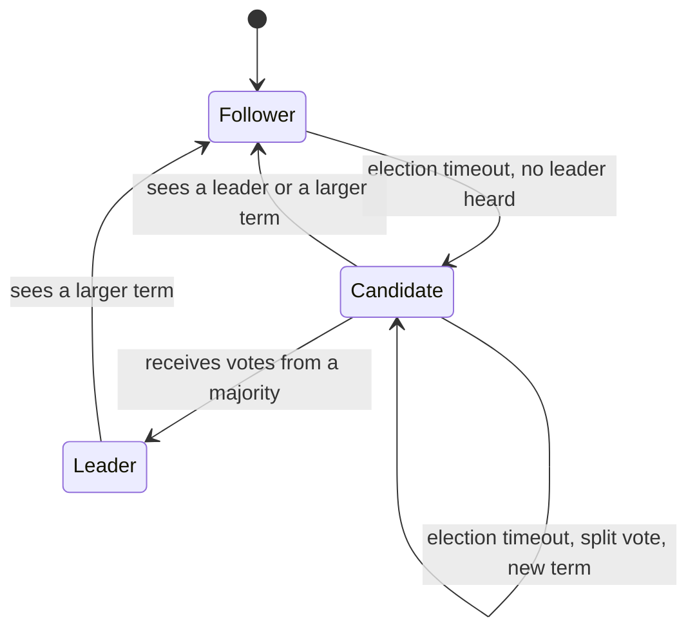
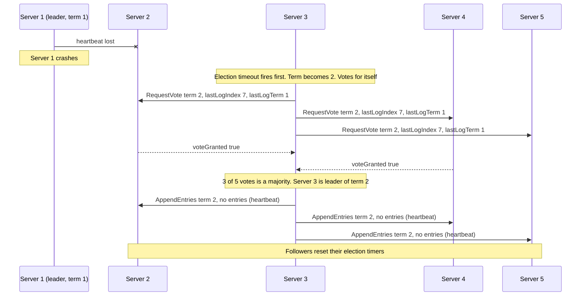
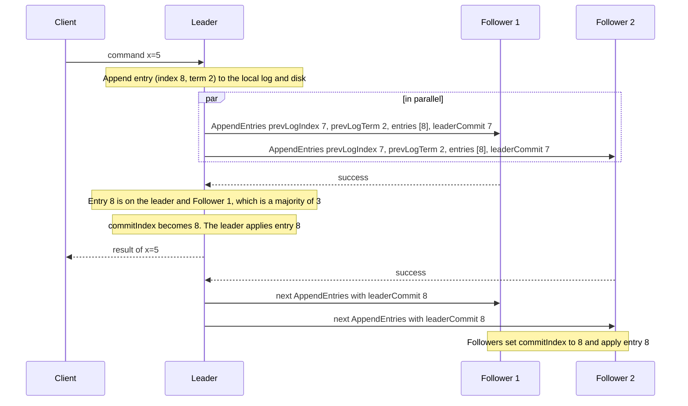
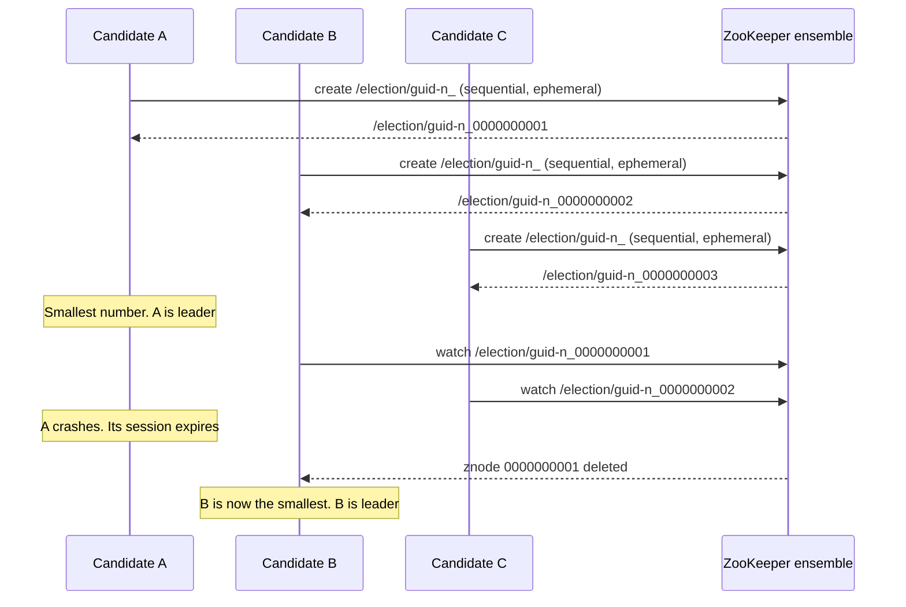

# Consensus and Leader Election

Consensus is the problem of making several nodes agree on one value even when some nodes crash and the network loses or delays messages. Almost every system that needs one leader, one ordering of writes, or one copy of its configuration solves it, usually by using a system that already implements it: etcd, ZooKeeper, or Consul. This page explains why consensus is needed, states the FLP impossibility result in one paragraph, explains Raft in detail (terms, leader election, log replication, the commit rule, the safety rules, membership changes, snapshots, and reads), gives Paxos in brief, shows how ZooKeeper and etcd build leader election, and lists what consensus costs. Time, clocks, and failure detection, which consensus relies on, are in [failures and time](01-failures-and-time.md). Replication with a leader is in [replication](../fundamentals/05-replication.md). The consistency model that consensus gives, linearizability, is in [consistency and CAP](../fundamentals/07-consistency-and-cap.md).

## Why It Matters

"How do you elect a leader?", "what happens when the leader fails?", "how does etcd or ZooKeeper stay consistent?", and "explain Raft" are standard questions in senior system design rounds, and they follow every answer that says "one primary node". A candidate who says "use ZooKeeper" without explaining why it works loses points. On the job, consensus sits under the metadata of Kubernetes (etcd), the controller of Kafka (ZooKeeper in older versions and a Raft-based quorum in current versions), the coordination of many databases, and every service that must run on exactly one node at a time. Knowing the cost of consensus (a majority round trip for each write) tells you when to use it for a small amount of critical data, and when not to put it on the data path of a high-throughput system.

## Core Concepts

**Consensus**: the problem in which a set of nodes each propose a value, and the nodes must decide on one of the proposed values. A consensus algorithm must give three properties:

- *Agreement*: no two nodes decide different values.
- *Validity*: the decided value is a value that some node proposed.
- *Termination*: every non-faulty node eventually decides.

**Replicated state machine**: a way to make a service fault tolerant. Each node runs a copy of a deterministic state machine. A consensus algorithm decides the order of the commands in a *replicated log*, and each node applies the commands in that order. Because the machines are deterministic and see the same commands in the same order, they reach the same state.

**Quorum and majority**: a *majority* is more than half of the nodes. Two majorities of the same set always share at least one node. This shared node is the reason that consensus is safe: a later decision can find the earlier decision. A cluster of `n` nodes tolerates `⌊(n-1)/2⌋` failures.

**Leader**: a node that orders the commands. Followers accept the order. If the leader fails, the nodes elect a new leader.

**Term (Raft)**: a number that counts elections. Each term has at most one leader. The term works as a logical clock (see [failures and time](01-failures-and-time.md)): a node that sees a larger term learns that its information is old. Paxos calls the same idea a *ballot number*, and ZooKeeper calls it an *epoch*.

**Log entry**: one command, with its position (index) and the term in which the leader received it.

**Committed entry**: a log entry that the cluster keeps through failures. In Raft, an entry is committed when it is stored on a majority of nodes, with the condition on the term in the section on the commit rule.

**Commit index**: the highest log index that the node knows is committed.

**Election timeout**: the time that a follower waits without a message from a leader before it starts an election.

**Heartbeat**: an `AppendEntries` message with no entries. The leader sends it at a fixed interval to keep its followers from starting an election.

**Fencing token**: a number that increases with each leader and that a resource checks. The resource rejects a request with an old token. A Raft term is a fencing token. See [distributed locks and leases](05-distributed-locks-and-leases.md).

**Lease**: permission that expires after a time. A node holds a lease while it renews it, and the permission ends when the lease expires.

**znode and ephemeral znode (ZooKeeper)**: a znode is a node in ZooKeeper's tree of data. An ephemeral znode exists as long as the session of the client that created it is active, and ZooKeeper deletes it when the session ends.

**Proposer, acceptor, learner (Paxos)**: a proposer suggests a value, an acceptor votes on proposals, and a learner finds out which value was chosen. A node often plays all three roles.

## How It Works

### Why consensus

Without consensus, a failure of the single node that makes decisions stops the system, and a second node that takes over without agreement can cause *split brain*: two leaders that both accept writes. The problems below reduce to consensus:

| Problem | What the nodes must agree on |
|---|---|
| Leader election | Which node is the leader now |
| Replicated log or state machine | The order of the commands |
| Atomic commit across nodes (see [distributed transactions](03-distributed-transactions.md)) | Commit or abort for each transaction |
| Group membership and configuration | Who is in the cluster and what the settings are |
| Lock service | Who owns a lock |
| Uniqueness (a unique name, a unique ID range) | Which of two competing requests wins |

### The FLP impossibility result

Fischer, Lynch, and Paterson (1985) proved that in a fully asynchronous system, no deterministic consensus protocol can guarantee that it terminates if even one node may crash. The reason is that the protocol cannot tell a crashed node from a very slow node. For any protocol, an adversary can delay messages so that the protocol never reaches a decision. FLP does not say that consensus is impossible in practice. It says that an algorithm cannot guarantee both safety and termination without an assumption about timing. Real algorithms keep safety in all cases (agreement and validity hold in every run, even in an asynchronous network), and they get termination from timeouts and randomization: Raft uses a randomized election timeout, and Paxos uses a distinguished proposer. When the network behaves badly, the algorithm may stop making progress, and it still does not decide wrong.

### Raft

Ongaro and Ousterhout designed Raft (2014) to be easier to understand than Paxos. It splits consensus into three parts: leader election, log replication, and safety. The paper reports a user study in which students answered questions about Raft better than questions about Paxos. A cluster has one leader at a time, and the leader handles all client requests.

#### Roles and terms

Each node is in one of three states.



Time is divided into terms. A term starts with an election. If a candidate wins, it leads for the rest of the term. If no candidate wins (a split vote), the term ends with no leader and a new term starts. Each node stores the current term. In every message, a node sends its term, and the receiver applies these rules:

- If the sender's term is smaller, the receiver rejects the message and returns its own term. The sender then steps down to follower.
- If the sender's term is larger, the receiver sets its term to the larger value and becomes a follower.

**State that each node stores.** Persistent state (written to disk before the node answers an RPC): `currentTerm`, `votedFor` (the candidate that got this node's vote in the current term), and the `log` (entries with a term and a command). Volatile state: `commitIndex` and `lastApplied`. The leader also keeps `nextIndex[]` and `matchIndex[]` for each follower. The node must persist `currentTerm` and `votedFor`, so that after a restart it does not vote twice in one term.

**Two RPCs.** `RequestVote` (sent by candidates) carries `term`, `candidateId`, `lastLogIndex`, and `lastLogTerm`. `AppendEntries` (sent by the leader, for replication and for heartbeats) carries `term`, `leaderId`, `prevLogIndex`, `prevLogTerm`, `entries[]`, and `leaderCommit`. A third RPC, `InstallSnapshot`, sends a snapshot to a follower that is far behind.

#### Leader election

A follower that does not hear from a leader for one election timeout becomes a candidate. It does these steps:

1. It increments `currentTerm`, votes for itself, and resets its election timer.
2. It sends `RequestVote` to all other nodes in parallel.
3. Each node that receives it grants its vote if all of these conditions hold: the candidate's term is not smaller than the node's term, the node has not voted for a different candidate in this term, and the candidate's log is at least as up to date as the node's log. The node stores its vote on disk before it replies.
4. If the candidate receives votes from a majority (counting its own), it becomes leader and immediately sends heartbeats to all nodes to establish its authority.
5. If the candidate receives `AppendEntries` from a node with a term that is not smaller than its own, it returns to follower.
6. If neither happens before the election timeout (a split vote), the candidate starts a new election with a larger term.

**Up to date.** The voter compares the last entries of the two logs. The log with the larger last term is more up to date. If the last terms are equal, the longer log is more up to date. This rule is the *election restriction*. It makes sure that a new leader has all committed entries, because a committed entry is on a majority, and a candidate needs a majority of votes, so at least one voter has the entry and refuses a candidate that lacks it.

**Randomized timeouts.** Each node picks its election timeout at random from a fixed interval, for example 150 to 300 ms (the example in the paper). Most of the time one node times out first, wins the election, and sends heartbeats before another node times out. The paper measured the effect: in a five-server cluster, with no randomness in the timeouts, leader election took more than 10 seconds in their tests because of repeated split votes, and with 5 ms of randomness the median downtime was 287 ms.



The numbers of the entries in the diagram are an example. If the election splits, for example when two candidates each get two votes in a five-node cluster, no candidate has three votes. Each candidate waits for its (random) timeout and tries again with a higher term, and one of them usually wins in the next round.

**Timing requirement.** Raft stays available when `broadcastTime << electionTimeout << MTBF`, where `broadcastTime` is the time to send an RPC to every node in parallel and receive the responses, and MTBF is the mean time between failures of one node. The paper states that broadcast time may range from 0.5 ms to 20 ms depending on the storage technology (because the receiver writes to disk before it answers), and that the election timeout is therefore likely between 10 ms and 500 ms. The paper recommends a conservative value of 150 to 300 ms. Safety does not depend on timing. Only the availability does.

**A node that returns from a partition.** A node that was cut off keeps incrementing its term each time its election timeout fires, and it does not win because the other nodes do not vote for it. When it reconnects, its large term makes the current leader step down, and the cluster runs a new election, although nothing was wrong. Ongaro's dissertation describes a *pre-vote* phase to avoid this: a candidate first asks whether a majority would vote for it, without changing any term. The paper (section 6) describes a related rule: a node that hears from a current leader within the minimum election timeout ignores `RequestVote`.

#### Log replication

The leader accepts client commands and replicates them.



The steps:

1. The leader appends the command to its own log as a new entry with its current term.
2. It sends `AppendEntries` to all followers in parallel. Each message carries the entries that follow `prevLogIndex`.
3. A follower accepts the message only if its log has an entry at `prevLogIndex` with the term `prevLogTerm`. This is the *consistency check*. If the check passes, the follower deletes any existing entry that conflicts with a new one (same index, different term) and all entries after it, appends the new entries, and replies success.
4. When the entry is stored on a majority (the leader counts itself), the leader marks it committed, applies the command to its state machine, and replies to the client.
5. The leader includes `leaderCommit` in later messages. A follower sets its `commitIndex` to the smaller of `leaderCommit` and the index of its last new entry, and applies the committed entries in order.

**Log matching.** Two properties follow from the consistency check and from the rule that a leader creates at most one entry for each index in a term: if two entries in different logs have the same index and term, they store the same command, and the logs are identical in all entries up to that index.

**Repairing a follower's log.** After a leader change, a follower's log may be shorter than the leader's, or may have extra entries that the old leader wrote and never committed. The new leader keeps `nextIndex` for each follower, which starts at the leader's last index plus 1. If the consistency check fails, the follower rejects the message, and the leader decrements `nextIndex` and tries again, until the check passes. Then the leader's entries replace the follower's conflicting entries. The leader never overwrites or deletes entries in its own log (the *append-only* property). The paper notes an optimization: the follower returns the term of the conflicting entry and the first index of that term, so that the leader skips a whole term at once.

#### The commit rule and why old-term entries need care

A leader does not commit an entry from an earlier term by counting replicas. It commits only entries from its own term by counting. When it commits one entry of its own term, all earlier entries in its log are committed with it, by log matching.

The reason is the scenario in the paper's Figure 8. Five servers, S1 to S5. The table lists the logs by the term of the entry at index 2.

| Step | Event | Logs at index 2 |
|---|---|---|
| a | S1 is leader in term 2 and replicates an entry at index 2 (term 2) to S2 only | S1: 2, S2: 2 |
| b | S1 crashes. S5 wins term 3 with votes from S3, S4, and S5 (their logs are shorter than or equal to S5's) and writes its own entry at index 2 (term 3) | S5: 3 |
| c | S5 crashes. S1 restarts and wins term 4. It continues to replicate the term-2 entry and stores it on S3. The entry is now on a majority | S1: 2, S2: 2, S3: 2 |
| d | If the leader counted replicas and committed the term-2 entry, and then S1 crashed, S5 could win (its last log term is 3, which is greater than 2) and overwrite index 2 on all nodes. A committed entry would be lost | S5 overwrites with term 3 |

The rule fixes this. In step c, S1 does not commit the term-2 entry by counting. It commits it only after a term-4 entry is on a majority. With a term-4 entry on a majority, S5 (last term 3) cannot win an election, because a majority of voters have a log with a last term of 4.

**No-op at the start of a term.** A new leader does not know which entries are committed. It appends a blank no-op entry at the start of its term. When the no-op is committed, all earlier entries are committed too.

#### Safety properties

Raft guarantees these properties at all times (Figure 3 of the paper):

| Property | Statement |
|---|---|
| Election Safety | At most one leader is elected in a given term |
| Leader Append-Only | A leader never overwrites or deletes entries in its log. It only appends |
| Log Matching | If two logs contain an entry with the same index and term, the logs are identical in all entries up to that index |
| Leader Completeness | If an entry is committed in a given term, the entry is present in the logs of the leaders of all higher terms |
| State Machine Safety | If a node applied an entry at an index to its state machine, no other node applies a different entry at that index |

Election Safety holds because each node votes at most once in a term, so only one candidate can get a majority. Leader Completeness holds because of the election restriction and the commit rule.

#### Membership changes

To replace a failed node or to change the cluster size, the configuration (the set of nodes) must change. A direct switch is unsafe: nodes switch at different times, so for a moment two disjoint majorities can exist (one of the old configuration, one of the new), and each can elect a leader in the same term.

The paper uses **joint consensus**, a two-phase change:

1. The leader writes a log entry for a joint configuration `C_old,new`. A node uses the latest configuration in its log as soon as it appends it, even before it is committed. While `C_old,new` is active, an election or a commit needs a separate majority from the old configuration and a separate majority from the new one. Nodes from both configurations can be leader.
2. When `C_old,new` is committed, the leader writes an entry for `C_new`. When `C_new` is committed, the old configuration is irrelevant, and nodes that are not in `C_new` can shut down.

No point exists at which `C_old` and `C_new` can both decide alone. The paper also covers three issues. A new node first joins as a non-voting member and catches up, so that it does not slow commits. A leader that is not in `C_new` steps down after it commits `C_new`. A removed node can disrupt the cluster by running elections, and the rule that ignores `RequestVote` within the minimum election timeout of a leader's heartbeat prevents it.

Ongaro's dissertation (2014) also describes a simpler method: change one node at a time. Any majority of the old configuration and any majority of the new configuration overlap when the two differ by one node, so no joint phase is needed. Many implementations use this method. The etcd FAQ says that, when you replace a failed member, you remove it first and then add its replacement.

#### Log compaction

The log cannot grow without limit. Each node takes a *snapshot* of its state machine at a committed index and discards the log entries before that index. The snapshot records the last included index and term. If a follower is so far behind that the leader already discarded the entries it needs, the leader sends the snapshot with `InstallSnapshot`.

#### Client interaction and linearizable reads

A client sends its command to the leader. If it contacts a follower, the follower tells it where the leader is (or forwards the request, as etcd does). If the leader crashes after it applies a command and before it replies, the client retries, and the command could run twice. Raft's answer is that the client gives each command a unique serial number, and the state machine remembers the last serial number for each client and returns the stored result for a repeat.

A read can go through the log, which is slow, or it can be answered by the leader without the log if two conditions hold. First, the leader knows the current commit index, which the no-op at the start of the term provides. Second, the leader confirms that it is still the leader by exchanging heartbeats with a majority before it answers. A leader that relied only on its own lease would use a time assumption (bounded clock skew), as the paper notes. A read that a follower answers from its own state may be stale.

#### Raft in production

The Raft website lists implementations. Etcd, Consul, CockroachDB, and TiKV are well-known users of Raft. For etcd, the documentation states that Raft is leader-based, that the leader handles all requests that need consensus, and that a follower forwards such a request to the leader.

### Paxos in brief

Paxos (Lamport, "The Part-Time Parliament", 1998; explained in "Paxos Made Simple", 2001) solves the same problem for one value (single-decree Paxos). Each proposal has a unique, increasing number `n`. The algorithm has two phases.

**Phase 1 (prepare).**
(a) A proposer picks a number `n` and sends `prepare(n)` to a majority of acceptors.
(b) An acceptor that gets `prepare(n)` with `n` greater than any number it already answered promises not to accept any proposal numbered below `n`, and it replies with the highest-numbered proposal that it already accepted (if any).

**Phase 2 (accept).**
(a) If the proposer receives replies from a majority, it sends `accept(n, v)` to them. The value `v` is the value of the highest-numbered proposal among the replies. If no reply carries a proposal, the proposer may choose any value.
(b) An acceptor accepts the proposal unless it already promised a number greater than `n`.

A value is *chosen* when a majority of acceptors accept the same proposal. The rule in phase 2(a) is the key to safety: a proposer must adopt a value that may already be chosen. Because two majorities overlap, the proposer hears about any chosen value.

**Liveness.** Two proposers can block each other: each completes phase 1 with a higher number than the other, which invalidates the other's phase 2, forever. The paper says that to guarantee progress, the system must elect a *distinguished proposer*, the only one that proposes, and notes that FLP shows that the election needs randomness or real time.

**Multi-Paxos** runs one Paxos instance for each position in a log. A stable leader runs phase 1 once for many instances and then only phase 2 for each command, so the steady-state cost is one round trip to a majority. This is the same cost as Raft in steady state.

| | Raft | Paxos (Multi-Paxos) |
|---|---|---|
| Specification | One complete algorithm with leader election, log replication, membership changes, and snapshots | Single-decree Paxos is short. The full log system is left to the implementer, and implementations differ |
| Leader | Required. Elected with a term | Optional for safety. Used for efficiency |
| Log | The leader's log has no holes. Entries are committed in order | Instances can fill in any order, and a new leader fills gaps |
| Who can become leader | Only a node with the most up-to-date log | Any node, which then learns missing values in phase 1 |
| Used in | etcd, Consul, CockroachDB, TiKV | Google Chubby and Spanner (Multi-Paxos), and variants in many systems |
| Teaching | Designed to be understood | Known for being hard to understand |

Zab, the protocol of ZooKeeper, is a third protocol of the same family. It orders updates by a transaction ID `zxid`, a pair `(epoch, counter)`, in which the epoch changes with each new leader. The ZooKeeper documentation states that leader activation ensures that only one leader uses a given epoch.

### Leader election built on a consensus service

Most applications do not run their own consensus. They use a coordination service that does, and they use its primitives to elect a leader. The primitive must tolerate failures of the leader, so it uses an ephemeral key or a lease: the key disappears when the owner stops responding.

#### ZooKeeper: ephemeral sequential znodes

ZooKeeper's recipes page describes this method:

1. Each candidate creates a znode `/election/guid-n_` with both the `SEQUENCE` and the `EPHEMERAL` flags. ZooKeeper appends a sequence number that is larger than any number used before under `/election`.
2. Each candidate reads the children of `/election`. The candidate with the smallest sequence number is the leader.
3. Each other candidate watches only the znode with the next smaller sequence number, not the leader's znode. When that znode is deleted, the candidate reads the children again. If it now has the smallest number, it becomes the leader. If not, it watches the next smaller znode.



Watching only the next znode avoids the *herd effect*: if all candidates watched the leader's znode, each leader failure would send a notification to every candidate, and every candidate would then read the children. The ZooKeeper documentation points out that this makes a spike of operations on the servers.

The documentation notes a limit: a znode with no preceding znode does not mean that its creator knows it is the leader, and the application may create a separate znode to confirm that the leader ran its start-up steps.

**Sessions and the stale leader.** ZooKeeper deletes the ephemeral znodes of a session when the session expires: the cluster has not heard from the client within the session timeout. The programmer's guide states that the client of an expired session learns about the expiry only when it re-establishes a connection. A leader that is paused, or that is cut off from ZooKeeper, can therefore keep acting as the leader after the others have elected a new one. The election alone does not stop the old leader. Recommendation: use a fencing token, for example the `zxid` of the election znode's creation or the version of a znode that the leader updates, and make the resource reject operations with an older token (see [distributed locks and leases](05-distributed-locks-and-leases.md)).

**Reads.** ZooKeeper orders all updates, but a client can read an older value from the server it is connected to. The documentation says that if a client must see the latest write from another client, it must call `sync()` before the read.

**Quorum and ensemble size.** The ZooKeeper overview states that the service stays available as long as a majority of the servers are available. Recommendation: use an odd number of servers (3 or 5), for the reason in the table of cluster sizes below.

#### etcd: leases and revisions

etcd stores keys in a replicated, ordered key-value store on top of Raft. Its documentation describes these primitives:

- A **lease** has a time-to-live (TTL). A lease expires if the cluster does not receive a keep-alive within the TTL. A key can be attached to at most one lease, and when the lease expires or is revoked, all keys attached to it are deleted. Each deletion creates a watch event.
- A client refreshes a lease with the `LeaseKeepAlive` call.
- Each change to the store gets a **revision**, and the documentation states that operations occur in a total order, which the revision implies. A key records the revision at which it was created and the revision of its last modification.
- A **watch** reports changes to a key or a range, in order.

The election pattern uses these primitives: each candidate creates a key under an election prefix, attached to its own lease, in a transaction that records the creation revision. The candidate with the lowest creation revision is the leader. The others watch the key that precedes theirs, as in the ZooKeeper recipe. If the leader stops renewing its lease, the key is deleted, the watcher sees the event, and the next candidate takes over. The etcd client libraries provide this pattern (the Go client has an `Election` type in its `concurrency` package). The creation revision, which increases with each election, is a usable fencing token.

The same caution as with ZooKeeper applies. The lease expires on the server's time, and the leader finds out later. A leader that pauses can wake up after the lease expired. Check the token at the resource.

**KV consistency.** The etcd documentation says that all KV operations are strictly serializable (linearizable and in a total order that agrees with real time). A *serializable* read, which a member answers from its local state without a majority check, is an option that is faster and can be stale (the FAQ states that serialized reads can be processed by any member).

#### Leader election inside a database or a message broker

The same pattern appears in databases and brokers. Older versions of Kafka elected the controller through a ZooKeeper ephemeral znode, and newer versions use a Raft-based controller quorum. MongoDB replica sets elect a primary with a protocol that is based on Raft. PostgreSQL has no built-in election, so tools such as Patroni use a distributed key-value store (etcd, ZooKeeper, or Consul) as the consensus layer (see [replication](../fundamentals/05-replication.md)).

### What consensus costs

| Cost | Explanation |
|---|---|
| Latency of a write | One round trip from the leader to a majority, plus the time to flush the log to disk on each node of that majority. The Raft paper gives 0.5 to 20 ms for the broadcast time, depending on storage |
| Throughput | The leader handles all writes, so its CPU, network, and disk limit the throughput. More nodes do not add write throughput. Batching and pipelining raise it |
| Quorum size | A write needs `⌊n/2⌋ + 1` nodes. More nodes make the quorum larger and the slowest node of the quorum matters more. The etcd FAQ says that write performance suffers with larger clusters |
| Availability | The cluster stops accepting writes when it has no majority. It tolerates `⌊(n-1)/2⌋` failures |
| Wide-area latency | If the nodes are in different regions, every commit waits for the round trip to the nearest majority. This is derived: the leader needs `⌊n/2⌋` follower replies, so the latency is the round trip to the `⌊n/2⌋`-th nearest follower |
| Disk | Each node must flush before it replies. A slow disk makes the leader slow, even if the network is fast. The etcd FAQ gives a case in which a slow disk makes a leader unable to commit within the election timeout |

**Odd node counts.** The etcd documentation gives the table of majority and failure tolerance:

| Cluster size `n` | Majority | Failures tolerated |
|---|---|---|
| 1 | 1 | 0 |
| 2 | 2 | 0 |
| 3 | 2 | 1 |
| 4 | 3 | 1 |
| 5 | 3 | 2 |
| 6 | 4 | 2 |
| 7 | 4 | 3 |

An even number gives no gain: 4 nodes tolerate 1 failure, the same as 3 nodes, and they need a larger quorum. A network partition of an even-sized cluster can also split it into two equal halves, and neither half has a majority. The etcd FAQ recommends an odd number of members. It says that Google's Chubby, a long-running production lock service, runs five nodes, that a five-member cluster tolerates two failures, and that this is enough in most cases.

**What not to do.** Do not place consensus on the data path of a high-volume store. Keep the replicated log for small, critical data (leader identity, configuration, metadata, locks), and use partitioning, with one consensus group for each partition, for large data. Spanner (Paxos) and CockroachDB (Raft) run a consensus group for each range of data. See [partitioning and sharding](../fundamentals/06-partitioning-and-sharding.md).

## Trade-offs and When to Use

| Approach | Guarantee | Cost | Use when |
|---|---|---|---|
| Consensus log (Raft, Paxos, Zab) | One agreed order. Linearizable operations. Tolerates `⌊(n-1)/2⌋` failures | A majority round trip per write. Leader bottleneck. No progress without a majority | Metadata, locks, leader election, configuration, small critical state |
| Leaderless quorum (Dynamo, Cassandra) | Overlapping read and write sets. Not linearizable by itself | Conflicts need resolution. Reads can be stale | High-volume data that tolerates eventual consistency (see [replication](../fundamentals/05-replication.md) and [consistency and CAP](../fundamentals/07-consistency-and-cap.md)) |
| Single primary with asynchronous replicas | Simple, fast writes | Failover can lose acknowledged writes, and split brain needs fencing | Data that accepts a small loss window, with a way to fence the old primary |
| Two-phase commit | Atomic commit over several resources | Blocks if the coordinator fails. Needs a reliable coordinator (see [distributed transactions](03-distributed-transactions.md)) | A transaction that spans several databases |
| Lease with a clock | Cheap mutual exclusion | Depends on bounded clock skew and on process pauses (see [failures and time](01-failures-and-time.md)) | Efficiency locks where a double run only wastes work |

**Build or use.** Recommendation: use an existing implementation (etcd, ZooKeeper, Consul, or a library such as Apache Ratis or Hashicorp Raft) and run it as a small cluster of 3 or 5 nodes. A correct implementation of consensus must handle disk failures, membership changes, snapshots, and many corner cases, and the cost of a mistake is data loss.

**When a leader election is not enough.** Election tells the nodes who the leader is now. It does not stop an old leader that has not noticed that it lost. Combine election with a fencing token, or make the leader's writes go through the consensus log.

**ZooKeeper or etcd.** Both give a consistent store with watches and short-lived keys. ZooKeeper has a hierarchical namespace, ephemeral znodes tied to sessions, and a long history in the Hadoop and Kafka ecosystems. etcd has a flat key space with leases, a gRPC API, and is the store of Kubernetes. Choose the one that your platform already runs.

## Java Example

The program below simulates leader election in a five-node Raft cluster. It implements the vote rule of `RequestVote`: the term check, the one vote in each term, and the election restriction (the candidate's log must be at least as up to date as the voter's log). It does not model timers, message loss, or log replication, so the order of the elections is fixed by the scenario in `main`. It shows three things: the first election, a candidate with a stale log that cannot win, and a new leader that has the committed entries.

```java
import java.util.ArrayList;
import java.util.List;

public class RaftElectionDemo {
    public static void main(String[] args) {
        List<RaftNode> nodes = new ArrayList<>();
        for (int id = 0; id < 5; id++) {
            nodes.add(new RaftNode(id));
        }

        System.out.println("Step 1: node 0 times out first in a new cluster.");
        elect(nodes, 0);

        System.out.println("Step 2: leader 0 appends two entries."
                + " Only nodes 1 and 2 receive them.");
        RaftNode leader = nodes.get(0);
        leader.log.add(leader.term);
        leader.log.add(leader.term);
        nodes.get(1).log.addAll(leader.log);
        nodes.get(2).log.addAll(leader.log);
        System.out.println("  The entries are on 3 of 5 nodes, so the leader commits them.");

        System.out.println("Step 3: leader 0 crashes."
                + " Node 3 has an empty log and times out first.");
        leader.alive = false;
        elect(nodes, 3);

        System.out.println("Step 4: node 1 has the full log and times out next.");
        elect(nodes, 1);

        for (RaftNode node : nodes) {
            System.out.println(node);
        }
    }

    static void elect(List<RaftNode> nodes, int candidateId) {
        RaftNode candidate = nodes.get(candidateId);
        candidate.becomeCandidate();
        int votes = 1;
        for (RaftNode peer : nodes) {
            if (peer == candidate || !peer.alive) {
                continue;
            }
            boolean granted = peer.handleRequestVote(candidate.term, candidate.id,
                    candidate.lastLogIndex(), candidate.lastLogTerm());
            System.out.println("  node " + peer.id + (granted ? " grants" : " denies")
                    + " its vote to node " + candidate.id + " for term " + candidate.term);
            if (granted) {
                votes++;
            }
        }
        int majority = nodes.size() / 2 + 1;
        if (votes >= majority) {
            candidate.role = "LEADER";
            System.out.println("  node " + candidate.id + " wins with " + votes
                    + " votes (majority is " + majority + ") and becomes leader of term "
                    + candidate.term);
        } else {
            System.out.println("  node " + candidate.id + " gets " + votes
                    + " votes (majority is " + majority + ") and stays a candidate");
        }
    }
}

class RaftNode {
    final int id;
    int term;
    Integer votedFor;
    String role = "FOLLOWER";
    boolean alive = true;
    final List<Integer> log = new ArrayList<>();

    RaftNode(int id) {
        this.id = id;
    }

    int lastLogIndex() {
        return log.size();
    }

    int lastLogTerm() {
        return log.isEmpty() ? 0 : log.get(log.size() - 1);
    }

    void becomeCandidate() {
        term++;
        votedFor = id;
        role = "CANDIDATE";
    }

    boolean handleRequestVote(int candidateTerm, int candidateId,
                              int candLastIndex, int candLastTerm) {
        if (candidateTerm < term) {
            return false;
        }
        if (candidateTerm > term) {
            term = candidateTerm;
            votedFor = null;
            role = "FOLLOWER";
        }
        boolean notVotedForOther = votedFor == null || votedFor == candidateId;
        boolean candidateUpToDate = candLastTerm > lastLogTerm()
                || (candLastTerm == lastLogTerm() && candLastIndex >= lastLogIndex());
        if (notVotedForOther && candidateUpToDate) {
            votedFor = candidateId;
            return true;
        }
        return false;
    }

    @Override
    public String toString() {
        return "node " + id + ": " + (alive ? role : "CRASHED") + ", term " + term
                + ", log terms " + log;
    }
}
```

<!-- expected-output -->
```text
Step 1: node 0 times out first in a new cluster.
  node 1 grants its vote to node 0 for term 1
  node 2 grants its vote to node 0 for term 1
  node 3 grants its vote to node 0 for term 1
  node 4 grants its vote to node 0 for term 1
  node 0 wins with 5 votes (majority is 3) and becomes leader of term 1
Step 2: leader 0 appends two entries. Only nodes 1 and 2 receive them.
  The entries are on 3 of 5 nodes, so the leader commits them.
Step 3: leader 0 crashes. Node 3 has an empty log and times out first.
  node 1 denies its vote to node 3 for term 2
  node 2 denies its vote to node 3 for term 2
  node 4 grants its vote to node 3 for term 2
  node 3 gets 2 votes (majority is 3) and stays a candidate
Step 4: node 1 has the full log and times out next.
  node 2 grants its vote to node 1 for term 3
  node 3 grants its vote to node 1 for term 3
  node 4 grants its vote to node 1 for term 3
  node 1 wins with 4 votes (majority is 3) and becomes leader of term 3
node 0: CRASHED, term 1, log terms [1, 1]
node 1: LEADER, term 3, log terms [1, 1]
node 2: FOLLOWER, term 3, log terms [1, 1]
node 3: FOLLOWER, term 3, log terms []
node 4: FOLLOWER, term 3, log terms []
```

Read the output as follows. In step 3, node 3 has an empty log and requests votes for term 2. Nodes 1 and 2 hold the two committed entries, so their logs are more up to date, and they deny the vote. Node 3 gets two votes (its own and node 4's), which is not a majority. Node 1 times out next, with term 3, and wins, because nodes 2, 3, and 4 find its log at least as up to date as theirs. Node 3 and node 4 end with empty logs. In a complete Raft implementation, the new leader's `AppendEntries` messages would copy the two entries to them.

## Interview Angle

### Questions

??? question "Explain how Raft elects a leader."

    **Direct answer:** a follower that hears no heartbeat for a randomized election timeout becomes a candidate, increments its term, votes for itself, and asks all other nodes for votes. A candidate that gets votes from a majority becomes the leader.

    **Rules that make it safe:** a node votes at most once in a term, and it stores the vote on disk. A node grants its vote only if the candidate's term is not smaller than its own and the candidate's log is at least as up to date as its own (a larger last term, or the same last term and a log that is at least as long). A majority is needed, so at most one candidate wins a term. The log rule means that the winner has every committed entry.

    **Liveness:** if two candidates split the votes, no one wins, and each candidate retries after another random timeout with a larger term. The randomness makes repeated ties unlikely. The leader sends heartbeats at a fixed interval, smaller than the election timeout, to keep the followers quiet.

    **Edge case:** the election timeout must be much larger than the broadcast time and much smaller than the mean time between failures. Raft stays safe when this does not hold, and it can lose availability through repeated elections.

??? question "How does Raft replicate a log entry, and when is the entry committed?"

    **Direct answer:** the leader appends the entry to its log and sends `AppendEntries` to all followers. The entry is committed when the leader has stored it on a majority of the nodes, including itself.

    **Mechanism:** each `AppendEntries` carries `prevLogIndex` and `prevLogTerm`. The follower accepts it only if its log has an entry at that index with that term. If not, it rejects, and the leader steps `nextIndex` back and retries until the logs match, and then it overwrites the follower's conflicting entries. After the commit, the leader applies the entry and replies to the client, and it passes `leaderCommit` to the followers in later messages so that they apply it.

    **Edge case:** the leader commits by counting replicas only for an entry from its current term. It commits older entries indirectly, when a current-term entry that follows them is committed. This rule prevents the loss of an entry that was on a majority but was not committed, which the paper shows in its Figure 8. A new leader therefore appends a no-op entry at the start of its term.

??? question "Why does a Raft cluster need an odd number of nodes, and how many failures does it tolerate?"

    **Direct answer:** it does not need an odd number, and an odd number is the efficient choice. A cluster of `n` nodes needs a majority of `⌊n/2⌋ + 1` to commit, so it tolerates `⌊(n-1)/2⌋` failures.

    **Reason:** 3 nodes tolerate 1 failure. 4 nodes also tolerate 1 failure, because the majority is 3. The fourth node adds cost and a larger quorum and gives no extra tolerance. 5 nodes tolerate 2, and 7 nodes tolerate 3. An even-sized cluster that a partition splits in two equal halves has no majority on either side.

    **Trade-off:** a larger cluster tolerates more failures and has slower writes, because the leader waits for more replies and the slowest node of the quorum matters more. The etcd documentation says that Google's experience, with Chubby, suggests five nodes, and that a larger cluster reduces write performance.

??? question "What is the FLP result, and how do real systems get around it?"

    **Direct answer:** in a fully asynchronous system with no timing assumption, no deterministic algorithm can guarantee consensus if even one node may crash. The result is by Fischer, Lynch, and Paterson (1985).

    **Reason:** a slow node and a crashed node look the same. An adversary that controls the delay of messages can keep the algorithm from deciding forever.

    **Workaround:** real algorithms keep safety in every run and get liveness from a timing assumption or randomization. Raft uses randomized election timeouts. Paxos relies on a distinguished proposer, which needs a leader election with timeouts. If the network is badly behaved, the system stops making progress, and it does not decide two different values.

    **Edge case:** FLP does not forbid consensus in practice. It forbids a guarantee of termination in a model with no timing assumption.

??? question "Compare Raft and Paxos."

    **Direct answer:** both reach agreement with a majority and stay safe under crashes and message loss. Raft specifies a complete replicated-log protocol with a strong leader. Paxos is a family of protocols whose core is single-value agreement.

    **Differences:** Raft's log has no holes and the leader has the most complete log (election restriction), so entries flow in one direction, from the leader. In Multi-Paxos, a new leader runs phase 1 to learn the accepted values and fills gaps, so logs may have holes for a time. Raft includes membership change and snapshots in the specification. Paxos leaves these to the implementer. Both cost one round trip to a majority per command in steady state.

    **Edge case:** the Raft paper reports that the authors found it easier for students to learn, and that Paxos implementations (for example, in Chubby) needed substantial extra design. Production systems exist on both sides, and the choice rarely changes performance.

??? question "How would you implement leader election with ZooKeeper? What goes wrong?"

    **Direct answer:** each candidate creates an ephemeral sequential znode under an election path. The candidate with the smallest sequence number is the leader. Each other candidate watches only the next smaller znode, and takes over when that znode disappears.

    **Reason:** an ephemeral znode is deleted when the session ends, so a crashed leader is replaced. Watching only the predecessor avoids the herd effect on a leader failure.

    **What goes wrong:** the session expires only after the session timeout, so the cluster detects a failed leader after that time, not at once. The leader that was paused or partitioned can learn about its expired session late, so it can act as leader while a new leader exists. A fencing token (for example the `zxid` or a znode version) at the resource prevents damage. Also, a read can be stale unless the client calls `sync()`.

    **Trade-off:** a short session timeout means a fast failover and false failovers during pauses. A long one means a slow failover.

??? question "How do you make a leader election safe against a paused or partitioned old leader?"

    **Direct answer:** give each leader a token that increases with each election, and make the protected resource reject any request with an older token. The election itself cannot stop the old leader, so the check must be at the resource.

    **Reason:** a leader holds its role because of a lease or a session. A garbage-collection pause, a stopped virtual machine, or a partition can last longer than the lease. When the old leader resumes, it believes that it is still the leader.

    **Design:** use the Raft term, the etcd creation revision, or the ZooKeeper `zxid` as the token. The storage service stores the highest token it has seen and refuses lower ones. Alternatively, send the leader's writes through the consensus log, so that the log orders them and the old leader's writes fail.

    **Edge case:** a lock that protects only efficiency (a duplicate job wastes work) can use a lease alone. A lock that protects correctness needs the token. See [distributed locks and leases](05-distributed-locks-and-leases.md).

??? question "How does a Raft cluster change its membership safely?"

    **Direct answer:** it changes the configuration through the log, either with joint consensus or one node at a time.

    **Reason:** a direct switch lets two different majorities (old and new configuration) exist at once, and each can elect a leader. Joint consensus uses a transitional configuration `C_old,new` in which every decision needs a majority of both the old and the new configuration. After `C_old,new` is committed, the leader writes `C_new`. Changing one node at a time works because any majority of the old and any majority of the new configuration overlap when the sets differ by one node.

    **Edge case:** a new node first joins as a non-voting learner and catches up, so that it does not stall commits. A leader that is not in the new configuration steps down after it commits `C_new`. The etcd FAQ says to remove the failed member first and then add its replacement.

??? question "A read-heavy service uses etcd. How do you get linearizable reads, and what do they cost?"

    **Direct answer:** the default read in etcd is linearizable. The leader confirms with a majority that it is still the leader before it answers. A serializable read is an option that any member answers from its local state, with possible staleness.

    **Reason:** a leader that answers from its own state can be a deposed leader that does not know it. The Raft paper requires two steps: the leader knows the commit index (the no-op at the start of the term), and it exchanges heartbeats with a majority before it replies. A lease on the leader's role avoids the heartbeat exchange and depends on bounded clock skew.

    **Trade-off:** a linearizable read costs a round trip to a majority and loads the leader. A serializable read spreads the load and may return old data. Use the second for data where staleness is acceptable, for example a cached configuration, and use the first for a lock check or a leader lookup that decides correctness.

### Follow-up Questions

??? question "What happens if the leader is partitioned from the majority?"

    The majority side elects a new leader with a higher term and continues. The old leader cannot commit, because it cannot reach a majority, so clients that talk to it get no successful writes. When the partition heals, the old leader sees the higher term, steps down, and discards its uncommitted entries. The leader did not acknowledge the entries that it did not commit.

??? question "Can Raft lose a committed entry?"

    No, if the safety rules hold and a majority of the nodes keep their disks. An entry is committed when a majority stores it, and the election restriction means that only a node with every committed entry can win. If a majority of nodes lose their data, the guarantee fails, which is the reason that nodes must flush the log to stable storage before they reply.

??? question "Why does a node store `votedFor` and `currentTerm` on disk?"

    A node that restarts must not vote twice in one term, and it must not use an old term. If the node forgot its vote, it could vote for two candidates in the same term, and two leaders could win it. This is a violation of Election Safety.

??? question "Why not use a lease and wall clocks instead of consensus for leader election?"

    A lease needs a bound on the clock rate and a bound on process pauses. When either bound fails, two nodes can believe they are the leader. Consensus keeps safety without a timing assumption (only liveness depends on timing). A lease is acceptable when a rare double leader costs only some wasted work.

??? question "How do you size the election timeout in practice?"

    Measure the broadcast time, including the disk flush, and choose a timeout that is about 10 times larger, and much smaller than the time between failures. The Raft paper suggests 150 to 300 ms for typical data-center networks. In a wide-area cluster, increase both the heartbeat interval and the election timeout, as the etcd FAQ explains, because a timeout that is too short causes repeated elections.

### Red Flags

- Saying "the nodes vote and the majority wins" with no mention of terms, the log rule, or persisted votes.
- Using two nodes (or any even number with no tie-breaker) for a consensus group.
- Believing that an election removes the old leader. A paused or partitioned leader may still act, and needs fencing.
- Saying that Raft has no liveness problem, or that FLP makes consensus impossible.
- Placing every write of a high-volume system through one consensus group.
- Reading from a follower and calling the read linearizable.
- Claiming that an entry is committed when it is on a majority, in every case. The rule for old-term entries matters.
- Implementing your own consensus for production with no proven library.

## Common Mistakes

| Mistake | Effect | Fix |
|---|---|---|
| Running a two-node or four-node consensus cluster | No extra tolerance. A partition leaves no majority | Use 3 or 5 nodes |
| Using an election lock with no fencing token | A paused leader corrupts data after a new leader takes over | Check a token that increases with each leader at the resource |
| Setting the election timeout below the network and disk latency | Repeated elections and no progress | Set it about an order of magnitude above the broadcast time |
| Putting a consensus group on the hot data path | The leader limits throughput | Use consensus for metadata, and partition the data (one group for each partition) |
| Reading from followers and expecting fresh data | Stale reads | Use a linearizable read, or `sync()` in ZooKeeper, or accept staleness on purpose |
| Placing all nodes of a cluster in one failure domain | One rack or zone failure removes the majority | Spread the nodes across zones. Account for the latency |
| Adding a new member to an unhealthy cluster | If the new member fails to join, the cluster can lose its quorum for good (the etcd FAQ warns about this) | Restore health first, remove the failed member, and then add its replacement |
| Slow or shared disks under the consensus log | The leader cannot flush on time and loses leadership | Use fast, dedicated disks. Monitor the flush latency |
| Treating a lease expiry as an instant event | A node acts after its lease expired | Stop work before the lease end by a margin, and fence |

## Commonly Confused With

| Looks like | Difference | Deciding question |
|---|---|---|
| Raft and Paxos | Raft is one complete replicated-log algorithm with a strong leader. Paxos is a family that starts with single-value agreement | Do I need a complete log protocol, or one decision? |
| Consensus and two-phase commit | Consensus tolerates the failure of a minority and makes progress as long as a majority works. Two-phase commit needs all participants to agree and blocks if the coordinator fails (see [distributed transactions](03-distributed-transactions.md)) | Is the agreement about one value among replicas, or a commit across different resources? |
| Leader election and a distributed lock | Election names one long-lived leader. A lock grants a short exclusive use of a resource. Both need fencing (see [distributed locks and leases](05-distributed-locks-and-leases.md)) | Does the holder run for a long time as a role, or for a short time as a critical section? |
| Quorum read and linearizable read | A quorum of `R + W > N` in a leaderless store does not give linearizability. A consensus read does (see [consistency and CAP](../fundamentals/07-consistency-and-cap.md)) | Does the store use a consensus log? |
| Term, epoch, and fencing token | A term (Raft), an epoch (Zab, Paxos ballot) and a fencing token are all numbers that increase with each leader. A fencing token is the value that a resource checks | Which number does the resource compare? |
| Committed and applied | Committed means that the entry is safe in the log. Applied means that the state machine ran it | Has the state machine run the command? |
| Replication and consensus | Replication copies data. Consensus makes the nodes agree on the order and on the leader (see [replication](../fundamentals/05-replication.md)) | Must all nodes agree on one order? |
| Raft term and wall-clock time | A term counts elections and has no relation to time | Am I comparing leaders or moments? |

## Quick Reference Card

- Consensus: agreement, validity, termination. A replicated log gives a replicated state machine.
- FLP (1985): no deterministic protocol guarantees termination in an asynchronous system with one crash. Real protocols keep safety in every run and use timeouts or randomness for liveness.
- Majority: `⌊n/2⌋ + 1`. Failures tolerated: `⌊(n-1)/2⌋`. Use 3 or 5 nodes. An even number adds nothing.
- Raft roles: follower, candidate, leader. Terms count elections. One leader for each term.
- Election: timeout, term + 1, vote for self, `RequestVote`. A voter checks the term, one vote for each term, and the candidate's log is at least as up to date. Majority wins. Randomized timeouts (150 to 300 ms in the paper).
- Replication: the leader appends and sends `AppendEntries` with `prevLogIndex` and `prevLogTerm`. The consistency check keeps the logs matched. Committed when it is on a majority, and only counting entries of the current term.
- Safety: Election Safety, Leader Append-Only, Log Matching, Leader Completeness, State Machine Safety.
- Membership: joint consensus or one node at a time. Snapshots compact the log.
- Reads: a leader needs the commit index and a heartbeat majority for a linearizable read.
- Paxos: prepare (promise) and accept. A proposer adopts the highest-numbered accepted value. A distinguished proposer gives progress. Multi-Paxos is a log of instances.
- ZooKeeper election: ephemeral sequential znodes, watch the predecessor. etcd election: a lease and a revision. Both need fencing for old leaders.
- Cost: a majority round trip plus a disk flush per write. The leader is the throughput limit. Use consensus for small, critical data.

## Further Reading

- Ongaro and Ousterhout. "In Search of an Understandable Consensus Algorithm". USENIX ATC 2014. The Raft paper, with the full rules in its Figure 2. <https://raft.github.io/raft.pdf>
- The Raft website and visualization: <https://raft.github.io/>. A list of implementations and an animation of elections and replication.
- Ongaro. "Consensus: Bridging Theory and Practice". PhD dissertation, Stanford University, 2014. Single-server membership changes, pre-vote, and client interaction.
- Lamport. "Paxos Made Simple". ACM SIGACT News 32(4), 2001. A short, plain statement of Paxos and Multi-Paxos. <https://lamport.azurewebsites.net/pubs/paxos-simple.pdf>
- Lamport. "The Part-Time Parliament". ACM Transactions on Computer Systems 16(2), 1998. The original Paxos paper.
- Fischer, Lynch, and Paterson. "Impossibility of Distributed Consensus with One Faulty Process". Journal of the ACM 32(2), 1985. The FLP result.
- Hunt, Konar, Junqueira, and Reed. "ZooKeeper: Wait-free Coordination for Internet-scale Systems". USENIX ATC 2010. The design of ZooKeeper and its recipes.
- Apache ZooKeeper documentation, "ZooKeeper Recipes and Solutions" (leader election): <https://zookeeper.apache.org/doc/current/recipes.html>. The ephemeral sequential znode recipe and the herd effect.
- Apache ZooKeeper documentation, "ZooKeeper Programmer's Guide" and "ZooKeeper Internals": <https://zookeeper.apache.org/doc/current/zookeeperProgrammers.html>. Sessions, ephemeral nodes, consistency guarantees, `sync`, and the `zxid`.
- etcd documentation, "FAQ" (cluster size, odd numbers, failure tolerance): <https://etcd.io/docs/v3.5/faq/>. The quorum table and the advice on cluster size.
- etcd documentation, "etcd API" (leases, keep-alive, revisions) and "KV API guarantees": <https://etcd.io/docs/v3.5/learning/api/>. The lease model and the consistency guarantees.
- Burrows. "The Chubby Lock Service for Loosely-Coupled Distributed Systems". OSDI 2006. A production lock service built on Paxos.
- Junqueira, Reed, and Serafini. "Zab: High-performance broadcast for primary-backup systems". DSN 2011. The ZooKeeper atomic broadcast protocol.
- Kleppmann. *Designing Data-Intensive Applications*, chapter 9 ("Consistency and Consensus"). Linearizability, total order broadcast, and the equivalence with consensus.
- Corbett et al. "Spanner: Google's Globally-Distributed Database". OSDI 2012. Paxos groups for each data range, with TrueTime for timestamps.
