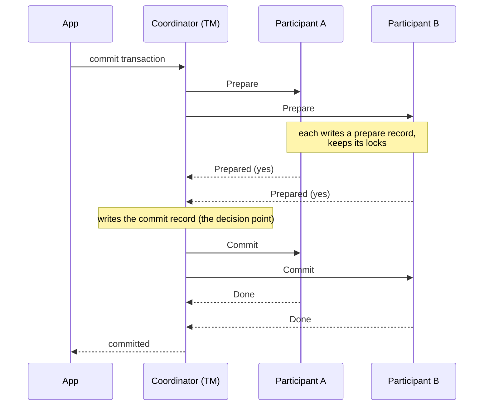
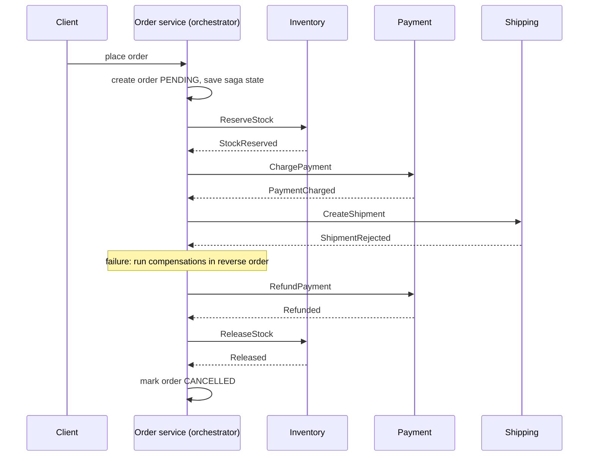
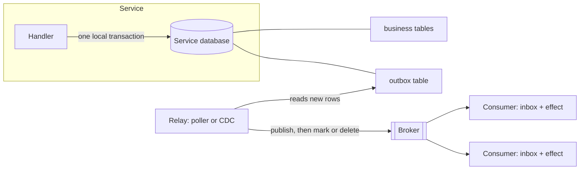
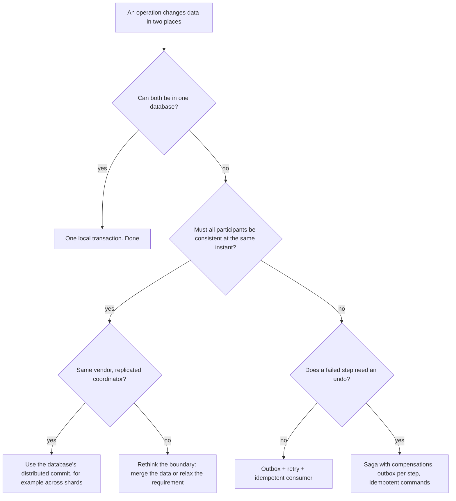

# Distributed Transactions

A transaction that changes data in more than one place must either change all of it or none of it. On one database, the database engine guarantees this. When the data lives in several databases, or in a database and a message broker, no single engine can guarantee it, and the system needs a protocol. This page covers the protocols that interviews and production systems use: two-phase commit (2PC), sagas, and the transactional outbox with its partner, the inbox. It also examines what "exactly-once" claims cover, and it explains when to design a system so that it needs no distributed transaction at all. The page states facts about protocols from the original papers (Gray and Lamport 2006, Garcia-Molina and Salem 1987) and facts about products from their documentation. The broker side of the outbox is in [message queues and streams](../fundamentals/08-message-queues-and-streams.md). The event-driven style that sagas live in is in [event-driven architecture](../fundamentals/16-event-driven-architecture.md). Consensus, which makes commit protocols fault-tolerant, is in [consensus and leader election](02-consensus-and-leader-election.md).

## Why It Matters

Every system design that splits data across services meets this question: "What happens if the payment succeeds and the inventory update fails?" Checkout, money transfer, booking, and order fulfillment all have the shape. Interviewers use the question to test four things: whether you know that a network call can fail after it succeeded on the other side, whether you can name the protocols (2PC, saga, outbox) and their costs, whether you can say what "exactly-once" really means, and whether you know when to avoid the problem by keeping the data in one database. On the job, the same knowledge decides whether a crash duplicates a payment, whether a message is lost between a database commit and a broker publish, and whether a stuck coordinator freezes rows for hours. The most common failure in interviews is to draw two services and a message queue, say "we use Kafka for consistency", and to name no protocol and no failure case.

## Core Concepts

| Term | Definition |
|---|---|
| Local transaction | A transaction inside one database. The database engine gives it atomicity, consistency, isolation, and durability (ACID). See `kb/databases/04-transactions-and-isolation.md` |
| Distributed transaction | A transaction whose operations run at several sites (databases, services, or a database and a broker) and that ends with one commit or abort request. The sites must all commit or all abort |
| Atomic commit problem | The agreement problem for a distributed transaction: all participants decide the same outcome (commit or abort), and they commit only if all of them can |
| Transaction manager (TM), or coordinator | The process that runs the commit protocol for one transaction. Gray and Lamport call it the TM |
| Resource manager (RM), or participant | A process that holds part of the data and can commit or abort its part. A database that takes part in a distributed transaction is an RM |
| Prepared state | The state of an RM that has promised it can commit. It keeps its locks and its changes on durable storage until the TM sends the outcome. It cannot abort on its own after this point |
| In-doubt transaction | A transaction that an RM has prepared and for which the RM has not received the outcome. The RM cannot decide alone |
| Two-phase commit (2PC) | A protocol with a voting phase (prepare) and a decision phase (commit or abort) |
| Blocking protocol | A protocol in which the failure of one process can stop other processes from deciding. 2PC blocks if the TM fails at the wrong time |
| XA | The X/Open standard interface between a TM and RMs for 2PC (the X/Open "Distributed Transaction Processing: The XA Specification"). In Java, the JDK package `javax.transaction.xa` defines the RM side (`XAResource`, `Xid`), and Jakarta Transactions (formerly the Java Transaction API, JTA) defines the TM side |
| Saga | A long transaction that is split into a sequence of local transactions T1 to Tn. Each Ti (except the last) has a compensating transaction Ci. If a step fails, the system runs the compensations of the steps that committed |
| Compensating transaction | A transaction that undoes the effect of a committed step in a business sense. It does not restore the old database state, because other transactions may have changed the data since |
| Orchestration and choreography | Two ways to coordinate a saga. An orchestrator sends commands to participants (orchestration). Participants react to each other's events (choreography) |
| Dual write | A service changes its database and then calls another system (a broker, a cache, a service). The two writes are not atomic |
| Transactional outbox | A table in the service's own database that stores the events to publish. The service writes the business change and the event row in one local transaction. A relay publishes the rows |
| Relay | The process that reads outbox rows and publishes them. It polls the table, or it reads the database log (change data capture, CDC) |
| Inbox | A table in the consumer's database that records the IDs of messages that the consumer already handled. The consumer writes the effect and the ID in one local transaction |
| Idempotent operation | An operation that has the same effect when applied once or many times |
| Idempotency key | A unique ID that a caller attaches to a request, so that the receiver can detect a repeat |
| Exactly-once effect | The state after processing equals the state after processing each message once. A system gets it from at-least-once delivery plus an idempotent effect |

## How It Works

### Why Distributed Transactions Are Hard

On one machine, a crash stops all operations at once, and the log tells the recovery process what to undo. Across machines, three facts break this:

1. **Partial failure.** One participant can crash while the others keep running. A caller that sends a request and gets no reply cannot tell whether the request failed, or the participant committed and the reply was lost. See [failures and time](01-failures-and-time.md).
2. **No shared clock and no shared log.** Each participant decides from its own state and from the messages that it receives. A message can arrive late, twice, or never.
3. **Agreement needs a protocol.** All participants must reach the same decision, even if some of them fail. This is the atomic commit problem. Fault-tolerant agreement is the consensus problem, and it needs a majority quorum (see [consensus and leader election](02-consensus-and-leader-election.md)).

The two families of answers differ in what they promise:

| Family | Promise | Cost |
|---|---|---|
| Atomic commit (2PC, Paxos Commit) | All participants commit or none does, and no outside transaction sees a partial result (isolation, with locks) | Locks held across network round trips. Blocking if the coordinator fails (2PC) |
| Sagas and the outbox | Each step is a local transaction. If a later step fails, a compensation runs. The system reaches a consistent end state, but other transactions can see the middle states | No isolation. The application writes compensations and handles duplicates |

### Two-Phase Commit

2PC is the classic atomic commit protocol. Gray and Lamport (2006, section 3) describe it with one TM and N RMs.

**The protocol.**

1. **Phase 1 (prepare).** The TM sends `Prepare` to every RM. Each RM that can commit writes its changes and a prepare record to durable storage, keeps its locks, and replies `Prepared` (a yes vote). An RM that cannot commit aborts its part and replies `Aborted` (a no vote).
2. **Phase 2 (decide).** If all RMs voted yes, the TM writes a commit record to its own durable log and sends `Commit` to all RMs. Otherwise the TM sends `Abort`. Each RM applies the outcome, releases its locks, and acknowledges.



**The rule that makes it correct.** Each process writes its state to durable storage before it sends a message that depends on the state. Gray and Lamport state: "Each process records its current state in stable storage before sending any message while in that state." After a crash, a process reads its log and continues. A prepared RM that restarts is still prepared and still waits for the outcome. The TM's commit record is the decision point: once it is durable, the transaction is committed, even if no RM knows yet.

**Cost in the normal case.** Gray and Lamport count the messages for their variant, in which the first RM to prepare starts the protocol: 3N - 1 messages, four message delays until the RMs learn the commit, and two stable-storage write delays if all RMs prepare concurrently (three if not). The textbook variant, in which the TM starts by sending `Prepare` to all N RMs, sends N prepare messages, N votes, and N decisions. Bernstein, Hadzilacos, and Goodman (*Concurrency Control and Recovery in Database Systems*, 1987, chapter 7) count it the same way: "in the absence of failures, the protocol uses 3n messages" in three rounds. Acknowledgements of the decision are extra. The textbook needs them only so that the TM can forget the transaction after every RM has applied the outcome, so they are not on the commit path. In both variants, the cost is two round trips and at least two forced disk writes on the path of every commit.

#### What Happens When Something Fails

| Failure | What happens | Outcome |
|---|---|---|
| An RM fails before it votes | The TM does not receive its vote and times out | The TM aborts. Safe |
| An RM votes no | The TM sends `Abort` to all | Abort. Safe |
| The TM fails before it writes the commit record | The TM restarts and finds no decision. It aborts. RMs that voted yes wait until it returns | Abort, but prepared RMs hold their locks while they wait |
| The TM fails after it writes the commit record and before it sends `Commit` | The TM restarts, reads its log, and sends `Commit` again | Commit, but prepared RMs hold their locks until the TM returns |
| An RM fails after it voted yes | The RM restarts, finds a prepare record without an outcome, and asks the TM | The TM replies with the outcome. The RM applies it |
| The TM fails right after all RMs voted yes, and it stays down | The RMs cannot decide: only the TM knows whether it wrote a commit or an abort | **Blocked** |

**The blocking problem.** Gray and Lamport (section 3.3): "the failure of the TM can cause the protocol to block until the TM is repaired. In particular, if the TM fails right after every RM has sent a Prepared message, then the other RMs have no way of knowing whether the TM committed or aborted the transaction." A prepared RM cannot abort alone, because the TM may have decided commit and told another RM already. It cannot commit alone, because another RM may have voted no. So it waits, and it holds its locks. Every other transaction that needs those rows waits too.

Participants can ask each other. Bernstein, Hadzilacos, and Goodman call this the **cooperative termination protocol**: an RM that times out while it is prepared sends a decision request to every other process. If a responder has already decided, it sends the outcome. If a responder has not voted yet, it aborts on its own and replies `Abort`. If the responder is also prepared and does not know the outcome, it cannot help. The textbook concludes that the cooperative termination protocol "reduces the probability of blocking, it does not eliminate it". It also states a general limit (Proposition 7.1): "If communication failures or total failures are possible, then every ACP may cause processes to become blocked." (ACP is the textbook's term for an atomic commitment protocol.)

!!! warning "A prepared transaction is a lock that survives a crash"
    The PostgreSQL documentation for `PREPARE TRANSACTION` states that "it is unwise to leave transactions in the prepared state for a long time". A prepared transaction "continues to hold whatever locks it held", it interferes with the ability of `VACUUM` to reclaim storage, and "in extreme cases" it can make the database shut down to prevent transaction ID wraparound. The feature is off by default: `max_prepared_transactions` is zero. The documentation also says the command "is not intended for use in applications or interactive sessions" and exists for "an external transaction manager". The TM must track prepared transactions and resolve them after a crash.

#### XA in MySQL

MySQL exposes the RM side of XA as SQL statements. The MySQL 8.4 reference manual states the facts that matter to a TM:

- "Support for XA transactions is available for the InnoDB storage engine." Other storage engines cannot take part.
- A branch moves through states. `XA START` makes it `ACTIVE`, `XA END` makes it `IDLE`, and `XA PREPARE` "puts the transaction in the `PREPARED` state". `XA COMMIT ... ONE PHASE` "prepares and commits the transaction" in one step, for a TM that has only one RM.
- A prepared branch survives: "an XA transaction in `PREPARED` state is now persistent until an explicit `XA COMMIT` or `XA ROLLBACK` statement is issued". MySQL writes the part up to `XA PREPARE` to the binary log, and the commit or rollback as a second part, so replicas see the prepared state too.
- Recovery: `XA RECOVER` "returns information for those XA transactions on the MySQL server that are in the `PREPARED` state", "regardless of which client started it". It needs the `XA_RECOVER_ADMIN` privilege. A TM that restarts runs `XA RECOVER` on every RM and commits or rolls back each listed XID according to its own log.
- Detached transactions: in MySQL 8.4 the system variable `xa_detach_on_prepare` is `ON` by default. After `XA PREPARE`, the branch is disconnected from the session, and another connection can commit or roll it back. This is what lets a recovering TM finish a branch that a dead connection prepared.

The statements below are the manual's example of one branch. The TM sends `XA PREPARE` to every branch, writes its decision, and then sends `XA COMMIT` (or `XA ROLLBACK`) to every branch. This is MySQL syntax, and the page checker does not run it.

<!-- sql-skip: mysql -->
```sql
XA START 'xatest';
INSERT INTO mytable (i) VALUES (10);
XA END 'xatest';
XA PREPARE 'xatest';
-- Here the TM collects the votes of the other branches and logs its decision.
XA COMMIT 'xatest';
```

#### Why Teams Avoid 2PC Across Services

- **Availability.** The transaction commits only if every participant and the TM are up. With N participants that each have availability a, the commit path has availability a to the power N (times the TM's), as in the serial-availability math in [scalability and availability](../fundamentals/01-scalability-and-availability.md).
- **Latency.** Two round trips and forced writes. Locks stay for the whole time.
- **Lock contention.** Locks held for more than one network round trip raise the conflict rate on hot rows.
- **Coupling.** Every participant must speak the same protocol (XA), and each must keep its prepared state across crashes. Many services, brokers, and SaaS APIs do not. RabbitMQ and SQS have no prepare phase. Kafka documents a `transaction.two.phase.commit.enable` setting for clients that take part in an external 2PC (see the discussion in [message queues and streams](../fundamentals/08-message-queues-and-streams.md)), and it still needs an external transaction manager.
- **Operations.** In-doubt transactions need a manual or scripted resolution after a TM loss.

Recommendation: use 2PC only inside one database system that partitions its data (for example, a transaction across shards), where one vendor controls all participants and can replicate the coordinator state. The Gray and Lamport paper shows the method: replace the single coordinator by a fault-tolerant group (see the next section).

### Paxos Commit and Three-Phase Commit

Gray and Lamport propose **Paxos Commit**. Each RM's vote is a value on which a Paxos consensus instance agrees (see [consensus and leader election](02-consensus-and-leader-election.md)). The protocol uses 2F + 1 acceptors, tolerates F failures, and "makes progress if at least F + 1 of them are working properly". Classic 2PC is the special case F = 0. The paper's cost table (normal case, N RMs, F tolerated faults):

| | Two-Phase Commit | Paxos Commit | Faster Paxos Commit |
|---|---|---|---|
| Message delays | 4 | 5 | 4 |
| Messages, no co-location | 3N - 1 | (N + 1)(F + 3) - 4 | N(2F + 3) - 1 |
| Stable-storage write delays | 2 | 2 | 2 |

Paxos Commit has the same stable-storage delay as 2PC and uses more messages. The abstract says that fault-tolerant consensus algorithms "do not block whenever any majority of the processes are working", and that Paxos Commit builds on one. Section 5 of the paper describes the simpler form of the same idea: to use Paxos "simply to obtain consensus on a single decision value" is "equivalent to replacing the TM's stable storage by the acceptors' stable storage, and replacing the single TM by a set of possible leaders". The conclusion states the result: Paxos Commit "uses multiple coordinators and makes progress if a majority of them are working". So a commit service that replicates the coordinator state through consensus removes the blocking problem while a majority of its coordinators works. Paxos Commit goes one step further: the RMs' votes, not only the decision, go to the acceptors, so no single process makes the decision.

**Three-phase commit (3PC)** adds a third phase (pre-commit) between the vote and the commit. If the coordinator fails, the participants that remain run a termination protocol and reach a decision without waiting for the failed coordinator. Two sources describe its limits:

- Bernstein, Hadzilacos, and Goodman (chapter 7, section 7.5) present two variants. The first variant tolerates only site failures, and the textbook states that it "may cause inconsistent decisions to be reached in the event of communication failures". Their example is a network partition: the processes in one component are uncertain and decide abort, and the processes in the other component are ready to commit and decide commit. The second variant is safe under communication failures, but it can block, which Proposition 7.1 says no protocol can avoid.
- Gray and Lamport write that the 3PC variants "have usually attempted to 'fix' the Two-Phase Commit protocol by choosing another TM if the first TM fails", and that they know of none "that provides a complete algorithm proven to satisfy a clearly stated correctness condition". The hard case is a process that "receives messages from two different processes, both claiming to be the current TM". Their conclusion: these protocols "assumed that two different processes could never both believe they were the coordinator—an assumption that cannot be implemented in a purely asynchronous system. Transient network failures could cause them to violate the consistency requirement of transaction commit."

So no 3PC variant is both non-blocking and safe when the network can partition. The site-failure variant stays non-blocking but can decide inconsistently, and the partition-tolerant variant stays consistent but can block. Choosing a single new coordinator safely is a leader election problem, which needs consensus. For this reason, practical systems use either 2PC with a replicated coordinator or sagas, and rarely 3PC.

### Sagas

A saga splits one long transaction into local transactions that each commit on their own, and it undoes a failed saga with compensations.

**The original idea.** Garcia-Molina and Salem (SIGMOD 1987) proposed sagas for long-lived transactions (LLTs) in one database. An LLT that holds locks for hours blocks short transactions and raises the deadlock rate. They define a saga as an LLT "that can be broken up into a collection of sub-transactions that can be interleaved in any way with other transactions". Each sub-transaction Ti has a compensating transaction Ci. The system guarantees that one of two sequences runs: T1, T2, ..., Tn (the preferred outcome), or T1, ..., Tj, Cj, ..., C1 for some j. The facts from the paper that shape every saga design:

- **A compensation is a semantic undo.** Ci "undoes, from a semantic point of view, any of the actions performed by Ti, but does not necessarily return the database to the state that existed when the execution of Ti began". The paper's example: if Ti reserves a seat, Ci cancels the reservation. Ci cannot restore the old seat count, because other transactions changed the count in between.
- **There is no isolation.** "Other transactions might see the effects of a partial saga execution", and when a compensation runs, "no effort is made to notify or abort transactions that might have seen the results" of the compensated step.
- **Recovery has two directions.** Backward recovery runs compensations. Forward recovery resumes the missing steps from a save-point and needs a durable copy of the code of the remaining steps. If a system saves a save-point before every step and forbids aborting the saga, it can use pure forward recovery, which needs no compensations. The paper adds the assumption that every step then "will eventually succeed if it is retried enough times".
- **A saga manager keeps a durable log.** The saga execution component (SEC) records each saga command in the log "before any action is taken". It needs no concurrency control of its own, "because the transactions it controls can be interleaved with other transactions". After a crash, the default recovery is backward: if a saga has no end-saga entry in the log, the SEC "discovers the identity of the last successfully executed and uncompensated transaction" and runs the compensations for it and all earlier steps. Forward recovery after a crash needs a save-point and the code of the remaining steps.
- **Compensations can fail too.** If a compensation has a bug or hits an error, "the system is stuck: it cannot abort the transaction nor can it complete it". The paper suggests alternate code (recovery blocks) or manual intervention.

**Sagas in microservices.** The same idea applies when each local transaction is in a different service with its own database. Chris Richardson's pattern description (microservices.io) names the two coordination styles and lists the costs: "Lack of automatic rollback" (the developer designs the compensations) and "Lack of isolation" (concurrent sagas can read each other's intermediate data, so the developer must use countermeasures).



#### Choreography and Orchestration

Richardson's description: with choreography, "each local transaction publishes domain events that trigger local transactions in other services". With orchestration, "an orchestrator (object) tells the participants what local transactions to execute". The comparison table and a recommendation are in [event-driven architecture](../fundamentals/16-event-driven-architecture.md). In short: choreography fits short flows of three or four steps, and orchestration fits flows that have branches, timeouts, and compensation. This page assumes orchestration, because it shows the saga log and the compensation order in one place.

#### Rules for a Correct Saga

1. **Each step is one local transaction.** The step writes its own database and the outgoing message in one transaction (the outbox, below). A step that updates its database and then sends a message in two steps has the dual-write bug.
2. **Every command is idempotent.** The orchestrator can crash after it sends a command and before it logs the reply. After a restart, it sends the command again. A participant must recognize the repeat. Use the saga ID plus the step name as the idempotency key, and store it in the same local transaction as the effect (see the inbox below).
3. **Every compensation is idempotent and can retry until it succeeds.** The compensation of a committed step must be able to run twice. It must also tolerate running before the step's own message arrives (a cancel that arrives before the original request: record the cancel and ignore the later request). Assumption: the network can reorder messages.
4. **Order the steps by risk.** Put the steps that are hard or impossible to undo (sending an email, shipping a parcel, calling an external bank API) after the steps that are easy to undo (reserve stock, hold funds). Then a failure late in the saga has less to compensate. The paper's forward-recovery idea has the same logic: after the point of no return, the saga must run forward.
5. **Persist the saga state.** The orchestrator stores the saga ID, the current step, and the outcome of each step in its database in the same transaction as the next command (outbox). After a crash, a new instance loads the state and continues. This is the log of the paper's saga execution component.
6. **Set timeouts.** A participant that does not reply must not leave the saga open forever. After a timeout, the orchestrator retries the command (idempotent) a bounded number of times, and then compensates or raises an alarm for manual handling.
7. **Compensate the failure of a compensation by retry, then by humans.** The paper's stuck-saga case is real: a refund API that stays down. Keep retrying with backoff (see [reliability patterns](../fundamentals/12-reliability-patterns.md)), and move the saga to a "needs attention" state with an alert.

#### The Isolation Problem

A saga has no isolation, so concurrent readers see intermediate states, and concurrent sagas can interfere:

| Anomaly | Example | Countermeasure |
|---|---|---|
| Dirty read of an uncommitted step | A reporting query counts an order whose payment will be refunded one second later | Mark the record with a state (PENDING) and filter on it. Show the state to users |
| Lost update | Saga A reserves stock. Saga B reads the stock, then A's compensation restores the old value and erases B's change | Make the compensation relative (add one back), not absolute (set to the old value). This is what the paper means by semantic undo |
| Concurrent sagas on one record | Two sagas change the same order | A state field acts as a semantic lock: a saga that finds the order in PENDING waits or fails. Version numbers detect conflicts |

Richardson's example uses this technique: the order service creates the order in a PENDING state and approves or rejects it when the saga ends. Recommendation: model every saga-managed record with an explicit state field and treat the pending states as part of the data model.

#### Telling the Client the Result

A saga is asynchronous, so an HTTP request cannot wait for it by default. Richardson lists three options with different trade-offs: the service replies after the saga completes (the client waits, with a timeout risk), the service replies with an order ID at once and the client polls `GET /orders/{id}`, or the service replies at once and later pushes an event (WebSocket, webhook) when the saga completes. See [communication patterns](../fundamentals/09-communication-patterns.md).

### The Transactional Outbox in Depth

The outbox is the building block that makes each saga step reliable, and it is useful on its own. The summary and one SQL example are in [message queues and streams](../fundamentals/08-message-queues-and-streams.md). This section covers the design decisions.

**The dual-write failure matrix.** A service that updates its database and publishes to a broker as two steps has four outcomes:

| Order of writes | Crash point | Result |
|---|---|---|
| Database, then broker | After the commit, before the publish | Event lost. Other services never learn about the change |
| Database, then broker | The publish fails and the service gives up | Same: event lost |
| Broker, then database | After the publish, before the commit | Phantom event for a change that never happened |
| Broker, then database | The commit fails after the publish | Same: phantom event |

Retrying inside the request does not fix this, because the process can crash between the two writes, and no code runs after a crash.

**The pattern.** The service writes the business row and the event row in one local transaction. The commit makes both durable, or the rollback discards both. The relay publishes the event later.



The SQL below runs on SQLite. The table has a `UNIQUE (aggregate_id, seq)` constraint: events of one aggregate get a sequence number, so a consumer detects a gap and a producer cannot write the same event twice.

```sql
CREATE TABLE orders (id INTEGER PRIMARY KEY, status TEXT NOT NULL);
CREATE TABLE outbox (
    id INTEGER PRIMARY KEY AUTOINCREMENT,
    aggregate_id TEXT NOT NULL,
    seq INTEGER NOT NULL,
    event_type TEXT NOT NULL,
    payload TEXT NOT NULL,
    status TEXT NOT NULL DEFAULT 'NEW',
    attempts INTEGER NOT NULL DEFAULT 0,
    UNIQUE (aggregate_id, seq)
);
```

Order 1 rolls back, so neither of its two rows exists. Order 2 commits and then changes state in a second transaction, which writes a second event with the next sequence number.

```sql
BEGIN;
INSERT INTO orders (id, status) VALUES (1, 'PLACED');
INSERT INTO outbox (aggregate_id, seq, event_type, payload)
VALUES ('1', 1, 'OrderPlaced', '{"orderId":1}');
ROLLBACK;

BEGIN;
INSERT INTO orders (id, status) VALUES (2, 'PLACED');
INSERT INTO outbox (aggregate_id, seq, event_type, payload)
VALUES ('2', 1, 'OrderPlaced', '{"orderId":2}');
COMMIT;

BEGIN;
UPDATE orders SET status = 'PAID' WHERE id = 2;
INSERT INTO outbox (aggregate_id, seq, event_type, payload)
VALUES ('2', 2, 'OrderPaid', '{"orderId":2}');
COMMIT;
```

The result shows that the rolled-back order left no event, and that each committed state change has its own event:

```sql
SELECT o.id AS order_id, o.status, x.seq, x.event_type
FROM orders o JOIN outbox x ON x.aggregate_id = CAST(o.id AS TEXT)
ORDER BY x.id;
```

<!-- sql-result -->
```text
order_id | status | seq | event_type
2 | PAID | 1 | OrderPlaced
2 | PAID | 2 | OrderPaid
```

#### Relay Design: Polling

A polling relay runs a loop: select unpublished rows, publish them, mark them as sent.

| Decision | Options and the trade-off |
|---|---|
| What the relay reads | `WHERE status = 'NEW' ORDER BY id LIMIT n`. Add an index on `(status, id)`, or the loop scans the table |
| Several relay instances | Instances must not publish the same row twice at once. On PostgreSQL, `SELECT ... FOR UPDATE SKIP LOCKED` lets each instance lock a different batch. The PostgreSQL documentation says that skipping locked rows "provides an inconsistent view of the data, so this is not suitable for general purpose work, but can be used to avoid lock contention with multiple consumers accessing a queue-like table" |
| Order | Two relay instances can publish two events of one aggregate in the wrong order (instance 1 holds event 1 and is slow, instance 2 publishes event 2). Fix: one relay per partition of the aggregate key (route each aggregate to one instance), or one relay with a standby |
| After the publish | Mark the row (`status = 'SENT'`) or delete it. A table that only grows slows the poll, so delete or archive sent rows in batches |
| A poison row | A row that the broker always rejects (for example, too large) blocks an ordered relay. Count `attempts`, and after a limit, set `status = 'DEAD'` and alert. This is the dead-letter idea from [message queues and streams](../fundamentals/08-message-queues-and-streams.md) |
| Poll interval | The interval is the added latency. A few hundred milliseconds adds load and delay. Some systems send a wake-up signal after the commit and keep the poll as a fallback |

This statement claims a batch for one relay instance. It uses `FOR UPDATE SKIP LOCKED` from the PostgreSQL `SELECT` documentation. It is PostgreSQL syntax, and the page checker does not run it.

<!-- sql-skip: postgresql -->
```sql
UPDATE outbox SET status = 'SENDING', attempts = attempts + 1
WHERE id IN (
    SELECT id FROM outbox
    WHERE status = 'NEW'
    ORDER BY id
    LIMIT 100
    FOR UPDATE SKIP LOCKED
)
RETURNING id, aggregate_id, seq, event_type, payload;
```

!!! warning "Polling by `id > last_seen` can skip rows"
    An auto-increment ID is assigned when the row is inserted (`nextval` runs inside the inserting transaction), not when the transaction commits. The PostgreSQL documentation for `nextval` says that the value is not reclaimed if the transaction aborts, "to avoid blocking concurrent transactions that obtain numbers from the same sequence": the sequence does not wait for transactions to end. The documentation states the consequence for aborts (gaps). The consequence for commit order is this page's reasoning: two concurrent transactions get IDs 10 and 11, and transaction 11 can commit first. A poller that has read up to 11 never sees 10 when it commits later. Recommendation: poll by a status column, which the relay changes after publishing, and not by a high-water mark on the ID. Log-based CDC avoids the problem because the log is in commit order.

#### Relay Design: Change Data Capture

A CDC relay reads the database's write-ahead log (WAL) or binlog, and publishes each insert into the outbox table. It does not poll. Debezium is the common open-source tool. From its documentation of the **outbox event router**:

- A Debezium connector captures changes in the outbox table, and the event router transformation (`io.debezium.transforms.outbox.EventRouter`) turns each row into a message.
- The expected default table columns: `id` (a UUID that "contains the unique ID of the event"; in the message it is a header, which consumers can use "to remove duplicate messages"), `aggregatetype`, `aggregateid`, `type`, and `payload`.
- `aggregatetype` selects the topic: by default the topic is `outbox.event.<aggregatetype>`.
- `aggregateid` becomes the message key. The documentation notes that "this is important for maintaining correct order in Kafka partitions".
- The outbox table is insert-only: "an outbox table functions as a queue; updates to records in an outbox table are not allowed". An update makes the router log a warning by default (`table.op.invalid.behavior` set to `warn`), or fail if the option is `error` or `fatal`. So a CDC outbox has no `status` column that the relay updates. That column belongs to the polling design.
- "The SMT automatically filters out `DELETE` operations on an outbox table." (SMT, single message transform, is the Kafka Connect term for the router.) The service can delete old rows, and consumers see no event for the delete.
- Delivery is at least once. The Debezium PostgreSQL connector documentation says that while the connector recovers from a fault, "it's possible that the connector might emit some duplicate change events", so consumers must be idempotent.

A Debezium blog post on the outbox pattern (Morling, 2019) shows a useful trick for log-based CDC: the application inserts the outbox row and deletes it in the same transaction. CDC reads the append-only log, so it sees the `INSERT` and publishes the event, and the table stays empty. The post sets the connector option `tombstones.on.delete` to `false`, so that "no deletion markers ('tombstones') will be emitted by the connector when an event record gets deleted from the outbox table". The connector default is `true` (a delete event followed by a tombstone), so the setting matters. The post keeps the events in Kafka with topic retention. The current event router documentation does not describe the insert-and-delete trick. It follows from the two documented facts above: CDC reads the log, and the router drops deletes.

| | Polling relay | CDC relay |
|---|---|---|
| Latency | Poll interval | Low (log tailing) |
| Load on the database | Repeated queries | Reads the log. No query load |
| Order | Needs care (see above) | Commit order from the log |
| Components | A job in the service | A CDC tool, replication permissions, and monitoring |
| Failure risk | A bug in the loop | An unread replication slot makes PostgreSQL keep WAL files and can fill the disk (see [event-driven architecture](../fundamentals/16-event-driven-architecture.md)) |
| Database coupling | Plain SQL | Log format and settings of the database |

**What the outbox guarantees and what it does not.** The relay can publish a row and crash before it marks the row. After the restart, it publishes the row again. So the outbox gives **at-least-once publication, in per-aggregate order if the design above holds**. It does not give exactly-once. The consumer must handle duplicates.

### The Inbox and the Idempotent Consumer

The outbox fixes the producer side. The consumer side needs the mirror pattern. A consumer that receives a message twice must apply the effect once. The **inbox** pattern: the consumer writes the message ID and the effect in one local transaction. If the ID already exists, the transaction does nothing.

The example creates an account and an inbox table, and then delivers the same message `evt-1` twice. The `changes()` function of SQLite returns the number of rows that the previous insert changed: 1 for a new ID, 0 for a repeated ID.

```sql
CREATE TABLE accounts (id TEXT PRIMARY KEY, balance INTEGER NOT NULL);
CREATE TABLE inbox (message_id TEXT PRIMARY KEY);
INSERT INTO accounts VALUES ('alice', 0);
```

```sql
BEGIN;
INSERT INTO inbox (message_id) VALUES ('evt-1') ON CONFLICT (message_id) DO NOTHING;
UPDATE accounts SET balance = balance + 30 WHERE id = 'alice' AND changes() = 1;
COMMIT;

BEGIN;
INSERT INTO inbox (message_id) VALUES ('evt-1') ON CONFLICT (message_id) DO NOTHING;
UPDATE accounts SET balance = balance + 30 WHERE id = 'alice' AND changes() = 1;
COMMIT;
```

The second delivery changed nothing:

```sql
SELECT balance FROM accounts WHERE id = 'alice';
```

<!-- sql-result -->
```text
balance
30
```

In PostgreSQL and MySQL, the application checks the affected-row count of the insert (`INSERT ... ON CONFLICT DO NOTHING` in PostgreSQL, `INSERT IGNORE` in MySQL) in its code, and runs the effect only if the count is 1. In MySQL, `IGNORE` turns every ignorable error into a warning, not only the duplicate key. A plain `INSERT` that catches the duplicate-key error (error 1062) and treats it as "already handled" is stricter. The check and the effect must share one transaction. If the consumer records the ID first and commits, and then crashes before the effect, the message is lost. If the consumer runs the effect first and records the ID in a second transaction, a crash between them applies the effect twice.

Design choices for idempotence:

| Technique | How | Limit |
|---|---|---|
| Inbox table | The unique message ID is the primary key. Insert it with the effect | The table grows. Delete IDs older than the longest redelivery window |
| Natural idempotence | Use an operation that is idempotent by itself: set a status (`SET status = 'PAID'`) instead of adding to a counter. Use an upsert keyed by the business ID | Not every effect has this form (add 30 to a balance does not) |
| Unique business constraint | A unique index on (order ID, payment type) rejects the second payment row | The consumer must handle the constraint error as a success |
| Version check | `UPDATE ... WHERE version = ?` applies an event only to the expected version | Needs a version on every event |
| Idempotency key on external calls | Send the key with each call to a payment provider or to another service. The receiver stores the key and the first result and replays the result for a repeat | Needs the receiver to support it. See `kb/api-design/02-api-design-practices.md` |

The [digital wallet case study](../../lld/case-studies/23-digital-wallet/README.md) shows the idempotency key inside one process: the same key with the same request returns the first result, and a retry that arrives while the first attempt runs waits for it. The [shopping cart and orders case study](../../lld/case-studies/18-shopping-cart-and-orders/README.md) shows checkout as a local saga: hold the stock, charge the payment with an idempotency key, and confirm the stock. If the payment fails, it releases the stock. If the hold has expired when the payment ends, it refunds the payment and cancels the order. Both programs run in one JVM. When the wallet, the stock, and the payment are separate services, the same steps need the saga and the outbox from this page.

### Exactly-Once Claims Examined

A system claims "exactly-once". Ask three questions: Which scope? What fails inside the scope? What is outside the scope?

| Claim | Scope | What it covers | What it does not cover |
|---|---|---|---|
| Kafka idempotent producer (default on since Kafka 3.0) | One producer session and one partition | The broker drops a batch that the producer retries after a missing acknowledgement | A restarted producer (new producer ID). An application that sends the same event twice |
| Kafka transactions | Writes to Kafka topics, plus the consumer offsets of the same transaction | A read-process-write loop between Kafka topics becomes atomic. `read_committed` consumers see only committed records | A database write, an HTTP call, an email. Those need idempotence |
| SQS FIFO deduplication | A 5-minute window and the same deduplication ID | A producer retry of `SendMessage` creates no duplicate | A re-send with a new deduplication ID. Redelivery to a consumer that crashed (the consumer must still be idempotent) |
| Outbox plus Debezium | Database commit to broker publish | The event exists if and only if the transaction committed | Duplicates after a relay or connector failure |
| Saga | Steps across services | The saga ends in a completed or compensated state | Isolation. Each command can run more than once unless it is idempotent |

The details of the Kafka and SQS rows, with the documentation quotes, are in [message queues and streams](../fundamentals/08-message-queues-and-streams.md).

**Why a general exactly-once delivery is not available.** If a sender transmits a message and gets no acknowledgement, it can send again (the receiver may process it twice) or give up (the receiver may never have received it). No protocol removes this choice. What a system can offer is an exactly-once *effect*: at-least-once delivery, plus an operation that the receiver applies once per message ID.

Recommendation: write "at-least-once delivery with idempotent consumers" in a design, and name where the deduplication key is stored. Use a broker's exactly-once feature when input and output are both in that broker. For every other effect, use an inbox table, a natural-idempotent operation, or an idempotency key.

### When to Avoid Distributed Transactions

The cheapest distributed transaction is the one that the design does not need. Questions to ask before choosing a protocol:

1. **Can the data live in one database?** If two entities must change together to keep an invariant (the balance and the ledger entry, the stock and the reservation), put them in one database, so that one local transaction covers both. A service boundary is a design choice. The invariant decides where to draw it.
2. **Is the invariant strict, or can it be eventually consistent?** A "customer total" that lags by seconds can be updated through an event. A balance that must never go negative cannot.
3. **Can one aggregate own the whole operation?** Design the aggregate so that one transaction changes only one aggregate, and use events between aggregates (domain-driven design practice). Then every cross-aggregate step is an eventually consistent reaction.
4. **Can the second system be made idempotent and retried?** Often "write locally, then retry the remote call until it works" (outbox or a persistent job) is enough, with no compensation.
5. **Is a manual or reconciliation process acceptable?** A nightly reconciliation job that compares two systems and repairs differences is a valid design for low-value mismatches. Payment systems keep one anyway, as a safety net.



## Trade-offs and When to Use

| | One local transaction | 2PC / XA | Paxos Commit or a distributed SQL commit | Saga (orchestrated) | Saga (choreographed) | Outbox + idempotent consumer |
|---|---|---|---|---|---|---|
| Atomicity | Yes | Yes (all or none) | Yes | Eventually, with compensations | Eventually, with compensations | Event is published if and only if the data committed |
| Isolation | Database level | Yes, through locks | Yes, through locks | None. Intermediate states are visible | None | None |
| Blocks if the coordinator fails | No coordinator | Yes | No, with a quorum up | No (the orchestrator state is persisted) | No coordinator | No |
| Latency | Lowest | Two round trips and forced writes | More messages than 2PC | Sum of the steps. Asynchronous | Sum of the steps. Asynchronous | One local commit, then asynchronous |
| Participants must | Be in one database | Support prepare (XA) | Be in one system | Support idempotent commands and compensations | Same | Be idempotent |
| Failure handling | Rollback | The TM resolves in-doubt transactions | Replicated coordinator | Compensate, retry, manual queue | Compensating events | Retry and deduplicate |
| Complexity | Lowest | Medium, and operations are hard | Vendor feature | High: state machine, compensations, tests | High: the flow is hidden | Medium |
| Use when | The data fits in one database | Two or three databases under one team's control, short transactions | You use a database that provides it | Business process across services with a clear undo | Short flows of three or four steps | Every event publication from a database |

Recommendation: start from the left. Use a local transaction when the data fits. Use the outbox for every cross-service event. Add a saga when a business process needs an undo. Use 2PC only inside a system whose vendor operates the coordinator, or for a small, short transaction across databases that your team controls.

## Java Example

The program simulates an orchestrated saga for an order with three steps (reserve stock, charge payment, create shipment). Each participant is idempotent: it keeps the first answer for each saga ID and ignores repeats. The orchestrator writes a log entry for every step, as the saga execution component does in the paper. Three scenarios run:

1. A saga that completes.
2. A saga whose third step refuses. The orchestrator compensates the two committed steps in reverse order.
3. An orchestrator that crashes in the unsafe window: the payment participant has charged, and the orchestrator dies before it logs the reply. The log shows only step 1 as done. The recovery process cannot tell whether the payment command ran, so it sends the payment command again and continues. The payment participant ignores the duplicate, so the charge happens once.

The recovery in scenario 3 is forward recovery: it resumes the saga after the last logged step. The paper's default crash recovery is backward (compensate every committed step). Forward recovery is safe here because each step is logged as it completes, which acts as a save-point after every step, and the participants are idempotent.

The participants also handle a compensation that arrives before its command (rule 3 in "Rules for a Correct Saga"): the participant records the cancel and refuses the later command, so it never undoes a step that did not run.

The participants and the log live in memory. In a real system, each participant has its own database, and the log is a table in the orchestrator's database that is written in the same transaction as the next command (outbox).

```java
import java.util.ArrayList;
import java.util.HashMap;
import java.util.HashSet;
import java.util.List;
import java.util.Map;
import java.util.Set;

public class SagaDemo {
    /** A saga participant. Each call is one local transaction in one service. */
    interface Participant {
        String name();

        /** Forward step. Returns false if the service refuses (a business failure). */
        boolean execute(String sagaId);

        /** Semantic undo of a step that committed. */
        void compensate(String sagaId);
    }

    /** Base class: a participant that ignores a command it has already handled. */
    static abstract class IdempotentParticipant implements Participant {
        private final Map<String, Boolean> executed = new HashMap<>();
        private final Set<String> doneCompensate = new HashSet<>();
        int duplicatesIgnored;

        public boolean execute(String sagaId) {
            Boolean first = executed.get(sagaId);
            if (first != null) {
                duplicatesIgnored++;
                return first; // repeat the original answer, change nothing
            }
            boolean result = apply(sagaId);
            executed.put(sagaId, result);
            return result;
        }

        public void compensate(String sagaId) {
            if (!doneCompensate.add(sagaId)) {
                duplicatesIgnored++;
                return;
            }
            // A cancel that arrives before the command: record a refusal, so the command
            // that arrives later does nothing. Undo only a step that ran and succeeded.
            Boolean first = executed.putIfAbsent(sagaId, false);
            if (Boolean.TRUE.equals(first)) {
                undo(sagaId);
            }
        }

        abstract boolean apply(String sagaId);

        abstract void undo(String sagaId);
    }

    static class Inventory extends IdempotentParticipant {
        int stock = 5;

        public String name() { return "inventory.reserve"; }

        boolean apply(String sagaId) { stock--; return true; }

        void undo(String sagaId) { stock++; }
    }

    static class Payment extends IdempotentParticipant {
        int balance = 100;

        public String name() { return "payment.charge"; }

        boolean apply(String sagaId) { balance -= 30; return true; }

        void undo(String sagaId) { balance += 30; }
    }

    static class Shipping extends IdempotentParticipant {
        final Set<String> unreachableAddresses;
        final Map<String, String> addressOf = new HashMap<>();

        Shipping(Set<String> unreachable) {
            this.unreachableAddresses = unreachable;
        }

        public String name() { return "shipping.create"; }

        boolean apply(String sagaId) {
            return !unreachableAddresses.contains(addressOf.get(sagaId));
        }

        void undo(String sagaId) { }
    }

    /** The orchestrator keeps a durable log (here a list) and drives the steps in order. */
    static class Orchestrator {
        final List<Participant> steps;
        final Map<String, List<String>> log = new HashMap<>();

        Orchestrator(List<Participant> steps) { this.steps = steps; }

        void record(String sagaId, String entry) {
            log.computeIfAbsent(sagaId, k -> new ArrayList<>()).add(entry);
            System.out.println("  log " + sagaId + ": " + entry);
        }

        /**
         * Run the saga from the first step. If crashAt is >= 0, the orchestrator crashes
         * after step crashAt has run and before it logs the reply.
         */
        String run(String sagaId, int crashAt) {
            record(sagaId, "STARTED");
            return continueFrom(sagaId, 0, crashAt);
        }

        /**
         * Forward recovery: read the log and resume at the first step not logged as done.
         * That step may have run before the crash, so the participant must be idempotent.
         */
        String recover(String sagaId) {
            int done = 0;
            for (String e : log.get(sagaId)) {
                if (e.startsWith("DONE ")) {
                    done++;
                }
            }
            System.out.println("  recovery: " + done + " step(s) logged as done, resend step "
                + (done + 1));
            return continueFrom(sagaId, done, -1);
        }

        String continueFrom(String sagaId, int from, int crashAt) {
            for (int i = from; i < steps.size(); i++) {
                Participant p = steps.get(i);
                if (!p.execute(sagaId)) {
                    record(sagaId, "FAILED " + p.name());
                    compensateBackwards(sagaId, i - 1);
                    return "ABORTED";
                }
                if (i == crashAt) {
                    System.out.println("  *** orchestrator crashes: " + p.name()
                        + " ran, its reply is not logged");
                    return "CRASHED";
                }
                record(sagaId, "DONE " + p.name());
            }
            record(sagaId, "COMPLETED");
            return "COMPLETED";
        }

        void compensateBackwards(String sagaId, int lastDone) {
            for (int i = lastDone; i >= 0; i--) {
                steps.get(i).compensate(sagaId);
                record(sagaId, "COMPENSATED " + steps.get(i).name());
            }
            record(sagaId, "ABORTED");
        }
    }

    public static void main(String[] args) {
        Inventory inventory = new Inventory();
        Payment payment = new Payment();
        Shipping shipping = new Shipping(Set.of("nowhere"));
        Orchestrator orch = new Orchestrator(List.of(inventory, payment, shipping));

        System.out.println("1. Happy path");
        shipping.addressOf.put("S1", "city");
        System.out.println("  result: " + orch.run("S1", -1));

        System.out.println("2. Third step refuses: compensate in reverse order");
        shipping.addressOf.put("S2", "nowhere");
        System.out.println("  result: " + orch.run("S2", -1));

        System.out.println("3. Orchestrator crashes before it logs step 2, then recovers");
        shipping.addressOf.put("S3", "city");
        System.out.println("  result: " + orch.run("S3", 1));
        System.out.println("  result: " + orch.recover("S3"));

        System.out.println("State after three sagas (S1 and S3 completed, S2 aborted):");
        System.out.println("  stock=" + inventory.stock + " balance=" + payment.balance);
        System.out.println("  duplicate commands ignored: inventory=" + inventory.duplicatesIgnored
            + " payment=" + payment.duplicatesIgnored);
    }
}
```

<!-- expected-output -->
```text
1. Happy path
  log S1: STARTED
  log S1: DONE inventory.reserve
  log S1: DONE payment.charge
  log S1: DONE shipping.create
  log S1: COMPLETED
  result: COMPLETED
2. Third step refuses: compensate in reverse order
  log S2: STARTED
  log S2: DONE inventory.reserve
  log S2: DONE payment.charge
  log S2: FAILED shipping.create
  log S2: COMPENSATED payment.charge
  log S2: COMPENSATED inventory.reserve
  log S2: ABORTED
  result: ABORTED
3. Orchestrator crashes before it logs step 2, then recovers
  log S3: STARTED
  log S3: DONE inventory.reserve
  *** orchestrator crashes: payment.charge ran, its reply is not logged
  result: CRASHED
  recovery: 1 step(s) logged as done, resend step 2
  log S3: DONE payment.charge
  log S3: DONE shipping.create
  log S3: COMPLETED
  result: COMPLETED
State after three sagas (S1 and S3 completed, S2 aborted):
  stock=3 balance=40
  duplicate commands ignored: inventory=0 payment=1
```

What the output shows:

- Scenario 2: the log shows `FAILED shipping.create`, then `COMPENSATED payment.charge` before `COMPENSATED inventory.reserve`. The compensations run in reverse order of the steps. After this saga, the stock and the balance returned to their old values.
- Scenario 3: the payment participant charged, and the orchestrator crashed before it logged the reply, so the log has one `DONE` entry. Recovery cannot know whether the payment command ran, so it sends the command again. The payment participant returns its stored answer and charges nothing, so the final balance is 40 (100 minus two charges of 30 for S1 and S3), and the counter shows one ignored duplicate. Without the idempotent participant, this recovery would charge S3 twice.
- The stock is 3 and the balance is 40: two completed sagas each took one unit and 30. The aborted saga S2 left no trace in either value.
- A production orchestrator also needs timeouts, a bound on retries, and a "needs attention" state. The program leaves them out.

## Interview Angle

### Questions

??? question "Explain two-phase commit. What problem does it solve, and what is its main weakness?"

    Two-phase commit solves the atomic commit problem: all participants of a distributed transaction commit, or none does.

    - **Phase 1, prepare.** The coordinator asks every participant to prepare. A participant that can commit writes its changes and a prepare record to durable storage, keeps its locks, and votes yes. From then on it cannot abort alone. A participant that cannot commit votes no.
    - **Phase 2, decide.** If all vote yes, the coordinator writes a commit record to its log (the decision point) and tells everyone to commit. Otherwise it tells everyone to abort. Each participant applies the outcome and releases its locks.
    - **Why it is correct.** Every process logs its state before it sends a message that depends on it, so a crash and restart continue from the log.
    - **The weakness is blocking.** If the coordinator fails after all participants voted yes, and before they learn the outcome, the participants cannot decide. They cannot abort, because the coordinator may have decided to commit. They cannot commit, because another participant may have voted no. They wait, and they hold their locks, so other transactions on those rows wait too. Gray and Lamport say it exactly: if the TM fails right after every RM has sent Prepared, the RMs have no way of knowing the outcome.
    - **Costs.** Two round trips, forced disk writes, and locks held across the network. The commit succeeds only if every participant is up.

    A strong answer adds that real systems limit 2PC to cases where one vendor controls all participants, and gives the PostgreSQL example: prepared transactions are off by default and a forgotten one blocks `VACUUM` and holds locks.

??? question "How can you remove the blocking problem of 2PC? What about three-phase commit?"

    The blocking comes from one coordinator that holds the only copy of the decision. The fix is to replicate the decision with a consensus protocol.

    - **Paxos Commit** (Gray and Lamport 2006): each participant's vote is the value of a Paxos instance. 2F + 1 acceptors store the votes, and the protocol makes progress if F + 1 of them work. Classic 2PC is the case F = 0. It has the same stable-storage write delay as 2PC, uses more messages, and needs five message delays instead of four (four in the faster variant).
    - **A replicated coordinator.** Gray and Lamport note that using Paxos only for the decision is equivalent to replacing the coordinator's stable storage by the acceptors' storage and the single coordinator by a set of possible leaders. A database that replicates each shard through consensus can store the coordinator state the same way, so the decision survives the loss of a minority of nodes. This is the inside-one-system case.
    - **Three-phase commit** adds a pre-commit phase. If the coordinator fails, the remaining participants run a termination protocol and decide without waiting for it. It is non-blocking only if failures are site crashes and timeouts detect them reliably. Bernstein, Hadzilacos, and Goodman show that the site-failure variant can reach inconsistent decisions under a network partition: one side aborts and the other commits. Gray and Lamport add that the 3PC protocols assume two processes never both believe they are the coordinator, which "cannot be implemented in a purely asynchronous system", so transient network failures can break atomicity. Electing one coordinator safely is a consensus problem. So practical systems use a replicated coordinator, not 3PC.

    I would also say that most service-to-service designs avoid atomic commit altogether and use a saga.

??? question "Compare a saga with two-phase commit. When do you choose each?"

    2PC gives atomicity and isolation. A saga gives neither isolation nor a single atomic step. It gives a guaranteed end state: all steps committed, or the committed steps compensated.

    | | 2PC | Saga |
    |---|---|---|
    | Intermediate states | Hidden by locks | Visible to other transactions |
    | Undo | Automatic rollback of prepared work | Compensating transactions that the developer writes |
    | Participants | Must support prepare (XA) and keep prepared state across crashes | Need local transactions, idempotent commands, and compensations |
    | Coordinator failure | Can block participants | The orchestrator persists its state and resumes |
    | Latency and locks | Locks held for the whole commit | Each step commits and releases at once |

    I choose 2PC for a short transaction inside one system or across a few databases that my team controls, where I need strict isolation and the participants support it. I choose a saga for a business process across services, with long or unreliable steps, third-party APIs, or a message broker, where I accept the intermediate states and can define a business undo. The origin of the saga is Garcia-Molina and Salem (1987): long transactions that hold locks for hours hurt other transactions, so split them and compensate on failure.

??? question "How do you design a saga for checkout with order, inventory, payment, and shipping services?"

    1. **Boundaries.** Each service owns its database. The order service starts the saga and owns its state.
    2. **Steps and compensations.** Create the order in a PENDING state. Reserve stock (undo: release). Charge payment (undo: refund). Create the shipment (undo: cancel). Approve the order.
    3. **Order by risk.** Put the steps that are easy to undo first (reserve stock, hold the funds) and the step that is hard to undo (shipping, an email) last. If a step cannot be undone, it runs after all steps that can fail.
    4. **Orchestration.** A saga orchestrator in the order service stores the saga state (ID, current step, step results) in its database. It sends each command through an outbox, in the same local transaction that updates the state.
    5. **Idempotence.** Every command carries the saga ID and the step name. Each participant stores them in an inbox table in the same transaction as its effect, and replays the stored result for a repeat. Every compensation is idempotent and can retry.
    6. **Failure.** If a step replies "failed", the orchestrator runs the compensations of the committed steps in reverse order. If a participant does not reply, the orchestrator retries the idempotent command with backoff, and after a bound it compensates or raises an alarm. A compensation that keeps failing moves the saga to a "needs attention" state with an alert.
    7. **Isolation.** The order has explicit states (PENDING, CONFIRMED, CANCELLED). Readers treat PENDING as not final. Compensations are relative (add the stock back) and not absolute.
    8. **Client.** The API returns the order ID with status PENDING, and the client polls or gets a push.

    I would mention that choreography also works for this flow, and that I prefer orchestration here because the flow has a defined outcome and compensation (see event-driven architecture).

??? question "A service must update its database and publish an event. How do you make it reliable?"

    The naive approach is a dual write: commit, then publish. A crash between the two loses the event. Publishing first and then committing can announce a change that never happened.

    I use the transactional outbox. The service writes the business change and an event row into an `outbox` table in the same local transaction. The commit makes both durable, and a rollback discards both. A relay process then publishes the outbox rows to the broker and marks or deletes them.

    - **Relay options.** A polling relay selects `NEW` rows in ID order and publishes them. A CDC relay (Debezium reading the WAL or binlog) has low latency and no polling load, and it sees rows in commit order.
    - **Guarantee.** At-least-once publication. The relay can publish and crash before it marks the row, so the consumer must deduplicate. I put the outbox row ID in the message as the deduplication key.
    - **Order.** I key messages by aggregate ID so that one aggregate's events stay in one partition. With several polling relays, I route each aggregate to one relay, or I run one relay with a standby.
    - **Operations.** I index the status column, delete or archive sent rows, count attempts to isolate a poison row, and alert on the age of the oldest unpublished row.

??? question "Why is polling an outbox by `id > last_seen` risky? How do you avoid the problem?"

    A sequence assigns the ID when the row is inserted, not when the transaction commits. Two concurrent transactions can get IDs 10 and 11, and the one with 11 can commit first. A poller that reads up to 11 and records it as the high-water mark never reads row 10 after it commits. The event is lost without any error.

    The PostgreSQL documentation for sequences says that a `nextval` value is not reclaimed after an abort, to avoid blocking concurrent transactions, so IDs have gaps. The same design means that the sequence hands out values without waiting for earlier transactions to commit, so IDs are not in commit order. The fix options: poll on a status column that the relay updates after publishing (`WHERE status = 'NEW'`), so a late-committing row still has the status `NEW`; or use log-based CDC, because the log is in commit order; or have the relay re-read a trailing window of IDs and deduplicate downstream.

??? question "Does Kafka give exactly-once? Can any system?"

    No system gives exactly-once delivery over an unreliable network. A sender that gets no acknowledgement must choose between sending again (a possible duplicate) and giving up (a possible loss). What a system can give is an exactly-once effect within a defined scope.

    - Kafka's idempotent producer removes duplicates that come from the producer's own retries, in one producer session and one partition. A restarted producer gets a new producer ID, so an application-level re-send is not detected.
    - Kafka transactions make writes to several topic partitions and the consumer offsets atomic, for a read-process-write loop between Kafka topics. Consumers must use `isolation.level=read_committed`.
    - An external effect (a database write, an email, a payment call) is outside the scope. For it I use at-least-once delivery plus an idempotent consumer: an inbox table written in the same transaction as the effect, or an idempotency key on the external call.
    - The outbox gives at-least-once publication from a database. Debezium's documentation says that duplicates are possible after a failure.

    So I say "at-least-once delivery with idempotent consumers" and I name where the deduplication key lives.

??? question "A payment call times out. The charge may or may not have happened. What do you do?"

    A timeout means "unknown", not "failed". If I treat it as failed and retry with a new request, I can charge twice. If I treat it as success, I can ship without payment.

    1. Send every charge with an **idempotency key** (the order ID plus an attempt-independent ID that I generate once and store before the first call). The provider stores the key with the first result, and returns that result for a retry.
    2. Retry the same request with the same key, with exponential backoff and jitter, up to a bound.
    3. If retries do not settle it, **query** the payment status by the key (or by the order reference) before I decide.
    4. If it stays unknown, keep the order in a PENDING state and move the saga to a "needs attention" queue. A reconciliation job compares my records with the provider's settlement report and repairs differences.
    5. Run a compensation (refund) only for a charge that I have confirmed. The compensation must be safe to run when the charge did not happen (a refund of a non-existing charge is rejected, and the rejection counts as success).

    This is the saga rule that every command is idempotent and that the orchestrator persists its state, applied to one call.

??? question "When do you avoid distributed transactions, and how?"

    I avoid them when I can keep the invariant inside one database. The invariant decides the boundary.

    - Put the data that must change together (balance and ledger entries, stock and reservation) in one database and one local transaction. A service boundary that splits such data creates a distributed transaction that the design did not need.
    - Design aggregates so that one transaction changes one aggregate. Between aggregates, use events, and accept eventual consistency where the business accepts it (a customer's lifetime total can lag).
    - Replace "update the remote system in the same transaction" by "write locally, then retry the remote call through an outbox until it succeeds", with an idempotent receiver. If the remote step cannot fail for business reasons, no compensation is needed.
    - Add a reconciliation job as a safety net. Payment systems run one even when they use sagas.
    - If a strict cross-partition invariant is unavoidable, use a database that provides distributed transactions inside one system, because its vendor runs a replicated coordinator.

    I would say that interviewers like this answer because it shows judgment: the best distributed transaction is the one that the design removes.

??? question "How do you make a consumer idempotent?"

    The consumer must give the same final state when it receives a message once or several times.

    1. **Inbox table.** The consumer inserts the message ID into a table with a unique key, and applies the effect, in one local transaction. If the insert finds the ID, the consumer skips the effect and acknowledges the message. Delete IDs after the longest redelivery window.
    2. **Natural idempotence.** Prefer operations that are idempotent: set a value, upsert by business key, "mark as paid", instead of "add 30".
    3. **Unique constraint.** A unique index on the business key rejects the second effect. The consumer treats the constraint error as success.
    4. **Version check.** Apply an event only if its version is the next one for the aggregate.
    5. **External calls.** Pass an idempotency key to the downstream API.

    The check and the effect must be in the same transaction. If the consumer records the ID and then crashes before the effect, the message is lost. If it applies the effect and then crashes before it records the ID, the effect repeats.

??? question "What are the lack-of-isolation problems of sagas and how do you handle them?"

    A saga commits each step on its own. Other transactions can read the intermediate state, and a compensation can run after other transactions changed the same data. Garcia-Molina and Salem say this directly: other transactions might see the effects of a partial saga, and no effort is made to notify them when a step is compensated.

    - **Dirty reads.** A reader sees an order whose payment is later refunded. I give the record an explicit state (PENDING, CONFIRMED, CANCELLED), and readers and downstream processes treat PENDING as not final.
    - **Lost updates from compensations.** An absolute compensation ("set stock to the old value") erases other changes. I make compensations relative ("add one back").
    - **Concurrent sagas on one record.** A state field works as a semantic lock: a second saga that finds the record in PENDING waits, fails, or queues. A version number detects a conflicting update.
    - **Business design.** Order the steps so that the visible intermediate states are acceptable to the business (a reservation is visible, a shipment is not created until payment is confirmed).

### Follow-up Questions

??? question "What does it mean that a transaction is in doubt?"

    A participant has voted yes (it is prepared) and has not received the outcome. It holds its locks and cannot decide alone. It must ask the coordinator, or other participants (the cooperative termination protocol), or wait for the coordinator to return. In PostgreSQL, such transactions appear in the `pg_prepared_xacts` view, and the TM finishes them with `COMMIT PREPARED` or `ROLLBACK PREPARED`. In MySQL, `XA RECOVER` lists every XA transaction in the `PREPARED` state, whichever client started it, and the TM finishes each with `XA COMMIT` or `XA ROLLBACK`. In both databases, a prepared transaction stays, with its locks, until someone resolves it. Monitor for old prepared transactions.

??? question "Why can't the orchestrator itself be a single point of failure in a saga?"

    It can be, if it keeps the saga state only in memory. The orchestrator persists the state (saga ID, current step, step results) in a database, in the same transaction as the next command (outbox). After a crash, another instance loads the state and continues. Participants ignore a repeated command because they are idempotent. This is the same role as the saga execution component and its log in the original paper.

??? question "How do you test a saga?"

    I test each step and each compensation as an idempotent operation: call it twice and assert one effect. I test the orchestrator as a state machine with fake participants that fail at each step, and I assert that the compensations run in reverse order. I add fault injection: crash the orchestrator after each step and after each log write, restart it, and assert the final state. I run a property test with random failures and duplicate and reordered messages, and I assert the invariant (for example, stock plus reserved equals the total). The Java example on this page shows a crash-and-recover scenario.

??? question "What if a compensation cannot undo the step (an email was sent, a parcel shipped)?"

    Some steps have no undo. Order the saga so that such steps run last, after all steps that can fail. If a step is irreversible and a later step fails anyway, the compensation is a business action: send a correction email, create a return, issue a credit. Garcia-Molina and Salem note the same limit: a compensation reverses the effect "from a semantic point of view", not physically. The business must accept the visible trace.

??? question "Why does the outbox table need an index, and what limits its throughput?"

    The polling relay reads `WHERE status = 'NEW' ORDER BY id`. Without an index on `(status, id)`, each poll scans the table, and the scan grows with the history. Sent rows should be deleted or archived in batches. Throughput is limited by the single write path to one table per database, by the ordering rule (one relay per aggregate partition), and by the broker's publish rate. CDC removes the polling load and keeps the commit order.

### Red Flags

- Saying "Kafka gives us exactly-once, so we need no idempotency" with no scope.
- Drawing a database and a broker and writing "publish the event after the commit" with no outbox or equivalent.
- Proposing 2PC across microservices and third-party APIs without naming the blocking problem and the locks.
- Writing compensations as "restore the previous value" (absolute undo), or assuming that a compensation cannot fail.
- A saga with no persisted state: a crash of the orchestrator loses the saga.
- Retrying a timed-out payment with a new request and no idempotency key.
- Treating "no response" as "failed".
- Ignoring isolation: no PENDING state, no discussion of readers that see intermediate data.
- Splitting data that shares an invariant across two services, and then solving the self-made problem with a saga.
- Saying "3PC solves blocking" with no mention of its assumptions.

## Common Mistakes

| Mistake | Why it hurts | Fix |
|---|---|---|
| Dual write to the database and the broker | A crash between the writes loses the event or publishes a phantom event | Transactional outbox |
| Treating a timeout as a failure | The remote operation may have succeeded. A retry duplicates it | Idempotency key on every request. Query the status before a decision |
| Recording the message ID and the effect in two transactions | A crash between them loses the message or repeats the effect | One local transaction for the inbox row and the effect |
| Absolute compensations | A compensation erases changes that other transactions made in between | Relative compensations (add back) |
| Compensations that are not idempotent | A retry of the compensation refunds twice | Store the compensation ID. Make the operation idempotent |
| Irreversible step early in the saga | A later failure cannot be compensated | Put hard-to-undo steps last |
| In-memory saga state | An orchestrator crash loses running sagas | Persist the state with the next command in one transaction |
| No timeouts in the saga | One slow participant holds the saga open forever | A timeout per step, a retry bound, then compensate or alert |
| Polling the outbox by a high-water mark on the ID | A transaction that commits late is skipped | Poll by status, or use log-based CDC |
| Several polling relays with no ordering rule | Events of one aggregate arrive out of order | One relay per aggregate partition, or one relay with a standby |
| An outbox that nobody cleans | The poll slows as the table grows | Delete or archive sent rows in batches |
| Leaving prepared transactions open (PostgreSQL) | Locks stay, `VACUUM` is blocked, and the database can approach transaction ID wraparound | Resolve prepared transactions at once. Monitor `pg_prepared_xacts` |
| Using 2PC across services that cannot persist a prepared state | A participant crash loses the promise and breaks atomicity | Use a saga for such participants |
| No reconciliation | Silent drift between systems stays hidden | A reconciliation job and a manual queue |

## Commonly Confused With

| Looks like | Difference | Deciding question |
|---|---|---|
| 2PC and a saga | 2PC holds locks until all participants decide and hides intermediate states. A saga commits each step and compensates later, and intermediate states are visible | Do I need isolation across the steps, and do all participants support prepare? |
| 2PC and consensus (Paxos, Raft) | 2PC agrees on one transaction's outcome across different data. A participant's no vote can force an abort. Consensus makes replicas of the same data agree on one value, and it tolerates a minority of failures | Are the participants holding different data (commit) or copies of the same data (consensus)? |
| Compensation and rollback | A rollback restores the state before the transaction, inside the database, with no one seeing the change. A compensation is a new transaction that undoes the effect in business terms after others may have seen it | Did the step already commit and become visible? |
| Choreography and orchestration | Choreography: services react to each other's events. Orchestration: one component sends commands | Where does the flow live: nowhere in particular, or in one state machine? |
| Outbox and CDC | The outbox is the table that stores the event atomically with the data. CDC is one way to read it | Am I choosing where to store the event, or how to ship it? |
| Outbox and inbox | The outbox makes the publication atomic with the producer's change. The inbox makes the consumer's effect atomic with its dedup record | Which side of the message am I protecting? |
| Idempotent producer and idempotent consumer | The producer feature removes duplicates from the producer's retries in one session. The consumer feature removes duplicates from redelivery and re-sends | Where does the duplicate come from? |
| Exactly-once delivery and exactly-once effect | Delivery over an unreliable network is at-least-once or at-most-once. The effect is exactly-once if the receiver deduplicates | Does the system deduplicate, and where does it store the key? |
| Distributed transaction and local transaction plus events | A distributed transaction commits several systems atomically. A local transaction plus outbox events commits one system and notifies the others later | Must the other systems change at the same instant? |

## Quick Reference Card

- **Problem:** a transaction across sites needs all-or-none, but messages and nodes fail and a timeout means "unknown".
- **2PC:** prepare (vote, keep locks, log), then decide (commit or abort). Correct because each process logs before it sends. Blocks if the coordinator fails after all votes: prepared participants hold locks and cannot decide alone (Gray and Lamport 2006).
- **2PC cost:** about 3N messages and 4 message delays in the paper's count, two forced writes on the path, locks across round trips.
- **Paxos Commit:** votes agreed by 2F + 1 acceptors, makes progress with F + 1 up, 2PC is F = 0. **3PC:** non-blocking only for site failures. Under a partition it can decide commit on one side and abort on the other (Bernstein et al.). Practical systems replicate the coordinator.
- **XA in MySQL:** InnoDB only. `XA PREPARE` state persists until `XA COMMIT` or `XA ROLLBACK`. `XA RECOVER` lists prepared XIDs. `xa_detach_on_prepare` is on by default in 8.4.
- **PostgreSQL:** `PREPARE TRANSACTION` is for external transaction managers, off by default (`max_prepared_transactions` = 0), a forgotten prepared transaction holds locks and blocks `VACUUM`.
- **Saga:** T1 to Tn with compensations C1 to Cn-1. Ends in all steps committed or the committed steps compensated. No isolation. Compensation is a semantic undo, so make it relative, idempotent, and retryable.
- **Saga rules:** persist the state with the next command, idempotent commands (saga ID plus step), timeouts and retry bounds, irreversible steps last, explicit PENDING states, a manual queue for stuck sagas.
- **Orchestration** for flows with branches and compensation, **choreography** for short flows (see event-driven architecture).
- **Outbox:** business row and event row in one local transaction. The relay polls (by status, not by ID high-water mark) or reads the log (Debezium). At-least-once. One relay per aggregate partition keeps order. Clean sent rows.
- **Inbox:** message ID and effect in one local transaction. Unique key. Delete old IDs after the redelivery window.
- **Exactly-once:** a scope, not a world. At-least-once plus an idempotent effect. Kafka covers Kafka-to-Kafka. External effects need idempotence.
- **Avoid distributed transactions:** keep invariants inside one database, size aggregates to one transaction, use events between aggregates, reconcile.
- **Timeout means unknown:** retry with the same idempotency key, then query the status, then reconcile.

## Further Reading

- Jim Gray and Leslie Lamport, "Consensus on Transaction Commit", ACM Transactions on Database Systems 31(1), 2006 (https://lamport.azurewebsites.net/video/consensus-on-transaction-commit.pdf): the 2PC protocol and its cost, the blocking problem, Paxos Commit, and the statement on three-phase commit. Read sections 3 and 4.
- Hector Garcia-Molina and Kenneth Salem, "Sagas", ACM SIGMOD 1987 (https://www.cs.cornell.edu/andru/cs711/2002fa/reading/sagas.pdf): the original saga definition, compensating transactions, and backward and forward recovery. Read sections 1 to 6.
- Philip A. Bernstein, Vassos Hadzilacos, and Nathan Goodman, *Concurrency Control and Recovery in Database Systems*, Addison-Wesley, 1987, chapter 7 "Distributed Recovery" (https://www.microsoft.com/en-us/research/wp-content/uploads/2016/05/chapter7.pdf): 2PC and its message count, the cooperative termination protocol, Proposition 7.1 on blocking, and the two 3PC variants with the partition example.
- MySQL 8.4 Reference Manual, "XA Transactions" (https://dev.mysql.com/doc/refman/8.4/en/xa.html), with the pages "XA Transaction States" and "Restrictions on XA Transactions": InnoDB only, the `PREPARED` state, `XA RECOVER`, detached transactions, and binary logging.
- PostgreSQL documentation, "PREPARE TRANSACTION" (https://www.postgresql.org/docs/current/sql-prepare-transaction.html): the notes on long prepared transactions, locks, `VACUUM`, and wraparound.
- PostgreSQL documentation, `max_prepared_transactions` (https://www.postgresql.org/docs/current/runtime-config-resource.html): the default of zero.
- PostgreSQL documentation, "The Locking Clause" of `SELECT` (https://www.postgresql.org/docs/current/sql-select.html): `FOR UPDATE SKIP LOCKED` and its caveat for queue-like tables.
- PostgreSQL documentation, "Sequence Manipulation Functions" (https://www.postgresql.org/docs/current/functions-sequence.html): why `nextval` does not wait for other transactions, so sequence values leave gaps (and, by this page's reasoning, are not in commit order).
- Chris Richardson, "Pattern: Saga" (https://microservices.io/patterns/data/saga.html): choreography and orchestration, the lack of rollback and isolation, and the options to return the result to a client.
- Chris Richardson, "Pattern: Transactional outbox" (https://microservices.io/patterns/data/transactional-outbox.html): the dual-write problem and the polling and log-tailing relays.
- Debezium documentation, "Outbox Event Router" (https://debezium.io/documentation/reference/stable/transformations/outbox-event-router.html): the expected table columns, topic routing, the event key, the insert-only rule, and the filtering of deletes.
- Debezium documentation, "Debezium connector for PostgreSQL" (https://debezium.io/documentation/reference/stable/connectors/postgresql.html): `tombstones.on.delete` and its default, and at-least-once delivery after faults.
- Gunnar Morling, "Reliable Microservices Data Exchange With the Outbox Pattern", Debezium blog, 2019 (https://debezium.io/blog/2019/02/19/reliable-microservices-data-exchange-with-the-outbox-pattern/): insert and delete in one transaction, the consumer that checks the event ID, and at-least-once semantics.
- Apache Kafka documentation, "Message Delivery Semantics" in the design section (https://kafka.apache.org/documentation/#semantics): the exact scope of the idempotent producer and transactions.
- Martin Kleppmann, *Designing Data-Intensive Applications*, chapter 9, section "Distributed Transactions and Consensus": the atomic commit problem, 2PC, and exactly-once message processing, as a textbook treatment.
- Related pages: [message queues and streams](../fundamentals/08-message-queues-and-streams.md), [event-driven architecture](../fundamentals/16-event-driven-architecture.md), [reliability patterns](../fundamentals/12-reliability-patterns.md), [consistency and CAP](../fundamentals/07-consistency-and-cap.md), [consensus and leader election](02-consensus-and-leader-election.md), [failures and time](01-failures-and-time.md), [digital wallet (LLD)](../../lld/case-studies/23-digital-wallet/README.md), [shopping cart and orders (LLD)](../../lld/case-studies/18-shopping-cart-and-orders/README.md), `kb/hld/case-studies/13-payment-system.md`, `kb/hld/case-studies/24-ecommerce-flash-sale.md`, `kb/databases/04-transactions-and-isolation.md`.
