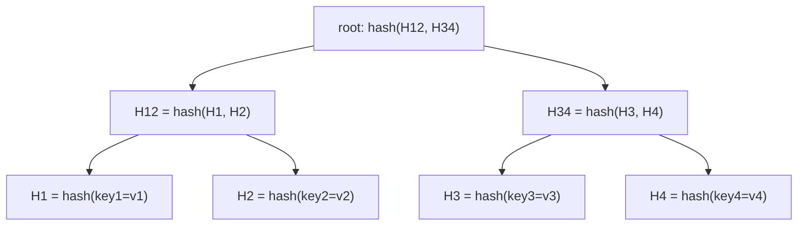
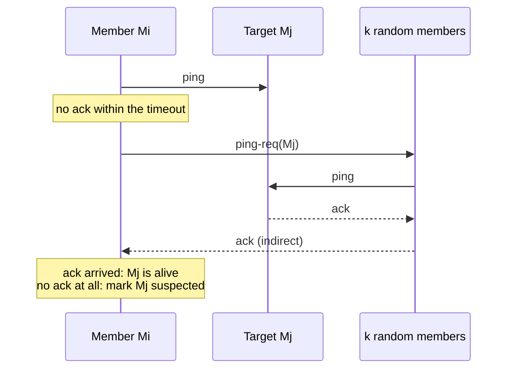

# Probabilistic Data Structures and Gossip

A probabilistic data structure trades exactness for a large saving in memory or messages. A Bloom filter answers "is this item in the set?" with a small chance of a wrong "yes". A count-min sketch estimates how often an item occurred. A HyperLogLog estimates how many distinct items occurred. A Merkle tree finds the differences between two large data sets by exchanging a few hashes. Gossip spreads information through a cluster with a constant load on each node. This page covers each structure with its mechanism, its error math, and a runnable Java program that checks the math. It also shows where each structure appears in real systems (Cassandra, Redis, Dynamo) and in system design interviews. Facts about the structures come from the original papers (Bloom 1970, Cormode and Muthukrishnan 2005, Flajolet et al. 2007, Fan et al. 2014, Das et al. 2002, DeCandia et al. 2007), and facts about products come from their documentation.

## Why It Matters

Large systems meet questions that exact answers cannot afford. "Does this URL already exist among 10 billion crawled URLs?" "What are the most frequent search queries in the last hour?" "How many unique users visited this page today?" "Which keys differ between two replicas of a 1 TB data set?" "Which nodes are alive?" Interviewers use these questions to test whether you know that an approximate answer with a known error bound is often the right engineering choice, and whether you can state the error type and the size of the error. On the job, the same structures appear inside databases you use: Cassandra and other LSM-tree stores keep a Bloom filter for each data file, Redis offers HyperLogLog with `PFADD` and `PFCOUNT`, Dynamo-style stores repair replicas with Merkle trees, and cluster membership often uses gossip. The most common failure in an interview is to name a Bloom filter and then claim that it can return false negatives, or to use a distinct-count structure to answer a question that needs the list of items.

## Core Concepts

| Term | Definition |
|---|---|
| Approximate membership query | A query "is x in the set S?" that a structure answers from a summary of S. The summary is much smaller than S |
| False positive | The structure says "present" and the item is absent |
| False negative | The structure says "absent" and the item is present. A standard Bloom filter has none |
| Bloom filter | A bit array of m bits and k hash functions. Add sets k bits. Query reads k bits and answers "present" only if all are set |
| Fill ratio | The fraction of bits that are 1. At the optimal k, it is about one half |
| Counting Bloom filter | A Bloom filter with a small counter in place of each bit. It supports delete |
| Cuckoo filter | A hash table of short fingerprints with two candidate buckets for each item. It supports delete and lookup in at most two buckets |
| Frequency estimation | Estimate how many times item x occurred in a stream |
| Count-min sketch | A d by w array of counters with d hash functions. Update adds to one counter in each row. Query returns the minimum of the d counters, which never underestimates |
| Heavy hitter | An item whose frequency exceeds a given fraction of the stream length |
| Cardinality estimation | Estimate the number of distinct items in a stream |
| HyperLogLog (HLL) | A cardinality estimator with m registers. Each register keeps the largest number of leading zero bits that its share of the hashed items has shown |
| Standard error | The typical relative error of an estimator: the standard deviation of the estimate divided by the true value |
| Mergeable sketch | A sketch for which the sketch of a union is computable from the sketches of the parts. HLL merges by the maximum of each register. Count-min merges by addition of counters |
| Merkle tree (hash tree) | A tree in which each leaf is the hash of a data item and each inner node is the hash of its children. Equal roots mean equal data |
| Anti-entropy | A background process that compares replicas and repairs differences |
| Gossip (epidemic) protocol | Each node periodically picks a random peer and exchanges information. Information spreads through the cluster like an infection |
| SWIM | Scalable Weakly-consistent Infection-style process group Membership protocol. It separates failure detection (random probes) from update dissemination (piggybacked gossip) and adds a suspicion state |
| Protocol period | The time between two probe rounds of a SWIM member |

## How It Works

### Bloom Filter

Burton Bloom introduced the structure in 1970 for "hash coding with allowable errors". The filter keeps a bit array of m bits, all zero at the start, and k independent hash functions. Each hash function maps an item to one of the m positions.

- **Add(x):** compute the k positions and set those bits to 1.
- **Query(x):** compute the k positions. If any bit is 0, answer "definitely not present". If all bits are 1, answer "possibly present".

```text
m = 16 bits, k = 3 hash functions

add("a") sets positions 2, 7, 11
add("b") sets positions 7, 9, 14

index: 0  1  2  3  4  5  6  7  8  9  10 11 12 13 14 15
bit:   0  0  1  0  0  0  0  1  0  1  0  1  0  0  1  0

query("c") reads positions 2, 9, 5:   bit 5 is 0      -> definitely not present
query("d") reads positions 2, 7, 14:  all bits are 1  -> possibly present
                                      (a false positive if "d" was never added)
```

A "no" is certain, because Add sets every bit of an added item, and nothing clears a bit. A "yes" is only probable, because bits set by other items can cover all k positions of an absent item. The filter never stores the items, so it cannot list them, and a standard filter cannot delete an item (clearing a bit could remove other items).

#### The Math

Let n be the number of items added, m the number of bits, k the number of hash functions.

1. Each Add attempts to set k bits, so n items attempt kn sets. The probability that one given bit is still 0 afterwards is (1 - 1/m)^(kn), which is approximately e^(-kn/m).
2. A query for an absent item reads k bits. Each bit is 1 with probability p = 1 - e^(-kn/m). If the k bits are independent, the false-positive rate is

    **f = (1 - e^(-kn/m))^k**

    Broder and Mitzenmacher ("Network Applications of Bloom Filters: A Survey") derive this formula. It is an approximation, because the bits are not exactly independent. The survey explains why the approximation is accurate.
3. For fixed m and n, f has a minimum at **k = (m/n) ln 2**. At this k, e^(-kn/m) = 1/2, so half of the bits are 1, and f = (1/2)^k.
4. Solve for m at the optimal k: **m = -n ln f / (ln 2)^2**, which is about **1.44 n log2(1/f)** bits. Fan et al. (the cuckoo filter paper) state the same result: "a space-optimized Bloom filter uses k = log2(1/ε) hash functions" and "can store each item using 1.44 log2(1/ε) bits, which depends only on ε rather than the item size or the total number of items". The information-theoretic minimum is log2(1/ε) bits per item, so the Bloom filter has a 44% space overhead above it.

Two rules follow. Each tenfold reduction of f costs 1.44 log2(10), which is 4.79 bits per item. The size depends on n and f only. It does not depend on the size of the items.

| Target false-positive rate f | Bits per item (1.44 log2(1/f)) | Hash functions k | Memory for 1 billion items |
|---|---|---|---|
| 10% | 4.79 | 3 | 0.60 GB |
| 1% | 9.59 | 7 | 1.20 GB |
| 0.1% | 14.38 | 10 | 1.80 GB |
| 0.01% | 19.17 | 13 | 2.40 GB |

Worked example. A crawler wants to test 1 billion URLs with f = 1%. m = 1e9 × 9.59 = 9.59e9 bits = 1.2e9 bytes, about 1.2 GB. k = 9.59 × ln 2 = 6.6, so k = 7. An exact set of 1 billion URLs of 100 bytes each needs at least 100 GB.

If the number of items grows beyond the design value n, f grows. With the same m and k = 7, doubling n to 2 billion gives f = (1 - e^(-7×2e9/9.59e9))^7 = (1 - e^(-1.46))^7 = (1 - 0.232)^7 = 0.158, which is about 16%, not 1%. A Bloom filter has a capacity. Size it for the maximum n, or rebuild it when it fills. The Java program below prints the effect of a wrong k on the same m and n.

#### Properties and Limits

| Property | Detail |
|---|---|
| Errors | False positives only. No false negatives, if the filter has no delete |
| Delete | Not possible in a standard filter. Rebuild, or use a counting Bloom filter or a cuckoo filter |
| Resize | Not possible in place. The positions depend on m. Build a new filter from the source data |
| Union | Two filters with the same m, k, and hash functions merge by bitwise OR |
| Cost of a query | k memory reads at random positions, so cache misses dominate for a large filter. Fan et al. list one cache miss per hash function for the standard filter |
| Source of truth | The filter needs the real data elsewhere. It decides only whether to look |

**Real use: Cassandra.** The Cassandra documentation says that on the read path Cassandra "employs a data structure known as a bloom filter" so that it avoids "checking every SSTable data file for the partition being requested". The filter tells Cassandra either that "the data definitely does not exist in the given file" or that it "probably exists". The operator tunes the accuracy per table with `bloom_filter_fp_chance`. The documented default is 0.01, and 0.1 for tables with `LeveledCompactionStrategy`. The filters live in RAM, off the Java heap. The documentation states that a table with `bloom_filter_fp_chance = 0.01` needs about three times the memory of the same table at 0.1. The ideal formula above predicts a factor of about two (9.59 against 4.79 bits per item), so a real implementation can cost more than the ideal formula. For the LSM-tree read path itself, see `kb/databases/06-storage-engines.md`.

**Real use: cache penetration.** A Bloom filter that holds all valid keys rejects requests for absent keys before they reach the cache or the database. A false positive costs one wasted lookup, which is a safe error. See [caching](../fundamentals/03-caching.md).

**Safe and unsafe uses.** Use a Bloom filter when a false positive costs only an extra lookup: skip the lookup for definite "no" answers (storage engines, caches, crawler deduplication). Do not use it where a false positive grants something: an access check, a "username is available" decision without a final check, or a "payment already processed" test that skips the real record.

### Counting Bloom Filter and Cuckoo Filter in Brief

**Counting Bloom filter.** Fan et al. describe it: "A counting Bloom filter uses an array of counters in place of an array of bits. An insert increments the value of k counters instead of simply setting k bits, and a lookup checks if each of the required counters is non-zero. The delete operation decrements the values of these k counters." In practice, a counter has four or more bits, so the filter needs about four times the space of a standard filter (the paper's Table 1 gives 3x to 4x). The counters must be large enough to avoid overflow. Deleting an item that was never added corrupts the counts and can create false negatives for other items.

**Cuckoo filter.** Fan et al. (CoNEXT 2014) propose it as a replacement for Bloom filters that supports delete. It is a compact cuckoo hash table that stores only a short fingerprint of each item.

- The table has buckets, and each bucket holds up to b fingerprints (b = 4 in the paper's main design).
- Each item has two candidate buckets: i1 = hash(x), and i2 = i1 XOR hash(fingerprint). The XOR makes the relation symmetric, so a stored fingerprint can find its other bucket from its own bucket and its fingerprint, without the original item. This is partial-key cuckoo hashing.
- **Lookup:** check both buckets for the fingerprint. At most two buckets are read.
- **Insert:** put the fingerprint in an empty slot of either bucket. If both are full, evict a random fingerprint, move it to its alternate bucket, and repeat up to a limit. If the limit is reached, the table is considered full and the insert fails.
- **Delete:** remove one matching fingerprint from either bucket.
- **False-positive rate:** about 2b / 2^f for f-bit fingerprints. The minimum fingerprint size is ⌈log2(1/ε) + log2(2b)⌉ bits. The table reaches about 95% load.

Limits stated in the paper: (1) to delete an item safely, it must have been inserted, "otherwise, deleting a non-inserted item might unintentionally remove a real, different item that happens to share the same fingerprint". (2) The filter does not suit inserting the same item more than 2b times, because both buckets of that item overflow. (3) An insert can fail when the table is nearly full.

| | Bloom filter | Counting Bloom filter | Cuckoo filter |
|---|---|---|---|
| Delete | No | Yes | Yes |
| Bits per item (paper's Table 1 and 2) | 1.44 log2(1/ε) | about 3 to 4 times a Bloom filter | (log2(1/ε) + 3) / 0.955, or (log2(1/ε) + 2) / 0.955 with semi-sorted buckets |
| Memory reads per lookup | k | k | 2 |
| Insert can fail | No (the false-positive rate rises) | Counter overflow | Yes, when full |
| Duplicate inserts | Harmless | Counters grow | At most 2b copies of one item |

By the table's formulas at ε = 1%, a Bloom filter needs 9.59 bits per item, a cuckoo filter needs (6.64 + 3) / 0.955 = 10.1 bits, and a semi-sorted cuckoo filter needs 9.05 bits. The paper states that a cuckoo filter uses less space than a space-optimized Bloom filter that cannot delete when ε is below 3%. The comparison depends on the variant, so measure before you choose. The cuckoo filter is asymptotically worse: its fingerprint size grows with log n, while a Bloom filter has a constant size per item.

### Count-Min Sketch

A count-min sketch estimates the frequency of each item in a stream, in fixed memory. Cormode and Muthukrishnan (2005) introduced it.

**Structure.** A d by w array of counters, all zero. d hash functions h1 to hd, each mapping an item to a column in 1..w. The paper picks them from a pairwise-independent family.

- **Update(x, c):** for each row j, add c to counts[j][hj(x)].
- **Query(x):** return the minimum over j of counts[j][hj(x)].

```text
d = 3 rows, w = 8 columns. Update("apple", +1):

column:  0  1  2  3  4  5  6  7
row 0:   0  0  0  0  0  1  0  0     h0("apple") = 5
row 1:   0  1  0  0  0  0  0  0     h1("apple") = 1
row 2:   0  0  0  0  0  0  0  1     h2("apple") = 7

Query("apple") = min(1, 1, 1) = 1
Another item that collides with "apple" in row 0 and row 1 adds to those cells.
Row 2 stays exact, so the minimum is still correct.
```

**Why it never underestimates.** Every update to x adds to all d cells of x. Other items only add more. So each of the d cells is at least the true count, and so is the minimum.

**Error bound (Theorem 1 of the paper, for non-negative counts).** With w = ⌈e/ε⌉ and d = ⌈ln(1/δ)⌉, the estimate satisfies a ≤ â, and with probability at least 1 - δ, â ≤ a + ε‖a‖₁, where ‖a‖₁ is the total of all counts, which is the stream length N for unit updates. The proof: in one row, the expected excess is at most (ε/e) N (the chance that another item shares the cell is at most 1/w, by pairwise independence). By Markov's inequality, the excess in that row exceeds εN with probability at most 1/e. The excess in all d independent rows exceeds εN with probability at most e^(-d) ≤ δ.

| Parameter | Meaning | Example |
|---|---|---|
| ε | Error as a fraction of the stream length N | 0.001 |
| δ | Probability that the error bound fails | 0.01 |
| w = ⌈e/ε⌉ | Columns | ⌈2718.3⌉ = 2719 |
| d = ⌈ln(1/δ)⌉ | Rows | ⌈4.6⌉ = 5 |
| Counters | w × d | 13,595 counters, about 54 KB with 4-byte counters |

The size does not depend on the number of distinct items or on N. For N = 100 million, the example sketch guarantees an overestimate of at most 100,000 with probability 99%.

**What it is good for and what it is not.**

- The error bound is **absolute** (εN), not relative to the item's count. A frequent item with a count of millions gets a small relative error. A rare item with a count of ten can show an estimate of hundreds (the Java program prints such a case). So count-min finds **heavy hitters** well, and it measures rare items badly.
- **Top-k:** keep the sketch plus a small min-heap of k candidates. On each update, query the item's estimate and compare it with the heap minimum. The paper's applications include heavy hitters and quantiles.
- **Mergeable:** two sketches with the same dimensions and hash functions merge by adding the arrays. This allows aggregation over shards and time windows.
- **Overestimates only:** the estimate can be too high, never too low. A count-min sketch cannot answer "how many distinct items".

Redis documents a `CMS.*` command family (for example `CMS.INITBYDIM`, `CMS.INCRBY`, `CMS.QUERY`, `CMS.MERGE`) among its probabilistic data types.

### HyperLogLog

HyperLogLog (HLL) estimates the number of distinct items (the cardinality) of a stream, with a few kilobytes of memory. Flajolet, Fusy, Gandouet, and Meunier (2007) describe it. The abstract states that the relative accuracy (the standard error) "is typically about 1.04/√m" and that the algorithm can "estimate cardinalities well beyond 10^9 with a typical accuracy of 2% while using a memory of only 1.5 kilobytes".

**The idea.** Hash each item to a uniform random bit string. For a random string, the chance that it starts with j zeros followed by a 1 is 1/2^(j+1). If the largest run of leading zeros that you have seen is z, you have probably seen about 2^(z+1) distinct strings. One such maximum is a noisy estimator: one lucky item with many leading zeros gives a large error. HLL reduces the noise in two steps.

1. **Stochastic averaging.** Use the first p bits of the hash to choose one of m = 2^p registers. Each register records the maximum ρ over its share of the items, where ρ(w) is the position of the leftmost 1-bit of the remaining bits (ρ(0001...) = 4).
2. **Harmonic mean.** Combine the registers with a normalized harmonic mean, which limits the effect of the registers that were lucky:

    **E = α_m · m² · (Σ 2^(-M[j]))^(-1)**

    The constant α_m corrects a systematic bias. The paper's practical program uses α_16 = 0.673, α_32 = 0.697, α_64 = 0.709, and α_m = 0.7213 / (1 + 1.079/m) for m ≥ 128.

Adding the same item twice changes no register, because the maximum is idempotent. This makes HLL safe for at-least-once pipelines that re-deliver events.

```text
item -> hash -> | first p bits: register index j | remaining bits w |
                                                   rho(w) = position of the first 1-bit
register[j] = max(register[j], rho(w))

estimate = alpha * m^2 / sum over j of 2^(-register[j])
```

**Small and large ranges.** For small cardinalities, many registers are still 0, and the formula is biased. The paper's program applies a small-range correction: if E ≤ (5/2) m and V of the registers are 0 (V ≠ 0), return m ln(m/V), which is linear counting. The paper's program also has a large-range correction for a 32-bit hash: when the estimate exceeds 2^32 / 30, hash collisions start to matter, and the program returns -2^32 ln(1 - E/2^32). This page's Java program uses a 64-bit hash, so collisions stay negligible far beyond 10^9 items, and the program omits the large-range correction.

**Accuracy and memory.** The standard error is 1.04/√m. A register needs about 5 or 6 bits (the maximum ρ for a 64-bit hash is at most 64 - p + 1, which fits in 6 bits).

| p | Registers m = 2^p | Standard error 1.04/√m | Memory at 6 bits per register |
|---|---|---|---|
| 10 | 1,024 | 3.25% | 768 bytes |
| 12 | 4,096 | 1.63% | 3 KB |
| 14 | 16,384 | 0.81% | 12 KB |
| 16 | 65,536 | 0.41% | 48 KB |

The row p = 14 matches the Redis documentation: "The Redis implementation uses up to 12 KB of memory and provides a standard error rate of 0.81%". (The 16,384 registers are this page's arithmetic from the two documented numbers. This page did not read the Redis source.) The paper states how the error spreads: the estimates are approximately Gaussian, and they "are expected to be within σ, 2σ, 3σ of the exact count in respectively 65%, 95%, 99% of all the cases", where σ ≈ 1.04/√m. For Redis, 95% of estimates are within 1.62%.

**Merge.** The register-wise maximum of two HLLs with the same p is the HLL of the union of the two sets. Redis documents `PFCOUNT` with several keys as the cardinality of the union: it merges the HLLs "into a temporary HyperLogLog". `PFMERGE` writes the merge into a key. The intersection has no direct formula. Inclusion-exclusion (|A ∩ B| = |A| + |B| - |A ∪ B|) subtracts three noisy numbers, and each error is relative to a large value, so a small intersection can drown in the error. This is this page's reasoning, not a quoted claim. Example: two sets of 10 million items each with 0.81% error have a standard error of about 81,000 each, so an intersection of 50,000 items is smaller than the error of one term.

**Redis.** The documentation lists `PFADD` (O(1)), `PFCOUNT` (O(1) for a single key, with a larger constant for several keys), and `PFMERGE` (O(N) for N HLLs). An HLL "is encoded as a Redis string", so `GET` and `SET` serialize it. The size is "12k bytes in the worst case, or a lot less if your HyperLogLog has seen very few elements". The documented limit is 2^64 members.

**Use.** Unique visitors per page and day, distinct IP addresses, ad reach, distinct search queries. An HLL cannot list the items, cannot remove an item, and cannot tell whether one item is in the set.

### Merkle Trees and Anti-Entropy

Two replicas of a large data set drift apart, because writes can miss a replica (a node was down, a message was lost). Comparing every key costs time and network traffic proportional to the data size. A Merkle tree reduces the comparison to a number of hash exchanges proportional to the number of differences times the tree height.

**Structure.** The DeCandia et al. Dynamo paper (SOSP 2007): "A Merkle tree is a hash tree where leaves are hashes of the values of individual keys. Parent nodes higher in the tree are hashes of their respective children."

**Comparison.**

1. The two replicas exchange the hash of the root.
2. If the roots are equal, the data are equal, and nothing more is needed. The paper: "if the hash values of the root of two trees are equal, then the values of the leaf nodes in the tree are equal and the nodes require no synchronization".
3. If the roots differ, the replicas exchange the hashes of the two children, and they descend only into the subtrees whose hashes differ.
4. The descent ends at the leaves. The leaves identify the keys that are out of sync, and the replicas copy those keys.



If key4 differs on one replica, the roots differ, H12 matches and H34 differs, and then H3 matches and H4 differs. The replicas copy only key4.

**In Dynamo.** The paper states that each node keeps "a separate Merkle tree for each key range (the set of keys covered by a virtual node) it hosts", and two nodes "exchange the root of the Merkle tree corresponding to the key ranges that they host in common". The paper also names the drawback: "many key ranges change when a node joins or leaves the system thereby requiring the tree(s) to be recalculated". Merkle trees "minimize the amount of data that needs to be transferred for synchronization and reduce the number of disk reads performed during the anti-entropy process". The replication context (read repair, hinted handoff, anti-entropy) is in [replication](../fundamentals/05-replication.md). The key ranges come from [partitioning and sharding](../fundamentals/06-partitioning-and-sharding.md).

**In Cassandra.** The Cassandra documentation for repair says that repair "synchronizes the data between nodes by comparing their respective datasets for their common token ranges, and streaming the differences". It "compares the data with merkle trees, which are a hierarchy of hashes". Cassandra does not run repair automatically. The operator runs `nodetool repair`. The default is an incremental repair, which handles only data written since the previous incremental repair. `nodetool repair --full` repairs all data in the range. The documentation notes that an incremental repair does not protect against disk corruption, so it recommends occasional full repairs. A repair costs disk and network I/O.

**Cost.** Building a tree needs a scan of the data (or an incrementally maintained tree). The comparison exchanges about (number of differing leaves) × (tree height) × 2 hashes. If most of the data differ, the tree adds overhead, and a plain copy is cheaper. The Java program below finds 2 stale leaves among 1,024 with 39 hash comparisons.

### Gossip and SWIM

**Gossip (epidemic) protocols.** Each node periodically picks one or a few random peers and exchanges state with them. A fact known by one node spreads like an infection: after each round, the number of nodes that know it grows by a constant factor in the early rounds, so the whole cluster learns it in a number of rounds that grows with log N. The SWIM paper states that the dissemination latency "grows slowly (logarithmically) with the number of members". Properties: no central coordinator, constant load per node, and tolerance of lost messages and node failures. The cost is delay and weak consistency: for a moment, nodes have different views.

**Gossip in Dynamo.** DeCandia et al.: "A gossip-based protocol propagates membership changes and maintains an eventually consistent view of membership. Each node contacts a peer chosen at random every second and the two nodes efficiently reconcile their persisted membership change histories." The same exchange propagates the token ranges, so each node knows which peers own which ranges and can forward a request directly.

**SWIM** (Das, Gupta, Motivala, DSN 2002) is a membership protocol that scales. Its motivation: all-to-all heartbeating "impose[s] network loads that grow quadratically with group size", or it compromises detection time or false-positive rate. SWIM separates two functions:

1. **Failure detection by random probing.** In each protocol period, member Mi picks one target Mj and sends it a `ping`. If no `ack` arrives within a timeout, Mi picks k other members at random and sends each a `ping-req(Mj)`. Each of them pings Mj and forwards the `ack` to Mi. If Mi gets no `ack`, directly or indirectly, by the end of the period, it treats Mj as failed (basic protocol) or suspected (with the suspicion mechanism). The indirect probe avoids the effect of congestion on the one network path between Mi and Mj.
2. **Dissemination by piggybacking.** Membership updates (joined, left, suspected, failed) ride on the `ping`, `ping-req`, and `ack` messages that the failure detector already sends. Message size is bounded by a constant, independent of the group size.



**Properties stated in the paper.**

- The message load per member is constant. The expected time to detect a failure at some non-faulty member is constant. Neither depends on the group size.
- Let the group have n members, and let a fraction q_f of them be non-faulty. The paper gives the probability that a given member is chosen as a ping target by at least one other member in one protocol period, and its limit for large n: 1 - e^(-q_f). The expected time from a failure to its first detection at some member is therefore at most T' / (1 - e^(-q_f)), where T' is the protocol period. If all other members are non-faulty (q_f = 1), Gupta's course slides on SWIM give the finite form: the probability is 1 - (1 - 1/n)^(n-1), which tends to 1 - 1/e, and the expected detection time is T' · e/(e - 1), about 1.58 protocol periods. The paper's Figure 3(a) plots this analytic value e/(e - 1) against measured detection times.
- **Round-robin target selection** gives a bound on the worst-case detection time. In the basic protocol, a failed member might never be chosen as a target, so the first detection has no bound. In the modified protocol, a member keeps its list in a random order, probes the targets in sequence, and makes a new random order after each traversal of the list. A new member joins the list at a random position. Each target is probed exactly once in each traversal, so if the list has at most n members, two probes of the same target are at most 2n - 1 protocol periods apart. The paper states that this bounds the worst-case detection time of a failure at any member, and that the average detection time stays the same. Gupta's slides state the bound as "Each failure is detected in worst case 2N-1 (local) protocol periods".
- The protocol period "has to be at least three times the round-trip estimate". The timeout after which a member starts the indirect probe comes from an estimate of the round-trip time (the paper's experiments use the average measured round-trip time).

**Suspicion.** A slow or briefly overloaded process can miss pings and be declared failed by mistake. In the suspicion subprotocol, an unresponsive member is first marked **suspected**, and a "Suspect" message spreads. A suspected member stays in the list and is still probed. If it answers within a timeout, an "Alive" message spreads, and the member is back with no leave and rejoin. If the timeout expires, the member is declared failed, and the news spreads. The timeout trades a longer detection time for fewer false positives. See [failures and time](01-failures-and-time.md) for the general failure-detection problem and for phi accrual detectors.

### Where Each Structure Appears in Interviews

| Interview problem | Structure | How it fits |
|---|---|---|
| Web crawler: "have I seen this URL?" | Bloom filter | A "no" is certain, so the crawler fetches. A false positive skips a few new URLs, which is acceptable. See `kb/hld/case-studies/08-web-crawler.md` |
| Cache penetration, requests for absent keys | Bloom filter | Rejects absent keys before the cache and database. See [caching](../fundamentals/03-caching.md) |
| LSM-tree read path | Bloom filter per data file | Skips files that cannot hold the key |
| "Is this username taken?" at signup | Bloom filter, then a database check | A "no" answers at once. A "maybe" needs the database |
| Trending topics, top-k queries, heavy hitters | Count-min sketch plus a heap | Fixed memory per window. See `kb/hld/case-studies/16-leaderboard-and-top-k.md` and `kb/hld/case-studies/21-ad-click-aggregation.md` |
| Approximate rate limiting of many keys | Count-min sketch | A counter for millions of keys in fixed memory, with the one-sided error. See [rate limiting algorithms](../fundamentals/13-rate-limiting-algorithms.md) |
| Unique visitors, distinct counts, ad reach | HyperLogLog | 12 KB per counter in Redis. Merges across days and shards. See `kb/hld/case-studies/21-ad-click-aggregation.md` |
| Replica repair in a Dynamo-style store | Merkle tree | Finds the differing keys. See `kb/hld/case-studies/03-key-value-store.md` |
| Cluster membership and failure detection | Gossip and SWIM | Constant load per node. Dynamo gossips its membership. SWIM adds probing and suspicion for failure detection. See `kb/hld/case-studies/03-key-value-store.md` |

## Trade-offs and When to Use

| | Exact structure (hash set, map) | Bloom filter | Cuckoo filter | Count-min sketch | HyperLogLog |
|---|---|---|---|---|---|
| Question | Anything | In the set? | In the set? | How often? | How many distinct? |
| Error | None | False positives | False positives | Overestimate (≤ εN with probability 1 - δ) | Relative, standard error 1.04/√m |
| Delete | Yes | No | Yes (only of inserted items) | Negative updates change the guarantee | No |
| Mergeable | Union by copy | OR of same-size filters | Not by a simple operation | Add the arrays | Register-wise maximum |
| Memory | Proportional to the items | About 9.6 bits per item at 1% | About 9 to 10 bits per item at 1% | w × d counters, fixed | m registers, fixed (12 KB at p = 14) |
| Can list the items | Yes | No | No | No | No |
| Typical size at scale | 100 GB for 1 billion URLs | 1.2 GB | 1.1 to 1.3 GB | 54 KB (ε = 0.001, δ = 0.01) | 12 KB |

**Choose an exact structure when** the data fits in memory, an error has a cost that you cannot accept (money, access control, legal counts), or you need the items back. **Choose a probabilistic structure when** the exact structure is too large or too slow, one kind of error is cheap and the other kind never occurs by construction, and you know the error bound and you have measured it.

Recommendation: state the error type and its size when you propose one in an interview ("a Bloom filter at 1%, so one in a hundred absent URLs triggers a wasted lookup"), say what happens on an error, and say that the source of truth stays elsewhere. Pair a probabilistic structure with an exact one: the filter first, then the real lookup.

## Java Example

Four programs check the math. Each program has its own `main`, its own imports, and a fixed seed, so the output is the same on every run. The hash function is the SplitMix64 finalizer, a 64-bit mixing function.

### Bloom Filter

The program sizes a filter for n = 10,000 items at a 1% false-positive rate from the formulas above, adds the items, checks that no false negative occurs, probes 200,000 absent items, and compares the measured rate with the theoretical rate. The program checks that the two rates are within 10% of each other. It also prints the theoretical rate for other values of k, to show that k = 7 is the minimum for this m and n. Each of the k hash functions is the mix function applied to the key XOR a different constant.

```java
import java.util.Locale;

public class Bloom {
    /** SplitMix64 finalizer: a fast 64-bit mixing function with good bit dispersion. */
    static long mix(long x) {
        x += 0x9E3779B97F4A7C15L;
        x = (x ^ (x >>> 30)) * 0xBF58476D1CE4E5B9L;
        x = (x ^ (x >>> 27)) * 0x94D049BB133111EBL;
        return x ^ (x >>> 31);
    }

    static class BloomFilter {
        final long[] words;
        final int m;
        final int k;

        BloomFilter(int m, int k) {
            this.m = m;
            this.k = k;
            this.words = new long[(m + 63) / 64];
        }

        /** Bit position for hash function number i: an independent mix per function. */
        int position(long key, int i) {
            long h = mix(key ^ mix(i + 1000L));
            return (int) Long.remainderUnsigned(h, m);
        }

        void add(long key) {
            for (int i = 0; i < k; i++) {
                int p = position(key, i);
                words[p >>> 6] |= 1L << (p & 63);
            }
        }

        boolean mightContain(long key) {
            for (int i = 0; i < k; i++) {
                int p = position(key, i);
                if ((words[p >>> 6] & (1L << (p & 63))) == 0) {
                    return false;
                }
            }
            return true;
        }

        double fillRatio() {
            long ones = 0;
            for (long w : words) {
                ones += Long.bitCount(w);
            }
            return (double) ones / m;
        }
    }

    /** Theoretical false-positive rate: (1 - e^(-k n / m))^k. */
    static double theory(int n, int m, int k) {
        return Math.pow(1 - Math.exp(-(double) k * n / m), k);
    }

    public static void main(String[] args) {
        int n = 10_000;
        double target = 0.01;
        int m = (int) Math.ceil(-n * Math.log(target) / (Math.log(2) * Math.log(2)));
        int k = (int) Math.round((double) m / n * Math.log(2));
        System.out.println(String.format(Locale.ROOT,
            "n=%d target=%.2f -> m=%d bits (%.2f bits/item), k=%d",
            n, target, m, (double) m / n, k));

        BloomFilter f = new BloomFilter(m, k);
        for (long key = 0; key < n; key++) {
            f.add(key);
        }
        int falseNegatives = 0;
        for (long key = 0; key < n; key++) {
            if (!f.mightContain(key)) {
                falseNegatives++;
            }
        }
        int probes = 200_000;
        int falsePositives = 0;
        for (long key = n; key < n + probes; key++) {
            if (f.mightContain(key)) {
                falsePositives++;
            }
        }
        double measured = (double) falsePositives / probes;
        double expected = theory(n, m, k);
        System.out.println("false negatives: " + falseNegatives);
        System.out.println(String.format(Locale.ROOT, "fill ratio: %.3f (theory 0.5 at optimal k)",
            f.fillRatio()));
        System.out.println(String.format(Locale.ROOT,
            "measured false-positive rate: %.5f", measured));
        System.out.println(String.format(Locale.ROOT,
            "theoretical rate:             %.5f", expected));
        boolean ok = Math.abs(measured - expected) <= 0.10 * expected;
        System.out.println("measured within 10% of theory: " + ok);

        System.out.println("effect of k at m=" + m + ", n=" + n + ":");
        for (int kk : new int[] {1, 3, 7, 10, 20}) {
            System.out.println(String.format(Locale.ROOT, "  k=%2d -> %.5f", kk, theory(n, m, kk)));
        }
    }
}
```

<!-- expected-output -->
```text
n=10000 target=0.01 -> m=95851 bits (9.59 bits/item), k=7
false negatives: 0
fill ratio: 0.519 (theory 0.5 at optimal k)
measured false-positive rate: 0.01023
theoretical rate:             0.01004
measured within 10% of theory: true
effect of k at m=95851, n=10000:
  k= 1 -> 0.09907
  k= 3 -> 0.01941
  k= 7 -> 0.01004
  k=10 -> 0.01299
  k=20 -> 0.07063
```

What the output shows: the sizing formula gives 9.59 bits per item and k = 7. No item that was added is missing. The fill ratio is 0.519 (the optimum is 0.5 for a real-valued k, and k = 7 is rounded from 6.64, so the ratio is slightly above). The measured rate, 0.01023, is within 2% of the theoretical 0.01004. The rate is lowest at k = 7 (0.01004), and it rises on both sides: k = 1 gives about 10%, and k = 20 gives 7%, because too many hash functions fill the array.

### Count-Min Sketch

The program builds a sketch with ε = 0.01 and δ = 0.01, so w = ⌈e/0.01⌉ = 272 columns and d = ⌈ln 100⌉ = 5 rows. The hash functions are ((a·x + b) mod p) mod w with p = 2^31 - 1, a pairwise-independent family as in the paper. The stream has 100,000 updates over 5,000 possible items. The distribution is skewed: small item numbers are frequent. The program compares each estimate with the exact count.

```java
import java.util.HashMap;
import java.util.Locale;
import java.util.Map;
import java.util.Random;

public class Cms {
    static final long PRIME = 2_147_483_647L; // 2^31 - 1, a prime

    static class CountMinSketch {
        final int w;
        final int d;
        final long[][] counts;
        final long[] a;
        final long[] b;

        CountMinSketch(double epsilon, double delta, long seed) {
            this.w = (int) Math.ceil(Math.E / epsilon);
            this.d = (int) Math.ceil(Math.log(1 / delta));
            this.counts = new long[d][w];
            this.a = new long[d];
            this.b = new long[d];
            Random rnd = new Random(seed);
            for (int j = 0; j < d; j++) {
                a[j] = 1 + (long) (rnd.nextDouble() * (PRIME - 1));
                b[j] = (long) (rnd.nextDouble() * PRIME);
            }
        }

        /** Pairwise-independent hash: ((a x + b) mod p) mod w. |a x + b| stays below 2^63. */
        int column(int row, int key) {
            // floorMod keeps the column non-negative for a negative key
            return (int) (Math.floorMod(a[row] * key + b[row], PRIME) % w);
        }

        void add(int key, long count) {
            for (int j = 0; j < d; j++) {
                counts[j][column(j, key)] += count;
            }
        }

        long estimate(int key) {
            long min = Long.MAX_VALUE;
            for (int j = 0; j < d; j++) {
                min = Math.min(min, counts[j][column(j, key)]);
            }
            return min;
        }
    }

    public static void main(String[] args) {
        double epsilon = 0.01;
        double delta = 0.01;
        CountMinSketch cms = new CountMinSketch(epsilon, delta, 42L);
        System.out.println("width w=" + cms.w + ", depth d=" + cms.d
            + ", cells=" + (cms.w * cms.d));

        int stream = 100_000;
        int universe = 5_000;
        Random rnd = new Random(7);
        Map<Integer, Long> exact = new HashMap<>();
        for (int i = 0; i < stream; i++) {
            double u = rnd.nextDouble();
            int item = (int) (u * u * u * universe); // skewed: small ids are frequent
            cms.add(item, 1);
            exact.merge(item, 1L, Long::sum);
        }
        double bound = epsilon * stream;
        int underestimates = 0;
        int aboveBound = 0;
        long maxError = 0;
        long totalError = 0;
        for (Map.Entry<Integer, Long> e : exact.entrySet()) {
            long error = cms.estimate(e.getKey()) - e.getValue();
            if (error < 0) {
                underestimates++;
            }
            if (error > bound) {
                aboveBound++;
            }
            maxError = Math.max(maxError, error);
            totalError += error;
        }
        System.out.println("distinct items: " + exact.size() + ", stream length N: " + stream);
        System.out.println("estimates below the true count: " + underestimates);
        System.out.println(String.format(Locale.ROOT, "error bound epsilon*N = %.0f", bound));
        System.out.println("items with error above the bound: " + aboveBound
            + " of " + exact.size() + " (allowed fraction delta = " + delta + ")");
        System.out.println("largest error: " + maxError);
        System.out.println(String.format(Locale.ROOT, "mean error over distinct items: %.2f",
            (double) totalError / exact.size()));
        for (int item : new int[] {0, 1, 2, 4000}) {
            System.out.println("item " + item + ": true=" + exact.getOrDefault(item, 0L)
                + " estimate=" + cms.estimate(item));
        }
    }
}
```

<!-- expected-output -->
```text
width w=272, depth d=5, cells=1360
distinct items: 5000, stream length N: 100000
estimates below the true count: 0
error bound epsilon*N = 1000
items with error above the bound: 0 of 5000 (allowed fraction delta = 0.01)
largest error: 356
mean error over distinct items: 221.11
item 0: true=5831 estimate=6038
item 1: true=1495 estimate=1733
item 2: true=989 estimate=1235
item 4000: true=10 estimate=224
```

What the output shows: no estimate is below the true count (the one-sided guarantee). No item has an error above εN = 1,000, and the largest error is 356, so the bound holds with margin. The mean error over the 5,000 items is 221. It is below N/w = 368, which is the expected excess in one row, because the minimum over five rows removes part of the excess. Item 0 is frequent (5,831), and its estimate is 3.5% too high. Item 4000 is rare (true count 10), and its estimate is 224: the absolute error is similar, and the relative error is large. This is the weakness for rare items.

### HyperLogLog

The program implements the HLL of the paper with p = 12 (m = 4,096 registers, standard error 1.04/64 = 1.63%), a 64-bit hash, the bias constant α_m = 0.7213 / (1 + 1.079/m), and the small-range correction (linear counting). It adds each item twice, to show that duplicates change nothing. It prints the estimate for n = 100, 10,000, and 1,000,000, and it checks that each error is within three standard errors. Then it merges two sketches by the register-wise maximum.

```java
import java.util.Locale;

public class Hll {
    static long mix(long x) {
        x += 0x9E3779B97F4A7C15L;
        x = (x ^ (x >>> 30)) * 0xBF58476D1CE4E5B9L;
        x = (x ^ (x >>> 27)) * 0x94D049BB133111EBL;
        return x ^ (x >>> 31);
    }

    static class HyperLogLog {
        final int p;
        final int m;
        final byte[] registers;

        HyperLogLog(int p) {
            if (p < 4 || p > 16) {
                throw new IllegalArgumentException("the paper's program takes p in 4..16");
            }
            this.p = p;
            this.m = 1 << p;
            this.registers = new byte[m];
        }

        void add(long item) {
            long h = mix(item);
            int j = (int) (h >>> (64 - p));            // first p bits pick the register
            long w = h << p;                           // the remaining 64 - p bits
            int rho = Long.numberOfLeadingZeros(w) + 1; // position of the leftmost 1-bit
            rho = Math.min(rho, 64 - p + 1);
            if (rho > registers[j]) {
                registers[j] = (byte) rho;
            }
        }

        double estimate() {
            double alpha = switch (m) {   // bias constants from the paper's program
                case 16 -> 0.673;
                case 32 -> 0.697;
                case 64 -> 0.709;
                default -> 0.7213 / (1 + 1.079 / m); // m >= 128
            };
            double sum = 0;
            int zeros = 0;
            for (byte r : registers) {
                sum += Math.pow(2, -r);
                if (r == 0) {
                    zeros++;
                }
            }
            double raw = alpha * m * m / sum;
            if (raw <= 2.5 * m && zeros > 0) {
                return m * Math.log((double) m / zeros); // small-range correction: linear counting
            }
            return raw;
        }

        void merge(HyperLogLog other) {
            for (int j = 0; j < m; j++) {
                registers[j] = (byte) Math.max(registers[j], other.registers[j]);
            }
        }
    }

    public static void main(String[] args) {
        int p = 12;
        int m = 1 << p;
        double stdError = 1.04 / Math.sqrt(m);
        System.out.println(String.format(Locale.ROOT,
            "p=%d, m=%d registers, standard error 1.04/sqrt(m) = %.4f", p, m, stdError));

        for (int n : new int[] {100, 10_000, 1_000_000}) {
            HyperLogLog hll = new HyperLogLog(p);
            for (long i = 0; i < n; i++) {
                hll.add(i);
                hll.add(i); // duplicates do not change the estimate
            }
            double est = hll.estimate();
            double err = (est - n) / n;
            System.out.println(String.format(Locale.ROOT,
                "n=%8d estimate=%10.1f error=%+.4f within 3 sigma: %b",
                n, est, err, Math.abs(err) < 3 * stdError));
        }

        HyperLogLog a = new HyperLogLog(p);
        HyperLogLog b = new HyperLogLog(p);
        for (long i = 0; i < 60_000; i++) {
            a.add(i);
        }
        for (long i = 40_000; i < 100_000; i++) {
            b.add(i);
        }
        a.merge(b); // union of 0..59999 and 40000..99999 has 100000 distinct items
        double est = a.estimate();
        System.out.println(String.format(Locale.ROOT,
            "union of two sketches: true=100000 estimate=%.1f error=%+.4f",
            est, (est - 100_000) / 100_000));
        System.out.println("memory: " + m + " registers of 1 byte here (6 bits each are enough)");
    }
}
```

<!-- expected-output -->
```text
p=12, m=4096 registers, standard error 1.04/sqrt(m) = 0.0163
n=     100 estimate=      97.1 error=-0.0286 within 3 sigma: true
n=   10000 estimate=   10098.9 error=+0.0099 within 3 sigma: true
n= 1000000 estimate= 1020719.4 error=+0.0207 within 3 sigma: true
union of two sketches: true=100000 estimate=101736.9 error=+0.0174
memory: 4096 registers of 1 byte here (6 bits each are enough)
```

What the output shows: the error is -2.9% at n = 100 (the small-range correction applies), +1.0% at 10,000, and +2.1% at one million. All three are within three standard errors (4.9%). The two sketches overlap in the range 40,000 to 59,999. The union of 0 to 59,999 and 40,000 to 99,999 has 100,000 distinct items, and the merged sketch estimates 101,737, an error of 1.7%. The program uses one byte for each register for clarity. A register needs only 6 bits.

### Merkle Tree

The program builds a hash tree over 1,024 key-value pairs on two replicas. Replica B has two stale values. The program finds the two out-of-sync keys by descending from the root, and it counts the hash comparisons.

```java
import java.nio.charset.StandardCharsets;
import java.security.MessageDigest;
import java.security.NoSuchAlgorithmException;
import java.util.ArrayList;
import java.util.HexFormat;
import java.util.List;

public class Merkle {
    static String sha256(String text) {
        try {
            MessageDigest md = MessageDigest.getInstance("SHA-256");
            return HexFormat.of().formatHex(md.digest(text.getBytes(StandardCharsets.UTF_8)));
        } catch (NoSuchAlgorithmException e) {
            throw new IllegalStateException(e);
        }
    }

    /** A complete binary hash tree over a power-of-two number of leaves. levels.get(0) = leaves. */
    static class Tree {
        final List<List<String>> levels = new ArrayList<>();

        Tree(List<String> leafValues) {
            List<String> level = new ArrayList<>();
            for (String v : leafValues) {
                level.add(sha256(v));
            }
            levels.add(level);
            while (level.size() > 1) {
                List<String> next = new ArrayList<>();
                for (int i = 0; i < level.size(); i += 2) {
                    next.add(sha256(level.get(i) + level.get(i + 1)));
                }
                levels.add(next);
                level = next;
            }
        }

        String root() {
            return levels.get(levels.size() - 1).get(0);
        }
    }

    static int comparisons;

    /** Walk down from (level, index) and collect the leaves whose hashes differ. */
    static void diff(Tree a, Tree b, int level, int index, List<Integer> out) {
        comparisons++;
        if (a.levels.get(level).get(index).equals(b.levels.get(level).get(index))) {
            return; // equal hash: the whole subtree is equal, no need to look further
        }
        if (level == 0) {
            out.add(index);
            return;
        }
        diff(a, b, level - 1, 2 * index, out);
        diff(a, b, level - 1, 2 * index + 1, out);
    }

    public static void main(String[] args) {
        int leaves = 1024;
        List<String> replicaA = new ArrayList<>();
        List<String> replicaB = new ArrayList<>();
        for (int i = 0; i < leaves; i++) {
            replicaA.add("key" + i + "=value" + i);
            replicaB.add("key" + i + "=value" + i);
        }
        Tree treeA = new Tree(replicaA);
        Tree treeB = new Tree(replicaB);
        System.out.println("leaves: " + leaves + ", tree height: " + (treeA.levels.size() - 1));
        System.out.println("identical replicas, roots equal: " + treeA.root().equals(treeB.root()));

        replicaB.set(37, "key37=STALE");
        replicaB.set(900, "key900=STALE");
        treeB = new Tree(replicaB);
        System.out.println("after 2 stale keys, roots equal: " + treeA.root().equals(treeB.root()));

        List<Integer> different = new ArrayList<>();
        comparisons = 0;
        diff(treeA, treeB, treeA.levels.size() - 1, 0, different);
        System.out.println("out-of-sync leaves: " + different);
        System.out.println("hash comparisons: " + comparisons
            + " (a full scan compares " + leaves + ")");
    }
}
```

<!-- expected-output -->
```text
leaves: 1024, tree height: 10
identical replicas, roots equal: true
after 2 stale keys, roots equal: false
out-of-sync leaves: [37, 900]
hash comparisons: 39 (a full scan compares 1024)
```

What the output shows: identical replicas have equal roots, so one comparison proves it. After two stale keys, the roots differ, and the descent finds exactly leaves 37 and 900 with 39 hash comparisons instead of 1,024 leaf comparisons. The cost grows with (differences × tree height), not with the data size.

## Interview Angle

### Questions

??? question "How does a Bloom filter work? What errors can it make?"

    A Bloom filter is a bit array of m bits with k hash functions. Add hashes the item k times and sets those k bits. Query hashes the item and reads the k bits: if any bit is 0, the answer is "definitely not in the set". If all are 1, the answer is "possibly in the set".

    - **Errors.** It makes false positives only: bits set by other items can cover all k positions of an absent item. It makes no false negatives, because Add sets every bit of an added item and nothing clears a bit. This holds as long as the filter supports no delete.
    - **Rate.** f ≈ (1 - e^(-kn/m))^k for n items. The optimal k is (m/n) ln 2, and then f = (1/2)^k and half of the bits are set.
    - **Cost.** About 1.44 log2(1/f) bits per item, independent of the item size: 9.6 bits at 1%, 14.4 bits at 0.1%.
    - **Limits.** No delete, no listing, no resize. If n grows beyond the design value, f grows. It needs the real data elsewhere.

    I would add the use: skip an expensive lookup on a certain "no" (LSM-tree files, cache penetration, crawler deduplication), where a false positive only costs a wasted lookup.

??? question "Size a Bloom filter for 1 billion URLs with a 1% false-positive rate. How many hash functions?"

    Use m = -n ln f / (ln 2)^2. With n = 1e9 and f = 0.01: ln(0.01) = -4.605, (ln 2)^2 = 0.4805, so m = 1e9 × 4.605 / 0.4805 = 9.59e9 bits, which is 1.2 GB. That is 9.59 bits per item. The number of hash functions is k = (m/n) ln 2 = 9.59 × 0.693 = 6.6, so I use 7.

    For comparison, an exact set of 1 billion URLs of 100 bytes each needs at least 100 GB, so the filter is about 80 times smaller. If I need 0.1%, each item costs 14.4 bits (1.8 GB, k = 10). Each tenfold reduction of the rate costs 4.79 bits per item. I would add two practical points. First, the filter is sized for a maximum n: with the same m and 2 billion items, the rate rises to about 16%. Second, I can shard the filter by URL hash across machines, or keep one per time window and rebuild old ones.

??? question "Where do you use a Bloom filter in a system design? What happens on a false positive?"

    I use a Bloom filter in front of an expensive lookup when most queries are for absent keys.

    - **LSM-tree databases (Cassandra).** A filter per data file tells the read path to skip files that cannot hold the key. A false positive costs one wasted file read. The Cassandra documentation exposes the rate as `bloom_filter_fp_chance`.
    - **Cache penetration.** Load the filter with all valid keys. A request for a key that the filter rejects returns "not found" without touching the cache or the database. A false positive passes through and costs one normal miss.
    - **Web crawler.** A "no" means the URL is new, so fetch it. A false positive skips a new URL, which a crawler can accept.
    - **Signup "username taken".** A "no" answers at once. A "maybe" goes to the database for the final check.

    The rule: a false positive must cost only an extra lookup. I do not use a Bloom filter for a decision where a false positive grants something (access, a duplicate-payment check without the real record).

??? question "A Bloom filter does not support delete. What are the alternatives?"

    - **Rebuild periodically** from the source data. This is the simplest, and it fits when deletes are rare. Cassandra's per-file filters rely on immutable files, so a filter never needs a delete.
    - **Counting Bloom filter.** Counters replace bits. Add increments k counters and delete decrements them. It needs about four times the space (counters of four or more bits), and deleting an item that was never added corrupts the counts.
    - **Cuckoo filter** (Fan et al. 2014). It stores short fingerprints in a table with two candidate buckets per item. It supports delete and reads at most two buckets per lookup. Its limits: delete is safe only for items that were inserted, one item cannot be inserted more than about 2b times (b is the bucket size), and an insert can fail when the table is almost full. At a low target rate (below 3% per the paper), it can use less space than a standard Bloom filter.

    I choose by the workload: immutable data, rebuild; frequent deletes with a hard memory limit, cuckoo; simple code and no deletes, a standard Bloom filter.

??? question "How does a count-min sketch work, and what is its error guarantee?"

    It is a d by w array of counters with d hash functions. Update(x) adds to one counter in each row (the column is hj(x)). Query(x) returns the minimum of the d counters.

    - **One-sided error.** Every update to x lands in all of its d cells, and other items only add to them. So each cell, and the minimum, is at least the true count. The sketch never underestimates.
    - **Bound.** With w = ⌈e/ε⌉ and d = ⌈ln(1/δ)⌉, the estimate is at most the true count plus εN with probability at least 1 - δ, where N is the total of all counts. Example: ε = 0.001 and δ = 0.01 give 2,719 × 5 counters, about 54 KB, for any stream length. The proof uses Markov's inequality for each row and independence across rows.
    - **Weakness.** The error bound is absolute (εN). Heavy hitters get a small relative error, and rare items can get a large one. It cannot say how many distinct items exist.
    - **Use.** Heavy hitters and top-k (sketch plus a small heap), approximate counters for many keys, and aggregation across shards by adding sketches.

??? question "Design a top-k trending hashtags service with approximate counts."

    1. **Ingest.** Events (hashtag uses) go to a partitioned stream, keyed by hashtag, so one worker sees all events of a hashtag.
    2. **Per-window sketch.** Each worker keeps a count-min sketch for the current window (for example one minute), plus a min-heap of its local top candidates. For each event, it updates the sketch, queries the estimate, and updates the heap if the estimate exceeds the heap minimum.
    3. **Merge.** A coordinator merges the workers' candidate lists. Since each hashtag lives on one worker, the merge needs only the union of the candidates and a global top-k. For a sliding window (the last hour), keep one sketch per minute and add the sketches of the last 60 minutes. Sketches with the same dimensions and hash functions add together.
    4. **Accuracy.** The sketch overestimates by at most εN with probability 1 - δ, so a truly frequent tag appears with a small relative error. Near the k-th rank, the order can swap, and I accept it. If the exact order matters for the top few, I re-count the candidates exactly from the stream.
    5. **Alternatives.** An exact count with a hash map is fine if the number of distinct tags fits in memory. The sketch pays off for a huge number of distinct keys. Other algorithms for top-k exist, and I would compare them if the interviewer asks.

    This maps to the leaderboard and ad-click case studies.

??? question "How do you count unique visitors per page per day for billions of events? What is the accuracy and the cost?"

    Use a HyperLogLog per page and day. For each event, add the visitor ID to the HLL (`PFADD page:day visitorId` in Redis). The count is `PFCOUNT`.

    - **Memory.** Redis uses up to 12 KB per HLL, fixed, a lot less for small sets. An exact set of 100 million 16-byte IDs needs more than 1.6 GB.
    - **Accuracy.** The standard error is 1.04/√m. Redis documents 0.81% (16,384 registers). The HyperLogLog paper states that about 95% of estimates are within two standard errors, which is 1.6% here, and 99% within three (2.4%).
    - **Duplicates and retries.** The same ID twice changes nothing, so at-least-once delivery is safe.
    - **Merge.** A week's unique visitors for a page are the union of seven daily HLLs: `PFCOUNT` with several keys, or `PFMERGE`. Merging does not double count a visitor who came on two days.
    - **Limits.** I cannot list visitors, delete one, or ask whether a given visitor is in the set. The intersection of two sets (visitors of page A and page B) has no direct formula, and inclusion-exclusion gives a large relative error for small intersections.

    If the business needs an exact count (billing), I use an exact structure, or I use HLL for the dashboard and an exact batch job for the invoice.

??? question "Why does HyperLogLog work? Why a harmonic mean and many registers?"

    A random hash string starts with at least j zeros with probability 2^(-j). Let ρ be the position of the first 1-bit (one more than the number of leading zeros). If the largest ρ that I saw among the hashes is r, then I have probably seen about 2^r distinct items, because a hash with r - 1 leading zeros and then a 1 appears about once in 2^r tries. The same item hashes to the same string, so duplicates add nothing.

    A single maximum has a huge variance: one lucky item moves the estimate by a power of two. HLL fixes this with stochastic averaging: the first p bits choose one of m = 2^p registers, and each register keeps the maximum over about n/m items. The registers act as m independent estimators. The estimator combines them with a harmonic mean, which reduces the effect of a lucky register (a large 2^M value), and a constant α_m removes the bias. The result has a standard error of about 1.04/√m, so 4 times the registers halve the error.

    The small-range correction (linear counting from the number of empty registers) fixes the bias when n is a few times m. The sketch is mergeable by the register-wise maximum, which gives the union.

??? question "How does Dynamo or Cassandra repair replicas that drifted apart, and why with Merkle trees?"

    Writes can miss a replica (node down, hint lost). Read repair fixes the keys that clients read, and hinted handoff covers short outages, but both are best effort. Anti-entropy repair compares whole replicas in the background.

    Comparing every key costs a full scan and network transfer. A Merkle tree makes the comparison cheap. Each replica builds a hash tree over a key range: leaves are hashes of key values, and inner nodes are hashes of their children. The replicas exchange the root hash. If it matches, the ranges are equal and nothing else moves. If not, they exchange child hashes and descend only into the subtrees that differ, down to the leaves. They then copy only the out-of-sync keys. The cost is about (differences × tree height) hashes. The Dynamo paper reports one drawback: when a node joins or leaves, key ranges change and the trees must be recomputed. Cassandra's `nodetool repair` compares data with Merkle trees, and the operator runs it (incremental by default, full occasionally).

??? question "How does gossip work, and why does SWIM use indirect probes and a suspicion state?"

    In gossip, each node periodically picks a random peer and exchanges state. Information spreads exponentially in the early rounds, so a cluster of N nodes learns a fact in a number of rounds that grows with log N, with constant load per node and no coordinator. Dynamo uses it for membership: each node contacts a random peer every second and reconciles membership histories.

    SWIM splits failure detection from dissemination. Detection: each period, a member pings one random target. If there is no ack, it asks k random members to ping the target (ping-req) and relay the ack. The indirect path avoids declaring a node dead because of congestion on one network path. Dissemination: updates ride on the ping and ack messages, so the message size and the per-member load stay constant as the group grows. The detection time is constant in expectation (at most e/(e-1) periods, about 1.58, when all other members are healthy), and round-robin target selection bounds the worst case at 2n - 1 periods for a list of n members.

    A slow or paused process can miss pings. SWIM first marks it suspected, spreads the suspicion, and keeps probing it. If it answers before a timeout, an "alive" message clears the suspicion. If not, it is declared failed. The timeout trades a longer detection time for fewer false positives.

### Follow-up Questions

??? question "Can you resize a Bloom filter or combine two of them?"

    You cannot resize it in place, because the bit positions depend on m, and the filter does not keep the items. You build a new filter from the source data, or you use a scalable design that adds a new filter when the current one fills (and queries all of them). Two filters with the same m, k, and hash functions combine by bitwise OR, which gives the filter of the union.

??? question "Can a count-min sketch undercount? What about deletes?"

    With non-negative updates, it cannot undercount: every cell is at least the true count. Theorem 1 of the paper holds for non-negative counts. With negative updates (deletes), another item's negative update can pull a shared cell below the true count of an item, so the minimum is no longer safe. For this general case, the paper takes the median of the d counters instead of the minimum (Theorem 2): with probability at least 1 - δ^(1/4), the estimate is within ±3ε‖a‖₁ of the true count. The error is then two-sided and larger. If deletes only expire old data, a simpler design keeps one sketch per time bucket and drops old buckets as a whole.

??? question "Can you estimate the intersection of two HyperLogLogs?"

    Not directly. The union is exact in structure (register-wise maximum). The intersection can come from inclusion-exclusion, |A ∩ B| = |A| + |B| - |A ∪ B|, but each term has a relative error of about 1/√m of a large number, so a small intersection can be smaller than the error. If the intersection matters, use a different structure or an exact count on a sample.

??? question "Why does the SWIM paper insist on a protocol period of at least three times the round-trip time?"

    The paper states that the period "has to be at least three times the round-trip estimate", and it sets the timeout of the direct probe from the measured round-trip time. The paper does not state the reason. This page's reasoning counts the message hops in one period. The direct `ping` and its `ack` take one round trip (Mi to Mj and back). The indirect probe takes four one-way hops, which is two round trips: Mi sends `ping-req` to a helper Mk, Mk pings Mj, Mj acks to Mk, and Mk forwards the ack to Mi. So the whole probe needs at least three round trips. A shorter period would end before an indirect ack could arrive, and Mi would suspect a live member.

??? question "Why does a Bloom filter use independent hash functions, and what breaks if they are correlated?"

    The formula assumes that the k positions of an item are independent and uniform. If the hash functions are correlated, items collide on all k positions more often, and the false-positive rate rises above the formula. Use a good 64-bit mixing function and a different seed (or constant) for each of the k positions. The Java program measures the rate and compares it with the formula, which is a test for the quality of the hashing.

### Red Flags

- Saying that a Bloom filter has false negatives, or that it can store or list the items.
- Proposing a Bloom filter for an access-control or a payment-deduplication decision where a false positive grants something.
- Naming a probabilistic structure without stating its error type and size ("a Bloom filter at 1%").
- Using HyperLogLog to answer "has this user visited?" (it holds no items) or to count intersections with no mention of the error.
- Using a count-min sketch for rare items, with no mention that the error is absolute.
- Forgetting that a Bloom filter has a capacity, and sizing it for the current data and not the maximum.
- Saying that gossip gives instant or strongly consistent membership.
- Using all-to-all heartbeats for a large cluster and not naming the quadratic load.
- Proposing a Merkle tree and then comparing all leaves (the point is to descend only where hashes differ).
- Claiming a number from memory (for example "Redis HLL error is 2%") where the documentation states 0.81%.

## Common Mistakes

| Mistake | Why it hurts | Fix |
|---|---|---|
| Using one hash function, or correlated ones | The false-positive rate is far above the formula | k independent, well-mixed hash functions. Measure the rate against the formula |
| Sizing a Bloom filter for today's n | The false-positive rate rises as n grows (16% instead of 1% at twice the items in the example) | Size for the maximum n, or rebuild when the fill ratio passes about one half |
| Using a Bloom filter as the source of truth | A false positive becomes a wrong decision | The filter only skips work. Keep the real lookup |
| Deleting from a standard Bloom filter by clearing bits | Other items lose bits and become false negatives | Rebuild, or use a counting Bloom filter or a cuckoo filter |
| Deleting an item that was never inserted from a cuckoo or counting filter | It can remove another item's fingerprint or counts | Delete only items that the system inserted, and track that elsewhere |
| Count-min for rare items | The absolute error εN dwarfs a small count | Use it for heavy hitters. Count rare items exactly |
| Summing HLLs with `+` | Double counts the visitors in both sets | Merge with the register-wise maximum (`PFMERGE`, or `PFCOUNT` with several keys) |
| HLL with too few registers for the accuracy target | The standard error is 1.04/√m, so m = 1,024 means 3.25% | Pick p from the target error: m = (1.04/error)^2 |
| Using HLL for billing | An estimate with 0.81% error is wrong by design | Use an exact count for money |
| Comparing all leaves in an anti-entropy job | The cost equals a full scan | Descend the Merkle tree only where hashes differ |
| Not recomputing Merkle trees after a membership change | Key ranges moved, so the old trees compare the wrong ranges | Recompute, or use fixed partitions (the Dynamo paper's later partitioning scheme) |
| A gossip interval or suspicion timeout copied from a LAN to a WAN | False failure detection, or slow detection | Derive the period from the measured round-trip time (at least three times, in SWIM) |
| Declaring a node failed at the first missed ping | A slow node leaves the group and returns | Suspicion state with a timeout, and indirect probes |

## Commonly Confused With

| Looks like | Difference | Deciding question |
|---|---|---|
| Bloom filter and hash set | A hash set stores the items, is exact, and can list and delete. A Bloom filter stores no items, has false positives, and is far smaller | Can I accept a false "yes", and do I need the items back? |
| Bloom filter and cuckoo filter | A cuckoo filter stores fingerprints, supports delete, and reads two buckets. A Bloom filter has no delete and reads k bits | Do I delete items, and is the false-positive target below about 3%? |
| Count-min sketch and HyperLogLog | Count-min estimates the frequency of one item. HLL estimates the number of distinct items. Neither answers the other question | How often did x occur, or how many different items occurred? |
| Count-min sketch and Bloom filter | Both hash an item to several positions. A Bloom filter answers yes or no with bits. A count-min sketch answers a count with counters, and takes the minimum | Do I need presence or a count? |
| HyperLogLog and a set | A set answers membership and lists items, with memory proportional to the items. HLL answers the distinct count only, in fixed memory | Do I need the items, or only their number? |
| Merkle tree and a checksum of the whole data | A single checksum says "different" and nothing else. A Merkle tree also says where, in a few hash exchanges | Do I need to find which keys differ? |
| Anti-entropy and read repair | Read repair fixes the keys that a read touches. Anti-entropy compares whole ranges in the background | Does the data get read often enough to heal itself? |
| Gossip and heartbeats to all nodes | All-to-all heartbeats cost quadratic load. Gossip and SWIM cost constant load per node | How many nodes does the cluster have? |
| Failure detection and membership dissemination | Detection decides who failed. Dissemination tells everyone. SWIM separates them | Which part of the protocol am I talking about? |

## Quick Reference Card

- **Bloom filter:** m bits, k hashes. No false negatives (without delete), false positives at f ≈ (1 - e^(-kn/m))^k. Optimal k = (m/n) ln 2, then half the bits are set. m ≈ 1.44 n log2(1/f) bits. 9.6 bits per item at 1%, 14.4 at 0.1%, plus 4.79 bits per extra decade. 1 billion items at 1% is 1.2 GB with k = 7. No delete, no resize, OR to merge. Cassandra: `bloom_filter_fp_chance` (default 0.01, 0.1 for `LeveledCompactionStrategy`).
- **Counting Bloom filter:** counters instead of bits, delete works, about 4 times the space. **Cuckoo filter:** fingerprints, two candidate buckets (i2 = i1 XOR hash(fingerprint)), delete works, two reads per lookup, about 95% load, insert can fail, at most 2b copies of one item.
- **Count-min sketch:** d × w counters, add to one cell per row, query the minimum. Never underestimates. Error ≤ εN with probability 1 - δ for w = ⌈e/ε⌉ and d = ⌈ln(1/δ)⌉. Absolute error: good for heavy hitters, bad for rare items. Merge by adding.
- **HyperLogLog:** m = 2^p registers of the maximum leading-zero rank, harmonic mean, standard error 1.04/√m. p = 14 gives 0.81% in 12 KB (Redis). Duplicates change nothing. Merge by register-wise maximum (`PFMERGE`, multi-key `PFCOUNT`). No listing, no delete, no good intersection.
- **Merkle tree:** hash of children up to a root. Equal roots mean equal data. Descend only where hashes differ. Cost about differences × height. Dynamo: one tree per key range, recomputed on membership change. Cassandra: `nodetool repair` compares data with Merkle trees.
- **Gossip:** random peer exchange, spread in O(log N) rounds, constant load per node, eventual consistency of the view. Dynamo gossips membership every second.
- **SWIM:** random ping, then k indirect ping-reqs, piggybacked updates, constant load, detection in at most e/(e-1) periods in expectation, round-robin for a worst-case bound of 2n - 1 periods, suspicion before failure, period at least 3 times the round-trip time.
- **Interview rule:** name the structure, the error type, the error size, what happens on an error, and where the exact data lives.

## Further Reading

- Burton H. Bloom, "Space/Time Trade-offs in Hash Coding with Allowable Errors", Communications of the ACM 13(7), 1970: the origin of the Bloom filter.
- Andrei Broder and Michael Mitzenmacher, "Network Applications of Bloom Filters: A Survey", Internet Mathematics 1(4), 2005 (https://www.eecs.harvard.edu/~michaelm/postscripts/im2005b.pdf): the derivation of the false-positive formula and of the optimal k.
- Bin Fan, David G. Andersen, Michael Kaminsky, and Michael D. Mitzenmacher, "Cuckoo Filter: Practically Better Than Bloom", CoNEXT 2014 (https://www.cs.cmu.edu/~dga/papers/cuckoo-conext2014.pdf): counting Bloom filters, partial-key cuckoo hashing, space formulas, and the limits of delete.
- Graham Cormode and S. Muthukrishnan, "An Improved Data Stream Summary: The Count-Min Sketch and its Applications", Journal of Algorithms 55(1), 2005 (https://www.cs.ox.ac.uk/people/graham.cormode/pubs/papers/cm-full.pdf): the structure, Theorem 1, and the heavy-hitter application.
- Philippe Flajolet, Éric Fusy, Olivier Gandouet, and Frédéric Meunier, "HyperLogLog: the analysis of a near-optimal cardinality estimation algorithm", AofA 2007 (https://algo.inria.fr/flajolet/Publications/FlFuGaMe07.pdf): the algorithm, the 1.04/√m standard error, the constants, and the small-range correction.
- Redis documentation, `PFADD` (https://redis.io/docs/latest/commands/pfadd/), `PFCOUNT` (https://redis.io/docs/latest/commands/pfcount/), and "HyperLogLog" (https://redis.io/docs/latest/develop/data-types/probabilistic/hyperloglogs/): 12 KB per key, 0.81% standard error, merge semantics, and the 2^64 limit.
- Abhinandan Das, Indranil Gupta, and Ashish Motivala, "SWIM: Scalable Weakly-consistent Infection-style Process Group Membership Protocol", DSN 2002 (https://www.cs.cornell.edu/projects/Quicksilver/public_pdfs/SWIM.pdf): probing, piggybacked dissemination, suspicion, the expected detection time, and round-robin target selection with its 2n - 1 bound (section 4.3).
- Indranil Gupta, CS 525 lecture slides "Failure Detectors and Membership Protocols", University of Illinois, March 2010 (https://courses.grainger.illinois.edu/cs525/sp2010/L_member.sp10.pdf): a SWIM co-author's summary that states the ping probability 1 - (1 - 1/N)^(N-1), the expected detection time T' · e/(e - 1), and the 2N - 1 worst case in plain text. A secondary source, used because the formulas in the paper's PDF do not extract as text.
- Giuseppe DeCandia et al., "Dynamo: Amazon's Highly Available Key-value Store", SOSP 2007 (https://www.allthingsdistributed.com/files/amazon-dynamo-sosp2007.pdf): section 4.7 (Merkle trees for anti-entropy) and section 4.8 (gossip-based membership).
- Apache Cassandra documentation, version 5.0 (the stable release), "Bloom Filters" (https://cassandra.apache.org/doc/stable/cassandra/managing/operating/bloom_filters.html) and "Repair" (https://cassandra.apache.org/doc/stable/cassandra/managing/operating/repair.html): `bloom_filter_fp_chance`, its defaults, and repair with Merkle trees.
- Related pages: [caching](../fundamentals/03-caching.md), [replication](../fundamentals/05-replication.md), [partitioning and sharding](../fundamentals/06-partitioning-and-sharding.md), [rate limiting algorithms](../fundamentals/13-rate-limiting-algorithms.md), [failures and time](01-failures-and-time.md), [distributed transactions](03-distributed-transactions.md), `kb/databases/06-storage-engines.md`, `kb/hld/case-studies/03-key-value-store.md`, `kb/hld/case-studies/08-web-crawler.md`, `kb/hld/case-studies/16-leaderboard-and-top-k.md`, `kb/hld/case-studies/21-ad-click-aggregation.md`.
