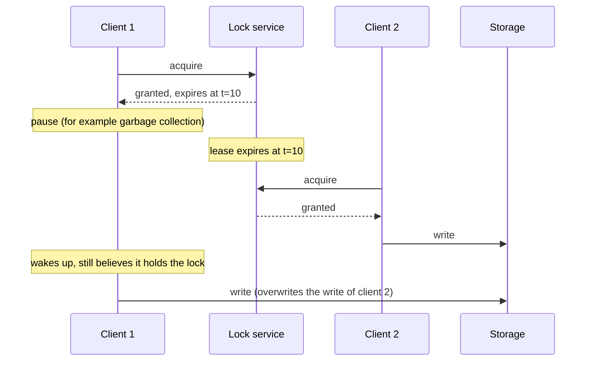
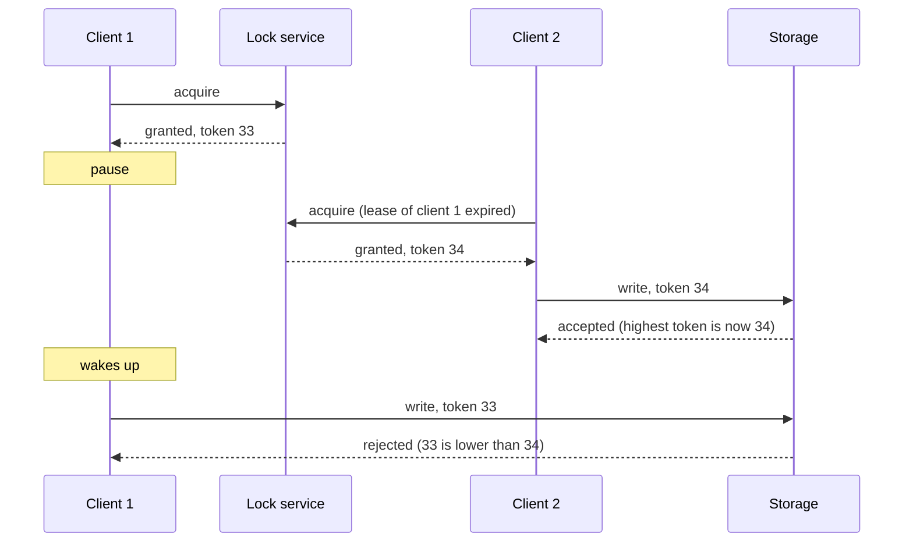
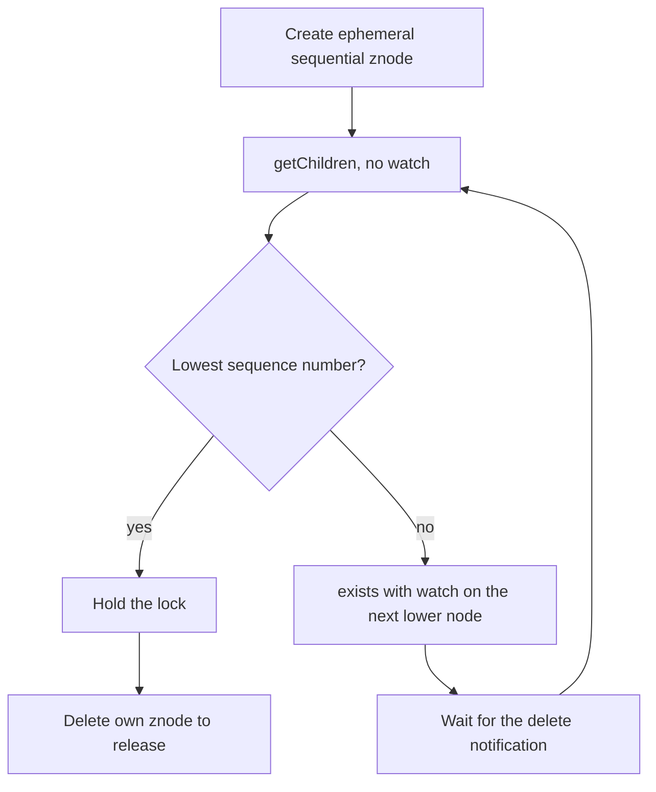

# Distributed Locks and Leases

A distributed lock lets several processes on different machines agree that only one of them works on a shared resource at a time. The idea looks like a mutex, and it fails in ways that a mutex does not, because processes pause, messages arrive late, and clocks disagree. This page separates the two reasons for a lock (efficiency and correctness), explains leases (locks that expire), explains fencing tokens (the check that makes a lease safe), presents the Redlock algorithm and the debate between Martin Kleppmann and Salvatore Sanfilippo (antirez) about it, shows how ZooKeeper, etcd, and PostgreSQL provide locks, and gives a runnable Java lease service with a fenced store. Clocks and failure detection are in [failures and time](01-failures-and-time.md). Consensus, which lock services use internally, is in [consensus and leader election](02-consensus-and-leader-election.md). Replication and failover are in [replication](../fundamentals/05-replication.md).

## Why It Matters

"How do you make sure that only one worker runs this job?" and "how would you build a distributed lock?" are common questions in senior system design rounds, in the deep dives of ticket booking, job scheduling, and payment designs, and the follow-up "what if the lock holder pauses?" separates candidates who know the topic from candidates who know the slogan. On the job, wrong locks cause real incidents: two workers that charge a customer twice, two writers that corrupt one file, two leaders that both accept writes. The correct answer is rarely "use Redis `SET NX`". It is a decision: do you need the lock for efficiency or for correctness, and if for correctness, does the protected resource check a fencing token.

## Core Concepts

**Mutual exclusion**: at any moment, at most one process is in the critical section for a resource. A **critical section** is the code that reads and changes the shared resource.

**Distributed lock**: a lock that a service outside the clients grants and tracks, so that clients on different machines can exclude each other. A lock in a distributed system differs from a mutex in a process: the lock service, the network, and each client can fail independently.

**Lease**: a lock (or other right) that the service grants for a limited time. Gray and Cheriton (1989) define a lease as "a contract that gives its holder specified rights over property for a limited period of time". If the holder crashes or becomes unreachable, the lease expires and the service can grant it again. A lock with no time limit has no such recovery: a crashed holder keeps it forever. Leases depend on clocks. Gray and Cheriton write that "the correct functioning of leases requires only that clocks have a known bounded drift", in which case the service can send the lease term as a duration.

**Lease term (TTL)**: the duration of a lease. The holder can **renew** the lease before it expires.

**Safety property**: something bad never happens. For a lock, the safety property is mutual exclusion. **Liveness property**: something good eventually happens. For a lock, the liveness property is that someone can eventually acquire it, even after a holder crashes.

**Process pause**: a period in which a process does not run, although the machine and the lock service continue. Causes include a stop-the-world garbage collection, a page fault, a virtual machine pause, a `SIGSTOP`, and CPU starvation. Kleppmann (2016) notes that stop-the-world pauses "have sometimes been known to last for several minutes".

**Fencing token**: a number that the lock service increases each time it grants the lock. The client sends the token with every request to the resource. The resource remembers the highest token that it has seen and rejects any request with a lower token.

**Efficiency lock and correctness lock** (Kleppmann's terms, for which he cites the Chubby paper): an efficiency lock saves work, and its failure costs a little (a duplicate email, a few cents of compute). A correctness lock prevents corrupted state, and its failure costs a lot (lost data, a double payment). The Chubby paper makes the same split: before Chubby, Google systems used ad hoc primary election "when work could be duplicated without harm" and operator intervention "when correctness was essential".

**Monotonic clock and wall clock**: a monotonic clock only moves forward at a steady rate (in Java, `System.nanoTime`). A wall clock shows the calendar time, and an administrator or the time-sync service can step it forward or back (in Java, `System.currentTimeMillis`). See [failures and time](01-failures-and-time.md).

**Session**: in ZooKeeper and etcd, a client connection that the service keeps alive with periodic heartbeats. The service deletes the client's ephemeral data when the session ends or the lease expires.

**Compare-and-set (CAS)**: a write that succeeds only if the stored value (or version) equals an expected value. Optimistic locking uses CAS (see [concurrency in LLD](../../lld/fundamentals/09-concurrency-in-lld.md) for the in-process version).

## How It Works

### Do you need a lock?

Ask what happens if two processes hold the lock at the same time.

| Answer | Lock type | Consequence for the design |
|---|---|---|
| A little waste (the same computation twice, a duplicate notification) | Efficiency | A single-node lock with a TTL is enough. Document that the lock is approximate |
| Corrupted or lost data, a double charge | Correctness | The lock alone is not enough. The resource must reject stale holders (fencing, CAS, or a transaction in the same database) |

Before you build a lock, check the alternatives:

- **Make the operation idempotent.** If running twice has the same effect as running once, the lock is only an efficiency measure. See [reliability patterns](../fundamentals/12-reliability-patterns.md) and [distributed transactions](03-distributed-transactions.md) for idempotent consumers.
- **Use a compare-and-set or a unique constraint at the resource.** `UPDATE ... WHERE version = ?` or an `INSERT` into a table with a unique key lets the database decide the winner. No lock service is needed.
- **Assign ownership by partition.** A Kafka consumer group gives each partition to one consumer at a time. A job scheduler can hash each job to one worker. Reassignment needs fencing, but the steady state needs no lock. See [message queues and streams](../fundamentals/08-message-queues-and-streams.md).
- **Keep the lock inside one database.** If the lock and the data are in the same transactional database, the database enforces both together (see the PostgreSQL section).

### The lease lifecycle

1. The client asks the lock service for the lock. The service checks that no valid lease exists, records the client as holder, sets an expiry time, and returns a lease (with a fencing token, if the service supports one).
2. The client does its work and renews the lease before it expires. A renewal succeeds only if the lease is still valid and the client is still the holder.
3. The client releases the lease when it finishes. If the client crashes, or cannot reach the service, the lease expires and the service grants the lock to another client.

The expiry gives liveness. It also removes mutual exclusion for the case that the holder is slow, not dead. This is the central problem.

### Why a lock without fencing is unsafe

Kleppmann (2016) gives this example. A client acquires a lock, reads a file in shared storage, changes it, writes it back, and releases the lock. The client pauses after it acquires the lock and before it writes, for longer than the lease term. The lease expires, a second client acquires the lock and writes, and then the first client wakes and writes. The first write overwrites the second client's changes.



You cannot fix this with a check of the expiry time just before the write. The pause can occur after the check and before the write. A network delay can also hold a write request in the network until after the lease expired: Kleppmann cites a GitHub incident in which packets were delayed for approximately 90 seconds. The client cannot know that its lease ended.

### Fencing tokens

The fix is to make the resource check. The lock service returns a number that increases each time it grants the lock. The client sends the number with every write. The resource keeps the highest number that it has seen and rejects a write with a lower number.



Properties of the design:

- The resource takes an **active part**: it stores the highest token and compares it on every write. A resource that cannot do this (an email API, a payment gateway with no idempotency key) cannot be protected by fencing.
- The token must **increase with each grant**. The lock service needs a durable, ordered counter, which needs consensus or a single reliable node. A random value does not work, because the resource cannot tell which value is newer.
- The resource rejects a token that is **lower** than the highest seen. It accepts the same token again, because one client sends many writes under one grant.
- The check and the write must be **atomic** at the resource (one conditional update, or one transaction). Otherwise the check and the write can themselves interleave.
- Fencing protects the resource. It does not stop the stale client from computing and from calling other systems that have no check.

A fencing token has the same job as the epoch (term) number in leader election and failover, which is the reason that a Raft term works as a fencing token. See [consensus and leader election](02-consensus-and-leader-election.md) and the fencing section of [replication](../fundamentals/05-replication.md).

### When the resource cannot check a token

| Resource | Option |
|---|---|
| A database | Put the token in the row and use a conditional update. Or use a version column (CAS). See the SQL example below |
| An object store (S3-style) | Use conditional writes (an `If-Match` ETag condition or a version check, if the store supports it), or write to a new key for each attempt and switch a pointer with CAS in a database |
| An API with idempotency keys | Send a key derived from the lock grant, so that a repeat of the same logical operation has no second effect |
| A system with no check at all | The lock is an efficiency lock only. Accept duplicates, or move the effect behind a service that you control and that checks |

### The Redlock algorithm

Redis documents a lock pattern for one Redis instance and a distributed algorithm, Redlock, for several. The facts below come from the Redis documentation page "Distributed Locks with Redis", which this page's author read on 2026-10-15.

**Single instance.** To acquire the lock, the client runs `SET resource_name my_random_value NX PX 30000`. `NX` sets the key only if it does not exist, and `PX 30000` sets an expiry of 30000 milliseconds. The value must be unique across clients and lock requests (the page suggests 20 bytes from `/dev/urandom`). To release, the client deletes the key only if the stored value equals its own random value, with a Lua script or, in Redis 8.4 and later, the `DELEX key IFEQ my_random_value` command. A plain `DEL` could remove the lock of another client after the first lock expired.

**Why replication is not enough.** Redis replication is asynchronous. A client acquires the lock on the master, the master crashes before it sends the key to the replica, the replica is promoted, and a second client acquires the same lock.

**Redlock with N independent masters** (the page uses N = 5, on different computers or virtual machines, with no replication between them). To acquire the lock the client:

1. reads the current time in milliseconds;
2. tries to acquire the lock on all N instances in parallel, with the same key and random value, and with a short per-instance timeout (for a 10-second auto-release time, about 5 to 50 ms);
3. computes the elapsed time. The lock is acquired only if the client got it on a majority (at least 3 of 5) and the elapsed time is less than the lock validity time;
4. if acquired, takes as the validity time the initial validity time minus the elapsed time;
5. if not acquired, tries to unlock all instances, including those where it believes it failed.

The safety argument in the page: the first key to expire stays for at least `MIN_VALIDITY = TTL - (T2 - T1) - CLOCK_DRIFT`, where T1 is the time before the first request and T2 is the time of the last reply. During that time another client cannot get a majority. A client that fails retries after a random delay, to avoid two clients that split the instances so that nobody wins.

**Lock extension.** If the work consists of small steps, the client can use a shorter validity time and extend the lock. The client sends a Lua script to all instances that extends the TTL only if the key still holds the client's random value. The client treats the lock as extended only if it extended it on a majority of instances within the validity time. The page says that the number of extension attempts must be limited, or a liveness property is violated.

**Liveness cost.** If a client acquires the lock and a network partition separates it from the instances before it releases the lock, other clients wait for the TTL. The page states this "availability penalty equal to TTL time on network partitions".

**Crash recovery.** A Redis instance that restarts with no persistent state could let a second client get a majority. The page offers two options: enable AOF persistence with `fsync=always` (a slower option), or delay the restart of a crashed instance for longer than the maximum TTL, so that the instance joins only after all earlier locks expired.

**Documented assumptions.** The algorithm assumes that there is no synchronized clock, but that the local time in every process advances at approximately the same rate, "with a small margin of error compared to the auto-release time of the lock". Mutual exclusion holds only as long as the client finishes within the validity time minus a margin for clock drift. The page cites Gray and Cheriton (1989) for systems that need bounded clock drift.

**What the page says today** under "Disclaimer about consistency": implement fencing tokens, especially for processes that take significant time, and note that "Redis is not using monotonic clock for TTL expiration mechanism", so a wall-clock shift can let two processes hold the lock. The page ends with "Analysis of Redlock" and links both Kleppmann's article and antirez's answer.

### The Redlock debate

Kleppmann published "How to do distributed locking" on 8 February 2016. Antirez answered with "Is Redlock safe?" on 9 February 2016. His post opens with "Martin Kleppmann [...] yesterday published an analysis of Redlock", and Kleppmann's article carries a note dated "Update 9 Feb 2016" that links the rebuttal. The summaries below keep each side's argument as the author wrote it, with short quotes for the core claims. Interviewers often hear one side repeated as fact, so state who said what.

**Kleppmann's position.**

1. *Say what the lock is for.* For efficiency, Redlock is "unnecessarily heavyweight and expensive". Use a single Redis instance, "perhaps with asynchronous replication to a secondary instance in case the primary crashes", accept that it sometimes drops a lock, and document that the locks are approximate. For correctness, he argues that Redlock "is not sufficiently safe".
2. *Redlock has no fencing token.* "The algorithm does not produce any number that is guaranteed to increase every time a client acquires a lock." The random value is not monotonic. A counter on one Redis node fails when that node fails, and counters on several nodes "would go out of sync". He writes that "it's likely that you would need a consensus algorithm just to generate the fencing tokens". Without a token, the resource cannot reject a paused or delayed client.
3. *Redlock's safety depends on timing.* "Its safety depends on a lot of timing assumptions": that all Redis nodes hold keys for approximately the right length of time, that the network delay is small compared to the expiry duration, and that process pauses are much shorter than the expiry duration. He concludes that Redlock works correctly only in a synchronous system model: bounded network delay, bounded process pauses, and bounded clock error. He adds that a synchronous model "does not mean exactly synchronised clocks: it means you are assuming a known, fixed upper bound on network delay, pauses and clock drift". He notes that Redis uses `gettimeofday`, not a monotonic clock, to expire keys, and that the time it returns can jump.
4. *Counterexample with a clock jump.* Client 1 acquires the lock on nodes A, B, C, and D and E are unreachable. The clock on node C jumps forward and the key expires. Client 2 acquires the lock on C, D, E. Both clients believe that they hold the lock. A crash and fast restart of C that loses the key gives the same result, and the delayed-restart remedy "relies on a reasonably accurate measurement of time".
5. *Counterexample with a pause.* Client 1 sends its requests to A to E. While the responses are in flight, client 1 enters a stop-the-world GC pause. All keys expire. Client 2 acquires the lock on all five nodes. Client 1 wakes, reads the responses from its kernel network buffers, and believes it holds the lock. He writes that a long network delay can have the same effect, and that "it is unlikely that Redlock would survive a Jepsen test".
6. *Recommendation.* "If you need locks for correctness, please don't use Redlock." Use "a proper consensus system such as ZooKeeper, probably via one of the Curator recipes", or "at the very least, use a database with reasonable transactional guarantees", and "enforce use of fencing tokens on all resource accesses under the lock".
7. *After the rebuttal.* His update of 9 February 2016 says that antirez "makes some good points, but I stand by my conclusions".

**Antirez's position.**

1. *Auto-release is necessary.* "A distributed lock without an auto release mechanism [...] is basically useless", because a crashed holder causes a deadlock. After the TTL, the mutual exclusion guarantee is gone for every auto-release lock. He writes that this criticism "is basically common to everything which is a distributed lock with auto release, not providing a monotonically increasing counter".
2. *Five arguments against the token fix.* (a) "Distributed locks are very useful exactly when we have no other control in the shared resource", so a design that assumes a resource-side check is "a very strange way to reason about distributed locks with strong guarantees". (b) If the store accepts a write only when the token is greater than all past tokens, the store is linearizable, and then you can generate an increasing ID for each Redlock grant. (c) Most resources are not linearizable stores. The large random value of each Redlock grant still supports check-and-set: "we set its state to `<token>`, then we operate the read-modify-write only if the token is still the same when we write". (d) Because of the same pauses, the order in which clients acquired tokens need not match the order in which they work on the resource. (e) Many locks guard non-transactional effects, such as moving physical objects or calling an external API. His bottom line: "a unique identifier for each lock can be used for the same goals, but is much more practical".
3. *The system model is weaker than Kleppmann states.* Redlock "assumes a semi synchronous system model where different processes can count time at more or less the same 'speed'". The processes do not need a bounded error in absolute time. His example: each process counts 5 seconds with at most 10% error (one counts 4.5 seconds, another 5.5). Administrators should not set the clock by hand, and the time daemon should spread a correction over time instead of jumping. He disputes that Redlock needs a bound on message delay: "Martin also states that Redlock requires bound messages maximum delays, which is not correct as far as I can tell".
4. *Delays during acquisition are handled.* The client reads the time in step 1 and again after it contacts the instances. "Whatever delay happens in the network or in the processes involved, after acquiring the majority we *check again* that we are not out of time." So the pause in Kleppmann's second counterexample makes the client treat the lock as invalid. A delay after that check is the general problem of every auto-release lock: the client must stop work before the validity time ends. He recommends the same before-and-after time check for any lock service with expiry.
5. *Restart.* The delayed restart is optional. Each Redis node can instead fsync at every operation, "how most other systems providing strong guarantees work".
6. *Concession.* "I think Martin has a point about the monotonic API, Redis and Redlock implementations should use it to avoid issues due to the system clock being altered."
7. *Conclusion.* He does not find justified the conclusion "that people should not use Redlock when the mutual exclusion guarantee is needed", and he asks for more expert feedback and for tests "with Jepsen, or similar tools".

**Where they agree.** A lock needs a TTL (Kleppmann calls the timeout "always a good idea"). A monotonic clock is better than the wall clock for expiry. A client that keeps working after its lock may have expired is a problem for every lock with expiry, not only Redlock.

**Where they disagree.** Kleppmann holds that a correctness lock needs a monotonically increasing fencing token checked at the resource, and an algorithm whose safety does not depend on timing. He holds that Redlock supplies neither. Antirez holds that a bounded relative clock rate is a practical assumption, that the second time check covers delays during acquisition, that a unique random value at the resource does the job of a token, and that the post-acquisition problem belongs to every lock.

**Analysis (this KB's reading, not a claim by either author).**

- The two pause scenarios differ in where the pause occurs. Kleppmann's scenario places the pause while the responses are in flight, so before the client's second clock read. If the client reads the clock after it reads the responses, as the algorithm says, it sees the elapsed time and drops the lock, as antirez states. A pause after the second clock read affects every auto-release lock, and no client-side check detects it. Only a check at the resource stops it.
- Antirez's check-and-set with a random value is also a check at the resource. It needs a resource that supports a conditional write. So both authors need the resource to take part for a correctness lock. They differ on whether the value must be ordered. A random value lets the resource detect that another holder wrote. An increasing token also lets the resource reject a holder whose first write arrives after a newer holder's write.
- The clock-jump counterexample is about the Redis nodes' expiry clocks, which use the wall clock. The Redis documentation still states that "Redis is not using monotonic clock for TTL expiration mechanism".
- The decision reduces to one question: can the protected resource verify a token or a version? If yes, add the check, and a lock service with an increasing token (ZooKeeper, etcd) gives a safe design. If no, no lock algorithm gives safety against a pause after the check.
- The Redis documentation now recommends fencing tokens for "any distributed locking system" and lists the missing monotonic clock as a risk. Neither author has published a joint conclusion.

Recommendation: for an efficiency lock, use a single Redis instance (or any database row with an expiry) and document that it is approximate. For a correctness lock, take the token from a consensus-backed service (ZooKeeper, etcd) or from the database that holds the data, and check it at the resource. Do not rely on Redlock alone for correctness.

### ZooKeeper locks

The ZooKeeper "Recipes and Solutions" page describes a lock with ephemeral sequential znodes. An **ephemeral znode** exists only while the creating session lives. A **sequential znode** gets a suffix from a counter that the parent znode keeps and that increases with each creation. The Programmer's Guide states that this counter is a signed 4-byte integer that overflows after 2147483647.

1. The client creates `locknode/guid-lock-` with the sequence and ephemeral flags. The `guid` lets the client find its node if the response to `create()` was lost.
2. The client calls `getChildren()` on the lock node without a watch (a watch here would cause a herd effect).
3. If its node has the lowest sequence number, the client holds the lock.
4. Otherwise it calls `exists()` with a watch on the node with the next lower sequence number. If `exists()` returns null (that node is already gone), the client goes back to step 2. Otherwise it waits for the notification and then goes back to step 2.
5. To release, the client deletes its node.

Each node is watched by exactly one client, so a delete wakes one client, and no polling or timeout is needed. The recipe page lists this: no herd effect, no polling, and easy observation of contention.



If the session expires, ZooKeeper deletes the client's ephemeral znode and the next client takes the lock. The Programmer's Guide states that the client of the expired session "will not be notified of the session expiration until/unless it is able to re-establish a connection to the cluster" (see [consensus and leader election](02-consensus-and-leader-election.md), which covers sessions and the stale leader). A paused client therefore needs fencing here as well.

**The fencing token in ZooKeeper.** Kleppmann writes that "you can use the zxid or the znode version number as fencing token", and cites Junqueira and Reed's ZooKeeper book. The `czxid` of the lock znode is a concrete choice. The Programmer's Guide gives the facts:

- Every change to the ZooKeeper state gets a `zxid`, and "if zxid1 is smaller than zxid2 then zxid1 happened before zxid2".
- `czxid` is "the zxid of the change that caused this znode to be created". The `create()` call returns the path, and the client reads the `czxid` from the znode's `Stat` (for example with `exists()`).

The holder is the client whose znode has the lowest sequence number, and a later grant goes to a znode that was created later. Therefore each new holder's `czxid` is higher than the previous holder's, and the resource can reject a lower `czxid`. The sequence number suffix also increases with each grant, until the counter overflows. A znode's data version is not a token here, because every new lock znode starts at version 0. Kleppmann's "znode version" fits a znode that each holder updates, for example a znode that the holder writes when it takes the lock.

### etcd locks

etcd gives leases and transactions. The etcd API documentation says that leases are "a mechanism for detecting client liveness": the cluster grants a lease with a time to live, the lease expires if the cluster receives no keep-alive within the TTL, each key attaches to at most one lease, and when a lease expires or is revoked, all keys attached to it are deleted. Clients refresh a lease on a bidirectional stream (`LeaseKeepAlive`). Each key also records its `create_revision` and `mod_revision`, and the same documentation states: "The etcd client's distributed shared locks use the creation revision to wait for lock ownership."

The Go client's `concurrency` package builds a lock on these parts. `NewSession` creates a leased session (the default TTL in the source is 60 seconds), and `NewMutex(session, prefix)` returns a `Mutex` with `Lock`, `TryLock`, and `Unlock`. The source of `mutex.go` and `key.go` shows the algorithm:

1. `Lock` runs one transaction. If the key `prefix/<lease ID in hex>` does not exist, it creates the key, attached to the session lease. In the same transaction it reads the key under the prefix with the lowest creation revision (the current owner).
2. If the client's own key has the lowest creation revision, the client holds the lock.
3. Otherwise the client finds the key with the largest creation revision below its own and watches that one key for deletion, then repeats. This is the predecessor watch of the ZooKeeper recipe, so a release wakes one waiter.
4. After the wait, `Lock` reads its own key again. If the key is gone (the session lease expired), `Lock` returns `ErrSessionExpired`.

`Mutex.IsOwner()` returns the comparison `CreateRevision(key) == myRev`. A client puts it in the `If` part of a transaction, so that a write to etcd commits only if the client still owns the lock. The fencing token for another system is the creation revision of the lock key (`Mutex.Key()`). The store revision increases with every change in etcd, and the next holder's key was created after the previous holder's key, so each new holder has a higher creation revision. `Mutex` has no getter for that revision. Read it with a `Get` of `Mutex.Key()`. `Mutex.Header()` returns "the response header received from etcd on acquiring the lock", and its revision equals the key's creation revision only when that call created the key and found itself as the owner in the same transaction. [Consensus and leader election](02-consensus-and-leader-election.md) uses the same creation revision as the token for elections.

Because the check `IsOwner` runs inside a consensus-backed transaction, a write to etcd itself under the lock is safe with no extra token. A write to another system still needs the token to be sent there.

### Chubby sequencers

Burrows (OSDI 2006) describes Chubby, Google's lock service built on Paxos. Chubby locks are advisory: "they conflict only with other attempts to acquire the same lock". The paper states the delayed-request problem: a holder of lock L may issue a request R and then fail, another process may acquire L and act, and R may arrive later and be "acted on without the protection of L".

Chubby's answer is a **sequencer**: "an opaque byte-string that describes the state of the lock immediately after acquisition. It contains the name of the lock, the mode in which it was acquired (exclusive or shared), and the lock generation number." The client passes the sequencer to servers, such as file servers, if it expects the lock to protect the operation. The receiving server tests whether the sequencer is still valid and has the right mode, and rejects the request if not. The server checks validity against its Chubby cache or, if it does not keep a session with Chubby, "against the most recent sequencer that the server has observed". That second option is the fencing token check. The paper was published ten years before Kleppmann's article.

For servers that do not check sequencers, Chubby offers a weaker mechanism, the **lock-delay**. If a lock becomes free because the holder failed or became unreachable (not because it released the lock), the lock server prevents other clients from claiming the lock for the lock-delay, which a client may set up to a bound of one minute. The paper calls this "imperfect".

### Database locks

**Row locks.** In PostgreSQL, `SELECT ... FOR UPDATE` locks the selected rows until the transaction ends. Other transactions that try to update, delete, or lock those rows wait. `NOWAIT` makes the statement fail instead of waiting, and `SKIP LOCKED` skips rows that are locked. The PostgreSQL documentation says that skipping locked rows gives an inconsistent view, so it is not for general use, and that it fits "queue-like" tables with several consumers.

**Advisory locks.** PostgreSQL provides locks that "have application-defined meanings" and that the database does not enforce on its own: the application must use them correctly. The documentation gives two forms:

- A **session-level** lock (`pg_advisory_lock`, `pg_try_advisory_lock`) stays until the application releases it or the session ends. It ignores transaction boundaries: a lock taken in a transaction that rolls back stays held. The owning session can acquire it more than once, and each acquisition needs its own unlock before the lock is released.
- A **transaction-level** lock (`pg_advisory_xact_lock`, `pg_try_advisory_xact_lock`) releases at the end of the transaction, and there is no unlock call.

The documentation says that advisory locks are faster than a flag in a table, avoid table bloat, and are cleaned up by the server at the end of the session. They live in a shared memory pool with a limit, "typically in the tens to hundreds of thousands" depending on configuration.

<!-- sql-skip: postgresql -->
```sql
-- PostgreSQL syntax. SQLite does not have advisory locks or FOR UPDATE.
-- Only one session runs the nightly job. The other sessions get false and skip the run.
SELECT pg_try_advisory_lock(42);          -- true: this session now holds lock 42

-- Work queue: several workers each take different rows without waiting for each other.
BEGIN;
SELECT id, payload
FROM jobs
WHERE status = 'pending'
ORDER BY id
LIMIT 10
FOR UPDATE SKIP LOCKED;
-- process the rows, mark them done
COMMIT;

SELECT pg_advisory_unlock(42);            -- release the session-level lock
```

**What a database lock protects.** A database holds the lock on the server side, tied to the connection, so a paused client does not let a second client enter while the first connection lives. If the connection ends, the database releases the lock (and rolls back the open transaction). The write that was part of the same transaction does not commit. Therefore, when the lock and the write are in the same transaction (a row lock, or a transaction-level advisory lock), the database checks them together and the pause problem does not arise. A session-level lock gives this protection only for writes on the same connection: a client whose connection dropped and that reconnects no longer holds the lock, so it must check before it writes again. The problem returns when the protected effect is outside the database: with a session advisory lock that guards an upload to an object store or a call to an external API, a client whose connection dropped (and whose lock was released) can still continue the external work. For that case, send a token that comes from the database (for example a value from a sequence, incremented in the same transaction that takes the lock).

**Limits.** A single database is a single point of failure for the lock. Long transactions hold locks, vacuum, and connections. A connection pooler in transaction mode does not keep a session between transactions, so a session-level advisory lock can stay on a server connection that another client uses next. The PgBouncer feature table marks "Session-level advisory locks" as "Never" supported in transaction pooling (and "Yes" in session pooling). Use transaction-level advisory locks behind such a pooler.

## Trade-offs and When to Use

| Option | Safety against a paused holder | Cost and operation | Fencing token | Use for |
|---|---|---|---|---|
| Single Redis instance, `SET NX PX` | None by itself. Failover can lose the lock | Cheap, fast | None | Efficiency locks |
| Redlock (5 Redis masters) | Depends on bounded pauses, delays, and clock rate (Kleppmann) or on bounded relative clock rate (antirez) | Five independent nodes, majority protocol | None | Efficiency locks where one Redis node is not enough. The debate is open for correctness |
| ZooKeeper (ephemeral sequential znodes) | Safe for acquisition. The holder needs fencing after a session expiry | A ZooKeeper ensemble, 3 or 5 nodes | `czxid` of the lock znode (a `zxid`), or the version of a znode that each holder updates | Correctness locks, leader election |
| etcd (lease and mutex) | Safe for acquisition. The holder needs fencing after a lease expiry | An etcd cluster, 3 or 5 nodes | Creation revision of the lock key | Correctness locks, Kubernetes-style components |
| PostgreSQL row lock or advisory lock | Safe when the protected data is in the same database. Not safe for outside effects | Uses your existing database | A sequence value that you add | Jobs, singletons, queues |
| Compare-and-set or unique constraint | Safe. No lock exists to expire | One conditional statement | The version or key is the check | Updates of one record |
| Idempotent operation | Safe. Duplicates do no harm | Needs idempotency keys | None needed | Any effect that you can make idempotent |

**Recommendation.** Start with the cheapest design that fits the failure cost. If a duplicate is harmless, use an efficiency lock. If it is not, prefer a design with no lock (CAS, unique constraint, idempotent operation). If you need a lock for correctness, use a lock service that gives a fencing token and make the resource check it.

**What every lease needs.**

- A TTL that is longer than a normal critical section and a renewal rule. A short TTL makes false expiry common. A long TTL delays recovery after a crash.
- A holder that stops work before the expiry minus a margin for clock drift. The holder measures the time with a monotonic clock (`System.nanoTime`) and computes the deadline from the moment before it sent the request, as Redlock's time check does.
- A fencing check at the resource for correctness locks.

## Java Example

The program below is a lease service with fencing tokens and an injected clock. The lock service grants one lease at a time and raises the token with each new grant. Two stores receive writes: a fenced store that rejects a token lower than the highest seen, and an unfenced store that accepts everything. Client A acquires a lease, renews it, checks that the lease is valid, and then pauses. The lease expires, client B acquires the lease with a higher token, and writes. When A resumes and writes with its old token, the fenced store rejects the write, and the unfenced store accepts it and loses B's data. The `ManualClock` replaces `System.nanoTime`, so the output is the same on every run.

```java
import java.util.Optional;

public class LeaseFencingDemo {
    private static final ManualClock clock = new ManualClock();

    static void say(String message) {
        System.out.println("t=" + clock.now() + " " + message);
    }

    public static void main(String[] args) {
        LeaseService leases = new LeaseService(clock, 10);
        FencedStore fenced = new FencedStore(true);
        FencedStore unfenced = new FencedStore(false);

        Lease a = leases.acquire("A").orElseThrow();
        say("A acquires: " + a);

        clock.advance(3);
        Optional<Lease> denied = leases.acquire("B");
        say("B tries to acquire: " + (denied.isPresent() ? denied.get() : "denied, A holds it"));

        clock.advance(2);
        a = leases.renew(a).orElseThrow();
        say("A renews: " + a);

        clock.advance(1);
        say("A checks its lease: valid=" + a.isValidAt(clock.now()));
        say("A pauses (for example a long GC pause)");

        clock.advance(14);
        Lease b = leases.acquire("B").orElseThrow();
        say("B acquires: " + b);
        say("B writes to the fenced store:   " + fenced.write("from-B", b.token()));
        say("B writes to the unfenced store: " + unfenced.write("from-B", b.token()));

        clock.advance(1);
        say("A resumes and still believes it holds the lease");
        say("A writes to the fenced store:   " + fenced.write("from-A", a.token()));
        say("A writes to the unfenced store: " + unfenced.write("from-A", a.token()));
        Optional<Lease> renewed = leases.renew(a);
        say("A tries to renew: " + (renewed.isPresent() ? renewed.get() : "refused"));

        say("B writes again to the fenced store: " + fenced.write("from-B-2", b.token()));
        say("fenced store:   " + fenced);
        say("unfenced store: " + unfenced);
    }
}

/** A clock that the test moves by hand. It replaces System.nanoTime in the lease service. */
class ManualClock {
    private long now = 0;

    long now() {
        return now;
    }

    void advance(long ticks) {
        now += ticks;
    }
}

/** A lease: one holder, a fencing token, and the time at which the lease expires. */
record Lease(String holder, long token, long expiresAt) {
    boolean isValidAt(long time) {
        return time < expiresAt;
    }

    @Override
    public String toString() {
        return "holder=" + holder + " token=" + token + " expiresAt=" + expiresAt;
    }
}

/** The lock service. It grants one lease at a time and raises the token on each new grant. */
class LeaseService {
    private final ManualClock clock;
    private final long ttl;
    private long lastToken = 0;
    private Lease current = null;

    LeaseService(ManualClock clock, long ttl) {
        this.clock = clock;
        this.ttl = ttl;
    }

    synchronized Optional<Lease> acquire(String client) {
        if (current != null && current.isValidAt(clock.now())) {
            return Optional.empty();
        }
        lastToken++;
        current = new Lease(client, lastToken, clock.now() + ttl);
        return Optional.of(current);
    }

    synchronized Optional<Lease> renew(Lease lease) {
        boolean isCurrent = current != null && current.token() == lease.token();
        if (!isCurrent || !current.isValidAt(clock.now())) {
            return Optional.empty();
        }
        current = new Lease(lease.holder(), lease.token(), clock.now() + ttl);
        return Optional.of(current);
    }
}

/** A resource. A fenced store rejects a write whose token is lower than the highest seen. */
class FencedStore {
    private final boolean checkTokens;
    private long highestToken = 0;
    private String value = "(empty)";

    FencedStore(boolean checkTokens) {
        this.checkTokens = checkTokens;
    }

    synchronized String write(String newValue, long token) {
        if (checkTokens && token < highestToken) {
            return "REJECTED (token " + token + " < " + highestToken + ")";
        }
        highestToken = Math.max(highestToken, token);
        value = newValue;
        return "accepted";
    }

    @Override
    public synchronized String toString() {
        return "value=" + value + " highestToken=" + highestToken;
    }
}
```

<!-- expected-output -->
```text
t=0 A acquires: holder=A token=1 expiresAt=10
t=3 B tries to acquire: denied, A holds it
t=5 A renews: holder=A token=1 expiresAt=15
t=6 A checks its lease: valid=true
t=6 A pauses (for example a long GC pause)
t=20 B acquires: holder=B token=2 expiresAt=30
t=20 B writes to the fenced store:   accepted
t=20 B writes to the unfenced store: accepted
t=21 A resumes and still believes it holds the lease
t=21 A writes to the fenced store:   REJECTED (token 1 < 2)
t=21 A writes to the unfenced store: accepted
t=21 A tries to renew: refused
t=21 B writes again to the fenced store: accepted
t=21 fenced store:   value=from-B-2 highestToken=2
t=21 unfenced store: value=from-A highestToken=2
```

Points to notice:

- A's check at `t=6` returns `valid=true`, and A is still unsafe at `t=21`. The check does not protect the write.
- The fenced store accepts B's second write, because B sends the same token again. It rejects only a lower token.
- The unfenced store ends with A's stale value. B's data is lost.
- The tick unit of `ManualClock` is arbitrary. A real lease uses a monotonic clock such as `System.nanoTime`.

### The same check in SQL

When the resource is a relational database, the fencing check is one conditional `UPDATE`. The block below runs in SQLite. The `last_token` column stores the highest token. Client B (token 34) writes first, then client A (token 33) tries to write after its pause.

```sql
CREATE TABLE document (
    id         INTEGER PRIMARY KEY,
    body       TEXT    NOT NULL,
    last_token INTEGER NOT NULL
);
INSERT INTO document VALUES (1, 'initial', 33);

-- Client B holds the lease with token 34.
UPDATE document SET body = 'from-B', last_token = 34
WHERE id = 1 AND last_token <= 34;

-- Client A wakes up with the old token 33. The condition is false, so no row changes.
UPDATE document SET body = 'from-A', last_token = 33
WHERE id = 1 AND last_token <= 33;
```

```sql
SELECT body, last_token FROM document WHERE id = 1;
```

<!-- sql-result -->
```text
body | last_token
from-B | 34
```

The application checks the number of rows that the `UPDATE` changed. Zero rows means that the token was stale, and the client must stop. The check and the write are one statement, so they cannot interleave. The same pattern with a `version` column is optimistic locking.

## Interview Angle

### Questions

??? question "When do you need a distributed lock, and how do you decide how strong it must be?"

    **Direct answer:** you need one when several processes could do the same work or change the same resource at the same time, and you cannot avoid that with a conditional write, a unique constraint, or an idempotent operation. The strength depends on what happens when two processes hold the lock together.

    **Reason:** Kleppmann separates two purposes. An efficiency lock saves duplicate work, and a failure costs a little, so a single Redis instance with a TTL is enough. A correctness lock prevents corrupted state or a double effect, and a failure costs a lot, so the lock alone is not enough: the resource must reject stale holders with a fencing token or a conditional write.

    **Trade-off:** before I add a lock, I check for alternatives. A compare-and-set on the record, a unique key, or an idempotency key often removes the lock and its failure modes. If the lock and the data sit in one transactional database, I use the database's own locks, because the database checks them with the write.

??? question "What is a lease, and why do distributed locks use one?"

    **Direct answer:** a lease is a lock that expires after a time limit unless the holder renews it. Gray and Cheriton (1989) introduced it for file cache consistency.

    **Reason:** a lock without a time limit has no recovery when the holder crashes or becomes unreachable: nobody else can acquire it. The lease gives liveness, because the service can grant the lock again after the expiry.

    **Edge case:** the expiry removes mutual exclusion for a holder that is slow and not dead. A holder that pauses for longer than the term still believes that it holds the lock. The lease needs two supports: a holder that stops work before the deadline, using a monotonic clock, and a fencing check at the resource. Gray and Cheriton also state that "the correct functioning of leases requires only that clocks have a known bounded drift". A fast server clock or a slow client clock lets the server grant the lease again while the old holder still uses it.

??? question "What is a fencing token, and how does it make a lock safe?"

    **Direct answer:** a fencing token is a number that the lock service increases at each grant. The client sends it with every request to the resource. The resource remembers the highest token and rejects a request with a lower one.

    **Reason:** the example is a client that pauses after it acquires the lock. Its lease expires, a second client gets token 34 and writes. When the first client wakes and writes with token 33, the resource rejects it. The check runs at the resource, so it does not depend on the stale client noticing that it lost the lock. A timing check in the client cannot do this, because the pause can occur after the check.

    **Trade-off:** the resource must take part: it stores the highest token and compares it atomically with the write. The token must come from a durable, ordered source (the `czxid` of a ZooKeeper lock znode, the creation revision of an etcd lock key, a database sequence). A random value cannot order grants, and Redlock does not produce a token. Chubby published the same idea in 2006 as the "sequencer", which carries a lock generation number. If the resource cannot check (an external API), use an idempotency key, or treat the lock as an efficiency lock.

??? question "Explain the Redlock algorithm."

    **Direct answer:** Redlock uses N independent Redis masters (typically 5). The client reads the time, tries `SET key random_value NX PX ttl` on all instances in parallel with a short per-instance timeout, and reads the time again. If it got the lock on a majority and the elapsed time is less than the TTL, the lock is acquired, and the validity time is the TTL minus the elapsed time. Otherwise the client releases all instances and retries after a random delay.

    **Details:** the random value makes the release safe: the client deletes the key only if the value matches (a Lua script, or `DELEX ... IFEQ` in Redis 8.4 and later). The instances do not replicate to each other. A crashed instance should stay away for longer than the maximum TTL after a restart, or use `fsync=always`, so that it cannot grant a lock that it forgot.

    **Caveat:** the algorithm assumes that clocks run at about the same rate and that the client finishes within the validity time. It produces no fencing token. The Redis documentation recommends fencing tokens and states that Redis does not use a monotonic clock for expiry.

??? question "Is Redlock safe? Present both sides."

    **Direct answer:** it depends on what you need the lock for, and the two authors disagree on correctness locks.

    **Kleppmann (8 February 2016):** for efficiency, Redlock is "unnecessarily heavyweight and expensive", and one Redis instance is enough. For correctness, it is not safe, for two reasons. It has no fencing token, so the resource cannot reject a paused or delayed client. Its safety also assumes a synchronous system model: bounded network delay, bounded process pauses, and bounded clock error. He stresses that this means known upper bounds, not exactly synchronized clocks. He shows two counterexamples that give two holders: a clock jump on one Redis node, and a GC pause while the responses are in flight. He recommends ZooKeeper (through Curator), or at least a database with transactions, and fencing tokens on all resource accesses. After the reply, he wrote that he stands by his conclusions.

    **Antirez (9 February 2016):** a lock needs auto-release, and after the TTL every such lock has the problem Kleppmann describes. A resource-side check is a strange premise for a lock, and if you have one, the large random value supports check-and-set at the resource, so a monotonic token is not required. Redlock needs only that processes count relative time at about the same rate, not a bound on message delay. The second time read after contacting the instances catches any delay during acquisition, including Kleppmann's pause case. He agrees that Redis and Redlock should use a monotonic clock API.

    **My position:** both need the resource to take part for a correctness lock. The difference is whether the value must be ordered. The question reduces to whether the resource can check a token. If it can, use a lock service that supplies an increasing token (ZooKeeper, etcd) and check it. If it cannot, no lock algorithm protects against a pause after acquisition. The Redis documentation itself now recommends fencing tokens. I use Redis locks for efficiency only.

??? question "How do ZooKeeper and etcd provide locks, and what is the fencing token in each?"

    **ZooKeeper:** each client creates an ephemeral sequential znode under a lock node. The client with the lowest sequence number holds the lock. The others watch only the next lower node, so a release wakes one client (no herd effect). A session expiry deletes the ephemeral node. The token can be the `czxid` of the client's znode (the `zxid` of its creation): `zxid` values are totally ordered, and each new holder's znode was created later. Kleppmann names "the zxid or the znode version number". The version works only for a znode that each holder updates: every new lock znode starts at version 0.

    **etcd:** the Go client's `concurrency.Session` creates a lease with a TTL (60 seconds by default) and keeps it alive. `Mutex.Lock` creates a key under the lock prefix, attached to the lease, so a lease expiry deletes the key. The key with the lowest creation revision holds the lock, and each waiter watches only the key just before its own. The creation revision of the lock key is the token. A client can also put the lock's `IsOwner()` comparison in a transaction, so that a write to etcd commits only while the client owns the lock.

    **Caveat:** in both systems the holder can pause past its session or lease expiry and then act. The service is safe for acquisition (it uses consensus), and the resource still needs the token check. Sessions and the stale leader are explained in [consensus and leader election](02-consensus-and-leader-election.md).

??? question "How would you use PostgreSQL for a distributed lock, and what are the limits?"

    **Direct answer:** use `SELECT ... FOR UPDATE` to lock rows during a transaction, or advisory locks for locks with an application-defined meaning. A transaction-level advisory lock (`pg_advisory_xact_lock`) releases at commit or rollback. A session-level lock (`pg_advisory_lock`) stays until you unlock or the session ends.

    **Strength:** if the lock and the protected data are in the same database, the database ties both to one transaction. If the client's connection dies, the transaction rolls back and the lock goes, so a stale client cannot commit a write. `SKIP LOCKED` lets several workers take different rows of a queue table.

    **Limits:** the database is a single point of failure for the lock. A session lock does not follow transaction rollback, and a pooler in transaction mode can break it. A lock that guards a side effect outside the database (an upload, an API call) does not stop a client whose session ended from finishing that effect. Add a token from a sequence and check it at the other system.

??? question "Design the guarantee 'only one worker runs this scheduled job at a time' for a fleet of services."

    **Direct answer:** first decide whether a duplicate run is harmful. If the job is idempotent, a cheap efficiency lock (a database row with an expiry, or one Redis key) reduces duplicates, and correctness does not depend on it.

    **Design for a job that must not run twice:** use a lock service with an increasing token (etcd lease or ZooKeeper), or a row in the application database updated with a conditional write (`UPDATE jobs SET owner = ?, token = token + 1, lease_expires = now() + ttl WHERE id = ? AND (owner IS NULL OR lease_expires < now())`, with `now()` from the database clock). The worker reads the new `token` in the same statement or transaction. The worker sends the token with each effect, and the downstream system rejects older tokens or de-duplicates by an idempotency key derived from the job and the run.

    **Failure handling:** the worker renews the lease in a loop, measures the deadline with a monotonic clock, and aborts the job when it cannot renew before the deadline. On abort or crash, the lease expires and another worker takes over. The job must therefore be restartable.

??? question "Why should a lease holder use a monotonic clock, and how much margin should it leave?"

    **Direct answer:** `System.nanoTime` measures elapsed time at a steady rate, and the wall clock can jump when an administrator or the time-sync service sets it. A lease deadline computed from a wall clock can end too early or too late after a jump.

    **Details:** the holder computes the deadline from the time that it read before it sent the request, not after it received the response, so network delay shortens the holder's view and never lengthens it. This is the same step as the time check in Redlock. It also subtracts a margin for clock rate drift between the holder and the service.

    **Edge case:** a monotonic clock does not detect a pause that happens between the last check and the action. Only the fencing check at the resource does. A monotonic clock is valid within one machine, and a deadline sent to another machine needs a duration, not a timestamp (see [failures and time](01-failures-and-time.md)).

### Follow-up Questions

??? question "Can a fencing token come from Redis?"

    A single Redis `INCR` gives an increasing number, and a failover to an asynchronously replicated replica can repeat or lower the number. Kleppmann notes that a counter on one Redis node fails with that node, and counters on several nodes drift. A token needs a durable, ordered source: a consensus store (ZooKeeper, etcd) or the primary database.

??? question "What if the resource accepts a token equal to the highest seen?"

    It must accept it. One grant covers many writes, and each write carries the same token. The resource rejects only a lower token. If your design needs to reject duplicates of one operation, add an idempotency key for the operation.

??? question "What happens to a ZooKeeper lock when the client's session expires but the client is still running?"

    ZooKeeper deletes the ephemeral znode, so the next waiter gets the lock. The old client learns about the expiry only when it reconnects. Until then it can still act. A fencing token on its writes prevents damage.

??? question "Why does the ZooKeeper recipe call `getChildren` without a watch?"

    A watch on the whole lock node would wake every waiter at every change, a herd effect, and only one waiter can proceed. The recipe watches only the next lower node, so one client wakes for each release.

??? question "Is a database row with an `expires_at` column a good lock?"

    It is a good efficiency lock and a workable correctness lock if the resource is in the same database and the writes use a conditional update with the row's version or token. The common mistake is to compare `expires_at` against the application server's clock, which can differ between servers. Use the database's clock for the comparison.

??? question "Why is `synchronized` or `ReentrantLock` not enough in a service with several instances?"

    A `synchronized` block or `ReentrantLock` excludes threads in one JVM only. Two instances of the service each have their own lock object. A distributed lock or a database constraint must coordinate across instances (see [Concurrency Basics: Threads, Locks, and the Java Memory Model](../../java/07-concurrency-basics.md) and [java.util.concurrent: Executors, Locks, Atomics, and Synchronizers](../../java/08-java-util-concurrent.md) for the in-process primitives).

### Red Flags

- Saying "use Redis `SETNX`" with no TTL, no random value, or no release check.
- A lock with no expiry, and no plan for a crashed holder.
- Checking `lock.isValid()` just before a write and calling the write safe.
- Believing that a lock service with a majority (Redlock, ZooKeeper) removes the pause problem. A pause after acquisition affects every lease.
- Using a random UUID as a "fencing token" and expecting the resource to order it.
- Using wall-clock time, or the clocks of different servers, to compare lease expiry.
- Using a distributed lock where a unique constraint or a conditional update would do.
- Quoting the Redlock debate without stating either side's argument.
- Holding a lock during a slow remote call with no timeout.

## Common Mistakes

| Mistake | Effect | Fix |
|---|---|---|
| Releasing with `DEL key` | A client deletes the lock that another client acquired after the first lease expired | Delete only if the stored value equals your random value (Lua script, or `DELEX ... IFEQ` in Redis 8.4 and later) |
| No fencing at the resource | A paused holder overwrites newer data | Send a token with each write and reject lower tokens atomically |
| TTL shorter than the critical section | The lease expires while the holder works, so two holders run | Set the TTL above the worst expected duration, renew in a loop, and abort if renewal fails |
| Using the wall clock for the deadline | A clock step shortens or extends the lease | Use `System.nanoTime` and a drift margin |
| A session advisory lock behind a transaction-mode pooler | The lock is lost or held by the wrong connection | Use a transaction-level lock, or a direct connection |
| Using Redlock for a correctness lock and calling it safe | Stale holders corrupt data after a pause or clock jump | Use a token from ZooKeeper, etcd, or the database, and check it at the resource |
| Watching the whole lock node in ZooKeeper | A herd effect on each release | Watch only the next lower sequential node |
| Lock inside the code path with no timeout on the lock call | A hung lock service blocks all callers | Set an acquisition timeout and fail or degrade |
| Treating a lock as the only defense | One failure leads to data loss | Combine the lock with idempotency or a conditional write |

## Commonly Confused With

| Looks like | Difference | Deciding question |
|---|---|---|
| Lock and lease | A lock may be held until released. A lease expires after a term unless renewed, so a crashed holder cannot block others forever | What recovers the lock when the holder dies? |
| Lease and fencing token | A lease limits the time of the grant. A fencing token orders the grants so that the resource can reject an old holder | Does the resource reject a stale holder? |
| Fencing token and the random lock value | The random value in Redis identifies the owner for a safe release. It has no order. A fencing token increases with each grant | Can the resource tell which grant is newer? |
| Redlock and a single-node Redis lock | Redlock needs a majority of N independent masters, so one node failing does not lose the lock. A single node loses the lock on failover | Is one lost lock harmless? If yes, use one node |
| Distributed lock and leader election | A lock grants short, exclusive use of a resource. Election names one long-lived leader. Both need fencing (see [consensus and leader election](02-consensus-and-leader-election.md)) | Is the holder a role or a critical section? |
| Distributed lock and optimistic locking (CAS) | A lock excludes others before the work. CAS lets everyone work and rejects a conflicting write at the end | Is the conflict rare and the work cheap to retry? |
| Row lock and advisory lock | A row lock covers table rows that a query selects. An advisory lock covers an application-chosen number and the database does not enforce its meaning | Do you lock data, or a concept? |
| Java `ReentrantLock` and a distributed lock | `ReentrantLock` excludes threads in one JVM. A distributed lock excludes processes on different machines | Do the contenders share one JVM? |

## Quick Reference Card

- First question: efficiency or correctness? What happens if two holders run together?
- Prefer no lock: idempotent operations, compare-and-set, unique constraints, partition ownership.
- A lease is a lock with an expiry. It gives liveness and removes mutual exclusion for slow holders.
- A pause (GC, page fault, `SIGSTOP`) or a delayed packet can make a holder act after its lease expired. A check before the write does not help.
- Fencing token: increases with each grant. The resource keeps the highest and rejects lower tokens, atomically with the write. A random value is not a token.
- Token sources: ZooKeeper `czxid` of the lock znode (or the version of a znode that each holder updates), the creation revision of an etcd lock key, a database sequence, a Raft term, a Chubby sequencer. Redlock produces none.
- Redlock: N = 5 independent masters, `SET NX PX` with a random value, majority within the validity time, validity = TTL minus elapsed. Release with a value check.
- Debate (8 and 9 February 2016): Kleppmann says that no token and timing assumptions (bounded delay, pauses, clock error) make Redlock unsafe for correctness. Antirez says that a bounded relative clock rate is enough, the second time read handles acquisition delays, a random value supports check-and-set, and a post-acquisition pause hits every lock. Both want a TTL and prefer a monotonic clock. Kleppmann stands by his conclusions.
- ZooKeeper lock: ephemeral sequential znode, lowest holds, watch the next lower one. etcd lock: lease plus key, lowest creation revision holds, watch the predecessor, `IsOwner` in a transaction.
- PostgreSQL: `FOR UPDATE [NOWAIT | SKIP LOCKED]`, advisory locks (session or transaction level). Safe when the data is in the same database.
- Holder rules: monotonic clock, deadline from the time before the request, stop before the expiry minus a margin, renew in a loop, abort on failure.

## Further Reading

- Kleppmann. "How to do distributed locking". 8 February 2016. The critique of Redlock and the case for fencing tokens. <https://martin.kleppmann.com/2016/02/08/how-to-do-distributed-locking.html>
- Sanfilippo (antirez). "Is Redlock safe?". 9 February 2016. The reply, with the token and system-model arguments. <http://antirez.com/news/101>
- Redis documentation. "Distributed Locks with Redis". The Redlock algorithm, its stated assumptions, and today's consistency disclaimer. <https://redis.io/docs/latest/develop/clients/patterns/distributed-locks/>
- Gray and Cheriton. "Leases: An Efficient Fault-Tolerant Mechanism for Distributed File Cache Consistency". SOSP 1989. The origin of leases and their clock assumption. <https://courses.cs.duke.edu/spring15/cps210/readings/leases-sosp89.pdf>
- Apache ZooKeeper documentation. "ZooKeeper Recipes and Solutions". The lock recipe with ephemeral sequential znodes and the herd effect. <https://zookeeper.apache.org/doc/current/recipes.html>
- Apache ZooKeeper documentation. "ZooKeeper Programmer's Guide". `zxid` ordering, `czxid`, sequential znodes, and session expiry. <https://zookeeper.apache.org/doc/current/zookeeperProgrammers.html>
- etcd documentation. "etcd API" (key revisions, and the Lease API: leases, keep-alives, expiry). <https://etcd.io/docs/v3.7/learning/api/>
- etcd Go client, package `concurrency` (`Session`, `Mutex`, `IsOwner`, `Header`), and its source `mutex.go` and `key.go`. <https://pkg.go.dev/go.etcd.io/etcd/client/v3/concurrency> and <https://github.com/etcd-io/etcd/tree/main/client/v3/concurrency>
- PgBouncer documentation. "Features" (the SQL feature table for session and transaction pooling). <https://www.pgbouncer.org/features.html>
- PostgreSQL documentation. "Explicit Locking", section "Advisory Locks", and the `SELECT` reference, "The Locking Clause" (`NOWAIT`, `SKIP LOCKED`). <https://www.postgresql.org/docs/current/explicit-locking.html> and <https://www.postgresql.org/docs/current/sql-select.html>
- Burrows. "The Chubby Lock Service for Loosely-Coupled Distributed Systems". OSDI 2006. Advisory locks, sequencers (section 2.4) as fencing, and the lock-delay. <https://research.google.com/archive/chubby-osdi06.pdf>
- Kleppmann. *Designing Data-Intensive Applications*, first edition (2017), chapter 8 ("The Trouble with Distributed Systems": process pauses, fencing tokens) and chapter 9. The 2016 article names these chapters as its long form.
- In this knowledge base: [failures and time](01-failures-and-time.md), [consensus and leader election](02-consensus-and-leader-election.md), [distributed transactions](03-distributed-transactions.md), [replication](../fundamentals/05-replication.md), and `kb/hld/case-studies/12-ticket-booking.md` and `kb/hld/case-studies/20-distributed-job-scheduler.md` for designs that use these locks.
