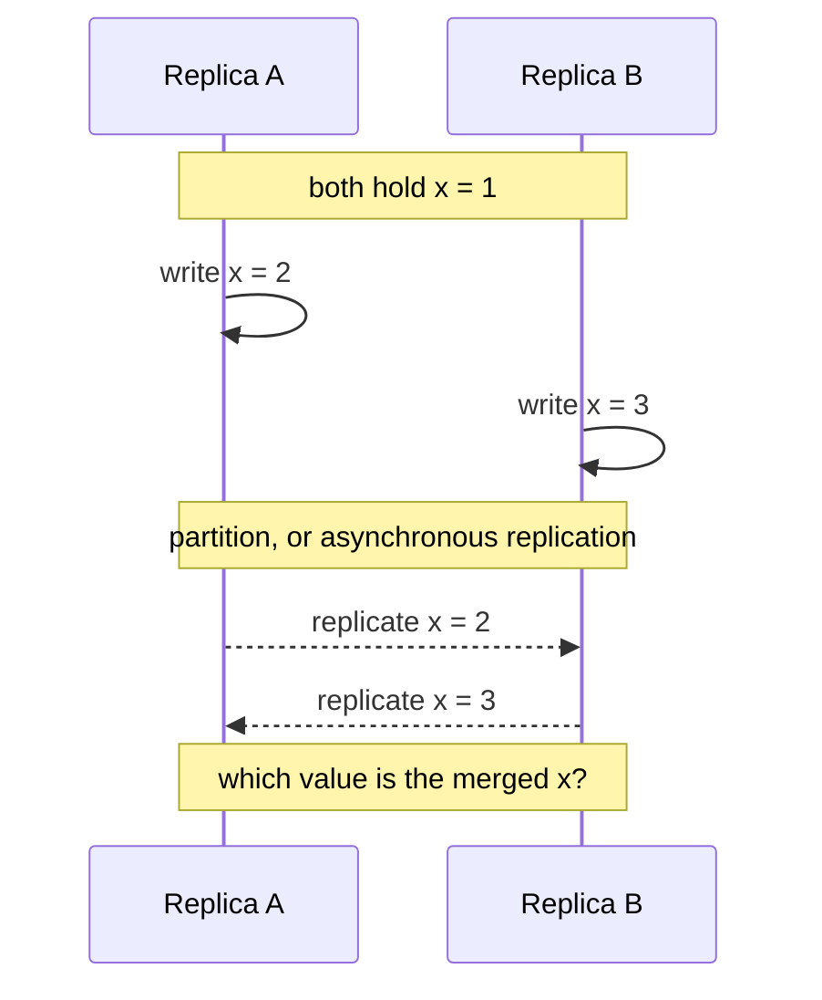
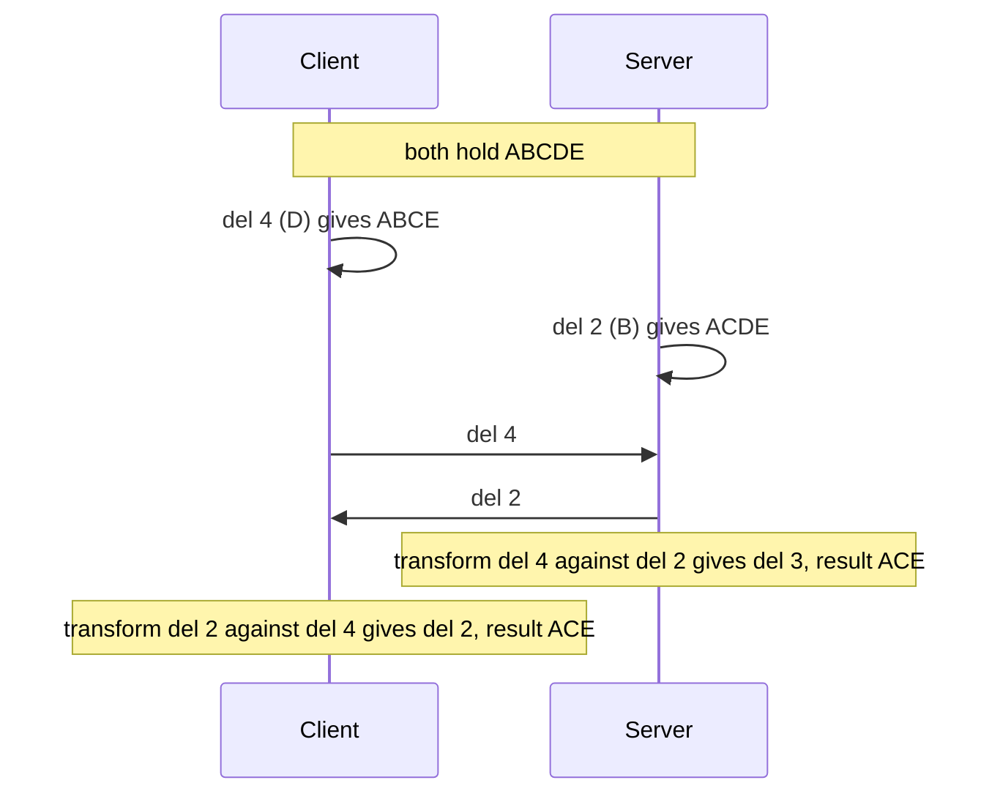

# CRDTs and Conflict Resolution

When two replicas accept writes at the same time, the writes conflict, and the system must decide what the merged result is. This page explains what a conflict is, why last-writer-wins loses data, how version vectors detect concurrent writes, how conflict-free replicated data types (CRDTs) merge without coordination (state-based and operation-based, with the G-Counter, PN-Counter, OR-Set, and LWW-Register), how operational transformation (OT) and CRDTs compare for collaborative editing, and what Riak, Redis Software, and Automerge document about their CRDTs. It has runnable Java for the counters, the set, and a small OT transform. Vector clocks and Lamport clocks are in [failures and time](01-failures-and-time.md). Replication, where conflicts arise, is in [replication](../fundamentals/05-replication.md). The consistency models that CRDTs provide are in [consistency and CAP](../fundamentals/07-consistency-and-cap.md).

## Why It Matters

Any system that accepts writes in more than one place meets conflicts: multi-region active-active databases, leaderless stores such as Dynamo-style systems, offline-first mobile apps, and collaborative editors. Interviewers ask "what happens when two users edit the same thing at once?" in the collaborative editor, chat, shopping cart, and key-value store designs. A strong answer names the conflict, states what each resolution rule loses, and picks a data type or a rule that fits the data. On the job, the same reasoning decides whether a like counter can be a CRDT, whether a user profile can use last-writer-wins, and why a bank balance cannot be left to merge on its own.

## Core Concepts

**Replica**: one copy of the data on one node. **Concurrent updates**: two updates that happen at different replicas such that neither replica had seen the other update when it made its own. Shapiro et al. define the relation: update `u` happened before `u'` if `u` was delivered at the replica where `u'` executed, and updates are concurrent if neither happened before the other.

**Conflict**: concurrent updates to the same item that the system cannot apply in a way that satisfies both writers. A conflict is a property of the data and the rule. Two concurrent increments of a counter do not conflict if the counter adds them. Two concurrent assignments to a register do.

**Eventual consistency**: if clients stop writing, the replicas eventually reach the same value (see [consistency and CAP](../fundamentals/07-consistency-and-cap.md)). **Strong eventual consistency (SEC)**, from Shapiro et al.: replicas that have delivered the same set of updates have equivalent state, with no further message exchange and no rollback.

**Last-writer-wins (LWW)**: each write carries a timestamp, and the replicas keep the write with the highest timestamp. A tie breaks by a replica identifier.

**Version vector**: one counter for each replica, stored with each version of an item. It records how many updates from each replica the version includes. Comparing two version vectors shows whether one version includes the other or whether they are concurrent. A **vector clock** has the same shape and orders events at processes (see [failures and time](01-failures-and-time.md)). A version vector orders versions of one data item and is indexed by replica.

**Sibling**: one of several concurrent versions that the store keeps when it cannot choose between them. The application or the user merges the siblings.

**Join semilattice**: a set with a partial order in which every two elements have a least upper bound (LUB). The LUB operation `⊔` (the **merge**) is commutative (`x ⊔ y = y ⊔ x`), associative, and idempotent (`x ⊔ x = x`).

**State-based CRDT (CvRDT, convergent)**: replicas send their whole state, and the receiver merges it with the LUB. **Operation-based CRDT (CmRDT, commutative)**: replicas send operations, and all concurrent operations commute. This needs delivery of each operation exactly once, in causal order.

**Tombstone**: a record that marks a deleted element, kept so that merges still see the deletion.

**Operational transformation (OT)**: a method for collaborative editing that changes (transforms) a concurrent operation so that it has the intended effect after other operations ran.

## How It Works

### Concurrent writes and conflicts



The replicas applied different writes in different orders. If each replica applies the other's write on top of its own, A ends at 3 and B ends at 2, and they never agree. A conflict rule must give the same result at every replica. The rules differ in what they lose:

| Rule | Result for the two writes | What it loses |
|---|---|---|
| Keep the highest timestamp (LWW) | One value | The other write, with no signal |
| Keep both (siblings, multi-value register) | Both values | Nothing. The reader merges |
| Merge by the data type (counter, set) | A combined value | Nothing, if the type fits the intent |
| Serialize with consensus or one leader | The second write sees the first | Availability during a partition |

[Replication](../fundamentals/05-replication.md) lists the same options as the multi-leader conflict approaches and shows where conflicts appear in leaderless stores.

### Last-writer-wins and its data loss

LWW converges: all replicas pick the highest timestamp, with a tie-break by replica identifier, so all replicas choose the same value. It is also the simplest rule that never needs a merge function. Its cost:

- **It drops concurrent writes without a signal.** If two clients add different items to one value (for example two items to a cart stored as one blob), one item disappears.
- **It depends on clocks.** The timestamp usually comes from a wall clock, and the clocks of different machines disagree. A write that happened later in real time or in causal order can carry a lower timestamp and lose. The Java example below shows this: replica `b` has seen `draft` and then writes `final`, but its clock is 10 ticks behind, so `draft` wins. See [failures and time](01-failures-and-time.md).
- **It is safe for some data.** If a write replaces the whole value and losing a concurrent write is acceptable (a user's last-seen time, a profile photo), LWW is a reasonable choice. Shapiro et al. cite NFS-like replicated file systems as a classic use.

Real systems use LWW for opaque values. The Redis Software documentation states that Active-Active strings and bitfields replicate with "last write wins", because their conflict semantics are undefined for binary objects, and that the wall-clock (OS time) timestamp is the only place where Active-Active databases use OS time to resolve a conflict. The Riak documentation says that its register type keeps "the most chronologically recent value", based on timestamps. Cassandra resolves conflicts per cell by timestamp (see [replication](../fundamentals/05-replication.md)).

### Version vectors

A version vector detects that two versions are concurrent, so that the system does not drop one of them by mistake.

**Algorithm.** Each replica `r` keeps a vector `V` with one counter for each replica.

1. A client reads a version and gets its vector `V` as the **context**. When the client writes, it sends that context. Replica `r` takes a new counter value for itself (one more than the highest counter that `r` has issued for this item), puts it in the entry `V[r]`, and stores the new value with the new vector. It discards stored versions that the new vector dominates.
2. To compare two versions with vectors `x` and `y`: `x` is **older than** `y` if `x[i] <= y[i]` for every `i` and the vectors differ. The versions are **equal** if all entries match. They are **concurrent** if `x[i] < y[i]` for some `i` and `x[j] > y[j]` for another `j`.
3. A read at a replica that holds concurrent versions returns all of them (the siblings) with a merged vector (entry-wise maximum) as the **context**. The client merges the values and writes the result with that context, and the new version supersedes all the siblings.

| Version | Vector over replicas A, B | Relation |
|---|---|---|
| `v1` | `{A:1, B:0}` | |
| `v2` | `{A:2, B:0}` | `v1` is older than `v2` (`v2` includes `v1`) |
| `v3` | `{A:1, B:1}` | `v2` and `v3` are concurrent (A is higher in `v2`, B is higher in `v3`) |
| merge of `v2` and `v3` | `{A:2, B:1}` | Supersedes both |

Dynamo (DeCandia et al., 2007) used vector clocks of (node, counter) pairs on object versions to detect concurrent writes and to return all concurrent versions to the client. The client merges the versions of a shopping cart, so that "an 'add to cart' operation is never lost". The paper adds: "However, deleted items can resurface." Dynamo bounded the clock size: when the number of pairs reaches a threshold ("say 10"), it removes the oldest pair. The paper states that this truncation "can lead to inefficiencies in reconciliation as the descendant relationships cannot be derived accurately". For its data types, Riak's documentation says that Riak keeps the history of a value in a context object "similar to a vector clock or dotted version vectors".

**The limit of per-server entries, and dotted version vectors.** Preguiça, Baquero, Almeida, Fonte, and Gonçalves (2010) show the problem with the algorithm above. Two clients read the same version with context `{b:1}` and both write through replica `b`. The first write gets `{b:2}` and the second gets `{b:3}`. The vector `{b:3}` claims to include `{b:2}`, so the replica treats the second write as newer and drops the first. The paper says that "a last writer wins policy was enforced with respect to concurrent updates handled in the same replica node", and that Dynamo, with one entry per replica node, falls into this category. One entry per client detects the concurrency, but then the vector grows with the number of clients. **Dotted version vectors** keep one entry per server replica and still represent causality without loss. An entry can hold a contiguous range of events plus one extra event, the "dot". For example, `{(a, 2), (b, 1), (c, 3, 7)}` stands for the events `a1, a2, b1, c1, c2, c3, c7`. The size grows "linearly only with the number of servers that register updates for a given data element, bounded by the degree of replication". The authors modified Riak to use them, with about 100 changed lines of code.

**Costs.** A vector with one entry for each client grows with the number of clients. A vector with one entry for each server replica stays small, and it needs dots to detect concurrent writes through one replica. A version vector detects concurrency and leaves the merge to the application. A CRDT supplies the merge rule inside the data type.

### CRDTs

A CRDT is a replicated data type that is designed so that concurrent updates merge without coordination and every replica converges.

Shapiro, Preguiça, Baquero, and Zawirski (SSS 2011, with the full proofs in the INRIA research report RR-7687) state two sufficient conditions.

- **State-based (CvRDT).** If the states form a join semilattice, the update operations only move the state up in the order (monotonic), and the merge computes the LUB, then replicas that have delivered the same updates are in equivalent states (they give the same query results). The delivery assumption is weak: every update must eventually reach every replica, directly or indirectly. The merge is idempotent, so a repeated or reordered state message does no harm, and a gossip or anti-entropy protocol (see [probabilistic data structures](04-probabilistic-data-structures.md) and [replication](../fundamentals/05-replication.md)) can carry the state.
- **Operation-based (CmRDT).** If all concurrent operations commute, and the delivery layer delivers each operation to every replica exactly once and in causal order (an order consistent with happened-before), then replicas converge. Each update has two parts: a *prepare* step at the source replica with no side effects, and an *effect* step that runs at all replicas.

The same paper shows that the two styles are equivalent in power: either can emulate the other. The choice is an engineering one:

| | State-based | Operation-based |
|---|---|---|
| Message content | The whole state (or a delta-state in delta-state CRDTs, see below) | Each operation |
| Message size | Grows with the state | Small |
| Delivery assumption | Eventual delivery, any order, duplicates allowed | Exactly-once, causal order |
| Merge | LUB of two states | Apply the operation |
| Fits | Gossip, anti-entropy, snapshots | Systems that already have reliable causal broadcast |

**Delta-state CRDTs.** Almeida, Shoker, and Baquero ("Delta State Replicated Data Types", arXiv 1603.01529, 2016) combine the two styles. A **δ-mutator** returns a delta-state, "typically with a much smaller size than the full state", and the replica joins the delta into its own state and into remote states with the same merge. The result has small messages, as in op-based CRDTs, sent "over unreliable communication channels", as in state-based CRDTs. The paper gives an anti-entropy algorithm for convergence and a second one that ensures causal consistency.

**What SEC gives.** A SEC replica accepts reads and writes at all times, whatever the network does, and any set of replicas that can communicate converges. The paper notes that a SEC object tolerates up to `n - 1` simultaneous crashes and needs no consensus. This is the availability and convergence side of the CAP trade-off (see [consistency and CAP](../fundamentals/07-consistency-and-cap.md)). SEC is stronger than plain eventual consistency, because convergence is immediate on delivery and needs no rollback. The paper also shows that SEC and sequential consistency are incomparable: a SEC object can reach a state that no sequential execution produces (with add-wins semantics, replica `p0` runs `add(e); remove(e')` while replica `p1` runs `add(e'); remove(e)`, and the merged state holds both `e` and `e'`, a state that no sequential execution produces), and sequential consistency needs consensus. A CRDT is not linearizable.

### The standard CRDTs

All specifications below come from Shapiro et al. (RR-7506 for the full catalog, RR-7687 for the summary).

**G-Counter (grow-only counter).** The payload is a vector with one slot for each replica. `increment` adds 1 to the local replica's slot. `value` is the sum of all slots. `merge` takes the maximum of each slot. The paper explains why a single integer fails: with a single integer and `max` as merge, two replicas that each increment once converge to 1 instead of 2. With a single integer and `+` as merge, the merge is not idempotent, and a repeated state message counts twice. The vector form fixes both. The assumptions are that the set of replicas is known and that the integers do not overflow.

**PN-Counter (positive-negative counter).** Two G-Counters: `P` counts increments and `N` counts decrements. The value is `sum(P) - sum(N)`, and merge merges both vectors. A single G-Counter cannot decrease, because a decrease would break monotonicity, and `max` would ignore it.

**Non-negative counter.** The report calls "value at or above zero" a global invariant, "which cannot be evaluated based on local information only". It is not enough for each replica to refuse a decrement when its local value is 0: two replicas that each hold 1 can both decrement, and the merged value is -1. The report gives one correct local rule: a replica may not originate more decrements than it originated increments (`P[g] - N[g] >= 0` for each replica `g`). It notes that this rule "may be too strong", because a replica cannot spend an increment that another replica made. Otherwise, "the remaining alternative is to synchronise", for example by reserving in advance the right to originate a number of decrements, as in escrow transactions. This is the general limit: an invariant that spans replicas (a balance at or above zero, a unique username, a seat that has one owner) needs coordination, or a local rule that is stricter than the invariant.

**LWW-Register.** The payload is a value with a timestamp. `assign` stores the new value with a new timestamp. `merge` keeps the higher timestamp. The report's specification marks the timestamp "consistent with causality" and assumes unique timestamps: a replica that has seen timestamp 100 must assign a timestamp above 100. Then a later assignment overwrites an earlier one, and concurrent assignments resolve by timestamp order. It loses a concurrent write, as the LWW section shows. A wall clock does not meet the causality condition, and the Java example shows the result.

**MV-Register (multi-value register).** Keeps all concurrent values, each with a version vector, and lets the reader resolve. It is the register form of siblings.

**G-Set and 2P-Set.** A G-Set only adds elements and merges by union. A 2P-Set holds a set of added elements and a set of removed elements (tombstones). A removed element can never be added again.

**OR-Set (observed-remove set).** Each `add(e)` creates a unique tag and stores the pair `(e, tag)`. `remove(e)` removes the pairs that the source replica has observed for `e`. An element is in the set if at least one pair for it remains. A concurrent `add(e)` at another replica creates a new tag that the remove did not observe, so the add survives the merge: **add wins over a concurrent remove**. A remove that has seen every add of the element removes it. The report gives the op-based specification (its Specification 15) and notes that earlier set designs (2P-Set, LWW-Set) have counter-intuitive behavior, which the OR-Set avoids. The Java example in this page is a **state-based variant** of the idea: it keeps the added tags and a set of removed tags, and merges both by union. Its removed-tag set grows without bound. Optimized versions remove the tombstones by using version-vector contexts (the Riak documentation describes a context object for removals, see below).

**Maps and sequences.** A CRDT map composes CRDT values: a field that holds a counter, a set, or a register. The report also gives CRDTs for graphs, for sequences (the Replicated Growable Array, RGA, for text and lists), and a shopping cart (OR-Cart). Sequence CRDTs give each element a unique position identifier so that concurrent inserts have a defined order.

### Garbage and metadata

The convergence rules rely on metadata: tags, tombstones, vector slots. This metadata grows. Removing it needs knowledge that every replica has seen an update (causal stability), which needs some form of coordination, or it needs a design that bounds it. Shapiro et al. recall the distributed garbage collection of Wuu and Bernstein for a replicated log, which can be adapted to the U-Set: each replica keeps a copy of all remote vector clocks, and it may discard a log entry once the entry's timestamp is below all remote vector clocks. The algorithm needs no consensus, but "it is live only if no process is crashed". The paper accepts this, because the liveness of garbage collection does not affect the correctness of the main algorithm. In practice, size and garbage collection of metadata are a main cost of a CRDT.

### Operational transformation and CRDTs for collaborative editing

Collaborative text editing is the hardest case, because positions shift when other users insert and delete text.

**Operational transformation.** Ellis and Gibbs (SIGMOD 1989) developed the first operational transformation algorithm, dOPT, used in their Grove text editor. The Jupiter paper describes it as "a fully distributed, optimistic algorithm": each user edits a local copy with no locks, and each site transforms the operations that other sites made at the same time. dOPT uses a transformation matrix and site priorities for tie-breaking.

The **Jupiter** paper (Nichols, Curtis, Dixon, and Lamping, UIST 1995) simplified the algorithm by using a central server. Each client synchronizes with the server over a two-party protocol, and the server serializes all changes and echoes them to the other clients. This gives n-way consistency from independent two-party protocols. When messages cross, each side transforms the incoming message with a function `xform(c, s) = {c', s'}` so that "if the client applies c followed by s', and the server applies s followed by c', then the client and server will wind up in the same final state". Jupiter's example: the text is `ABCDE`, the client deletes the fourth character and the server deletes the second. Without a transform, one side ends with `ACD` and the other with `ACE`. The server transforms the client's `del 4` into `del 3`, because the earlier deletion shifted the text, and both sides end with `ACE`. (The paper counts positions from 1. The Java example below counts from 0 and uses `del(3)` and `del(1)`.) Each state is labeled with the number of client and server messages processed so far, and "the protocol labels each message with the state the sender was in just before the message was generated". The receiver uses the labels to find the state in which a conflict began. If the sides diverge by more than one message, a site transforms the incoming message against each message that it sent and that the other side has not yet acknowledged, and it updates those saved messages. The paper's example: the client has applied `c = del 4`, and the server, which has not yet seen `c`, sends `s1 = del 1` and then `s2 = del 3`. Both `c` and `s2` delete the same `D`, so the correct transform of `s2` is a no-op, but `xform(c, s2)` gives `del 3`, because `c` and `s2` were not generated from the same state. When the client transforms `s1`, it also keeps `c'` (here `del 3`, which is `c` adjusted for `s1`) in its queue of outgoing messages. When `s2` arrives, the client computes `xform(c', s2)`, which gives the no-op. The paper states that dOPT does not transform saved messages in this case, and that Jupiter's algorithm fixes this problem.



**Why OT is hard to get right.** A transform function must give the same result for every pair of operations and, with more than two sites, for orderings of three or more. Jupiter limits the problem by using a central server (two-party transformations only). The Jupiter paper says that a distributed optimistic algorithm "must be prepared to handle a change from any participant at any time", and that "getting all the cases right is very difficult". The paper also notes that "the best transformations are not always obvious", so choosing a transformation for each pair of operation types is a design effort of its own.

**CRDTs for text.** A sequence CRDT (for example RGA, or the list and text types of Automerge) gives each character a unique identifier and a defined place relative to its neighbors. An insert names the character after which it goes, so a concurrent edit does not change what the insert means. No transform is needed, and the replicas can exchange operations in any order that respects causality, with no central server. The cost is metadata for each character, and tombstones for deleted characters, until garbage collection runs.

| | Operational transformation | Sequence CRDT |
|---|---|---|
| Idea | Transform concurrent operations against each other | Give every element a unique, ordered identifier |
| Central server | Common (Jupiter). Simplifies the algorithm | Not required. Peer-to-peer works |
| Correctness | Transform functions must be proven for all pairs (and for more sites, more) | The data type satisfies the merge properties by construction |
| Metadata | Small (operation history until acknowledged) | An identifier per element, and tombstones |
| Offline work and long divergence | Harder: long histories to transform | Natural: merge states or operation logs |
| Intent preservation | Defined by the transform functions | Defined by the position-identifier scheme |

Kleppmann, Wiggins, van Hardenberg, and McGranaghan argue, in "Local-first software" (Onward! 2019), that CRDTs are "multi-user from the ground up while also being fundamentally local and private", and that "CRDTs have the potential to be a foundational technology for realizing local-first software". The essay describes Automerge as an open-source JavaScript CRDT implementation that Ink & Switch developed, and it states that these libraries do not yet fully realize local-first ideals. The collaborative editor design is in `kb/hld/case-studies/19-collaborative-editor.md`.

### Real systems

**Riak KV data types** (Riak KV documentation). Riak data types are "convergent replicated data types (CRDTs), inspired by the work of Marc Shapiro, Nuno Preguiça, Carlos Baquero, and Marek Zawirski". The types are counters, flags, HyperLogLogs, maps, registers, and sets. Flags and registers live inside maps. The client interface is operation-based (increment a counter, add to a set) while "the convergence logic is state-based behind the scenes". A bucket type with the `datatype` property (`counter`, `map`, `set`, `hll`) turns on a type. The documented convergence rules:

| Type | Rule |
|---|---|
| Counter | A PN-Counter. "All increments and decrements by all actors are eventually applied" |
| Set | A concurrent add and remove of one element: the add wins |
| Map | A concurrent add or update of a field and a remove of it: the add or update wins |
| Flag | `enable` wins over `disable` |
| Register | The most chronologically recent value wins, by timestamp |

Removal operations (remove from a set, remove a field, disable a flag) need a **context**, the history of the value that the client read. The official clients handle it, and the Java and PHP clients need the context passed by hand. Riak counters cannot give unique, ordered IDs.

**Redis Software Active-Active.** Redis Software's Active-Active databases (formerly CRDB) are "based on CRDT technology". Several clusters each host a primary instance, and the databases use only CRDT-based types, so conflicts resolve with no application code. The documentation describes a strong eventual consistency model, in which Redis "uses vector clocks and the CRDT conflict resolution" and an optional causal consistency feature preserves the order of operations. Documented type behavior: string counters (`INCR`, `INCRBY`) accumulate the operations of all member databases, with 59-bit counters to guard against overflow in concurrent operations; strings and bitfields otherwise use last-write-wins: if the syncer cannot determine the order of operations, the value with the latest wall-clock (OS time) timestamp wins; sets keep metadata to behave as an OR-Set with an observed-remove rule ("remove can only remove instances it has already seen and in all other cases element add wins"). This is a product feature of Redis Software, not of open-source Redis.

**Automerge.** Automerge is "a library of data structures for building collaborative applications" and "a Conflict-Free Replicated Data Type (CRDT)". Replicas edit offline and merge later, with no central server needed. The documented conflict rules: concurrent inserts and deletes in lists and text are all preserved, and concurrent inserts at one position get the same order on all nodes. If two users concurrently set the same property of the same object, Automerge picks one value as the winner on all nodes and keeps the others as conflicts that `getConflicts` returns. It uses "a combination of LWW (last writer wins) and multi-value register". The LWW order is "based on the internal ID of the operation, not a wall clock time": an operation ID is a counter and an actor ID, ordered by the counter first, with the actor ID breaking ties.

## Trade-offs and When to Use

| Approach | Convergence | Data loss | Application work | Needs coordination | Fits |
|---|---|---|---|---|---|
| Single leader or consensus for the item | Yes (one order) | None | None | Yes, on each write | Money, inventory, uniqueness |
| LWW | Yes | Concurrent writes, and writes with skewed clocks | None | No | Whole-value replacement where loss is acceptable |
| Version vectors with siblings | Yes, after the application merges | None, if the merge keeps data | Merge code for each type | No | Dynamo-style stores, carts |
| CRDT | Yes | None for the data type's rule (the rule may not match the intent) | Choose the right type | No | Counters, sets, flags, maps, text, offline sync |
| OT with a central server | Yes | None if transforms are right | Transform functions for each operation pair | A server, not consensus | Real-time text and document editing |

**When a CRDT fits.** The data has a merge rule that matches what users mean: sums (counters), unions (tags, likes, presence), add-wins sets, and ordered sequences. The system must stay available under partitions or offline, or must accept writes in several regions with low latency.

**When it does not.** The data has an invariant that spans replicas: a balance at or above zero, one owner for a seat or a username, a bounded stock. A CRDT cannot enforce it without coordination, because each replica decides on its own. Use a single leader, consensus, or reservations (escrow) for those parts, and let CRDTs handle the rest. A CRDT can also carry large metadata (identifiers per element, tombstones) and needs a garbage-collection plan.

**Recommendation.** Treat the conflict rule as part of the data model. For each field, write down what two concurrent writes should produce, and choose the type that gives it: counter, add-wins set, LWW register, or an invariant that needs a leader.

## Java Example

The program below implements four state-based types: a G-Counter, a PN-Counter, an OR-Set, and an LWW-Register. Every replica keeps its own state, updates it with no coordination, and later merges states. The scenarios merge in different orders (and repeat a merge) to show that the result is the same. The collections are sorted (`TreeMap`, `TreeSet`), so the output is deterministic. The OR-Set here is a state-based variant (added tags and removed tags, merged by union), not the op-based specification of the paper. Its removed-tag set grows without bound. In all four types, `copy()` keeps the replica identifier, so only one copy of a replica may keep updating: two copies that both update would reuse one slot or one tag. Each merge takes a per-slot maximum, a set union, or the maximum of a (timestamp, writer) pair, so it is commutative, associative, and idempotent. The LWW part breaks the specification on purpose: replica `b` assigns timestamp 95 after it has seen timestamp 100, which a timestamp "consistent with causality" does not allow. It shows the data loss that a wall clock causes. A conforming LWW-Register takes a timestamp above every timestamp that it has seen (a Lamport clock or a hybrid logical clock, see [failures and time](01-failures-and-time.md)).

```java
import java.util.ArrayList;
import java.util.List;
import java.util.Map;
import java.util.Set;
import java.util.TreeMap;
import java.util.TreeSet;

public class CrdtDemo {
    public static void main(String[] args) {
        gCounterDemo();
        pnCounterDemo();
        orSetDemo();
        lwwRegisterDemo();
    }

    static void gCounterDemo() {
        System.out.println("== G-Counter: page views counted in three regions ==");
        GCounter eu = new GCounter("eu");
        GCounter us = new GCounter("us");
        GCounter asia = new GCounter("asia");
        eu.increment(5);
        us.increment(3);
        asia.increment(2);
        eu.increment(1);
        System.out.println("before any merge: eu=" + eu.value() + " us=" + us.value()
                + " asia=" + asia.value());

        GCounter first = eu.copy();
        first.merge(us);
        first.merge(asia);
        GCounter second = asia.copy();
        second.merge(us);
        second.merge(eu);
        GCounter third = us.copy();
        third.merge(asia);
        third.merge(eu);
        third.merge(eu);
        System.out.println("merge order eu,us,asia:  " + first);
        System.out.println("merge order asia,us,eu:  " + second);
        System.out.println("merge order us,asia,eu,eu again: " + third);
        System.out.println("all equal: " + (first.equals(second) && second.equals(third)));
    }

    static void pnCounterDemo() {
        System.out.println("== PN-Counter: stock level changed in two warehouses ==");
        PNCounter north = new PNCounter("north");
        PNCounter south = new PNCounter("south");
        north.increment(10);
        north.merge(south);
        south.merge(north);
        System.out.println("after the first sync: north=" + north.value()
                + " south=" + south.value());

        north.decrement(4);
        south.decrement(3);
        south.increment(1);
        System.out.println("concurrent updates:   north=" + north.value()
                + " south=" + south.value());

        PNCounter northMerged = north.copy();
        northMerged.merge(south);
        PNCounter southMerged = south.copy();
        southMerged.merge(north);
        southMerged.merge(north);
        System.out.println("north after merge: " + northMerged);
        System.out.println("south after merge: " + southMerged);
        System.out.println("converged: " + northMerged.equals(southMerged));
    }

    static void orSetDemo() {
        System.out.println("== OR-Set: a concurrent add and remove of the same element ==");
        ORSet r1 = new ORSet("r1");
        ORSet r2 = new ORSet("r2");
        r1.add("milk");
        r1.add("eggs");
        r2.merge(r1);
        System.out.println("after sync: r1=" + r1.elements() + " r2=" + r2.elements());

        r1.remove("milk");
        r2.add("milk");
        r2.remove("eggs");
        System.out.println("concurrent: r1=" + r1.elements() + " r2=" + r2.elements());

        ORSet merged1 = r1.copy();
        merged1.merge(r2);
        ORSet merged2 = r2.copy();
        merged2.merge(r1);
        System.out.println("r1 merges r2: " + merged1.elements());
        System.out.println("r2 merges r1: " + merged2.elements());
        System.out.println("converged: " + merged1.elements().equals(merged2.elements()));

        merged1.add("eggs");
        System.out.println("eggs added again after its removal: " + merged1.elements());
    }

    static void lwwRegisterDemo() {
        System.out.println("== LWW-Register: the clock of replica b runs 10 ticks behind ==");
        LwwRegister a = new LwwRegister("a");
        LwwRegister b = new LwwRegister("b");
        a.assign("draft", 100);
        b.merge(a);
        b.assign("final", 95);
        System.out.println("b wrote 'final' after it saw 'draft', with timestamp 95");
        a.merge(b);
        b.merge(a);
        System.out.println("a=" + a.value() + " b=" + b.value() + " (the later write is lost)");
    }
}

/** State-based grow-only counter. One slot for each replica. Merge takes the maximum per slot. */
class GCounter {
    private final String id;
    private final Map<String, Long> slots = new TreeMap<>();

    GCounter(String id) {
        this.id = id;
    }

    void increment(long amount) {
        if (amount < 0) {
            throw new IllegalArgumentException("a G-Counter cannot decrease");
        }
        slots.merge(id, amount, Long::sum);
    }

    long value() {
        long sum = 0;
        for (long slot : slots.values()) {
            sum += slot;
        }
        return sum;
    }

    void merge(GCounter other) {
        for (Map.Entry<String, Long> entry : other.slots.entrySet()) {
            slots.merge(entry.getKey(), entry.getValue(), Math::max);
        }
    }

    Map<String, Long> slots() {
        return Map.copyOf(slots);
    }

    GCounter copy() {
        GCounter copy = new GCounter(id);
        copy.slots.putAll(slots);
        return copy;
    }

    @Override
    public boolean equals(Object o) {
        return o instanceof GCounter other && slots.equals(other.slots);
    }

    @Override
    public int hashCode() {
        return slots.hashCode();
    }

    @Override
    public String toString() {
        return slots + " value=" + value();
    }
}

/** A counter that also decreases. It holds two G-Counters: increments (P) and decrements (N). */
class PNCounter {
    private final GCounter increments;
    private final GCounter decrements;
    private final String id;

    PNCounter(String id) {
        this.id = id;
        this.increments = new GCounter(id);
        this.decrements = new GCounter(id);
    }

    void increment(long amount) {
        increments.increment(amount);
    }

    void decrement(long amount) {
        decrements.increment(amount);
    }

    long value() {
        return increments.value() - decrements.value();
    }

    void merge(PNCounter other) {
        increments.merge(other.increments);
        decrements.merge(other.decrements);
    }

    PNCounter copy() {
        PNCounter copy = new PNCounter(id);
        copy.increments.merge(increments);
        copy.decrements.merge(decrements);
        return copy;
    }

    @Override
    public boolean equals(Object o) {
        return o instanceof PNCounter other
                && increments.equals(other.increments) && decrements.equals(other.decrements);
    }

    @Override
    public int hashCode() {
        return 31 * increments.hashCode() + decrements.hashCode();
    }

    @Override
    public String toString() {
        return "P=" + new TreeMap<>(increments.slots()) + " N=" + new TreeMap<>(decrements.slots())
                + " value=" + value();
    }
}

/**
 * State-based observed-remove set. Each add creates a unique tag. A remove records the tags that
 * the replica has seen for the element. An element is present if one of its tags is not removed.
 */
class ORSet {
    private final String id;
    private long counter = 0;
    private final Map<String, Set<String>> added = new TreeMap<>();
    private final Set<String> removedTags = new TreeSet<>();

    ORSet(String id) {
        this.id = id;
    }

    void add(String element) {
        counter++;
        added.computeIfAbsent(element, e -> new TreeSet<>()).add(id + ":" + counter);
    }

    void remove(String element) {
        removedTags.addAll(added.getOrDefault(element, Set.of()));
    }

    List<String> elements() {
        List<String> result = new ArrayList<>();
        for (Map.Entry<String, Set<String>> entry : added.entrySet()) {
            boolean alive = entry.getValue().stream().anyMatch(tag -> !removedTags.contains(tag));
            if (alive) {
                result.add(entry.getKey());
            }
        }
        return result;
    }

    void merge(ORSet other) {
        for (Map.Entry<String, Set<String>> entry : other.added.entrySet()) {
            added.computeIfAbsent(entry.getKey(), e -> new TreeSet<>()).addAll(entry.getValue());
        }
        removedTags.addAll(other.removedTags);
    }

    ORSet copy() {
        ORSet copy = new ORSet(id);
        copy.counter = counter;
        copy.merge(this);
        return copy;
    }
}

/** Last-writer-wins register. The highest timestamp wins. The replica id breaks a tie. */
class LwwRegister {
    private final String id;
    private String value = null;
    private long timestamp = 0;
    private String writer = "";

    LwwRegister(String id) {
        this.id = id;
    }

    void assign(String newValue, long time) {
        value = newValue;
        timestamp = time;
        writer = id;
    }

    String value() {
        return value;
    }

    void merge(LwwRegister other) {
        boolean otherWins = other.timestamp > timestamp
                || (other.timestamp == timestamp && other.writer.compareTo(writer) > 0);
        if (otherWins) {
            value = other.value;
            timestamp = other.timestamp;
            writer = other.writer;
        }
    }
}
```

<!-- expected-output -->
```text
== G-Counter: page views counted in three regions ==
before any merge: eu=6 us=3 asia=2
merge order eu,us,asia:  {asia=2, eu=6, us=3} value=11
merge order asia,us,eu:  {asia=2, eu=6, us=3} value=11
merge order us,asia,eu,eu again: {asia=2, eu=6, us=3} value=11
all equal: true
== PN-Counter: stock level changed in two warehouses ==
after the first sync: north=10 south=10
concurrent updates:   north=6 south=8
north after merge: P={north=10, south=1} N={north=4, south=3} value=4
south after merge: P={north=10, south=1} N={north=4, south=3} value=4
converged: true
== OR-Set: a concurrent add and remove of the same element ==
after sync: r1=[eggs, milk] r2=[eggs, milk]
concurrent: r1=[eggs] r2=[milk]
r1 merges r2: [milk]
r2 merges r1: [milk]
converged: true
eggs added again after its removal: [eggs, milk]
== LWW-Register: the clock of replica b runs 10 ticks behind ==
b wrote 'final' after it saw 'draft', with timestamp 95
a=draft b=draft (the later write is lost)
```

Points to notice:

- The G-Counter result is the same for three merge orders, and a repeated merge changes nothing. These are the commutative, associative, and idempotent properties of the merge.
- The PN-Counter converges to 4: 10 initial, minus 4 and 3 for the decrements, plus 1 for the increment. Replicas that decrement concurrently do not lose a decrement.
- In the OR-Set, `r1` removes `milk` and `r2` concurrently adds `milk` again. After the merge, `milk` is present (the add wins, because the remove never saw the new tag). `eggs` is absent, because `r2` removed the only tag that existed.
- In the LWW part, the later write (`final`) is lost, because the clock of `b` is behind.

### A small operational transformation

The next program applies the Jupiter transform to a text. Two sites make concurrent edits and apply each other's operation after a transform. The program prints the result at both sites. The delete-delete case is the example of the Jupiter paper (the paper counts positions from 1, this code from 0). The rule for two inserts at one position (the site with the lower number goes first) is a choice made in this page for the demonstration, not a rule from the paper. The transform shown is correct for two sites that each make one operation. It does not cover sites that diverge by more than one operation (Jupiter's queue of outgoing messages handles that case, as described above), and it does not cover more than two sites without a central server.

```java
public class OtDemo {
    public static void main(String[] args) {
        System.out.println("== Jupiter example: two deletes at the same time ==");
        Op serverOp = Op.delete(1, 2);
        Op clientOp = Op.delete(3, 1);
        String start = "ABCDE";
        System.out.println("start=" + start + " server=" + serverOp + " client=" + clientOp);
        String noTransform = clientOp.apply(serverOp.apply(start));
        String otherNoTransform = serverOp.apply(clientOp.apply(start));
        System.out.println("no transform:  server site=" + noTransform
                + " client site=" + otherNoTransform);
        converge(start, serverOp, clientOp);

        System.out.println("== Two inserts at the same position ==");
        converge("ab", Op.insert(1, 'X', 1), Op.insert(1, 'Y', 2));

        System.out.println("== An insert and a delete ==");
        converge("abc", Op.insert(1, 'X', 1), Op.delete(1, 2));
    }

    /** Site 1 applies a then b' (b transformed against a). Site 2 applies b then a'. */
    static void converge(String start, Op a, Op b) {
        Op bAfterA = b.transformAgainst(a);
        Op aAfterB = a.transformAgainst(b);
        String site1 = bAfterA.apply(a.apply(start));
        String site2 = aAfterB.apply(b.apply(start));
        System.out.println("start=" + start + " a=" + a + " b=" + b);
        System.out.println("  site 1 applies a, then " + bAfterA + " -> " + site1);
        System.out.println("  site 2 applies b, then " + aAfterB + " -> " + site2);
        System.out.println("  converged: " + site1.equals(site2));
    }
}

/** A text operation at a zero-based position. The site number breaks ties between inserts. */
record Op(boolean isInsert, int pos, char ch, int site) {
    static Op insert(int pos, char ch, int site) {
        return new Op(true, pos, ch, site);
    }

    static Op delete(int pos, int site) {
        return new Op(false, pos, '-', site);
    }

    String apply(String text) {
        if (pos < 0) {
            return text;
        }
        return isInsert
                ? text.substring(0, pos) + ch + text.substring(pos)
                : text.substring(0, pos) + text.substring(pos + 1);
    }

    /** Returns this operation, changed so that it has the same effect after other was applied. */
    Op transformAgainst(Op other) {
        if (isInsert && other.isInsert) {
            boolean shift = pos > other.pos || (pos == other.pos && site > other.site);
            return new Op(true, shift ? pos + 1 : pos, ch, site);
        }
        if (isInsert) {
            return new Op(true, pos <= other.pos ? pos : pos - 1, ch, site);
        }
        if (other.isInsert) {
            return new Op(false, pos < other.pos ? pos : pos + 1, ch, site);
        }
        if (pos == other.pos) {
            return new Op(false, -1, ch, site);
        }
        return new Op(false, pos < other.pos ? pos : pos - 1, ch, site);
    }

    @Override
    public String toString() {
        String name = isInsert ? "ins(" + pos + "," + ch + ")" : "del(" + pos + ")";
        return pos < 0 ? "no-op" : name;
    }
}
```

<!-- expected-output -->
```text
== Jupiter example: two deletes at the same time ==
start=ABCDE server=del(1) client=del(3)
no transform:  server site=ACD client site=ACE
start=ABCDE a=del(1) b=del(3)
  site 1 applies a, then del(2) -> ACE
  site 2 applies b, then del(1) -> ACE
  converged: true
== Two inserts at the same position ==
start=ab a=ins(1,X) b=ins(1,Y)
  site 1 applies a, then ins(2,Y) -> aXYb
  site 2 applies b, then ins(1,X) -> aXYb
  converged: true
== An insert and a delete ==
start=abc a=ins(1,X) b=del(1)
  site 1 applies a, then del(2) -> aXc
  site 2 applies b, then ins(1,X) -> aXc
  converged: true
```

## Interview Angle

### Questions

??? question "What is a write conflict, and how do systems resolve conflicts between replicas?"

    **Direct answer:** a conflict exists when two replicas accept updates to the same item concurrently, without either having seen the other, and the system must produce one merged value that every replica agrees on.

    **Options:** (1) Avoid conflicts: send all writes for an item to one leader or one home region. This needs coordination or loses availability when that node fails. (2) Last-writer-wins: keep the highest timestamp. It converges and loses the other write, and clock skew can make the wrong write win. (3) Keep siblings: store all concurrent versions, detected with version vectors, and let the application or user merge them (Dynamo, Riak). (4) Use a data type whose merge is defined (a CRDT). (5) For text, transform operations (OT).

    **Trade-off:** each option trades data loss, application work, and coordination. I choose by field: a like counter is a PN-Counter, tags are an add-wins set, a profile photo is LWW, and a balance needs a leader.

??? question "Why is last-writer-wins dangerous, and when is it acceptable?"

    **Direct answer:** it silently discards the concurrent write, and it relies on timestamps from clocks that disagree.

    **Reason:** two clients that update different parts of one value (two items added to a cart saved as one blob) lose one update, with no error. Clock skew is worse: a write that came later in causal order can have a lower timestamp. In my example, replica `b` has seen `draft`, then writes `final` at timestamp 95, but `draft` has timestamp 100 from a faster clock, so `final` is dropped. Logical timestamps (Lamport clocks, hybrid logical clocks) fix the causal case and still lose truly concurrent writes.

    **When it is acceptable:** the write replaces a whole value, a lost concurrent write does no harm, and you want no merge code: last-seen time, a cached value, a profile picture. Document it as a decision. Redis Software and Riak both use LWW for strings and registers, and Redis names the wall-clock timestamp as the only place where it uses OS time.

??? question "How does a version vector detect concurrent writes, and how does it differ from a vector clock?"

    **Direct answer:** a version vector keeps a counter for each replica, stored with each version of an item. Version `x` is older than `y` if every entry of `x` is at most the same entry of `y`. If neither is older, the versions are concurrent.

    **Mechanism:** a replica that accepts a write increments its own entry. A read that finds concurrent versions returns all of them as siblings, with the entry-wise maximum as the context. The client merges and writes back with that context, which supersedes the siblings.

    **Difference:** a vector clock orders events at processes (the vector is indexed by process and updated on message exchange). A version vector orders versions of one data item and is indexed by the replicas that store it. Clients are not entries, so the size is bounded by the number of replicas. **Caveat:** with one entry per server, two clients that write concurrently through the same replica get vectors such as `{b:2}` and `{b:3}`, and the second appears to include the first, so the first write is lost. Dotted version vectors (Preguiça et al., 2010) fix this: each entry can hold a range plus one extra event (a "dot"), so the vector still has one entry per server and records causality without loss. The paper's authors modified Riak to use them. A version vector detects concurrency only. It does not merge.

??? question "What is a CRDT? Explain state-based and operation-based CRDTs."

    **Direct answer:** a conflict-free replicated data type is a data type designed so that replicas can update independently and always converge when they have seen the same updates, with no coordination.

    **State-based (CvRDT):** replicas send their state, and the merge is the least upper bound in a join semilattice: commutative, associative, idempotent. Updates only move the state up. Delivery can be unordered, duplicated, and lossy as long as every update eventually arrives, so gossip works.

    **Operation-based (CmRDT):** replicas send operations. Concurrent operations commute, and the network must deliver each operation exactly once in causal order. Messages are small.

    **Edge case:** Shapiro et al. show the two are equivalent in power. What a CRDT gives is strong eventual consistency: replicas with the same updates have the same state, with no rollback. It does not give linearizability or cross-item invariants.

??? question "Implement a counter that many replicas can increment without coordination. Then support decrements."

    **Direct answer:** a G-Counter. Each replica owns one slot in a vector. `increment` adds to the replica's own slot, `value` sums all slots, and `merge` takes the per-slot maximum.

    **Why a plain integer fails:** with `max` as the merge, two replicas that each increment once converge to 1. With `+` as the merge, a repeated state message counts twice. The per-replica slot with `max` is idempotent and does not lose increments.

    **Decrements:** use two G-Counters, `P` for increments and `N` for decrements. The value is `sum(P) - sum(N)`, and the merge merges both. This is the PN-Counter. **Limit:** it cannot enforce a minimum of zero, because two replicas at 1 can both decrement. Shapiro et al. give one local rule that does enforce it (no replica originates more decrements than it originated increments), and the report says that it "may be too strong". Otherwise enforcing it needs coordination, for example reserved shares (escrow).

??? question "Explain the OR-Set. What happens when one replica adds an element and another removes it at the same time?"

    **Direct answer:** each `add(e)` creates a unique tag and stores `(e, tag)`. `remove(e)` removes the pairs for `e` that the remover has seen. An element is present if any pair for it remains. If one replica removes `e` while another adds `e` at the same time, the add creates a tag that the remove did not see, so after the merge `e` is present: add wins.

    **Why not a simpler set:** a 2P-Set cannot add an element again after a remove. An LWW-Set depends on timestamps. The OR-Set removes only what the remover observed.

    **Cost:** tags and tombstones accumulate. Production versions compact them with causal contexts. The Riak documentation and Redis Software describe the same add-wins and observed-remove rule.

??? question "Compare operational transformation and CRDTs for a collaborative text editor."

    **Direct answer:** OT keeps positions as numbers and transforms concurrent operations so that they have the intended effect after the other ran. A CRDT gives each character a unique identifier and a place relative to its neighbors, so concurrent inserts and deletes merge by construction.

    **OT:** Ellis and Gibbs (1989) introduced it. Jupiter (1995) made it practical with a central server that serializes operations and a two-party transform `xform(c, s)` on each client-server link. Example: with `ABCDE`, a client `del 4` and a server `del 2` cross, and the transform turns `del 4` into `del 3`. The central server is what keeps the algorithm tractable. A fully distributed OT must handle changes from any participant at any time, which is hard to get right.

    **CRDT:** works with no central server, supports offline editing and merging long divergent histories, and avoids transform functions. It costs metadata for each character and tombstones, and needs garbage collection.

    **Choice:** with a central server that you control and short offline periods, OT is established. For peer-to-peer and offline-first (local-first software), CRDTs fit. See `kb/hld/case-studies/19-collaborative-editor.md`.

??? question "Can you build a bank account balance or a unique username with CRDTs?"

    **Direct answer:** not without coordination. A CRDT decides locally and merges later, so it cannot enforce an invariant that spans replicas.

    **Reason:** the Shapiro et al. report shows the counter case: two replicas at 1 can each decrement, and the merged value is -1. A rule such as "do not decrement at 0" is local and does not prevent this. The report's correct local rule (a replica spends no more than it received itself) is too strict for a bank account, because a customer must be able to spend a deposit made at another replica. The same limit holds for "only one user gets this name" and "only one buyer gets the last seat".

    **What to do:** keep these facts behind a leader or a consensus group (see [consensus and leader election](02-consensus-and-leader-election.md)), or use reservations (escrow): each replica gets a share of the budget and spends only its share. Use CRDTs for the parts where merging is correct, such as likes, tags, and presence.

??? question "What do Riak, Redis Software, and Automerge document about their conflict resolution?"

    **Riak KV:** its data types (counters, sets, maps, flags, registers, HyperLogLogs) are CRDT-inspired. Counters are PN-Counters, sets and map fields are add-wins, flags are enable-wins, and registers are LWW by timestamp. Removals need the context that the client read.

    **Redis Software Active-Active:** multi-primary replication across clusters with CRDT types only. String counters sum the operations of all members, sets behave as OR-Sets with an observed-remove rule, and strings and bitfields use LWW with an OS-time timestamp. It documents strong eventual consistency and an optional causal consistency. It is a Redis Software feature.

    **Automerge:** a CRDT library for local-first applications. Lists and text keep all concurrent inserts and deletes. For a concurrent write to the same property, it picks a deterministic winner by operation ID (counter and actor ID, not wall clock) and exposes the losers through `getConflicts`.

### Follow-up Questions

??? question "Why must the CRDT merge be idempotent?"

    The network can deliver or retry a state message more than once, and gossip delivers the same state many times. An idempotent merge (`x ⊔ x = x`) makes repeats harmless. A merge that adds two counter values is not idempotent, and it double counts.

??? question "Does a CRDT guarantee that all replicas have the same value at all times?"

    No. It guarantees that replicas that have delivered the same updates have the same state. Between updates and delivery, replicas differ. Reads can be stale, so a CRDT is not linearizable.

??? question "What is a tombstone, and why does it cause trouble?"

    A tombstone records a deletion so that a later merge does not bring the element back. Tombstones and tags grow with every add and remove. Removing them safely needs knowledge that every replica has seen the deletion, which takes some coordination or a bounded design.

??? question "How do delta-state CRDTs reduce message size?"

    A plain state-based CRDT sends its whole state, which can be large. Almeida, Shoker, and Baquero (arXiv 1603.01529, 2016) define δ-mutators: an update returns a delta-state, typically much smaller than the full state, and the replica joins the delta into its own state and sends it to others. Receivers join deltas with the same merge as full states, so the merge stays commutative, associative, and idempotent, and duplicated or reordered deltas do no harm. This gives small messages, as in op-based CRDTs, over unreliable channels, as in state-based CRDTs. A replica can join several deltas into one delta-group and send that. The paper gives an anti-entropy algorithm for convergence and a variant that ensures causal consistency.

??? question "Why does Jupiter use a central server?"

    The Jupiter paper says that a distributed optimistic algorithm must handle a change from any participant at any time, and that this makes the algorithm complex. With a central server, each client needs only a two-party protocol with the server, and the server serializes all changes. This gives n-way consistency with a simpler algorithm.

??? question "Is a version vector the same as a Lamport clock?"

    No. A Lamport clock is one number, and `a → b` implies `L(a) < L(b)`, but the converse fails, so it cannot detect concurrency. A version vector (like a vector clock) can: two versions are concurrent exactly when neither vector is older. See [failures and time](01-failures-and-time.md).

### Red Flags

- Saying "CRDTs solve conflicts" with no mention of what the merge rule does with a concurrent add and remove, or that invariants still need coordination.
- Recommending last-writer-wins for data that a user edits in several places, with no mention of lost writes or clock skew.
- Using wall-clock timestamps from different machines as if they were comparable.
- Confusing a vector clock, a version vector, and a Lamport clock.
- Claiming that eventual consistency and a CRDT mean "no problems with stale reads".
- Using a CRDT counter for a quantity with a minimum (stock, balance).
- Saying that OT and CRDTs "do the same thing" with no mention of the central server, the transform functions, or the identifiers.
- Ignoring tombstone and metadata growth.

## Common Mistakes

| Mistake | Effect | Fix |
|---|---|---|
| LWW for a value that several clients edit in parts | Silent loss of one client's change | Split the value into fields, use a mergeable type, or keep siblings |
| LWW timestamps from unsynchronized wall clocks | A causally later write loses | Use logical or hybrid logical clocks for order, and accept that concurrent writes still lose |
| A merge that adds counter values | A repeated message counts twice | Merge per-replica slots by maximum |
| A single integer as a distributed counter | Lost increments after a merge by maximum | Use a G-Counter or PN-Counter |
| Indexing a version vector by client identifier | The vector grows with the number of clients | Index by server replica, and use dotted version vectors so that concurrent writes through one replica are still detected |
| A CRDT for an invariant that spans replicas | The invariant breaks (negative stock, duplicate owner) | Coordinate those operations with a leader, consensus, or escrow |
| Never compacting tombstones and tags | Memory and message size grow without limit | Plan garbage collection, and use causal contexts |
| Treating a store's resolved value as the only value | The application hides a conflict that the user should see | Surface siblings or conflict lists (for example `getConflicts` in Automerge) where it matters |
| Assuming operation-based CRDTs work over an unordered network | Replicas diverge | Provide exactly-once, causal-order delivery, or use the state-based form |

## Commonly Confused With

| Looks like | Difference | Deciding question |
|---|---|---|
| CRDT and eventual consistency | Eventual consistency promises that replicas agree eventually if writes stop. A CRDT gives strong eventual consistency: the same updates give the same state, with no rollback | Does the merge need a rollback or a coordinator? |
| Version vector and vector clock | A vector clock orders events of processes. A version vector orders versions of a data item, indexed by replica | Am I ordering events or versions of data? |
| Version vector and CRDT | A version vector detects concurrency and leaves the merge to the application. A CRDT contains the merge | Who merges? |
| State-based and operation-based CRDT | State-based sends the state and merges with a join. Operation-based sends commuting operations and needs causal, exactly-once delivery | What does my network guarantee? |
| LWW-Register and MV-Register | LWW keeps one value and loses concurrent ones. MV keeps all concurrent values | Can I afford to lose a concurrent write? |
| OR-Set and 2P-Set | A 2P-Set cannot re-add a removed element. An OR-Set can, and an add wins over a concurrent remove | May an element come back after a remove? |
| OT and CRDT | OT transforms operations, usually with a central server. A CRDT gives elements unique identifiers and merges | Is there a central server, and must it work offline? |
| Operational transformation and a Lamport timestamp | OT changes the operation so that it has the intended effect. A timestamp only orders operations | Do positions shift when operations run in different orders? |
| CRDT and consensus | A CRDT needs no agreement and cannot enforce cross-replica invariants. Consensus gives one order and costs availability (see [consensus and leader election](02-consensus-and-leader-election.md)) | Does an invariant span replicas? |

## Quick Reference Card

- A conflict is two concurrent updates to one item. A rule must give the same result at every replica.
- LWW: converges, loses concurrent writes silently, depends on clocks. Use for whole-value replacement where loss is acceptable.
- Version vector: one counter for each replica, stored with a version. Older means every entry is at most the other. Neither older means concurrent. Concurrent versions become siblings. It detects, and does not merge.
- SEC: replicas with the same updates have the same state, with no rollback and no consensus. Always available. Not linearizable.
- State-based CRDT: join semilattice, merge is commutative, associative, idempotent, updates are monotonic. Op-based CRDT: concurrent operations commute, and delivery is exactly-once and causal.
- G-Counter: vector with a slot for each replica, merge by maximum, sum for the value. PN-Counter: two G-Counters. A non-negative bound needs coordination or escrow.
- LWW-Register: highest timestamp. MV-Register: keep all concurrent values. G-Set: union. 2P-Set: no re-add. OR-Set: unique tags, remove only the observed tags, add wins over a concurrent remove.
- Cost: metadata (slots, tags, tombstones) grows and needs garbage collection.
- OT: transform concurrent operations (Ellis and Gibbs 1989, Jupiter 1995 with a central server and `xform`). CRDT text: unique element identifiers. Use OT with a central server, CRDTs for peer-to-peer and offline.
- Systems: Riak data types (counter = PN-Counter, set and map add-wins, flag enable-wins, register LWW), Redis Software Active-Active (string counters sum, sets OR-Set, strings LWW), Automerge (op-ID order, `getConflicts`).
- Invariants across replicas (balance, uniqueness, last seat) need a leader, consensus, or reservations.

## Further Reading

- Shapiro, Preguiça, Baquero, and Zawirski. "Conflict-free Replicated Data Types". SSS 2011 (Stabilization, Safety, and Security of Distributed Systems). The definitions of SEC, CvRDT, and CmRDT. This page used the INRIA research report version, RR-7687. <https://hal.inria.fr/inria-00609399/document>
- Shapiro, Preguiça, Baquero, and Zawirski. "A comprehensive study of Convergent and Commutative Replicated Data Types". INRIA research report RR-7506, 2011. The full catalog: G-Counter, PN-Counter, registers, sets, OR-Set, graphs, sequences. <https://hal.inria.fr/inria-00555588/document>
- Ellis and Gibbs. "Concurrency Control in Groupware Systems". ACM SIGMOD 1989. The first operational transformation algorithm. <https://dl.acm.org/doi/10.1145/66926.66963>
- Nichols, Curtis, Dixon, and Lamping. "High-Latency, Low-Bandwidth Windowing in the Jupiter Collaboration System". UIST 1995. OT with a central server and the `xform` function. <https://lively-kernel.org/repository/webwerkstatt/projects/Collaboration/paper/Jupiter.pdf>
- Kleppmann, Wiggins, van Hardenberg, and McGranaghan. "Local-first software: You own your data, in spite of the cloud". Onward! 2019. CRDTs as a base for software that keeps data on the user's device. <https://www.inkandswitch.com/essay/local-first/>
- DeCandia et al. "Dynamo: Amazon's Highly Available Key-value Store". SOSP 2007. Vector clocks, siblings, the shopping cart merge, and clock truncation. <https://www.allthingsdistributed.com/files/amazon-dynamo-sosp2007.pdf>
- Preguiça, Baquero, Almeida, Fonte, and Gonçalves. "Dotted Version Vectors: Logical Clocks for Optimistic Replication". arXiv 1011.5808, November 2010. Why per-server version vectors lose concurrent writes through one server, and the dot that fixes it. <https://arxiv.org/abs/1011.5808>
- Almeida, Shoker, and Baquero. "Delta State Replicated Data Types". arXiv 1603.01529, March 2016. δ-mutators and anti-entropy for delta-state CRDTs. <https://arxiv.org/abs/1603.01529>
- Riak KV documentation. "Data Types" (concept) and "Developing with Riak KV: Data Types". Types, convergence rules, and context. <https://docs.riak.com/riak/kv/latest/learn/concepts/crdts/index.html> and <https://docs.riak.com/riak/kv/latest/developing/data-types/index.html>
- Redis Software documentation. "Active-Active geo-distributed Redis", and the Active-Active data type pages for strings and sets. <https://redis.io/docs/latest/operate/rs/databases/active-active/>, <https://redis.io/docs/latest/operate/rs/databases/active-active/develop/data-types/strings/>, and <https://redis.io/docs/latest/operate/rs/databases/active-active/develop/data-types/sets/>
- Automerge documentation. "Welcome to Automerge" and "Conflicts". <https://automerge.org/docs/hello/> and <https://automerge.org/docs/reference/documents/conflicts/>
- Kleppmann. *Designing Data-Intensive Applications*, first edition (2017), chapter 5 ("Replication": handling write conflicts and version vectors).
- In this knowledge base: [failures and time](01-failures-and-time.md), [replication](../fundamentals/05-replication.md), [consistency and CAP](../fundamentals/07-consistency-and-cap.md), and `kb/hld/case-studies/19-collaborative-editor.md`.
