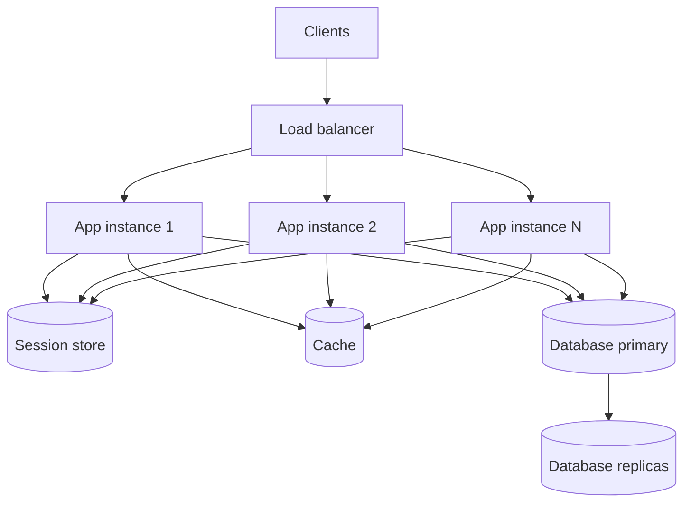

# Scalability and Availability

Scalability is the ability of a system to handle more load by adding resources. Availability is the share of time, or the share of requests, in which the system works. Every system design interview uses both ideas, because each answer to "how does this handle 10 times the traffic?" and "what happens when a server dies?" comes from them. This page defines the terms, gives the numbers and the arithmetic that interviewers expect, and shows how to reason about the limits of each technique. Load balancing, caching, replication, and partitioning have their own pages. This page links to them and does not repeat them.

## Why It Matters

Almost every HLD interview contains the same three questions: "How do you scale this?", "What is your availability target and how do you reach it?", and "What is your latency target?". A candidate who answers "add more servers and a load balancer" gets partial credit. A candidate who names the bottleneck that the extra servers do not remove, computes the availability of the whole request path, and states the latency target as a percentile gets full credit. On the job, the same vocabulary (SLI, SLO, error budget, p99) is the language of capacity planning, on-call rotations, and contracts with customers. The numbers on this page (downtime per year for each number of nines, the fan-out effect on tail latency, Amdahl's limit) let you check a design in your head in under a minute.

## Core Concepts

### Scaling

**Scalability**: the property that a system keeps its performance targets when the load grows, if you add resources in proportion. The load can be requests per second, stored data, concurrent connections, or number of users. A system can scale in one dimension and not in another.

**Vertical scaling** (scale up): move the service to a larger machine, with more CPU cores, more memory, or a faster disk. The software does not change.

**Horizontal scaling** (scale out): run more machines, and divide the work among them. The software must support the division.

**Stateless service**: a service that keeps no data between requests that a later request needs. Each request carries all that the service needs (or the service reads it from a shared store). Any instance can serve any request. If an instance dies, no user data is lost.

**Stateful service**: a service whose instance holds data that other instances do not have (for example a session in memory, a database partition, an open WebSocket connection). A request must reach the instance that holds the data, or the instance must copy its data to others.

**Session**: the data that a server keeps about one user between requests, such as a login and a shopping cart.

**Sticky session** (session affinity): a load balancer rule that sends all requests of one user to the same instance, so the instance can keep the session in memory.

### Performance

**Latency**: the time between the start of a request and the end of its response, measured for one request. **Throughput**: the number of requests that the system completes in a unit of time (for example, requests per second). **Bandwidth**: the maximum data rate of a link. **Concurrency**: the number of requests in progress at the same moment.

**Little's law**: in a stable system, the average number of requests in the system (L) equals the arrival rate (λ) multiplied by the average time that a request spends in the system (W): L = λ × W (Little, 1961). Example: a service receives 2,000 requests per second and each takes 50 ms on average. Concurrency is 2,000 × 0.05 = 100 requests in progress. Use it to size thread pools, connection pools, and queues.

**Percentile** (p50, p99, p999): the value below which a given share of the measurements falls. The p99 latency of 200 ms means that 99% of requests finish in 200 ms or less and 1% take longer. The p50 is the median. The p999 is the 99.9th percentile (1 request in 1,000 is slower). **Tail latency**: the latency of the slowest requests, for example p99 and above.

### Availability

**Availability**: the share of time in which the system serves requests correctly. The usual unit is a percentage written as a number of nines: 99.9% is "three nines". A second definition counts requests: the number of successful requests divided by the number of valid requests (the Google SRE book uses this form for services that run in many places at the same time).

**MTBF** (mean time between failures) and **MTTR** (mean time to repair): the average time that a component works before it fails, and the average time that it takes to restore it. Availability of one component = MTBF / (MTBF + MTTR). Only the ratio of the two values matters: a halved MTTR gives the same availability as a doubled MTBF. Example: MTBF of 1,000 hours and MTTR of 1 hour give 1,000 / 1,001 = 99.9%.

**Redundancy**: more than one component that can do the same job, so that the failure of one does not stop the service. **Failover**: the switch of work from a failed component to a redundant one. **Failure domain**: a set of components that fail together because they share a cause (one process, one host, one rack, one power supply, one availability zone, one region, one deployment).

**Single point of failure** (SPOF): a component whose failure stops the whole service, because nothing can take over its job.

### Objectives and agreements

The definitions follow the Google SRE book, chapter 4.

**SLI** (service level indicator): a carefully defined quantitative measure of one aspect of the service, for example the share of requests that return a non-error response, or the share of requests faster than 300 ms. **SLO** (service level objective): a target for an SLI, for example "99.9% of requests succeed over 30 days". **SLA** (service level agreement): a contract with users that states the consequences of missing the objectives, for example a refund. If a target has no explicit consequence, it is an SLO and not an SLA. An SLA target is usually looser than the internal SLO, so the team has room to react before it owes a refund.

**Error budget**: the allowed amount of failure, which is 100% minus the SLO. An SLO of 99.9% gives an error budget of 0.1%.

**Amdahl's law**: the maximum speedup of a task from n parallel workers is limited by the part of the task that cannot run in parallel (Amdahl, 1967).

## How It Works

### The scaling path

A typical service grows through these steps. Each step removes one bottleneck and moves the bottleneck to the next tier.



1. **One server.** The application and the database run on one machine. A failure of the machine is a total outage.
2. **Separate the database.** The database gets its own machine. The two tiers scale independently.
3. **Scale the application tier horizontally.** Run N identical stateless instances behind a [load balancer](02-load-balancing-dns-cdn.md). This step needs a stateless application (next sections).
4. **Add a cache** to remove repeated reads from the database ([caching](03-caching.md)).
5. **Add read replicas** for read-heavy load ([replication](05-replication.md)).
6. **Partition the data** when one primary cannot hold the writes or the data ([partitioning](06-partitioning-and-sharding.md)).
7. **Add more than one region** for latency and for region-level failures ([multi-region](19-multi-region-and-disaster-recovery.md)).

The order matters in an interview. Step 3 is cheap and removes most application bottlenecks. Steps 5 and 6 add consistency problems, so a candidate who jumps to sharding before measuring the load loses points.

### Vertical scaling and where it ends

Vertical scaling needs no code change and no distributed-systems reasoning. A bigger machine has a local, fast memory, and a database on one machine has transactions and joins without network hops. For a first version and for many production services, it is the right first step.

It ends for four reasons:

| Limit | Explanation |
|---|---|
| Hardware ceiling | The largest machine that a vendor offers has a fixed number of cores, a fixed amount of memory, and a fixed number of disks or network cards |
| Cost | Assumption: price rises faster than capacity near the top of a vendor's range. Check the vendor's price list for the instance family that you use |
| Single point of failure | One machine is one failure domain. The upgrade itself can need a restart, which is downtime |
| Software limits | A single process may not use all cores (lock contention, a single-threaded component), and a very large heap can lengthen garbage-collection pauses, depending on the collector |

Recommendation: scale vertically first for a stateful, hard-to-partition component (a relational primary), and plan the horizontal step before the machine reaches the top of its range.

### Horizontal scaling and where it ends

Horizontal scaling adds capacity in small steps, uses cheap machines, and gives redundancy at the same time (N instances survive the loss of one). It has costs: the load balancer, the network hops, the need for statelessness or partitioning, and the operational work for N machines.

Horizontal scaling stops giving a benefit when a shared resource becomes the bottleneck:

- **The database primary.** All instances write to one primary. More instances add more write load on the same machine.
- **Connection limits.** Each instance holds a pool of database connections. If the pool has 20 connections and the fleet has 500 instances, the database receives 10,000 connections. Databases have limits on connections (see the documentation of your database for the value and its memory cost).
- **A shared lock or a single queue.** If every request must take one global lock, extra instances wait for the lock.
- **A hot key.** One key (a celebrity profile, a viral item) receives so much traffic that one cache node or one partition cannot serve it. More instances do not help. See [caching](03-caching.md) and [partitioning](06-partitioning-and-sharding.md).
- **The serial fraction of the work.** Amdahl's law, below.

### Stateless services and where the state goes

A stateless application tier is the base of horizontal scaling. The state moves out of the instance. This table lists the options.

| State | Where it goes | Cost |
|---|---|---|
| Session (login, cart) | A shared store such as Redis or a database. The instance reads it with the session id from a cookie | One network hop per request (approximate: sub-millisecond to a few milliseconds inside one data center). The store becomes a dependency that must be as available as the application |
| Session in a token | A signed (and optionally encrypted) token in the client, for example a JWT. The server verifies the signature and keeps no session | No lookup. Revocation is harder, because the server holds no list. Large tokens increase the size of every request. See `kb/security/03-authorization-oauth-oidc-jwt.md` |
| User data | The database | Normal database cost |
| Files and uploads | Object storage ([storage types](10-storage-types.md)) | Not on the local disk of an instance |
| Cache | A distributed cache ([caching](03-caching.md)), not the heap of one instance, when all instances must see the same value | A network hop. A local cache is faster but can differ between instances |
| Background work | A queue ([message queues](08-message-queues-and-streams.md)) | The work survives the death of an instance |
| Scheduled jobs | A single scheduler with leader election, or a job queue | Without it, N instances run the same job N times |
| Configuration | A configuration service or environment variables at start | A change in the service needs a rollout or a refresh |

The test for statelessness: kill any instance at any moment. If no user sees an error beyond a retry and no data is lost, the instance is stateless.

### Sticky sessions and their cost

Sticky sessions let you keep the session in the memory of one instance. The load balancer sets a cookie (or hashes the client IP address) and sends later requests of the user to the same instance. AWS Application Load Balancer, for example, supports this at the target group level with a duration-based cookie that the load balancer generates (`AWSALB`) or with an application-based cookie (AWS documentation, target group attributes). You set the stickiness duration from 1 second to 7 days. The cookie that the load balancer generates has a fixed expiry of 7 days, and the load balancer resets the expiry after every request. Two constraints from the same page: stickiness does not work if cross-zone load balancing is off for the target group, and the weighted random algorithm cannot be combined with sticky sessions.

The cost:

- **Uneven load.** The load balancer assigns a user to an instance once. One instance can collect the heavy users while another stays idle. New instances in a scale-out receive only new users, so a scale-out takes a long time to relieve the loaded instances. The AWS documentation describes this and lists manual rebalancing steps.
- **Loss of the session when the instance dies.** The sessions in its memory disappear and the users log in again.
- **Harder deployments and scale-in.** The instance must drain its sessions before it stops.
- **Less effective load-balancing algorithms.** Per the AWS documentation, requests from a user with stickiness bypass the routing algorithm after the first request.
- **A client that does not send cookies breaks it.** Cookies are required for cookie-based stickiness.

When sticky sessions are right: a short migration step from a stateful application that you cannot change yet, a cache that is expensive to rebuild and is local to the instance (a loaded model, a per-user in-memory structure), and long-lived connections such as WebSocket (which are sticky by nature). For all other cases, move the session to a shared store.

### Latency and throughput

Latency and throughput are not the same, and the relation between them is not fixed. A pipeline can have high throughput and high latency (a batch system). A system can have low latency for one request and low throughput (a single thread).

As load approaches the capacity of a resource, queues form and latency rises sharply, while throughput stops growing. This is the usual shape: flat latency at low load, then a "knee", then a rapid rise. The design goal is to keep the utilization of each resource below the knee. Assumption: the knee depends on the workload, so measure it with a load test (`kb/engineering-practice/10-performance-engineering.md`).

Little's law gives a check: if the thread pool of an instance has 200 threads and each request takes 50 ms, the instance can serve at most 200 / 0.05 = 4,000 requests per second. If a downstream dependency slows to 500 ms, the same pool serves only 400 requests per second, and the queue grows. This is how one slow dependency takes down a whole tier. See [reliability patterns](12-reliability-patterns.md) for timeouts and bulkheads.

### Percentiles and why averages hide tail latency

The mean of a latency distribution hides the slow requests. A service with 99 requests of 20 ms and 1 request of 1,000 ms has a mean of 29.8 ms, and a p99 of 20 ms (nearest-rank method) and a p999 of 1,000 ms. The mean looks healthy, yet one user in a hundred waits a second or more. The Google SRE book makes the same point: most metrics are distributions, and a high percentile such as the 99th or 99.9th shows a plausible worst case.

Why the tail matters more than it seems: **fan-out**. If one user request calls many backends in parallel and waits for all of them, the user request is as slow as the slowest call. Dean and Barroso (2013) give this example: each server "typically responds in 10ms but with a 99th-percentile latency of one second". If a user request must collect responses from 100 such servers in parallel, then "63% of user requests will take more than one second". The arithmetic is 1 − 0.99^100 = 63.4%. The paper gives a second case: if only 1 request in 10,000 is slower than one second on each server, a service with 2,000 servers "will see almost one in five user requests taking more than one second" (1 − 0.9999^2000 = 18.1%). The Java example below reproduces the first case with a simulation.

The paper also reports a measurement from a real Google service with a large fan-out tree, measured at the root:

| What must finish | p50 | p95 | p99 |
|---|---|---|---|
| One random leaf request | 1 ms | 5 ms | 10 ms |
| 95% of all leaf requests | 12 ms | 32 ms | 70 ms |
| 100% of all leaf requests | 40 ms | 87 ms | 140 ms |

The p99 of one leaf is 10 ms, but the p99 of the whole request is 140 ms. The wait for the slowest 5% of the leaf requests is half of the total p99 (70 ms of 140 ms). So techniques that target the slow outliers give the largest gain.

```text
P(user request is slow) = 1 - (1 - p)^n
p = share of slow calls per server (0.01), n = number of calls that the request waits for

n = 1     ->  1.0%
n = 10    ->  9.6%
n = 100   -> 63.4%
n = 1000  -> 100.0% (99.99568%)
```

The paper also describes mitigations. A **hedged request** sends the same request to a second replica after a short delay and uses the first answer. The client cancels the other request when the first result arrives. If the client waits for the p95 latency of that class of requests before it sends the second request, the extra load is limited to about 5%. In a Google benchmark that reads 1,000 keys from a BigTable table spread over 100 servers, a hedging request after a 10 ms delay "reduces the 99.9th-percentile latency for retrieving all 1,000 values from 1,800ms to 74ms while sending just 2% more requests". A **tied request** puts copies of the request in the queues of two servers, each tagged with the identity of the other. When one server starts to execute its copy, it sends a cancellation message to the other server. Both techniques can run the same request on two servers, so the request must be safe to run twice: a read, or an idempotent write. See [reliability patterns](12-reliability-patterns.md).

Rules for latency numbers in a design:

1. State latency targets as percentiles ("p99 below 300 ms"), not as a mean.
2. Measure on the client side or at the load balancer, because server-side timers miss queue time before the handler starts.
3. Do not average percentiles of different instances. The average of two p99 values is not the p99 of the combined traffic. Merge the histograms, then compute the percentile.
4. Count the whole path. The p99 of a request that calls three services in a row is not the sum of three p99 values. It depends on the distributions and on how the latencies of the services correlate. The sum is not a guaranteed upper bound either: the true p99 of the path can be higher or lower than the sum. Use the sum only as a rough first estimate, and measure the p99 of the whole path end to end.

### Availability: the number of nines

The downtime that each target allows (computed: (1 − availability) × period, with a 365-day year and a 30-day month):

| Availability | Nines | Downtime per year | Downtime per month (30 days) | Downtime per day |
|---|---|---|---|---|
| 99% | two | 3.65 days (87.6 hours) | 7.2 hours | 14.4 minutes |
| 99.9% | three | 8.76 hours | 43.2 minutes | 86.4 seconds |
| 99.95% | three and a half | 4.38 hours | 21.6 minutes | 43.2 seconds |
| 99.99% | four | 52.56 minutes | 4.32 minutes | 8.64 seconds |
| 99.999% | five | 5.26 minutes | 25.9 seconds | 0.86 seconds |
| 99.9999% | six | 31.5 seconds | 2.6 seconds | 0.09 seconds |

How to read the table in an interview:

- Each additional nine divides the allowed downtime by 10, and it multiplies the cost and the effort by more than that. Five nines (5.26 minutes per year) is less than the time that a human needs to notice an alert and log in. That target needs full automation of detection and failover.
- The target must match the business. A target of 99.99% for an internal report is waste. A target of 99% for a payment API is too low.
- Scheduled maintenance counts as downtime unless the SLO excludes it. Say which one you mean.
- A time-based number hides the shape of the failure. One 8-hour outage and 500 outages of one minute give the same yearly availability and very different user experience. Request-based availability (successful requests divided by valid requests) is better for a service with traffic that varies during the day.

### Serial and parallel availability

Assumption for all formulas below: the components fail independently. This is the optimistic case (see the warning after the worked example).

- **In series** (the request needs all components): A = A1 × A2 × ... × An. The result is lower than the lowest component.
- **In parallel** (the request needs at least one of n redundant components): A = 1 − (1 − A1) × (1 − A2) × ... × (1 − An). The result is higher than the highest component.

**Worked example.** A request passes through a load balancer (99.99%), an application tier (99.9% for one instance), and a database (99.9% for one primary).

1. Serial chain with one of each: 0.9999 × 0.999 × 0.999 = 0.997901, which is 99.79%. The downtime is (1 − 0.997901) × 525,600 minutes = about 1,103 minutes per year, which is about 18.4 hours. The chain is less available than its weakest part.
2. Add a second application instance. The tier availability is 1 − (1 − 0.999)^2 = 1 − 0.000001 = 0.999999, which is 99.9999%.
3. Add a database replica with automatic failover and assume the same 99.9% for each database node: the pair has 1 − (1 − 0.999)^2 = 0.999999.
4. The redundant chain: 0.9999 × 0.999999 × 0.999999 = 0.999898, which is 99.9898%. The downtime is about 53.6 minutes per year.

The load balancer is now the weakest part: its 0.01% is almost all of the remaining downtime. To improve it, run more than one load balancer, for example with DNS or anycast in front ([load balancing, DNS, and CDN](02-load-balancing-dns-cdn.md)), and the next weakest part becomes the limit. Managed load balancers already run many nodes in many zones, so the 99.99% in this example is an assumption for the calculation and not a vendor figure.

!!! warning "Why real systems do worse than the formula"
    The parallel formula assumes independent failures. Two instances that share a deployment, a configuration, a software bug, a certificate, an availability zone, or a dependency fail together. The formula gives 99.9999% for two instances, but a bad deploy to both gives the availability of one deploy process. Redundancy protects against random hardware failure. It does not protect against a correlated failure. Reduce correlation with separate failure domains (zones and regions), staged rollouts, and no shared dependency without redundancy of its own.

Also count the dependencies. A service with an SLO of 99.99% cannot hard-depend on a service with an SLO of 99.9%. The hard dependency is a serial component. Remove it, make it optional (a fallback), or accept the lower number.

### SLI, SLO, SLA, and the error budget

The procedure from the SRE book:

1. **Choose SLIs** that match what users experience. The book lists four common ones: request latency, error rate, throughput, and availability. For a data store, add durability. Examples: "the share of HTTP requests that return a status other than 5xx", "the share of requests with latency below 300 ms".
2. **Choose SLOs**: a target and a window for each SLI. Example: 99.9% of requests succeed over a rolling 30 days. Use a percentile for latency: 99% of requests below 300 ms.
3. **Compute the error budget**: 100% − SLO. For 99.9% over 30 days with 10 million requests, the budget is 0.1% × 10,000,000 = 10,000 failed requests, or 43.2 minutes of full outage.
4. **Track the burn.** The budget is spent by incidents, risky deployments, and planned experiments. If the team burns the budget early in the window, it slows down.
5. **Apply a policy.** The example policy in the Google SRE Workbook: if the service exceeds its error budget over the preceding four weeks, the team halts changes and releases other than P0 fixes and security fixes until the service is back within its SLO. The policy lists exceptions, for example when the cause is outside the service's scope. The budget turns the argument "stability or features" into a number that product and engineering agree to in advance.
6. **Write the SLA looser than the SLO** and tie it to a consequence. The SLA is a contract that a lawyer reviews. The SLO is an engineering target. Alerting is on the SLO burn rate. See [observability in design](20-observability-in-design.md) and `kb/engineering-practice/08-observability.md`.

An SLO of 100% is the wrong target. The user's own phone, network, and ISP fail more often than a highly available service does, so the user does not see the last nines, and the cost of each nine is very high. The SRE book, chapter 3, states it this way: "a user on a 99% reliable smartphone cannot tell the difference between 99.99% and 99.999% service reliability!"

### Redundancy, failover, and single points of failure

**Patterns for redundancy:**

| Pattern | Description | Failover | Cost |
|---|---|---|---|
| Active-passive (hot standby) | One node serves. A standby receives the data and waits | A detector promotes the standby. Failover takes seconds to minutes (detection time plus promotion time) | The standby is idle capacity |
| Active-passive (cold standby) | The standby is off, or starts from a backup | Minutes to hours | Low cost, long recovery |
| Active-active | All nodes serve traffic | A failed node is removed from rotation. The others absorb its load | Needs spare capacity on every node, and a data layer that accepts writes in more than one place |
| N+1, N+2 | N nodes carry the load. One or two extra nodes absorb failures | Automatic removal by the load balancer | Overhead of 1/N or 2/N |

Capacity under failure: with 3 instances at 70% load each, the loss of one instance puts 105% load on the other two (3 × 70 / 2 = 105). The service overloads and fails in a cascade. Size each tier so that the remaining nodes can carry the load after the loss of your chosen failure domain (one instance, or one zone). With 3 zones, each zone must carry at most 66.7% of its capacity to survive one zone loss (arithmetic: the remaining two zones must hold the load of three).

**Failover has three parts, and each one costs time:** detection (health checks that need several failures in a row, so detection takes interval × threshold), decision (who promotes the standby, and how it avoids two leaders at once, see [replication](05-replication.md) for split brain and fencing), and recovery (promotion, cache warm-up, client reconnection, DNS time to live). The total is the downtime of that failure.

**Finding single points of failure.** Walk the request path from the client to the data and ask for each box: "What happens if this box stops?" Common results:

- The load balancer (use a managed multi-zone one, or a pair with a floating address).
- DNS (use more than one provider or a provider with anycast, and watch the time to live).
- The database primary (replicas with failover).
- The cache (a cold cache sends the full load to the database, so the database must survive a cache outage, or the cache needs replicas).
- A single availability zone or region ([multi-region](19-multi-region-and-disaster-recovery.md)).
- A shared dependency: an authentication service, a configuration store, a certificate that expires, a license server, a person who owns all the knowledge.
- The deployment pipeline: if it fails, you cannot ship a fix.

### Amdahl's law in brief

Amdahl (1967): if a fraction p of the work can run in parallel on n workers, and the fraction 1 − p must run serially, the maximum speedup is

```text
speedup(n) = 1 / ((1 - p) + p / n)
```

For p = 0.95 (5% serial work):

| Workers (n) | Speedup | Share of the ideal speedup |
|---|---|---|
| 2 | 1.90 | 95% |
| 10 | 6.90 | 69% |
| 100 | 16.8 | 17% |
| 1,000 | 19.6 | 2% |
| infinity | 20 | 0% |

The limit is 1 / (1 − p) = 20, so no number of machines gives more than 20 times the speed. In a system design, the serial fraction is the work that all requests must share: a write to one database primary, a global lock, a single sequence generator, a single leader, a coordination step. The practical lesson: before you add machines, find the serial part and shrink it (partition the data, remove the global lock, batch the writes). Amdahl's law fixes the problem size. For a growing problem size, the benefit of more machines can be larger (Gustafson, 1988), which is why scale-out works for large data sets. Both laws ignore the cost of coordination between workers, which can make the speedup fall as n grows.

### Choosing what to scale

| Symptom | Likely bottleneck | First fix |
|---|---|---|
| CPU high on the application instances, latency rises with load | Application tier | More stateless instances, or find the hot code path |
| Database CPU or I/O high, reads dominate | Database reads | Cache, then read replicas, then indexes (`kb/databases/03-indexing.md`) |
| Database write latency high | Single primary | Batch writes, queue the writes, then partition |
| Latency fine at the median, bad at p99 | Tail effects: garbage collection pauses, noisy neighbor, a slow node, fan-out | Hedged requests, timeouts, remove the slow node, reduce the fan-out |
| One key or one partition hot | Skew | Local cache, key replication, split the key ([partitioning](06-partitioning-and-sharding.md)) |
| Everything slows after a dependency slows | Missing timeouts, unbounded queues | Timeouts, bulkheads, load shedding ([reliability patterns](12-reliability-patterns.md), [rate limiting](13-rate-limiting-algorithms.md)) |
| Scale-out does not raise throughput | Serial fraction or a shared resource | Find the lock or the single resource (Amdahl) |

For the numbers that drive these decisions (requests per second per server, storage per user), see `kb/hld/back-of-envelope-estimation.md`.

## Trade-offs and When to Use

| Choice | Benefit | Cost | Use when |
|---|---|---|---|
| Vertical scaling | No code change. Simple operations. Local transactions | Hardware ceiling. One failure domain. Restart for upgrades | First step. A relational primary. Small teams |
| Horizontal scaling | Capacity in small steps. Redundancy | Needs stateless code or partitioning. More machines to operate. Network hops | Application tier. Any tier whose state you can move or partition |
| Stateless instances with a session store | Any instance serves any user. Simple scale-in and failover | A network hop on each request. The store is a dependency | Default for web and API tiers |
| Sticky sessions | No code change for a stateful application | Uneven load. Session loss on failure. Harder deploys | Migration step. A local cache that is costly to rebuild. WebSocket |
| Session in a signed token | No lookup | Hard revocation. Larger requests | APIs with short-lived tokens |
| Active-passive | Simple. Strong consistency is easier | Idle capacity. Failover time | Databases, leader-based systems |
| Active-active | Uses all capacity. Fast failover | Conflict handling. More capacity for spare | Stateless tiers. Multi-region reads |
| More nines | Less downtime | Cost grows faster than 10 times per nine. More complexity | Only if the business loss from downtime exceeds the cost |
| Error-budget policy | An agreed rule between product and engineering | Needs honest measurement and a team that follows the rule | Services with an SLO and an on-call team |

Recommendation for an interview: state the target first ("99.9%, p99 below 300 ms, 5,000 requests per second at peak"), then show how the design reaches it, then name the bottleneck that you would meet next. A target stated before the design is the difference between a design and a list of components.

## Java Example

The program below runs the four calculations of this page. First it prints the downtime that each availability target allows. Second it computes the availability of a serial chain and of the same chain with redundancy. Third it generates 100,000 request latencies with a 1% slow tail (seeded, so the output does not change between runs) and prints the mean and the percentiles. Fourth it simulates a request that waits for 100 backend calls and compares the share of slow requests with the formula 1 − 0.99^n.

```java
import java.math.BigDecimal;
import java.util.Arrays;
import java.util.Random;

public class Avail {
    public static void main(String[] args) {
        // 1. Downtime allowed for each availability target (365-day year, 30-day month).
        double[] targets = {0.99, 0.999, 0.9995, 0.9999, 0.99999};
        System.out.println("target    per year (min)  per month (min)");
        for (double a : targets) {
            double year = (1 - a) * 365 * 24 * 60;
            double month = (1 - a) * 30 * 24 * 60;
            System.out.printf("%-9s %14.2f  %15.2f%n", pct(a), year, month);
        }

        // 2. Serial and parallel availability (independent failures assumed).
        double lb = 0.9999, app = 0.999, db = 0.999;
        double serial = lb * app * db;
        double appPair = 1 - Math.pow(1 - app, 2);
        double dbPair = 1 - Math.pow(1 - db, 2);
        double redundant = lb * appPair * dbPair;
        System.out.printf("serial chain      : %.6f%n", serial);
        System.out.printf("two app instances : %.6f%n", appPair);
        System.out.printf("redundant chain   : %.6f%n", redundant);

        // 3. Mean versus percentiles for a latency sample with a slow tail.
        Random rnd = new Random(42);
        int n = 100_000;
        int[] ms = new int[n];
        long sum = 0;
        for (int i = 0; i < n; i++) {
            ms[i] = 10 + rnd.nextInt(20);               // typical request: 10 to 29 ms
            if (rnd.nextInt(100) == 0) {
                ms[i] += 400 + rnd.nextInt(600);        // 1% of requests: 400 to 999 ms extra
            }
            sum += ms[i];
        }
        int[] sorted = ms.clone();
        Arrays.sort(sorted);
        System.out.printf("mean=%.1f ms p50=%d p99=%d p999=%d%n", sum / (double) n,
                nearestRank(sorted, 0.50), nearestRank(sorted, 0.99), nearestRank(sorted, 0.999));

        // 4. Fan-out: a request waits for 100 backend calls and takes the slowest one.
        int requests = 10_000, fanOut = 100, slow = 0;
        for (int r = 0; r < requests; r++) {
            int worst = 0;
            for (int c = 0; c < fanOut; c++) {
                worst = Math.max(worst, ms[rnd.nextInt(n)]);
            }
            if (worst >= 400) {
                slow++;
            }
        }
        System.out.printf("fan-out %d: %.1f%% of requests take 400 ms or more (formula %.1f%%)%n",
                fanOut, 100.0 * slow / requests, 100 * (1 - Math.pow(0.99, fanOut)));
    }

    // BigDecimal.valueOf uses the decimal form of the double (0.9995 -> "0.9995").
    static String pct(double a) {
        return BigDecimal.valueOf(a).movePointRight(2).stripTrailingZeros().toPlainString() + "%";
    }

    static int nearestRank(int[] sorted, double p) {
        return sorted[(int) Math.ceil(p * sorted.length) - 1];
    }
}
```

<!-- expected-output -->

```text
target    per year (min)  per month (min)
99%              5256.00           432.00
99.9%             525.60            43.20
99.95%            262.80            21.60
99.99%             52.56             4.32
99.999%             5.26             0.43
serial chain      : 0.997901
two app instances : 0.999999
redundant chain   : 0.999898
mean=26.6 ms p50=20 p99=432 p999=953
fan-out 100: 63.8% of requests take 400 ms or more (formula 63.4%)
```

What to notice: the mean (26.6 ms) is close to the median (20 ms) and hides a p99 of 432 ms and a p999 of 953 ms. Fan-out over 100 calls turns the 1% tail into a slow request for about 64% of users. The simulation (63.8%) is close to the formula (63.4%); the small difference is sampling noise. The serial chain of three components has lower availability than any of them (99.79%), and redundancy for the application and database tiers moves the weakest part to the load balancer (99.9898%).

## Interview Angle

### Questions

??? question "How do you scale a web application from one server to millions of users?"

    I scale in steps, and at each step I name the bottleneck that the previous step left. First I separate the database from the application. Second I make the application tier stateless (sessions go to a shared store such as Redis, files go to object storage, jobs go to a queue) and run N instances behind a load balancer. Third I add a cache for repeated reads and a CDN for static content. Fourth, if reads still dominate, I add read replicas. Fifth, if writes or data size exceed one primary, I partition the data. Last, for latency and region-level failures, I deploy in more than one region.

    The reason for this order is cost and risk: each later step adds consistency problems (replica lag, cross-partition queries, cross-region conflicts), so I do not take it before I have measured that I need it. I also say what I would measure at each step: CPU and p99 latency of the application tier, cache hit ratio, database CPU and replication lag, and the hottest partition.

??? question "What is the difference between vertical and horizontal scaling, and when does each stop working?"

    Vertical scaling moves the service to a larger machine. Horizontal scaling adds machines. Vertical scaling needs no code change and keeps transactions local, so I use it first for a relational primary. It stops at the hardware ceiling, at the cost curve near the top of the range, and because one machine is one failure domain. Horizontal scaling gives capacity in small steps and redundancy, but it needs a stateless design or partitioned data. It stops when a shared resource limits the work: a single database primary, a global lock, a hot key, or the connection limit of the database. In Amdahl's terms, the serial fraction sets the limit. For example, if 5% of the work is serial, no number of machines gives more than 20 times the speed.

??? question "Why do you use percentiles and not the average latency? What is the p99 and why does it matter more in a microservice architecture?"

    The average hides the slow requests. With 99 requests at 20 ms and 1 at 1,000 ms, the mean is 29.8 ms, which looks healthy, while one user in a hundred waits a second. A percentile states the experience of the slow users directly: p99 is the latency that 99% of requests meet or beat. SLOs should use percentiles.

    The p99 matters more in a microservice or fan-out architecture, because one user request waits for many calls. If each call has a 1% chance of being slow and the request waits for 100 calls, the chance that at least one is slow is 1 − 0.99^100 = 63%. Dean and Barroso make this point in "The Tail at Scale". The tail of the backend becomes the typical latency of the front end. The mitigations are fewer calls in the critical path, timeouts, hedged requests for idempotent reads, and removal of slow nodes. I also remember that percentiles cannot be averaged across instances. I merge histograms.

??? question "Your service has 99.9% availability. A new feature adds a hard dependency on a service with 99.9% availability. What is the new availability?"

    The dependency is in series with the service, so I multiply: 0.999 × 0.999 = 0.998001, which is 99.8%. The downtime grows from 8.76 hours to about 17.5 hours per year. This assumes independent failures. If the failures are correlated, the number is better than this and not worse, because they overlap, but I do not rely on it.

    The fix is to remove the hard dependency from the request path: make the call optional with a fallback (a cached or default value), make it asynchronous through a queue, or add redundancy to the dependency. Each option has a cost in consistency or complexity that I would state.

??? question "How many nines do you need, and what does each nine cost?"

    I start from the business: what does an hour of downtime cost, and what do users tolerate? Then I map the target to the downtime budget: 99.9% is 8.76 hours per year, 99.99% is 52.56 minutes, 99.999% is 5.26 minutes. Each nine cuts the budget by a factor of 10 and raises the cost by more than that. At four nines I need redundancy in every tier, more than one availability zone, automated failover, and safe deployments, because a single manual step takes longer than the whole budget. At five nines I need full automation of detection and recovery, because a human cannot respond inside 5 minutes per year. I also remember that a chain of dependencies multiplies, so the target of the whole request path is lower than the target of each part. For most user-facing services, I propose 99.9% to 99.99%, with an error budget, and I would say that the target is an assumption to confirm with the interviewer.

??? question "What are SLI, SLO, and SLA, and what is an error budget?"

    An SLI is a measurement of the service, for example the share of requests that return a non-5xx status within 300 ms. An SLO is a target for the SLI over a window, for example 99.9% over 30 days. An SLA is a contract that attaches a consequence, such as a refund, to missing a target. An SLA is usually looser than the internal SLO, so the team reacts before it owes money.

    The error budget is 100% minus the SLO: 0.1% for a 99.9% SLO, which is 43.2 minutes of outage in 30 days, or 10,000 failed requests out of 10 million. The team spends the budget on incidents and on risky changes. If the budget is exhausted, the agreed policy applies: in the example policy in the Google SRE Workbook, the team halts releases except for urgent fixes until the service is within its SLO. The budget makes the trade-off between speed and stability explicit and agreed in advance.

??? question "Why should the application tier be stateless, and where does the state go? What is wrong with sticky sessions?"

    A stateless instance holds no data that another instance lacks, so any instance can serve any request. That allows the load balancer to use any algorithm, scale-out and scale-in at any time, failover with no data loss, and rolling deployments. The state moves to a shared store: sessions to Redis or a database (or into a signed token), files to object storage, background work to a queue, shared cache data to a distributed cache.

    Sticky sessions keep the state in the instance and route the user to it with a cookie or an IP hash. The costs: uneven load, because a user is bound to an instance and new instances relieve the old ones slowly; session loss when the instance dies; harder deployments, because the instance must drain; and the routing algorithm is bypassed after the first request. I accept sticky sessions as a migration step or for an expensive local cache or WebSocket connections, and I say that I would move the session to a shared store.

??? question "Two instances with 99.9% availability each run in parallel. Is the availability 99.9999%? Why or why not?"

    The formula gives 1 − 0.001^2 = 0.999999, which is 99.9999%, but only if the failures are independent and the failover is perfect. In practice it is lower, for three reasons. First, correlated failures: the two instances share a deployment, a configuration, a bug, a zone, or a dependency, so they fail together. Second, failover is not instant. The load balancer needs several failed health checks to remove an instance, and requests fail in that time. Third, capacity: if one instance cannot carry the full load, the survivor overloads and fails (a cascade). So I would put the instances in separate zones, deploy in stages, size each instance to carry the full load, and then measure the real availability with request-based SLIs.

??? question "You have 3 application instances at 70% CPU each. One dies. What happens, and how do you design against it?"

    The two survivors must carry the full load: 3 × 70% / 2 = 105% each. They overload, latency rises, health checks start to fail, the load balancer removes them, and the service goes down in a cascade. I design against it with capacity for the failure that I choose to survive (N+1): to survive the loss of one of 3 instances the steady load must stay below 66.7% per instance, and to survive the loss of one of 3 zones the same rule applies per zone. I add autoscaling with a fast enough reaction, load shedding or rate limiting to protect the survivors ([reliability patterns](12-reliability-patterns.md)), and health checks that remove a node on failure but do not remove all nodes at once (a load balancer that fails open when all targets are unhealthy, as AWS documents for ALB, keeps some service).

??? question "Explain Amdahl's law and how it applies to a distributed system."

    If a fraction p of the work runs in parallel on n workers and the rest is serial, the speedup is at most 1 / ((1 − p) + p / n). With 5% serial work, 10 workers give 6.9 times, 100 give 16.8 times, and the limit is 20 times. In a distributed system the serial part is whatever all requests share: the write path to one database primary, a global lock, a single ID generator, a single leader, a coordination step. So before I add machines I find that part and shrink it: partition the data, remove the global lock, batch writes, or move work off the critical path into a queue. I also mention that the law fixes the problem size, and coordination costs can make the real speedup worse than the formula.

### Follow-up Questions

??? question "How do you measure availability for a service with uneven traffic?"

    Use request-based availability: successful requests divided by valid requests over the window. A time-based number treats a 5-minute outage at 3 a.m. the same as one at peak. Request-based counting weights the outage by the number of users that it hit. Define "successful" in the SLI (for example, status below 500 and latency below 1 second), and define "valid" to exclude client errors (4xx) and traffic outside the SLO (load tests).

??? question "How does a hedged request reduce tail latency, and what does it cost?"

    The client sends a request to one replica. If no answer arrives within a short delay (near the p95 of the call), it sends the same request to another replica and uses the first answer. Only the slow 5% of calls produce a second request, so the extra load is small: in the benchmark of Dean and Barroso (1,000 keys read from a BigTable table on 100 servers), a 10 ms hedge delay cut the 99.9th percentile from 1,800 ms to 74 ms for 2% more requests. The client cancels the outstanding request when the first answer arrives, and the paper notes that the hedge can be tagged with a lower priority than the primary request to reduce its cost further. The hedge works because a slow call is often slow for a reason outside the request itself (a queue, a garbage-collection pause, a background task on that server), so a second replica is likely to be fast. The cost: extra load (which can overload a system that is already slow, so I cap the hedge rate), and the request must be safe to run twice (a read or an idempotent write). A tied request goes further: both servers queue the request and cancel each other when one starts it.

??? question "Where would you put the session in an e-commerce application, and what do you do when the session store fails?"

    A shared store such as Redis with replication, with the session id in a cookie and a time to live equal to the session length. If the store fails, the options are: fail the request and ask the user to log in again, or degrade. For a shopping cart, I would keep the cart in the database for logged-in users, so a session store failure loses only the login and not the cart. The session store is a dependency in series with the application, so it needs redundancy that matches the application's target.

??? question "How do you scale a system that is write-heavy?"

    First reduce the writes: batch them, aggregate before the write, or write only changes. Second, move the write off the request path with a queue, so a spike fills the queue and not the database ([message queues](08-message-queues-and-streams.md)). Third, partition the data so that several primaries share the writes ([partitioning](06-partitioning-and-sharding.md)). Fourth, choose a storage engine that fits writes, for example an LSM-tree store (`kb/databases/06-storage-engines.md`). Read replicas do not help, because every replica applies every write.

### Red Flags

- Saying "we use microservices and Kubernetes, so it scales", with no bottleneck named.
- Using the average latency as the target, or adding p99 values of different services as if they were exact.
- Claiming 99.999% with a single load balancer, a single database, or a single zone.
- Multiplying the availability of redundant components when the failures are correlated, with no mention of the correlation.
- Sticky sessions as the default answer for state.
- Adding replicas or shards before the first measurement, and then treating them as free.
- Not stating a target (requests per second, latency percentile, availability) before the design.
- Ignoring capacity under failure: a design that survives the loss of a node only when the nodes are idle.

## Common Mistakes

| Mistake | Why it hurts | Fix |
|---|---|---|
| Averaging latency | Hides the slow users. Fan-out raises the tail | Use p50, p99, p999. Merge histograms before computing percentiles |
| Averaging percentiles across instances | The result is not a percentile of the combined traffic | Keep histograms or digests, merge, then compute |
| Adding nines to a single point of failure | The chain is as weak as its weakest component | Walk the request path and add redundancy to each tier |
| Treating redundancy as independent | Shared bugs, configuration, deployments, and zones cause correlated failures | Separate failure domains. Stage rollouts. Avoid shared dependencies without redundancy |
| No capacity for the failure case | The survivors overload and fail in a cascade | Size for N+1 (or one zone lost). Add load shedding |
| Session in instance memory without a plan | Sessions are lost at deploy, scale-in, and failure | Shared store or token. Use sticky sessions only as a documented step |
| Scaling the application tier when the database is the limit | More instances add more load on the database and more connections | Measure the bottleneck first. Cache, replicate, partition |
| SLO of 100% | No budget for change. Cost without limit. Users cannot see the last nines | Choose a target from the user need and the cost. Keep an error budget |
| An SLA with no SLO behind it | The team finds out about a breach from the customer | Alert on SLO burn rate. Set the SLO tighter than the SLA |
| Counting time-based availability only | Hides when the outage hit and how many users it hit | Use request-based SLIs |
| Using Amdahl's law as an excuse not to scale | The law shows what to fix first. It does not forbid scaling | Find the serial part and shrink it |
| Large fan-out in the request path | The tail of the slowest call becomes the typical latency | Reduce the number of calls, use timeouts and hedged requests, cache |

## Commonly Confused With

| Looks like | Difference | Deciding question |
|---|---|---|
| Scalability vs performance | Performance is how fast the system is at a given load. Scalability is how performance changes when load and resources grow | Does the system keep its target when I add load and add machines in proportion? |
| Latency vs throughput | Latency is the time of one request. Throughput is the number of requests per unit of time | Am I asked about one user's wait or about total capacity? |
| Availability vs reliability | Availability is the share of time the system works. Reliability is the probability that it works without failure for a period (and correctness of the results) | Do I count downtime, or the chance of a failure-free run? |
| Availability vs durability | Availability: can I reach the data now. Durability: is the data kept without loss over time | Is the question "is it up?" or "is the data safe?" |
| SLA vs SLO vs SLI | SLI is a measurement. SLO is a target for it. SLA is a contract with a consequence | Is there a contract with a penalty? |
| Fault tolerance vs high availability | Fault tolerance: the system continues with no interruption when a component fails. High availability: the system recovers quickly, with a short interruption possible | Does a failure cause any visible interruption? |
| Failover vs failback | Failover moves work to the standby after a failure. Failback returns the work to the repaired primary | Am I moving away from a failure, or returning after repair? |
| Stateless vs sticky | A stateless instance can serve any request. A sticky design binds the user to one instance | Can I kill any instance with no user impact? |
| Horizontal scaling vs partitioning | Horizontal scaling adds identical copies. Partitioning splits the data so that each node owns a part | Do all nodes hold the same data, or each a different part? |
| Mean vs median vs p99 | Mean is the sum divided by the count and is sensitive to outliers. Median is the p50. p99 shows the slow tail | Do I care about the typical user or the slowest 1%? |

## Quick Reference Card

Procedure for the scalability and availability part of any HLD answer:

1. State the targets: requests per second at peak, latency percentile, availability, and data size.
2. Make the application tier stateless. Move the session, files, and jobs out.
3. Scale the application tier horizontally behind a load balancer.
4. Find the next bottleneck (database reads, writes, a hot key). Apply the fix in order: cache, replicas, partitioning.
5. Walk the request path and mark every single point of failure. Add redundancy in separate failure domains.
6. Compute the availability of the chain (series multiplies, parallel multiplies the failure probabilities). Say that the formula assumes independence.
7. Size for N+1 and add load shedding.
8. Define SLIs and SLOs and keep an error budget.

Numbers to remember (computed for a 365-day year):

| Availability | Downtime per year |
|---|---|
| 99% | 3.65 days |
| 99.9% | 8.76 hours |
| 99.99% | 52.56 minutes |
| 99.999% | 5.26 minutes |

Formulas:

- Series: A = A1 × A2 × ... × An.
- Parallel: A = 1 − (1 − A1)(1 − A2)...(1 − An).
- Little's law: L = λ × W.
- Fan-out: P(slow) = 1 − (1 − p)^n. For p = 1% and n = 100, P = 63%.
- Amdahl: speedup = 1 / ((1 − p) + p / n). The limit is 1 / (1 − p).
- Error budget = 100% − SLO. For 99.9% over 30 days it is 43.2 minutes.

Rules:

- Percentiles, not averages. Do not average percentiles.
- Statelessness first, then scale out.
- Redundancy needs separate failure domains.
- A hard dependency is a serial component.
- The SLO is stricter than the SLA.

## Further Reading

- Dean, Barroso. ["The Tail at Scale"](https://cacm.acm.org/research/the-tail-at-scale/). *Communications of the ACM* 56(2), 2013, pages 74–80, DOI 10.1145/2408776.2408794 (also listed on [Google Research](https://research.google/pubs/the-tail-at-scale/)). The fan-out arithmetic, the fan-out measurement table, hedged and tied requests, and the 1,800 ms to 74 ms benchmark.
- [Google SRE book, chapter 4: Service Level Objectives](https://sre.google/sre-book/service-level-objectives/). The definitions of SLI, SLO, and SLA, and the argument for percentiles.
- [Google SRE book, chapter 3: Embracing Risk](https://sre.google/sre-book/embracing-risk/). Request-based availability, the cost of each nine, and error budgets.
- [Google SRE Workbook: Example Error Budget Policy](https://sre.google/workbook/error-budget-policy/). A concrete policy for an exhausted budget.
- [AWS: Edit target group attributes for your Application Load Balancer](https://docs.aws.amazon.com/elasticloadbalancing/latest/application/edit-target-group-attributes.html). Sticky sessions (cookie types, the 1-second to 7-day duration, the fixed 7-day cookie expiry, manual rebalancing), the routing algorithms, and the deregistration delay.
- [AWS: Health checks for Application Load Balancer target groups](https://docs.aws.amazon.com/elasticloadbalancing/latest/application/target-group-health-checks.html). The fail-open behavior when all targets are unhealthy.
- Little. "A Proof for the Queuing Formula: L = λW". *Operations Research* 9(3), 1961. The original proof of Little's law.
- Amdahl. "Validity of the Single Processor Approach to Achieving Large Scale Computing Capabilities". *AFIPS Spring Joint Computer Conference*, 1967. The original statement of Amdahl's law.
- Gustafson. "Reevaluating Amdahl's Law". *Communications of the ACM* 31(5), 1988. The scaled-problem view.
- Kleppmann. *Designing Data-Intensive Applications*. O'Reilly, 2017. Chapter 1 covers reliability, scalability, and the description of load and performance with percentiles.
