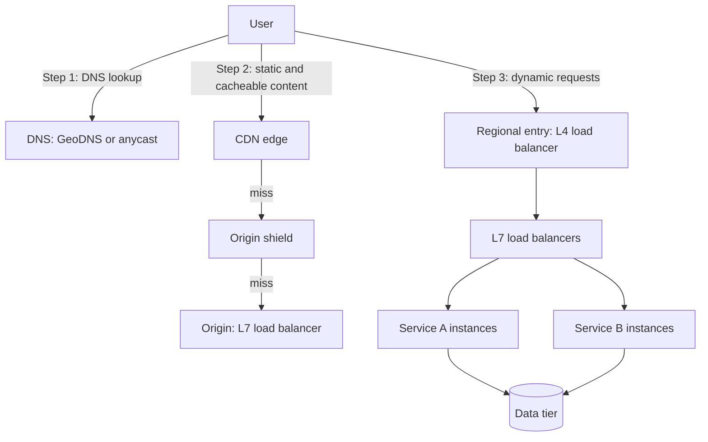
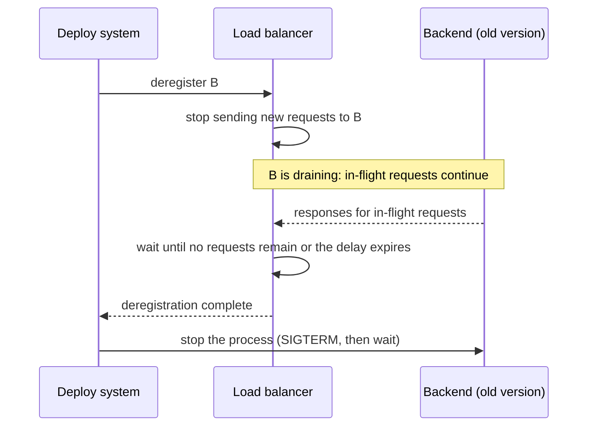
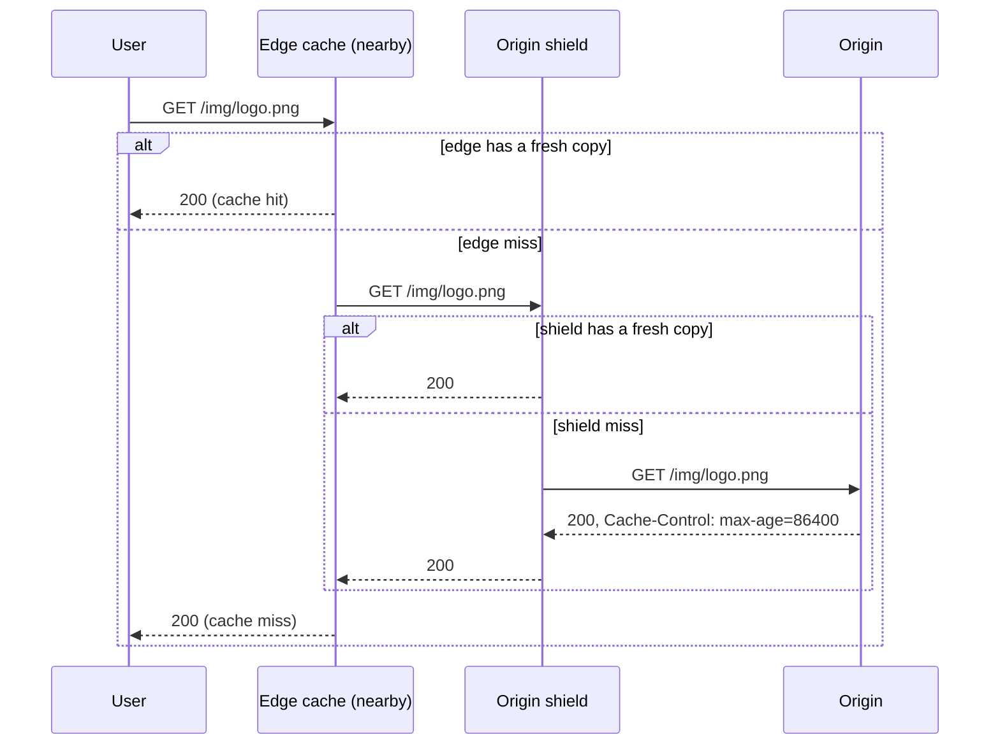

# Load Balancing, DNS, and CDN

A load balancer spreads requests over several servers. DNS maps a name to the address of a load balancer or a data center. A CDN (content delivery network) serves cached copies of content from servers close to the user. Together they are the front door of every large system: the first three boxes in an HLD diagram. This page explains what each one sees and decides, the algorithms and their limits, how health checks and draining keep a deploy invisible to users, how DNS and anycast direct users to a region, and how a CDN removes load from the origin. The protocol details of DNS live in `kb/networking/06-dns.md`, and the protocol view of proxies lives in `kb/networking/09-proxies-and-nat.md`. This page covers the design view.

## Why It Matters

"Draw the high-level design" starts with a client, a load balancer, and a set of servers, and the interviewer then asks: "Is the load balancer a single point of failure? Layer 4 or layer 7? Which algorithm? How do you deploy without dropping requests? How do users in Asia reach the nearest region? What do you cache at the edge?" Each question has a short, exact answer, and weak answers ("round robin, I guess") cost points. On the job, the same knowledge decides how you configure Nginx, Envoy, HAProxy, or a cloud load balancer: health-check thresholds that cause a cascade, a DNS time to live that turns a 1-minute failover into a 1-hour one, a cache key that serves one user's page to another. The page gives the numbers and the product defaults that you need, each from the product documentation.

## Core Concepts

**Load balancer**: a component that receives client requests (or connections) and forwards each one to one of several backend servers. It also runs health checks, and removes failed backends from rotation. The names for the backends differ by product: *targets* (AWS), *upstream servers* (Nginx), *servers in a backend* (HAProxy), *endpoints in a cluster* (Envoy).

**Layer 4 (L4) load balancer**: a load balancer that works at the transport layer. It sees the IP addresses, the ports, and the protocol (TCP or UDP), and it does not read the application payload. **Layer 7 (L7) load balancer**: a load balancer that works at the application layer. It terminates the client connection, parses the protocol (for example HTTP), and routes each request on its content: host, path, headers, cookies, method. The numbers refer to the OSI model (`kb/networking/01-osi-and-tcp-ip-models.md`).

**Reverse proxy**: a server that accepts requests for a group of servers and forwards them. An L7 load balancer is a reverse proxy with a balancing policy.

**Health check**: a test that the load balancer runs against a backend to decide whether the backend may receive traffic. An **active** check sends probe requests on a timer. A **passive** check watches real traffic and counts failures.

**Connection draining** (also *deregistration delay*): the stage in which a backend that is leaving rotation receives no new requests and keeps its in-flight requests until they finish or a timeout expires.

**TLS termination**: the load balancer ends the client's TLS connection, decrypts the traffic, and forwards it to the backend (in plain text or in a second TLS connection).

**Sticky session**: see the [scalability page](01-scalability-and-availability.md).

**DNS** (Domain Name System): the distributed database that maps names to records, mainly IP addresses. A **resolver** (recursive resolver) is the server that looks up the answer for a client and caches it. An **authoritative server** holds the records of a zone. **TTL** (time to live) is the number of seconds that a resolver may cache a record. **GeoDNS**: an authoritative server that gives different answers depending on the location of the client (or of its resolver). **Anycast**: the same IP address is announced from many locations, and the network routes each packet to the nearest one. A BGP route decides what "nearest" means (RFC 4786).

**CDN**: a network of cache servers (edge servers, in points of presence or *PoPs*) that stores copies of content close to users. The server that holds the original is the **origin**. **Cache key**: the set of request attributes (URL, host, selected headers, query parameters, cookies) that identifies one cached object. **Cache hit ratio**: the share of requests that the cache answers without a request to the origin. **Pull CDN**: the CDN fetches an object from the origin when a user first requests it. **Push CDN**: you upload objects to the CDN in advance. **Origin shield**: an additional cache layer between the edge caches and the origin, so that the origin receives as few as one request per object. **Invalidation** (purge): the removal of cached objects before their TTL ends. **Edge compute**: code that runs on the CDN servers, near the user.

## How It Works

### Where the pieces sit



Load balancers appear at three places: at the edge (the entry to a region), in front of each service (internal), and in the client (client-side balancing, where the caller picks the instance; see [microservices](14-microservices-and-monoliths.md)). A service mesh (Envoy sidecars, for example) puts an L7 balancer next to each caller.

### L4 and L7 load balancers

An L4 balancer picks a backend when the connection opens. It then forwards all packets of that connection to that backend. An L7 balancer reads each request and picks a backend for each request.

| Aspect | L4 | L7 |
|---|---|---|
| What it sees | IP addresses, ports, protocol. TLS bytes it cannot read (unless it terminates TLS) | Full HTTP request: method, host, path, headers, cookies, body (if it buffers) |
| Routing decision | Per connection, by a hash or a count | Per request, by content and policy |
| Connection model | Two modes. In pass-through mode (NAT or direct routing) the balancer forwards packets, and the client and the backend share one TCP connection. In proxy mode (HAProxy `mode tcp`, the Envoy TCP proxy, an NLB TLS listener) the balancer terminates the client's TCP connection and opens a new one to the backend, but it still does not parse the payload | Terminates the client connection and opens separate connections to the backends. It can reuse backend connections between many clients |
| Can it do | Port and protocol routing, TCP and UDP, very high connection rates, static IP addresses, preserve the client IP | Path and host routing, header-based routing, redirects, rewrites, authentication, TLS termination, HTTP/2 to HTTP/1.1 conversion, retries per request, rate limits, compression, WAF integration |
| Cannot do | Route by URL. Retry one HTTP request. Balance requests inside one long connection (one HTTP/2 or gRPC connection goes to one backend) | Handle arbitrary non-HTTP protocols (some products also have an L4 mode) |
| Cost per request | Low. No parsing | Higher. Parsing, buffering, TLS |
| Typical use | Entry point for very high traffic, non-HTTP protocols (databases, game servers, MQTT), TLS pass-through, a static IP for the allowlist of a customer | HTTP and gRPC APIs, microservice routing, canary releases, blue-green, user-visible features |

AWS documentation gives a concrete pair. A Network Load Balancer "functions at the fourth layer of the OSI model" and can handle millions of requests per second. For TCP it picks a target with a flow hash over protocol, source IP, source port, destination IP, destination port, and TCP sequence number. Each connection goes to one target for its lifetime. For UDP the hash uses the same fields without the sequence number, so one UDP flow stays on one target. It gives a static IP address per Availability Zone (and optionally one Elastic IP address per subnet). An Application Load Balancer "functions at the application layer, the seventh layer". It evaluates listener rules in priority order. A rule has conditions (host, path, header, method, query parameters, source IP) and actions (forward, redirect, fixed response, authenticate).

**One long connection pins the load.** An L4 balancer assigns a connection once. A gRPC or HTTP/2 client opens one connection and multiplexes thousands of requests on it. All the requests go to one backend, and a new backend that joins later receives no traffic from that client. The fixes: an L7 balancer that balances each HTTP/2 stream, or client-side balancing over several connections, or a maximum connection age so that clients reconnect. The same problem exists for WebSocket (`kb/networking/08-websockets-and-realtime.md`) and for HTTP keep-alive, in a smaller form.

**Two-tier pattern.** A common design puts a pool of L4 balancers (static IP, high rate, DDoS absorption) in front of a fleet of L7 balancers (routing, TLS). The L4 tier is simple and rarely changes. The L7 tier changes often with new routes. Google's Maglev paper (Eisenbud et al., NSDI 2016) describes an L4 software balancer: routers spread packets over the Maglev machines with Equal Cost Multipath (ECMP), and each machine uses consistent hashing and connection tracking to send packets of one connection to the same backend.

**Direct server return (DSR)**: a mode of some L4 balancers in which the backend sends the response directly to the client and not back through the balancer. The balancer then handles only the small request traffic and not the large response traffic. It suits file downloads and video. The cost is that the balancer cannot see the response, and the network setup is more complex. Not every product supports it.

**Client IP.** After a proxy, the backend sees the IP address of the proxy. An L7 balancer passes the client IP in the `X-Forwarded-For` header (de facto standard) or the `Forwarded` header (RFC 7239). An L4 balancer can keep the client IP in the packets, or pass it in the PROXY protocol header. For NLB, client IP preservation is a target group attribute whose default depends on the target type and the protocol: it is on for instance targets, on (and cannot be turned off) for IP targets with UDP, TCP_UDP, QUIC, or TCP_QUIC, and off for IP targets with TCP or TLS (NLB target group attributes documentation). The backend must trust these headers only from the balancer, because a client can send a fake `X-Forwarded-For`.

### Load-balancing algorithms

| Algorithm | How it picks | State kept | Strength | Weakness |
|---|---|---|---|---|
| Round robin | The next backend in a fixed cycle | One counter | Simple. Even number of requests per backend | Ignores the cost of each request and the speed of each backend. A long request pins a backend |
| Weighted round robin | A cycle where a backend with weight 3 appears three times as often | Counter and weights | Handles machines of different size. Allows a canary at 5% | Static weights. They do not follow the real load |
| Least connections | The backend with the fewest active connections (weighted variants divide by weight) | Active count per backend | Adapts to slow backends and long requests | The balancer needs the full count. With several balancers, each sees only its own connections. A new or restarted backend with zero connections receives a burst |
| Least response time | The backend with the lowest recent response time, often combined with the active count | Moving average of latency | Favors the fast backend | A backend that fails fast (errors in 1 ms) attracts all traffic. Needs error handling |
| IP hash | `hash(client IP) mod N` | None | Same client reaches the same backend with no cookie. Works for L4 | Changing N remaps most clients. Clients behind one NAT form a hot spot |
| Consistent hashing (hash of IP, header, URL, or cookie) | Hash on a ring. Each key goes to the next backend on the ring | The ring | Adding or removing a backend moves only about 1/N of the keys (Karger et al., 1997). Gives cache affinity: the same URL reaches the same cache | Uneven load unless each backend has many virtual nodes. A hot key overloads one backend. See [partitioning](06-partitioning-and-sharding.md) |
| Random | A uniform random backend | None | No shared state between balancers | The maximum load is above the average (see below) |
| Power of two random choices (P2C) | Pick two backends at random. Send to the one with fewer active requests | Active count per backend | Near the quality of least connections, with no scan of all backends. Works with many independent balancers | Needs a load signal. Small N gives less benefit |
| Least outstanding requests | The backend with the fewest requests in progress (the request-level form of least connections) | In-flight count | Good when request cost varies | As for least connections |

#### Why least connections works better than round robin, and why P2C exists

Round robin gives every backend the same number of requests, but requests differ in cost. If 2% of requests take 200 times longer, a backend that gets a few of them holds a queue, while another sits idle. A balancer that uses the number of active requests sees that queue and avoids that backend.

Least connections has a problem at scale. It must know the load of every backend, and it needs one global counter. With several load balancer instances, each one sees only the requests that pass through it. Many instances can send a burst to the same "least loaded" backend at the same time (a herd effect). The HAProxy manual names the same problem: it says that random balancing "can be useful with large farms or when servers are frequently added or removed as it may avoid the hammering effect that could result from roundrobin or leastconn in this situation". P2C keeps randomness, so independent balancers rarely pick the same backend, and still avoids the most loaded backends.

P2C samples two backends at random and takes the less loaded one. The static result comes from Azar, Broder, Karlin, and Upfal ("Balanced Allocations"): in the balls-into-bins model with n balls and n bins, the maximum load is about ln n / ln ln n with one random choice, and about ln ln n / ln d (plus a constant) with d ≥ 2 choices. Mitzenmacher (2001) studied the dynamic form, where requests arrive and finish over time (the "supermarket model"), with Poisson arrivals at n servers, and showed that two choices give an exponential improvement in the expected time a request spends in the system compared with one random choice, while three choices are only a constant factor better than two. Dean and Barroso cite Mitzenmacher for the same point: a choice between two servers based on queue lengths at enqueue time "exponentially improves load-balancing performance over a uniform random scheme".

Numbers for n = 1,000,000:

- The leading terms of the formulas give about 5.3 for one choice and about 3.8 for two choices (computed; the formulas ignore constants and lower-order terms, so these values are approximate and understate the gap).
- A simulation for this page (10^6 balls into 10^6 bins, three seeded runs) gave a maximum load of 8 or 9 with one random choice and 4 with two choices.

The gap grows with n, because one expression grows as ln n / ln ln n and the other as ln ln n. The gain from each further choice is smaller (the divisor changes from ln 2 to ln 3, not the order of growth), and two choices is the usual setting (the Envoy default and the HAProxy default).

Products implement it: Envoy's weighted least request balancer, with equal weights, "selects N random available hosts as specified in the configuration (2 by default)" and picks the one with the fewest active requests, which the Envoy documentation calls P2C. HAProxy's `balance random(<draws>)` picks `<draws>` servers at random and selects the least loaded of them. The manual says: "The default value is 2, which generally shows very good distribution and performance. This algorithm is also known as the Power of Two Random Choices". Nginx has `random [two [method]]`: with `two`, it picks two servers at random and chooses between them by the method, which is `least_conn` by default. The other method, `least_time`, is marked in the same documentation as part of the commercial subscription.

The Java example in this page simulates four algorithms with the same arrival pattern.

#### Weighted algorithms and slow start

Weights express capacity differences (a larger instance has a higher weight) and release plans (send 5% to the new version). A new backend that starts cold (JIT-compiler not warm, caches empty, connection pool not open) can fail under its full share. **Slow start** raises the share of a new backend linearly over a period. AWS ALB supports it per target group: the load balancer increases the number of requests to a new target linearly during the slow start duration. ALB does not allow slow start together with the least outstanding requests or the weighted random algorithm (AWS documentation). Nginx has a `slow_start` parameter on `server` in the commercial subscription, and it cannot be combined with `hash`, `ip_hash`, or `random` (Nginx documentation). HAProxy has the `slowstart` server option: the server's connection limit (`maxconn`) and, for dynamic weighted algorithms, its weight grow linearly from 1 to 100% over the given time after the server comes back up. The manual says that the slow start never applies when HAProxy itself starts.

### Health checks

A load balancer removes failed backends. It learns about a failure in two ways.

**Active health check**: the balancer sends a probe to each backend on a timer (an HTTP `GET` to a path, a TCP connect, a gRPC health check call). If the backend fails *unhealthy threshold* probes in a row, the balancer removes it. If it passes *healthy threshold* probes in a row, the balancer adds it back. The detection time is about interval × unhealthy threshold. The ALB defaults for an instance or IP target (AWS documentation) are an interval of 30 seconds, a timeout of 5 seconds, an unhealthy threshold of 2, and a healthy threshold of 5. So an ALB with the defaults needs about 2 × 30 = 60 seconds to mark a dead target unhealthy (computed), and 5 × 30 = 150 seconds to mark a recovered target healthy again. A newly registered target needs to pass only one health check before it receives traffic. Lower the interval to detect faster, at the cost of more probe traffic.

**Passive health check**: the balancer counts errors in real traffic: connection failures, timeouts, 5xx responses. A backend with too many errors is ejected for a period. Passive checks react to a real failure with no probe traffic, and they find failures that the probe path does not show. They need traffic to work, and a client sees the failures that trigger the ejection.

| Product | Active | Passive (documented parameters) |
|---|---|---|
| Nginx (open source) | Not in the open-source upstream module. The `health_check` directive (`ngx_http_upstream_hc_module`) is part of the commercial subscription (defaults: interval 5 seconds, fails 1, passes 1) | `max_fails` (default 1) failed attempts within `fail_timeout` (default 10 seconds) marks the server unavailable for `fail_timeout`. The `proxy_next_upstream` directive (and its equivalents for other protocols) defines what counts as a failed attempt. In a group with only one server, Nginx ignores these parameters and never marks the server unavailable |
| HAProxy | The `check` server option enables checks (a TCP connect by default, or an application-level check if one is configured). `inter` sets the interval (default 2,000 ms), `fall` the consecutive failures to mark a server down (default 3), `rise` the consecutive successes to mark it up (default 2) | `observe layer4` (connection results) or `observe layer7` (HTTP responses, HTTP proxies only), which requires `check`. After `error-limit` consecutive errors (default 10), the `on-error` action runs: `fastinter`, `fail-check` (the default: count a failed check), `sudden-death`, or `mark-down` |
| Envoy | Active health checking is configured per cluster | Outlier detection, which the Envoy documentation calls "a form of passive health checking": a host with consecutive errors (for example `consecutive_5xx`) is ejected for `base_ejection_time` multiplied by the number of times in a row it has been ejected, up to `max_ejection_time`. `max_ejection_percent` limits how many hosts are ejected |
| AWS ALB | Health checks per target group (the defaults above) | Automatic Target Weights: anomaly detection of 5xx responses and connection failures, always on. Anomaly mitigation (less traffic to an anomalous target) works only with the weighted random algorithm |
| AWS NLB | Health checks per target group. Defaults: TCP probe, interval 30 seconds, timeout 10 seconds for TCP and HTTPS (6 seconds for HTTP), healthy threshold 5, unhealthy threshold 2, HTTP success codes 200–399. The probes are distributed over the load balancer nodes and decided by consensus, so a target receives more probes than the configured interval suggests | The NLB documentation describes active checks only ("Network Load Balancers use active health checks"). When a target becomes unhealthy, NLB by default sends a TCP RST for packets on the client connections bound to it, unless the load balancer fails open. The target group attribute "connection termination for unhealthy targets" (on by default) controls this. With it off, the target keeps its established connections and receives no new ones. Only then can you set an "unhealthy draining interval": the target stays in the `unhealthy.draining` state for that interval, keeps its established connections, and then becomes `unhealthy`. If it passes health checks during the interval, it becomes healthy again. NLB fails open when all targets fail at the same time in all enabled zones, or when the target group is empty |

**What a health check should test.**

- A **shallow** check (the process answers) detects a crashed process. It misses a backend that is alive and cannot reach its database.
- A **deep** check (the handler also calls the database and other dependencies) detects more. The risk: if the shared database slows down, every backend fails the deep check at the same time, the balancer removes all of them, and a partial outage becomes a total outage. A balancer that fails open (ALB sends traffic to all registered targets when all targets are unhealthy, per the AWS documentation) limits this effect. Envoy's `max_ejection_percent` limits ejection in the same way.
- Recommendation: use a check that tests the instance itself (process alive, can accept work, not shutting down) and local resources (disk, thread pool not full). Do not include shared dependencies in the check that removes an instance from rotation. See readiness and liveness in [reliability patterns](12-reliability-patterns.md).
- A health check endpoint must not be expensive, and it must not require authentication that the balancer cannot supply.

**Flapping.** A backend that alternates between pass and fail causes churn. The thresholds (more than one pass to return) and the slow start damp it.

### Connection draining

A deployment or a scale-in removes a backend. Without draining, in-flight requests fail. The sequence:



Facts from the documentation: ALB waits 300 seconds by default (the deregistration delay) before it completes deregistration. If the target has no in-flight requests and no active connections, ALB completes deregistration at once. If a deregistering target closes the connection before the delay ends, the client gets a 5xx response. The target state during the wait is `draining`. If a client with a sticky session sends a new request while its target is draining, ALB routes the request to a healthy target. Nginx has a `drain` parameter on `server`: in draining mode, only requests that are bound to the server (for example by a sticky session) are sent to it. The parameter appeared in version 1.13.6 as part of the commercial subscription. Open-source Nginx has it since version 1.29.6, together with the `sticky` directive and the `route` parameter (Nginx documentation and change log).

Rules for the application:

1. On SIGTERM, the process stops accepting new connections, finishes in-flight requests, and then exits. Spring Boot, for example, does this with graceful shutdown. Its current reference documentation says that graceful shutdown is enabled by default for the embedded Tomcat, Jetty, and Reactor Netty servers, which "stop accepting new requests at the network layer". The property `spring.lifecycle.timeout-per-shutdown-phase` sets the grace period for in-flight requests, and `server.shutdown=immediate` turns graceful shutdown off.
2. Set the drain timeout longer than the p99.9 request time and shorter than the termination grace period of the platform.
3. Long-lived connections (WebSocket, streaming, long polling) do not finish by themselves. The server sends a close message and the client reconnects to another backend, with jittered delays so that all clients do not reconnect at the same moment (see [reliability patterns](12-reliability-patterns.md)).
4. Keep-alive connections: send `Connection: close` on the last responses, or set a maximum connection age at the balancer.

### TLS termination

| Mode | What happens | Benefit | Cost |
|---|---|---|---|
| Termination at the load balancer | The balancer decrypts. The balancer-to-backend hop is plain HTTP | One place for certificates and renewals. Backends do no TLS work. The balancer can read the request (L7 routing, WAF, headers) | The traffic is plain text inside the network. Some compliance rules forbid it |
| Re-encryption (TLS to the backend) | The balancer decrypts, routes, and encrypts again to the backend | L7 features, and encryption on the internal hop | Two TLS handshakes and the certificates on the backends |
| Pass-through (L4) | The balancer forwards the encrypted bytes. The backend terminates TLS | End-to-end encryption. The balancer holds no private key | No L7 routing. The backend does the TLS work. The balancer can route by the SNI name only in products that read it |
| mTLS between services | Both sides present certificates | Service identity. Authenticated internal traffic | Certificate issuing and rotation. Often done by a service mesh (`kb/security/07-infrastructure-security.md`) |

ALB documentation states that for an HTTPS listener, the load balancer "uses certificates to terminate connections and decrypt requests from clients", and that certificates can come from AWS Certificate Manager. Termination at the edge also shortens the TLS handshake for the user, because the handshake happens with a nearby server and the long connection to the origin is reused (`kb/networking/05-tls-and-https.md`).

### Global load balancing: DNS, GeoDNS, and anycast

A regional load balancer spreads traffic inside one region. To spread traffic over regions and to survive the loss of a region, you need a global mechanism. Two mechanisms are common, and they combine.

**DNS-based routing.** An authoritative DNS service returns a different answer for the same name, by a policy. The Route 53 documentation lists these routing policies:

| Policy | Behavior (Route 53 documentation) |
|---|---|
| Simple | One resource for a function |
| Weighted | Route to several resources in proportions that you specify |
| Latency | Route to the AWS Region with the best latency |
| Geolocation | Route by the location of the users |
| Geoproximity | Route by the location of your resources, with an optional shift (bias) of traffic between locations |
| Failover | Active-passive failover, driven by health checks |
| Multivalue answer | Return up to eight healthy records chosen at random |
| IP-based | Route by the IP address range of the client |

How it works: the user's recursive resolver asks the authoritative server. The server sees the address of the resolver (and, if the resolver sends it, a prefix of the client's address in the EDNS Client Subnet option, RFC 7871), looks up the best region, and returns the address of that region's entry point. Limits:

- The server sees the resolver, not the user. A user who uses a public resolver in another country can be mapped to the wrong region unless the resolver forwards the client subnet.
- Resolvers cache the answer for the TTL. A failover takes at least as long as the TTL for clients that honor it, and longer for clients that do not (see the next section).
- DNS knows nothing about load unless a health check or weight tells it.

**Anycast.** The same IP address is announced from many locations by BGP. Routers send each packet along the shortest BGP path, which usually leads to a nearby location (RFC 4786 describes the operation of anycast services). CDNs and public DNS providers use anycast, so that a user reaches a nearby PoP with one IP address and no DNS trick. If a location fails, it stops announcing the route, and traffic moves to the next nearest location within the time that BGP needs to converge (seconds to minutes, approximate; it depends on the network). Limits: "nearest" means the shortest network path, which is not always the lowest latency. A route change in the middle of a long TCP connection can send packets to another location, and that location resets the connection. This risk is higher for long connections and lower for short HTTP requests. AWS Global Accelerator, for example, gives an accelerator two static IPv4 addresses that "are anycast from the AWS edge network", and routes the traffic over the AWS network to load balancers or instances in one or more Regions (Global Accelerator documentation).

| Aspect | DNS-based (GeoDNS, latency, weighted) | Anycast |
|---|---|---|
| Decision point | Authoritative DNS, at lookup time | Network routers, at each packet |
| Failover time | TTL plus resolver and client behavior (minutes) | BGP convergence (seconds to minutes) |
| Granularity | Per resolver, and by policy and weight | By network topology |
| Control | High: weights, health checks, geography | Low: depends on routing |
| Long connections | Stable (one address for the session) | A route change can break a connection |
| Typical use | Choose a region. Weighted rollouts. Failover | CDN entry. DNS servers. DDoS absorption. Static IP in front of regions |

Recommendation: use DNS for the region decision and for the weighted and failover policy, and use anycast (through the CDN or a global accelerator service) for the entry to the nearest PoP. State in the interview that the failover time depends on the TTL.

### DNS in system design

**The caching layers.** A name lookup passes several caches. Each one holds the record for at most the TTL that the authoritative server sets, and some hold it for longer.

```text
application cache (for example the JVM)
  -> operating system resolver cache
    -> stub resolver and home router
      -> recursive resolver of the ISP or a public resolver (shared by many users)
        -> authoritative server (the source of truth)
```

**TTL trade-offs.**

| Short TTL (for example 30 to 60 seconds) | Long TTL (for example 1 hour to 1 day) |
|---|---|
| Faster failover and faster rollout of a change | Fewer queries, so lower DNS cost and load on the authoritative servers |
| More queries. A DNS outage at the provider hurts sooner, because the caches expire sooner | Records stay in caches during a short DNS provider outage |
| Adds a lookup latency for users more often | Slow to change. A wrong record stays for the TTL |

Use a short TTL on records that you may need to change in an emergency (the entry to a region), and a long TTL on stable records. Before a planned migration, lower the TTL one full old TTL period ahead of the change, move, and then raise it again.

**Why failover by DNS is slower than the TTL says.** Some clients and resolvers keep records longer than the TTL. The AWS NLB documentation says it directly: if a client does not honor the TTL and sends requests to an IP address that was removed from DNS, the requests fail. (For reference, the DNS records of an Elastic Load Balancing load balancer have a TTL of 60 seconds, per the "How Elastic Load Balancing works" page.)

Java is an example of a client with its own cache. The facts for JDK 21:

- The `InetAddress` javadoc says that the security property `networkaddress.cache.ttl` sets how many seconds a successful lookup stays in the JVM's cache, and that the default is "an implementation specific period of time". A value of -1 means "cache forever".
- In OpenJDK that period is 30 seconds when no security manager is installed. The `java.security` file of the JDK says so ("When a security manager is not set, the default behavior in this implementation is to cache for 30 seconds"), and the source class `sun.net.InetAddressCachePolicy` has `DEFAULT_POSITIVE = 30`. If a security manager is installed, the default is to cache forever. (JDK 24 and later cannot enable a security manager at all, per JEP 486.)
- `networkaddress.cache.negative.ttl` sets the time for failed lookups. The javadoc gives the default as 10 seconds.
- `networkaddress.cache.ttl` is a security property, not a system property. Set it in the `java.security` file or with `java.security.Security.setProperty` before the first lookup. A `-Dnetworkaddress.cache.ttl=...` flag has no effect. To override security properties from the command line, point `-Djava.security.properties=<file>` at a file that contains the property. The system property that OpenJDK reads as a fallback is `sun.net.inetaddr.ttl` (from the source of `InetAddressCachePolicy`; it is an implementation detail, not a standard API).

Recommendation: in a service that depends on DNS changes, set the TTL explicitly (for example 30 or 60 seconds) instead of relying on the default, check that no library or old runtime sets it to -1, and reconnect on connection errors so that the client does a new lookup.

**Negative caching and stale answers.** A resolver caches "this name does not exist" (RFC 2308) for a time that the zone sets: the lower of the TTL of the SOA record and the SOA MINIMUM field. RFC 8767 allows a resolver to serve an expired answer when the authoritative servers cannot be reached, which helps during a provider outage. The JDK has a similar option for its own cache: the security property `networkaddress.cache.stale.ttl` (in the JDK 21 javadoc) keeps a name whose TTL has expired for the given number of seconds if a new lookup fails. If the property is not set, or is 0, the JVM does not use stale names.

**DNS round robin is not load balancing.** A name with several A records returns them in rotated order, and clients pick one. The DNS server does no health check by default, the caches skew the share, a client may keep one address for a long time, and one resolver can serve millions of users with one cached answer. It is a cheap way to spread load over a few balancers. It is not a way to detect failures (some managed services add health checks to DNS records, as Route 53 does for failover and multivalue answers).

**Other design points.**

- Use an alias or CNAME record to point a name to a managed load balancer, because the IP addresses of a managed load balancer change as it scales. Note that a CNAME cannot be set at the zone apex (the bare domain). Providers offer alias records as a workaround (see the documentation of your DNS provider).
- DNS provider outages happen. A second authoritative provider (or a provider with anycast) removes DNS as a single point of failure.
- Service discovery inside a cluster is DNS-based in Kubernetes. See [microservices](14-microservices-and-monoliths.md).

### CDNs

A CDN reduces latency (the user talks to a nearby server), reduces origin load (the cache answers most requests), and absorbs traffic spikes and some attacks. It is best for content that many users request and that changes rarely: images, video segments, scripts, style sheets, downloads, and public API responses.



**Pull and push.**

| Aspect | Pull (origin pull) | Push |
|---|---|---|
| How content gets to the CDN | The edge fetches from the origin on the first request, and caches it | You upload the content to the CDN storage, or to an origin that the CDN uses |
| First request | Slow (a miss goes to the origin) | Fast, if the upload finished before |
| Operations | Low. Set cache headers on the origin | Higher. You decide what to upload, when, and when to delete |
| Origin load | Spikes after a release or a purge (many edges miss at once) | None for pushed objects |
| Storage | Only requested objects are cached | You pay for all uploaded objects, also those no one requests |
| Best for | Websites and APIs with a large, changing catalog and a long tail of rarely requested objects | A small set of large files that you know ahead of time: software releases, a game patch, a scheduled video |

Most systems use pull with object storage as the origin ([storage types](10-storage-types.md)), and warm the cache for a known event (a premiere) by requesting the objects once.

**Cache key.** The CDN stores one copy per cache key. In most CDNs the key contains at least the host and the path. Whether it also contains the query string, headers, or cookies depends on the product and its configuration (CloudFront sets this in a cache policy). Adding an attribute to the key creates more copies and lowers the hit ratio. Leaving out an attribute that changes the response serves the wrong content. Rules:

- Put in the key everything that changes the response body: the path, the query parameters that matter, the encoding (`Accept-Encoding` has many raw values, so key on a few normalized values such as gzip, br, or none; check how your CDN handles it), the language header if you serve by language.
- Leave out everything that does not: tracking parameters (`utm_*`), irrelevant cookies, `User-Agent` (it has too many values).
- The `Vary` response header (RFC 9110) tells caches which request headers select the stored response. `Vary: Cookie` or `Vary: User-Agent` makes the hit ratio low.
- Do not cache a personalized response under a key that does not contain the user. A common incident is a cookie-based page cached and served to the next user. Use `Cache-Control: private` or `no-store` for such responses (RFC 9111).
- A header that changes the response and is not in the key allows cache poisoning. The CloudFront documentation lists which attributes go into the cache key.

**Cache-Control headers** that the CDN honors (RFC 9111): `max-age` for all caches, `s-maxage` for shared caches such as a CDN (it overrides `max-age` there), `public`, `private`, `no-store`, and `immutable` (RFC 8246: the content does not change during its freshness lifetime). RFC 5861 adds `stale-while-revalidate` (serve the stale copy while the cache refreshes it in the background) and `stale-if-error` (serve the stale copy if the origin returns an error). Details of the headers are in `kb/networking/04-http.md`.

**Invalidation.** Three methods, in order of preference:

1. **Versioned URLs** (fingerprinting): put a hash or version in the file name (`app.3f9a1c.js`) and set a long TTL with `immutable`. A release changes the URL, so no purge is needed. The CloudFront documentation recommends versioned file names for frequently updated files, because versioning also works when a user has an old copy in a browser or a corporate proxy, serves different versions to different users, makes rollback easy, and costs less than invalidation.
2. **Purge by URL, prefix, or tag.** You send an API call, and the CDN removes the matching objects (CloudFront supports invalidation by path and by cache tag, per its documentation). A purge takes time to reach all PoPs, and the next requests go to the origin (a spike). Use it for emergencies: a wrong price, a legal takedown.
3. **Short TTL** with `stale-while-revalidate`: accept staleness of a few seconds to minutes for pages that must be nearly fresh.

A purge does not clear the browser cache. The user's browser holds the copy until its own `max-age` ends. See [caching](03-caching.md) for the general invalidation problem.

**Origin shield** (a mid-tier cache). Without a mid-tier, each PoP that misses sends its own request to the origin, so 200 PoPs can send 200 requests for the same new object. CloudFront already has regional edge caches as a mid-tier, but requests from viewers in different regions go through different regional edge caches, and each of them can still ask the origin for the same object. With a shield, the PoPs ask the shield, and the shield sends one request. The CloudFront documentation says: requests for content that is not in the shield cache "are consolidated with other requests for the same object, resulting in as few as one request going to your origin". It helps most for content with viewers in many regions, for live streaming and on-the-fly image processing, and for origins with limited capacity. It adds a cost and one more hop for dynamic or low-cacheability content, where the CloudFront documentation says it may not be a good fit. A related technique is **request collapsing** (coalescing): the cache holds the requests for the same missing object while one request goes to the origin ([cache stampede](03-caching.md)).

**Edge compute.** Code that runs at the PoP: rewrite URLs, check an authentication token, run an A/B test, resize an image, add headers, or answer from the edge with no origin call. Example: AWS Lambda@Edge runs functions at CloudFront; the CloudFront documentation says that with Origin Shield enabled, the origin-facing triggers run in the Region of the shield, and the viewer-facing triggers are not affected. Limits: short execution time, small memory, no direct access to your private network and database, and state that is eventually consistent across PoPs. Put only logic that benefits from being close to the user and does not need a central database.

**What a CDN does for dynamic content.** Even a non-cacheable response benefits: the user's TLS handshake ends at a nearby PoP, and the PoP reuses a warm connection to the origin on a fast network. The CloudFront documentation describes the same effect for Origin Shield ("CloudFront network traffic remains on the high throughput CloudFront network all the way to your origin").

**What not to cache at the edge:** responses with user-specific data under a shared key, responses to `POST`, `PUT`, `DELETE`, content with strict freshness needs (account balance), and anything with `Set-Cookie` unless you strip or key it.

**Protecting the origin.** Make the origin accept traffic only from the CDN (a secret header, an allowlist of CDN addresses, or private connectivity), or an attacker bypasses the CDN and its protection. Sign URLs or cookies for private content (a time-limited signed URL, as in [storage types](10-storage-types.md)).

### Real products and their documented features

| Product | Layer | Documented features used in designs |
|---|---|---|
| Nginx (open source `ngx_http_upstream_module`) | L7 (HTTP), also L4 with the stream module | Weighted round robin (default), `least_conn`, `ip_hash`, `hash` (with `consistent` for ketama), `random [two [method]]`. Passive checks with `max_fails` and `fail_timeout`. `keepalive` for upstream connections. Since 1.29.6 (also in the 1.30 stable branch): `sticky` session affinity and the `drain` and `route` server parameters. Since 1.31.0 (mainline, May 2026): the `least_time` directive. Commercial subscription: active health checks (`health_check`), `slow_start`, and `least_time` as the method of `random two` |
| HAProxy | L4 and L7 | `balance` algorithms including `roundrobin`, `leastconn`, `source`, `uri`, `hdr`, `random` (with draws, default 2, the power of two choices), `hash-type consistent` (only the mappings of a server that goes up or down move, which the manual calls ideal for caches). Server options `check`, `inter` (default 2 s), `fall` (default 3), `rise` (default 2), `slowstart`. Passive checks with `observe`, `error-limit`, and `on-error` |
| Envoy | L4 and L7 proxy, data plane of service meshes | Weighted round robin, client-side weighted round robin, weighted least request (P2C, default 2 choices), ring hash, Maglev, random. Active health checking and outlier detection (passive). Retries, timeouts, circuit breaking per cluster |
| AWS Application Load Balancer | L7 | Listener rules on host, path, header, method, query, source IP. Routing algorithms: round robin (default), least outstanding requests, weighted random. Slow start. Sticky sessions with `AWSALB` or application cookies. Deregistration delay (default 300 seconds). Health checks (defaults above). Fail-open if all targets are unhealthy. Automatic Target Weights. Cross-zone balancing is always on at the load balancer level, and you can turn it off per target group (then stickiness is not supported, and an Availability Zone with no targets returns 503 errors) |
| AWS Network Load Balancer | L4 | Target groups for TCP, UDP, TCP_UDP, TLS, QUIC, and TCP_QUIC. Flow hash target selection (QUIC: by the server ID in the connection ID). Millions of requests per second. A static IP per Availability Zone and optionally one Elastic IP per subnet. Active health checks only (defaults above). Cross-zone balancing off by default. Client IP preservation depends on the target type and the protocol (see the client IP paragraph above) |
| AWS CloudFront | CDN | Regional edge caches, Origin Shield (an optional extra layer, with a charge), invalidation by path and tag, versioned names recommended, Lambda@Edge |
| AWS Route 53 | DNS | Policies: simple, weighted, latency, geolocation, geoproximity, failover, multivalue (up to eight healthy records), IP-based |

Statements about versions and commercial features follow the documentation pages listed in Further Reading at the time of writing. Check the current documentation before you rely on a feature, because vendors move features between editions.

### Capacity and limits of a load balancer

- **A load balancer is also a system that can fail or saturate.** A single software balancer is a single point of failure. Run at least two with a shared address (a floating IP that moves on failure) or in front of a DNS or anycast layer. Managed balancers run many nodes in several zones (ALB and NLB create a node per enabled Availability Zone, per the AWS documentation). They scale automatically ("can scale to the vast majority of workloads"), and the documentation does not publish a fixed limit on that page.
- **Ephemeral ports.** A proxy opens a TCP connection to the backend for each client request unless it reuses connections. One TCP connection is identified by source IP, source port, destination IP, destination port. With one source IP and one backend address and port, the proxy has only as many connections as it has source ports. Linux uses the range 32768 to 60999 by default (`ip_local_port_range`, kernel documentation), which is 28,232 ports (computed from the default; the range is configurable). The limit counts more than the open connections. The side that closes a TCP connection first keeps it in the TIME_WAIT state, and Linux holds TIME_WAIT for 60 seconds (`TCP_TIMEWAIT_LEN` in the kernel source `include/net/tcp.h`). If the proxy opens a new connection for each request and closes it first, each closed connection holds its port for 60 seconds, so the proxy can open only about 28,232 / 60 ≈ 470 new connections per second to one backend address and port (computed). That is one reason L7 proxies keep connections open to the backends (`keepalive` in Nginx) and send many requests over each. Other fixes: more source IP addresses, more backend ports, a wider port range, or the `tcp_tw_reuse` setting, which lets new outgoing connections reuse TIME_WAIT ports when that is safe for the protocol (in current kernels its default, 2, enables it for loopback traffic only, per the kernel documentation).
- **Connection count versus request rate.** One L7 balancer node can hold many idle connections but spends CPU on TLS handshakes and request parsing. Plan capacity with a load test of your own configuration (`kb/engineering-practice/10-performance-engineering.md`). Published numbers depend on hardware and configuration.
- **Cross-zone balancing** sends traffic across zones, which evens the load and adds cross-zone data transfer cost. Turning it off keeps traffic in one zone, and then each zone needs enough targets (AWS documentation: for ALB, an empty zone returns 503 errors when cross-zone balancing is off).

## Trade-offs and When to Use

| Decision | Option A | Option B | Choose A when | Choose B when |
|---|---|---|---|---|
| Layer | L4 | L7 | Non-HTTP protocols, very high rate, static IP, TLS pass-through | Content-based routing, per-request retries, HTTP features, canary |
| Algorithm for a web service | Round robin | Least connections or P2C | Requests have similar cost and backends are equal | Request cost varies, or backends differ in speed |
| Algorithm for a cache tier | Round robin | Consistent hashing | Backends are stateless | Backends hold cache data: the same key should reach the same node |
| Algorithm with many balancers | Least connections | P2C | One balancer sees all traffic | Many balancers each see part of it |
| Health check depth | Shallow | Deep | Shared dependencies exist (avoid a mass ejection) | A dependency is private to the instance |
| Health check type | Active only | Active and passive | Low traffic. Predictable failures | Real traffic is high and you want fast reaction to real errors |
| TLS | Terminate at the balancer | Re-encrypt or pass through | The internal network is trusted and you want L7 features | Compliance needs encryption in transit inside the network, or you need end-to-end control |
| Global routing | DNS (latency or geolocation) | Anycast | You need weights, policy, and health-based failover by region | You need the entry at the nearest PoP and fast re-route |
| CDN fill | Pull | Push | Large, changing catalog | Known large files, release events |
| CDN invalidation | Versioned URLs | Purge | Static assets that you build | Emergency removal and content that cannot change its URL |
| Origin shield | Off | On | Small origin traffic, local audience | Global audience, expensive or small origin, popular new content |
| DNS TTL | Short | Long | Entry points that need fast failover | Stable records, cost-sensitive, resilience to DNS provider outage |

Recommendation for an interview answer: "DNS with latency routing (TTL of 60 seconds) sends users to the nearest region. A CDN with origin shield serves static content and cacheable API responses. In the region, an L4 load balancer gives a stable entry, and an L7 balancer routes by path to the services with least-outstanding-requests balancing, active health checks on a shallow endpoint, and a 60-second drain on deploy." Then name the failure of each piece.

## Java Example

The program simulates four balancing algorithms with the same workload: 50 backends, 20 new requests per tick, and a mix of short requests (1 to 10 ticks) and long requests (200 ticks, 2% of requests). The balancer sees only the number of active requests on each backend. The output shows the peak load of the busiest backend and the mean load. All algorithms have the same mean (the same total work), and they differ in how high the peak goes. The random sources are seeded, so the output is the same in every run. Consistent hashing, which balances by key and not by load, has its own runnable ring in [partitioning and sharding](06-partitioning-and-sharding.md).

```java
import java.util.ArrayList;
import java.util.Iterator;
import java.util.List;
import java.util.Random;

public class Lb {
    interface Balancer {
        int pick(int[] active);   // returns the index of the chosen backend
    }

    static class RoundRobin implements Balancer {
        private int next;
        public int pick(int[] active) {
            int chosen = next;
            next = (next + 1) % active.length;   // stays in range, no int overflow
            return chosen;
        }
    }

    static class RandomPick implements Balancer {
        private final Random rnd;
        RandomPick(long seed) { rnd = new Random(seed); }
        public int pick(int[] active) {
            return rnd.nextInt(active.length);
        }
    }

    static class LeastConnections implements Balancer {
        public int pick(int[] active) {
            int best = 0;
            for (int i = 1; i < active.length; i++) {
                if (active[i] < active[best]) {
                    best = i;
                }
            }
            return best;
        }
    }

    // Power of two random choices: sample two backends, take the one with fewer active requests.
    static class PowerOfTwo implements Balancer {
        private final Random rnd;
        PowerOfTwo(long seed) { rnd = new Random(seed); }
        public int pick(int[] active) {
            int a = rnd.nextInt(active.length);
            int b = rnd.nextInt(active.length);
            return active[a] <= active[b] ? a : b;
        }
    }

    // Every tick, 20 new requests arrive. A request lasts 1 to 10 ticks, and 2% of the
    // requests last 200 ticks. The balancer sees only the number of active requests.
    // The result is the peak number of active requests on one backend, and the mean.
    static String simulate(String name, Balancer lb, int backends, long seed) {
        Random work = new Random(seed);
        int[] active = new int[backends];
        List<int[]> running = new ArrayList<>();      // {backend, ticks left}
        int peak = 0;
        long total = 0;
        int ticks = 2_000;
        for (int t = 0; t < ticks; t++) {
            Iterator<int[]> it = running.iterator();
            while (it.hasNext()) {
                int[] r = it.next();
                if (--r[1] == 0) {          // the request finishes in this tick
                    active[r[0]]--;
                    it.remove();
                }
            }
            for (int k = 0; k < 20; k++) {
                int b = lb.pick(active);
                active[b]++;
                int len = work.nextInt(50) == 0 ? 200 : 1 + work.nextInt(10);
                running.add(new int[] {b, len});
            }
            for (int a : active) {
                peak = Math.max(peak, a);
            }
            if (t >= ticks / 2) {
                for (int a : active) {
                    total += a;
                }
            }
        }
        double mean = total / (double) (backends * (ticks - ticks / 2));
        return String.format("%-18s peak per backend: %3d  mean per backend: %.1f",
                name, peak, mean);
    }

    public static void main(String[] args) {
        int backends = 50;
        System.out.println(simulate("round robin", new RoundRobin(), backends, 7));
        System.out.println(simulate("random", new RandomPick(1), backends, 7));
        System.out.println(simulate("power of two", new PowerOfTwo(1), backends, 7));
        System.out.println(simulate("least connections", new LeastConnections(), backends, 7));
    }
}
```

<!-- expected-output -->

```text
round robin        peak per backend:  10  mean per backend: 3.7
random             peak per backend:  15  mean per backend: 3.7
power of two       peak per backend:   9  mean per backend: 3.7
least connections  peak per backend:   5  mean per backend: 3.7
```

What to notice: round robin (peak 10) ignores the 200-tick requests, so a backend that receives several of them holds a long queue. Random (peak 15) is worse, because it has no balance guarantee at all. Power of two choices (peak 9) improves on both with two random samples and no scan of the 50 backends. Least connections (peak 5) is best here because one balancer sees all backends. With many balancers that each hold a partial view, the herd effect reduces this benefit, and P2C keeps most of it. The numbers belong to this simulation. They are not a benchmark of any product.

## Interview Angle

### Questions

??? question "What is the difference between an L4 and an L7 load balancer? Which one do you choose?"

    An L4 balancer works on connections: it sees IP addresses, ports, and the protocol, and it picks a backend when the connection opens. An L7 balancer terminates the connection, parses the protocol, and picks a backend for each request, using the host, path, headers, or cookies. So L7 can do content-based routing, per-request retries, TLS termination with inspection, redirects, and canary splits. L4 is cheaper per request, handles non-HTTP protocols and very high connection rates, and can give a static IP address.

    I choose L7 for HTTP and gRPC APIs, because I need routing by path and per-request balancing. A gRPC client multiplexes all requests on one connection, so an L4 balancer would send all of them to one backend. I choose L4 for non-HTTP traffic (databases, MQTT, game servers), for TLS pass-through, or when the client needs a fixed IP address. At large scale I use both: L4 balancers at the edge (stable address, high rate), and L7 balancers behind them for routing. The trade-off is cost and CPU on the L7 tier, which I scale horizontally.

??? question "Compare round robin, least connections, and power of two random choices. When does each fail?"

    Round robin gives each backend the same number of requests in turn. It needs one counter and works when requests have similar cost and the backends are equal. It fails when cost varies: a backend that gets a few long requests builds a queue while others idle. Least connections picks the backend with the fewest active requests, so it adapts to long requests and slow backends. It fails when there are many balancers, because each sees only its own share of the connections, and many of them can send a burst to the same "least loaded" backend. A new backend with zero connections can also receive a burst, so I add slow start. It also needs a scan of all backends.

    Power of two random choices samples two backends at random and sends the request to the less loaded one. In the balls-into-bins model (Azar et al.), the maximum load is about ln ln n / ln 2 with two choices against ln n / ln ln n with one random choice, and Mitzenmacher showed an exponential improvement in the expected time a request spends in the system when requests arrive and finish over time. In a simulation with a million requests on a million backends (an average load of 1), the most loaded backend held 4 requests with two choices and 8 or 9 with one random choice. It needs no global view and works with many independent balancers, because their random samples rarely collide on the same backend. Envoy uses it by default in its least request balancer, and HAProxy has it as `balance random` (2 draws by default). It fails when the load signal is stale or missing, and for a small number of backends the gain is small. If one balancer sees all traffic and the backends are few, plain least connections is as good or better.

??? question "How do health checks work? What are the risks of a deep health check?"

    An active check sends a probe to each backend on a timer. After a number of consecutive failures (the unhealthy threshold) the balancer removes the backend, and after a number of consecutive successes it adds the backend back. The detection time is about interval times threshold. With the ALB defaults (30-second interval, unhealthy threshold of 2) it is about 60 seconds, so for faster detection I lower the interval and accept the probe traffic. A passive check counts errors in real traffic (timeouts, 5xx) and ejects a backend with too many. It reacts to real failures with no probes. I use both.

    A deep check that tests the database or other shared dependencies detects more, but it creates a correlated failure. If the shared database slows down, every backend fails the check at once, the balancer removes all of them, and a partial outage becomes a full outage. So the check that controls the rotation should test only the instance itself (process, thread pool, shutting-down flag). I also want a balancer that fails open or a limit on the share of ejected hosts: ALB sends traffic to all targets when all are unhealthy, and Envoy has `max_ejection_percent`.

??? question "How do you deploy a new version with no dropped requests?"

    I use connection draining. The deploy system deregisters the old instance. The load balancer stops sending new requests to it but keeps the in-flight requests until they finish or the drain timeout expires (ALB: the deregistration delay, default 300 seconds, and it completes at once if there are no active connections). The process gets SIGTERM, stops accepting new connections, finishes in-flight work, and exits. The drain timeout must exceed my p99.9 request time and stay below the platform's kill timeout. For long-lived connections such as WebSocket, the server sends a close message, and clients reconnect with jitter. New instances start with slow start so they warm up before they receive a full share, and the balancer adds them only after they pass the healthy threshold. A canary uses a weighted algorithm to send 1 to 5% of traffic to the new version first.

??? question "A user in India opens your site. Walk through how the request reaches the nearest data center."

    The browser checks its caches, then the OS, then the recursive resolver (the ISP or a public one). The resolver asks the authoritative DNS service for the name. The authoritative service picks an answer by policy: latency-based, geolocation, or geoproximity routing for a global load balancing policy. It sees the resolver's address, or the client subnet if the resolver forwards it, and returns the address of the closest region's entry point. If I use a CDN or a global accelerator with anycast, the returned IP address is the same everywhere, and BGP sends the packets to the nearest PoP. The PoP terminates TLS, serves cached content, and sends the rest over the provider's network to the regional load balancer.

    The caveats I state: DNS sees the resolver and not the user, so a user of a distant public resolver can be mapped wrongly. Failover by DNS takes at least the TTL, longer for clients that ignore it. Anycast fails over faster, but a route change can break a long TCP connection.

??? question "What is the effect of the DNS TTL on failover, and how do you choose it?"

    The TTL is the time that a resolver may cache an answer, so after a failure the clients that cached the old record keep using it until it expires. The worst-case switch time is the TTL plus the delay of clients and resolvers that hold records longer than the TTL. The AWS NLB documentation says that requests fail for a client that does not honor the TTL after an address leaves DNS. A JVM is an example: it caches lookups itself. The `networkaddress.cache.ttl` security property controls it. The javadoc calls the default implementation-specific, OpenJDK uses 30 seconds without a security manager, and a value of -1 caches forever. So I set it explicitly in `java.security` or with `Security.setProperty` (a `-D` flag does not set a security property), and I make clients reconnect on errors.

    A short TTL (30 to 60 seconds) gives fast failover and fast changes, at the cost of more queries and more exposure to a DNS provider outage. A long TTL gives fewer queries and resilience to provider outages, but slow changes. So I use a short TTL for the records of entry points that I may need to switch, and a long TTL for stable records. Before a planned move I lower the TTL ahead of time. I also use health-checked failover records and a second DNS provider, so that DNS itself is not a single point of failure.

??? question "How does a CDN work, and how do you decide what to cache and for how long?"

    A user's request goes to a nearby edge server. On a hit, the edge returns the stored copy. On a miss, the edge asks an optional mid-tier cache (origin shield) and then the origin, stores the response by its cache key, and returns it. The origin controls freshness with `Cache-Control` (`max-age`, `s-maxage` for shared caches, `stale-while-revalidate`, `private`, `no-store`).

    I cache content that many users request and that changes rarely: static assets with versioned names and a long `max-age` with `immutable`, images and video segments, and public API responses with a short TTL. I do not cache personalized responses under a shared key. The cache key must contain every attribute that changes the response and nothing else: no tracking parameters, no irrelevant cookies, and a careful use of `Vary`. I measure the hit ratio. A low ratio usually means a too-wide cache key or a too-short TTL.

??? question "How do you invalidate content on a CDN?"

    My first choice is not to invalidate: I use versioned URLs (a content hash in the file name) with a long TTL, so a new release has a new URL. This also works for browsers and proxies that hold the old copy, and it supports rollback. For content that must keep its URL, I use a purge by URL, prefix, or tag through the CDN API, for emergencies such as a legal takedown or a wrong price. A purge needs time to reach all PoPs, does not clear browser caches, and sends a burst of requests to the origin, so I use an origin shield and request collapsing. For pages that must be nearly fresh, I use a short TTL with `stale-while-revalidate`.

??? question "Is the load balancer a single point of failure? How do you prevent it?"

    A single software balancer instance is one. To prevent it I run at least two, with a shared virtual IP that moves on failure, or I put them behind DNS or anycast. A managed balancer (ALB, NLB) runs a node in each enabled Availability Zone, and its DNS name returns the node addresses. For NLB, the AWS documentation says that it removes the address of a zone from DNS when the zone has no healthy target. For ALB with cross-zone balancing off, the documentation says the opposite for an empty zone: ALB keeps the zonal address in DNS, and requests that enter that zone get 503 errors. I also need targets in each zone and enough capacity per zone if cross-zone balancing is off. Beyond the balancer, DNS and the certificate need redundancy too: a second DNS provider and automated certificate renewal. And I size the balancer tier for the load, because a balancer can saturate (CPU for TLS, connection tables, ephemeral ports) before the backends do.

### Follow-up Questions

??? question "Why is DNS round robin not a load balancer?"

    It returns several addresses in rotating order, and clients pick one. The DNS server does not check the health of the addresses by default, so it can return a dead server. Resolver caches hold one answer for many users, so the share is uneven, and clients may keep one address for a long time. It has no information about load. It is acceptable to spread traffic over a few balancers, and each one then does the real balancing and health checking. Managed DNS services add health checks to records (failover and multivalue policies), which fixes the first problem but not the cache effects.

??? question "What problem do HTTP/2 and gRPC create for an L4 balancer?"

    A client opens one long connection and sends many requests over it. The L4 balancer picks a backend once per connection, so all requests of that client go to one backend, and new backends receive no traffic from existing clients. The load is uneven. The fixes are an L7 balancer that balances per request or stream, client-side balancing with several connections, or a maximum connection age so that clients reconnect and spread out.

??? question "What is an origin shield, and when does it not help?"

    An origin shield is an extra cache layer between the edge caches and the origin. Without it, each PoP that misses sends its own request, so a new popular object can cause hundreds of origin requests. With it, the PoPs ask the shield, and it sends as few as one request to the origin. It helps a global audience, expensive or small origins, and live or on-demand packaging. The CloudFront documentation says that it "may not be a good fit" for dynamic content that is proxied to the origin, content with low cacheability, or content that is infrequently requested, because it adds a hop and a charge. It also adds little for an audience in one region: those viewers already go through one regional edge cache, so their misses already reach the origin from one place, and a shield removes few extra requests.

??? question "How would you do a canary release at the load balancer?"

    Use weighted routing: register the new version as a separate target group, and send a small weight, for example 5%, to it. Watch the error rate and the latency percentile of the new group, compare them with the old group, and raise the weight in steps or roll back. With ALB, the algorithm and slow start are set per target group. I must make sure that stickiness does not pin the same users to the canary for ever. With DNS weighted records the granularity is coarse and the TTL delays the change, so I prefer the load balancer for a fast rollback.

??? question "Where do you terminate TLS, and what do you lose by doing it at the load balancer?"

    At the edge or the load balancer in most designs: one place for certificates and renewal, no TLS cost on the backends, and the balancer can read the request for L7 routing, WAF, and headers. I lose encryption inside the network if the hop to the backend is plain HTTP. If the policy requires encryption in transit everywhere, I re-encrypt to the backends, or use mTLS through a service mesh. If I need end-to-end control, I use L4 pass-through and give up L7 routing.

### Red Flags

- "Round robin" with no reason and no mention of request cost, health checks, or weights.
- Putting a single load balancer in the diagram with no statement of how it survives failure.
- Using an L4 balancer in front of gRPC or HTTP/2 without noticing the single-connection problem.
- A health check that calls the database, with no thought for a mass ejection.
- No drain on deploy: "we restart the servers".
- Failover by DNS with a TTL of one hour, or no mention of the TTL.
- "The CDN caches everything": no cache key, no `Vary`, no personalization risk, no invalidation plan.
- Caching private data under a shared key.
- Claiming that anycast or GeoDNS gives the lowest latency with no caveat.
- Quoting product behavior without knowing the edition, for example assuming that active health checks are in open-source Nginx.

## Common Mistakes

| Mistake | Why it hurts | Fix |
|---|---|---|
| Round robin for requests with very different cost | Long requests pile up on a few backends | Least outstanding requests, least connections, or P2C |
| Trusting `X-Forwarded-For` from the internet | A client can forge its IP and bypass IP rules | Accept it only from the balancer. Take the last trusted hop |
| One deep health check on shared dependencies | A dependency slowdown ejects all backends | Check the instance only. Fail open or limit ejections |
| Aggressive health checks with a threshold of 1 | A single slow response removes a healthy backend, and the load shifts and causes more failures | Use thresholds of 2 or more and a sensible timeout |
| No slow start for new instances | A cold instance receives its full share and fails | Slow start, readiness checks, and warm-up |
| No draining | In-flight requests fail on each deploy | Deregistration delay, graceful shutdown on SIGTERM |
| Drain timeout longer than the platform's kill timeout | The process is killed before the drain ends | Align the timeouts |
| Sticky sessions with weighted or scale-out changes | New instances get little load. Canary users stay pinned | Use a shared session store. Limit the cookie lifetime |
| Long DNS TTL on a failover record | A failover takes as long as the TTL | A short TTL on entry points. Health-checked failover |
| Ignoring client DNS caching (for example the JVM) | A service keeps using a removed address | Set the `networkaddress.cache.ttl` security property explicitly. Reconnect on failure |
| Wide cache key (cookies, `User-Agent`, tracking parameters) | A low hit ratio and a high origin load | Include only attributes that change the response |
| Narrow cache key | Wrong content for some users, or cache poisoning | Add the attribute (language, device class) or mark the response uncacheable |
| Purging as the standard release process | Origin spikes. Slow propagation. Browser caches keep the old copy | Versioned asset names with a long TTL |
| Origin open to the internet behind a CDN | An attacker bypasses CDN protection and hits the origin | Accept traffic only from the CDN |
| Forgetting capacity of the balancer tier | The balancer saturates (TLS handshakes, ports, connection table) before the backends | Load-test it, scale it horizontally, reuse backend connections |
| CNAME at the zone apex | The DNS standard does not allow it with other records | Use the alias or flattening feature of the DNS provider |

## Commonly Confused With

| Looks like | Difference | Deciding question |
|---|---|---|
| Load balancer vs reverse proxy | A reverse proxy forwards requests for a group of servers. A load balancer adds a policy to spread them over several. Many products do both | Does the component pick among several backends? |
| Load balancer vs API gateway | A gateway adds API concerns: authentication, rate limits, request transformation, routing by API version. A balancer spreads traffic. Products overlap ([microservices](14-microservices-and-monoliths.md)) | Do I need API policy, or only distribution? |
| L4 vs L7 | L4 routes connections by address and port. L7 routes requests by content | Do I need to read the request? |
| Forward proxy vs reverse proxy | A forward proxy acts for the client, and a reverse proxy acts for the server (`kb/networking/09-proxies-and-nat.md`) | Whose identity does the proxy hide? |
| Active vs passive health check | Active sends probes. Passive watches real traffic | Do I wait for real failures, or probe in advance? |
| Liveness vs readiness | Liveness: the process should be restarted if it fails. Readiness: the instance may receive traffic. The balancer uses readiness | Should a failure restart the process, or only remove it from rotation? |
| Connection draining vs graceful shutdown | Draining is the balancer's behavior (no new requests). Graceful shutdown is the application's behavior (finish work, then exit). You need both | Who is waiting: the balancer, or the process? |
| GeoDNS vs anycast | GeoDNS returns different addresses by location. Anycast announces one address from many locations | Is the decision made in DNS, or in the network routing? |
| CDN vs cache (Redis) | A CDN caches HTTP responses near the user. A cache such as Redis caches data near the application ([caching](03-caching.md)) | Is the object an HTTP response for the public, or application data? |
| Push CDN vs pull CDN | Push: you upload. Pull: the CDN fetches on a miss | Who moves the object to the edge? |
| Invalidation vs expiry | Invalidation removes an object now. Expiry removes it at the end of its TTL | Is the content wrong now, or only old? |
| Origin shield vs regional edge cache | Both are mid-tier caches. The shield is a single chosen layer that all misses use before the origin (CloudFront documents regional edge caches as part of its design) | Do I want one place that talks to the origin? |

## Quick Reference Card

Procedure for the front door of an HLD answer:

1. DNS: pick latency or geolocation routing for the region, a short TTL on entry records, health-checked failover, a second provider.
2. CDN: pull from object storage or the origin, long TTL and versioned names for static assets, origin shield for a global audience.
3. Entry: L4 for a stable address and high rate, L7 for routing. Terminate TLS at the L7 tier.
4. Algorithm: least outstanding requests or P2C for varying request cost. Consistent hashing for cache nodes. Weights for canaries.
5. Health: active checks on a shallow endpoint, passive ejection, a limit on ejected hosts.
6. Deploy: slow start in, drain out, graceful shutdown in the app.
7. Failure of each part: say what happens when the balancer, a zone, or the DNS provider fails.

| Need | Tool |
|---|---|
| Route by URL or header | L7 balancer |
| Static IP, TCP or UDP, highest rate | L4 balancer |
| Even load with varied request cost | Least outstanding requests or P2C |
| Same key to the same cache node | Consistent hashing |
| Nearest region | Latency or geolocation DNS, or anycast |
| Region failover | Health-checked DNS failover, short TTL |
| Fast global entry and cached content | CDN |
| Few origin requests | Origin shield and request collapsing |
| Release static assets | Versioned URLs |
| Remove content now | Purge by URL, prefix, or tag |

Numbers (each from the cited documentation or computed):

- ALB health check defaults: interval 30 s, timeout 5 s, unhealthy 2, healthy 5. Deregistration delay: 300 s.
- Nginx passive check defaults: `max_fails` 1, `fail_timeout` 10 s.
- HAProxy check defaults: `inter` 2 s, `fall` 3, `rise` 2.
- NLB health check defaults: TCP, interval 30 s, unhealthy 2, healthy 5.
- ELB DNS record TTL: 60 s. OpenJDK DNS cache without a security manager: 30 s.
- Envoy and HAProxy P2C: 2 choices by default.
- Linux ephemeral ports: 32768 to 60999 by default, 28,232 ports. With TIME_WAIT of 60 s and no connection reuse, about 470 new connections per second to one backend address (computed).
- P2C: maximum load about ln ln n / ln 2, against ln n / ln ln n for one random choice (for 10^6 requests on 10^6 backends, a simulation gives 4 against 8 or 9).

Rules:

- DNS failover time is at least the TTL, and often more.
- Do not put shared dependencies in the rotation health check.
- Drain on every deploy.
- The cache key holds what changes the response, and only that.
- Prefer versioned URLs to purges.

## Further Reading

- Mitzenmacher. "The Power of Two Choices in Randomized Load Balancing". *IEEE Transactions on Parallel and Distributed Systems* 12(10), 2001, pages 1094–1104. The analysis of two random choices in a dynamic system where requests arrive and finish (the supermarket model).
- Azar, Broder, Karlin, Upfal. "Balanced Allocations". *SIAM Journal on Computing* 29(1), 1999, pages 180–200 (first published at STOC 1994). The static balls-into-bins result behind P2C: maximum load ln ln n / ln d with d choices.
- Karger, Lehman, Leighton, Panigrahy, Levine, Lewin. "Consistent Hashing and Random Trees: Distributed Caching Protocols for Relieving Hot Spots on the World Wide Web". *ACM STOC*, 1997, pages 654–663. The origin of consistent hashing.
- Eisenbud et al. ["Maglev: A Fast and Reliable Software Network Load Balancer"](https://www.usenix.org/conference/nsdi16/technical-sessions/presentation/eisenbud). *NSDI*, 2016. How Google builds an L4 balancer: ECMP over Maglev machines, consistent hashing, and connection tracking.
- [Nginx: `ngx_http_upstream_module`](https://nginx.org/en/docs/http/ngx_http_upstream_module.html). The balancing methods, `max_fails`, `fail_timeout`, `slow_start`, and `drain`, with the commercial-only notes.
- [Nginx change log](https://nginx.org/en/CHANGES). The versions in which `sticky`, `drain` (1.29.6), and `least_time` (1.31.0) reached open-source Nginx.
- [Nginx: `ngx_http_upstream_hc_module`](https://nginx.org/en/docs/http/ngx_http_upstream_hc_module.html). Active health checks and their defaults.
- [HAProxy configuration manual, version 3.4](https://docs.haproxy.org/3.4/configuration.html). The `balance` algorithms, `random` with draws (and its note on the hammering effect of round robin and leastconn), `hash-type`, the server health check options and their defaults, `slowstart`, and `observe`, `error-limit`, and `on-error`.
- [Envoy: load balancers](https://www.envoyproxy.io/docs/envoy/latest/intro/arch_overview/upstream/load_balancing/load_balancers). Weighted least request (P2C), ring hash, Maglev, and random.
- [Envoy: outlier detection](https://www.envoyproxy.io/docs/envoy/latest/intro/arch_overview/upstream/outlier). Passive health checking and the ejection logic.
- [AWS: What is an Application Load Balancer?](https://docs.aws.amazon.com/elasticloadbalancing/latest/application/introduction.html). Layer 7 routing rules and TLS termination with ACM certificates.
- [AWS: Edit target group attributes for your Application Load Balancer](https://docs.aws.amazon.com/elasticloadbalancing/latest/application/edit-target-group-attributes.html). Deregistration delay, routing algorithms, slow start, stickiness, and cross-zone behavior.
- [AWS: Health checks for Application Load Balancer target groups](https://docs.aws.amazon.com/elasticloadbalancing/latest/application/target-group-health-checks.html). Defaults for interval, timeout, and thresholds, and the fail-open behavior.
- [AWS: What is a Network Load Balancer?](https://docs.aws.amazon.com/elasticloadbalancing/latest/network/introduction.html). Layer 4 behavior, flow hash, static IP addresses, and DNS removal of an unhealthy zone.
- [AWS: Health checks for Network Load Balancer target groups](https://docs.aws.amazon.com/elasticloadbalancing/latest/network/target-group-health-checks.html). Active health check defaults, the TCP RST on connections to an unhealthy target, and fail-open.
- [AWS: Edit target group attributes for your Network Load Balancer](https://docs.aws.amazon.com/elasticloadbalancing/latest/network/edit-target-group-attributes.html). Client IP preservation defaults, connection termination for unhealthy targets, and the unhealthy draining interval.
- [AWS: How Elastic Load Balancing works](https://docs.aws.amazon.com/elasticloadbalancing/latest/userguide/how-elastic-load-balancing-works.html). A node per enabled Availability Zone, cross-zone defaults, and the 60-second TTL of the load balancer's DNS records.
- [AWS Global Accelerator: What is AWS Global Accelerator?](https://docs.aws.amazon.com/global-accelerator/latest/dg/what-is-global-accelerator.html). Static IP addresses anycast from the AWS edge network in front of regional endpoints.
- [AWS Route 53: Choosing a routing policy](https://docs.aws.amazon.com/Route53/latest/DeveloperGuide/routing-policy.html). The routing policies for DNS-based global routing.
- [AWS CloudFront: Use Origin Shield](https://docs.aws.amazon.com/AmazonCloudFront/latest/DeveloperGuide/origin-shield.html). What the shield does, where it helps, and its cost model.
- [AWS CloudFront: Invalidate files to remove content](https://docs.aws.amazon.com/AmazonCloudFront/latest/DeveloperGuide/Invalidation.html). Invalidation compared with versioned file names.
- [Linux kernel: IP sysctl, `ip_local_port_range`](https://www.kernel.org/doc/html/latest/networking/ip-sysctl.html). The default ephemeral port range and `tcp_tw_reuse`.
- [Linux kernel source: `include/net/tcp.h`](https://git.kernel.org/pub/scm/linux/kernel/git/torvalds/linux.git/tree/include/net/tcp.h). `TCP_TIMEWAIT_LEN`, the 60-second TIME_WAIT period.
- [Java `InetAddress` javadoc](https://docs.oracle.com/en/java/javase/21/docs/api/java.base/java/net/InetAddress.html). The DNS caching properties `networkaddress.cache.ttl`, `networkaddress.cache.stale.ttl`, and `networkaddress.cache.negative.ttl`. The `conf/security/java.security` file of an OpenJDK 21 installation states the 30-second default without a security manager.
- [JEP 486: Permanently Disable the Security Manager](https://openjdk.org/jeps/486). JDK 24 and later cannot enable a security manager.
- [RFC 4786: Operation of Anycast Services](https://www.rfc-editor.org/rfc/rfc4786). How anycast works and how it fails over.
- [RFC 9111: HTTP Caching](https://www.rfc-editor.org/rfc/rfc9111). `Cache-Control`, shared caches, and freshness.
- [RFC 5861: HTTP Cache-Control Extensions for Stale Content](https://www.rfc-editor.org/rfc/rfc5861). `stale-while-revalidate` and `stale-if-error`.
- [RFC 8246: HTTP Immutable Responses](https://www.rfc-editor.org/rfc/rfc8246). The `immutable` directive.
- [RFC 2308: Negative Caching of DNS Queries](https://www.rfc-editor.org/rfc/rfc2308) and [RFC 8767: Serving Stale Data to Improve DNS Resiliency](https://www.rfc-editor.org/rfc/rfc8767). How resolvers cache failures and serve expired answers.
- [Spring Boot reference: graceful shutdown](https://docs.spring.io/spring-boot/reference/web/graceful-shutdown.html). Graceful shutdown on by default for the embedded servers, `server.shutdown`, and `spring.lifecycle.timeout-per-shutdown-phase`.
- [RFC 7871: Client Subnet in DNS Queries](https://www.rfc-editor.org/rfc/rfc7871). The EDNS Client Subnet option that lets GeoDNS see a prefix of the client address.
- Dean, Barroso. ["The Tail at Scale"](https://doi.org/10.1145/2408776.2408794). *Communications of the ACM* 56(2), 2013. A short summary of the power of two choices in the context of tail latency.
- [RFC 7239: Forwarded HTTP Extension](https://www.rfc-editor.org/rfc/rfc7239). The standard header for client address information behind a proxy.
