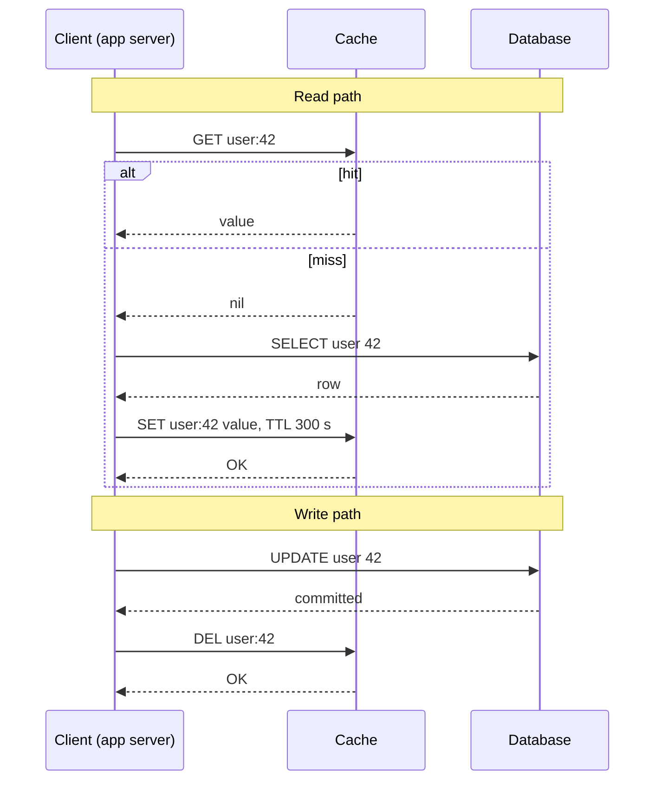
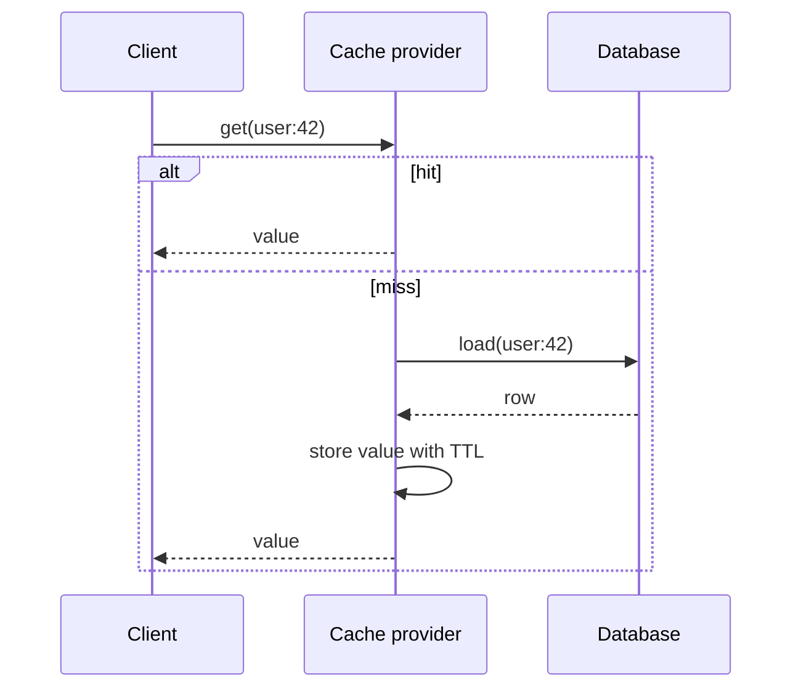
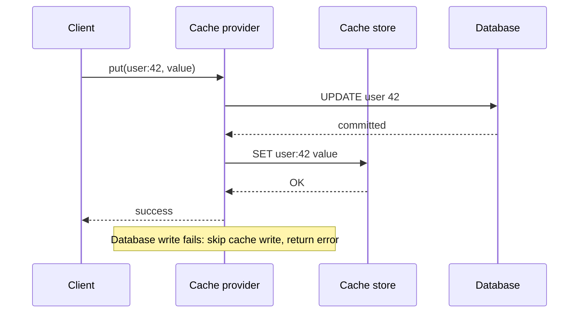
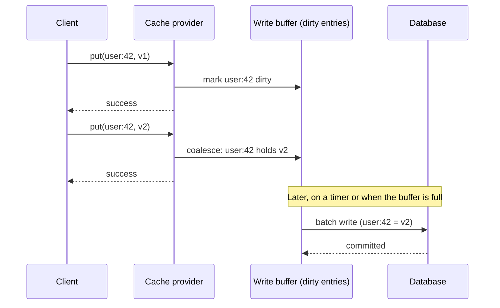
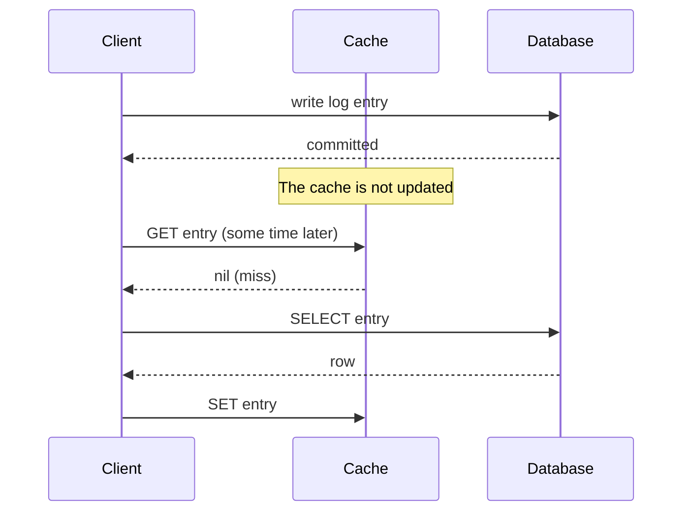
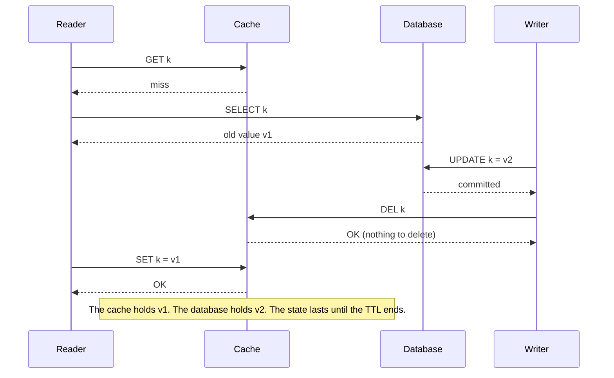

# Caching

A cache is a fast store that keeps copies of data from a slower store, so that repeated reads skip the slow store. This page covers where a cache sits, the five read and write strategies with their failure behavior, eviction, invalidation and its races, the failure modes of a cache (stampede, hot key, penetration), Redis against Memcached, and how to size a cache.

## Why It Matters

Most HLD interview problems with a read-heavy workload include a caching step: "the read load is 100 000 requests per second, so we add a cache". An interviewer then asks which strategy you use, what happens when the cache and the database disagree, and what happens when the cache fails or when a popular key expires. A candidate who names "cache-aside with a TTL" and stops gets a follow-up on each of those. On the job, a cache cuts database load and read latency without a change to the database, and it is also a common source of incidents: stale data, a stampede after a restart, and a database that cannot survive without the cache. This page gives the vocabulary and the failure analysis for those questions.

## Core Concepts

**Cache**: a store that holds a copy of data that lives in a *source of truth* (also called the *system of record*, usually a database). The cache is faster, smaller, or closer to the reader than the source of truth. If the cache and the source of truth disagree, the source of truth is right.

**Hit and miss**: a *hit* is a read that the cache answers. A *miss* is a read that the cache cannot answer, so the reader goes to the source of truth. The **hit ratio** is `hits / (hits + misses)`.

**TTL** (time to live): the time after which a cache entry expires. A TTL bounds how long a stale entry can live. If an invalidation is lost, the TTL is the only mechanism that removes the stale entry.

**Eviction**: the removal of an entry that has not expired, because the cache is full. The *eviction policy* chooses the victim. **Expiry** is the removal of an entry because its TTL ended. The two are different events with different causes.

**Invalidation**: the removal or update of an entry because the source of truth changed.

**Working set**: the set of keys that the workload reads within a time window. A cache that holds the working set reaches a high hit ratio. A cache smaller than the working set evicts keys that the workload needs soon.

**Cold cache**: a cache that holds few or no entries, for example after a restart or a deployment. A cold cache sends nearly all reads to the source of truth.

**Hot key**: one key that gets so many requests that the single cache node that owns it becomes the bottleneck.

**Cache stampede** (also *thundering herd* or *dogpile*): many requests miss the same key at the same time, and all of them recompute the value or read the database.

**Cache penetration**: requests for keys that exist in neither the cache nor the database. Each request misses the cache and reaches the database.

**Negative caching**: storing the fact "this key does not exist" as a cache entry, so that repeated requests for a missing key stop at the cache.

**Look-aside cache**: a cache that the application calls directly, next to the database. The cache does not know about the database. Memcached and Redis, used the usual way, are look-aside caches. A **read-through** or **write-through** cache is the opposite: the application calls only the cache, and the cache calls the database.

### Cache Placement

A request can pass through several caches before it reaches the database. The table lists them from the user to the data. The latency numbers are approximate and depend on the deployment. Within one data center, a network round trip is about 0.5 ms, and a main memory reference is about 100 ns (approximate; the "Numbers Everyone Should Know" slide in Jeff Dean's LADIS 2009 keynote, "Designs, Lessons and Advice from Building Large Distributed Systems"). Colin Scott's [interactive latency page](https://colin-scott.github.io/personal_website/research/interactive_latency.html) shows the same two values and projects other numbers by year.

| Layer | What it caches | Who controls it | Shared between users | Invalidation | Typical use |
|---|---|---|---|---|---|
| Client (browser, mobile app) | HTTP responses, assets, API results | `Cache-Control`, `ETag` headers (see `kb/networking/04-http.md`) | No | TTL, versioned URLs, conditional requests | Static assets, rarely changing API data |
| CDN | HTTP responses at edge locations | Response headers, purge API (see [load balancing, DNS and CDN](02-load-balancing-dns-cdn.md)) | Yes, per edge location | TTL, purge by URL or tag | Images, video, JavaScript, public pages |
| Reverse proxy or API gateway | HTTP responses in front of the servers | Proxy configuration (Nginx `proxy_cache`, Varnish) | Yes | TTL, purge | Public GET endpoints |
| In-process cache (application memory) | Java objects | Application code (Caffeine, Guava) | No, one copy per server instance | TTL, size bound, pub-sub message | Reference data, hot keys, results of pure functions |
| Distributed cache | Serialized values by key | Application code | Yes, all servers read the same entries | Application deletes keys, TTL | Session data, user profiles, query results, counters |
| Database cache | Pages, query plans, sometimes query results | The database | Yes | Database manages it | Hot table and index pages |

The **database buffer pool** keeps recently used disk pages in memory. PostgreSQL calls it `shared_buffers`, and InnoDB calls it the buffer pool. You do not control individual entries. You size it, and it speeds up every query without application code. A query that the buffer pool serves is still slower than a Redis lookup, because the database parses, plans, and executes the query. Query execution lives in `kb/databases/05-query-execution-and-tuning.md`, and storage engines live in `kb/databases/06-storage-engines.md`.

Two rules guide placement. First, put the cache as close to the reader as the freshness requirement allows: a browser cache costs nothing per request but you cannot invalidate it on demand, and a distributed cache costs one network round trip but you can delete a key at any moment. Second, each extra layer adds a place where stale data can hide, so list every layer when you debug a stale read.

## How It Works

### The Reference Setup

All diagrams below use the same four participants: the **client** (an application server), the **cache** (for example Redis or Memcached), the **database**, and in some diagrams a **cache provider** (a library or service that sits in front of the cache and the database). Each strategy section gives the sequence diagram, the consistency behavior, and what happens when each component fails.

### Cache-Aside (Look-Aside, Lazy Loading)

The application owns the logic. On a read, it checks the cache first. On a miss, it reads the database and writes the value into the cache. On a write, it updates the database and then deletes the cache entry.



**Consistency.** The cache is eventually consistent with the database. There is a window between the database commit and the delete in which a reader sees the old value. A second race can leave a stale value in the cache until its TTL ends (see [Invalidation and the Races](#invalidation-and-the-races)).

**Failure behavior.**

| Failure | Result | Mitigation |
|---|---|---|
| Cache is down on read | Every read goes to the database. The database load jumps by `1 / (1 - hit ratio)` times | Time out the cache call in a few milliseconds, fall back to the database, rate-limit or shed load, keep a circuit breaker (see [reliability patterns](12-reliability-patterns.md)) |
| Cache is down on write | The database commit succeeded, but the delete failed. The cache keeps the old value until the TTL ends, or until the cache returns with its old data | Retry the delete from a queue, or delete from a change-data-capture stream. Keep a TTL as a bound |
| Database is down on a miss | The read fails. Cached keys still work | Serve stale data for a short time if the product allows it |
| Application crashes between the database commit and the delete | The cache holds a stale value until the TTL ends | Same as "cache is down on write" |
| Application crashes after a miss, before the `SET` | No harm. The next read reloads the value | None needed |

Recommendation: use cache-aside as the default. It works with any cache, it caches only keys that readers request, and a cache failure does not stop reads or writes (the database is still reachable). Its cost is the code in every call site and a first-read miss for each key.

### Read-Through

The cache provider owns the read logic. The application asks the cache. On a miss, the cache provider calls a loader that the application registered, stores the result, and returns it.



**Consistency.** The same as cache-aside for the read path. A good provider also coalesces concurrent misses for the same key into one load, which cache-aside code must add by hand (see [Cache Stampede](#cache-stampede)).

**Failure behavior.** If the loader fails, the provider returns the error to the client, or returns a stale value if the provider supports that. If the provider is down, the client has no path to the database, because the client does not call the database. A read-through design therefore needs the provider to be highly available, or the client needs a fallback path. Examples: Caffeine `LoadingCache` (in-process), Amazon DynamoDB Accelerator (DAX) in front of DynamoDB, Oracle Coherence and Hazelcast with a map loader. The difference from cache-aside is who writes the miss-handling code. The reader sees no difference.

### Write-Through

The application writes to the cache provider. The provider writes to the cache and to the database in the same call, and it returns to the client only after both writes finish.



**Consistency.** The cache and the database agree after each successful write. Reads after a write see the new value. Two concurrent writes to the same key can still reach the database in one order and the cache in the other order, so the provider must serialize writes per key (a lock or a single writer per key) to keep them equal.

**Failure behavior.**

| Failure | Result |
|---|---|
| Database write fails | The provider returns an error. The cache keeps the old value. Both stores still agree |
| Database write succeeds, cache write fails | The database holds the new value, the cache holds the old one. The provider must retry the cache write, or delete the key, or return an error and let the client retry. This is the dual-write problem |
| Provider crashes between the two writes | Same as the previous row |
| Cache is down | Writes fail, or the provider degrades to database-only writes and then must invalidate the key when the cache returns |

Write-through raises the write latency (one cache write plus one database write, in sequence). It also caches data that nobody may read, which wastes memory. Use it when reads dominate, a read after a write must see the new value, and the write rate is low enough to pay the extra latency.

### Write-Back (Write-Behind)

The application writes to the cache. The cache acknowledges at once. The provider writes the data to the database later, often in batches.



**Consistency.** The database lags behind the cache. A reader that bypasses the cache sees old data. Writes that the provider coalesces (v1 is never written) reduce database load, which is the purpose of the strategy.

**Failure behavior.** This is the strategy with the worst failure behavior.

| Failure | Result |
|---|---|
| Cache node crashes before the flush | The acknowledged writes in the buffer are lost. The client was told "success". Recovery needs a durable buffer (a replicated cache, a write-ahead log, or a queue such as Kafka) |
| Database is down | The buffer grows. If the buffer is full, the provider must reject writes or drop data |
| Database rejects a write later (constraint violation) | The client already has "success". The error has no caller to receive it |
| Two cache nodes hold the same key | A flush can write an older value over a newer one, unless the flush uses versions |

Use write-back when the data tolerates loss of the most recent writes and the write rate is too high for the database. Examples: counters and view counts, metrics, gaming state that is saved every few seconds. The CPU cache and the Linux page cache use the same idea, and they accept the same loss on power failure unless the program calls `fsync`. Do not use write-back for payments, orders, or inventory.

### Write-Around

The application writes to the database only. It does not touch the cache on a write. The cache fills later through cache-aside reads.



**Consistency.** If the key is already in the cache, the cache returns the old value after a write until the TTL ends or someone invalidates it. Write-around is safe only for keys that readers do not cache yet, or when the application also deletes the entry. The write rule of cache-aside is write-around plus a delete.

**Failure behavior.** A cache failure does not affect writes, because writes never touch the cache. The first read after a write is a miss, which costs one database read.

Use write-around for data that the system writes often and reads rarely or not soon after the write: logs, audit records, bulk imports. Writing such data into the cache would push out entries that readers need.

### Comparison of the Five Strategies

| Strategy | Who runs the miss logic | Write goes to | Read after write sees new value | Write latency | Data loss risk | Main failure |
|---|---|---|---|---|---|---|
| Cache-aside | Application | Database, then delete cache key | After the delete, with races | Database | None | Stale entry after a failed delete or a race |
| Read-through | Cache provider | Not specified (pairs with any write strategy) | Same as the paired write strategy | Not specified | None | Provider is a single point of failure for reads |
| Write-through | Cache provider | Cache and database, in sequence | Yes | Cache plus database | None | Dual-write failure between the two stores |
| Write-back | Cache provider | Cache, database later | Yes, from the cache | Cache only | Yes, buffered writes | Crash before flush loses acknowledged writes |
| Write-around | Application | Database only | After a miss, or after the TTL | Database | None | Stale entry if the key was already cached |

### Eviction and TTL

A cache has a fixed memory budget. When it is full, the eviction policy picks the entries to remove.

| Policy | Evicts | Good when | Weak when |
|---|---|---|---|
| FIFO | The oldest inserted entry | Insertion age predicts usefulness | Workloads where popular entries stay popular, because FIFO evicts them by age |
| LRU (least recently used) | The entry unused for the longest time | Recent use predicts next use (most workloads) | A large one-time scan flushes the cache of useful entries |
| LFU (least frequently used) | The entry with the fewest accesses | A stable set of popular keys | A formerly popular key keeps a high count, unless counts decay |
| Random | A random entry | Uniform access, or very low overhead is needed | Skewed access |
| TTL-based | The entry closest to expiry | Short TTLs mark the disposable entries | The TTL says nothing about usefulness |

The LLD page [LRU and LFU cache](../../lld/case-studies/02-lru-and-lfu-cache/README.md) shows how to build the O(1) data structures for LRU (hash map plus doubly linked list) and LFU. This page covers how real products apply the policies.

**Redis** (from the Redis key-eviction documentation and the default `redis.conf`). You set `maxmemory` and `maxmemory-policy`. On a 64-bit system, the default `maxmemory` is 0, which means no limit: Redis does not evict, and its memory grows until the operating system stops it. The default policy is `noeviction`. The policies are `noeviction`, `allkeys-lru`, `allkeys-lfu`, `allkeys-random`, `volatile-lru`, `volatile-lfu`, `volatile-random`, and `volatile-ttl`. Redis 8.6 adds two least-recently-modified (LRM) policies, `allkeys-lrm` and `volatile-lrm`: LRM updates a key's timestamp only on writes, so it evicts keys that nobody has modified recently, even if clients read them often. The `volatile-*` policies consider only keys that have a TTL, and they behave like `noeviction` if no key has one. With `noeviction` and a `maxmemory` limit, a command that adds data returns an error when the limit is reached, while reads still work. Redis LRU and LFU are approximate: Redis samples a small number of keys (`maxmemory-samples`, default 5) and evicts the best candidate among the sample. The documentation says a sample size of 10 comes close to true LRU at some extra CPU cost. LFU (Redis 4.0 and later) uses a probabilistic counter (a Morris counter) with a decay period, so that a key that was popular in the past loses its rank (defaults: `lfu-log-factor` 10 and `lfu-decay-time` 1 minute). The documentation recommends `allkeys-lru` as the default if the workload has a popular subset. Redis also expires keys with a TTL on access and with a background sampling process, so an expired key can occupy memory for a short time before removal.

**Memcached** (from its documentation and source) evicts by LRU per slab class, and items also expire after their TTL. Current versions use a segmented LRU by default: new items enter a HOT queue, items that clients read at least twice move to a WARM queue, and the server evicts from the tail of a COLD queue. A background thread moves items between the queues and frees expired items. A one-time scan therefore passes through HOT and COLD without pushing out the active items in WARM.

**TTL guidance.** Recommendation: set a TTL on every entry, even when you invalidate explicitly. The TTL bounds the damage of a lost invalidation. Pick the TTL from the product's tolerance for stale data: seconds for inventory counts, minutes for a profile, hours or days for reference data. Add random jitter (for example plus or minus 10 percent) to TTLs that you set in bulk. Without jitter, a batch of entries that you load at the same moment expires at the same moment and causes a stampede on the database.

### Invalidation and the Races

Phil Karlton named cache invalidation as one of the two hard things in computer science. The races below show why. The cases assume cache-aside.

**Why delete and not update.** On a write, the application can update the cache entry (set the new value) or delete it. If two writers update the database in order A, B and update the cache in order B, A, the cache keeps A's value while the database holds B's value, and the entry stays wrong until the TTL ends. A delete is order-independent: the entry is gone whichever order the two deletes arrive. A delete is also idempotent, so a writer can retry it safely. The Facebook memcache paper (Nishtala et al., NSDI 2013) describes memcache as a "demand-filled look-aside cache": a web server writes to the database and then sends a delete, and the paper gives idempotence as the reason to delete instead of update.

**Race 1: delete before write.** The writer deletes the cache key first and then updates the database. A reader runs between the two steps, misses, reads the old row from the database, and stores the old value in the cache. The write then commits. The cache now holds the old value until the TTL ends. Fix: update the database first, then delete.

**Race 2: delete after write, the stale-read window.** The writer commits to the database and then deletes the key. Between the commit and the delete, readers hit the cache and get the old value. This window lasts the time of one network call, a few milliseconds if nothing fails. It cannot be zero in a design without distributed transactions. If the delete fails, the window lasts until the TTL ends.

**Race 3: the set-after-delete race.** This is the harder one, and it occurs even with the delete-after-write order.



The reader's database read happened before the write, and the reader's `SET` happened after the writer's `DEL`. The race needs the reader to stall between its read and its `SET` for longer than a write and a delete take. The probability is low, and it is not zero at scale. Three fixes:

1. **Lease (Facebook).** On a miss, the cache returns a *lease token* (a 64-bit token bound to the key) to the reader. The reader must present the token with its `SET`. If a `DEL` arrives for the key while the lease is open, the cache invalidates the token, and it rejects the reader's `SET`. In the diagram, the writer's `DEL` invalidates the reader's lease and the reader's `SET k = v1` fails. The paper compares this to load-link/store-conditional. The paper also limits how often the cache issues a token per key (by default once every 10 seconds per key in Facebook's configuration), which reduces stampedes (see [Cache Stampede](#cache-stampede)). Leases are Facebook's change to memcached. The classic Memcached `get` and `set` commands have no leases. The Memcached meta protocol gives a similar result: on a miss, one client receives a "win" flag and the right to recache the item, and a meta delete with the `I` flag marks the item stale instead of removing it (Memcached meta protocol documentation).
2. **Delayed double delete.** The writer deletes the key, waits for a period longer than the slowest read-then-set sequence (for example 500 ms to 1 s), and deletes again. The second delete removes a stale value that a slow reader stored. This is a heuristic. The wait is a guess, and a reader that stalls longer than the wait defeats it.
3. **Versioned values.** Each row carries a version number. The `SET` is conditional: it succeeds only if the cache has no entry, or holds a lower version. Redis needs a Lua script or a transaction for this, because the version check and the write must be one atomic step.

**Invalidation by change data capture (CDC).** Instead of each application writer deleting keys, a process reads the database's commit log and issues the deletes. Facebook does this with the `mcsqueal` daemon (Nishtala et al., section 4.1). Each SQL statement that changes data also carries the memcache keys to invalidate after the transaction commits. An `mcsqueal` daemon runs on every database. It reads the statements that its database commits, extracts the deletes, batches them, and sends them to `mcrouter` instances in each frontend cluster, which route each delete to the right memcached server. Because the deletes live in the database's reliable log, `mcsqueal` can replay invalidations that were lost or misrouted. This removes the "crash between commit and delete" gap. As an optimization, the web server that made the write also deletes the key in its own cluster, so that the same user reads their own write without waiting for the pipeline. Tools such as Debezium provide a general CDC pipeline that you can use the same way.

**TTL as the final bound.** No invalidation scheme in this section is exact. Choose the TTL that you can tolerate as the maximum staleness, and state that number in the design.

### Cache Stampede

A stampede happens when a popular key expires (or a cold cache starts), many concurrent requests miss, and every one of them recomputes the value. The database sees a spike of identical queries at the moment when the cache protects it least.

Example with approximate numbers: a key gets 5 000 requests per second, and the query behind it takes 200 ms. When the key expires, all requests that arrive in the next 200 ms miss: about 1 000 identical queries at once.

Four fixes. Use them together when the key is critical.

1. **Locking (mutex per key).** The first request that misses takes a lock for the key (for example Redis `SET lock:k token NX PX 5000`). It recomputes the value and stores it. The other requests wait for a short time and read the cache again, or serve a stale copy. The lock needs a timeout, so that a crashed holder does not block the key forever. Lock leases and their pitfalls: `kb/hld/distributed-systems/05-distributed-locks-and-leases.md`.
2. **Request coalescing (single-flight).** Within one application instance, concurrent misses for the same key share one in-flight load. The first request starts the load, and the others wait on the same future. The Java example below does this. It reduces the database load from "requests per instance" to "one per instance". Across 50 instances, 50 loads still run, so combine it with a distributed lock or with a lease when the load is expensive.
3. **Stale-while-revalidate.** Keep two TTLs: a soft TTL and a hard TTL. After the soft TTL, the cache serves the old value and one request refreshes it in the background. Readers do not wait unless the hard TTL also ends before the refresh finishes. The HTTP `stale-while-revalidate` directive (RFC 5861) uses the same idea.
4. **Probabilistic early expiration (XFetch).** Each reader decides on its own, with a random draw, whether to refresh the entry before it expires. Vattani, Chierichetti and Lowenstein ("Optimal Probabilistic Cache Stampede Prevention", VLDB 2015) give the rule: refresh when

    `now - delta * beta * ln(rand()) >= expiry`

    where `delta` is the time that the recomputation takes, `rand()` is uniform in (0, 1], `expiry` is the entry's expiry time, and `beta` is a tuning factor (the paper's default is 1; larger values refresh earlier and reduce stampedes further). Because `-ln(rand())` is positive, the left side is `now` plus a random positive number. The probability that a reader refreshes at time `now` is `exp(-(expiry - now) / (delta * beta))`. Far from the expiry, the probability is near zero. Close to the expiry, it approaches one. A reader refreshes before the entry expires, and no coordination or lock is needed. Readers that arrive while that refresh runs (during `delta`) can also decide to refresh, so a few recomputations can overlap, but the paper shows that the expected number stays a small constant that does not depend on the request rate. A higher request rate makes the first refresh happen earlier, and the paper shows that this effect grows only with the logarithm of the rate. The entry must store `delta` and `expiry` with the value. The paper's optimality theorem: among refresh rules that do not know the request rate, the exponential rule gives the best trade-off between how early the refresh happens and how many readers recompute at once. The second Java example simulates the rule.

Also prevent the cold-cache variant: **warm the cache** before a release sends traffic to it, and **jitter TTLs** so that bulk-loaded keys do not expire together.

### Hot Keys

A hot key is one key with so much traffic that the node that owns it saturates, while other nodes sit idle. Adding nodes does not help, because the hash of the key sends all requests to the same node. Examples: a celebrity's profile, a viral product, a feature flag that every request reads.

Detection: sample per-key request counts (`redis-cli --hotkeys` works only when `maxmemory-policy` is an LFU policy; `MONITOR` streams every command and slows the server), or count in the client library.

| Fix | How it works | Cost |
|---|---|---|
| In-process cache for the key (local caching) | Each application instance holds a copy for a short TTL (1 to 5 seconds). Requests for the key never leave the instance | Staleness up to the local TTL. Memory per instance. Invalidation reaches only the shared cache, so the local TTL must be short |
| Key replication | Store the value under `k#0`, `k#1`, ..., `k#N-1` on different nodes. A reader picks a random suffix. A writer updates or deletes all copies | N writes per update. The reader and writer must agree on N |
| Replicate a small key set to whole servers | Facebook replicates a category of keys to several servers within a pool when clients fetch many of those keys in one request, the whole set fits on one or two servers, and the request rate exceeds what one server handles. Each client picks a replica by its own IP address (Nishtala et al., section 3.2.3) | Memory for the copies. Every invalidation goes to every replica |
| Client-side caching by the cache server | Redis 6 and later can track which keys a client read and send that client an invalidation message when a key changes, so clients keep local copies with server-driven invalidation (Redis client-side caching, `CLIENT TRACKING`). Invalidations arrive as RESP3 push messages, or over a second, redirected connection with RESP2. If a client loses the invalidation connection, it must flush its local cache | Server memory for the tracking table, which has a size limit: when the table is full, Redis invalidates old entries to free space. Broadcasting mode (`BCAST` with key prefixes) uses no server memory but sends more messages |
| Split the value | If the hot key holds a large object, split it so that no node serves the full object on every request | Reads need several lookups |

Recommendation: try local caching first. It needs no coordination, and every request that an instance answers from its own memory is a request that the hot node does not serve. State the staleness bound that you accept.

### Cache Penetration

Penetration means that requests ask for keys that do not exist. Cache-aside cannot cache a missing row by default (there is no value to store), so each request reaches the database. Attackers use this with random IDs, and bugs use it with deleted or invalid IDs.

Fixes:

1. **Negative caching.** Store a marker value ("not found") with a short TTL (30 to 60 seconds). A later request for the same key stops at the cache. Keep the TTL short, because the row may be created soon after. The cost is memory per distinct missing key, and a scan with random IDs still fills the cache with markers.
2. **Bloom filter in front of the database.** A Bloom filter is a compact set that answers "definitely not present" or "possibly present". Load it with all valid keys. A request for a key that the filter rejects returns "not found" without any cache or database call. The filter has false positives, so a few invalid keys still reach the database, and it has no false negatives for the keys that you loaded. The filter needs updates when new rows appear, and standard Bloom filters do not support deletes (a Cuckoo filter does). Details: `kb/hld/distributed-systems/04-probabilistic-data-structures.md`. Redis Open Source provides a Bloom filter data type (`BF.RESERVE`, `BF.ADD`, `BF.EXISTS`), and you can also run the filter inside the application.
3. **Validate input.** Reject IDs that cannot be valid (wrong format, out of range) before any lookup.
4. **Rate-limit per client.** See [rate limiting algorithms](13-rate-limiting-algorithms.md).

### Failure Modes Summary

| Problem | Trigger | Symptom | First fix |
|---|---|---|---|
| Stampede | Hot key expires, or cold cache | Spike of identical queries | Single-flight, lock, XFetch, jittered TTL |
| Penetration | Requests for absent keys | High miss ratio, database load | Negative cache, Bloom filter |
| Hot key | Skewed popularity | One cache node saturated | Local cache, key replication |
| Cache avalanche | Many keys expire together, or the cache cluster fails | Database overload | Jittered TTL, replicas, load shedding, warm cache |
| Stale data | Lost or racing invalidation | Readers see old values | TTL bound, lease, CDC invalidation |
| Cache outage | Node or cluster failure | Latency rises, database overload | Replicas, circuit breaker, fall-back with load shedding |

**The database must survive the cache's worst day.** If a 95 percent hit ratio lets the database serve 5 percent of the load, a cache outage multiplies the database load by 20. If the database cannot take that, the cache is a hard dependency, and the design needs a replicated cache, a gutter pool (below), or load shedding.

**Gutter pool (Facebook).** A small, separate pool of cache servers (approximately 1 percent of the memcached servers in a cluster, per the paper). When a client gets no response from a regular server, it sends the request to the gutter pool. If the gutter pool also misses, the client reads the database and stores the value in the gutter pool. Gutter entries have a short TTL, so that no one needs to invalidate them, and readers accept slightly stale data in exchange. The paper prefers this to rehashing the failed server's keys onto the remaining servers, because one key can account for 20 percent of a server's requests, and the server that inherits a hot key can fail in turn (Nishtala et al., section 3.3).

### Redis and Memcached

Facts below come from the Redis and Memcached documentation. Check the version that you deploy.

| Aspect | Redis | Memcached |
|---|---|---|
| Data model | Strings, hashes, lists, sets, sorted sets, streams, bitmaps, HyperLogLog, geospatial indexes, and more | Items with a key, expiry, flags, and an opaque value. The server does not interpret the value. The client serializes data |
| Operations on values | Server-side operations per type (`ZADD`, `HINCRBY`, `LPUSH`, `SETNX`), Lua scripts, transactions | `get`, `set`, `add`, `replace`, `append`, `incr`, `decr`, `cas`, `touch`, and the meta commands (`mg`, `ms`, `md`) with flags for stale items and recache control |
| Persistence | RDB snapshots and the append-only file (AOF). A restart can reload the data | An in-memory cache. Warm restart (1.5.18 and later, `-e` memory file) keeps the cache across a clean restart only. Extstore (1.6.0 and later) keeps values on flash and keys in memory. Treat the data as disposable |
| Threading | Executes commands on one main thread. Redis 6.0 and later can use extra threads for socket reads, writes, and protocol parsing (`io-threads`, disabled by default), and command execution stays on one thread | Multi-threaded. Each worker thread runs its own event loop. The number of worker threads is set by `-t` (the default is 4, from the `memcached` man page) |
| Replication and clustering | Primary-replica replication, Sentinel for failover, Redis Cluster with 16 384 hash slots | The server has no replication between servers. Clients choose the node with consistent hashing. Memcached 1.6.23 and later include an optional built-in proxy (a compile-time option) that routes keys to pools and can send a write to several pools |
| Eviction | Ten policies in Redis 8.6 (see above), approximate LRU, LFU, and LRM | Segmented LRU (HOT, WARM, COLD) per slab class |
| Memory management | The allocator manages memory per object (jemalloc by default on Linux). Per-key overhead exists | Slab allocator that groups items in size classes. Items waste the gap up to the slab chunk size |
| Maximum value size | 512 MB for a string | 1 MB by default (`-I` raises it, up to 1 GB) |
| Typical use | Cache plus data structures: sessions, rate limiters, leaderboards, queues, locks | Simple, large, key-value cache |

Recommendation: choose Redis when you need data structures, persistence, replication, or atomic scripts. Choose Memcached when you need only a simple, multi-threaded key-value cache that uses all cores of one machine and that you can lose without consequence. If the system already runs Redis for data structures, using it for the plain cache too means one fewer system to operate. Redis data types and operations: `kb/databases/08-redis.md`.

### Sizing a Cache

Sizing answers two questions: how much memory, and what hit ratio results.

**Step 1: Estimate the working set.** Count the distinct keys that the workload reads in the window that matters (often a day), and multiply by the average entry size plus overhead.

Example with assumptions: a service has 50 million users. In one day, 10 million distinct users read their profiles. Each profile is 2 KB serialized. Per-key overhead in the cache is 100 bytes (Assumption: measure the real number with `MEMORY USAGE` in Redis or from the Memcached slab statistics).

- Memory for the working set: `10 000 000 x (2 048 + 100) bytes = 21.5 GB`.
- Add 20 to 30 percent headroom for fragmentation, replication buffers, and growth (Assumption). That gives about 26 to 28 GB, which spreads over 4 nodes with 8 GB each (counting only the data), or over 2 nodes with 16 GB, plus a replica per node for availability.

**Step 2: Relate the hit ratio to latency and database load.**

The average read latency with cache-aside is `L = t_cache + (1 - h) x t_db`, where `h` is the hit ratio, `t_cache` is the cache lookup time, and `t_db` is the database read time (the cost of the `SET` after a miss is left out). With `t_cache = 0.5 ms` and `t_db = 10 ms` (both Assumptions):

| Hit ratio h | Average latency | Database reads at 100 000 requests per second |
|---|---|---|
| 0.80 | 0.5 + 0.2 x 10 = 2.5 ms | 20 000 per second |
| 0.95 | 0.5 + 0.05 x 10 = 1.0 ms | 5 000 per second |
| 0.99 | 0.5 + 0.01 x 10 = 0.6 ms | 1 000 per second |
| 0.999 | 0.5 + 0.001 x 10 = 0.51 ms | 100 per second |

Moving from 95 percent to 99 percent cuts the database load by a factor of 5, and the average latency by 40 percent. The gain per extra memory shrinks as `h` rises, because the long tail of rarely read keys needs a lot of memory for each point of hit ratio. Averages hide the tail: the p99 latency stays close to `t_db` as long as more than 1 percent of the requests miss (see [scalability and availability](01-scalability-and-availability.md)).

**Step 3: Check the throughput.** Measure the per-node throughput with `redis-benchmark` (or `memtier_benchmark`) on your hardware, with your value sizes and your pipelining. The result depends on all three, so do not use a number from someone else's hardware. Divide the peak request rate by the measured per-node throughput, and add nodes for headroom. In an interview, state the per-node number as an assumption.

**Step 4: Measure and adjust.** Track the hit ratio (Redis `INFO stats`: `keyspace_hits / (keyspace_hits + keyspace_misses)`), the eviction rate (`evicted_keys`), and the memory use. If the hit ratio is low and `evicted_keys` is high, the cache is smaller than the working set or the eviction policy is wrong. If the hit ratio is low and evictions are low, the TTL is too short or the keys are too varied to reuse (for example, keys that include a timestamp). Observability details: [observability in design](20-observability-in-design.md).

**Key design affects the hit ratio.** A key must contain every input that changes the value (tenant, language, version) and no input that does not (request ID, timestamp). Put a format version in the key, such as `user:42:v7`. A deployment that changes the serialized format then reads only new keys and never parses old entries, and the old keys leave by TTL or eviction.

## Trade-offs and When to Use

| Decision | Option A | Option B | Choose A when | Choose B when |
|---|---|---|---|---|
| Write strategy | Cache-aside (delete on write) | Write-through | The code is simple, the cache can fail without blocking writes, and the system tolerates a short stale window | Reads must see the latest write and the cache provider can write both stores |
| Write strategy | Write-through | Write-back | Data loss is not acceptable | Write rate exceeds database capacity and the loss of recent writes is acceptable |
| Update or delete on write | Delete | Update (set) | For cache-aside in most cases: it avoids the ordering race of two updates | The value is expensive to recompute and a miss after every write is too costly. Use versions or leases |
| Cache location | In-process | Distributed | The data is small, read-heavy, and a few seconds of staleness is acceptable | Many instances must see one copy, or the data is larger than one instance's memory |
| Consistency | Short TTL only | Explicit invalidation plus TTL | The data changes rarely and the staleness bound equals the TTL | Staleness must be shorter than any TTL that gives a useful hit ratio |
| Eviction | LRU | LFU | Access is recency-driven and scans are rare | A stable set of popular keys exists and one-time scans occur |
| Product | Redis | Memcached | You need data types, persistence, or replication | You need a plain, multi-threaded cache and no extra features |
| Stampede control | Single-flight in process | Distributed lock or XFetch | A few application instances share the key | Many instances share the key and the load is expensive |

When not to use a cache:

- The data changes on nearly every read, so the hit ratio stays low and invalidation costs more than it saves.
- The database is fast enough. A cache adds a second system to run, a second failure mode, and an invalidation problem.
- The read must be strongly consistent with the latest write (a bank balance for a payment decision). Read from the leader database.
- You cannot tolerate the database load that the cache hides when it fails.

## Java Example

The first program is a cache-aside cache with three protections: single-flight loading (concurrent misses share one load), negative caching (a missing key is stored for a short TTL), and TTL expiry. It uses a controllable clock, so the output does not depend on real time. The program joins all threads before it prints.

```java
import java.util.concurrent.*;
import java.util.concurrent.atomic.*;
import java.util.function.Function;
import java.util.function.LongSupplier;

public class Main {
    public static void main(String[] args) throws Exception {
        AtomicLong clockMillis = new AtomicLong(0);
        AtomicInteger dbCalls = new AtomicInteger();
        // The "database": slow, and it has no row for user:404.
        Function<String, String> database = key -> {
            dbCalls.incrementAndGet();
            try {
                Thread.sleep(100);
            } catch (InterruptedException e) {
                Thread.currentThread().interrupt();
            }
            return key.equals("user:404") ? null : "profile-of-" + key;
        };
        SingleFlightCache<String, String> cache =
                new SingleFlightCache<>(database, 60_000, 5_000, clockMillis::get);

        // 1. Fifty threads miss the same key at the same time.
        int threads = 50;
        CountDownLatch start = new CountDownLatch(1);
        ExecutorService pool = Executors.newFixedThreadPool(threads);
        Future<?>[] futures = new Future<?>[threads];
        for (int i = 0; i < threads; i++) {
            futures[i] = pool.submit(() -> {
                start.await();
                return cache.get("user:42");
            });
        }
        start.countDown();
        for (Future<?> f : futures) {
            f.get();
        }
        pool.shutdown();
        System.out.println("50 concurrent misses, database calls: " + dbCalls.get());

        // 2. A missing key: the first read loads, the next reads hit the negative entry.
        cache.get("user:404");
        cache.get("user:404");
        cache.get("user:404");
        System.out.println("3 reads of a missing key, database calls: " + dbCalls.get());

        // 3. Time passes. The negative entry (5 s) expires. The profile (60 s) does not.
        clockMillis.addAndGet(6_000);
        cache.get("user:404");
        cache.get("user:42");
        System.out.println("after 6 s, database calls: " + dbCalls.get());

        // 4. After 60 s the profile expires too.
        clockMillis.addAndGet(60_000);
        cache.get("user:42");
        System.out.println("after 66 s, database calls: " + dbCalls.get());
    }
}

class SingleFlightCache<K, V> {
    private record Entry<V>(V value, long expiresAtMillis) {}

    private final ConcurrentHashMap<K, Entry<V>> store = new ConcurrentHashMap<>();
    private final ConcurrentHashMap<K, CompletableFuture<V>> inFlight = new ConcurrentHashMap<>();
    private final Function<K, V> loader;
    private final long ttlMillis;
    private final long negativeTtlMillis;
    private final LongSupplier clock;

    SingleFlightCache(Function<K, V> loader, long ttlMillis, long negativeTtlMillis,
                      LongSupplier clock) {
        this.loader = loader;
        this.ttlMillis = ttlMillis;
        this.negativeTtlMillis = negativeTtlMillis;
        this.clock = clock;
    }

    V get(K key) {
        Entry<V> cached = store.get(key);
        if (cached != null && isFresh(cached)) {
            return cached.value();              // hit (a negative entry returns null)
        }
        CompletableFuture<V> mine = new CompletableFuture<>();
        CompletableFuture<V> running = inFlight.putIfAbsent(key, mine);
        if (running != null) {
            return running.join();              // another thread loads this key: wait for it
        }
        try {
            Entry<V> again = store.get(key);    // re-check: the previous load may have finished
            if (again != null && isFresh(again)) {
                mine.complete(again.value());
                return again.value();
            }
            V loaded = loader.apply(key);       // the one and only load for this key
            long ttl = loaded == null ? negativeTtlMillis : ttlMillis;
            store.put(key, new Entry<>(loaded, clock.getAsLong() + ttl));
            mine.complete(loaded);
            return loaded;
        } catch (RuntimeException | Error e) {
            mine.completeExceptionally(e);      // waiting threads get the failure, not a hang
            throw e;
        } finally {
            inFlight.remove(key, mine);         // remove only this thread's own flight
        }
    }

    private boolean isFresh(Entry<V> entry) {
        return entry.expiresAtMillis() > clock.getAsLong();
    }
}
```

The program prints the lines below. The numbers are the same in each run, whatever the thread schedule: a thread either finds a fresh entry, joins the running flight, or starts a flight and re-checks the store before it loads. Only the first flight finds the store empty, so the 50 threads cause exactly one load. A thread that waits on a failed flight receives the loader's exception (wrapped in a `CompletionException`), so no thread waits forever.

<!-- expected-output -->

```text
50 concurrent misses, database calls: 1
3 reads of a missing key, database calls: 2
after 6 s, database calls: 3
after 66 s, database calls: 4
```

The second program simulates probabilistic early expiration (XFetch). A key expires at second 60 and a recomputation takes `delta` = 2 seconds. One request arrives every 10 ms. The program prints the time at which the first request refreshes the key, for plain expiry (`beta` = 0) and for XFetch with `beta` = 1. A fixed seed makes the result repeatable. At 100 requests per second, the first request that draws a small `rand()` refreshes the key early. With a lower request rate, the first refresh comes closer to the expiry.

```java
import java.util.Random;

public class Main {
    public static void main(String[] args) {
        double expiry = 60.0;   // seconds
        double delta = 2.0;     // seconds to recompute the value
        for (double beta : new double[] {0.0, 1.0}) {
            Random random = new Random(7);
            double firstRefresh = -1;
            for (int i = 0; i * 0.01 <= expiry; i++) {
                double now = i * 0.01;
                // random.nextDouble() is in [0, 1). Use 1 - x to stay in (0, 1].
                double draw = 1.0 - random.nextDouble();
                if (now - delta * beta * Math.log(draw) >= expiry) {
                    firstRefresh = now;
                    break;
                }
            }
            System.out.printf("beta=%.1f first refresh at %.2f s (expiry at %.0f s)%n",
                    beta, firstRefresh, expiry);
        }
        double[] gaps = {10.0, 4.0, 1.0, 0.1};
        for (double gap : gaps) {
            double probability = Math.exp(-gap / (delta * 1.0));
            System.out.printf("%.1f s before expiry, refresh probability per request: %.4f%n",
                    gap, probability);
        }
    }
}
```

<!-- expected-output -->

```text
beta=0.0 first refresh at 60.00 s (expiry at 60 s)
beta=1.0 first refresh at 47.28 s (expiry at 60 s)
10.0 s before expiry, refresh probability per request: 0.0067
4.0 s before expiry, refresh probability per request: 0.1353
1.0 s before expiry, refresh probability per request: 0.6065
0.1 s before expiry, refresh probability per request: 0.9512
```

## Interview Angle

### Questions

??? question "Which caching strategy do you use for a read-heavy service, and what happens when the cache is down?"

    Cache-aside with a TTL. The application reads the cache first. On a miss, it reads the database and writes the value into the cache with a TTL. On a write, it updates the database first and then deletes the cache key.

    Why this one: it works with any cache, only requested keys occupy memory, and a cache failure does not stop the service, because the application can still reach the database.

    When the cache is down, every read goes to the database. If the hit ratio was 95 percent, the database load rises by a factor of 20. So I protect the database in four ways: a short cache timeout (a few milliseconds) so that threads do not pile up, a circuit breaker that stops calls to a failed cache, load shedding or rate limiting at the service edge, and a sharded cache cluster with a replica per shard: sharding limits a node failure to that node's share of the keys, and the replica takes over that share with its data still in memory. I also size the database for the cache-down case or accept degraded service in that case, and I say that in the design.

??? question "Compare write-through, write-back, and write-around. When would you pick each?"

    Write-through writes to the cache and the database in one call and returns after both finish. It keeps them equal and gives read-your-writes, but the write latency is the sum of both writes, and the two writes can fail separately (the dual-write problem). Pick it when reads dominate and the data must be fresh after a write.

    Write-back writes to the cache, acknowledges, and flushes to the database later in batches. It gives the lowest write latency and reduces database writes by coalescing, but a cache crash loses the acknowledged writes that were not flushed, and a late database error has no caller. Pick it for counters, metrics, and state that can lose a few seconds, with a durable buffer if the loss matters.

    Write-around writes to the database only and lets reads fill the cache. It protects the cache from data that nobody reads soon, such as logs and bulk imports. It is stale-prone if the key is already cached, so a delete is needed. Pick it for write-heavy, read-rarely data.

    I would not use write-back for payments or inventory.

??? question "Why does cache-aside delete the key on a write instead of updating it? Which race remains?"

    Updating the cache on a write has an ordering race. Writers A and B update the database in order A, B, but their cache updates can arrive in order B, A. The cache then holds A's value while the database holds B's value, until the TTL ends. A delete does not have this problem: two deletes in any order leave the key absent, and the next reader loads the current row. Deletes are also idempotent, so retrying them is safe. Facebook's memcache paper names idempotence as its reason to delete instead of update.

    The race that remains: a reader misses, reads the old row, then the writer commits and deletes the key, and then the reader stores the old value. The cache holds the stale value until the TTL ends. It needs a slow reader, so it is rare, but at scale it occurs. The fixes are leases (the cache rejects the reader's set because the delete invalidated its token), a delayed second delete (a heuristic), versioned writes, or a TTL that I accept as the staleness bound. I would also say that "update the database first, then delete" is required: deleting first lets a reader refill the cache with the old row before the write commits.

??? question "Explain a cache stampede and three ways to prevent it."

    A stampede occurs when a popular key expires, many concurrent requests miss, and each one runs the expensive query. If a key gets 5 000 requests per second and the query takes 200 ms, about 1 000 identical queries start at once.

    Fixes: (1) Single-flight or a per-key lock. The first miss loads the value. The other requests wait for it, or serve the stale value. A distributed lock needs a timeout so that a crashed holder does not block the key. (2) Stale-while-revalidate. Keep a soft and a hard TTL, serve the old value after the soft TTL, and refresh in the background. (3) Probabilistic early expiration (XFetch, Vattani et al., VLDB 2015). Each reader refreshes before the expiry with probability `exp(-(expiry - now) / (delta * beta))`, so a refresh usually happens before the entry expires, needs no lock, and the expected number of concurrent recomputations stays a small constant whatever the request rate. (4) Jittered TTLs, so that a batch of keys does not expire together, and cache warming before a release.

    Trade-off: locks add waiting and a failure mode, stale-while-revalidate serves old data, and XFetch needs the recompute time stored with the entry.

??? question "What is a hot key, and how do you handle one?"

    A hot key is one key with so much traffic that the node that owns it saturates while other nodes are idle. Adding nodes does not help, because the hash of the key chooses one node.

    I detect it with per-key counters or sampling. Then: (1) add an in-process cache with a short TTL (1 to 5 seconds) in each application instance, which removes most of the traffic with no coordination, and I state the staleness bound; (2) replicate the key under several names (`k#0` to `k#N-1`) on different nodes, read a random copy, and update or delete all copies on a write; (3) for Redis, use server-assisted client-side caching (`CLIENT TRACKING`), where the server sends invalidations to clients that read the key, so local copies stay fresh without a short TTL. The cost of replication is N writes per update, and the cost of local caching is staleness. If the key is a counter, shard the counter and add the parts on read.

??? question "How do you defend the database against requests for keys that do not exist?"

    This is cache penetration. Each request for a nonexistent key misses the cache and queries the database, and an attacker can send random IDs.

    Defenses, from the cheapest: validate the input (format and range) before any lookup; negative caching, where I store a "not found" marker with a short TTL (30 to 60 seconds) so that repeated requests stop at the cache; a Bloom filter that holds all valid keys, so a key that the filter rejects returns "not found" without any lookup (it has no false negatives for loaded keys, and a few false positives still reach the database); and per-client rate limiting. Negative caching costs memory for each distinct missing key and delays the visibility of a row that is created right after a miss, so the TTL stays short. A Bloom filter needs updates when rows are added, and a standard one cannot delete (a Cuckoo filter can).

??? question "What is a lease in the Facebook memcache paper, and which two problems does it solve?"

    A lease is a 64-bit token, bound to one key, that the cache gives to a client on a miss. The client must present the token when it sets the value. If the cache receives a delete for the key while the lease is open, the cache invalidates the token and rejects the client's set.

    Problem 1, stale sets: a client that read an old value from the database and was slow would otherwise overwrite the effect of a later invalidation. The invalidated lease blocks that set. Problem 2, thundering herds: the cache issues a token for a key at most once every 10 seconds (Facebook's default configuration), and the other clients that miss in that period get a notice to wait a short time and retry. The lease holder usually sets the value within a few milliseconds, so the retries hit. In the paper's one-week measurement on keys prone to herds, leases cut the peak database query rate from 17K/s to 1.3K/s. The paper also keeps recently deleted values for a short time, so a client that can accept slightly stale data gets it at once instead of waiting.

    Leases are Facebook's change to memcached, not a feature of the classic `get`/`set` commands. If asked how to get this with open-source Memcached, the meta protocol has the same building blocks: a miss can hand one client a "win" flag to recache, and a meta delete can mark an item stale instead of removing it. With Redis, the two halves need two mechanisms. The stale set needs a conditional set: a Lua script that writes only if the cached version is lower, or a lease key that the reader creates on a miss, the writer deletes, and the reader's script checks before its `SET`. The herd needs a per-key lock (`SET lock:k token NX PX ...`) or single-flight. A lock alone does not stop a stale set, because the writer's delete can still land between the reader's database read and its `SET`.

??? question "Redis or Memcached for a cache? What are the differences that matter?"

    Both are in-memory key-value stores, and inside one data center the network round trip (about 0.5 ms) dominates the read time of either. Memcached stores opaque values with simple commands, runs multi-threaded (default 4 worker threads), has no replication between servers (clients shard with consistent hashing), and treats data as disposable (warm restart survives only a clean restart). Redis has rich types (hashes, lists, sets, sorted sets, streams), server-side atomic operations and Lua scripts, persistence (RDB and AOF), replication, Sentinel failover, and Redis Cluster. It runs commands on one main thread, with optional I/O threads since Redis 6.0 (off by default), so one node uses one core for command execution. To use more cores with Redis, run more shards.

    I choose Redis if I need data structures (a leaderboard, a rate limiter, a lock), replication, or persistence. I choose Memcached for a plain, large, simple cache where one machine's cores should serve reads and the data can disappear. Memory behavior also differs: Memcached uses slab classes and wastes the gap in each class, and Redis keeps per-key metadata. For Redis, I set `maxmemory` and an eviction policy (`allkeys-lru` as the default for a pure cache), because by default a 64-bit Redis has no memory limit and the policy is `noeviction`: memory grows until the operating system intervenes, and with a limit but no eviction policy, writes fail when memory is full. Memcached always has a memory limit and evicts by LRU, but the default limit (`-m`) is only 64 MB, so I set `-m` to the planned cache size.

??? question "How do you size a cache and estimate its effect?"

    First I estimate the working set: the distinct keys that the workload reads in the window that matters, times the entry size plus per-key overhead, plus 20 to 30 percent headroom. For example, 10 million distinct profiles per day at 2 KB plus 100 bytes of overhead is about 21.5 GB, so about 26 to 28 GB with headroom, which fits on a few nodes plus replicas.

    Then I relate the hit ratio to latency and database load. The average latency is `t_cache + (1 - h) x t_db`. With 0.5 ms and 10 ms, `h` = 0.95 gives 1.0 ms and `h` = 0.99 gives 0.6 ms. At 100 000 reads per second, the database load drops from 5 000 to 1 000 reads per second. Each extra point of hit ratio needs more memory, because the tail of keys is long, so I find the size where more memory stops raising the hit ratio by a useful amount. I find it with measurements over a typical week: the hit ratio, `evicted_keys`, and memory. I also check that the measured per-node throughput covers the peak with headroom, and that the database survives a cold cache.

??? question "A user updates their profile and then sees the old one on refresh. What could cause it, and how do you fix it?"

    Candidates, in the order that I check: (1) the write path did not delete the key, or the delete failed and nobody retried it, and the entry lives until its TTL ends; (2) the set-after-delete race left an old value in the cache; (3) the read came from a lagging database replica after a cache miss, which stores the old row in the cache (see [replication](05-replication.md)); (4) a layer in front of the cache holds a copy, such as an in-process cache, a CDN, or the browser; (5) a failover brought up a cache replica with older data.

    Fixes: delete from a durable path (retry queue or CDC), and also delete synchronously in the request that made the write so the same user reads their own write (Facebook does both); use leases or versions to close the race; route the read after a write to the leader for a short time, or read the cache-miss path from the leader; send `Cache-Control: no-cache` or versioned URLs for HTTP layers; and set a TTL that matches the staleness the product accepts. I would also add the version to the cache entry, so that I can log "entry version is lower than the row version" and measure how often it happens.

??? question "Your cache cluster restarts during peak traffic and the database falls over. How do you prevent and recover from it?"

    The restart creates a cold cache, so nearly all requests miss and hit the database at once, which is a stampede on every key. Prevention: restart nodes one at a time, never the whole cluster; shard the cache so that one node's loss affects only its share of the keys, and keep a replica per shard that takes over with a warm copy; use consistent hashing so that a failed node moves only its own keys (see [partitioning and sharding](06-partitioning-and-sharding.md)); use a gutter pool for failed nodes; use single-flight and per-key locks to limit identical loads; shed load or rate-limit at the edge; and keep a circuit breaker on the database path that returns a degraded response.

    Recovery: pre-warm the cache from a list of the hottest keys before the node takes traffic, or restart from saved data (a Redis RDB or AOF file, or a Memcached warm restart after a clean shutdown), and bring traffic back in steps. For future designs, I would test the cold-cache case in a load test, because the system must survive the loss of the cache.

### Follow-up Questions

??? question "How does the answer change if the cache is in-process (Caffeine) and not Redis?"

    Each application instance holds its own copy, so a write on one instance leaves stale copies on the others. Options: a short TTL as the only bound; a pub-sub invalidation message (for example over Redis or Kafka) that tells every instance to drop the key; or a two-level cache where the local layer has a very short TTL and a distributed cache sits behind it. Stampede protection is simpler, because `LoadingCache` coalesces loads for one key within the instance. Memory is multiplied by the number of instances, and the garbage collector sees the cache, so the cache needs a size bound (see [Memory and Garbage Collection](../../java/06-memory-and-gc.md)).

??? question "How do you cache the result of a query that joins several tables?"

    The result depends on all rows that it reads, so the cache must invalidate when any of them changes. Options: cache with a short TTL and accept the staleness; give the cached value a tag per source row or table and delete by tag (Redis sets of keys per tag, with the cost of maintaining them); use CDC events to find affected keys; or cache the individual entities and join in the application. The first option is the most common. The tag option costs write amplification and is exact only if every writer follows it.

??? question "How do you keep a cache and a database consistent without a lock or a transaction across them?"

    You cannot make them atomic, because they are separate systems. You choose a bounded inconsistency. Update the database in a transaction, then invalidate the cache from the database's commit log (CDC), with retries until the delete succeeds. This removes lost deletes. Use leases or versioned conditional sets to remove the set-after-delete race, and a TTL as the final bound. The transactional outbox pattern gives the same at-least-once delivery for an application-level event (see `kb/hld/distributed-systems/03-distributed-transactions.md`).

??? question "When is a cache not enough, and you need a different design?"

    When the read set does not fit, the hit ratio stays low and the database still takes the load, so I add read replicas or a better index or I precompute the result (a materialized view). When the data must be strongly consistent, a cache is the wrong tool. When writes dominate, a cache saves little, and a write-optimized store or a queue helps more.

### Red Flags

- "Just add Redis" with no strategy, TTL, or invalidation plan.
- Updating the cache before the database, or updating the cache with a set after a write without addressing the two-writer race.
- Not mentioning what happens when the cache is down, or assuming the database can take the full load.
- Calling write-back safe for money or inventory.
- One TTL for everything, with no jitter, and no mention of stampede.
- Believing that the cache makes the system consistent, or that invalidation is a solved problem.
- Treating Redis as the source of truth without describing persistence and failover.
- Quoting hit ratios and latencies without a unit, a source, or a stated assumption.
- Putting every key in one cache node and ignoring hot keys.

## Common Mistakes

| Mistake | Why it hurts | Fix |
|---|---|---|
| No TTL on cache entries | A lost invalidation leaves a stale entry until something else deletes it, and memory fills with dead keys | Set a TTL on every entry, even when you invalidate explicitly |
| Delete the key, then write the database | A reader refills the cache with the old row between the two steps | Write the database first, then delete |
| Update the cache with `SET` on a write | Two writers can leave the older value in the cache | Delete the key, or write with a version check |
| Identical TTLs on bulk-loaded keys | All keys expire together and the database sees a spike | Add random jitter to the TTL |
| No protection for a popular key | A stampede at each expiry | Single-flight, lock, stale-while-revalidate, or XFetch |
| Caching `null` as "no value" with a long TTL | A row created after the miss stays invisible | Negative caching with a short TTL |
| Cache calls without a timeout | A slow cache holds application threads until the thread pool is exhausted, and the service stops answering requests | Short timeouts, a circuit breaker, and a fall-back path |
| Unbounded in-process cache | The heap grows and the garbage collector slows the service | Set a maximum size and an eviction policy |
| Putting a timestamp or request ID in the key | The hit ratio drops to zero | Build the key from the inputs that change the value only |
| Treating the hit ratio average as success | A cache with a 99 percent hit ratio can still make the p99 latency equal the database latency | Track the p99 latency and the miss path |
| No cache-down test | The first outage shows that the database cannot take the load | Load test a cold cache and a cache outage |
| Caching per-user data under a shared key | One user sees the data of another | Include the user or tenant in the key, and review the key design |
| Redis used as a cache with the default memory settings | With the 64-bit defaults (`maxmemory` 0, policy `noeviction`), memory grows until the operating system stops the process. With `maxmemory` set but `noeviction`, writes fail with an out-of-memory error when memory is full | Set `maxmemory` and an eviction policy such as `allkeys-lru` |

## Commonly Confused With

| Looks like | Difference | Deciding question |
|---|---|---|
| Cache-aside and read-through | Both load on a miss. In cache-aside the application runs the miss logic. In read-through the cache provider runs it | Does the application code or the cache library call the database on a miss? |
| Write-through and write-back | Both write via the cache. Write-through returns after the database write. Write-back returns before it | Does the client wait for the database write? |
| Write-around and cache-aside | Write-around is the write rule "skip the cache". Cache-aside is the whole pattern, and its write rule deletes the key | Does the write touch the cache (delete or update), or ignore it? |
| Expiry and eviction | Expiry is the end of a TTL. Eviction is a removal for lack of memory | Did the entry end its TTL, or did the cache run out of space? |
| Cache stampede and hot key | A stampede is many misses for one key in a short time. A hot key is high traffic for one key, including hits | Is the load on the database (stampede) or on one cache node (hot key)? |
| Cache stampede and cache avalanche | A stampede involves one key. An avalanche involves many keys that expire or fail together | One key or many keys? |
| Cache penetration and cache stampede | Penetration asks for keys that do not exist. A stampede asks for a key that exists and expired | Does the row exist in the database? |
| Cache and CDN | A CDN is a cache of HTTP responses at edge locations. A distributed cache stores application data by key in the data center | Does the data travel as an HTTP response to the user, or stay inside the back end? |
| Cache and database buffer pool | The buffer pool caches disk pages inside the database. An application cache stores finished results outside it | Does the database manage the copy, or does the application? |
| Cache and session store | A cache can be rebuilt from the database. A session store holds the only copy of the data | If you delete the entry, can the system recreate it? |

## Quick Reference Card

- **Default:** cache-aside, TTL on every key, update the database first, then delete the key.
- **Why delete:** two updates can swap order in the cache. Two deletes cannot.
- **Races:** delete-before-write (fix: write first), set-after-delete (fix: lease, version, or TTL), failed delete (fix: retry from CDC or a queue).
- **Write-through:** cache and database written in sequence, both equal, higher write latency, dual-write risk.
- **Write-back:** acknowledge from cache, flush later, loses unflushed writes on a crash. Not for money.
- **Write-around:** database only, cache fills on read. For write-heavy, read-rarely data.
- **Stampede fixes:** single-flight, per-key lock with timeout, stale-while-revalidate, XFetch (`now - delta*beta*ln(rand()) >= expiry`), jittered TTL.
- **Hot key fixes:** in-process cache with a 1 to 5 s TTL, key replication (`k#i`), server-assisted client-side caching.
- **Penetration fixes:** validate input, negative cache with a short TTL, Bloom filter, rate limit.
- **Eviction:** LRU is the default choice, LFU suits stable popular sets. Redis: set `maxmemory` plus `allkeys-lru`. Redis defaults (64-bit): no memory limit, policy `noeviction`.
- **Redis:** rich types, persistence, replication, one command thread. **Memcached:** opaque values, multi-threaded, no persistence by default.
- **Latency:** `t_cache + (1 - h) x t_db`. Database load: `(1 - h) x QPS`. Raising the hit ratio from 95 to 99 percent cuts database load 5 times.
- **Size:** working set times (entry size plus overhead) plus 20 to 30 percent headroom. Test the cold-cache case.
- **Say in the interview:** the staleness bound, what happens when the cache is down, and who deletes the key.

## Further Reading

- Nishtala et al., ["Scaling Memcache at Facebook"](https://www.usenix.org/conference/nsdi13/technical-sessions/presentation/nishtala), NSDI 2013. Look-aside caching with deletes (section 2), leases and replication within pools (section 3.2), the gutter pool (section 3.3), and `mcsqueal` invalidation (section 4.1).
- Vattani, Chierichetti, Lowenstein, ["Optimal Probabilistic Cache Stampede Prevention"](https://www.vldb.org/pvldb/vol8/p886-vattani.pdf), Proceedings of the VLDB Endowment 8(8), 2015. The XFetch rule (Figure 3) and its optimality theorem.
- Redis documentation, ["Key eviction"](https://redis.io/docs/latest/develop/reference/eviction/). Policies (including LRM from Redis 8.6), approximate LRU and LFU, and the `INFO` hit-ratio formula.
- Redis documentation, ["Client-side caching reference"](https://redis.io/docs/latest/develop/reference/client-side-caching/). Tracking, the invalidation table, broadcasting mode, and what a client must do when it loses the connection.
- Redis default configuration file, [`redis.conf`](https://github.com/redis/redis/blob/unstable/redis.conf). The defaults for `maxmemory-policy`, `maxmemory-samples`, the LFU parameters, and `io-threads`.
- Memcached documentation, [docs.memcached.org](https://docs.memcached.org/). The data model, warm restart, flash storage (extstore), the built-in proxy, and the [meta protocol](https://docs.memcached.org/protocols/meta/) with its anti-stampede flags.
- Memcached source, [`doc/new_lru.txt`](https://github.com/memcached/memcached/blob/master/doc/new_lru.txt). The segmented LRU (HOT, WARM, COLD).
- [RFC 5861](https://www.rfc-editor.org/rfc/rfc5861), "HTTP Cache-Control Extensions for Stale Content". The `stale-while-revalidate` directive for the HTTP layer.
- [RFC 9111](https://www.rfc-editor.org/rfc/rfc9111), "HTTP Caching". The rules for browser, proxy, and CDN caches.
- Kleppmann, *Designing Data-Intensive Applications*, first edition (2017), chapters 5 (replication) and 11 (stream processing). Replication lag and derived data, which explain stale reads and invalidation by change streams.
- Jeff Dean, ["Designs, Lessons and Advice from Building Large Distributed Systems"](https://www.cs.cornell.edu/projects/ladis2009/talks/dean-keynote-ladis2009.pdf), LADIS 2009 keynote. The "Numbers Everyone Should Know" slide, the source for the approximate latency numbers that this page uses.
- Related pages: [LRU and LFU cache (LLD)](../../lld/case-studies/02-lru-and-lfu-cache/README.md), [load balancing, DNS and CDN](02-load-balancing-dns-cdn.md), [replication](05-replication.md), [partitioning and sharding](06-partitioning-and-sharding.md), [consistency and CAP](07-consistency-and-cap.md), [reliability patterns](12-reliability-patterns.md), [rate limiting algorithms](13-rate-limiting-algorithms.md), `kb/hld/case-studies/15-distributed-cache.md`.
