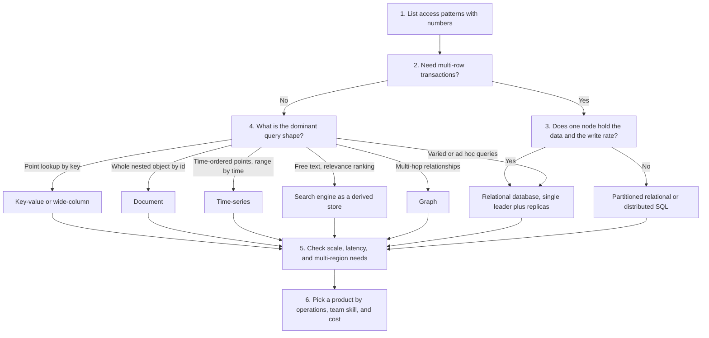
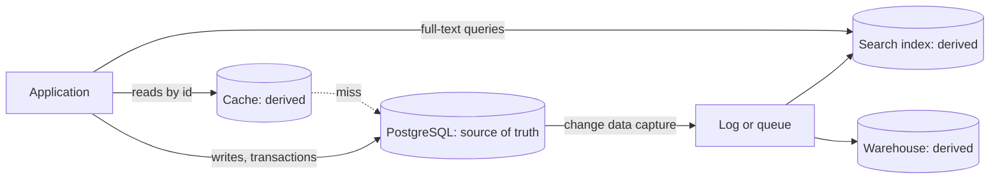

# Choosing a Database

Every system design has a step where the candidate says "I store this in X". This page gives a procedure that leads from the access patterns of the system to a database family, and then to a real product. It covers the choice only. The internals of each database (B+ trees, LSM trees, MVCC, isolation levels) have their home in the `kb/databases/` pages, and this page links to them.

## Why It Matters

Almost every HLD interview asks "Which database do you use, and why?" A weak answer names a product ("MongoDB, because it scales"). A strong answer names the access patterns, the consistency need, and the data volume, and then shows how these facts lead to the choice. The same skill matters on the job: a wrong database choice is expensive to undo, because the data model, the queries, and the operations all depend on it. The page gives a decision procedure, a profile of each database family (when to use it and when not), a table of real systems, the cost of using several databases in one system, and a script for justifying the choice in an interview.

## Core Concepts

**Access pattern**: one way in which the application reads or writes data, described by the key that the query uses, the shape of the result, and the frequency. Example: "get a user by id, 5,000 times per second" or "list the last 20 messages of a chat, 20,000 times per second". The access patterns decide the database. The entities alone do not.

**Data model**: the way a database represents data and relations. The main models are the relational model (tables, rows, foreign keys), key-value (an opaque value behind a key), document (a self-contained JSON-like value with a queryable structure), wide-column (rows grouped under a partition key, with a flexible set of columns), graph (nodes and edges), time series (points ordered by time), and search (an inverted index over text).

**Transaction**: a group of reads and writes that the database treats as one unit. **ACID** names the guarantees of a transaction: atomicity (all or nothing), consistency (the transaction keeps the declared constraints), isolation (concurrent transactions do not see each other's partial work, to the degree that the isolation level promises), and durability (a committed transaction survives a crash). Isolation levels and anomalies have their home in `kb/databases/04-transactions-and-isolation.md`.

**Join**: an operation that combines rows of two or more tables by a condition. Relational databases run joins in the query engine. Most NoSQL databases do not support joins, so the application must read the related data itself or store the data together (denormalization).

**Constraint**: a rule that the database enforces on every write, such as a primary key, a unique key, a foreign key, or a check. Constraints keep invalid data out of the store, even when the application has a bug.

**Secondary index**: an index on a field other than the primary key. A database with a rich set of secondary indexes can answer more query shapes. Indexing has its home in `kb/databases/03-indexing.md`.

**Scale-up and scale-out**: scale-up means a bigger machine. Scale-out means more machines. A single-node relational database scales reads out with replicas (see [replication](05-replication.md)) and scales writes up. Scaling writes out needs partitioning (see [partitioning and sharding](06-partitioning-and-sharding.md)). Some databases are built for scale-out from the start, and some have it added later.

**Consistency model of a database**: the guarantee about what a read returns after a write. The guarantees range from linearizable to eventual. See [consistency and CAP](07-consistency-and-cap.md).

**OLTP and OLAP**: online transaction processing (many small reads and writes that serve users) and online analytical processing (few large scans and aggregations that serve analysts). This page covers OLTP stores. Analytical stores are in `kb/databases/10-oltp-olap-and-warehousing.md`.

**Source of truth and derived store**: the source of truth is the store that holds the authoritative copy of the data. A derived store (a cache, a search index, a data warehouse) holds a copy that the system rebuilds from the source of truth. A derived store may lose data without loss of information, because the system can rebuild it.

**Polyglot persistence**: the use of more than one database technology in one system, each for the data that it fits. Martin Fowler made the term widely known in a 2011 article, and he credits Scott Leberknight with its first use. Fowler and Sadalage also cover it in *NoSQL Distilled* (2012).

**NewSQL or distributed SQL**: a relational database that offers SQL, transactions, and horizontal scale-out. Examples: Google Spanner (Corbett et al., OSDI 2012) and CockroachDB. They keep the relational model and add partitioning and replication inside the database.

## How It Works

The choice is a sequence of questions. Each answer removes options. The sequence below is a procedure that you can state aloud in an interview.



### Step 1: List the entities and the access patterns, with numbers

Write each entity (user, order, message, post). For each entity, write the queries that the requirements imply, in this form: the key, the result shape, the read or write rate, and the latency target. Use the numbers from the estimation step (see `kb/hld/back-of-envelope-estimation.md`). Mark each read as a point read (one key), a range read (a key prefix or a time range), a join, a text search, or an aggregation. Mark each write as an insert of new data, an update of existing data, or an append.

A read and write ratio matters. A system with 100 reads for each write needs a cache and read replicas. A system with more writes than reads (metrics, logs) needs a store that is built for sequential appends, such as an LSM-tree store or a time-series store (see `kb/databases/06-storage-engines.md`).

### Step 2: Decide whether you need transactions and constraints

Ask: does one operation change more than one record, and must all changes succeed or fail together? Examples: a payment that debits one account and credits another, an order that reduces stock and creates a line item, a seat booking that must have at most one owner. If yes, you need multi-row transactions. Relational databases offer them in the standard form. Some NoSQL databases offer them with limits (see the profiles below). If you choose a store without transactions, you must build the guarantee in the application (sagas, idempotent retries, conditional writes). That work costs time and creates bugs.

Ask: must the database enforce uniqueness or a foreign key? A unique constraint is the simplest protection against a double booking or a duplicate account.

### Step 3: If you need transactions, test the scale against one node

This step applies to the relational branch of the flowchart. Estimate the data size, the read rate, and the write rate. Compare them with what one well-configured node of a relational database can serve. Do not guess the limit. Use a benchmark or a measured number from your own system. If the data fits on one node (with replicas for reads and failover), a relational database stays the simplest choice. Many systems that interviewers describe as "big" fit this rule. If one node cannot hold the write rate or the data size, you must partition. The choices are then a relational database with application-level sharding, a distributed SQL database, or a NoSQL database that partitions by design, but only if its transaction support covers the operations that need transactions (see the profiles below).

### Step 4: Match the dominant query shape to a family

This step applies to data that does not need multi-row transactions. If the main reads are lookups by one key, a key-value or wide-column store serves them with the least overhead. If the main read returns a whole nested object, a document store keeps it together. If the main query filters by time and aggregates, a time-series store serves it. If the main query is free text with relevance ranking, a search engine serves it. If the main query follows relations over several hops ("friends of friends who like X"), a graph database serves it. If queries vary and cross entities, the relational model serves them, because SQL and joins let the team ask new questions without a new data model.

### Step 5: Check latency, availability, and regions

Ask: what latency does the user accept at the 99th percentile? Must the system accept writes during a network partition? Must the system run in more than one region? A store that replicates across regions with leaderless or multi-leader replication offers high write availability and accepts conflicts. A store with a single leader offers simple consistency and a failover pause. See [replication](05-replication.md), [consistency and CAP](07-consistency-and-cap.md), and [multi-region and disaster recovery](19-multi-region-and-disaster-recovery.md).

### Step 6: Pick a product

Within a family, choose by operations and by team skill. A managed service (Amazon RDS or Aurora, DynamoDB, Amazon Keyspaces, a hosted Elasticsearch) removes work, and costs money. A product that the team already runs in production has an advantage that most technical differences do not outweigh. Check the license and the exit path too.

### Profiles of the families

The sections below use one format: what the family is, when to use it, when not to use it, and what to watch. The internals of each family are in `kb/databases/07-nosql-families.md`.

#### Relational (SQL)

The relational model stores data in tables with a fixed schema. Rows relate through keys. The query language is SQL.

- **Use when:** the data has relations that queries join; the system needs multi-row transactions and constraints; the query shapes are not fully known at design time; the data fits on one node, or on a primary with read replicas.
- **Do not use when:** the write rate or the data size exceeds what one primary can handle, and the application cannot shard; the access pattern is a single key at very high throughput with no relations, where a key-value store has less overhead; the schema changes with every record.
- **Watch:** vertical limits on writes; a long migration for large tables; the cost of cross-shard joins and cross-shard transactions after sharding.
- **Examples:** PostgreSQL, MySQL, MariaDB, Oracle Database, SQL Server.
- **Internals:** `kb/databases/01-relational-model-and-sql.md`, `kb/databases/02-schema-design-and-normalization.md`, `kb/databases/03-indexing.md`, `kb/databases/04-transactions-and-isolation.md`.

#### Key-value

A key-value store maps a key to a value that the database treats as opaque (or as a small set of typed fields). The main operations are get, put, and delete by key.

- **Use when:** every read and write uses the key; the system needs sub-millisecond latency (in-memory stores) or a throughput that needs automatic partitioning (DynamoDB, a Dynamo-style store); the data is a session, a cache entry, a feature flag, a shopping cart, or a counter.
- **Do not use when:** queries filter on the value; the system needs joins or ad hoc queries; the system needs multi-key transactions with arbitrary scope.
- **Watch:** an in-memory store (Redis, Memcached) is limited by RAM, and its persistence has a durability cost (see `kb/databases/08-redis.md`); a hot key overloads one partition.
- **Examples:** Redis, Memcached (cache only), DynamoDB, etcd (small, strongly consistent configuration data), Riak.

DynamoDB is a key-value and document database that you access through a primary key (a partition key, and optionally a sort key) and through secondary indexes. The DynamoDB documentation says that reads are eventually consistent by default, that a read can ask for strong consistency on a table or a local secondary index, and that all reads from a global secondary index are eventually consistent.

#### Document

A document store keeps self-contained records, usually JSON or a binary form of JSON, and can index and query fields inside them.

- **Use when:** the main read returns one whole nested object (a product with its attributes, a user profile with preferences); records have different fields; the data has a tree shape and the application seldom joins across documents.
- **Do not use when:** the data has many-to-many relations that queries traverse; many queries join several collections; the system needs strict cross-record constraints.
- **Watch:** duplicated data in embedded documents becomes inconsistent after an update; a document that grows without bound (an array of all comments) becomes slow and can hit a size limit.
- **Transactions:** MongoDB offers multi-document ACID transactions on replica sets (feature compatibility version 4.0 or later) and on sharded clusters (feature compatibility version 4.2 or later), according to its documentation. The documentation also states that a distributed transaction costs more than a single-document write, and that a good data model minimizes the need for distributed transactions.
- **Examples:** MongoDB, Couchbase, Amazon DocumentDB, Firestore. Many relational databases (PostgreSQL `jsonb`, MySQL `JSON`) store documents in a column, which is a reasonable choice when documents are a small part of a relational model.

#### Wide-column

A wide-column store partitions rows by a partition key and sorts the rows of one partition by clustering columns. Each row can have a different set of columns. Google Bigtable (Chang et al., OSDI 2006) introduced the model. Cassandra combines the Bigtable data model with the Dynamo replication design.

- **Use when:** the write rate and the data size are too large for one node; queries are known in advance, and each query reads one partition or a range inside one partition (for example, "the last 50 events of device X"); the system needs high write availability across data centers.
- **Do not use when:** queries are ad hoc; the system needs joins; the system needs multi-row transactions with strict isolation; the data is small.
- **Watch:** the design is query-first. You build one table for each query, and you duplicate data on purpose. A partition that grows without bound or a hot partition slows the cluster. Cassandra supports lightweight transactions (compare-and-set on one partition), and it does not give general multi-row transactions.
- **Examples:** Cassandra, ScyllaDB, HBase, Bigtable, Amazon Keyspaces.

#### Graph

A graph database stores nodes and edges, both with properties, and runs traversals.

- **Use when:** the value of the query is in the relations, and the queries follow several hops: social graphs, recommendations, fraud rings, access-control hierarchies, network topology.
- **Do not use when:** the queries are point reads or simple joins of two tables (a relational database does this well); the graph is huge and needs partitioning across machines (graph partitioning is hard, and few products do it well); the workload is mainly aggregation.
- **Watch:** a multi-hop query in SQL needs recursive joins (recursive CTEs), which works for shallow depth. A graph database becomes worth its cost when depth is variable and queries are frequent.
- **Examples:** Neo4j, Amazon Neptune, JanusGraph, ArangoDB (multi-model).

#### Time-series

A time-series database stores points of (time, series identifier, value) and optimizes for appends, for range queries on time, for downsampling, and for retention.

- **Use when:** the data is metrics, sensor readings, or financial ticks; writes are mostly appends in time order; reads are range scans over time with aggregation; old data expires or gets downsampled.
- **Do not use when:** the data has updates in place; the system needs joins across entities; the volume is small enough for a relational table with an index on time.
- **Watch:** the number of distinct series (cardinality) often limits the system before the number of points does.
- **Examples:** TimescaleDB (a PostgreSQL extension), InfluxDB, Prometheus (a monitoring system with its own local time-series database), VictoriaMetrics.
- **Analytical stores:** ClickHouse is a column-oriented OLAP database, and Apache Druid is a real-time analytics database. Teams use both for large aggregations over time-stamped events. They are OLAP stores, not OLTP stores, so they are in `kb/databases/10-oltp-olap-and-warehousing.md`.

#### Search

A search engine builds an inverted index over text and other fields, and ranks the results by relevance. Index structure and ranking have their home in [search and indexing](11-search-and-indexing.md).

- **Use when:** users type free text; the system needs relevance ranking, fuzzy match, filters with facets, or autocomplete.
- **Do not use when:** the store must be the only copy of the data. Recommendation: treat a search index as a derived store and keep the source of truth in a database, because a search index is built for retrieval, and a rebuild from the source repairs any loss. Do not use it for transactions, or for searches that must see a write at once: a new document appears in search results only after the next index refresh.
- **Watch:** the delay between a write to the source and the document becoming searchable; reindexing cost when the mapping changes.
- **Examples:** Elasticsearch, OpenSearch, Apache Solr. PostgreSQL full-text search is enough for a small system.

#### Distributed SQL

A distributed SQL database gives SQL and transactions on a cluster that partitions and replicates data by itself.

- **Use when:** the system needs the relational model and transactions, and one primary cannot hold the writes or the data, or the system needs relational data in several regions with strong consistency.
- **Do not use when:** one node is enough (the distributed commit adds latency to each transaction, and the operation is more complex); the workload is single-key lookups at the highest throughput, where a key-value store is cheaper.
- **Watch:** latency of cross-region commits; a poor choice of primary key creates a hot range.
- **Examples:** Google Spanner, CockroachDB, YugabyteDB, TiDB, Amazon Aurora DSQL.

### Table of families and real systems

| Family | Data model | Strong at | Weak at | Real systems |
|---|---|---|---|---|
| Relational | Tables, rows, foreign keys | Joins, constraints, transactions, ad hoc queries | Write scale-out | PostgreSQL, MySQL, Oracle, SQL Server |
| Key-value | Key to opaque value | Point reads and writes at low latency, simple partitioning | Queries on values, joins | Redis, DynamoDB, etcd, Memcached |
| Document | Nested JSON documents | Whole-object reads, flexible schema | Many-to-many relations, cross-document constraints | MongoDB, Couchbase, Firestore |
| Wide-column | Partition key, clustering columns | Heavy writes, partition-local range reads, multi-data-center availability | Ad hoc queries, joins, strong isolation | Cassandra, ScyllaDB, HBase, Bigtable |
| Graph | Nodes and edges | Multi-hop traversals | Bulk aggregation, partitioning | Neo4j, Neptune, JanusGraph |
| Time-series | (time, series, value) | Appends, time-range scans, downsampling, retention | Updates, joins | TimescaleDB, InfluxDB, Prometheus |
| Search | Inverted index | Free text, ranking, facets | Transactions, being the only copy | Elasticsearch, OpenSearch, Solr |
| Distributed SQL | Tables with automatic partitioning | SQL with scale-out and multi-region transactions | Latency of distributed commits | Spanner, CockroachDB, YugabyteDB, TiDB |

### Worked examples

The table shows how the procedure applies to common interview problems. Each choice is a recommendation for the stated assumptions. A different assumption can lead to a different choice.

| System | Dominant access pattern | Choice | Reason |
|---|---|---|---|
| URL shortener | Get long URL by short code. Insert one row per link | Key-value or relational with a unique key on the code | One-key lookups. The unique constraint prevents duplicate codes. A cache serves the read-heavy load |
| Chat messages | Append a message to a conversation. Read the latest N in a conversation | Wide-column (partition by conversation) | High write rate. Reads are one-partition range scans in time order |
| Social news feed | Read a precomputed feed by user id | Key-value or wide-column for the feed. Relational or document store for posts and users | Feed reads are point reads by key. Post data needs updates and moderation |
| Payments and ledger | Transfer between accounts. No lost or doubled money | Relational (or distributed SQL if one node is not enough) | Multi-row transactions, constraints, and an audit trail |
| Product catalog with search | Show a product by id. Search by text and filters | Document or relational for the source. Search engine as a derived store | Two query shapes. The source of truth stays in one place, and the index follows through change data capture |
| Metrics and monitoring | Append points. Query a time range with aggregation | Time-series store | Appends, time-range scans, downsampling, and retention |
| Ride hailing (driver location) | Update a driver position often. Query drivers near a point | In-memory key-value or geo index for the live position. Relational for trips | The position changes every few seconds and can be lost. The trip needs transactions. See [geospatial indexing](18-geospatial-indexing.md) |
| Social graph ("friends of friends") | Traverse relations over two or more hops | Relational for small depth. Graph database for deep or variable depth | Choose the graph database when traversal queries are the core feature |
| Ticket booking | Reserve a seat once. Count the free seats | Relational | A unique constraint or row lock prevents a double booking. Isolation level matters |
| Session store | Get and set a session by id with expiry | In-memory key-value with TTL | One-key access, low latency, data that can expire |

### Polyglot persistence and its cost

Most large systems use more than one database: a relational database as the source of truth, a cache, a search index, and a queue. Each added store helps one access pattern and costs the team in five ways:

1. **Operations.** Each store needs deployment, monitoring, backup, upgrades, capacity planning, and an on-call team that understands it.
2. **Consistency.** Data in two stores can disagree. A write to the database followed by a write to the search index can fail halfway (the dual-write problem). The fix is to write to one store, and to feed the other store from a log: the transactional outbox or change data capture. See [event-driven architecture](16-event-driven-architecture.md) and `kb/hld/distributed-systems/03-distributed-transactions.md`.
3. **Skills.** Each store has its own query language, its own failure modes, and its own tuning.
4. **Security and compliance.** Each store needs access control, encryption, and audit, and each copy of personal data counts for deletion requests.
5. **Cost.** Each store has a license or a cloud fee, and storage duplicates data.

Recommendation: add a store only when a measured access pattern fails on the current store, and name the source of truth for each piece of data. If a store is derived, say how the system rebuilds it.



### How to justify the choice in an interview

Use this five-part script. It takes about one minute.

1. **State the access patterns with numbers.** "The two main queries are a read by short code at 10,000 per second and an insert at 100 per second."
2. **State the requirements that decide.** "A short code must be unique, so I need a uniqueness guarantee. I accept eventual consistency for click counts."
3. **Name the choice and the family.** "I use a key-value store, for example DynamoDB, with the short code as the partition key. A conditional put with `attribute_not_exists(code)` rejects a duplicate code, so the store gives the uniqueness guarantee."
4. **Give one alternative and the reason you rejected it.** "A relational database also works at this size, and I would choose it if the team already runs one and the load fits on one primary with replicas."
5. **State the trade-off and the trigger for a change.** "The cost is that I cannot run ad hoc queries on the links. If the product needs analytics, I add a warehouse that is fed by the change stream."

If the interviewer changes a requirement, repeat the procedure from the step that the new fact touches. Do not defend the first choice by reflex.

## Trade-offs and When to Use

| Decision | Option A | Option B | Choose A when | Choose B when |
|---|---|---|---|---|
| SQL or NoSQL | Relational | NoSQL family | Relations, constraints, transactions, or unknown queries matter, and one primary with replicas holds the load | The access pattern is narrow and known, and the scale or the availability need exceeds one primary |
| Normalize or denormalize | Normalized tables | Duplicated data in one record or table | Writes must stay consistent and joins are cheap | Reads dominate and a join is too slow or impossible (NoSQL) |
| Strong or eventual consistency | Single leader or consensus | Leaderless or multi-leader | A stale read causes a wrong action (money, stock, seats) | The system must accept writes during partitions, or latency across regions matters more than freshness |
| One store or several | One database | Polyglot persistence | The team is small and one store meets the targets | A measured access pattern (search, time series, cache) fails on the main store |
| Managed or self-hosted | Managed service | Self-hosted | Operations cost more than the fee | License, cost at scale, or control forces self-hosting |
| Shard a relational database or move to NoSQL or distributed SQL | Application-level sharding | Distributed database | The team needs the product and its ecosystem, and the shard key is clear | The team wants the database to move data and to rebalance, and accepts the model change |
| Schema on write or on read | Fixed schema (relational) | Flexible schema (document) | The data is regular, and many teams read it | The data varies by record and one application owns it |

## Java Example

The program below encodes the first part of the decision procedure as a function. It takes an access profile and returns a family with reasons. The function is a teaching aid that makes the order of the questions explicit. It is not a replacement for judgment, because real choices depend on team skill and operations too.

```java
import java.util.ArrayList;
import java.util.List;

public class DatabaseAdvisor {
    enum QueryShape { POINT_BY_KEY, NESTED_OBJECT, TIME_RANGE, FULL_TEXT, TRAVERSAL, AD_HOC }

    record Profile(String name, QueryShape shape, boolean needsMultiRowTransactions,
                   boolean fitsOnOnePrimary, boolean needsMultiRegionWrites) { }

    record Advice(String family, List<String> reasons) { }

    static Advice advise(Profile p) {
        List<String> why = new ArrayList<>();
        if (p.needsMultiRowTransactions()) {
            why.add("multi-row transactions and constraints are required");
            if (p.fitsOnOnePrimary()) {
                why.add("data and write rate fit on one primary, so replicas serve the reads");
                return new Advice("relational (primary plus replicas)", why);
            }
            why.add("one primary cannot hold the load, so the database must partition");
            return new Advice("distributed SQL or sharded relational", why);
        }
        switch (p.shape()) {
            case POINT_BY_KEY -> {
                why.add("reads and writes use one key");
                if (p.needsMultiRegionWrites()) {
                    why.add("writes must stay available in several regions");
                    return new Advice("key-value or wide-column with leaderless replication", why);
                }
                return new Advice("key-value", why);
            }
            case NESTED_OBJECT -> {
                why.add("the main read returns one whole nested object");
                return new Advice("document", why);
            }
            case TIME_RANGE -> {
                why.add("writes append in time order and reads scan a time range");
                return new Advice("time-series", why);
            }
            case FULL_TEXT -> {
                why.add("users search free text with ranking");
                why.add("keep the source of truth in another store");
                return new Advice("search engine (derived store)", why);
            }
            case TRAVERSAL -> {
                why.add("queries follow relations over several hops");
                return new Advice("graph", why);
            }
            default -> {
                why.add("queries are not known in advance");
                return new Advice("relational", why);
            }
        }
    }

    public static void main(String[] args) {
        List<Profile> profiles = List.of(
            new Profile("url-shortener", QueryShape.POINT_BY_KEY, false, true, false),
            new Profile("payments-ledger", QueryShape.AD_HOC, true, true, false),
            new Profile("global-payments", QueryShape.AD_HOC, true, false, true),
            new Profile("metrics", QueryShape.TIME_RANGE, false, false, false),
            new Profile("product-search", QueryShape.FULL_TEXT, false, true, false),
            new Profile("shopping-cart", QueryShape.POINT_BY_KEY, false, true, true));
        for (Profile p : profiles) {
            Advice a = advise(p);
            System.out.println(p.name() + " -> " + a.family());
            for (String r : a.reasons()) {
                System.out.println("  - " + r);
            }
        }
    }
}
```

<!-- expected-output -->

```text
url-shortener -> key-value
  - reads and writes use one key
payments-ledger -> relational (primary plus replicas)
  - multi-row transactions and constraints are required
  - data and write rate fit on one primary, so replicas serve the reads
global-payments -> distributed SQL or sharded relational
  - multi-row transactions and constraints are required
  - one primary cannot hold the load, so the database must partition
metrics -> time-series
  - writes append in time order and reads scan a time range
product-search -> search engine (derived store)
  - users search free text with ranking
  - keep the source of truth in another store
shopping-cart -> key-value or wide-column with leaderless replication
  - reads and writes use one key
  - writes must stay available in several regions
```

A relational design in SQL shows what a constraint gives. The block uses the SQLite dialect and runs on the page's test database. The unique constraint on `code` rejects a duplicate short code in the database, and the application needs no check-then-insert sequence that can race. `INSERT OR IGNORE` is SQLite syntax: it skips the row that breaks the constraint. A plain `INSERT` fails with a constraint error instead. PostgreSQL uses `INSERT ... ON CONFLICT DO NOTHING` for the same effect.

```sql
CREATE TABLE links (
    code TEXT PRIMARY KEY,
    url  TEXT NOT NULL
);
INSERT INTO links (code, url) VALUES ('ab12', 'https://example.com/a');
INSERT OR IGNORE INTO links (code, url) VALUES ('ab12', 'https://example.com/b');
```

```sql
SELECT code, url FROM links;
```

<!-- sql-result -->

```text
code | url
ab12 | https://example.com/a
```

## Interview Angle

### Questions

??? question "How do you choose a database for a new system?"

    I start from the access patterns, not from the product. I list the entities, and for each query I write the key, the result shape, the rate, and the latency target. Then I ask four questions in order. First: do I need multi-row transactions or constraints? If yes, I start from a relational database. Second, for that relational data: do the data and the write rate fit on one primary with replicas? If yes, I stay with one relational primary, because it is the simplest system and SQL handles queries that I did not plan. If not, I choose distributed SQL or shard by a key that keeps most transactions on one shard. Third, for the data that does not need transactions: what is the dominant query shape? A lookup by key points to key-value or wide-column, a whole nested object points to a document store, a time range points to a time-series store, free text points to a search engine, multi-hop relations point to a graph, and varied queries point back to relational. Fourth: what do latency, availability, and regions require? Last, I pick a product by operations and team skill. At a small load, a relational database can serve several of these shapes (an index on time, `jsonb`, full-text search), so I add a specialized store only when the load or the feature needs it.

    I state the trade-off of my choice and the event that would make me change it. I do not say "NoSQL scales better" without the access pattern that needs it.

??? question "SQL or NoSQL for an e-commerce system?"

    I split the system by access pattern, because one store does not serve all of it. Orders, payments, and inventory need multi-row transactions and constraints. A relational database fits them, and one primary with replicas holds the load of most companies. The product catalog is read-heavy, has attributes that differ by category, and is read as a whole object, so a document store or a relational table with a `jsonb` column fits. Product search needs text relevance, so I add a search engine as a derived store, fed from the catalog by change data capture. The shopping cart and the session are lookups by one key with expiry, so an in-memory key-value store or DynamoDB fits.

    The cost is that I run several stores. I keep the relational database as the source of truth for orders and money, and I rebuild every derived store from it or from the log. If the team is small, I start with the relational database alone and add the others when a measured query fails.

??? question "When would you not use a relational database?"

    I leave a relational database when an access pattern does not fit it, and I name the pattern. The first case is a write rate or a data size that one primary cannot hold, when the team cannot or will not shard. A partitioned NoSQL store or a distributed SQL database then fits. The second case is a workload of single-key lookups at very high throughput with no relations, where a key-value store has less overhead per request. The third case is free text with relevance ranking, which a search engine serves better. The fourth case is append-only time-ordered points with retention, which a time-series store compresses and queries more efficiently. The fifth case is a multi-hop traversal of variable depth, where a graph database is simpler than recursive joins.

    I do not leave a relational database because of a loose schema alone, since `jsonb` and `JSON` columns cover many such needs.

??? question "Why is a search engine not a good primary database?"

    A search engine builds an inverted index for fast text retrieval and ranking. It makes new documents visible to search queries only after an index refresh, so a search right after a write can miss the new document. (In Elasticsearch, a get by document id is real-time by default, so this gap applies to search queries, not to reads by id.) It does not offer multi-document transactions or foreign keys. A change of the mapping often needs a reindex. For these reasons I treat it as a derived store: the source of truth is a database, and a change data capture pipeline feeds the index. If the index is lost or corrupt, I rebuild it from the source. This is a recommendation based on the guarantees of the engine, and some teams use it as the primary store for logs, where loss of old data is acceptable.

??? question "What is polyglot persistence, and what does it cost?"

    Polyglot persistence means that one system uses several database technologies, each for the data that it fits: a relational database for orders, a cache for hot reads, a search engine for text, a time-series store for metrics. The gain is that each access pattern runs on a store that is built for it.

    The costs are operations (each store needs deployment, monitoring, backups, and on-call knowledge), consistency (data in two stores can diverge, and a dual write to both stores can fail halfway), skills, security surface, and money. I reduce the consistency risk by writing to one source of truth and feeding the others from a log with a transactional outbox or change data capture. I add a new store only after a measured access pattern fails on the current one.

??? question "You use a document database, and the product needs a many-to-many relation. What do you do?"

    First I check how often the relation is queried and in which direction. If the relation is queried rarely, I store the identifiers on both sides and let the application resolve them with two reads, and I accept the extra round trip. If the relation is central (students and courses, with queries from both sides, with constraints), the data is relational, and the document store is the wrong tool for that part. I then move that part to a relational database, or I move the whole system if most of it is relational. Embedding the related documents on both sides duplicates data, and an update then needs many writes and can leave copies inconsistent. I state that cost before I accept the design.

??? question "Why would you choose Cassandra over PostgreSQL, and what do you give up?"

    I choose Cassandra when the write rate or the data size exceeds one PostgreSQL primary, when the queries are known and each reads one partition or a range inside it, and when the system needs high write availability across data centers. Cassandra replicates without a leader, so any replica accepts a write, and the client chooses a consistency level for each request.

    I give up joins, ad hoc queries, general multi-row transactions, and the simple consistency of a single leader. The data model is query-first: I create one table for each query and duplicate data. Cassandra offers lightweight transactions for compare-and-set on one partition, and they cost more than normal writes. I also accept that the system needs repair operations to keep replicas converged (see [replication](05-replication.md)). If the data fits on one primary and queries vary, I choose PostgreSQL.

??? question "How do you pick between DynamoDB and a relational database?"

    I compare access patterns. DynamoDB fits when I know every query in advance, each query uses the partition key (and optionally the sort key or an index), and I need the service to scale throughput and storage without a manual shard design. The key design is a central skill: a poor partition key creates a hot partition. DynamoDB is a managed service, so I trade operations work for cost and for a narrower query model. It has no joins, so I design the items around the access patterns (single-table design is one approach).

    A relational database fits when queries vary, joins matter, I need constraints, or the team knows it well. With replicas it serves read-heavy loads on one primary. I would also consider the cost model: DynamoDB charges for capacity or requests, and a relational database charges for the instance. If the access patterns are narrow and the scale is high, DynamoDB is strong. If the product is still changing and the load is moderate, the relational database keeps more options open.

??? question "Interviewer: 'Your system must serve 100,000 writes per second.' How does your database choice change?"

    I first check the number against one primary and against the size of each write. 100,000 writes per second of small rows can be too much for one relational primary. The write path needs partitioning. I then ask which guarantees the writes need. If each write is independent and the reads are by key or by partition (events, messages, metrics), a partitioned store fits: Cassandra, DynamoDB, or a time-series store. If the writes need multi-row transactions (a ledger), I choose distributed SQL, or I shard a relational database by a key such that most transactions stay inside one shard. I also check whether a queue in front of the database can smooth bursts, and whether batching reduces the number of writes. I state the partition key and the hot-key risk before I name the product. See [partitioning and sharding](06-partitioning-and-sharding.md).

### Follow-up Questions

??? question "How do you migrate from one database to another with no downtime?"

    I run the migration in phases. I write to the old store and the new store (through a log, not a dual write in the application, if I can), I backfill the history, I compare the stores for differences, I move reads to the new store in small percentages, and I switch writes last. I keep the old store until I trust the new one, and I plan the rollback. The risk is that the two stores disagree during the migration, so I compare data continuously.

??? question "Where does a cache fit in the choice?"

    A cache is a derived store, not a database choice. It accelerates a read pattern that the main database serves too slowly. It does not replace the source of truth. See [caching](03-caching.md).

??? question "How does the choice change when the data must stay in one country?"

    Data residency is a placement constraint. I choose a store that can place data by region, or I run one deployment for each region. I also check where backups, replicas, search indexes, and caches hold copies. See [multi-region and disaster recovery](19-multi-region-and-disaster-recovery.md).

??? question "A table has 10 billion rows and the queries are slow. Do you change the database?"

    Not first. I check the indexes and the query plans (see `kb/databases/05-query-execution-and-tuning.md`), then I consider partitioning the table by a key such as time, and archiving old rows. A change of database family is the last step, and I justify it with an access pattern that the current store cannot serve.

### Red Flags

- Naming a product before the access patterns ("I use MongoDB because it scales").
- Saying "NoSQL is faster than SQL" or "SQL does not scale". The speed depends on the access pattern, and many relational systems run at large scale.
- Choosing NoSQL to avoid designing a schema. The schema moves into the application code.
- Using one database for everything, including full-text search and time-series data, with no check of the load.
- Using five databases in a design for a small load, with no reason for each one.
- Not saying where the source of truth is, or how a derived store is rebuilt.
- Ignoring transactions: choosing a key-value store for a payment system with no plan for atomic updates.
- Stating consistency claims about a product that the product documentation does not support.

## Common Mistakes

| Mistake | Why it hurts | Fix |
|---|---|---|
| Choosing a database from the entity list | Entities do not show the queries. The same entities can need different stores | Write the access patterns with rates first |
| Assuming one primary cannot serve a large system | The team pays for sharding or a new store that it does not need | Estimate the load and compare it with a measured single-node number |
| Using a search engine as the source of truth | A refresh delay, no transactions, and costly reindexing | Keep a database as the source of truth, and feed the index from it |
| Writing to two stores in the application code | One write can fail and leave the stores inconsistent | Write once and replicate through a log (outbox or change data capture) |
| Embedding unbounded data in a document | The document grows, writes slow, and size limits apply | Store the many side as separate records that refer to the parent |
| Picking a poor partition key in a key-value or wide-column store | A hot partition limits throughput | Choose a key with high cardinality and even traffic. See [partitioning and sharding](06-partitioning-and-sharding.md) |
| Forgetting the read-after-write need with eventually consistent reads | A user sees stale data after a save | Use strong reads or read from the leader for such flows. See [replication](05-replication.md) |
| Adding a store for a trend and not for a measured need | More operations, no benefit | Add a store when a measured access pattern fails |
| Not stating the cost of the choice | The answer sounds like a sales pitch | Name what you give up, and what would change your mind |

## Commonly Confused With

| Looks like | Difference | Deciding question |
|---|---|---|
| SQL vs NoSQL | SQL names a query language and, in practice, the relational model. NoSQL names many unrelated models. Some NoSQL stores have SQL-like languages, and some SQL stores store JSON | Which access pattern and guarantees do I need? |
| Document store vs relational with `jsonb` | A document store is built around documents (indexing, sharding, queries on nested fields). A `jsonb` column adds documents to a relational model | Is the data mostly documents, or mostly relations with a few flexible fields? |
| Key-value vs wide-column | Key-value maps a key to one value. Wide-column maps a partition key to many rows that are sorted inside the partition | Do I need range reads inside one partition? |
| Cache vs database | A cache is derived and may lose data. A database holds the source of truth and gives durability | Can the system rebuild this data from another store? |
| Search engine vs database full-text search | A search engine offers ranking, analyzers, facets, and scale-out. Database full-text search covers small and simple cases in the same store | Does the product need relevance tuning and a separate scale? |
| Distributed SQL vs sharded relational | Distributed SQL moves data and runs distributed transactions inside the database. Sharded relational leaves routing, resharding, and cross-shard queries to the application | Does the team want the database to own partitioning? |
| Data lake or warehouse vs OLTP database | A warehouse serves large analytical scans. An OLTP database serves small transactions | Does the query scan most of a table, or touch a few rows? See `kb/databases/10-oltp-olap-and-warehousing.md` |
| Polyglot persistence vs dual writes | Polyglot persistence is a design that uses several stores. Dual writes are one unsafe way to keep them in sync | Is there one source of truth with a log that feeds the others? |

## Quick Reference Card

Procedure:

1. List the access patterns with key, shape, rate, and latency.
2. Transactions or constraints needed? Start relational.
3. Relational data: does one primary plus replicas hold the load? If yes, stay there. If not, use distributed SQL or shard.
4. Data without transactions: match the dominant query shape: key, nested object, time range, text, traversal, or ad hoc (relational).
5. Check latency, availability, and regions.
6. Pick a product by operations and team skill.
7. Name the source of truth, the derived stores, and the trade-off.

| Need | Family | Example systems |
|---|---|---|
| Joins, constraints, transactions, ad hoc queries | Relational | PostgreSQL, MySQL |
| Lookup by key, low latency, expiry | Key-value | Redis, DynamoDB |
| Whole nested object, flexible fields | Document | MongoDB |
| Writes beyond one node, partition-local reads, multi-data-center | Wide-column | Cassandra, HBase |
| Multi-hop relations | Graph | Neo4j, Neptune |
| Time-ordered points, retention | Time-series | TimescaleDB, InfluxDB |
| Free text, ranking | Search (derived) | Elasticsearch, OpenSearch |
| SQL plus scale-out and multi-region transactions | Distributed SQL | Spanner, CockroachDB |

Rules to remember:

- The access pattern decides the database.
- One primary with replicas serves more load than candidates expect. Measure it.
- A search index and a cache are derived stores.
- Each added store costs operations, consistency work, and skills.
- State what you give up, and what would change the choice.

## Further Reading

- Kleppmann, *Designing Data-Intensive Applications*, O'Reilly, 2017, chapter 2 (data models and query languages: relational, document, graph) and chapter 3 (storage and retrieval). The standard treatment of the data model trade-offs.
- DeCandia et al., ["Dynamo: Amazon's Highly Available Key-value Store"](https://www.allthingsdistributed.com/files/amazon-dynamo-sosp2007.pdf), SOSP 2007. The design of a key-value store that favors availability, and the origin of many NoSQL ideas.
- Chang et al., ["Bigtable: A Distributed Storage System for Structured Data"](https://research.google/pubs/bigtable-a-distributed-storage-system-for-structured-data/), OSDI 2006. The origin of the wide-column model.
- Corbett et al., ["Spanner: Google's Globally-Distributed Database"](https://research.google/pubs/spanner-googles-globally-distributed-database-2/), OSDI 2012. The reference for distributed SQL with strong consistency.
- Fowler and Sadalage, *NoSQL Distilled*, Addison-Wesley, 2012. A short survey of the NoSQL families and of polyglot persistence.
- Fowler, ["PolyglotPersistence"](https://martinfowler.com/bliki/PolyglotPersistence.html), 2011. The article that made the term widely known, with its origin.
- [Amazon DynamoDB Developer Guide: read consistency](https://docs.aws.amazon.com/amazondynamodb/latest/developerguide/HowItWorks.ReadConsistency.html). The documented consistency options of DynamoDB.
- [Apache Cassandra documentation: Dynamo](https://cassandra.apache.org/doc/latest/cassandra/architecture/dynamo.html). Replication, consistency levels, and the repair mechanisms of Cassandra.
- [PostgreSQL documentation](https://www.postgresql.org/docs/current/). The reference for the relational features that this page mentions (constraints, `jsonb`, full-text search).
- [MongoDB manual: transactions](https://www.mongodb.com/docs/manual/core/transactions/). The documented scope and limits of multi-document transactions.
- [Elasticsearch get API](https://www.elastic.co/docs/api/doc/elasticsearch/operation/operation-get). A get by id is real-time by default, while search results wait for a refresh.
- `kb/databases/07-nosql-families.md`, `kb/databases/03-indexing.md`, `kb/databases/04-transactions-and-isolation.md`, `kb/databases/06-storage-engines.md`, and `kb/databases/09-scaling-a-database.md` in this knowledge base. The internals that this page leaves out.
