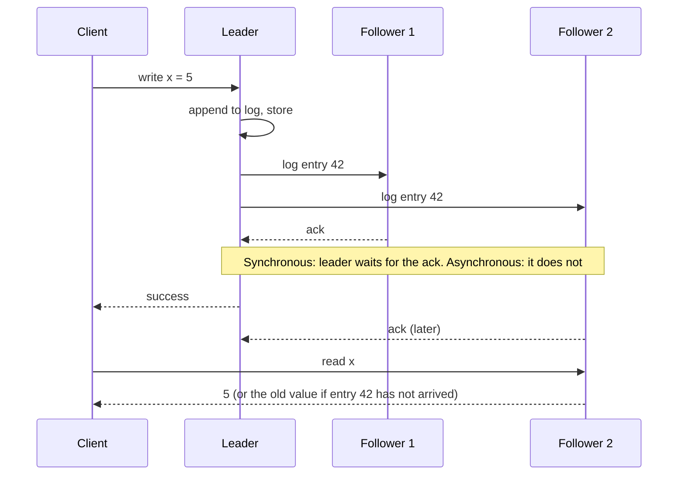
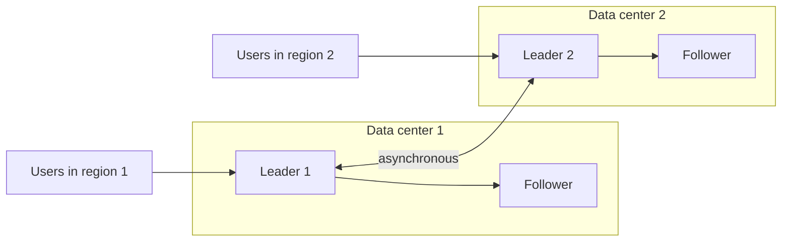
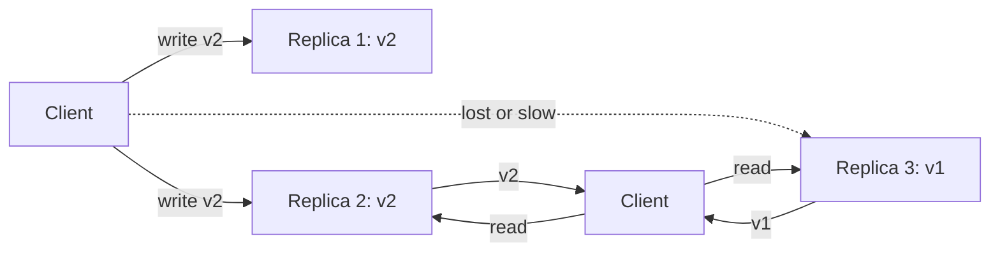
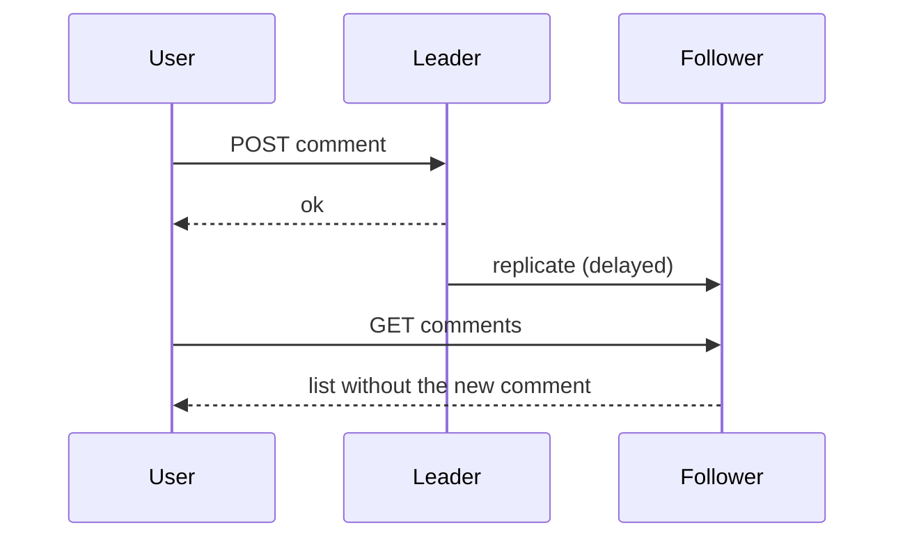

# Replication

Replication keeps a copy of the same data on more than one machine. This page explains why a system replicates, the three replication architectures (single leader, multi-leader, leaderless), the anomalies that replication lag causes and the fixes for each, failover and its hazards, the formats of the replication log, and what PostgreSQL, MySQL, Cassandra, and DynamoDB document about their own replication. The page follows the structure of Kleppmann, *Designing Data-Intensive Applications* (DDIA), chapter 5, and adds details from the Dynamo paper (DeCandia et al., SOSP 2007) and from the vendor documentation. Splitting data across machines is a different topic: see [partitioning and sharding](06-partitioning-and-sharding.md). The theory of consistency is in [consistency and CAP](07-consistency-and-cap.md).

## Why It Matters

Replication appears in almost every system design interview, because every design that stores data must say what happens when a machine fails and how the system serves many readers. Interviewers ask for the replication mode ("synchronous or asynchronous?"), the lag anomalies ("a user posts a comment and then does not see it"), and the failover plan ("what happens when the leader dies?"). On the job, the same topic decides how much data a crash loses, how long an outage lasts, and why a dashboard shows old numbers. A candidate who can state the guarantee of each mode, the failure that each mode permits, and the fix for each anomaly gives a senior-level answer.

## Core Concepts

**Replica**: a node that stores a copy of the data. **Replication**: the process that keeps the copies in step.

**Why replicate.** Three goals drive replication (DDIA chapter 5):

| Goal | How replication serves it | Limit |
|---|---|---|
| Availability | If one replica fails, another replica serves the data | Needs failure detection and, in some designs, a failover step |
| Read scale | Many replicas serve reads in parallel | Does not scale writes: each write still reaches every replica. Reads from a lagging replica can be stale |
| Latency | A replica near the user answers faster than a distant primary | Writes may still travel to a distant leader. Cross-region replication adds lag |

A fourth reason is durability: a copy on another machine survives the loss of a disk or a machine. A fifth is to run maintenance, backups, or analytical queries on a replica and not on the primary.

**Leader** (also primary or master in older documents): the replica that accepts writes in a single-leader design. **Follower** (also standby, replica, or secondary): a replica that applies the changes of the leader. This page uses leader and follower. The vendor sections use the vendor's terms and say so.

**Replication log**: the ordered record of changes that the leader sends to its followers. Followers apply the entries in the same order.

**Synchronous replication**: the leader reports a write as successful only after the follower confirms it. **Asynchronous replication**: the leader reports success without waiting for the follower. **Semi-synchronous replication**: the leader waits for one follower (or a set of followers) and does not wait for the rest.

**Replication lag**: the delay between a write on the leader and the moment the write becomes visible on a follower. With asynchronous replication, the lag has no upper bound in theory. It grows under load, network problems, or a slow follower (DDIA chapter 5).

**Eventual consistency**: if writes stop, all replicas converge to the same value after some time. The definition gives no bound on the time.

**Quorum**: a minimum number of replicas that must take part in an operation. With n replicas, w write acknowledgements, and r read responses, the condition w + r > n makes every read set overlap every write set (DDIA chapter 5; DeCandia et al.). See the section on leaderless replication.

**Failover**: the process that moves the leader role from a failed node to another node. **Split brain**: a state in which two nodes both believe that they are the leader. **Fencing**: a mechanism that stops a node that lost the leader role from continuing to write, for example by revoking its access or by rejecting requests that carry an old epoch number.

**Version vector**: a map from replica identifier to a counter, kept for each version of a value. It lets the system tell whether one version of a value descends from another or whether the two versions are concurrent. The Dynamo paper calls its version structure a vector clock, a list of (node, counter) pairs. DDIA notes that people often use the two names for the same thing, although a version vector and a vector clock are not quite the same. The theory is in `kb/hld/distributed-systems/01-failures-and-time.md`.

## How It Works

### Single-leader replication

One replica is the leader. All writes go to the leader. The leader writes the change to its local storage and to the replication log, and the followers apply the log. A client can read from the leader or from a follower. Writes to a follower are not allowed, because they could not be ordered against the writes at the leader. DDIA chapter 5 calls this design "leader-based replication" and notes that it is used by PostgreSQL, MySQL, Oracle Data Guard, SQL Server Always On, MongoDB, and by message brokers such as Kafka.



#### Synchronous, asynchronous, and semi-synchronous

| Mode | The leader reports success when | Data loss if the leader fails | Write latency | Availability of writes |
|---|---|---|---|---|
| Asynchronous | The leader has stored the write | The writes that no follower received are lost | Lowest | Not affected by a slow or dead follower |
| Synchronous (all followers) | Every follower has confirmed | None for confirmed writes | Highest: bounded by the slowest follower | One unavailable follower blocks all writes |
| Semi-synchronous (one synchronous follower, the rest asynchronous) | The leader and at least one follower have the write | None for confirmed writes, as long as the synchronous follower survives and the system does not fall back to asynchronous mode | Bounded by the synchronous follower | If the synchronous follower fails, the system makes an asynchronous follower synchronous, blocks writes, or (in MySQL, after a timeout) falls back to asynchronous replication |

DDIA chapter 5 states that it is impractical for all followers to be synchronous, because the outage of any one node stops all writes. In practice, a database with synchronous replication enabled makes one follower synchronous and the others asynchronous. If the synchronous follower becomes slow or unavailable, one of the asynchronous followers becomes synchronous. This guarantees an up-to-date copy on at least two nodes. DDIA calls this configuration semi-synchronous. Some systems also run fully asynchronous replication and accept the loss of recent writes after a leader failure, in return for write availability.

!!! warning "The name semi-synchronous has two meanings"
    DDIA uses semi-synchronous for "one synchronous follower". MySQL uses the same name for a plugin with a different rule: the source waits for a replica acknowledgement only until a timeout, and then it falls back to asynchronous replication (see the MySQL section). While MySQL runs in that fallback mode, a leader failure can lose confirmed writes. In an interview, say which of the two mechanisms you mean.

!!! warning "Asynchronous replication can lose confirmed writes"
    If the leader fails and the client already received a success message, the write may exist only on the failed leader. A new leader chosen from the followers does not have it. DDIA chapter 5 describes this as a weakening of durability that many systems accept on purpose.

#### Setting up a new follower

A new follower cannot copy the files of a live leader, because the data changes during the copy. The usual steps (DDIA chapter 5) are:

1. Take a consistent snapshot of the leader, without a lock on the whole database if possible.
2. Copy the snapshot to the new follower.
3. The follower connects to the leader and asks for all changes after the snapshot. The snapshot is tied to an exact position in the replication log (PostgreSQL calls it a log sequence number, MySQL calls it a binary log coordinate or a GTID set).
4. When the follower has processed the backlog, it has caught up. It then follows the stream of changes.

#### Follower failure: catch-up recovery

A follower keeps on disk the position of the last log entry that it processed. After a crash or a network break, it reconnects and asks for all entries after that position. This is a simple, reliable recovery.

#### Leader failure: failover

Failover moves the leader role to a follower. It has three steps (DDIA chapter 5):

1. **Detect the failure.** Most systems use a timeout: nodes send heartbeats, and a node that misses heartbeats for a set time counts as dead. A short timeout detects failure fast and causes false failovers when the network is slow or the leader is overloaded. A long timeout lowers the risk of false failovers and lengthens the outage.
2. **Choose a new leader.** The nodes elect a leader, or a controller node appoints one. The best candidate is the follower with the most recent data, which loses the fewest writes. Consensus algorithms solve the election problem (see `kb/hld/distributed-systems/02-consensus-and-leader-election.md`).
3. **Reconfigure the system.** Clients send writes to the new leader. If the old leader returns, the system must make it a follower and must make sure that it does not act as a leader.

Failover has known hazards (DDIA chapter 5):

- **Lost writes.** With asynchronous replication, the new leader may lack writes that the old leader accepted. If the old leader rejoins, the system usually discards those writes, which breaks the promise to the client. A 2012 GitHub incident shows the cost. GitHub's post-mortem reports that a cluster partition in its Pacemaker-managed MySQL cluster led to two leader elections, and that the node that its operations team knew to be out of date became the active leader. Records that MySQL created in that window had identifiers that the application also used to look up data in Redis, and the links between the two stores went out of sync. For seven minutes, 16 private repositories were reachable by users outside their collaborator lists. DDIA summarizes the incident as the reuse of auto-increment primary keys by an out-of-date leader.
- **Split brain.** Two nodes both act as leader and both accept writes, so the data diverges. Some systems stop one leader when they detect two (a mechanism that can shut down both nodes if it is badly designed).
- **Wrong timeout.** A timeout that is too short triggers a failover during a load peak. The failover adds load and can make the situation worse.

Because of these hazards, some operations teams prefer a manual failover, which a person starts after a check.

##### Fencing

A node that was the leader and lost the role can still be running (a long garbage-collection pause, a network partition that only separates it from the controller). It may not know that another node took over. Fencing stops such a node from damaging data. Techniques:

- **Epoch number (fencing token).** Each election produces a larger epoch number. The storage layer or the followers reject any write that carries an older epoch. The design is described in `kb/hld/distributed-systems/05-distributed-locks-and-leases.md`.
- **STONITH** ("shoot the other node in the head"): the controller powers off or isolates the old leader, for example through a power controller or by revoking its cloud network access. The Pacemaker cluster manager documentation says that fencing is also known as STONITH, because the most common fencing method cuts power to the node. The PostgreSQL failover documentation uses the term for the mechanism that tells an old primary that it is no longer the primary.
- **Lease.** The leader may write only while it holds a time-limited lease. After the lease expires, the leader must stop. A lease depends on bounded clock drift and on the leader noticing that it expired, so it protects best when combined with an epoch check at the storage layer.

!!! info "Failover needs agreement"
    A failover is a consensus problem: all nodes must agree on one new leader. Systems that implement it with a consensus protocol (Raft, Paxos, ZooKeeper's Zab) avoid split brain by a majority rule. A system with only two nodes cannot tell a dead peer from a network partition, so it needs a third vote (a witness or an arbiter).

### The replication log formats

The leader must send changes to followers in some format. DDIA chapter 5 lists four methods.

| Method | What the log holds | Strength | Weakness | Example |
|---|---|---|---|---|
| Statement-based | The SQL statements that changed data (`INSERT`, `UPDATE`, `DELETE`) | Compact. Easy to read | A statement with a nondeterministic function (`NOW()`, `RAND()`) can give a different result on each replica. A statement with side effects (triggers, stored procedures) can differ. A statement with an auto-increment column or a dependency on existing data must run in the same order | MySQL `binlog_format=STATEMENT` |
| Write-ahead log (WAL) shipping | The low-level byte changes to disk pages, as the storage engine writes them | Exact copy of the primary | Coupled to the storage engine and its version: the leader and the followers usually must run the same version, which makes a zero-downtime upgrade harder | PostgreSQL physical streaming replication |
| Logical (row-based) log | A description of each changed row: for an insert, the new column values; for a delete, the row identity; for an update, the row identity and the new values | Decoupled from the storage engine. A follower may run another version or another system. Change data capture can read it | Larger than a statement for a statement that changes many rows | MySQL `binlog_format=ROW`, PostgreSQL logical replication |
| Trigger-based | Changes that database triggers write into a table, which an external process reads | Flexible: the application can filter or transform changes | More overhead and more bugs than built-in replication | Databus for Oracle, Bucardo for PostgreSQL (examples in DDIA) |

The next sections give the documented behavior of real systems.

### Multi-leader replication

In a multi-leader design, more than one node accepts writes. Each leader also acts as a follower of the other leaders. DDIA chapter 5 gives three use cases:

1. **Multi-data-center operation.** Each data center has its own leader. Writes stay local and have low latency. A failure of one data center does not stop the others. The leaders replicate to each other asynchronously.
2. **Clients that work offline.** A calendar app on a phone keeps a local database that acts as a leader. It syncs with the server and other devices when the network returns. Each device is a leader.
3. **Collaborative editing.** Each user edits a local copy, and the changes replicate to the others. A real-time editor needs fine-grained merging (see `kb/hld/distributed-systems/06-crdts-and-conflict-resolution.md`).



#### Write conflicts

If two leaders accept a write to the same record at the same time, the system has a **write conflict**. In single-leader replication, the leader orders the writes, so a conflict cannot arise at the storage level. In multi-leader replication, each leader accepts its write before it learns about the other, so the conflict appears later, during replication. DDIA chapter 5 lists these approaches:

| Approach | How it works | Cost |
|---|---|---|
| Avoid conflicts | Route all writes for one record to the same leader (for example, a user's data goes to the leader in the user's home region) | Fails when the home region fails or when the user moves |
| Last write wins (LWW) | Each write has a timestamp, and the highest timestamp survives | Silently discards the other writes. Depends on clocks that can differ between nodes |
| Replica ids | The write from the leader with the higher id wins | Silently discards writes |
| Merge | Combine the values, for example by sorting and joining them | Needs a merge rule for each data type |
| Record the conflict | Keep all versions (siblings) and let the application or the user resolve them later | The application must handle siblings |
| Conflict-free data types and operational transformation | Data structures that merge by design (CRDTs), or a transformation of concurrent operations | Limited to supported data types. See `kb/hld/distributed-systems/06-crdts-and-conflict-resolution.md` |

Conflict resolution runs on write (when the system detects the conflict in the replication log) or on read (the system stores all versions and resolves them when the application reads).

DDIA also warns that multi-leader replication has surprising interactions with auto-incrementing keys, triggers, and integrity constraints, and recommends that teams avoid it where possible.

#### Topologies

A replication topology describes the paths along which writes travel between leaders.

| Topology | Path | Weakness |
|---|---|---|
| Circular | Each node sends to the next one in a ring | One failed node breaks the ring until it is reconfigured |
| Star | One root node sends to all others | The root is a single point of failure |
| All-to-all | Each leader sends to every other leader | Messages can overtake each other on different network paths, so a follower can see an update before the insert that it depends on (a causality problem) |

In circular and star topologies, a write passes through several nodes, and each node tags the write with the identifiers of the nodes that it has passed through, so that the write does not loop forever. In an all-to-all topology, version vectors fix the ordering problem.

### Leaderless replication

In a leaderless design, any replica accepts writes, and no node orders them. Amazon's Dynamo (DeCandia et al., SOSP 2007) made the design popular. Cassandra, Riak, and Voldemort follow it. The Dynamo paper's own system is the internal Amazon service, not the DynamoDB service (see the DynamoDB section below).

A client (or a coordinator node on its behalf) sends each write to several replicas, and each read to several replicas. The client does not wait for all replicas. It waits for a quorum.

#### Quorums

With **n** replicas for each key, a write needs confirmation from **w** replicas, and a read queries **r** replicas. If **w + r > n**, the set of replicas that took the write and the set of replicas that answer the read overlap in at least one replica, so the read sees at least one copy with the latest write (DDIA chapter 5; DeCandia et al.). A common setup is n = 3, w = 2, r = 2. The Dynamo paper states that the common (N, R, W) configuration that several instances of Dynamo use is (3, 2, 2).



In the figure, n = 3 and w = 2. The write reaches two replicas. A read with r = 2 queries replica 2 and replica 3. It receives v2 and v1, and it returns the newer version, v2. Replica 3 is stale, and read repair (below) can fix it.

Parameters change the behavior:

- With w = n and r = 1, reads are fast, and one failed replica blocks writes.
- With w = 1 and r = n, writes are fast, and one failed replica blocks reads.
- With w + r <= n, a read can miss the latest write. The system gains latency and availability and accepts stale reads.

!!! warning "A quorum does not guarantee linearizability"
    With w + r > n, a read still can return an old value in several cases (DDIA chapter 5): a sloppy quorum (below) writes to nodes outside the usual n nodes, so the overlap does not hold; two writes happen at the same time and the system picks a winner by timestamp (with clock skew, the winner can be the older write); a write succeeds on fewer than w replicas, returns an error, and does not roll back the replicas where it succeeded; a read runs at the same time as a write, and only some replicas show the new value; a node with the new value fails and is restored from a replica that has the old value, which drops the count of replicas with the new value below w. Quorum reads and writes aim for a high probability of fresh reads, and they do not give a guarantee. See [consistency and CAP](07-consistency-and-cap.md).

#### Catching up: read repair and anti-entropy

A replica that missed a write (because it was down) must catch up. Dynamo-style systems use three mechanisms:

1. **Read repair.** When a client reads from several replicas and sees a stale response from one replica, the client (or the coordinator) writes the newer value to that replica. This repairs values that readers request often. Values that nobody reads stay stale. In Cassandra, the documentation calls read repair a best-effort mechanism in the read path that helps replicas converge.
2. **Hinted handoff.** When a replica is unavailable, another node accepts the write on its behalf and stores a hint. When the replica returns, the node hands the data to it (see sloppy quorums below). Cassandra documents that hints are best effort and do not replace repair: a coordinator stores hints for a down node only during the `max_hint_window`, which defaults to 3 hours. After the window, the replica stays out of sync until read repair or anti-entropy repair fixes it.
3. **Anti-entropy process.** A background process compares the data of replicas and copies the missing data. The Dynamo paper uses **Merkle trees** for the comparison: each replica builds a hash tree over a key range, in which each leaf is the hash of a key's value and each parent is the hash of its children. Two replicas compare the root hashes. If they match, the ranges are identical. If not, the replicas descend into the subtrees that differ and exchange only the differing keys. Cassandra documents the same mechanism as anti-entropy repair, with full, sub-range, and incremental forms, and states that it is what guarantees eventual consistency, because read repair and hints are only best effort.

The comparison cost of a Merkle tree is low when most data matches. Dynamo keeps a separate Merkle tree for each key range that a node hosts. The paper names the drawback: when a node joins or leaves, many key ranges change, and the nodes must recalculate the trees for the new ranges. The paper states that its refined partitioning scheme (fixed, equal-size partitions, section 6.2 of the paper) addresses this. For the data structure, see `kb/hld/distributed-systems/04-probabilistic-data-structures.md`.

#### Sloppy quorums and hinted handoff

A **strict quorum** uses only the n replicas that the partitioning scheme assigns to the key. If some of them are unreachable, the operation fails when fewer than w (or r) respond. A **sloppy quorum** accepts writes and reads on the first n healthy nodes that the system finds, which may include nodes outside the assigned n. The nodes that are not the usual owners keep a hint (the intended owner is in the metadata of the write). When the owner returns, the stand-in node sends the data back (hinted handoff). The Dynamo paper describes this design to raise write availability. DDIA chapter 5 adds the cost: a sloppy quorum does not guarantee that a read sees the latest write, even when w + r > n, because the nodes that took the write may not be among the nodes that the read queries. A sloppy quorum is an assurance of durability (the write is stored on w nodes) and not of recency.

#### Detecting concurrent writes

Two clients can write to the same key at the same time through different replicas. The system needs a rule to decide whether one write replaced the other or whether they are concurrent (DDIA chapter 5):

- **Last write wins (LWW).** Each write carries a timestamp, and the replicas keep the highest one. The result converges, and it discards concurrent writes without notice. It also depends on clocks. Cassandra uses timestamps for each cell: the timestamp comes from the client, or from the coordinator when the client sends none, and the highest timestamp wins. The Cassandra documentation notes that correctness depends on accurate clocks and recommends time synchronization such as NTP.
- **Happens-before and version vectors.** One write happens before another if the second writer had seen the first. If neither happened before the other, the writes are concurrent. A version vector for each key and replica lets the system detect this. Dynamo returns all concurrent versions (siblings) to the client, which merges them. The paper's example is the shopping cart: the merge never loses an add-to-cart operation, and deleted items can resurface. To limit the size of a vector clock, Dynamo stores a timestamp with each (node, counter) pair. When the number of pairs reaches a threshold (the paper says "say 10"), Dynamo removes the oldest pair. The paper states that this truncation can make reconciliation less efficient, because the system cannot always derive the descendant relationships, and that the problem had not surfaced in production.

### Replication lag and its anomalies

In a leader-based system with asynchronous replication, a read from a follower can return stale data. If the system stops writing, the followers catch up (eventual consistency). The lag is usually a fraction of a second, and it can grow to seconds or minutes under load or failure (DDIA chapter 5). Three anomalies matter in practice. Each has a fix.

#### Read-your-writes (read-after-write) consistency

**Anomaly.** A user writes data and reads it back immediately. The write went to the leader, and the read goes to a lagging follower. The user does not see their own write and thinks it was lost.



**Guarantee.** Read-your-writes consistency promises that a user always sees their own writes. It makes no promise about the writes of other users.

**Fixes** (DDIA chapter 5):

- Read data that the user may have changed from the leader, and read everything else from followers. Example: a user always reads their own profile from the leader and other profiles from followers. This needs a rule that tells which data the user may have modified.
- Read from the leader for a time after the user's last write (for example one minute), and monitor the lag to choose a safe value. Block reads from followers whose lag exceeds a limit.
- The client remembers the timestamp or log position of its last write. The system serves a read only from a replica that has applied the log up to that position. If a replica is behind, the system waits, or sends the read to another replica or to the leader. A logical timestamp, such as a log sequence number, avoids clock problems.
- With replicas in several data centers, a request that must read from the leader goes to the data center that holds the leader.
- Cross-device case: if the user writes on a phone and reads on a laptop, the timestamp of the last write must be stored on the server side, not in the device, and a request from any device that needs read-your-writes must reach the leader's data center.

#### Monotonic reads

**Anomaly.** A user reads twice. The first read goes to a follower that is up to date and returns a comment. The second read goes to a follower that lags, and the comment disappears. The user sees time go backward.

**Guarantee.** Monotonic reads promise that, after a user has read a newer value, the user does not read an older value. It is weaker than strong consistency and stronger than eventual consistency (DDIA chapter 5).

**Fix.** Each user always reads from the same replica. Choose the replica by a hash of the user identifier (and not at random for each request). If that replica fails, the user's requests go to another replica, and the guarantee can break at that moment.

#### Consistent prefix reads

**Anomaly.** Two writes have a causal order: a question and its answer. The writes go to different partitions, and the replication of each partition has its own lag. An observer can see the answer before the question. The order of the events is wrong.

**Guarantee.** Consistent prefix reads promise that if writes happen in a certain order, a reader sees them in that order.

**Fix.** Write causally related events to the same partition. If that is not possible, use an algorithm that tracks causal dependencies (see `kb/hld/distributed-systems/01-failures-and-time.md`). The problem appears in partitioned databases, because a single-leader partition has a total order of its own writes.

| Anomaly | What the user sees | Guarantee | Typical fix |
|---|---|---|---|
| Stale read after own write | The write is missing | Read-your-writes | Read recent or user-modified data from the leader. Track the log position of the last write |
| Time going backward | A value appears and then disappears | Monotonic reads | Pin each user to one replica |
| Effect before cause | An answer before its question | Consistent prefix reads | Same partition for causally related writes. Track causality |

!!! tip "Interview answer on lag"
    Say that the application should not hide replication lag behind the word "eventually". Name the guarantee that the product needs (read-your-writes for a user's own data, monotonic reads for a feed), and say which routing rule provides it. DDIA chapter 5 notes that transactions can hide these details from the application, and that many systems dropped transactions when they moved to distributed databases, with the claim that transactions cost too much performance and availability. A system with asynchronous replication that offers no transactions pushes this work into the application.

### Examples from real systems

The statements below come from the vendors' documentation. Terms are the vendors' terms.

#### PostgreSQL

PostgreSQL has **physical streaming replication**: a standby connects to the primary and receives the write-ahead log (WAL) as the primary generates it. The documentation states that replication is asynchronous by default, with a delay that is typically under one second. A standby needs a base backup and a `primary_conninfo` setting. The primary needs a role with the `REPLICATION` privilege and `max_wal_senders` set high enough (default 10).

- **Synchronous replication.** Set `synchronous_standby_names` to a non-empty value, with `synchronous_commit` set to `on` (the default). If `synchronous_standby_names` is empty (the default), synchronous replication is off, and commits do not wait for any standby. Two forms exist: `FIRST num_sync (s1, s2, ...)` is priority-based, where the commit waits for the `num_sync` highest-priority standbys; `ANY num_sync (s1, s2, ...)` is quorum-based, where the commit waits for at least `num_sync` of the listed standbys. The values of `synchronous_commit` are `remote_apply`, `on`, `remote_write`, `local`, and `off`. With a synchronous standby configured, they set how far the standby must progress before the commit returns: `remote_apply` waits until the standby has flushed and replayed the commit record, so queries on the standby can see the change; `on` waits for the standby to flush the commit record to durable storage; `remote_write` waits for the standby to write it to its file system, which survives a crash of the PostgreSQL standby process and not an operating-system crash of the standby; `local` waits only for the local flush on the primary; `off` does not wait for the local flush either, so a crash can lose the latest commits (up to three times `wal_writer_delay`), without corrupting the database. A transaction can change its own level, for example with `SET LOCAL synchronous_commit TO local`.
- **When no synchronous standby is available**, commits wait and may never finish, according to the documentation. An operator must lower the count or disable the setting and reload the configuration.
- **Replication slots** make the primary keep the WAL that a standby still needs. The documentation warns that a slot can fill the `pg_wal` directory if a standby stays away. `max_slot_wal_keep_size` limits the WAL that slots may retain. Its default is -1, which means no limit, so an operator must set it or monitor the slots.
- **Hot standby** lets read-only queries run on a standby. The documentation covers query conflicts with WAL replay and the `hot_standby_feedback` setting. With this setting, the standby tells the primary which queries run on it, so the primary does not clean up rows that those queries need. The setting prevents some query cancellations on the standby, and the documentation warns that it can cause bloat on the primary.
- **Cascading replication** lets a standby relay WAL to other standbys. It is asynchronous.
- **Failover** is a manual or tool-driven step: `pg_ctl promote` or the function `pg_promote()` turns a standby into a primary. The documentation states that PostgreSQL does not provide the software that detects a failure of the primary and notifies the standby. Teams use external tools for detection and election. With `recovery_target_timeline = 'latest'` (the default), downstream standbys follow a new timeline after a promotion.
- **Logical replication** uses publications and subscriptions and replicates row changes of selected tables. The publisher needs `wal_level = logical` (the default is `replica`, and the setting needs a server restart). The documentation lists replication between different major versions and between different platforms as use cases.
- **Lag monitoring.** On the primary, `pg_stat_replication` shows for each standby the `sent_lsn`, and the write, flush, and replay positions. On a standby, `pg_last_wal_receive_lsn()` and `pg_last_wal_replay_lsn()` show the position.

<!-- sql-skip: postgresql -->

```sql
-- PostgreSQL syntax. On the primary: bytes of WAL that each standby has not replayed.
SELECT application_name,
       sync_state,
       pg_wal_lsn_diff(pg_current_wal_lsn(), replay_lsn) AS replay_lag_bytes
FROM pg_stat_replication;
```

#### MySQL

MySQL replicates through the **binary log**. The source writes changes to the binary log, and each replica reads them and applies them. The documentation (MySQL 8.4) names three formats: statement-based (`binlog_format=STATEMENT`), row-based (`ROW`), and mixed (`MIXED`, which uses statements and switches to rows for some statements). Row-based logging is the default. The documentation also notes that changing `binlog_format` is deprecated as of MySQL 8.0, and a future version can remove the variable.

- **Default mode** is asynchronous replication.
- **Semisynchronous replication** is available through a plugin. The documentation says that the source blocks a committing session until at least one semisynchronous replica acknowledges that it received the events (the replica has written them to its relay log and flushed to disk, and has not necessarily applied them), or until a timeout occurs. If the timeout passes with no acknowledgement, the source falls back to asynchronous replication, and it returns to semisynchronous mode when a replica catches up. The number of required acknowledgements is configurable and defaults to one. The documentation states that after a source crash and a failover, the failed source should not be reused as the replication source and should be discarded, because it can contain transactions that no replica acknowledged.
- **Group Replication** is a plugin that builds a group of servers with a membership service and automatic failure detection. It has a single-primary mode (if the primary leaves the group, the group elects a new primary automatically) and a multi-primary mode (all members accept updates, and the group detects conflicting transactions when it certifies them). If a network partition leaves no majority, the group does not make progress until the partition is resolved. The documentation states that Group Replication does not handle client-side failover: a middleware framework such as MySQL Router, a proxy, a connector, or the application itself must do it. InnoDB Cluster wraps Group Replication with MySQL Shell and MySQL Router.
- **Global transaction identifiers (GTIDs)** give each transaction an identifier that is unique across the topology, which makes it easier to point a replica at a new source after a failover. See the MySQL manual for the details.

#### Cassandra

Cassandra is leaderless, in the Dynamo style. The documentation describes:

- A **replication factor** (RF) for each keyspace: the number of nodes that store each partition. With RF = 3, three distinct nodes store each partition.
- **Replication strategies.** `NetworkTopologyStrategy` sets an RF for each data center and places replicas on different racks when it can. The documentation recommends it for production. `SimpleStrategy` ignores data centers and racks, and the documentation recommends it only for testing.
- **Consistency levels.** A write always goes to all replicas. The consistency level sets how many replicas must respond before the coordinator answers the client. `ONE` needs one replica, `QUORUM` needs a majority of all replicas, `LOCAL_QUORUM` needs a majority in the coordinator's data center, `ALL` needs every replica, and `ANY` (writes only) lets the coordinator answer after it stores a hint. The documentation states that reads see acknowledged writes when W + R > RF. For example, `QUORUM` reads and writes with RF = 3 need 2 responses each and overlap in at least one replica. The quorum caveats above still apply, so this rule alone does not make Cassandra linearizable.
- **Hinted handoff**, **read repair**, and **anti-entropy repair** with Merkle trees (above). The documentation calls hints and read repair best effort and states that anti-entropy repair is what guarantees eventual consistency. `nodetool repair` runs an incremental repair by default, and `nodetool repair --full` runs a full repair. The repair documentation says that operators must repair often enough that the gc grace period never expires on unrepaired data. With the default settings, that means a repair of every node at least once every 7 days. As a starting point, it suggests an incremental repair every 1 to 3 days and a full repair every 1 to 3 weeks.
- **Conflict resolution** by the highest timestamp for each cell (above).
- **Lightweight transactions** use compare-and-set on one partition (`INSERT ... IF NOT EXISTS`) and run a consensus round, which costs more than a normal write. They give linearizable behavior for the operations that use them.

#### DynamoDB

DynamoDB is a managed AWS service. It is a different system from the Dynamo paper, and AWS documentation does not describe it as an implementation of the paper. The documentation states these facts about replication and consistency:

- **Single Region.** A table keeps its data on multiple servers and in multiple Availability Zones of one Region. Reads are **eventually consistent** by default. A read can set `ConsistentRead` to true on a table or a local secondary index, and then returns the result of all earlier successful writes. All reads from a global secondary index and from a stream are eventually consistent. An eventually consistent read costs half of a strongly consistent read.
- **Global tables** replicate a table across AWS Regions, with one replica table in each Region. Any replica accepts writes (multi-active).
    - **Multi-Region eventual consistency (MREC)** is the default. Changes replicate to the other replicas asynchronously, typically within a second or less. If the same item changes in several Regions at the same time, DynamoDB resolves the conflict with the "last writer wins" rule on a per-item basis, using the latest internal timestamp. A strongly consistent read returns the latest version only if the last update happened in the Region of the read, and it can return stale data if the last update happened in another Region. Transactions are atomic only inside the Region where they run.
    - **Multi-Region strong consistency (MRSC)** replicates each write synchronously to at least one other Region before the write returns. Strongly consistent reads on any replica return the latest version. An MRSC global table uses exactly three Regions (three replicas, or two replicas and a witness). Conflicting concurrent writes to one item fail with `ReplicatedWriteConflictException`. MRSC does not support transactions, Time to Live, or local secondary indexes. The documentation states a Recovery Point Objective (RPO) of zero for MRSC, and an RPO equal to the replication delay for MREC.

## Trade-offs and When to Use

### Architecture comparison

| Property | Single leader | Multi-leader | Leaderless |
|---|---|---|---|
| Who accepts writes | The leader | Any leader | Any replica |
| Write conflicts | None at the storage level | Yes. Need a resolution rule | Yes. Need a resolution rule (LWW, version vectors) |
| Write availability during a leader failure | Lost until failover completes | Other leaders continue | Continues while w replicas respond (or any node, with a sloppy quorum) |
| Read consistency | Strong if read from the leader. Lag on followers | Eventual between leaders | Tunable by r and w. No linearizability guarantee |
| Multi-region writes | One region writes. Others forward writes to it | Each region writes locally | Each region can write locally with a local quorum |
| Complexity | Lowest | High: conflicts, topology, constraints | High: repair, siblings, clock dependence |
| Typical systems | PostgreSQL, MySQL, MongoDB replica sets | DynamoDB global tables (MREC), CouchDB, collaboration tools. MySQL Group Replication in multi-primary mode also accepts writes on every member, and it detects conflicts when it certifies each transaction, before commit | Cassandra, Riak, Voldemort, the Dynamo paper |

### Replication mode comparison

| Mode | Choose when | Avoid when |
|---|---|---|
| Asynchronous | Write latency and availability matter more than losing a few seconds of writes after a leader failure. Followers are in distant regions | Losing a confirmed write is not acceptable (payments, ledgers) |
| Synchronous to one follower (semi-synchronous) | You need no loss of confirmed writes on a single failure, and you accept the latency of one follower round trip | The follower is far away, so each commit pays the round trip |
| Synchronous to all | Rare. The data set is small and all nodes are close | Almost always: one slow node blocks all writes |
| Quorum (w + r > n) | You need tunable consistency with no single leader | You need linearizable reads with no extra mechanism |

### When to use which

- **Single leader:** the default. Choose it when one node can take the write load, and you want simple semantics and transactions.
- **Multi-leader:** choose it for multi-data-center writes with local latency, or for offline clients. Prefer to avoid conflicts by routing, and add conflict resolution for what remains.
- **Leaderless:** choose it for high write availability and a wide fan-out with a tolerance for stale reads and application-level conflict handling, such as a shopping cart or a time-line store.

Recommendation: start with single-leader replication. Add followers for read scale and failover. Move to multi-leader or leaderless replication only when a requirement (writes in several regions, offline operation, write availability during partitions) forces it, and state the conflict rule in the design.

## Java Example

The program simulates the ideas above with no network. Part 1 has a leader and two followers with asynchronous log shipping that the program controls by hand. It shows a read-your-writes failure, the fix with a log position token, and a monotonic-reads failure with its fix. Part 2 has three leaderless replicas with n = 3, w = 2, r = 2. It shows that a read with r = 2 overlaps the latest write (w + r > n), that a read with r = 1 can miss it (w + r = n), and that read repair fixes a stale replica.

```java
import java.util.ArrayList;
import java.util.HashMap;
import java.util.List;
import java.util.Map;

public class ReplicationDemo {
    record Entry(String key, String value, long version) { }

    static class Replica {
        final String name;
        final Map<String, Entry> data = new HashMap<>();
        long applied = 0;
        boolean up = true;

        Replica(String name) {
            this.name = name;
        }

        void put(Entry e) {
            Entry old = data.get(e.key());
            if (old == null || e.version() > old.version()) {
                data.put(e.key(), e);
            }
        }

        String read(String key) {
            Entry e = data.get(key);
            return e == null ? "(missing)" : e.value();
        }
    }

    static class LeaderFollowers {
        final Replica leader = new Replica("leader");
        final List<Replica> followers = List.of(new Replica("f1"), new Replica("f2"));
        final List<Entry> log = new ArrayList<>();

        long write(String key, String value) {
            Entry e = new Entry(key, value, log.size() + 1);
            log.add(e);
            leader.put(e);
            leader.applied = e.version();
            return e.version();
        }

        void ship(Replica follower, long upTo) {
            while (follower.applied < upTo && follower.applied < log.size()) {
                follower.put(log.get((int) follower.applied));
                follower.applied++;
            }
        }

        // Read-your-writes: a follower serves the read only if it has applied the user's token.
        String readWithToken(Replica follower, String key, long token) {
            return follower.applied >= token ? follower.read(key) : leader.read(key);
        }
    }

    static void leaderFollowerDemo() {
        LeaderFollowers c = new LeaderFollowers();
        Replica f1 = c.followers.get(0);
        Replica f2 = c.followers.get(1);

        c.write("bio", "v1");
        c.ship(f1, 1);
        c.ship(f2, 1);
        long token = c.write("bio", "v2");
        c.ship(f1, 2);

        System.out.println("Part 1: leader with asynchronous followers");
        System.out.println("log position of the last write: " + token);
        System.out.println("f1 applied=" + f1.applied + ", f2 applied=" + f2.applied);
        System.out.println("read-your-writes broken: read f2 -> " + f2.read("bio"));
        System.out.println("read-your-writes fixed: token read on f2 -> "
            + c.readWithToken(f2, "bio", token));
        System.out.println("monotonic reads broken: f1 then f2 -> "
            + f1.read("bio") + ", " + f2.read("bio"));
        System.out.println("monotonic reads fixed: user pinned to f2 -> "
            + f2.read("bio") + ", " + f2.read("bio"));
        c.ship(f2, 2);
        System.out.println("after catch-up: f2 -> " + f2.read("bio"));
    }

    static class QuorumStore {
        final List<Replica> replicas = List.of(
            new Replica("r1"), new Replica("r2"), new Replica("r3"));
        long clock = 0;

        int write(String key, String value, int w) {
            Entry e = new Entry(key, value, ++clock);
            int acks = 0;
            for (Replica r : replicas) {
                if (r.up) {
                    r.put(e);
                    acks++;
                }
            }
            return acks >= w ? acks : -1;
        }

        // Models a write that reaches only the listed replicas, as when the others are slow.
        void writeTo(String key, String value, String... names) {
            Entry e = new Entry(key, value, ++clock);
            for (Replica r : replicas) {
                for (String n : names) {
                    if (r.name.equals(n)) {
                        r.put(e);
                    }
                }
            }
        }

        String read(String key, int r, boolean repair, String... names) {
            List<Replica> asked = new ArrayList<>();
            for (Replica rep : replicas) {
                for (String n : names) {
                    if (rep.name.equals(n) && asked.size() < r) {
                        asked.add(rep);
                    }
                }
            }
            Entry newest = null;
            for (Replica rep : asked) {
                Entry e = rep.data.get(key);
                if (e != null && (newest == null || e.version() > newest.version())) {
                    newest = e;
                }
            }
            if (repair && newest != null) {
                for (Replica rep : asked) {
                    rep.put(newest);
                }
            }
            return newest == null ? "(missing)" : newest.value();
        }
    }

    static void quorumDemo() {
        QuorumStore s = new QuorumStore();
        s.write("cart", "v1", 2);
        s.writeTo("cart", "v2", "r1", "r2");
        System.out.println("Part 2: leaderless replicas, n=3");
        System.out.println("r1=" + s.replicas.get(0).read("cart")
            + ", r2=" + s.replicas.get(1).read("cart")
            + ", r3=" + s.replicas.get(2).read("cart"));
        System.out.println("w=2, r=2 reads r2 and r3 -> " + s.read("cart", 2, false, "r2", "r3"));
        System.out.println("w=2, r=1 reads r3 only -> " + s.read("cart", 1, false, "r3"));
        s.read("cart", 2, true, "r2", "r3");
        System.out.println("after read repair r3 -> " + s.replicas.get(2).read("cart"));
    }

    public static void main(String[] args) {
        leaderFollowerDemo();
        quorumDemo();
    }
}
```

<!-- expected-output -->

```text
Part 1: leader with asynchronous followers
log position of the last write: 2
f1 applied=2, f2 applied=1
read-your-writes broken: read f2 -> v1
read-your-writes fixed: token read on f2 -> v2
monotonic reads broken: f1 then f2 -> v2, v1
monotonic reads fixed: user pinned to f2 -> v1, v1
after catch-up: f2 -> v2
Part 2: leaderless replicas, n=3
r1=v2, r2=v2, r3=v1
w=2, r=2 reads r2 and r3 -> v2
w=2, r=1 reads r3 only -> v1
after read repair r3 -> v2
```

!!! note "What the demo leaves out"
    The program has no failure detection, no election, no hinted handoff, no vector clocks, and no clocks. It uses a counter as the version. A real system must handle concurrent writes with more than a counter. The demo also lets the write path reach the replicas by a manual call, so that the output does not depend on thread timing.

## Interview Angle

### Questions

??? question "Explain synchronous, asynchronous, and semi-synchronous replication. Which do you choose?"

    In asynchronous replication, the leader confirms a write after it stores the write locally and does not wait for followers. Write latency is lowest and a slow follower does not block writes, but if the leader fails, the writes that no follower received are lost, even though the client got a success message. In synchronous replication, the leader waits for a follower to confirm before it confirms to the client. No confirmed write is lost on a single failure, and the write latency includes the follower round trip. If all followers are synchronous, one unavailable follower blocks all writes.

    Semi-synchronous replication is the practical compromise. One follower is synchronous and the others are asynchronous. If the synchronous follower fails or lags, the system promotes an asynchronous follower to synchronous. The data then lives on at least two nodes. PostgreSQL offers `synchronous_standby_names` with `FIRST n` and `ANY n`, and it blocks commits when too few synchronous standbys answer. MySQL offers a semisynchronous plugin that falls back to asynchronous mode after a timeout. That fallback keeps writes available, and while it lasts, a leader failure can lose confirmed writes. So I ask which behavior the product needs when the synchronous follower is gone: block writes, or accept possible loss.

    My choice depends on the loss that the product accepts. For a ledger or a payment, I use synchronous replication to at least one nearby follower. For a social feed, I use asynchronous replication, and I accept the loss of the last moments of data on a leader crash. For a follower in a distant region, I use asynchronous replication, because each commit would otherwise pay the cross-region round trip.

??? question "A user posts a comment and does not see it after the page reloads. What is happening, and how do you fix it?"

    This is a read-your-writes violation caused by replication lag. The write went to the leader, and the reload read from a follower that has not yet applied the write. The data is not lost. The follower lags.

    The fixes, in order of preference: route reads of data that the user may have modified to the leader (for example their own profile or their own comments); or let the client carry the log position or timestamp of its last write, and serve the read only from a replica that has applied that position, with a fallback to the leader or a short wait; or read from the leader for a fixed time after a write, for example one minute, and monitor the lag to choose the time. If the user works on several devices, I keep the last-write position on the server, and I route requests from every device that needs the guarantee to the data center that holds the leader.

    The cost is more load on the leader, so I apply the rule only where the product needs it.

??? question "What is monotonic reads consistency, and how do you provide it?"

    Monotonic reads promise that a user who has read a value at some version never later reads an older version. Without it, two reads that hit two followers with different lag can show a comment and then make it vanish.

    I provide it by pinning each user (or session) to one replica, chosen by a hash of the user id, and not by a random choice for each request. All of a user's reads see one replica's timeline, which only moves forward. If that replica fails, the user moves to another replica, and the guarantee can break once, so I accept that or let the client send its last seen position so that the new replica waits until it reaches that position.

??? question "What happens when the leader fails? Walk through a failover."

    Failover has three steps. First, detect the failure: nodes exchange heartbeats, and a node that misses them for a timeout counts as dead. The timeout is a trade-off: a short one causes false failovers under load, and a long one lengthens the outage. Second, choose a new leader: the follower with the most up-to-date log is the best candidate, because it loses the fewest writes. The election should use a consensus mechanism or a coordination service, so that all nodes agree on one leader. Third, reconfigure: clients send writes to the new leader, and the old leader, if it returns, becomes a follower.

    The hazards are: lost writes (with asynchronous replication, the new leader may lack writes that the old leader confirmed); split brain (two nodes both act as leader); and a false failover caused by a timeout that is too short. I prevent split brain with a majority-based election and with fencing: each leader term has an epoch number, and storage or followers reject writes that carry an old epoch. To limit lost writes, I use semi-synchronous replication, so that at least one follower holds each confirmed write, and I promote that follower. If the mechanism can fall back to asynchronous mode (as MySQL's plugin does after a timeout), I monitor the fallback, because the guarantee does not hold while it lasts.

??? question "What is split brain, and how do you prevent it?"

    Split brain is a state in which two nodes both believe they are the leader and both accept writes. The data diverges and the system may not be able to merge it. It happens when a failover starts while the old leader is still alive (a network partition, or a long pause such as a garbage-collection pause), so the old leader does not know that a new one took over.

    I prevent it in three layers. The election uses a majority (consensus), so only one candidate can win a term, and a cluster needs an odd number of voters or a witness. Each term has an epoch (fencing token), and the storage or the followers reject writes with a lower epoch, so the old leader cannot damage data. The leader holds a lease, and it stops when the lease expires. For extra safety, an operator or a controller can isolate the old node (STONITH, or revoke its network or storage access).

??? question "Compare single-leader, multi-leader, and leaderless replication."

    Single-leader replication has one writer, so there are no write conflicts and the semantics are simple. The cost is that writes stop during a failover, and that writes from distant regions travel to the leader. Multi-leader replication lets several nodes accept writes, which gives local writes in each data center and offline operation. The cost is write conflicts, which the system must detect and resolve (conflict avoidance by routing, last write wins, merge, or keep siblings), and subtle problems with constraints and auto-increment keys. Leaderless replication lets any replica accept a write and uses quorums (w + r > n), read repair, hinted handoff, and anti-entropy for convergence. It gives high write availability and tunable consistency. The costs are stale reads that a quorum does not rule out, concurrent write handling (timestamps or version vectors), and repair operations.

    I default to single-leader, and I switch when a requirement forces me: multi-region local writes, offline clients, or write availability during partitions.

??? question "Explain quorum reads and writes. Does w + r > n guarantee that a read returns the latest write?"

    With n replicas for a key, a write must reach w replicas, and a read queries r replicas. If w + r > n, the read set and the write set share at least one replica, so the read sees at least one copy of the latest successful write, and the coordinator returns the copy with the highest version. A typical setting is n = 3, w = 2, r = 2. Lower w makes writes fast and available, lower r makes reads fast, and the sum sets the consistency.

    It does not guarantee the latest write, so the system is not linearizable by this rule alone. Cases that break it: a sloppy quorum that writes to nodes outside the assigned n, concurrent writes that a timestamp rule orders wrongly because of clock skew, a write that reaches fewer than w replicas, fails, and leaves a partial result, a read that runs at the same time as a write, and a node restored from a stale replica, which lowers the count of up-to-date replicas. For a strict guarantee, I use a consensus-based operation, such as Cassandra's lightweight transactions, or a database with a leader and linearizable reads. See [consistency and CAP](07-consistency-and-cap.md).

??? question "How do replicas in a leaderless system catch up after a failure?"

    Three mechanisms work together. Hinted handoff: while a replica is down, another node accepts the writes for it and stores them as hints, and replays them when the replica returns. Cassandra keeps hints for a down node only for `max_hint_window` (default 3 hours), and the documentation calls hints best effort. Read repair: when a read gets different versions from replicas, the coordinator sends the newest value to the stale replicas. It repairs only data that someone reads. Anti-entropy repair: a background process compares replicas with Merkle trees, which are hash trees over key ranges. Replicas compare root hashes and descend only into the subtrees that differ, so they exchange only the keys that differ. The Cassandra documentation states that anti-entropy repair is what guarantees eventual consistency, so operators schedule it. Its rule is to repair often enough that the gc grace period never expires on unrepaired data: with the default settings, every node at least once every 7 days. Recommendation: if a node was down for longer than `max_hint_window`, repair it when it returns, because the coordinators stopped storing hints for it.

??? question "How does the choice of replication log format affect a system? Compare statement-based, WAL shipping, and logical logs."

    Statement-based replication sends the SQL statements. It is compact, and it breaks for nondeterministic functions (`NOW()`, `RAND()`), for statements with side effects (triggers, stored procedures), and for statements that depend on execution order. MySQL documents row-based logging as its default format.

    WAL shipping sends the byte-level changes of the storage engine. It gives an exact physical copy, and it couples the follower to the storage format, so the leader and followers usually need the same version, which complicates rolling upgrades. PostgreSQL physical streaming replication works this way.

    A logical (row-based) log describes the changes at the level of rows. It does not depend on the storage engine, so a follower can run another version, and external consumers can read it. Change data capture uses it (see [event-driven architecture](16-event-driven-architecture.md)). The cost is larger log volume for statements that change many rows. For a major-version upgrade or a feed to other systems, I choose logical replication, and for a plain high-availability standby, I choose physical replication.

### Follow-up Questions

??? question "How would you scale reads for a read-heavy system, and what is the catch?"

    I add followers and route reads to them, usually behind a load balancer or a driver that knows read and write endpoints. The catch is replication lag: I need the routing rules for read-your-writes and monotonic reads. A second catch is that replicas do not scale writes, so a write-heavy system needs partitioning (see [partitioning and sharding](06-partitioning-and-sharding.md)).

??? question "How do you monitor replication lag?"

    I measure lag in bytes of log (or in log positions) and in time. In PostgreSQL, I compare `pg_current_wal_lsn()` on the primary with the replay position in `pg_stat_replication`. In MySQL, I use the replica status. In DynamoDB MREC global tables, the `ReplicationLatency` CloudWatch metric reports the time between a write in one replica and its appearance in another. I alert when lag exceeds the limit that the product accepts, and the router stops reading from a replica above that limit.

??? question "What is the replication story across regions?"

    The common patterns: single-leader with asynchronous followers in other regions (simple, lag in the seconds, loss of recent writes on a region failure); multi-leader or leaderless with a leader or a local quorum in each region (local writes, with conflicts); or a consensus-based database that replicates synchronously across regions (zero RPO, and each commit pays cross-region latency, as in DynamoDB MRSC or Spanner). The choice follows the recovery point objective and the write latency target. See [multi-region and disaster recovery](19-multi-region-and-disaster-recovery.md).

??? question "Can last write wins lose data? When is it acceptable?"

    Yes. With two concurrent writes, last write wins keeps one and drops the other without notice, and clock skew can make the older write win. It is acceptable when the writes are idempotent overwrites of the same fact and losing one concurrent update is harmless (a "last seen" time, a cache entry). It is not acceptable for data that merges, such as a shopping cart or a counter. Use version vectors with application merge, or a conflict-free data type (see `kb/hld/distributed-systems/06-crdts-and-conflict-resolution.md`).

### Red Flags

- Saying that replicas scale writes. They scale reads.
- Describing asynchronous replication as "no data loss" or synchronous replication to all followers as a normal setup.
- Not knowing that a read from a follower can be stale, or answering "eventually consistent" with no routing fix for the user.
- Saying that w + r > n gives strong consistency with no caveats.
- Proposing automatic failover with no answer for split brain, lost writes, and a wrong timeout.
- Using two nodes for a consensus-based election.
- Recommending last write wins for all conflicts without naming the data loss and the clock dependence.
- Confusing DynamoDB with the Dynamo paper, or claiming facts about a vendor that the documentation does not state.

## Common Mistakes

| Mistake | Why it hurts | Fix |
|---|---|---|
| Sending all reads to followers | Users do not see their own writes | Route recent or user-owned data to the leader, or track the log position |
| Choosing a random replica for each read | Reads go back in time | Pin a user to one replica |
| Automatic failover with a very short timeout | A load peak or a slow network causes a false failover, which adds load | Tune the timeout from measured latency, and use a consensus-based controller |
| No fencing of the old leader | Split brain, divergent data | Epoch numbers, leases, and isolation of the old node |
| A promoted follower that is far behind | Confirmed writes are lost. Key reuse can corrupt data | Promote the most up-to-date follower. Use semi-synchronous replication for critical data. Check that identifiers cannot be reused |
| Synchronous replication to every follower | One slow node blocks all writes | Use one synchronous follower, or a quorum (`ANY n`) |
| Never running repair in a leaderless system | Replicas diverge for data that nobody reads. In Cassandra, deleted data can return after the gc grace period | Schedule anti-entropy repair so that every node is repaired within the gc grace period (Cassandra: at least every 7 days with the defaults). Repair a node that was down for longer than the hint window |
| Relying on timestamps from unsynchronized clocks | The older write can win | Synchronize clocks, or use version vectors, or use conditional writes |
| Letting a replication slot grow without bound | The primary runs out of disk | Monitor slots and set a limit such as `max_slot_wal_keep_size` in PostgreSQL |
| Using statement-based logging with nondeterministic functions | Replicas hold different data | Use row-based logging |
| Treating a replica as a backup | A bad `DELETE` replicates to every replica at once | Keep separate backups and point-in-time recovery |

## Commonly Confused With

| Looks like | Difference | Deciding question |
|---|---|---|
| Replication vs partitioning (sharding) | Replication copies the same data to several nodes. Partitioning splits different data across nodes. Systems use both | Am I adding copies of the same data, or splitting the data? |
| Replication vs backup | Replication copies each change at once, including mistakes. A backup is a separate point-in-time copy | Can I recover from an accidental delete? |
| Leader-follower vs primary-standby vs master-slave | The same single-leader design. The names differ by vendor. Older documents use master and slave | Does one node accept all writes? |
| Synchronous replication vs strong consistency | Synchronous replication is a method of durability between nodes. Strong consistency is a guarantee for readers. A synchronous follower that is not read from gives no read guarantee | What does the reader see after a write? |
| Quorum vs consensus | A quorum counts responses and does not order operations or elect a leader. Consensus makes nodes agree on one value or one sequence | Do I need agreement on one order, or tunable freshness? |
| Sloppy quorum vs strict quorum | A sloppy quorum may use nodes outside the key's assigned replicas. A strict quorum uses only the assigned ones | Do I prefer write availability, or the overlap guarantee? |
| Hinted handoff vs read repair vs anti-entropy | Hinted handoff replays missed writes from a stand-in node. Read repair fixes stale data found during a read. Anti-entropy compares whole ranges in the background | When does each catch a missed write? Only anti-entropy catches data that nobody reads |
| Multi-leader vs leaderless | Multi-leader has several leaders that replicate to each other. Leaderless has no leader and uses quorums on the client side or in a coordinator | Is there a node that orders the writes for a subset of the data? |
| Dynamo (paper) vs DynamoDB (service) | The paper describes an internal Amazon system. DynamoDB is a different managed service | Am I citing the paper or the service documentation? |
| Physical vs logical replication | Physical copies the storage-level log and needs the same version. Logical copies row changes and allows other versions | Do I need a version upgrade or a change feed? |

## Quick Reference Card

| Topic | Key facts |
|---|---|
| Why replicate | Availability, read scale, latency, durability. Not write scale |
| Single leader | One writer. Followers apply the log. Default choice |
| Asynchronous | Fast. Can lose confirmed writes on leader failure |
| Synchronous | No loss for confirmed writes. One slow node blocks |
| Semi-synchronous | One synchronous follower, others asynchronous |
| Multi-leader | Local writes in each region or device. Needs conflict resolution |
| Leaderless | Quorums, w + r > n. Read repair, hinted handoff, anti-entropy |
| Quorum limits | Not linearizable. Sloppy quorum, clock skew, partial writes break it |
| Lag anomalies | Read-your-writes, monotonic reads, consistent prefix |
| Fixes | Leader reads for own data. Pin user to a replica. Same partition for related writes |
| Failover | Detect (timeout), elect (consensus), reconfigure. Hazards: lost writes, split brain, false positives |
| Fencing | Epoch numbers, leases, STONITH |
| Log formats | Statement (nondeterminism), WAL (version coupled), logical (portable), trigger-based |
| PostgreSQL | WAL streaming, `FIRST n` or `ANY n` synchronous standbys, slots, logical replication |
| MySQL | Binary log, row format default, semisynchronous plugin with timeout fallback, Group Replication |
| Cassandra | RF, `NetworkTopologyStrategy`, consistency levels, hints (3 hours), repair, LWW by timestamp |
| DynamoDB | Eventually consistent reads by default, `ConsistentRead`, global tables MREC (LWW) or MRSC |

Interview checklist:

1. State the mode (single leader, multi-leader, leaderless) and why.
2. State synchronous, asynchronous, or semi-synchronous, and the data loss that you accept.
3. Name the lag anomalies that the product can show, and the fix for each.
4. Describe failover: detection, election, fencing, lost writes.
5. State the conflict rule if more than one node accepts writes.
6. Say how replicas catch up after a failure.

## Further Reading

- Kleppmann, *Designing Data-Intensive Applications*, O'Reilly, 2017, chapter 5 "Replication". The main reference for this page: leaders and followers, replication lag, multi-leader and leaderless replication, quorums, and concurrent writes.
- DeCandia et al., ["Dynamo: Amazon's Highly Available Key-value Store"](https://www.allthingsdistributed.com/files/amazon-dynamo-sosp2007.pdf), SOSP 2007. The origin of quorums with (N, R, W), sloppy quorums, hinted handoff, vector clocks, and Merkle-tree anti-entropy.
- [PostgreSQL documentation: High Availability, Load Balancing, and Replication](https://www.postgresql.org/docs/current/high-availability.html), including [log-shipping standby servers](https://www.postgresql.org/docs/current/warm-standby.html). Streaming replication, synchronous replication, slots, cascading, and failover.
- [PostgreSQL documentation: Replication configuration](https://www.postgresql.org/docs/current/runtime-config-replication.html). `synchronous_standby_names`, `max_wal_senders`, and the related settings.
- [PostgreSQL documentation: Logical Replication](https://www.postgresql.org/docs/current/logical-replication.html). Publications, subscriptions, and the differences from physical replication.
- [MySQL 8.4 Reference Manual: Replication](https://dev.mysql.com/doc/refman/8.4/en/replication.html). The binary log, formats, GTIDs, and replication topologies.
- [MySQL 8.4 Reference Manual: Semisynchronous Replication](https://dev.mysql.com/doc/refman/8.4/en/replication-semisync.html). The acknowledgement rule, the timeout, and the fallback.
- [MySQL 8.4 Reference Manual: Group Replication](https://dev.mysql.com/doc/refman/8.4/en/group-replication.html). Single-primary and multi-primary modes and the role of client routing.
- [Apache Cassandra documentation: Dynamo](https://cassandra.apache.org/doc/latest/cassandra/architecture/dynamo.html). Replication factor, strategies, consistency levels, read repair, hinted handoff, and repair.
- [Apache Cassandra documentation: Hints](https://cassandra.apache.org/doc/latest/cassandra/managing/operating/hints.html). The `max_hint_window` default and the best-effort nature of hints.
- [Apache Cassandra documentation: Repair](https://cassandra.apache.org/doc/latest/cassandra/managing/operating/repair.html). Full and incremental repair, and how often to run them.
- [PostgreSQL documentation: Failover](https://www.postgresql.org/docs/current/warm-standby-failover.html). Why PostgreSQL needs external failure detection, and STONITH.
- [Pacemaker Explained: Fencing](https://clusterlabs.org/projects/pacemaker/doc/2.1/Pacemaker_Explained/html/fencing.html). Fencing and STONITH in a cluster manager.
- GitHub, ["GitHub availability this week"](https://github.blog/news-insights/the-library/github-availability-this-week/), 2012. The post-mortem of a MySQL failover with an out-of-date leader and a split cluster.
- [Amazon DynamoDB Developer Guide: read consistency](https://docs.aws.amazon.com/amazondynamodb/latest/developerguide/HowItWorks.ReadConsistency.html) and [how global tables work](https://docs.aws.amazon.com/amazondynamodb/latest/developerguide/V2globaltables_HowItWorks.html). The consistency options, MREC and MRSC.
- `kb/hld/distributed-systems/02-consensus-and-leader-election.md`, `kb/hld/distributed-systems/05-distributed-locks-and-leases.md`, `kb/hld/distributed-systems/06-crdts-and-conflict-resolution.md`, and `kb/databases/09-scaling-a-database.md` in this knowledge base. Election, fencing tokens, conflict-free data types, and read replicas from the database view.
