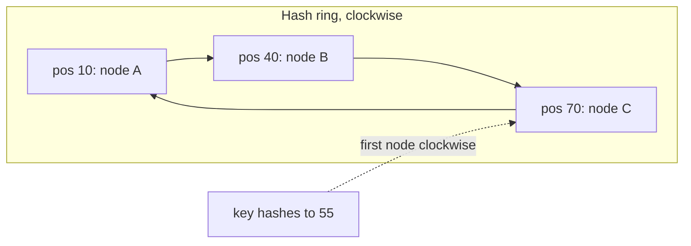
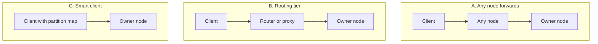

# Partitioning and Sharding

One machine cannot hold all the data or serve all the requests of a large system. Partitioning splits a dataset into parts, and each part lives on a different node. This page explains how to choose the split, how to find the node that owns a key, how to move parts when the cluster changes, and what goes wrong when one part gets more traffic than the others. Replication copies the same data to several nodes. It has its own page: [replication](05-replication.md). Real systems combine both: each partition has several replicas.

## Why It Matters

Interviewers ask "How do you scale the database?" in most system design rounds that store data. Read replicas scale reads only. When writes or data size exceed one node, the answer is partitioning: the candidate must name a partition key, say why it spreads the load, and say what the choice makes hard (range scans, joins, transactions across partitions). Strong candidates also know that hash-mod-N breaks when the cluster changes, that consistent hashing fixes this, and that a single hot key defeats any partitioning scheme. On the job, a wrong partition key is one of the most costly mistakes in a data model, because changing it later means moving all the data.

## Core Concepts

**Partition** (also called a shard): one part of a dataset. Each record belongs to exactly one partition. This KB uses "partition" for the logical part and "node" for the machine. In a sharded SQL deployment, people say "shard" for the same thing. In Cassandra the word is "token range", in DynamoDB "partition", in MongoDB "chunk" or "range" (a range of shard key values that a shard owns), and in Vitess "shard".

**Partition key** (or **shard key**): the field of a record that decides the partition. The system applies a function to the key and gets the partition. Every query that knows the key goes to one partition. A query that does not know the key goes to all partitions (a *scatter-gather* query).

**Horizontal and vertical partitioning**: horizontal partitioning (sharding) splits the *rows* of one table across nodes. Vertical partitioning splits the *columns* or the *tables* across nodes (for example, user profiles on one database and orders on another). This page covers horizontal partitioning. Splitting by feature is a step in [microservices](14-microservices-and-monoliths.md).

**Skew**: an uneven distribution of data (some partitions hold more bytes) or of load (some partitions get more requests). **Hot spot**: a partition with so much load that it limits the whole system. **Hot key**: one key that causes a hot spot.

**Range partitioning**: each partition owns a contiguous range of keys, for example A–F, G–M. Neighbouring keys are on the same partition, so a range scan reads one partition or a few. Bigtable, HBase, and MongoDB ranged sharding work this way.

**Hash partitioning**: the system hashes the key, and each partition owns a range of hash values. Keys that are neighbours are far apart after hashing, so the data spreads evenly, and range scans over the key do not work. Cassandra, DynamoDB, and MongoDB hashed sharding work this way.

**Consistent hashing**: a hash scheme that maps keys and nodes to the same circular space. When a node joins or leaves, only the keys next to that node move. Karger et al. introduced it in 1997 for web caches. The paper maps each item to the closest bucket point on the unit interval. Storage systems such as Dynamo use the variant in which the first node clockwise owns the key. Both variants have the property that a new node takes keys only from its neighbours.

**Virtual node (vnode)**: one physical node that owns many positions on the hash ring. Each position is a vnode. Vnodes even out the load and spread the work of a failed node over many nodes.

**Rebalancing**: moving partitions between nodes so that load and storage stay even after a node joins, leaves, or becomes hot.

**Local secondary index** (document-partitioned): each partition indexes only its own records. **Global secondary index** (term-partitioned): one index covers all records and is itself partitioned by the indexed value. Kleppmann (*Designing Data-Intensive Applications*, chapter 6) uses these names.

## How It Works

### Range partitioning

The system splits the key space into ordered ranges and assigns each range to a node. A map of range boundaries tells the router where a key goes.

- Strength: a query such as "all events of user 7 between two dates" reads one contiguous range on one partition if the key is `(user, time)`.
- Weakness: if the key grows with time (a timestamp or an auto-increment id), all new writes go to the last range. One partition takes all write load. The fix is a compound key with a prefix that spreads writes, for example `(sensor_id, time)` instead of `time` alone. The cost is that a time-only range scan becomes one scan per prefix value.
- The boundaries must follow the data, not the key space. Ranges A–F and G–M can hold very different amounts of data, so systems split a range when it grows too big (see dynamic splitting below).

### Hash partitioning and why hash mod N fails

The simplest hash scheme is `node = hash(key) mod N`. It spreads keys evenly. It fails when N changes. If a 4-node cluster becomes a 5-node cluster, a key stays on its node only if `hash mod 4 == hash mod 5`. For random hashes this is true for about 1 key in 5. About 80% of all keys move, and a cache cluster would lose 80% of its hit ratio at once. The program in the [Java Example](#java-example) measures this: 8042 of 10000 keys move.

Because of this, systems whose node count changes do not use `hash mod N` over physical nodes. They use many more partitions than nodes and move whole partitions, or they use a ring. `hash mod N` over a fixed number of *partitions* is common and correct: Kafka's default partitioner hashes the record key modulo the partition count of the topic. The same problem appears there one level up: if you add partitions to a Kafka topic, many keys map to a different partition, and the order of a key across the change is lost.

### Consistent hashing

The hash function maps to a fixed circular space, for example 0 to 2^63 − 1, and position 2^63 − 1 is next to position 0. The system hashes each node to a position on the circle. To find the owner of a key, the system hashes the key and walks clockwise to the first node position. That node owns the key.



When node D joins at position 55, D takes over only the keys between 40 and 55 from node C. All other keys stay where they are. When a node leaves, its keys go to the next node clockwise. On average, a change moves K/N keys (K keys, N nodes after the change). This is the property that hash mod N does not have.

With one position per node, the arcs have very different lengths, so the load is uneven. In the example in this page, 4 nodes with one position each hold 164 to 5863 of 10000 keys. A second problem: when a node fails, all its keys go to one neighbour, which can overload it.

### Virtual nodes

Each physical node takes many positions: `hash("node-A#0")`, `hash("node-A#1")`, and so on. The load of a node is the sum of many small arcs, so it is close to the average. The same example with 256 positions per node gives 2369 to 2698 keys per node. When a node fails, its arcs go to many different neighbours, so the extra load spreads.

Costs of vnodes: the ring has N × V entries, so the routing table is larger, and each node has more neighbours that it must repair and stream data with. A node with more vnodes can take more load: a stronger machine can hold more positions than a weaker one. Cassandra's `num_tokens` setting sets the number of tokens (vnodes) per node. The default is 16 in the current `cassandra.yaml` reference. The Cassandra architecture documentation says that Cassandra 2.x chose tokens at random and needed a high default of 256, and that Cassandra 3.x and later have a deterministic token allocator that keeps the ring balanced with far fewer tokens per node.

**How many points does the theory need?** Karger et al. map each bucket to κ·log C points, where κ is a constant and C is an upper bound on the number of buckets. With that many points, each bucket owns at most an O(1/|V|) fraction of the interval with high probability, where |V| is the number of buckets in the current view.

**The 1/sqrt(V) rule of thumb (a derivation, not a result from the paper).** Assume that N nodes each place V tokens uniformly at random. The share of the hash space that one node owns then follows a Beta(V, (N − 1)V) distribution, with mean 1/N and relative standard deviation sqrt((N − 1) / (NV + 1)). For large N, this is about 1/sqrt(V). For N = 4 and V = 256, it gives 5.4%, and the program below measures deviations of −5% to +8% (the keys add sampling noise). Three limits apply. The rule describes the typical node, not the hottest node, which deviates more. It describes the share of the hash space, not the request load, which also depends on key popularity. It does not apply to Cassandra's deterministic allocator, which does not choose tokens at random.

**Dynamo's three strategies.** The Dynamo paper (DeCandia et al., 2007, section 6.2) describes how Dynamo's partitioning scheme "has evolved over time":

- Strategy 1, "T random tokens per node and partition by token value", was "the initial strategy deployed in production". Its problem: "the schemes for data partitioning and data placement are intertwined". A new node had to scan data on other nodes, and bootstrapping "has taken almost a day to complete" in the busy shopping season.
- Strategy 2, "T random tokens per node and equal sized partitions", divides the hash space into Q equal partitions and uses the tokens only for placement. It "served as an interim setup" during the migration.
- Strategy 3, "Q/S tokens per node, equal-sized partitions", where S is the number of nodes.

The paper reports: "strategy 3 achieves the best load balancing efficiency and strategy 2 has the worst". Compared to strategy 1, strategy 3 "reduces the size of membership information maintained at each node by three orders of magnitude". Because partition ranges are fixed, "a partition can be relocated as a unit by simply transferring the file". The stated disadvantage: "changing the node membership requires coordination in order to preserve the properties required of the assignment". Strategy 3 is the "fixed number of partitions" strategy in the rebalancing table below.

### Rendezvous hashing (highest random weight)

For each key, the client computes a score `hash(node, key)` for every node and picks the node with the highest score. There is no ring and no virtual node. When a node leaves, only the keys that it owned move, and each of them goes to the node with the next-highest score, so the keys spread over all remaining nodes. Thaler and Ravishankar introduced it in 1996 (published in IEEE/ACM Transactions on Networking, 1998).

| | Ring with vnodes | Rendezvous |
|---|---|---|
| Lookup cost | O(log(N × V)) for a sorted map | O(N) hashes per key |
| State | N × V positions | The list of nodes |
| Balance | Depends on V | Uniform, no parameter |
| Typical use | Storage systems with many nodes | Caches and load balancers with tens of nodes |

Recommendation: use a ring with vnodes for a storage system with hundreds of nodes, and rendezvous hashing when the node list is small and you want the simplest correct code. A third family, jump consistent hash (Lamping and Veach, 2014), needs no memory but supports only numbered buckets that grow and shrink at the end, so it fits partitions that do not fail individually.

### Rebalancing strategies

| Strategy | How it works | Used by | Trade-off |
|---|---|---|---|
| Fixed number of partitions | Create many more partitions than nodes (for example 1000 partitions on 10 nodes). A new node steals a few whole partitions from each existing node. The key-to-partition map never changes | Dynamo strategy 3. Kleppmann (DDIA chapter 6) lists Elasticsearch (the primary shard count is set when the index is created) and Couchbase | Easy to implement. The partition count is hard to change later. Too few limits growth, too many adds overhead |
| Dynamic splitting | A partition that exceeds a size limit splits in two. A partition that shrinks merges with a neighbour | HBase regions and Bigtable tablets (DDIA chapter 6). MongoDB ranges: the default range size is 128 MB, and in current versions the cluster splits a chunk only when the balancer must migrate it, so a chunk can grow past the range size | Adapts to data volume. A new empty table starts with one partition and a hot spot, unless the system pre-splits |
| Proportional to the number of nodes | A fixed number of partitions per node. In the design that DDIA describes, a new node picks existing partitions at random, splits them, and takes half of each | Cassandra with vnodes | Partition size stays stable as the cluster grows. Random splits can be uneven. Cassandra 3.x and later reduce this with a token allocator that places new tokens to balance the ring (`allocate_tokens_for_local_replication_factor`, default 3) |

Rules that apply to all strategies:

- Rebalancing moves a lot of data over the network. A throttled, background move protects the production traffic. MongoDB's documentation states that "a single shard can only participate in one chunk migration at a time", and that its balancer starts a migration only when the data size of a collection differs between two shards by at least three times the range size (384 MB for the default 128 MB).
- Automatic rebalancing can add load at the worst moment, for example when a node is slow, because the cluster may read the slowness as a failure and start to move data. Many systems keep a human in the loop for membership changes.
- During a move, the old owner keeps serving until the new owner has a full copy. Then the router switches. MongoDB documents this procedure: the source shard accepts writes for the range during the copy, the destination synchronizes the changes made during the copy, and then the source updates the cluster metadata and deletes its copy.

### Secondary indexes

A query by the partition key goes to one partition. A query by another field needs a secondary index.

| | Local index (document-partitioned) | Global index (term-partitioned) |
|---|---|---|
| Where the index lives | In each partition, covering that partition's records only | Separate, partitioned by the indexed value |
| Write cost | One partition. The index update is local | A write can touch several partitions (the data partition and each index partition) |
| Read cost | Scatter-gather: the query goes to all partitions | One index partition, then the data partitions that it points to |
| Consistency of index | Updated with the data, in the same partition | Often updated asynchronously, so a read can miss a recent write |
| Examples | Cassandra local (per-node) secondary indexes, Elasticsearch, DynamoDB local secondary index (same partition key) | DynamoDB global secondary index |

DynamoDB documents both. A global secondary index is stored separately from the base table and has its own partitions. All reads from a global secondary index are eventually consistent. A local secondary index shares the partition key of the table and supports both read consistency options. See [consistency and CAP](07-consistency-and-cap.md) for the meaning of those terms.

Scatter-gather latency is set by the slowest partition. Assume 100 partitions, each with a p99 latency of 50 ms, and independent latencies. A query that waits for all 100 takes longer than 50 ms in 1 − 0.99^100 = 63% of requests. This is the tail-latency effect that Dean and Barroso describe in "The Tail at Scale".

### Request routing

A client must find the node that owns a key. There are three designs.



| Design | How it works | Example | Trade-off |
|---|---|---|---|
| Any node forwards | The client contacts any node. That node forwards the request to the owner. Nodes learn the map by gossip | Cassandra coordinator node. Dynamo behind a generic load balancer | No extra tier. One extra network hop |
| Routing tier | A proxy holds the map and routes each request | MongoDB `mongos`, Vitess VTGate | Clients stay simple. The tier is one more component to scale and keep available |
| Smart client | The client library holds the map and connects directly to the owner | Cassandra token-aware drivers. Kafka clients, which fetch topic metadata and send each record to the leader of its partition. Dynamo's partition-aware client library | The fewest hops. The client must refresh its map when it changes |

The Dynamo paper (section 4.5) compares the first and third designs. A generic load balancer means that "the client does not have to link any code specific to Dynamo", and a partition-aware client "can achieve lower latency because it skips a potential forwarding step". Vitess documents that it "calculates the sharding key or keys for each query and then routes that query to the appropriate shards". Where does the map live? Either in a coordination service such as ZooKeeper or etcd (see `kb/hld/distributed-systems/02-consensus-and-leader-election.md`), or in the nodes themselves, spread by gossip. When the map is stale, the receiving node rejects or forwards the request, and the client refreshes its map.

### Hot keys and celebrity problems

Even a perfect hash cannot split one key: all requests for one key go to one partition. A celebrity account with 100 million followers, a viral product, or a global counter each create a hot key. DynamoDB documents that every partition "is designed to deliver a maximum capacity of 3,000 read units per second and 1,000 write units per second", so one hot key can hit a hard limit while the table total is far below its limit. The Dynamo paper (section 6.2) states the design assumption that makes hashing work at all: "there are enough keys in the popular end of the distribution" for the load of popular keys to spread over the nodes. A single hot key breaks that assumption.

Fixes, in order of cost:

1. **Cache the hot reads** in front of the partition, with local caches in the application servers (see [caching](03-caching.md)). This removes read load, not write load.
2. **Replicate hot keys** and read from any replica. This spreads reads. It does not spread writes.
3. **Split the key (write sharding)**: add a random or computed suffix to the key, for example `post:42#0` to `post:42#9`. Writes spread over 10 partitions. Reads must query all 10 suffixes and merge. DynamoDB documents this technique as "write sharding".
4. **Aggregate before the write**: buffer counter increments in memory and flush a sum every second, so the partition gets 1 write instead of thousands.
5. **Treat the celebrity differently**: a feed system can fan out the posts of normal users on write, and fetch the posts of celebrities on read. The case study `kb/hld/case-studies/05-news-feed.md` covers this.

DynamoDB documents adaptive capacity (for on-demand and provisioned tables), which shifts capacity toward busy partitions. It does not remove the per-partition maximum.

### Resharding without downtime

The goal: move data to a new layout while the application keeps reading and writing. The common method has four steps.

1. **Copy**: take a consistent snapshot of the source partitions and copy it to the new partitions.
2. **Catch up**: stream the changes that happened during the copy (from the write-ahead log or change stream) to the new partitions, until the lag is near zero.
3. **Verify**: compare the data on both sides, for example by checksums.
4. **Cut over**: stop writes for a short moment, apply the last changes, and switch the router to the new partitions. Keep the old data for a while so that you can switch back.

Vitess describes this process: it copies, verifies, and keeps data up to date on the new shards while the existing shards serve traffic, and the cutover causes a few seconds of read-only downtime (Vitess documentation, "Sharding"). MongoDB lets you change the shard key of a populated collection with `reshardCollection` (MongoDB 5.0 and later), and documents `refineCollectionShardKey` for a finer-grained key.

The alternative is **double writing** in the application: write to the old and the new layout, backfill the old data, verify, then read from the new layout. It needs no database feature, but the application must handle partial failures of the two writes.

Recommendation: choose a partition count that leaves room for ten times the current load, and choose a key that you will not need to change.

### Choosing the partition key

Ask these questions in order.

1. Which query is the most frequent and the most latency-sensitive? The key must make it a single-partition query.
2. Does the key have many distinct values, and are they evenly used? A key such as `country` has few values and a very uneven spread. A key such as `user_id` has many.
3. Does the key put related records together when the application reads them together? Orders of one user on one partition make "my orders" a single-partition query.
4. Does the key grow monotonically (time, auto-increment)? If yes, a range partition will have a hot spot at the end.
5. Which operations cross partitions? Joins, transactions, and unique constraints across partitions are expensive or not supported. See `kb/hld/distributed-systems/03-distributed-transactions.md`.

### Product examples

| System | Scheme | Facts from the documentation |
|---|---|---|
| Cassandra | Hash ring with vnodes | A token is a position on the hash ring. A node holds one or more tokens. The default partitioner is `Murmur3Partitioner`. `num_tokens` defaults to 16. "The partitioner can NOT be changed without reloading all data" |
| DynamoDB | Hash partitioning on the partition key | DynamoDB passes the partition key to an internal hash function, and the result decides the partition. Items with the same partition key and different sort keys stay together, sorted by the sort key. DynamoDB adds partitions when provisioned throughput grows past what the partitions can support, or when a partition is full |
| MongoDB | Chunks of a shard key range | A chunk is a range of shard key values with an inclusive lower and an exclusive upper bound. The balancer migrates chunks to even out the data size per shard. Hashed sharding hashes the shard key, ranged sharding keeps the key order. A chunk that grows past the range size and cannot split is a jumbo chunk. "The most common cause is when a chunk represents a single shard key value" |
| Vitess | Key ranges of a keyspace ID | The primary vindex of a table sets the sharding scheme. Vitess converts sharding keys to a left-justified binary string. A shard name is a hex key range, for example `80-c0`. Shards need not have equal size |

!!! note "Where this topic ends"
    The storage view (how one node stores a partition) is in `kb/databases/06-storage-engines.md`. The database view of scaling, with connection pools and read replicas, is in `kb/databases/09-scaling-a-database.md`. A full key-value store with a ring, replication, and quorums is in `kb/hld/case-studies/03-key-value-store.md`.

## Trade-offs and When to Use

| Choice | Pick it when | Cost |
|---|---|---|
| Range partitioning | Range scans and ordered access matter (time series by device, lookups by prefix) | Hot spots on sequential keys. Needs splitting logic |
| Hash partitioning | Point lookups dominate and an even spread matters | No range scan on the key. Each range query is scatter-gather |
| Hash, then range inside (compound key) | You need an even spread across entities and ordered access inside one entity (DynamoDB partition key + sort key, Cassandra partition key + clustering columns) | The query must name the partition key |
| Fixed number of partitions | The cluster size is known to stay in a range | The partition count is hard to change |
| Dynamic splitting | The data volume is unknown | A new table has one hot partition until it splits |
| Ring with vnodes | The node set changes often, and the system is peer-to-peer | More routing state and repair work |
| Local secondary index | Writes must stay on one partition | Reads by the index fan out to all partitions |
| Global secondary index | Reads by the secondary field must hit one partition | Slower writes, often asynchronous, with stale reads |
| Do not shard yet | One node holds the data and the load with headroom | None. Sharding adds operational cost, so use it only after read replicas, caching, and a larger machine no longer work |

Sharding costs: cross-shard joins, cross-shard transactions, unique constraints across shards, and a more complex deployment. Postpone it until the numbers force it. Assumption: a single modern database node can hold several terabytes and serve tens of thousands of simple queries per second. This is an approximate planning figure with no single source, and it depends on the hardware and the query. Measure your own workload. Many systems need replicas and caches long before they need shards.

## Java Example

The program below is a consistent-hashing ring with virtual nodes. The ring stores positions in a `TreeMap`. A lookup finds the first position at or after the key's hash with `ceilingEntry`, and wraps to the first entry when none exists. The hash is the first 8 bytes of an MD5 digest, so the output is the same on every run. (MD5 is a poor choice for security and a good choice here: it is in the JDK and its output is spread evenly. A production system would use a faster hash such as Murmur3.)

The `main` method does four things: it shows the load per node for 1, 16, and 256 vnodes; it counts the keys that move when a fifth node joins, for the ring and for `hash mod N`; it prints a replica set of three distinct nodes; and it shows how the replica set changes when a node leaves.

```java
import java.nio.charset.StandardCharsets;
import java.security.MessageDigest;
import java.security.NoSuchAlgorithmException;
import java.util.ArrayList;
import java.util.LinkedHashSet;
import java.util.List;
import java.util.Map;
import java.util.Set;
import java.util.TreeMap;

public class Main {
    public static void main(String[] args) {
        List<String> nodes = List.of("node-A", "node-B", "node-C", "node-D");
        int keyCount = 10_000;

        System.out.println("Load per node for " + keyCount + " keys, 4 nodes:");
        for (int vnodes : new int[] {1, 16, 256}) {
            ConsistentHashRing ring = new ConsistentHashRing(vnodes);
            nodes.forEach(ring::addNode);
            Map<String, Integer> load = new TreeMap<>();
            for (int i = 0; i < keyCount; i++) {
                load.merge(ring.nodeFor("user-" + i), 1, Integer::sum);
            }
            System.out.println("  vnodes=" + vnodes + " -> " + load);
        }

        ConsistentHashRing ring = new ConsistentHashRing(256);
        nodes.forEach(ring::addNode);
        String[] before = new String[keyCount];
        for (int i = 0; i < keyCount; i++) {
            before[i] = ring.nodeFor("user-" + i);
        }
        ring.addNode("node-E");
        int movedRing = 0;
        int movedModulo = 0;
        for (int i = 0; i < keyCount; i++) {
            if (!before[i].equals(ring.nodeFor("user-" + i))) {
                movedRing++;
            }
            long h = ConsistentHashRing.hash("user-" + i);
            if (Long.remainderUnsigned(h, 4) != Long.remainderUnsigned(h, 5)) {
                movedModulo++;
            }
        }
        System.out.println("Keys that move when a 5th node joins (of " + keyCount + "):");
        System.out.println("  consistent hashing, 256 vnodes: " + movedRing);
        System.out.println("  hash mod N, N from 4 to 5:      " + movedModulo);

        System.out.println("Replica set (3 distinct nodes) for 'order-42': "
            + ring.preferenceList("order-42", 3));
        ring.removeNode("node-B");
        System.out.println("After removing node-B:                         "
            + ring.preferenceList("order-42", 3));
    }
}

/** A consistent-hashing ring. Each physical node owns many positions (virtual nodes). */
class ConsistentHashRing {
    private final int vnodesPerNode;
    private final TreeMap<Long, String> ring = new TreeMap<>();

    ConsistentHashRing(int vnodesPerNode) {
        this.vnodesPerNode = vnodesPerNode;
    }

    void addNode(String node) {
        for (int i = 0; i < vnodesPerNode; i++) {
            ring.put(hash(node + "#" + i), node);
        }
    }

    void removeNode(String node) {
        for (int i = 0; i < vnodesPerNode; i++) {
            ring.remove(hash(node + "#" + i));
        }
    }

    /** The owner is the first position clockwise from the key, wrapping at the end. */
    String nodeFor(String key) {
        Map.Entry<Long, String> e = ring.ceilingEntry(hash(key));
        return (e != null ? e : ring.firstEntry()).getValue();
    }

    /** Walks clockwise and collects distinct physical nodes, as a replicated store does. */
    List<String> preferenceList(String key, int count) {
        Set<String> result = new LinkedHashSet<>();
        Long position = ring.ceilingKey(hash(key));
        if (position == null) {
            position = ring.firstKey();
        }
        for (Map.Entry<Long, String> e : ring.tailMap(position, true).entrySet()) {
            result.add(e.getValue());
            if (result.size() == count) {
                return new ArrayList<>(result);
            }
        }
        for (Map.Entry<Long, String> e : ring.headMap(position, false).entrySet()) {
            result.add(e.getValue());
            if (result.size() == count) {
                break;
            }
        }
        return new ArrayList<>(result);
    }

    /** The first 8 bytes of the MD5 digest, as an unsigned-comparable long. */
    static long hash(String s) {
        try {
            byte[] d = MessageDigest.getInstance("MD5").digest(s.getBytes(StandardCharsets.UTF_8));
            long h = 0;
            for (int i = 0; i < 8; i++) {
                h = (h << 8) | (d[i] & 0xFF);
            }
            return h >>> 1; // keep 63 bits so signed comparison matches ring order
        } catch (NoSuchAlgorithmException e) {
            throw new IllegalStateException(e);
        }
    }
}
```

The program prints:

<!-- expected-output -->
```text
Load per node for 10000 keys, 4 nodes:
  vnodes=1 -> {node-A=1396, node-B=2577, node-C=164, node-D=5863}
  vnodes=16 -> {node-A=2025, node-B=2568, node-C=1855, node-D=3552}
  vnodes=256 -> {node-A=2698, node-B=2513, node-C=2369, node-D=2420}
Keys that move when a 5th node joins (of 10000):
  consistent hashing, 256 vnodes: 1923
  hash mod N, N from 4 to 5:      8042
Replica set (3 distinct nodes) for 'order-42': [node-C, node-A, node-B]
After removing node-B:                         [node-C, node-A, node-E]
```

Read the output as follows:

- With one position per node, node C holds 164 keys and node D holds 5863. With 256 positions, every node holds between 2369 and 2698 keys, close to the average of 2500.
- When the fifth node joins, 1923 of 10000 keys (about 19%) move on the ring, which is close to the ideal 1/5 = 20%. With `hash mod N`, 8042 keys (about 80%) move, which matches the expected fraction 4/5.
- The `preferenceList` method walks clockwise and skips positions of nodes that it already has. This is how Dynamo-style systems pick N distinct replicas. When `node-B` leaves, the next distinct node takes its place and the other two replicas stay.

## Interview Angle

### Questions

??? question "How do you choose between range and hash partitioning?"

    **Direct answer:** choose by the dominant query. If queries are point lookups by key and the load must spread evenly, use hash partitioning. If queries scan a key range in order, use range partitioning.

    **Reason:** a hash function sends neighbouring keys to different partitions. That spreads load and destroys order, so a range query becomes a scatter-gather over all partitions. A range partition keeps neighbouring keys together, so a scan reads one partition, but a key that grows over time (timestamp, auto-increment id) sends all new writes to the last range.

    **Trade-off and edge case:** most real keys combine both. Use a hash of the entity id as the partition key and the time as the sort key (the DynamoDB and Cassandra model). Writes spread across entities, and a time-range query for one entity reads one partition. The cost is that a query across all entities for one time window must visit every partition.

??? question "Why does `hash(key) mod N` fail when the cluster changes, and how does consistent hashing fix it?"

    **Direct answer:** when N changes from N to N+1, a key stays on its node only if `hash mod N == hash mod (N+1)`. For random hashes that is true for about 1/(N+1) of the keys, so about N/(N+1) of the keys move. For 4 to 5 nodes, that is 80% of the data, and a cache cluster loses 80% of its hit ratio at once.

    **Fix:** consistent hashing maps both keys and nodes to a circle. A key belongs to the first node clockwise from its position. A new node takes over only the arc between itself and its predecessor, so on average K/N keys move (K keys, N nodes after the change).

    **Edge case:** with one position per node the arcs are uneven, so the load is uneven. The fix is virtual nodes. In practice, a second fix is to use many fixed partitions and map partitions to nodes with a table, which is simple and needs no ring.

??? question "What are virtual nodes and what problems do they solve?"

    **Direct answer:** a virtual node is one position on the ring. A physical node owns many of them, spread over the circle.

    **Problems solved:**

    - *Uneven load:* with few positions the arcs differ a lot in length. The sum of many small arcs is close to the average.
    - *Failure spread:* when a node fails, each of its arcs goes to a different neighbour, so the extra load spreads over many nodes and not over one.
    - *Heterogeneous machines:* a node with more capacity takes more positions.
    - *Faster rebuild:* a new node streams data from many peers in parallel.

    **Costs:** a bigger routing table, and more neighbours for repair and streaming. Cassandra's current default is 16 tokens per node. Earlier versions used 256, and the documentation states that the newer allocator works with a lower count.

??? question "Design the sharding for an orders database with 2 billion orders. What is your shard key?"

    **Direct answer:** shard by `customer_id` with hash partitioning, and keep an order's items on the same shard as the order.

    **Reason:** the most frequent queries are "orders of this customer" and "this order by id". With `customer_id` as the key, "orders of this customer" is a single-shard query. Hashing spreads customers evenly. For lookup by order id, embed the customer id or a shard id in the order id (see [unique ID generation](15-unique-id-generation.md)), so the router finds the shard without a lookup.

    **Trade-offs:** queries across customers (for example, "all orders placed today") become scatter-gather. Serve them from a separate analytics store that a change stream feeds. Do not put a global secondary index on the order date: all of today's orders would write to one index partition, which is the monotonic-key hot spot again. If an order id does not carry the shard, the system needs a lookup table from order id to customer id, which is itself a partitioned table. A very large business customer can create a hot shard, so I would monitor per-key load and split such tenants onto dedicated shards. Transactions across customers (for example, a marketplace order with several sellers) need a saga or two-phase commit (`kb/hld/distributed-systems/03-distributed-transactions.md`).

    **Capacity check (approximate):** 2 billion orders at 1 KB is 2 TB. With a 500 GB target per shard that is 4 shards at the minimum. I would start with 64 logical partitions on 4 nodes, so that growth means moving partitions and not rehashing.

??? question "A celebrity account makes one partition hot. What do you do?"

    **Direct answer:** first identify whether the load is reads or writes, because the fixes differ.

    - *Hot reads:* add a cache in front of the partition and replicate the hot key. A local cache in each application server removes most of the load.
    - *Hot writes:* split the key with a suffix (`key#0` to `key#9`) so writes spread over 10 partitions, and merge on read. Or aggregate in memory and flush a sum.
    - *Fan-out systems:* do not fan out a celebrity's post on write. Store it once and let followers fetch it on read.

    **Edge case:** a hash function cannot split one key, so no partition scheme alone fixes a hot key. DynamoDB's adaptive capacity moves capacity toward busy partitions, but each partition keeps a hard maximum (3,000 read units and 1,000 write units per second in the documentation).

??? question "Local or global secondary index: which do you choose?"

    **Direct answer:** it depends on whether writes or reads by the secondary field matter more.

    A local index lives in each partition, next to the data. A write touches one partition, and the index is always consistent with the data. A read by the indexed field must ask all partitions (scatter-gather), and its latency is that of the slowest partition. A global index is partitioned by the indexed value. A read goes to one index partition. A write can touch several partitions, so systems usually update global indexes asynchronously, and a read can miss a recent write (DynamoDB: all reads from a global secondary index are eventually consistent).

    **Choice:** if the field is used in many low-latency reads and the application accepts a short delay, use a global index. If the query is rare, or must be consistent, or the data set per query is small, use a local index or query the primary store.

??? question "How do you reshard a live database with no downtime?"

    **Direct answer:** copy, catch up, verify, and cut over.

    1. Create the new partitions and copy a snapshot of the source into them.
    2. Stream the change log of the source into the new partitions until the lag is near zero.
    3. Verify the data with checksums or row counts.
    4. Stop writes for a short time, apply the last changes, switch the router, and resume writes. Keep the old data until you are sure.

    **Reference:** Vitess documents this flow, with a cutover of a few seconds of read-only time. MongoDB provides `reshardCollection` for a new shard key.

    **Edge cases:** the copy adds load to the source, so throttle it. Writes during the cutover must go to one owner only, otherwise two copies diverge. The rollback plan is to reverse the stream, so the old layout stays current for a while after the cutover.

??? question "How does a client find the node that owns a key?"

    **Direct answer:** there are three designs: any node forwards the request (Cassandra coordinator), a routing tier holds the map (MongoDB `mongos`, Vitess VTGate), or the client library holds the map and connects directly.

    **Trade-offs:** forwarding costs one extra hop and needs no extra component. A routing tier keeps clients simple but is one more component to scale and make highly available. A smart client has the fewest hops but must refresh its map and must handle a stale map.

    **Where the map lives:** in a coordination service (ZooKeeper, etcd) that serves as the source of truth, or in the nodes themselves, spread by gossip. The map changes rarely, so clients cache it and refresh on a "wrong node" response.

??? question "When do you use rendezvous hashing instead of a hash ring?"

    **Direct answer:** use rendezvous hashing when the node list is short (tens of nodes) and you want a scheme with no tuning parameter.

    The client hashes the pair (node, key) for each node and picks the node with the highest score. The result is uniform without virtual nodes, and when a node leaves, only its keys move, each to the node with the next-highest score, so the load of the departed node spreads over all other nodes. The cost is O(N) hashes per lookup, which is too slow for thousands of nodes. A ring with vnodes costs O(log(N × V)) per lookup with a sorted structure, and the ring also fits peer-to-peer storage systems that need to know the ordered neighbours of a key to place replicas.

??? question "What breaks when you shard a relational database?"

    **Direct answer:** everything that spans more than one shard: joins, transactions, unique constraints, foreign keys, and global aggregates.

    - *Joins:* a join across shards needs a scatter-gather and a merge in the application or the router. Keep joined tables on the same shard by using the same shard key (co-location), and copy small reference tables to every shard.
    - *Transactions:* a transaction across shards needs two-phase commit or a saga.
    - *Unique constraints:* a unique index is per shard. A global unique value needs a central id generator or a shard-aware scheme.
    - *Auto-increment ids:* each shard would produce the same ids. Use an id generator.
    - *Operations:* schema changes must roll out to all shards, and backups must be consistent across shards.

    **Recommendation:** delay sharding. Use replicas, caching, and a bigger node first, and use a system such as Vitess that moves part of this work into a routing layer.

### Follow-up Questions

??? question "How many virtual nodes per physical node?"

    Enough that the load imbalance stays within the tolerance of the system, and few enough that routing state and repair stay cheap. Karger et al. use κ·log C points per bucket (C is an upper bound on the bucket count). With random tokens, the typical node deviates from the mean share by about 1/sqrt(V), so 16 tokens give about 25% and 256 tokens about 6%. Cassandra defaults to 16 tokens per node in the current documentation (256 in older versions). The practical answer is to measure the load spread of the key distribution that you expect, and to pick the smallest count that meets the target.

??? question "What happens to the data of a node that fails on a ring?"

    With replication, the next nodes clockwise already hold copies, because the replica set of a key is the next N distinct nodes on the ring. Reads and writes continue on the other replicas. The cluster then either waits for the node to return (and replays hinted writes) or streams data to a replacement. See [replication](05-replication.md).

??? question "Why not use a lookup table from key to node instead of a hash?"

    A lookup table gives full control (you can put any key anywhere), but it must hold one entry per key, so it grows with the data, it needs its own partitioning, and every lookup reads it. A hash needs no state. Systems that need control use a table at the level of partitions (thousands of entries), not at the level of keys.

??? question "How does a ring handle nodes with different capacities?"

    Give a stronger node more virtual nodes. The `cassandra.yaml` reference states: "The more tokens, relative to other nodes, the larger the proportion of data that this node will store." It adds: "You probably want all nodes to have the same number of tokens assuming they have equal hardware capability." Dynamo section 4.2 gives the same reason for virtual nodes: the count per node "can be decided based on its capacity".

### Red Flags

- Proposing `hash(key) mod N` for a cluster that grows, without mentioning the data movement.
- Choosing `country`, `status`, or a boolean as the shard key.
- Choosing a timestamp or an auto-increment id as the range key for a write-heavy table.
- Saying "consistent hashing solves hot keys". It balances keys, not load on a single key.
- Sharding at the start of a design with a few gigabytes of data, without stating why a single node with replicas does not work.
- Ignoring cross-shard queries, joins, and transactions after choosing a shard key.
- Saying that a global secondary index is always consistent with the base data.

## Common Mistakes

| Mistake | Why it hurts | Fix |
|---|---|---|
| A low-cardinality shard key (`country`, `status`) | A few partitions hold most data, and the partition count cannot grow past the number of key values | Use a key with many values, or a compound key |
| A monotonic range key | All new writes hit the last partition | Hash a prefix or add a bucket to the key |
| Too few partitions in a fixed-partition design | The cluster cannot grow past the partition count | Pick a count that leaves room for ten times growth |
| Hash mod N on physical nodes | 80% of the data moves when a node joins (4 to 5 nodes) | Use a ring, rendezvous hashing, or fixed partitions mapped to nodes |
| One ring position per node | The load varies by more than 30 times in the example in this page | Use vnodes |
| No plan for a hot key | One key reaches the limit of one partition | Cache, split the key, or aggregate before the write |
| Scatter-gather on the hot path | The query latency is the latency of the slowest partition | Co-locate related data, or use a global index |
| Rebalancing at full speed | The move competes with production traffic | Throttle the move, and run it at low load |
| A cross-shard transaction without a plan | The system loses atomicity or becomes slow | Keep a transaction in one shard by design, or use a saga |
| Choosing the shard key without a query list | The most frequent query turns out to be scatter-gather | List the top queries first, then pick the key |

## Commonly Confused With

| Looks like | Difference | Deciding question |
|---|---|---|
| Partitioning and replication | Partitioning splits the data across nodes. Replication copies the same data to several nodes. Most systems do both | Does the problem concern the size and load of the data (partition) or its availability and read scale (replicate)? |
| Sharding and partitioning | Sharding is partitioning across several nodes. "Partitioning" in a database such as PostgreSQL can mean splitting a table inside one node | Do the parts live on different machines? |
| Consistent hashing and a hash ring with a table | Consistent hashing places keys by their hash. A table of fixed partitions places partitions by a map | Do you need a router with no central state (ring), or full control of placement (table)? |
| Consistent hashing and load balancing | Both use the technique, but a load balancer uses it to keep the same client on the same server (see [load balancing](02-load-balancing-dns-cdn.md)). A store uses it to place data | Does the key have to find stored data (partitioning) or only a stable choice of server (balancing)? |
| Local and global secondary index | A local index is per partition. A global index is partitioned by the indexed value | Must a read by the secondary field hit one partition? |
| Range partition and range scan | A range partition keeps neighbouring keys together. A range scan is a query that needs this | Do queries read ordered ranges of the key? |
| Vertical partitioning and sharding | Vertical partitioning splits columns or tables. Sharding splits rows | Do you split by feature (vertical) or by key (horizontal)? |

## Quick Reference Card

- Partition for size and write load. Replicate for availability and read load. Do both.
- Pick the key from the top query. Many distinct values, even use, related data together, no monotonic growth.
- Range: scans work, hot spot on sequential keys. Hash: even spread, no scans.
- Compound key: hash the entity, order inside it.
- Hash mod N moves about N/(N+1) of the keys when N changes. A ring moves about 1/(N+1).
- Vnodes even out load and spread the load of a failed node. Cassandra: 16 tokens by default in the current documentation.
- Rendezvous hashing: highest `hash(node, key)` wins. O(N) per lookup. No parameter.
- Rebalancing: fixed partitions, dynamic splitting, or proportional to nodes. Throttle the move.
- Local index: cheap writes, scatter-gather reads. Global index: one-partition reads, costly and often delayed writes.
- Routing: any node forwards, a routing tier, or a smart client. The map lives in a coordination service or spreads by gossip.
- Hot key: cache, replicate, split the key with a suffix, aggregate, or avoid fan-out. Hashing cannot split one key.
- Live resharding: copy, catch up, verify, cut over.
- Do not shard before replicas, caches, and a larger node stop being enough.

## Further Reading

- Karger, Lehman, Leighton, Panigrahy, Levine, Lewin. "Consistent Hashing and Random Trees: Distributed Caching Protocols for Relieving Hot Spots on the World Wide Web". Proceedings of the 29th ACM Symposium on Theory of Computing (STOC), 1997, pages 654–663. The original paper. Read it for the definition and the balance argument.
- DeCandia et al. "Dynamo: Amazon's Highly Available Key-value Store". SOSP 2007: <https://www.allthingsdistributed.com/files/amazon-dynamo-sosp2007.pdf>. Section 6.2 compares three partitioning strategies, sections 4.2 and 4.3 describe the ring, virtual nodes, and the preference list, and section 4.5 compares load-balancer routing with a partition-aware client.
- Thaler and Ravishankar. "Using Name-Based Mappings to Increase Hit Rates". IEEE/ACM Transactions on Networking 6(1), 1998. The source of rendezvous hashing.
- Lamping and Veach. "A Fast, Minimal Memory, Consistent Hash Algorithm". arXiv:1406.2294, 2014. Jump consistent hash.
- Kleppmann. *Designing Data-Intensive Applications*, chapter 6 (Partitioning). Range and hash partitioning, secondary indexes, rebalancing, and request routing.
- Dean and Barroso. "The Tail at Scale". Communications of the ACM 56(2), 2013. Why scatter-gather queries are slow at the tail.
- Apache Cassandra documentation, "Dynamo" architecture page: <https://cassandra.apache.org/doc/latest/cassandra/architecture/dynamo.html>. Tokens, vnodes (why Cassandra 2.x needed 256 tokens and how the 3.x allocator lowers the count), replication, and consistency levels.
- Apache Cassandra documentation, `cassandra.yaml` reference: <https://cassandra.apache.org/doc/latest/cassandra/managing/configuration/cass_yaml_file.html>. The defaults for `num_tokens` and the partitioner.
- Amazon DynamoDB Developer Guide, "Partitions and data distribution": <https://docs.aws.amazon.com/amazondynamodb/latest/developerguide/HowItWorks.Partitions.html>. How the partition key maps to a partition.
- Amazon DynamoDB Developer Guide, "Best practices for designing and using partition keys effectively": <https://docs.aws.amazon.com/amazondynamodb/latest/developerguide/bp-partition-key-design.html>. Per-partition limits, adaptive capacity, and write sharding.
- MongoDB Manual, "Data Partitioning with Chunks": <https://www.mongodb.com/docs/manual/core/sharding-data-partitioning/>. Chunks, the balancer, and jumbo chunks.
- MongoDB Manual, "Sharded Cluster Balancer": <https://www.mongodb.com/docs/manual/core/sharding-balancer-administration/>. Migration thresholds, the range migration procedure, and when chunks split.
- Vitess documentation, "Sharding": <https://vitess.io/docs/reference/features/sharding/>. Keyspaces, vindexes, key ranges, and resharding.
