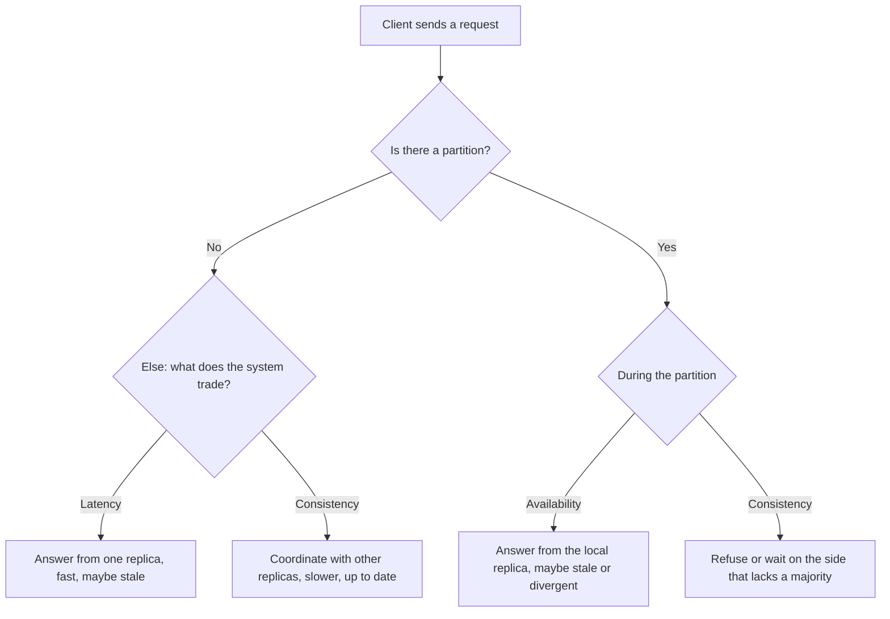

# Consistency and the CAP Theorem

A replicated system must decide what a reader sees after a write, and what the system does when nodes cannot talk to each other. This page states the CAP theorem as Gilbert and Lynch proved it, explains why the slogan "pick two of three" misleads, adds the PACELC trade-off that applies when no failure happens, lists the consistency models from strongest to weakest with an example of each, explains quorums with a runnable simulation, and gives a procedure for the interview question "is your system CP or AP?". Replication itself (leaders, followers, lag, failover) has its home in [replication](05-replication.md). Splitting data across nodes is in [partitioning and sharding](06-partitioning-and-sharding.md).

## Why It Matters

CAP is the most quoted and most misquoted result in system design. Interviewers use it to separate candidates who repeat a slogan from candidates who reason about the behavior of a system under failure. "Is this system CP or AP?" appears in many rounds, usually after the candidate picks a database. A good answer names the operation, the failure, the consistency model, and the cost. On the job, the same reasoning decides whether a payment path may read from a replica, whether a shopping cart accepts writes in a minority partition, and which Cassandra or DynamoDB read option a service uses.

## Core Concepts

**Replica**: one copy of a piece of data on one node.

**Network partition**: a failure in which the network splits the nodes into groups that cannot exchange messages with each other. Each group can still run. A partition also covers the case in which messages are delayed for so long that a node must act without them. Brewer (2012) states this view: "pragmatically, a partition is a time bound on communication".

**Linearizability** (also called atomic consistency or strong consistency): every operation appears to take effect at a single instant between its start and its end, and all operations appear in one total order that respects real time. If write W finishes before read R starts, then R sees W or a later write. Herlihy and Wing defined it in 1990. This is the meaning of "consistency" in the CAP theorem.

**Availability** (in CAP): every request that a non-failing node receives gets a response. This is a stronger statement than "the service has high uptime". See the precise definition below.

**Atomic consistency**: Gilbert and Lynch's name for linearizability of a read/write object. This page uses "linearizability".

**Eventual consistency**: if no new writes arrive, all replicas converge to the same value after some time. The model says nothing about what a read returns before convergence.

**Quorum**: the minimum number of replicas that must take part in an operation. N is the number of replicas of an item, W the number of replicas that must acknowledge a write, and R the number of replicas that a read contacts.

**Staleness**: a read returns a value that is older than the latest committed write.

**Latency**: the time between the request and the response. PACELC adds latency to the trade-off, because coordination between replicas costs round trips.

## How It Works

### The CAP theorem as Gilbert and Lynch proved it

Brewer presented the conjecture in an invited talk at PODC in 2000. Brewer (2012) writes that the idea "first appeared in fall 1998" and was published in 1999. Gilbert and Lynch proved a formal version in 2002 ("Brewer's Conjecture and the Feasibility of Consistent, Available, Partition-Tolerant Web Services", ACM SIGACT News 33(2)). The proof makes three terms exact. The quotes are from the paper.

| Term | Meaning in the proof |
|---|---|
| Consistency | Atomic data objects, which is linearizability: "there must exist a total order on all operations such that each operation looks as if it were completed at a single instant". A consequence: "any read operation that begins after a write operation completes must return that value, or the result of a later write operation" |
| Availability | "Every request received by a non-failing node in the system must result in a response." The paper adds that this "puts no bound on how long the algorithm may run before terminating", but that every request must terminate "even when severe network failures occur" |
| Partition tolerance | "The network will be allowed to lose arbitrarily many messages sent from one node to another." In a partition, "all messages sent from nodes in one component of the partition to nodes in another component are lost" |

**Theorem 1 (Gilbert and Lynch, quoted):** "It is impossible in the asynchronous network model to implement a read/write data object that guarantees the following properties: Availability; Atomic consistency in all fair executions (including those in which messages are lost)."

The *asynchronous network model* has no clocks: "nodes must make decisions based only on the messages received and local computation". A *fair execution* is one in which every enabled process keeps taking steps, so no node simply stops.

**Proof sketch.** Split the nodes into two non-empty, disjoint sets, G1 and G2. The object starts with value v0, and every message between G1 and G2 is lost. Execution α1: a client writes v1 to a node in G1. By availability, the write completes. Execution α2: a client reads from a node in G2, and no write happens. By availability, the read returns, and it must return v0. Now run α1 and then α2. The nodes in G2 receive no message from G1, so they cannot tell this combined execution from α2 alone, and the read again returns v0. The read began after the write completed, so linearizability requires v1. This contradiction proves the theorem. In a real system the choice appears as: G2 answers with v0 (it gives up consistency), or G2 waits for G1 and does not answer (it gives up availability).

**Corollary 1.1 (a stronger result).** In the asynchronous model, it is also impossible to guarantee availability in all fair executions and atomic consistency only "in fair executions in which no messages are lost". The reason, in the paper's words: "an algorithm has no way of determining whether a message has been lost, or has been arbitrarily delayed". So in a network with no clocks, an always-available system cannot be linearizable even in the runs in which the network loses nothing.

!!! warning "What the theorem does not say"
    - It does not say that you must give up one property all the time. The theorem is about what happens *during a partition*. When the network is healthy, a system that uses timeouts can be consistent and available. Gilbert and Lynch show this in the partially synchronous model (below). In the purely asynchronous model, which has no timeouts, Corollary 1.1 rules even this out.
    - "Partition tolerance" is not a property that you can choose to drop. Partitions happen in any system that spans more than one node (a network link, a switch, or a slow node can cause them). A system that is "CA" is a system that does not tolerate partitions, which for a distributed system means it stops or breaks during one. A single-node database is "CA" only because it is not distributed.
    - "Consistency" in CAP is linearizability of one object. It is not the "C" of ACID (which means that a transaction keeps the invariants of the database).
    - "Availability" in CAP means that *every* non-failing node answers *every* request. A system with 99.99% uptime that refuses requests on the minority side of a partition is not "available" in the CAP sense. A system that answers every request, but possibly with stale data, is.
    - The theorem covers a read/write register. It does not describe transactions, and it says nothing about latency.

Gilbert and Lynch also discuss the *partially synchronous* model (section 4). In it, "every node has a clock, and all clocks increase at the same rate", but the clocks are not synchronized. Every message "is either delivered within a given, known time: t_msg, or it is lost". Because the bound is known, a node can use a timeout to decide that a message was lost.

- **Theorem 2:** the impossibility still holds. No algorithm gives availability and atomic consistency "in all executions (even those in which messages are lost)".
- **The difference from the asynchronous model:** the analogue of Corollary 1.1 does not hold. The paper describes algorithms that "will return atomic data when all messages in an execution are delivered (i.e., there are no partitions), and will only return inconsistent (and, in particular, stale) data when messages are lost". Its example is a central node with a timeout: if the central node does not answer within 2·t_msg + t_local, the local node answers with the best value that it knows.
- **Delayed-t consistency (section 4.4):** a weaker condition that allows stale reads during a partition, but requires atomicity when no message is lost and bounds how long the staleness lasts after the partition heals.

This is the formal basis for the practical rule: be linearizable while the network works, and decide what to give up only when a timeout fires.

### Why "pick two" misleads

The slogan says: choose any two of Consistency, Availability, Partition tolerance. Formally, the slogan is not false: Gilbert and Lynch (section 3.2) show that any two of the three are achievable. It misleads about design. Brewer wrote in "CAP Twelve Years Later: How the 'Rules' Have Changed" (IEEE Computer 45(2), 2012) that the "2 of 3" formulation "was always misleading because it tended to oversimplify the tensions among properties". His points, with his words in quotes:

1. **The choice exists only during a partition.** "Because partitions are rare, there is little reason to forfeit C or A when the system is not partitioned."
2. **The choice is fine-grained.** "The choice between C and A can occur many times within the same system at very fine granularity; not only can subsystems make different choices, but the choice can change according to the operation or even the specific data or user involved."
3. **The properties are not binary.** "All three properties are more continuous than binary." Availability runs from 0 to 100%, consistency has many levels, and "even partitions have nuances, including disagreement within the system about whether a partition exists".
4. **Plan the partition itself.** The strategy "should have three steps: detect partitions, enter an explicit partition mode that can limit some operations, and initiate a recovery process to restore consistency and compensate for mistakes made during a partition." In partition mode, the system either limits some operations (less availability) or records extra information about operations for use in recovery. Brewer's examples: an ATM in "stand-in mode" limits net withdrawals to a fixed amount, and a system can record the intent to charge a credit card and execute it after recovery.
5. **Latency is part of the picture.** "Operationally, the essence of CAP takes place during a timeout", when the program must choose to "cancel the operation and thus decrease availability" or "proceed with the operation and thus risk inconsistency". Abadi builds on this (below).

Kleppmann ("A Critique of the CAP Theorem", arXiv:1509.05393, 2015) adds that the CAP definitions of availability and consistency are narrow, and that labeling a whole database "CP" or "AP" is therefore often wrong, since one database offers several options per operation.



### PACELC

Abadi ("Consistency Tradeoffs in Modern Distributed Database System Design: CAP is Only Part of the Story", IEEE Computer 45(2), 2012) points out that CAP "only posits limitations in the face of certain types of failures, and does not constrain any system capabilities during normal operation". In normal operation a replicated system still trades consistency against *latency*: to give a consistent read, a replica must coordinate with others, and coordination takes at least one round trip. Across regions, a round trip is tens to hundreds of milliseconds (approximate, depending on distance; this figure is not from the paper).

Abadi's definition: "if there is a partition (P), how does the system trade off availability and consistency (A and C); else (E), when the system is running normally in the absence of partitions, how does the system trade off latency (L) and consistency (C)?" He adds that "the latency/consistency tradeoff (ELC) only applies to systems that replicate data".

| Class | During a partition | Without a partition | Examples (Abadi's 2012 classification, default configurations) |
|---|---|---|---|
| PA/EL | Favor availability | Favor latency | Dynamo, Cassandra, Riak |
| PC/EC | Favor consistency | Favor consistency | VoltDB/H-Store, Megastore. "BigTable and related systems such as HBase are also PC/EC" |
| PA/EC | Favor availability | Favor consistency | MongoDB (the 2012 version). Abadi notes that it is technically not available in the CAP sense, because the minority side is unavailable. He classifies it PA because a partition causes "more consistency issues than availability issues": the old primary keeps unreplicated writes in a rollback directory, and the new primary diverges from it |
| PC/EL | Favor consistency | Favor latency | PNUTS. Abadi warns that "PC does not indicate that the system is fully consistent". It means that the system "does not reduce consistency beyond the baseline consistency level when a network partition occurs—instead, it reduces availability" |

Treat the examples as a snapshot of the paper, not of the current products. Products have added settings since 2012, and a configuration can move a product between classes. For example, DynamoDB's `ConsistentRead` and Cassandra's consistency levels let the caller choose per request.

Abadi's argument for why PACELC matters: the reason that many systems give up consistency is mostly *latency*, not the rare partition. In his words, "reduced consistency is attributable to runtime latency, not CAP". PNUTS is his clearest example: it serves stale reads in normal operation to cut latency, and yet it chooses consistency during a partition. A replica that waits for a remote acknowledgement adds the round trip to every write.

### Consistency models, from strongest to weakest

A **consistency model** is a contract that states which values a read may return. Stronger models are easier to program against and cost more coordination, so they have higher latency and lower availability under partition.

The models form a partial order, not a single line. The Jepsen consistency map shows these implications for single objects: linearizable implies sequential, sequential implies causal, causal implies writes-follow-reads and PRAM (pipelined RAM: every process sees the writes of each single process in the order in which that process made them), and PRAM implies monotonic reads, monotonic writes, and read-your-writes. The four session guarantees do not imply each other. The table lists the models from stronger to weaker along that order. Consistent prefix is not on the Jepsen map. Kleppmann (DDIA chapter 5) describes it as a guarantee against replication lag.

Jepsen also classifies availability. A model is *totally available* if every non-failing node can serve every request during a partition. It is *sticky available* if a node can serve every client that keeps talking to the same node. Sequential consistency and linearizability cannot be totally available. Causal consistency and read-your-writes can be at most sticky available. Monotonic reads, monotonic writes, and writes-follow-reads can be totally available.

| Model | Guarantee | Example | Cost |
|---|---|---|---|
| Linearizability | All operations appear in one total order that respects real time. A read after a completed write sees that write or a later one | A lock service or leader election that stores the current leader (etcd, ZooKeeper writes). A bank balance on a single account | Needs a quorum or a single leader on every operation, so latency is high and a minority partition cannot serve |
| Sequential consistency | All processes see operations in one total order, and each process's operations stay in its program order. The order need not match real time (Lamport, 1979) | Two users post comments. Everyone sees the same order of the two comments, but a reader may see it later than another reader | Cheaper than linearizability, but still needs a global order. Cannot be totally available |
| Causal consistency | If operation A may have caused operation B (a read then a write, or a reply to a message), every node sees A before B. Unrelated operations can appear in any order | A reply to a comment never appears before the comment | Needs dependency tracking (version vectors or timestamps). Sticky available: a client that stays on one replica keeps working during a partition |
| Read-your-writes (session guarantee) | A client always sees its own earlier writes | After you change your profile photo, you see the new photo at once, while others may see the old one for some time | Route the client to the leader, or to a replica that has its write, or pass a version token |
| Monotonic reads (session guarantee) | A client that has seen a value never sees an older value later | A user refreshes a page and the comment count never goes back from 12 to 10 | Pin a client to one replica, or pass a version token |
| Consistent prefix (DDIA, not on the Jepsen map) | If a sequence of writes happens in a certain order, a reader sees them in that order | A reader sees the question before the answer, never only the answer | Keep related writes on one partition, or track causal order |
| Eventual consistency | If writes stop, all replicas converge. No promise before that | The follower count of a social account. DNS | Cheapest. Application must tolerate stale and out-of-order reads |

Terry et al. (1994, the Bayou system) defined the session guarantees: read-your-writes, monotonic reads, writes-follow-reads, and monotonic writes. Causal consistency implies all four: writes-follow-reads directly, and the other three through PRAM.

The anomalies that replication lag causes, and their fixes, are in [replication](05-replication.md).

### Quorums

In a replicated store with **N** replicas per item, a write waits for **W** acknowledgements, and a read asks **R** replicas and takes the newest version that it sees. Gifford introduced weighted voting in 1979, and the Dynamo paper (DeCandia et al., 2007) made the (N, R, W) notation common.

**The rule:** if **R + W > N**, every set of R replicas overlaps every set of W replicas in at least one replica. So a read always contacts at least one replica that has the latest acknowledged write.

Example with N = 3:

| W | R | R + W | Effect |
|---|---|---|---|
| 2 | 2 | 4 > 3 | A read overlaps every acknowledged write. Tolerates 1 failed replica for both reads and writes |
| 3 | 1 | 4 > 3 | Fast reads, slow writes, writes fail if any replica is down |
| 1 | 3 | 4 > 3 | Fast writes, reads fail if any replica is down |
| 1 | 1 | 2 <= 3 | Fastest. A read can miss the latest write. Eventual consistency |
| 2 | 1 | 3 = 3 | A read can miss the latest write (the Java example shows this) |

The [Java Example](#java-example) enumerates every choice of replicas to show the rule.

**What R + W > N does not guarantee.** The overlap is a necessary base for linearizability and it is not sufficient. Abadi (2012) writes that Dynamo-style systems "cannot achieve full consistency as defined by Gilbert and Lynch, even if R + W > N". Kleppmann (*Designing Data-Intensive Applications*, chapters 5 and 9) lists these edge cases:

- *Sloppy quorums and hinted handoff:* if the nodes that should hold the key are unreachable, the system writes to other nodes and hands the data back later. Then the W nodes need not be among the N home nodes, and the overlap is lost until the hints are delivered.
- *Concurrent writes:* two writes to the same key can arrive at replicas in different orders. If the system resolves them with last-write-wins by timestamp, a clock skew can drop a write that appeared later in real time.
- *Concurrent read and write:* a read that overlaps a write can see the new value on one replica and the old value on another. Two readers can then see different orders (the new value, then the old one), which linearizability forbids, unless the reader repairs the replicas before it returns.
- *Failed write that left traces:* a write that reached fewer than W replicas reports failure, but the replicas that got it keep the value, and a later read can return it.
- *A restored replica:* if a node with a new value fails and the system restores it from a replica with an old value, the count of replicas with the new value can fall below W.

**How to get linearizable reads and writes from quorums.** The reader must perform read repair synchronously: if it sees replicas with an older version, it writes the newest version to them before it returns. The writer must first read the latest version from a quorum. This is the algorithm of Attiya, Bar-Noy, and Dolev (1995). It makes a read/write register linearizable at the cost of an extra round trip. It does not give a linearizable compare-and-set, which needs consensus (Kleppmann, DDIA chapter 9).

**How stale are partial quorums?** Bailis et al. ("Probabilistically Bounded Staleness for Practical Partial Quorums", VLDB 2012) model and measure the probability that a partial quorum (R + W <= N) returns a stale value, as a function of the time since the write.

A quorum also sets the latency: the coordinator waits for the W-th (or R-th) fastest reply. A smaller quorum reduces tail latency, because it skips the slowest replicas.

### Tunable consistency in Cassandra and DynamoDB

**Cassandra.** Each read and write request carries a *consistency level* (CL). The documentation defines:

| CL | Meaning in the documentation |
|---|---|
| `ONE` | Only a single replica must respond |
| `QUORUM` | A majority (n/2 + 1) of the replicas must respond |
| `LOCAL_QUORUM` | A majority of the replicas in the local datacenter (the datacenter of the coordinator) must respond |
| `EACH_QUORUM` | A majority of the replicas in each datacenter must respond |
| `ALL` | All of the replicas must respond |
| `ANY` | A single replica may respond, or the coordinator may store a hint. Accepted for writes only |

The documentation also lists `TWO`, `THREE`, and `LOCAL_ONE`. In `n/2 + 1`, the division is integer division. It states: "Write operations are always sent to all replicas, regardless of consistency level." The level sets how many replicas must acknowledge before the coordinator answers the client. For a read, the coordinator contacts only enough replicas to satisfy the level (plus one more if speculative retry fires). With a replication factor of 3, `QUORUM` is 2. Reads at `QUORUM` and writes at `QUORUM` give R + W = 4 > 3, so a read overlaps a write. `LOCAL_QUORUM` avoids the cross-region round trip and so lowers latency. It gives the overlap inside one datacenter only. The documentation calls hinted handoff and read repair "only best-effort". Anti-entropy repair, which compares Merkle trees of the replicas, is the mechanism that makes all replicas converge.

**DynamoDB.** A read is *eventually consistent* by default. The caller can set `ConsistentRead` to true on `GetItem`, `Query`, and `Scan`, and DynamoDB then "returns a response with the most up-to-date data, reflecting the updates from all prior write operations that were successful". Eventually consistent reads cost half as much as strongly consistent reads. Strongly consistent reads work on tables and local secondary indexes. All reads from a global secondary index or a stream are eventually consistent. A global table (multi-Region) has two modes: multi-Region eventual consistency (the default, in which replication typically completes within a second) and multi-Region strong consistency, in which DynamoDB replicates the write synchronously to another Region before it returns.

!!! note "Reading the product facts"
    The two products solve the same problem with different knobs. Cassandra exposes the quorum sizes (the caller picks a level per request). DynamoDB exposes one choice (eventual or strong read) and hides the replica count. Both let one application mix choices: a payment read at the strong setting, a feed read at the weak setting.

### How to answer "is your system CP or AP?"

Do not answer with one word. Use this procedure:

1. **Name the operation.** "For which operation: the write of an order, or the read of the product page?" The answer can differ per operation.
2. **State the invariant that the operation must keep.** "No two users hold the same seat" needs consistency. "The like count is within a few percent" does not.
3. **Say what happens during a partition.** The side that holds a majority of replicas (or the leader) continues. The other side either refuses (consistency) or answers with local data (availability).
4. **Say what the user sees.** An error and a retry, or a stale value, or an accepted write that the system merges later.
5. **Say what you do without a partition.** Name the latency cost of the consistent path (PACELC).
6. **Name the repair.** For the available choice: read repair, anti-entropy, conflict resolution (see `kb/hld/distributed-systems/06-crdts-and-conflict-resolution.md`), and compensation. For the consistent choice: timeouts, retries, and degraded modes.

| System | Choice per operation | Reason |
|---|---|---|
| Bank transfer | Consistency. Refuse in the minority partition | Money must not be created or lost |
| Seat booking | Consistency per seat | Two owners of one seat is a business error |
| Shopping cart (Dynamo) | Availability. Accept writes and merge carts later | A lost "add to cart" costs more than an extra item. The Dynamo paper chose this design |
| Social feed or like count | Availability and eventual consistency | A stale count is harmless |
| Leader election, lock | Consistency | Two leaders corrupt data |
| User profile | Read-your-writes for the owner, eventual for others | The owner must see own edits |
| Inventory display vs checkout | Display: eventual. Checkout reservation: consistent | The page can be stale. The last-item decision cannot |

Recommendation: give this answer in the form "For operation X, I choose consistency/availability, because the invariant is Y. During a partition, Z happens. Without a partition, it costs this much latency."

## Trade-offs and When to Use

| Choice | Gain | Cost | Use it when |
|---|---|---|---|
| Linearizable reads and writes | No stale reads. Simple reasoning | Higher latency (a quorum or a leader round trip). A minority partition cannot serve. Lower throughput | Money, locks, uniqueness, leader election, inventory of scarce items |
| Sequential consistency | A single order that all clients agree on | Still needs global ordering | A total order matters but real-time order does not |
| Causal consistency | No effect before its cause. Sticky available during a partition (a client that stays on one replica keeps working) | Dependency metadata. A client that moves to another replica may have to wait | Collaboration, comment threads, chat |
| Session guarantees | The user sees own writes and does not go back in time | Sticky routing or version tokens | User-facing reads after writes on replicated stores |
| Eventual consistency | Lowest latency. Highest availability | Stale reads, conflicts, merge logic | Counters, feeds, caches, catalogs, analytics |
| Strong quorum (R + W > N) | Reads overlap writes | Latency of the slowest replica in the quorum. Lower availability | Cassandra at `QUORUM`, DynamoDB strong reads |
| Weak quorum (R + W <= N) | Low latency. Survives more failures | Stale reads | Data that tolerates staleness |

A mixed design is the usual answer: strong consistency on a small set of operations that keep invariants, and weak consistency on the rest.

## Java Example

The program below simulates one key on N = 3 replicas. It writes version 2 to a subset of W replicas, and then reads every subset of R replicas and takes the newest version that the read sees. It prints what each read returns for three (W, R) pairs. With R + W > N, every read returns `v2`. With R + W <= N, some reads return the stale `v1`. The program does not model failures, concurrency, or clocks, so it shows only the overlap rule.

```java
import java.util.ArrayList;
import java.util.List;

public class Main {
    public static void main(String[] args) {
        System.out.println("N=3, W=2, R=2 (R + W > N): read after write, every replica choice");
        run(3, 2, 2);
        System.out.println("N=3, W=1, R=1 (R + W <= N): read after write, every replica choice");
        run(3, 1, 1);
        System.out.println("N=3, W=2, R=1 (R + W = N): read after write, every replica choice");
        run(3, 2, 1);
    }

    /** For each W-subset of replicas: writes "v2" to it, then reads every R-subset. */
    static void run(int n, int w, int r) {
        for (List<Integer> writeSet : subsets(n, w)) {
            Replica[] replicas = new Replica[n];
            for (int i = 0; i < n; i++) {
                replicas[i] = new Replica(1, "v1");
            }
            for (int i : writeSet) {
                replicas[i] = new Replica(2, "v2");
            }
            StringBuilder line = new StringBuilder("  write reached " + writeSet + ":");
            for (List<Integer> readSet : subsets(n, r)) {
                Replica newest = replicas[readSet.get(0)];
                for (int i : readSet) {
                    if (replicas[i].version() > newest.version()) {
                        newest = replicas[i];
                    }
                }
                line.append(" read").append(readSet).append("=").append(newest.value());
            }
            System.out.println(line);
        }
    }

    static List<List<Integer>> subsets(int n, int size) {
        List<List<Integer>> out = new ArrayList<>();
        collect(n, size, 0, new ArrayList<>(), out);
        return out;
    }

    static void collect(int n, int size, int from, List<Integer> cur, List<List<Integer>> out) {
        if (cur.size() == size) {
            out.add(new ArrayList<>(cur));
            return;
        }
        for (int i = from; i < n; i++) {
            cur.add(i);
            collect(n, size, i + 1, cur, out);
            cur.remove(cur.size() - 1);
        }
    }
}

/** One replica's copy of a single key: a version number and a value. */
record Replica(int version, String value) {}
```

The program prints:

<!-- expected-output -->
```text
N=3, W=2, R=2 (R + W > N): read after write, every replica choice
  write reached [0, 1]: read[0, 1]=v2 read[0, 2]=v2 read[1, 2]=v2
  write reached [0, 2]: read[0, 1]=v2 read[0, 2]=v2 read[1, 2]=v2
  write reached [1, 2]: read[0, 1]=v2 read[0, 2]=v2 read[1, 2]=v2
N=3, W=1, R=1 (R + W <= N): read after write, every replica choice
  write reached [0]: read[0]=v2 read[1]=v1 read[2]=v1
  write reached [1]: read[0]=v1 read[1]=v2 read[2]=v1
  write reached [2]: read[0]=v1 read[1]=v1 read[2]=v2
N=3, W=2, R=1 (R + W = N): read after write, every replica choice
  write reached [0, 1]: read[0]=v2 read[1]=v2 read[2]=v1
  write reached [0, 2]: read[0]=v2 read[1]=v1 read[2]=v2
  write reached [1, 2]: read[0]=v1 read[1]=v2 read[2]=v2
```

Read the output as follows:

- For W = 2, R = 2, each write set of two replicas and each read set of two replicas share at least one replica, so every read sees `v2`.
- For W = 1, R = 1, a read sees `v2` only if it contacts the one replica that got the write.
- For W = 2, R = 1 (R + W = N), a read that contacts the one replica outside the write set returns `v1`. The rule needs R + W *greater than* N.

## Interview Angle

### Questions

??? question "State the CAP theorem precisely."

    **Direct answer:** Gilbert and Lynch (2002): "It is impossible in the asynchronous network model to implement a read/write data object that guarantees the following properties: Availability; Atomic consistency in all fair executions (including those in which messages are lost)."

    **Definitions:** consistency means atomic consistency, which is linearizability (one total order of operations that respects real time). Availability means that "every request received by a non-failing node in the system must result in a response", with no time bound. Partition tolerance means the network may "lose arbitrarily many messages sent from one node to another". The asynchronous model has no clocks, so a node cannot tell a lost message from a slow one.

    **Reason, as a short proof:** split the nodes into two groups and lose every message between them. A write to the first group completes, because the system is available. A later read from the second group must also return, and the second group has seen nothing of the write, so it returns the old value. That breaks linearizability.

    **Edge cases:**

    - The result covers one read/write object. It says nothing about transactions or latency.
    - In the asynchronous model, Corollary 1.1 is even stronger: an always-available system cannot be linearizable even in the runs with no lost messages. In the partially synchronous model (clocks and a known message delay), a system can be linearizable while no messages are lost and return stale data only during a partition. That is why "the choice exists only during a partition" is true for real systems that use timeouts.
    - A system that runs on more than one node cannot choose to drop partition tolerance.
    - "Pick two" is a misleading summary. Brewer (2012) wrote that the formulation "was always misleading".

??? question "Why is 'pick two of three' misleading?"

    **Direct answer:** because a system does not pick P. Partitions happen, so the real choice is between C and A *when a partition occurs*, and many systems make that choice per operation.

    **Reasons:**

    - Partitions are rare, so a system has both properties most of the time (Brewer, 2012).
    - C and A are not binary. Weaker models such as causal consistency, and partial availability (some operations or some users served), sit between the extremes.
    - Latency matters in the no-partition case, and CAP ignores it. Abadi's PACELC adds it.
    - CAP's "availability" and "consistency" are narrow definitions, so labeling a whole product "CP" or "AP" hides its per-request options (Kleppmann, 2015).

??? question "What is PACELC and why does it add something to CAP?"

    **Direct answer:** PACELC says that if there is a partition, the system trades availability against consistency (PAC), and else, in normal operation, it trades latency against consistency (ELC). Abadi proposed it in 2012.

    **Reason:** CAP describes only the failure case, but replication costs latency in every request. A consistent read or write needs coordination with other replicas, which costs at least one round trip, and across regions that is tens to hundreds of milliseconds. Many systems that look "AP" chose weak consistency to cut this latency.

    **Example:** the default configurations of Dynamo, Cassandra, and Riak are PA/EL in Abadi's paper (available during a partition, low latency otherwise). VoltDB/H-Store, Megastore, and Bigtable/HBase are PC/EC. PNUTS is PC/EL: it serves stale reads in normal operation for latency, and during a partition it refuses updates to data whose master is on the other side. PNUTS shows Abadi's main point: the reason to weaken consistency is often latency, not partitions. In practice, per-request settings (Cassandra consistency levels, DynamoDB `ConsistentRead`) let one application sit in different classes for different operations.

??? question "Explain linearizability, sequential consistency, causal consistency, and eventual consistency with an example each."

    **Linearizability:** every operation takes effect at one instant between its start and end, and all clients agree on one order that respects real time. Example: a lock service. If client A acquired the lock and the call returned, client B's later acquire must fail.

    **Sequential consistency:** all clients see the same total order, and each client's operations keep their program order, but the order may lag behind real time. Example: two users post, everyone sees the same order of the two posts, and a user may see it a little later than another.

    **Causal consistency:** operations that are causally related appear in the same order for everyone, and unrelated operations can differ. Example: a reply never appears before the comment that it answers.

    **Eventual consistency:** if writes stop, replicas converge. Example: a follower count that updates a few seconds late, or a DNS record that spreads as caches expire.

    **Order of strength:** linearizable is stronger than sequential, which is stronger than causal, which is stronger than eventual. The full order is partial: causal implies the session guarantees (read-your-writes, monotonic reads, monotonic writes, writes-follow-reads), and those do not imply each other. A stronger model costs more latency and more availability. On the Jepsen map, sequential and linearizable cannot be totally available, and causal can be at most sticky available (a client must stay on one replica).

??? question "What are read-your-writes and monotonic reads, and how do you provide them on replicated storage?"

    **Direct answer:** read-your-writes means a client always sees its own earlier writes. Monotonic reads means a client that read a value never later reads an older value.

    **Why they fail:** with asynchronous replication, a client can write to the leader and then read from a follower that has not yet applied the write. A second read can then go to a different, more lagging follower and show older data than the first read.

    **Fixes:**

    - Read your own data from the leader for a short time after a write, or always for data that the user owns.
    - Carry a version token (a log position or a timestamp) with the client. A replica serves the read only if it has reached that token, and otherwise the read waits or goes elsewhere.
    - Pin a client to one replica (a hash of the user id) to get monotonic reads.

    **Trade-off:** sticky routing breaks when the replica fails, so the client must then carry its token to a new replica. See [replication](05-replication.md).

??? question "Explain quorums. What does R + W > N guarantee, and what does it not guarantee?"

    **Direct answer:** with N replicas, a write waits for W acknowledgements and a read contacts R replicas. If R + W > N, every read set overlaps every acknowledged write set in at least one replica, so a read contacts a replica with the latest acknowledged write, and the read returns the newest version that it finds.

    **Example:** N = 3, W = 2, R = 2. Any two replicas overlap any other two replicas in at least one replica.

    **What it does not guarantee:** linearizability. Abadi (2012) states that Dynamo-style systems "cannot achieve full consistency as defined by Gilbert and Lynch, even if R + W > N". Counter-examples: sloppy quorums (the W replicas are not the home replicas), concurrent writes resolved by last-write-wins with skewed clocks, a read that runs concurrently with a write and sees the new value on one replica and the old one on another, a write that failed after it reached some replicas, and a replica restored from an older copy.

    **How to close the gap:** for a linearizable read/write register, the reader repairs stale replicas synchronously before it returns, and the writer reads the latest version from a quorum before it writes (Attiya, Bar-Noy, and Dolev, 1995). This costs an extra round trip. A linearizable compare-and-set or a unique-name check needs consensus (Raft, Paxos).

    **Latency effect:** the coordinator waits for the R-th or W-th fastest replica. A smaller quorum lowers tail latency and weakens the guarantee.

??? question "How does tunable consistency work in Cassandra and DynamoDB?"

    **Cassandra:** the client sets a consistency level on each request. `ONE` needs one replica to respond. `QUORUM` needs a majority (n/2 + 1), and `LOCAL_QUORUM` a majority in the local data center. `ALL` needs all replicas. Cassandra always sends writes to all replicas, and the level decides how many acknowledgements the coordinator waits for. With replication factor 3, `QUORUM` reads and `QUORUM` writes give R + W = 4 > 3.

    **DynamoDB:** reads are eventually consistent by default. A caller sets `ConsistentRead` to get a read that reflects all prior successful writes. An eventually consistent read costs half of a strongly consistent read. A global secondary index offers eventually consistent reads only. A global table can run in a multi-Region strong consistency mode, in which the write is replicated synchronously to another Region before it returns.

    **Trade-off:** the strong option adds latency and cost, and lowers availability when replicas are unreachable. Use it for reads that guard an invariant, and use the default for the rest.

??? question "Is your system CP or AP?"

    **Direct answer:** I would not give one label for the whole system. It depends on the operation. Here is how I decide, for a ticket booking system.

    - *Reserving the last seat:* consistency. Two buyers must not get one seat, so the write goes through a leader or a quorum, and a client on the minority side of a partition gets an error and retries.
    - *Browsing events and showing "seats left":* availability. A stale number is acceptable, so reads go to any replica or a cache.
    - *Without a partition:* the reservation pays one extra round trip for the consistent path, and the browse path does not.
    - *After a partition:* replicas repair themselves with read repair and anti-entropy, and stale caches expire.

    **Why not one label:** most databases offer both choices through settings, and CAP's definitions of C and A are narrow, so a system rarely fits one box. Naming the operation, the invariant, the behavior in a partition, and the latency cost shows that I understand the trade-off.

??? question "Why can a system with leader-based replication not be fully available during a partition?"

    **Direct answer:** because a consistent system must send each write to the leader, and the followers on the other side of the partition cannot reach it.

    If followers accept writes on their own, two leaders exist, and the data diverges (split brain). If followers refuse writes, the minority side is unavailable in the CAP sense. A consensus protocol such as Raft keeps the majority side working and makes the minority side wait (see `kb/hld/distributed-systems/02-consensus-and-leader-election.md`). The system is "available" for clients that reach the majority, and not available for the others, which is exactly the CAP trade-off.

??? question "A user updates a profile and then sees the old profile. What happened, and how do you fix it?"

    **Direct answer:** a read-your-writes violation. The write went to the leader and the read went to a follower that had not yet applied the write (replication lag).

    **Fixes:** route reads of the user's own profile to the leader, or pass a version token from the write response and let a replica serve the read only when it has applied up to that token, or write through to the cache that the read path uses. Reads of other users' profiles can stay eventual.

    **Trade-off:** routing to the leader adds load to the leader, so apply it only to the data that the user just wrote, for a short time.

### Follow-up Questions

??? question "Can a system be CA?"

    A distributed system cannot rule out partitions, so it must choose between C and A when one happens. Brewer (2012): "If the choice is CA, and then there is a partition, the choice must revert to C or A." He gives one useful reading of CA: "choosing CA should mean that the probability of a partition is far less than that of other systemic failures, such as disasters or multiple simultaneous faults". He notes that most groups "design for CA within a single site" (a traditional database in one datacenter), and that partitions inside a datacenter are less likely but "indeed possible, which makes a CA goal problematic". In an interview, say that you cannot drop P on more than one node, that "CA" in practice means "we assume the network inside this site does not partition", and that you choose between C and A when it does.

??? question "What is the difference between the C in CAP and the C in ACID?"

    The C in CAP is linearizability of single objects: all clients see one order of operations that respects real time. The C in ACID is that a transaction moves the database from one valid state to another, so it keeps the application's invariants. Brewer (2012): "In ACID, the C means that a transaction preserves all the database rules, such as unique keys. In contrast, the C in CAP refers only to single-copy consistency, a strict subset of ACID consistency." Gilbert and Lynch add in a footnote that atomic consistency "refers only to a property of a single request/response operation sequence", while database consistency refers to transactions. Brewer also writes that "Isolation is at the core of the CAP theorem": serializable isolation needs communication between nodes, so a system that requires it "can operate on at most one side during a partition". Isolation is covered in `kb/databases/04-transactions-and-isolation.md`.

??? question "How does a system stay linearizable under partition?"

    It lets only the side with a majority (or the leader that a majority backs) accept operations. The minority side refuses or waits. Consensus protocols (Raft, Paxos) work this way, so the cost is lost availability on the minority side and a round trip to a majority for every operation.

??? question "What happens after a partition heals in an AP system?"

    The replicas hold divergent versions. The system must detect the conflict and resolve it: last-write-wins by timestamp (it can lose writes), version vectors with merge in the application (the Dynamo shopping cart), or CRDTs (data types that merge without conflict). See `kb/hld/distributed-systems/06-crdts-and-conflict-resolution.md`. The system must also compensate for the side effects of operations that it accepted during the partition.

??? question "Why does a cross-region write cost so much?"

    A consistent write must reach a quorum, and if the quorum spans regions, the write waits for the round trip between regions, which is tens to hundreds of milliseconds (approximate, and it depends on the distance). Systems reduce this with a local quorum (Cassandra `LOCAL_QUORUM`), a leader per region, or weaker consistency across regions. See `kb/hld/fundamentals/19-multi-region-and-disaster-recovery.md`.

### Red Flags

- "CAP means you can only pick two", with no mention of the partition condition.
- "Our system is CA."
- Labeling a whole database "CP" or "AP" with no reference to the operation or to the settings.
- Using "consistency" for ACID consistency and CAP consistency without saying which.
- Claiming that R + W > N gives linearizability.
- Forgetting that eventual consistency needs conflict handling, and not saying how conflicts get resolved.
- Using the strongest consistency for every operation, with no mention of latency cost.
- Ignoring the latency side of the trade-off (PACELC).

## Common Mistakes

| Mistake | Why it hurts | Fix |
|---|---|---|
| Treating CAP as a property of a product | One product offers several modes, and the choice differs per operation | Decide per operation and per invariant |
| Ignoring the no-partition case | The latency cost of consistency affects every request | Use PACELC: state the latency cost |
| Confusing CAP consistency with ACID consistency | The two terms mean different things | Say "linearizable" for CAP |
| Assuming that R + W > N means linearizable | Sloppy quorums, clock skew, and concurrent operations break it | Use consensus or read repair for linearizability, or accept the weaker guarantee |
| Using last-write-wins everywhere | A clock skew drops a newer write | Use version vectors or merge types |
| Reading from followers right after a write | The user sees old data | Use read-your-writes: leader read or version token |
| Using strong consistency for counters and feeds | Higher latency and lower availability with no benefit | Use eventual consistency where staleness is harmless |
| Using eventual consistency for money or uniqueness | Double spend, duplicate usernames | Use a consistent path for the invariant |
| Setting `ALL` in Cassandra to be "safe" | One failed replica fails every request | Use `QUORUM` or `LOCAL_QUORUM` |
| No plan for partition recovery | Divergent state stays for good | Define detection, partition mode, and recovery (Brewer 2012) |

## Commonly Confused With

| Looks like | Difference | Deciding question |
|---|---|---|
| Consistency in CAP and consistency in ACID | CAP: linearizability of a replicated object. ACID: a transaction keeps the database invariants | Is the question about replicas that agree, or about transactions that keep rules? |
| Availability in CAP and uptime (nines) | CAP: every non-failing node answers every request. Uptime: the fraction of time that the service responds (see [scalability and availability](01-scalability-and-availability.md)) | Is the question about behavior in a partition or about a percentage over a year? |
| Linearizability and serializability | Linearizability: one object, real-time order. Serializability: transactions on many objects behave as if run one at a time, in any order | Does the guarantee cover one object in real time, or whole transactions? |
| Strong consistency and strong isolation | Consistency concerns replicas. Isolation concerns concurrent transactions on one database | Are the clashing parties replicas or transactions? |
| Eventual consistency and no consistency | Eventual consistency promises convergence once writes stop | Does the system promise that replicas converge? |
| Quorum and consensus | A quorum is a count of replicas. Consensus is a protocol that makes nodes agree on one value | Do the replicas need one agreed order (consensus), or only an overlap of read and write sets (quorum)? |
| Replication lag and a partition | Lag is a delay in a healthy network. A partition is a break in communication | Is the delay temporary and bounded, or are nodes unreachable? |

## Quick Reference Card

- CAP (Gilbert and Lynch, 2002): in the asynchronous network model, no read/write object guarantees both availability (every request to a non-failing node gets a response) and atomic consistency (linearizability) in all fair executions, including those that lose messages.
- With timeouts (partially synchronous model), a system can be linearizable while no messages are lost, so the choice appears only during a partition. P is not optional on more than one node.
- "Pick two" is a slogan that Brewer (2012) called "always misleading": detect the partition, enter partition mode, recover and compensate.
- PACELC (Abadi, 2012): if Partition, A or C. Else, Latency or Consistency.
- Models, strong to weak (a partial order, Jepsen map): linearizable, sequential, causal, PRAM, session guarantees (read-your-writes, monotonic reads, monotonic writes, writes-follow-reads), eventual. Causal and read-your-writes are at most sticky available.
- Quorum: R + W > N makes read and write sets overlap. It does not alone give linearizability.
- Cassandra: `ONE`, `QUORUM` (n/2 + 1), `LOCAL_QUORUM`, `ALL`, set per request. DynamoDB: eventual read by default, `ConsistentRead` for a strong read, global secondary index reads are eventual.
- "CP or AP?" Answer per operation: invariant, behavior in a partition, behavior without a partition, repair.
- Money, locks, uniqueness, leaders: consistent. Feeds, counters, caches: available.

## Further Reading

- Gilbert and Lynch. "Brewer's Conjecture and the Feasibility of Consistent, Available, Partition-Tolerant Web Services". ACM SIGACT News 33(2), 2002, pages 51–59: <https://users.ece.cmu.edu/~adrian/731-sp04/readings/GL-cap.pdf>. The proof. Read it for the exact definitions, Corollary 1.1, and the partially synchronous model.
- Brewer. "CAP Twelve Years Later: How the 'Rules' Have Changed". IEEE Computer 45(2), 2012, pages 23–29. The author's correction of "pick two", with partition mode, recovery, and the ATM example.
- Abadi. "Consistency Tradeoffs in Modern Distributed Database System Design: CAP is Only Part of the Story". IEEE Computer 45(2), 2012, pages 37–42. The source of PACELC and the classification of systems.
- Attiya, Bar-Noy, and Dolev. "Sharing Memory Robustly in Message-Passing Systems". Journal of the ACM 42(1), 1995. The quorum algorithm that makes a read/write register linearizable.
- Kleppmann. "A Critique of the CAP Theorem". arXiv:1509.05393, 2015. Why the CAP definitions are narrow.
- Kleppmann. *Designing Data-Intensive Applications*, chapter 5 (replication, quorums) and chapter 9 (consistency and consensus). The edge cases of quorums and the definitions of linearizability.
- Herlihy and Wing. "Linearizability: A Correctness Condition for Concurrent Objects". ACM TOPLAS 12(3), 1990. The definition of linearizability.
- Lamport. "How to Make a Multiprocessor Computer That Correctly Executes Multiprocess Programs". IEEE Transactions on Computers, 1979. The definition of sequential consistency.
- Terry et al. "Session Guarantees for Weakly Consistent Replicated Data". PDIS 1994. Read-your-writes, monotonic reads, and the other session guarantees.
- DeCandia et al. "Dynamo: Amazon's Highly Available Key-value Store". SOSP 2007. Sloppy quorums, hinted handoff, and version vectors in production.
- Bailis et al. "Probabilistically Bounded Staleness for Practical Partial Quorums". VLDB 2012. How stale partial quorums are in practice.
- Jepsen consistency models map: <https://jepsen.io/consistency/models>. The relations between the models and their availability (total, sticky).
- Apache Cassandra documentation, "Dynamo" architecture page: <https://cassandra.apache.org/doc/latest/cassandra/architecture/dynamo.html>. Consistency levels, hinted handoff, read repair.
- Amazon DynamoDB Developer Guide, "DynamoDB read consistency": <https://docs.aws.amazon.com/amazondynamodb/latest/developerguide/HowItWorks.ReadConsistency.html>. Eventually consistent and strongly consistent reads, and global table consistency modes.
