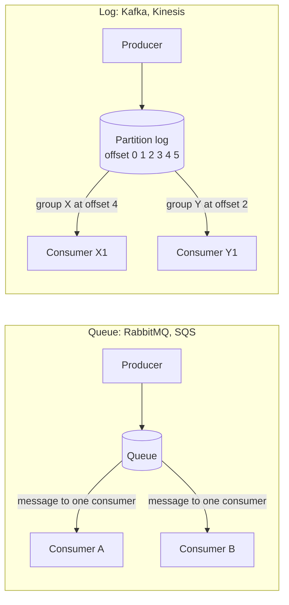
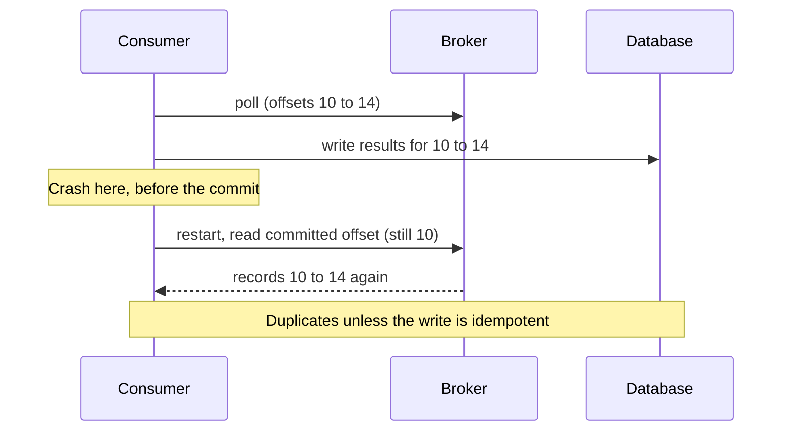
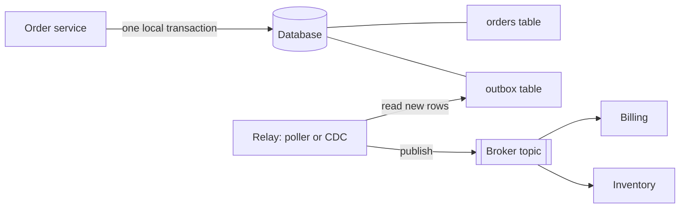

# Message Queues and Streams

A message broker is a server that sits between the services that send data (producers) and the services that process it (consumers). It stores each message until a consumer handles it. This page compares the two main broker designs, the queue and the log, and covers the topics that system design interviews probe: delivery semantics, ordering, consumer groups, offsets, backpressure, dead-letter queues, retries, and the transactional outbox pattern. The page states facts about Apache Kafka, RabbitMQ, Amazon SQS, and Amazon Kinesis Data Streams from their official documentation. For the in-process version of a broker (one JVM, no network), see the [pub-sub case study](../../lld/case-studies/15-pub-sub-message-queue/README.md). For the use of events as an architecture style, see [event-driven architecture](16-event-driven-architecture.md).

## Why It Matters

Almost every system design answer contains a box labeled "queue" or "Kafka": a notification system, a news feed fan-out, an order pipeline, a metrics pipeline, a web crawler frontier. Interviewers use the box to test five things: whether you know why you put it there (decoupling, buffering, fan-out, replay), whether you can state what delivery guarantee you get, whether you can keep order where order matters, whether you can handle a message that always fails, and whether you know that "exactly-once" has a precise and narrow meaning. On the job, the same skills decide whether a consumer outage loses data, whether a retry storm takes down a database, and whether a deployment duplicates a payment. A wrong answer here, such as "Kafka gives exactly-once, so I do not need idempotency", is a common reason for a down-level.

## Core Concepts

**Message**: a unit of data that a producer sends. It has a payload and often a key and headers. **Event**: a message that records a fact that already happened ("OrderPlaced"). **Command**: a message that asks a service to do something ("ChargeCard"). See [event-driven architecture](16-event-driven-architecture.md) for the difference.

**Producer** sends messages. **Consumer** receives and processes them. **Broker** is the server that stores messages between the two.

**Queue**: a broker structure in which each message goes to one consumer, and the broker removes the message after the consumer acknowledges it. Several consumers share one queue to split the work. This pattern is called *competing consumers*. RabbitMQ queues and Amazon SQS queues work this way.

**Log (stream)**: an append-only, ordered sequence of records that the broker keeps for a retention period, whether or not any consumer has read them. Consumers do not remove records. Each consumer tracks its own position. Kafka topics and Kinesis streams work this way. Many people say "stream" for a log that consumers read in order.

**Topic**: a named log (Kafka) or a named channel (RabbitMQ exchange, SNS). **Partition**: one ordered log that is a slice of a topic. A topic with N partitions holds N independent logs. Kafka calls it a partition. Kinesis calls it a *shard*.

**Offset**: the position of a record in a partition. Kafka assigns offsets 0, 1, 2, and so on. The offset of a record never changes (Kafka design documentation, log compaction). A consumer commits the offset of the next record that it will read, and after a restart it continues from the committed offset.

**Consumer group**: a set of consumers that share a subscription so that they split the work. In Kafka, each partition goes to exactly one consumer in a group at a time. Each group reads the whole topic independently of other groups.

**Acknowledgement (ack)**: a signal from a consumer to a broker that says "I finished this message". In a queue, the ack removes the message. In a log, the consumer commits an offset instead, which acknowledges all earlier records of the partition at once.

**Delivery semantics**:

| Name | Meaning | How it fails |
|---|---|---|
| At-most-once | The broker delivers each message zero or one times | A message can be lost. No duplicates |
| At-least-once | The broker delivers each message one or more times | A message can arrive twice. No loss |
| Exactly-once | The effect of each message happens once | See [Exactly-Once: What It Covers](#exactly-once-what-it-covers). The scope is narrow |

**Idempotent operation**: an operation that has the same effect when you run it once or many times. "Set the status to SHIPPED" is idempotent. "Add 10 to the balance" is not. An *idempotent consumer* produces the same final state when it receives the same message twice.

**Backpressure**: a mechanism that slows producers, or stops pulling new work, when consumers cannot keep up. Without it, queues grow without bound or components crash.

**Consumer lag**: the number of records between the end of a partition and the position of a consumer (Kafka). For a queue, the equivalent measure is the queue depth (the number of messages that wait) and the age of the oldest message.

**Dead-letter queue (DLQ)**: a separate queue that holds messages that the system could not process after a set number of attempts. **Poison message**: a message that always fails, for example one with a malformed payload.

**Retention**: how long a broker keeps a record. **Log compaction**: a Kafka retention mode that keeps at least the latest record for each key and removes older records of the same key.

**Visibility timeout** (SQS): the time during which SQS hides a received message from other consumers. If the consumer does not delete the message before the timeout ends, the message becomes visible again and SQS can deliver it again.

## How It Works

### Queue and Log Side by Side



| Property | Queue (RabbitMQ, SQS) | Log (Kafka, Kinesis) |
|---|---|---|
| Who tracks progress | The broker tracks each message (delivered, acked) | Each consumer group tracks one offset per partition |
| After consumption | The broker deletes the message on ack | The record stays until retention removes it |
| Replay of old data | Not possible after the ack | Possible: the consumer rewinds the offset |
| Several independent readers | Needs a copy of the message per reader (fan-out exchange or SNS in front) | Native: each group reads the log on its own |
| Parallelism limit | Number of consumers on the queue | Number of partitions (per group) |
| Per-message features | Per-message ack, retry count, delay, priority, DLQ | Mostly none. The app builds retry and DLQ topics |
| Ordering | One queue gives an order. Several competing consumers and redelivery break it | Total order inside one partition. No order across partitions |

The Kafka design documentation explains why consumers *pull*: "A pull-based system has the nicer property that the consumer simply falls behind and catches up when it can." A push-based broker controls the rate, so a slow consumer can be overwhelmed. Pull is the reason that Kafka needs no explicit backpressure protocol.

### Kafka Write Path

1. The producer picks a partition. If the record has a key, the default partitioner computes the murmur2 hash of the serialized key and takes it modulo the partition count (`toPositive(murmur2(key)) % numPartitions` in the client source), so equal keys go to the same partition. If the record has no key, the producer uses a *sticky* partition: it sends records to one partition until at least `batch.size` bytes have gone to it, and then it switches to another partition (producer configuration, `partitioner.class`).
2. The producer batches records per partition and sends the batch to the *leader* of the partition.
3. The leader appends the batch to its log file. Each partition has one leader and several follower replicas. The *in-sync replica set* (ISR) holds the leader and the followers that keep up.
4. Follower replicas fetch the batch from the leader.
5. Kafka treats a write as *committed* only when all in-sync replicas have it: "A write to a Kafka partition is not considered committed until all in-sync replicas have received the write." The setting `min.insync.replicas` sets a floor: the partition accepts writes (with `acks=all`) only while the ISR has at least that many members. If the ISR is smaller, the producer gets a `NotEnoughReplicas` error. The default is 1, so with the defaults a write succeeds when the leader is the only in-sync replica, and a failure of that leader can lose the write. Recommendation: replication factor 3 with `min.insync.replicas=2` for data that must not be lost.
6. With `acks=all` (the default in current producer documentation), the leader acknowledges the producer after the commit.

Replication has its home in [replication](05-replication.md). Partition placement has its home in [partitioning and sharding](06-partitioning-and-sharding.md).

Kafka reads and writes the log sequentially, and it serves a consumer that has caught up from the operating system page cache. The design documentation names these as the reasons for its throughput: sequential disk access, and the `sendfile` system call that moves data from the page cache to the network without extra copies.

### Consumer Groups and Partition Assignment

Kafka gives each partition to exactly one consumer in a group. The consequences:

- With 4 partitions and 2 consumers, each consumer reads 2 partitions.
- With 4 partitions and 5 consumers, one consumer gets no partition and stays idle. The partition count is the upper limit of parallelism of one group.
- A second group reads the same topic with its own offsets and does not affect the first group.

A *group coordinator* (a broker) tracks the group members. A *rebalance* is the event in which the group reassigns partitions. A rebalance runs when a consumer joins, leaves, or stops sending heartbeats, or when the subscription changes. The consumer settings that matter (defaults from the Kafka consumer configuration documentation):

| Setting | Default | Effect |
|---|---|---|
| `session.timeout.ms` | 45000 | The coordinator removes a consumer that sends no heartbeat for this time. Classic protocol only: with `group.protocol=consumer`, the broker setting `group.consumer.session.timeout.ms` controls it |
| `heartbeat.interval.ms` | 3000 | The consumer sends a heartbeat this often. Keep it at no more than one third of the session timeout. Classic protocol only: with `group.protocol=consumer`, the broker setting `group.consumer.heartbeat.interval.ms` controls it |
| `max.poll.interval.ms` | 300000 | The consumer must call `poll()` at least this often. If not, the group treats the consumer as failed and rebalances |
| `max.poll.records` | 500 | The maximum number of records that one `poll()` returns |
| `partition.assignment.strategy` | `RangeAssignor`, `CooperativeStickyAssignor` | The client-side assignment algorithms. Built-in: Range, RoundRobin, Sticky, CooperativeSticky. With `group.protocol=consumer`, the broker assigns partitions (`group.remote.assignor` picks the server-side assignor) |
| `group.instance.id` | null | A non-empty value makes the consumer a *static member*, so a short restart does not cause a rebalance |
| `enable.auto.commit` | true | The consumer commits offsets in the background at an interval |
| `auto.offset.reset` | latest | The start position when the group has no valid committed offset: `earliest`, `latest`, `by_duration:<ISO 8601 duration>`, or `none` (throw an exception) |
| `isolation.level` | `read_uncommitted` | With `read_committed`, `poll()` returns only committed transactional records |
| `group.protocol` | `classic` | The group protocol. The value `consumer` selects the newer protocol (KIP-848), in which the broker sets the heartbeat interval and the session timeout, and a server-side assignor computes the assignment |

A common production failure: a handler takes longer than `max.poll.interval.ms` for one batch. The coordinator removes the consumer, the group rebalances, another consumer reprocesses the batch, and the slow consumer then fails its commit. Fixes: lower `max.poll.records`, speed up the handler, or raise the interval.

Kinesis uses a different model. The Kinesis Client Library (KCL) assigns each shard to one record processor and stores progress (checkpoints) and leases in Amazon DynamoDB tables, according to the Kinesis documentation. RabbitMQ and SQS have no partition assignment: all consumers of a queue compete for its messages.

!!! info "Kafka share groups (queue semantics on a log)"
    Share groups (KIP-932, "Queues for Kafka") shipped as a preview in Apache Kafka 4.1, and the Kafka 4.2 upgrade notes state that the feature "is production-ready in Apache Kafka 4.2". A share group lets several consumers read the same partition and acknowledge records one by one, so the number of consumers can exceed the partition count. The broker counts delivery attempts per record, which lets it handle a record that keeps failing without application code. The upgrade notes say: "Use share groups in cases where records are processed one at a time, rather than as part of an ordered stream." The model trades the strict per-partition order of a consumer group for queue-like parallelism. Share groups store their state in the internal topic `__share_group_state`. This page keeps its main focus on consumer groups, which interviews still assume.

### Offsets, Commits, and Replay

A consumer group stores its committed offsets in Kafka: the design documentation says that "the consumer's position is stored as a message in an internal topic". The topic is named `__consumer_offsets` (constant `GROUP_METADATA_TOPIC_NAME` in the Kafka client source). The commit point decides what happens after a crash:



| Commit timing | Result after a crash | Semantics |
|---|---|---|
| Commit, then process | The consumer skips the records that it had not finished | At-most-once |
| Process, then commit | The consumer repeats the records that it had not committed | At-least-once |
| Process and commit offset in the same transaction (same database, or a Kafka transaction) | No repeat that has an effect | Effectively once, inside that transaction's scope |

Kafka docs (Message Delivery Semantics): "Kafka guarantees at-least-once delivery by default", and a user can get at-most-once by disabling producer retries and committing offsets before processing.

**Replay**: because the log keeps records, a consumer can reset its group offset to an earlier position (a timestamp or an offset) and process again. Use cases: fix a bug in a consumer and recompute, build a new read model, recover from a bad deployment. The design documentation says that the rewind "violates the common contract of a queue, but turns out to be an essential feature for many consumers". Replay works only inside the retention window. A queue cannot replay after the ack.

### Delivery Semantics in Practice

| System | Default delivery | What the official docs state |
|---|---|---|
| Kafka | At-least-once | Producer retries can duplicate unless idempotence is on. Consumers repeat records after a crash before the commit |
| RabbitMQ | At-least-once with manual acks and publisher confirms | Unacked deliveries return to the queue. Redelivered messages carry the `redeliver` flag. Consumers must handle redeliveries. Automatic acknowledgement mode is unsafe: messages can be lost |
| SQS standard queue | At-least-once | "More than one copy of a message might be delivered, and messages may occasionally arrive out of order" |
| SQS FIFO queue | Deduplicated send, ordered per message group | If the producer retries `SendMessage` within the 5-minute deduplication interval, SQS adds no duplicate. SQS matches duplicates by the deduplication ID: an explicit ID, or a SHA-256 hash of the body with content-based deduplication (attributes excluded). A re-send with a new deduplication ID is a new message |
| Kinesis | At-least-once. The consumer checkpoints | "There are two primary reasons why records may be delivered more than one time to your Amazon Kinesis Data Streams application: producer retries and consumer retries." A record processor that restarts (worker crash, scaling, resharding, deployment) resumes from the last checkpoint |

The Kinesis page "Handle duplicate records" gives an example: a worker processes records 10001 to 20000, uploads the result, and crashes before it checkpoints. After the restart it reads from 10001 again, so it consumes the batch twice. The page recommends a primary key inside each record, or a destination that handles duplicates (idempotent processing).

#### Exactly-Once: What It Covers

"Exactly-once" is a claim about a scope, not about the whole world. Read the Kafka documentation precisely.

**The idempotent producer.** Since Kafka 0.11, "the broker assigns each producer an ID and deduplicates messages using a sequence number". The producer keeps one sequence number per partition (KIP-98). If a producer retries a batch because it did not get an acknowledgement, the broker detects the repeated sequence number and writes the batch once. Since Kafka 3.0, `enable.idempotence` defaults to `true`. Idempotence requires `acks=all`, `retries` greater than 0, and `max.in.flight.requests.per.connection` of at most 5. If the application sets a conflicting value (for example `acks=1`) and does not set `enable.idempotence` explicitly, the producer turns idempotence off without an error. If the application sets `enable.idempotence=true` together with a conflicting value, the producer throws a `ConfigException` (producer configuration documentation). The `KafkaProducer` javadoc limits the scope: "the producer can only guarantee idempotence for messages sent within a single session." A restarted producer gets a new producer ID, so the broker cannot match its records to the old ones. If the application sends the same event twice with two `send()` calls, or re-sends it after a restart, the broker cannot detect it. The javadoc says that "it is imperative to avoid application level re-sends".

**Transactions.** "The producer supports the ability to send messages atomically to multiple topic partitions using transactions." A producer with a `transactional.id` writes to several partitions and topics, and either all writes become visible or none. Setting a `transactional.id` also turns on idempotence. The `transactional.id` gives the producer the same identity across restarts. When a new instance with the same ID starts (`initTransactions()`), the transaction coordinator aborts or completes the unfinished transaction of the old instance and fences the old instance: the old instance gets a `ProducerFencedException`. This protects against a "zombie" instance that still runs after a new one took over. It does not detect an event that the application sends again in a new transaction. The producer can also add the consumer offsets to the transaction with `sendOffsetsToTransaction`: the offsets count as committed only if the transaction commits. The coordinator aborts a transaction that stays open longer than `transaction.timeout.ms` (default 60000).

The consumer side has three rules from the design documentation:

- Set `isolation.level=read_committed`, so that `poll()` returns only committed transactional records. With the default `read_uncommitted`, the consumer sees records from aborted transactions and from open transactions.
- Set `enable.auto.commit=false`, because the producer commits the offsets inside the transaction.
- After an abort, reset the consumer position yourself (seek to the last committed offset). The documentation says that "the consumer has to refetch the committed offset because it does not automatically rewind".

A `read_committed` consumer reads only up to the *last stable offset* (LSO), which is one less than the offset of the first open transaction. An open transaction therefore holds back all later records of the partition for `read_committed` readers, until the producer commits or aborts it, or until `transaction.timeout.ms` ends it. A long transaction adds end-to-end latency. The documentation also advises one producer instance for each consumer instance, so that transactions and rebalances line up.

**The read-process-write loop.** Combine the three: a consumer reads from topic A, a transactional producer writes the results to topic B and commits the input offsets in the same transaction. After a crash, the transaction aborts, the consumer restarts from the old offset, and the output appears once for read_committed readers. The design documentation states the scope: "the transactional producer and the consumer using read-committed isolation level can be used generally to provide exactly-once delivery when reading, processing and writing data on Kafka topics." Kafka Streams wraps this pattern behind one configuration setting: `processing.guarantee` set to `exactly_once_v2` (the default is `at_least_once`). The Streams documentation notes that exactly-once processing needs a cluster of at least three brokers by default.

**What exactly-once does not cover:**

- A side effect outside Kafka: an email, an HTTP call, a write to a relational database. The Kafka documentation says: "Exactly-once delivery for other destination systems generally requires cooperation with such systems." The recommended approach is "letting the consumer store its offset in the same place as its output", which is how Kafka Connect connectors avoid a two-phase commit.
- Duplicates created by the application (a user clicks twice, an upstream service sends the event twice with a new message). Fix with an idempotency key.
- A consumer that uses `read_uncommitted` (the default) sees records of aborted and open transactions.
- Delivery semantics of other brokers. SQS FIFO deduplication covers a producer retry with the same deduplication ID within 5 minutes. It does not catch a re-send with a new deduplication ID, and it does not make a consumer's database write happen once.

**Recommendation:** treat "exactly-once" as "at-least-once delivery plus an idempotent effect". Then the claim holds for any broker. Use the Kafka transactional features when both input and output are Kafka topics. For all other effects, make the consumer idempotent. Distributed transaction patterns (two-phase commit, saga, outbox) and a full discussion of exactly-once claims have their home in `kb/hld/distributed-systems/03-distributed-transactions.md`.

### Idempotent Consumer

An idempotent consumer records which messages it has processed and skips repeats. Three forms:

1. **Natural idempotence.** The operation has the same result when repeated: `UPDATE order SET status = 'SHIPPED' WHERE id = ?`.
2. **Dedup table.** The consumer inserts the message ID into a table with a unique constraint in the same database transaction as the business change. If the insert fails because the ID exists, the consumer skips the message. The dedup record and the effect commit together or not at all.
3. **Version check.** Each event carries a version number. The consumer applies it only if the version is higher than the stored one. This form also protects against out-of-order delivery.

An in-memory set of seen IDs (as in the Java example below) loses its content on a restart, so it is a demonstration only.

### Ordering

| Broker | Order guarantee (from the docs) | What the app controls |
|---|---|---|
| Kafka | A partition is "totally ordered". No order across partitions | The message key decides the partition |
| Kinesis | A shard holds records in sequence. A partition key maps to one shard by an MD5 hash of the key | The partition key |
| SQS standard | Best-effort order only | Nothing. Use FIFO for order |
| SQS FIFO | Order per message group (`MessageGroupId`, required) | The group ID. Messages of one group are handled in sequence, so more groups give more parallelism |
| RabbitMQ | One queue delivers in publish order to a consumer. Requeued messages return to their original position when possible, otherwise nearer the head | Single consumer, or the single active consumer feature, for strict order |

**Per-key order is the usual requirement.** A system needs the events of one account, one order, or one user in order, but not the events of different accounts in order. Use the entity ID as the key. All events of the entity then go to one partition, and one consumer processes them in order. Total order across all events needs one partition, which limits throughput to one consumer.

**What breaks ordering:**

| Cause | Why | Fix |
|---|---|---|
| Records of one entity use different keys or no key | They land in different partitions | Key by entity ID |
| More partitions added to a topic | The key-to-partition mapping changes, so new records of a key can go to another partition while older records sit in the old one. With `auto.offset.reset=latest`, a consumer can also skip the first records written to a new partition before the group starts to read it (the consumer configuration documentation warns of this loss) | Plan the partition count ahead, or create a new topic and migrate |
| Producer retry with several in-flight requests and no idempotence | Batch 2 succeeds, batch 1 fails and is retried after it | Keep idempotence on. It keeps order with up to 5 in-flight requests. Set `enable.idempotence=true` explicitly, so that a conflicting setting fails with a `ConfigException` instead of turning idempotence off |
| Consumer hands records of one partition to a thread pool | Threads finish in a different order | Process one partition in one thread, or route by key inside the consumer to single-threaded workers |
| Retry topic or DLQ | A failed message is handled later than the messages after it | Accept the reorder, or block the partition (head-of-line blocking), or use version checks |
| Competing consumers on a queue, and redelivery | Consumer B finishes message 2 before consumer A finishes message 1 | Single active consumer, or group IDs (SQS FIFO) |
| SQS standard queue | Best-effort order only | Use FIFO, or make consumers order-independent |
| Producers in several services write the same entity | The broker orders by arrival, not by the order of the business events | One writer per entity, or version numbers |

**Hot partitions.** A key that carries much more traffic than the rest (a celebrity account, one large tenant) overloads one partition and one consumer. Fixes: split the key (`accountId` plus a sub-key) if order inside the sub-key is enough, give the large tenant a dedicated topic, or use a salted key and merge later. See the hot-key discussion in [partitioning and sharding](06-partitioning-and-sharding.md).

### Choosing the Number of Partitions

Assumption for this example: a topic must carry 100 MB/s, and one consumer instance processes 10 MB/s. The topic needs at least 100 / 10 = 10 partitions to keep up. Add headroom for peaks and for growth, because adding partitions later changes the key-to-partition mapping and breaks per-key order across the change. More partitions also raise the cost of replication, leader elections, and consumer rebalances. Recommendation: derive the count from the target throughput divided by the per-consumer throughput, then multiply by a growth factor that you can name (for example 2 for the next 12 months).

### Backpressure

Backpressure answers one question: what happens when producers are faster than consumers?

| Layer | Mechanism |
|---|---|
| Pull-based consumer (Kafka, Kinesis, SQS) | The consumer asks for data when it is ready, so the log or queue absorbs the burst. The consumer lag grows. Lag is the signal |
| Kafka consumer | `max.poll.records` bounds the batch. `pause()` and `resume()` on the consumer stop fetching from chosen partitions while the handler catches up |
| Kafka producer | The producer keeps a bounded buffer (`buffer.memory`). When the buffer is full, `send()` blocks the calling thread for up to `max.block.ms` (default 60000). Then the send fails with a `BufferExhaustedException` (a `TimeoutException`), which the producer returns through the `Future` and the callback, not as an exception thrown from `send()`. The application slows down, and it sees the failure only if it checks the `Future` or the callback |
| RabbitMQ consumer | Prefetch (`basic.qos`) caps the number of unacked deliveries per channel. Values of 100 to 300 usually perform well, according to the RabbitMQ documentation. A value of 1 is the most conservative |
| RabbitMQ publisher | Publisher confirms tell the producer when the broker has taken the message. A slow confirm rate is a signal to slow down. Queue length limits with `reject-publish` overflow refuse new messages |
| SQS | Consumers pull. Queue depth and the age of the oldest message drive auto scaling of the consumers |
| Producer side of the system | Rate limit or shed load at the edge. See [rate limiting algorithms](13-rate-limiting-algorithms.md) |

A queue absorbs a *burst*. It does not fix a *sustained* overload: if the average arrival rate is above the average processing rate, the queue grows without bound until retention or disk space ends it. Decide what to do in that case: scale consumers out, shed or sample load, or reject at the producer. Alert on lag and on the age of the oldest message, not on the queue depth alone.

### Retries and Backoff

A consumer fails on a message for one of two reasons. A *transient* failure (a timeout, a deadlock in the database, a downstream 503) goes away if the consumer tries again later. A *permanent* failure (a malformed payload, a business rule violation) never goes away.

Retry policy:

1. Retry transient errors only. Send permanent errors to the DLQ at once.
2. Wait between attempts with *exponential backoff*: the delay doubles after each failure (100 ms, 200 ms, 400 ms, and so on) up to a cap.
3. Add *jitter* (a random part of the delay) so that many consumers do not retry at the same moment. The details have their home in [reliability patterns](12-reliability-patterns.md).
4. Limit the attempts (for example 5), then send the message to the DLQ.
5. Make the handler idempotent, because a retry can repeat a partial effect.

Where the retry waits matters:

| Pattern | How it works | Cost |
|---|---|---|
| Block and retry in place | The consumer sleeps and retries the same record | Simple. One failing record blocks the whole partition (head-of-line blocking) and can exceed `max.poll.interval.ms` |
| Retry topics (Kafka) | On failure the consumer publishes the record to `orders.retry.1`, `orders.retry.2` (with growing delays), then `orders.dlq`. A consumer of each retry topic waits until the record is due | The main topic keeps moving. Order across retries is lost. More topics to run |
| Visibility timeout (SQS) | The consumer does not delete the message. After the visibility timeout, SQS delivers it again. The receive count grows until the redrive policy moves it to the DLQ | Built in. The delay between attempts equals the timeout, so backoff needs the consumer to change the timeout per message |
| Requeue (RabbitMQ) | `basic.nack` with `requeue=true` returns the message at once | A requeue loop costs CPU and floods the logs. The RabbitMQ documentation advises tracking redelivery counts and discarding or delaying instead |

### Dead-Letter Queues and Poison Messages

A DLQ stores messages that exhausted their attempts, so that the main flow continues and an engineer can examine the failure. The broker-specific behavior from the official documentation:

| Broker | How a message reaches the DLQ | Notes |
|---|---|---|
| SQS | A *redrive policy* sets `maxReceiveCount`: the number of times consumers can receive a message from the source queue before SQS moves it to the DLQ | The DLQ must be in the same AWS account and Region as the source queue. For a standard queue, the message keeps its original enqueue timestamp, so set the DLQ retention longer than the source retention. Console redrive moves messages back to the source |
| RabbitMQ | A dead letter exchange (DLX) receives messages that a consumer rejected or nacked without requeue (`rejected`), that expired (`expired`), that a length limit dropped (`maxlen`), or that a quorum queue returned more than its delivery limit (`delivery_limit`) | The `x-death` header records the history. Quorum queues have a delivery limit that defaults to 20 since RabbitMQ 4.0, which stops a poison message from looping. Above the limit, the queue dead-letters the message if a DLX is configured, and drops it if not. By default, RabbitMQ re-publishes dead-lettered messages without publisher confirms, so a message can be lost if the target queue is unavailable. Quorum queues offer at-least-once dead-lettering, but only if you set `dead-letter-strategy` to `at-least-once` (the default is `at-most-once`) and `overflow` to `reject-publish` |
| Kafka (plain consumer) | None built in for the consumer and producer clients. The application publishes the failed record, with the error and the source topic, partition, and offset in headers, to a DLQ topic | Name the DLQ topic after the source topic and alarm on it. Kafka Connect sink connectors have a built-in DLQ (`errors.deadletterqueue.topic.name`). Kafka Streams added DLQ support to its exception handlers in 4.2 (KIP-1034). Share groups count delivery attempts per record |
| Kinesis | None built in to the stream. A KCL consumer decides what to do with a failed record. An AWS Lambda consumer can send information about a failed batch to an on-failure destination (SQS, SNS, or S3) after its retries end | For SQS and SNS destinations, Lambda sends only metadata (shard ID and sequence number range), so the consumer must read the records from the stream before retention removes them. The Lambda documentation warns that with the default settings, a bad record can block processing on its shard for up to one week: set a retry limit and a maximum record age |

The SQS documentation adds a warning for FIFO queues: do not use a DLQ if you must keep the exact order of operations, because the moved message breaks the order.

**Operating a DLQ.** A DLQ without an alarm is a place where data is lost silently. Alert on any message in the DLQ. Keep the original message, the error, and the attempt count. Decide who owns the replay. Replay only after the fix, and expect the replayed message to run out of order with newer messages. Keep the DLQ retention longer than the on-call response time.

### Delay Queues and Scheduled Messages

A *delay queue* holds a message back for a set time before a consumer can see it. Use cases: send a reminder in 30 minutes, cancel an unpaid order after 15 minutes, retry after a backoff.

- **SQS** has native delay: the default delay of a message is 0 seconds, and the maximum is 15 minutes (SQS quotas). For longer delays, store the due time and re-enqueue until it is due, or use a scheduler service.
- **RabbitMQ** has no delay setting in its core queue types. The workaround is a *holding queue* with a message TTL and a dead letter exchange that routes expired messages to the working queue. The TTL documentation sets a limit on this design: quorum queues dead-letter an expired message when it reaches the head of the queue, and classic queues do so when it reaches the head or when a policy change affects the queue. If one holding queue holds messages with different per-message TTLs (the `expiration` property), a message with a 1-minute TTL behind a message with a 1-hour TTL waits the full hour. Use one holding queue per delay value, with a queue-level TTL (`x-message-ttl` or a `message-ttl` policy), so that messages in each queue expire in the order of arrival. Streams do not support expiration.
- **Kafka** has no per-record delay. Common designs: retry topics with growing delays and a consumer that pauses until the record is due, or a database table of due jobs with a poller.
- **Scheduler design** (millions of timers) has its home in `kb/hld/case-studies/20-distributed-job-scheduler.md`.

### Fan-Out Patterns

*Fan-out* means that one message reaches many consumers, each with its own purpose.

| Pattern | How | Example |
|---|---|---|
| Kafka consumer groups | Each service reads the topic with its own group ID, at its own pace | `orders` topic read by billing, inventory, analytics |
| Pub/sub topic in front of queues | A topic copies each message into one queue per subscriber. The AWS pattern uses Amazon SNS with one SQS queue per subscriber | A slow subscriber backs up only its own queue |
| RabbitMQ exchanges | A *fanout* exchange copies a message to all bound queues. A *topic* exchange routes by pattern on the routing key | Route `order.eu.*` to the EU queue |
| Fan-out on write | The system writes a post to each follower's feed when the author posts | News feed. See `kb/hld/case-studies/05-news-feed.md` |
| Work distribution (fan-out then fan-in) | A coordinator splits a job into tasks on a queue. Workers process them. A counter or a join step collects results | Video transcoding into several resolutions |

### Retention and Compaction

Kafka keeps records by **time** or **size**: "old log data is discarded after a fixed period of time or when the log reaches some predetermined size". The settings are `retention.ms` and `retention.bytes` per topic. The topic default for `retention.ms` is 604800000 ms (7 days), which comes from the broker setting `log.retention.hours=168`. By default `retention.bytes` sets no size limit, and when you set it, the limit applies to each partition, not to the whole topic. Kinesis keeps records for 24 hours by default and up to 365 days (8760 hours) when you raise it, with extra charges above 24 hours. SQS keeps a message for 4 days by default, with a range from 60 seconds to 14 days. A queue message does not need a long retention, because the ack removes it.

**Log compaction** (Kafka design documentation) keeps at least the last known value for each key. It suits a topic that represents the current state of entities (the latest profile of each user, the latest price of each product), and the changelog of a key-value store.

- Compaction removes older records of a key. It "will never re-order messages, just remove some".
- The offset of a record never changes, and stays valid after compaction removes records around it.
- A record with a key and a null value is a *tombstone*: it deletes the key. The broker keeps the tombstone for `delete.retention.ms` (default 86400000 ms, 1 day), and then removes it. A consumer that lags more than this time can miss the delete.
- Compaction runs in the background on the closed segments of the log. The newest records stay uncompacted for some time, so a reader may see several versions of one key.

Choose time retention for event streams (clicks, logs, payments, where each event matters). Choose compaction for state topics, where only the latest value per key matters. A topic can combine both.

### The Transactional Outbox Pattern

**The problem: the dual write.** A service changes its database and then sends a message to the broker. The two steps are not atomic:

- If the service commits the database change and crashes before it publishes, the message is lost. Other services never learn about the order.
- If the service publishes first and the database commit then fails, the message announces a change that never happened.

Most brokers cannot take part in a database transaction. A two-phase commit (2PC) across both adds a coordinator, extra round trips, and locks held while the coordinator waits. The Kafka 4.2 and 4.3 producer configuration documents a setting for this case, `transaction.two.phase.commit.enable`: "If set to true, then the broker is informed that the client is participating in two phase commit protocol and transactions that this client starts never expire." It still needs an external transaction manager, and RabbitMQ and SQS have no equivalent. The outbox pattern needs only the local database transaction.

**The pattern.** The service writes the business change and the outgoing message to an `outbox` table in the same local database transaction. A separate *relay* process reads the outbox and publishes to the broker. The database transaction makes the two writes atomic.



The SQL below runs on SQLite. It creates the tables and shows the two writes in one transaction.

```sql
CREATE TABLE orders (id INTEGER PRIMARY KEY, status TEXT NOT NULL);
CREATE TABLE outbox (
    id INTEGER PRIMARY KEY AUTOINCREMENT,
    aggregate_id INTEGER NOT NULL,
    event_type TEXT NOT NULL,
    payload TEXT NOT NULL,
    published INTEGER NOT NULL DEFAULT 0
);
BEGIN;
INSERT INTO orders (id, status) VALUES (1, 'PLACED');
INSERT INTO outbox (aggregate_id, event_type, payload)
VALUES (1, 'OrderPlaced', '{"orderId":1}');
COMMIT;
BEGIN;
INSERT INTO orders (id, status) VALUES (2, 'PLACED');
INSERT INTO outbox (aggregate_id, event_type, payload)
VALUES (2, 'OrderPlaced', '{"orderId":2}');
COMMIT;
```

The relay selects the rows that it has not yet published, in order:

```sql
SELECT id, aggregate_id, event_type FROM outbox WHERE published = 0 ORDER BY id;
```

<!-- sql-result -->
```text
id | aggregate_id | event_type
1 | 1 | OrderPlaced
2 | 2 | OrderPlaced
```

After the broker confirms a publish, the relay marks the row:

```sql
UPDATE outbox SET published = 1 WHERE id = 1;
```

Two relay designs:

| Design | How | Trade-off |
|---|---|---|
| Polling publisher | A job selects unpublished rows every few hundred milliseconds and publishes them | Simple. Adds read load and latency. Several relay instances need a claim mechanism (for example a lock on the row) to avoid double publishing |
| Change data capture (CDC) | A tool such as Debezium reads the database transaction log and publishes each new outbox row | Low latency, no polling load. Needs the tool and access to the log |

The relay can crash between the publish and the mark. After a restart it publishes the row again. So the outbox gives **at-least-once** publishing, and consumers must be idempotent (use the outbox row ID as the message ID). The pattern also keeps order per aggregate if the relay publishes the rows of one aggregate in ID order and uses the aggregate ID as the key. See `kb/hld/distributed-systems/03-distributed-transactions.md` for the outbox together with sagas, and `kb/databases/04-transactions-and-isolation.md` for the transaction guarantees the pattern relies on.

The mirror problem exists on the consumer side: the consumer must apply the effect and record the processed message ID (or the offset) in one local transaction. That is the *inbox* pattern, which is the dedup table from the section "Idempotent Consumer".

### Broker Profiles From the Official Documentation

**Apache Kafka.** A distributed, replicated, partitioned commit log. Consumers pull. Records stay for the retention period. Throughput scales with partitions. Per-partition order. Idempotent producer and transactions give exactly-once inside Kafka. Share groups (production-ready in Kafka 4.2) add queue-style consumption. Operations to plan: partition count, replication factor, `min.insync.replicas`, consumer lag monitoring, rebalances.

**RabbitMQ.** A broker that implements AMQP 0.9.1 and other protocols, with exchanges that route messages to queues. Consumer acks (`basic.ack`, `basic.nack`, `basic.reject`) and publisher confirms give at-least-once. Prefetch limits unacked messages. Dead letter exchanges handle failures. *Quorum queues* replicate each queue with the Raft consensus algorithm (leader plus followers, publisher confirms after replication to a majority, default group size 3), and since RabbitMQ 4.0 classic queue mirroring is removed, so quorum queues and streams are the replicated options. The quorum queue documentation lists poor fits: temporary queues, backlogs of 5 million or more messages, and large fan-outs. It names streams as the better fit for the last two.

**Amazon SQS.** A fully managed queue. A *standard queue* has nearly unlimited throughput, at-least-once delivery, and best-effort ordering. A *FIFO queue* adds order per message group and deduplication. Each `SendMessage` stores the message in several Availability Zones before acknowledging. The consumer receives a message, which hides it for the visibility timeout (default 30 seconds, maximum 12 hours), and then deletes it. Maximum message size is 1 MiB. FIFO throughput without high-throughput mode is 300 transactions per second per API action per partition (3,000 messages per second with batches of 10), and a high-throughput mode raises the limit by region (SQS quotas page).

**Amazon Kinesis Data Streams.** A managed log. A stream has *shards*. Each shard accepts up to 1,000 records per second and 1 MB per second for writes. For reads, each shard supports 5 `GetRecords` transactions per second and 2 MB per second, and all polling consumers of the shard share these limits. The partition key picks the shard (MD5 hash of the key). In *provisioned mode* you choose the shard count and can reshard. In *on-demand mode* Kinesis manages the shards. The quotas page gives the maximum record payload as 10 MiB, and says that Kinesis handles intermittent large records (1 to 10 MiB) with burst capacity (the older "Terminology and concepts" page still says 1 MB). Two consumer types exist. A *shared-throughput* consumer polls with `GetRecords` and shares the 2 MB per second of the shard with the other polling consumers. An *enhanced fan-out* consumer registers with the stream, and Kinesis pushes records to it over HTTP/2 (`SubscribeToShard`) with a dedicated 2 MB per second per shard for each consumer. A stream accepts up to 20 registered enhanced fan-out consumers (50 in On-demand Advantage mode). The documentation gives the typical propagation delay as about 70 ms for enhanced fan-out, and about 200 ms for one shared-throughput consumer, rising to about 1000 ms with five (approximate).

## Trade-offs and When to Use

### Queue, Stream, or Direct Call

| Need | Direct call (REST, gRPC) | Queue (RabbitMQ, SQS) | Stream (Kafka, Kinesis) |
|---|---|---|---|
| The caller needs the answer now | Best choice | Poor. Needs a reply queue | Poor |
| Work can finish later; smooth out bursts | Poor. Caller waits or fails | Best choice | Good |
| Each task to exactly one worker, with per-task retry and delay | Poor | Best choice | Needs retry topics |
| Several services react to the same event | Caller must know every callee | Needs fan-out in front | Best choice |
| Replay old events, rebuild a read model | Not possible | Not possible after the ack | Best choice |
| Very high throughput (hundreds of thousands of messages per second) | Limited by the callee | SQS standard scales out. A RabbitMQ queue is bounded by one node | Best choice (scale with partitions) |
| Order per entity | Caller controls | Single consumer or FIFO group | Key to partition |
| Operational cost | None extra | Low (managed SQS) to medium (RabbitMQ cluster) | Highest (Kafka cluster), or managed |
| Failure coupling | The callee outage fails the caller | The queue isolates the outage | The log isolates the outage |

See [communication patterns](09-communication-patterns.md) for the synchronous side, and [batch and stream processing](17-batch-and-stream-processing.md) for the processing engines (Flink, Spark) that read from logs.

### Decision Guide

- **Use a direct call** when the caller needs the result to continue, the call is cheap, and a short outage of the callee is acceptable (or you use timeouts, retries, and a circuit breaker).
- **Use a queue** when you have tasks (send an email, resize an image, charge a card) that one worker does once, you want per-message retry, DLQ, and delay, and you do not need replay. Pick SQS if you run on AWS and want no servers to operate. Pick RabbitMQ when you need flexible routing (exchanges), priorities, or protocol support.
- **Use a log** when several consumers read the same data, you need replay, you need per-key order at high volume, or the data is an event history (clickstream, change data capture, audit). Pick Kafka for the broad ecosystem, Kinesis if you want a managed stream on AWS.
- **Use both** when it fits: events on Kafka for fan-out and history, and a work queue for the tasks that follow from an event.
- **Do not add a broker** for a call that must return a result in the same request, or when one monolith's in-process call is enough. A broker adds a system to run, monitor, and secure.

### Comparing the Four Systems

| Dimension | Kafka | RabbitMQ | SQS (standard / FIFO) | Kinesis Data Streams |
|---|---|---|---|---|
| Model | Log (partitioned) | Queue with exchanges (quorum queues replicate with Raft) | Queue | Log (sharded) |
| Consumer model | Pull. Group per partition | Push with prefetch limit | Pull (receive, then delete) | Pull. KCL leases shards |
| Order | Per partition | Per queue, weakened by requeue and competing consumers | Best effort / per message group | Per shard |
| Delivery | At-least-once. Exactly-once inside Kafka | At-least-once (manual ack and confirms) | At-least-once / dedup within 5 minutes | At-least-once (consumer checkpoints) |
| Replay | Yes, within retention | No (streams are a separate type) | No | Yes, within retention (24 hours to 365 days) |
| Per-message retry, delay, DLQ | App builds it | Built in (nack, TTL with DLX, delivery limit) | Built in (visibility timeout, delay up to 15 min, redrive) | App builds it |
| Scaling unit | Partition | Queue (and node) | Managed | Shard (or on-demand) |
| Operations | You run it (or buy managed Kafka) | You run it | Managed by AWS | Managed by AWS |

## Java Example

The example simulates the four mechanisms in one process with no libraries: partitioning by key, range assignment of partitions to a consumer group, a crash before an offset commit (a duplicate) with and without a dedup set, and retry with exponential backoff that ends in a dead-letter queue. The retry delay is computed and printed, not slept, so the output is deterministic. The in-memory dedup set stands in for a durable dedup table.

```java
import java.util.ArrayList;
import java.util.HashMap;
import java.util.HashSet;
import java.util.LinkedHashMap;
import java.util.List;
import java.util.Map;
import java.util.Set;
import java.util.function.Consumer;
import java.util.function.Predicate;

public class Main {
    record Message(String id, String key, String value) {}

    /** A topic: a fixed number of append-only partition logs. */
    static class Topic {
        final List<List<Message>> partitions = new ArrayList<>();

        Topic(int count) {
            for (int i = 0; i < count; i++) {
                partitions.add(new ArrayList<>());
            }
        }

        int partitionFor(String key) {
            return Math.floorMod(key.hashCode(), partitions.size());
        }

        void append(Message m) {
            partitions.get(partitionFor(m.key())).add(m);
        }
    }

    /** Range assignment: each consumer gets a contiguous block of partitions. */
    static Map<String, List<Integer>> assign(List<String> consumers, int partitionCount) {
        Map<String, List<Integer>> result = new LinkedHashMap<>();
        int base = partitionCount / consumers.size();
        int extra = partitionCount % consumers.size();
        int next = 0;
        for (int i = 0; i < consumers.size(); i++) {
            List<Integer> mine = new ArrayList<>();
            int count = base + (i < extra ? 1 : 0);
            for (int j = 0; j < count; j++) {
                mine.add(next++);
            }
            result.put(consumers.get(i), mine);
        }
        return result;
    }

    /**
     * Reads one partition from the committed offset. If crashAfter is reached, the
     * consumer stops before it commits. Returns the offset it committed.
     */
    static int poll(List<Message> log, int committed, int crashAfter, Consumer<Message> handler) {
        int handled = 0;
        for (int offset = committed; offset < log.size(); offset++) {
            handler.accept(log.get(offset));
            handled++;
            if (handled == crashAfter) {
                return committed;
            }
        }
        return log.size();
    }

    /** Retries each message with exponential backoff. A message that keeps failing goes
     * to the DLQ. */
    static void processWithRetry(List<Message> log, Predicate<Message> handler, int maxAttempts,
            long baseDelayMs, List<Message> dlq) {
        for (Message m : log) {
            boolean done = false;
            for (int attempt = 1; attempt <= maxAttempts && !done; attempt++) {
                if (handler.test(m)) {
                    System.out.println("  " + m.id() + " ok on attempt " + attempt);
                    done = true;
                } else if (attempt < maxAttempts) {
                    long delay = baseDelayMs * (1L << (attempt - 1));
                    System.out.println("  " + m.id() + " failed, retry in " + delay + " ms");
                } else {
                    System.out.println("  " + m.id() + " failed " + attempt + " times, to DLQ");
                    dlq.add(m);
                }
            }
        }
    }

    public static void main(String[] args) {
        System.out.println("1. Partitioning by key");
        Topic orders = new Topic(3);
        String[] keys = {"alice", "bob", "carol", "alice", "bob", "alice"};
        for (int i = 0; i < keys.length; i++) {
            orders.append(new Message("m" + i, keys[i], "event" + i));
        }
        for (int p = 0; p < 3; p++) {
            List<String> ids = new ArrayList<>();
            for (Message m : orders.partitions.get(p)) {
                ids.add(m.id() + "(" + m.key() + ")");
            }
            System.out.println("  partition " + p + ": " + ids);
        }

        System.out.println("2. Consumer group assignment of 4 partitions");
        for (int n : new int[] {2, 3, 5}) {
            List<String> consumers = new ArrayList<>();
            for (int i = 1; i <= n; i++) {
                consumers.add("c" + i);
            }
            System.out.println("  " + n + " consumers: " + assign(consumers, 4));
        }

        System.out.println("3. Crash before commit gives a duplicate");
        List<Message> log = new ArrayList<>();
        for (int i = 0; i < 4; i++) {
            log.add(new Message("p" + i, "acct", "payment" + i));
        }
        List<String> naiveEffects = new ArrayList<>();
        List<String> dedupedEffects = new ArrayList<>();
        Set<String> seen = new HashSet<>();
        Consumer<Message> handler = m -> {
            naiveEffects.add(m.id());
            if (seen.add(m.id())) {
                dedupedEffects.add(m.id());
            }
        };
        int committed = poll(log, 0, 3, handler);
        System.out.println("  after crash, committed offset = " + committed);
        committed = poll(log, committed, -1, handler);
        System.out.println("  after restart, committed offset = " + committed);
        System.out.println("  effects without dedup: " + naiveEffects);
        System.out.println("  effects with dedup:    " + dedupedEffects);

        System.out.println("4. Retry with backoff and a dead-letter queue");
        List<Message> work = List.of(
                new Message("j1", "k", "good"),
                new Message("j2", "k", "flaky"),
                new Message("j3", "k", "poison"),
                new Message("j4", "k", "good"));
        Map<String, Integer> failures = new HashMap<>();
        Predicate<Message> job = m -> {
            if (m.value().equals("poison")) {
                return false;
            }
            if (m.value().equals("flaky")) {
                return failures.merge(m.id(), 1, Integer::sum) > 2;
            }
            return true;
        };
        List<Message> dlq = new ArrayList<>();
        processWithRetry(work, job, 4, 100, dlq);
        System.out.println("  DLQ holds: " + dlq.stream().map(Message::id).toList());
    }
}
```

<!-- expected-output -->
```text
1. Partitioning by key
  partition 0: [m0(alice), m3(alice), m5(alice)]
  partition 1: [m1(bob), m2(carol), m4(bob)]
  partition 2: []
2. Consumer group assignment of 4 partitions
  2 consumers: {c1=[0, 1], c2=[2, 3]}
  3 consumers: {c1=[0, 1], c2=[2], c3=[3]}
  5 consumers: {c1=[0], c2=[1], c3=[2], c4=[3], c5=[]}
3. Crash before commit gives a duplicate
  after crash, committed offset = 0
  after restart, committed offset = 4
  effects without dedup: [p0, p1, p2, p0, p1, p2, p3]
  effects with dedup:    [p0, p1, p2, p3]
4. Retry with backoff and a dead-letter queue
  j1 ok on attempt 1
  j2 failed, retry in 100 ms
  j2 failed, retry in 200 ms
  j2 ok on attempt 3
  j3 failed, retry in 100 ms
  j3 failed, retry in 200 ms
  j3 failed, retry in 400 ms
  j3 failed 4 times, to DLQ
  j4 ok on attempt 1
  DLQ holds: [j3]
```

What the output shows:

- Section 1: all events of `alice` land in partition 0 in publish order, and `bob` and `carol` share partition 1. Partition 2 is empty: three keys do not fill three partitions. Real systems need many more keys than partitions. The example uses `String.hashCode()` in place of the murmur2 hash that the Kafka client uses, so a real Kafka producer can put these keys on other partitions. The property that matters is the same: equal keys always go to the same partition.
- Section 2: with 5 consumers and 4 partitions, `c5` gets nothing.
- Section 3: the consumer processed `p0` to `p2`, crashed before the commit, and read the same three records again. The dedup set keeps the effect to one run each.
- Section 4: a flaky message succeeds on attempt 3. A poison message uses all 4 attempts and goes to the DLQ, and the next message `j4` still gets processed. In a real consumer the sleeps for the backoff would block the partition, which is why large systems use retry topics.

## Interview Angle

### Questions

??? question "What is the difference between a message queue and a log such as Kafka? When do you choose each?"

    A queue and a log differ in who tracks progress and what happens after consumption.

    - In a queue (RabbitMQ, SQS), the broker tracks each message. A consumer receives it and acknowledges it, and the broker deletes it. Consumers compete for the messages, so adding consumers adds parallelism. The broker offers per-message retry, delay, and a DLQ.
    - In a log (Kafka, Kinesis), the broker appends records to partitions and keeps them for the retention period. Each consumer group keeps its own offset per partition. Consumption does not delete anything, so several groups read the same data independently and a consumer can replay by rewinding the offset. Order holds inside a partition. Parallelism is capped by the partition count.

    Choose a queue for tasks that one worker does once, with per-task retries and delays (send email, resize image). Choose a log when several services need the same events, when replay matters (rebuild a read model, fix a bug and reprocess), or when volume and per-key order matter (clickstream, change data capture). Trade-off: the log gives replay and fan-out but pushes retry and DLQ logic into the application, and it has a higher operating cost. A queue gives those per-message features but cannot replay after the ack. Many systems use both: events in a log, tasks in a queue.

??? question "Does Kafka give exactly-once delivery? What exactly does it guarantee?"

    Kafka gives exactly-once inside a defined scope. It does not make every side effect happen once.

    - The idempotent producer (default on since Kafka 3.0, and it needs `acks=all`) assigns a producer ID and a sequence number per partition, so the broker drops a retried batch that it already wrote. The scope is one producer session: a restarted producer gets a new producer ID. If the application re-sends the same event with a new `send()`, before or after a restart, the broker cannot detect the duplicate. A trap: if the configuration has a conflicting setting such as `acks=1` and does not set `enable.idempotence` explicitly, the producer turns idempotence off without an error.
    - Transactions let a producer with a `transactional.id` write to several partitions and topics atomically, and commit consumer offsets in the same transaction (`sendOffsetsToTransaction`). Consumers must use `isolation.level=read_committed` to hide aborted and open transactions, and must turn auto-commit off. When a new instance with the same transactional ID starts, the coordinator aborts the unfinished transaction of the old instance and fences the old instance (`ProducerFencedException`), so a zombie cannot write. The transactional ID does not deduplicate an event that the application sends again in a new transaction.
    - Together, they give an exactly-once read-process-write loop when input and output are both Kafka topics. Kafka Streams offers it as a setting (`processing.guarantee=exactly_once_v2`).
    - Costs: a `read_committed` consumer reads only up to the last stable offset, so an open transaction delays all later records of the partition until it commits, aborts, or reaches `transaction.timeout.ms` (default 60 seconds). After an abort, the application must seek back to the committed offset itself.

    Not covered: a side effect outside Kafka (a database write, an email, an HTTP call). The Kafka documentation says exactly-once for other destinations "generally requires cooperation with such systems", for example by storing the offset in the same place as the output. In practice I treat it as at-least-once delivery plus an idempotent consumer (a dedup table in the same database transaction as the effect). I would not say "exactly-once, so no idempotency needed".

??? question "How do you guarantee ordering in a Kafka-based system, and what breaks it?"

    Kafka orders records inside one partition only. To get per-entity order, use the entity ID (account ID, order ID) as the record key. The partitioner sends all records with the same key to the same partition, and one consumer in a group reads that partition in order. Total order across a topic needs a single partition, which caps throughput at one consumer.

    What breaks it:

    - Records of one entity with different keys, or no key.
    - Adding partitions: the key-to-partition mapping changes, so new records of a key can go to a different partition than the old ones. Plan partition counts ahead.
    - Producer retries with several in-flight requests when idempotence is off. With idempotence on, order holds for up to 5 in-flight requests. Idempotence can be off without anyone noticing: a conflicting setting such as `acks=1` disables it silently unless `enable.idempotence=true` is set explicitly.
    - A consumer that hands one partition's records to a thread pool. Process a partition in one thread, or shard by key to single-threaded workers.
    - Retry topics and DLQs: a failed record runs later than those after it. Use version numbers in the events or accept the reorder.
    - A hot key: order is kept, but one partition and one consumer carry all the load.

    Trade-off: more order means less parallelism. Ask the interviewer whether the requirement is per-entity (usually yes) or global (rare).

??? question "How do consumer groups and partition assignment work? How many partitions do you pick?"

    A consumer group is a set of consumers that split a topic. Kafka assigns each partition to exactly one consumer of the group at a time. Each group has its own offsets, so groups do not affect each other. A group coordinator tracks membership by heartbeats. When a consumer joins, leaves, or times out, the group rebalances: it reassigns partitions. Assignment strategies include range, round-robin, sticky, and cooperative sticky. Static membership (`group.instance.id`) avoids a rebalance on a short restart.

    The partition count is the upper bound of parallelism for one group: with 4 partitions, a fifth consumer is idle.

    To pick the count, divide the target throughput by the throughput of one consumer, then add headroom. Example: 100 MB/s target, 10 MB/s per consumer gives 10 partitions, and I would choose 20 for growth. I cannot raise the count later without changing the key-to-partition mapping, which breaks per-key order across the change. More partitions also add cost: more files and replication traffic, slower leader election, and longer rebalances. Also watch for a rebalance storm: a handler slower than `max.poll.interval.ms` (default 5 minutes) makes the group evict the consumer and reassign its partitions, which causes duplicates. Fix: smaller `max.poll.records`, faster handler, or a longer interval.

??? question "A consumer keeps failing on one message. How do you handle poison messages and retries?"

    First, classify the failure. A transient failure (timeout, deadlock, 503) can succeed later. A permanent failure (malformed payload, a rule violation) never succeeds.

    - Retry transient failures with exponential backoff plus jitter, a cap on the delay, and a limit on the attempts (for example 5). The handler must be idempotent, because a retry can repeat a partial effect.
    - Send permanent failures to a DLQ at once, and send a transient failure there after the last attempt, with the error, the source and the attempt count attached.
    - Keep the main flow moving. If the consumer blocks and retries in place, one bad record stalls the whole partition (head-of-line blocking) and can exceed `max.poll.interval.ms`. Use retry topics (`retry.1`, `retry.2`, then `dlq`) in Kafka.
    - SQS and RabbitMQ have this built in: an SQS redrive policy moves a message to the DLQ after `maxReceiveCount` receives. RabbitMQ quorum queues have a delivery limit (default 20 since 4.0). Above the limit, the queue dead-letters the message through a DLX if one is configured, and drops it if not.
    - Operate the DLQ: alert when it is not empty, assign an owner, replay after the fix, and keep the DLQ retention longer than the source retention.

    Trade-off: retry topics keep throughput but lose order across the retried message. If order matters for that entity, block that key only, or use version checks.

??? question "What is the dual-write problem, and how does the transactional outbox solve it?"

    A dual write changes the database and then publishes to the broker. The two are not atomic. If the service crashes after the commit and before the publish, the event is lost and other services stay out of date. If it publishes first and the commit fails, the event announces a change that did not happen.

    The outbox pattern writes the business change and the event into an `outbox` table in the same local database transaction. Either both rows commit or neither does. A relay process reads the new outbox rows and publishes them to the broker. The relay either polls the table or uses change data capture (for example Debezium reading the database log). The relay marks or deletes the row after the broker confirms the publish.

    Properties: publishing is at-least-once, because the relay can crash between the publish and the mark. Consumers must therefore be idempotent, and the outbox row ID works as the message ID. Order per aggregate holds if the relay publishes the rows of an aggregate in ID order and keys the record by the aggregate ID. Costs: an extra table, a relay to operate, and extra latency (polling interval or CDC delay). The alternative, a two-phase commit across the database and the broker, needs a transaction coordinator, holds locks across network round trips, and needs a broker that can take part (most cannot; recent Kafka producers document a `transaction.two.phase.commit.enable` setting for an external coordinator). Details are in `kb/hld/distributed-systems/03-distributed-transactions.md`.

??? question "Consumer lag is growing. How do you diagnose it and what do you do?"

    Lag growth means the consumers process slower than producers write. I check in this order:

    1. **Is it a burst or a sustained overload?** Compare the arrival rate with the processing rate over time. A queue absorbs a burst, but a sustained gap grows until retention deletes data.
    2. **Is one partition behind or all of them?** One lagging partition points to a hot key or one stuck consumer (a poison message, a long GC pause, a slow downstream call). All partitions behind point to a general capacity problem.
    3. **Are the consumers healthy?** Look for rebalance loops (handlers longer than `max.poll.interval.ms`), crashes, and slow downstream dependencies (the database, an HTTP service).
    4. **Fix by cause.** Scale consumers out, but only up to the partition count. If consumers hit the limit, add partitions (and accept the mapping change) or split the work. Speed up the handler with batching, or move to async I/O. Fix the slow dependency. Remove the poison message with a DLQ. For a hot key, split the key.
    5. **Protect the system.** Shed or sample low-value load, and rate limit producers if the overload continues.

    Alert on the age of the oldest unprocessed message or the time-to-drain, not only on the raw lag number.

??? question "Compare Kafka, RabbitMQ, and SQS. Which one do you pick for an order-processing pipeline and for a clickstream pipeline?"

    The choice follows the access pattern.

    - **Kafka:** a partitioned, replicated log with retention, replay, consumer groups, and per-partition order. It scales with partitions and suits high volume, fan-out, and event history. The application builds retry and DLQ. It costs the most to run.
    - **RabbitMQ:** a queue broker with exchanges for routing, per-message acks, publisher confirms, prefetch, DLX, TTL, and priorities. Quorum queues replicate with Raft. It suits task queues and complex routing. A single queue does not scale out like a partitioned log, and the docs advise against quorum queues for backlogs above about 5 million messages.
    - **SQS:** a managed queue. Standard queues scale almost without limit with at-least-once delivery and best-effort order. FIFO queues give order per message group and 5-minute send deduplication. It has built-in visibility timeout, delay up to 15 minutes, and DLQ redrive. It has no replay, and no servers to run.

    Order processing: each order step (charge, reserve stock, ship) is a task with retries, delays, and a DLQ, and I need order per order ID. I would pick SQS FIFO (group per order) on AWS, or RabbitMQ. If many services also need the order events and history, I publish events to Kafka through an outbox. Clickstream: very high volume, many independent consumers (analytics, fraud, search), replay for reprocessing. I would pick Kafka (or Kinesis on AWS), keyed by user ID if the order per user matters.

??? question "How do you apply backpressure in a pipeline built on a broker?"

    Backpressure keeps a fast producer from overwhelming a slow consumer, and the broker is the buffer between them.

    - With pull-based brokers (Kafka, SQS, Kinesis), the consumer fetches when ready. A burst turns into lag instead of a crash. Bound the batch (`max.poll.records`). Use `pause()` and `resume()` to stop fetching partitions while a downstream system recovers.
    - On the producer side, the Kafka producer has a bounded buffer (`buffer.memory`). When it fills, `send()` blocks the caller up to `max.block.ms`, and then the send fails with a `BufferExhaustedException` in the returned `Future` and the callback. The blocking slows the caller. The caller sees the failure only if it checks the `Future` or the callback, so fire-and-forget code loses records silently. RabbitMQ publisher confirms and `reject-publish` overflow tell the producer to slow down or fail.
    - With RabbitMQ push delivery, prefetch (`basic.qos`) limits unacked messages per channel, which bounds the work in flight per consumer.
    - Scale consumers with the queue depth or the age of the oldest message (an SQS auto scaling pattern).
    - Shed load at the edge when the overload lasts: rate limiting, sampling, or rejecting with a 429 or 503 status, rather than let the queue grow without bound.

    The key point: a queue absorbs bursts, not a sustained gap between arrival and processing rates. For a sustained gap, you must add capacity or drop work on purpose.

??? question "How would you implement a delayed task, for example cancel an unpaid order after 15 minutes?"

    Pick by the broker and the volume.

    - **SQS:** send a message with `DelaySeconds` up to 900 seconds (15 minutes). The consumer then checks whether the order is still unpaid, and cancels it if so. The check keeps the handler idempotent and handles the case that the user paid in the meantime. For delays above 15 minutes, re-enqueue until due.
    - **RabbitMQ:** use a holding queue with a queue-level TTL (`x-message-ttl`, here 15 minutes) and a dead letter exchange that routes expired messages to the working queue. Do not mix different per-message TTLs in one holding queue: classic and quorum queues dead-letter an expired message only when it reaches the queue head, so a short-TTL message behind a long-TTL message waits for the long one. For several delay values, use one holding queue per value.
    - **Kafka:** no per-record delay. Use retry topics with fixed delays and a consumer that pauses the partition until the head record is due, or store the due time in a database table and run a poller or scheduler.
    - **Scale:** for millions of timers, use a scheduler service that stores jobs by due time (see `kb/hld/case-studies/20-distributed-job-scheduler.md`).

    In all cases the delayed message only triggers a check. The state in the database stays the source of truth.

### Follow-up Questions

??? question "Why does adding partitions to a Kafka topic break ordering?"

    The default partitioner computes the partition as the murmur2 hash of the key modulo the partition count. When the count changes from 4 to 6, a key can map to a new partition. New records of that key go to the new partition while its older records sit in the old one, so two consumers can process them in parallel and out of order. There is also a loss risk: producers can write to a new partition before the consumer group starts to read it, and with `auto.offset.reset=latest` the group then starts at the end and skips those records (the consumer configuration documentation warns of this). Plan the count early, or create a new topic with more partitions, drain the old one, and switch. If you must add partitions, consider `earliest` for the reset policy.

??? question "What happens if a Kafka consumer commits an offset before it finishes processing?"

    The commit moves the group position past the record. If the consumer crashes after the commit and before the processing ends, the group never reads that record again. The result is at-most-once for that record: it is lost. Commit after processing for at-least-once, and make the handler idempotent.

??? question "Why does the SQS standard queue deliver a message twice, and how do you protect against it?"

    SQS stores each message redundantly in several Availability Zones, and the documentation states that because of this distributed architecture more than one copy can be delivered. A consumer can also exceed the visibility timeout, which makes the message visible to another consumer while the first one still works. Protect with an idempotent consumer, and set the visibility timeout above the maximum processing time (or extend it while the work runs). A FIFO queue removes the send-side duplicates within 5 minutes, but the consumer still needs idempotence.

??? question "What is log compaction and when would you use it instead of time-based retention?"

    Compaction keeps at least the last record for each key and removes older ones. Offsets do not change. A null value is a tombstone that deletes the key after `delete.retention.ms`. Use it for a topic that stores the current state of entities (the latest profile per user), for the changelog of a key-value store, or to let a new consumer rebuild a table from the topic. Use time retention for event streams where every event matters.

??? question "Can a queue guarantee that a message is processed exactly once if the consumer calls an external payment API?"

    No broker can. The consumer can charge the card and crash before it acknowledges, and the broker then redelivers. The fix is an idempotency key on the payment call (the message ID or the order ID), so that the payment provider ignores the second request. The broker gives at-least-once, and the idempotency key turns it into one effect.

### Red Flags

- Saying "Kafka is exactly-once" with no scope. State what the idempotent producer, transactions, and `read_committed` cover, and that external side effects need idempotency.
- Putting a queue between a caller and a callee when the caller needs the answer in the same request.
- Using one global queue or one partition for "order", without saying that per-key order is enough and that one partition caps throughput.
- Ignoring failure: no retry policy, no DLQ, no alert on the DLQ, no idempotent consumer.
- Retrying forever or retrying with no backoff and jitter. That creates a retry storm.
- Saying "just add more consumers" without noting the partition cap and the hot-key problem.
- Dual write: updating the database and publishing to the broker in two steps with no outbox or equivalent.
- Choosing Kafka for a simple task queue, or SQS for a workload that needs replay, without a reason.
- Using auto-commit and claiming no loss. Auto-commit commits on a timer, regardless of processing progress.
- Not naming a failure mode of the broker: lag, rebalance, a full disk, a leader election.

## Common Mistakes

| Mistake | Why it hurts | Fix |
|---|---|---|
| Assuming exactly-once covers database or HTTP side effects | A crash before the commit repeats the effect | Idempotent consumer: dedup table in the same transaction, idempotency key on external calls |
| Committing offsets before processing | A crash loses the records | Commit after processing, or process and commit in one transaction |
| Handler slower than `max.poll.interval.ms` | The group evicts the consumer, rebalances, and repeats records | Smaller `max.poll.records`, faster handler, or a longer interval |
| No key on events that need order | Events of one entity spread over partitions and arrive out of order | Key by entity ID |
| Too few partitions at creation | The consumer count is capped, and adding partitions later breaks key order | Size from throughput and growth |
| Retrying in place with sleep | One bad message blocks the partition | Retry topics, or move to a DLQ after limited attempts |
| No DLQ alarm | Failed messages sit unseen. Data is lost silently | Alert on DLQ depth. Assign an owner |
| DLQ retention shorter than the source retention (SQS standard) | The message keeps its original enqueue timestamp, so it can expire soon after the move | Set the DLQ retention longer than the source retention |
| SQS visibility timeout shorter than processing time | The message returns while the first consumer still works, so two consumers process it | Set the timeout above the longest processing time, or extend it |
| RabbitMQ requeue loop on a poison message | CPU and log load with no progress | Track redeliveries, use a delivery limit, dead-letter |
| RabbitMQ automatic ack mode | A crash loses the in-flight messages | Manual acks and publisher confirms |
| Dual write to the database and the broker | Lost or phantom events after a crash | Transactional outbox |
| Huge messages in the broker | Slow brokers, size limits (SQS 1 MiB, Kafka `max.message.bytes` default about 1 MB per record batch, Kinesis 10 MiB per record but 1 MB per second per shard for writes) | Store the payload in object storage and send a reference |
| Hot key | One partition and one consumer carry the load | Split the key, or isolate the tenant |
| Treating the queue as a database | Unbounded growth, no query, retention loss | Keep state in a database, use the queue for transport |
| Alerting on queue depth alone | A deep queue that drains is healthy. A shallow queue that never drains is not | Alert on age of the oldest message and time-to-drain |

## Commonly Confused With

| Looks like | Difference | Deciding question |
|---|---|---|
| Queue and topic | A queue delivers each message to one consumer. A topic (pub/sub) delivers each message to every subscriber. Kafka topics act as both, depending on group IDs | Must every service see this message, or does one worker handle it? |
| Kafka partition and Kinesis shard | Same idea (an ordered slice of the log). A Kinesis shard has fixed documented limits: 1 MB per second and 1,000 records per second for writes, 2 MB per second and 5 `GetRecords` calls per second for reads, shared by all polling consumers. Enhanced fan-out gives each registered consumer its own 2 MB per second per shard | Do I size by ordering and consumer needs (Kafka) or by the fixed capacity of each shard (Kinesis provisioned)? |
| Consumer group and competing consumers | A Kafka group assigns whole partitions, so order holds per partition. Competing consumers on a queue take any message, so order is weak | Do I need per-key order? |
| Offset commit and ack | An ack settles one message. A commit settles every record up to the offset | Can I settle messages individually, or only in order? |
| Idempotent producer and idempotent consumer | The producer feature removes duplicates from the producer's own retries in one session. The consumer feature removes duplicates from redelivery and from application re-sends | Where does the duplicate come from? |
| Kafka transaction and database transaction | A Kafka transaction makes writes to several topic partitions atomic with the offset commit. It does not include external systems | Is every write in the transaction a Kafka write? |
| Retry and replay | A retry runs again one failed message soon. A replay re-reads a range of the log, often hours or days later, for a whole group | One message or a range of history? |
| DLQ and retry topic | A retry topic holds messages that wait for another attempt. A DLQ holds messages that gave up | Will a later attempt help? |
| Log compaction and retention | Retention deletes by age or size. Compaction deletes older records of the same key | Do I need history or the latest state? |
| Delay queue and scheduler | A delay queue holds a message for a bounded delay (SQS: up to 15 minutes). A scheduler stores jobs with due times for any delay | How far in the future is the job? |
| Message queue and event bus | A queue carries commands to a worker. An event bus carries facts for any subscriber | Does the sender expect something to be done, or does it announce something that happened? |
| Outbox and CDC | The outbox is the table that stores the event with the data change. CDC is one way to read the outbox (or the whole table log) | Am I choosing where to store the event, or how to ship it? |

## Quick Reference Card

- **Queue**: broker tracks each message, deletes it on ack, no replay, competing consumers, per-message retry/delay/DLQ. RabbitMQ, SQS.
- **Log**: append-only partitions, retention, each group has its own offset, replay, order per partition. Kafka, Kinesis.
- **Delivery**: at-most-once (commit first), at-least-once (process first, then commit; the default), exactly-once = at-least-once plus idempotent effect.
- **Kafka exactly-once**: idempotent producer (producer ID plus sequence number per partition, one session, default on since 3.0, silently off if a conflicting setting such as `acks=1` is present), transactions (atomic writes to many partitions plus offsets, `transactional.id` fences zombies), `read_committed` consumers with auto-commit off. Covers read-process-write from Kafka to Kafka only. External effects need idempotency. Streams: `processing.guarantee=exactly_once_v2`.
- **Order**: per partition, so key by entity ID. Adding partitions, no key, thread pools per partition, retry topics, and standard SQS break it.
- **Parallelism**: capped at the partition count per group. Size = target throughput / consumer throughput, plus growth.
- **Defaults (Kafka consumer)**: `session.timeout.ms` 45000, `heartbeat.interval.ms` 3000, `max.poll.interval.ms` 300000, `max.poll.records` 500, `enable.auto.commit` true, `auto.offset.reset` latest, `isolation.level` `read_uncommitted`.
- **SQS**: visibility timeout 30 s default (max 12 h), retention 4 days default (60 s to 14 days), delay up to 15 min, message up to 1 MiB, FIFO dedup interval 5 min, standard = at-least-once and best-effort order.
- **Kinesis**: shard = 1 MB/s and 1,000 records/s write, 2 MB/s and 5 `GetRecords`/s read shared by polling consumers. Enhanced fan-out = 2 MB/s per shard per registered consumer, pushed over HTTP/2. Record up to 10 MiB. Retention 24 h default, up to 365 days.
- **RabbitMQ**: manual ack plus publisher confirms plus prefetch. Quorum queues (Raft), delivery limit 20 since 4.0. DLX for rejected, expired, maxlen, delivery_limit. At-least-once dead-lettering needs `dead-letter-strategy=at-least-once`. Expired messages dead-letter only at the queue head.
- **Backpressure**: pull-based consumer, bounded batches, `pause()`, bounded producer buffer, prefetch, scale on age of the oldest message, shed load at the edge.
- **Retry**: transient only, exponential backoff with jitter, cap, then DLQ. Do not block the partition. Alert on the DLQ.
- **Compaction**: keeps the last value per key. Tombstone = null value. `delete.retention.ms` default 1 day. Time retention: `retention.ms` default 7 days.
- **Outbox**: business row and event row in one local transaction. Relay (poll or CDC) publishes. At-least-once, so consumers are idempotent.
- **Choose**: direct call if the caller needs the answer. Queue for tasks. Log for fan-out, replay, and volume.

## Further Reading

Kafka, RabbitMQ, SQS, and Kinesis statements on this page come from these official sources.

- Apache Kafka 4.3 documentation, Design (https://kafka.apache.org/43/design/design/): the primary source for pull-based consumption, replication and the ISR, message delivery semantics, using transactions, share groups, log compaction, and tombstones. Read the sections "Message Delivery Semantics" and "Using Transactions" for the exact scope of exactly-once.
- Apache Kafka 4.3 producer configuration (https://kafka.apache.org/43/configuration/producer-configs/): the defaults and conditions for `enable.idempotence`, `acks`, `max.in.flight.requests.per.connection`, `buffer.memory`, `max.block.ms`, `partitioner.class`, `transactional.id`, and `transaction.timeout.ms`.
- Apache Kafka 4.3 consumer configuration (https://kafka.apache.org/43/configuration/consumer-configs/): the defaults for the session, heartbeat, poll, commit, offset reset, isolation, and group protocol settings in the table above.
- Apache Kafka 4.3 topic configuration (https://kafka.apache.org/43/configuration/topic-configs/): `retention.ms`, `retention.bytes`, `delete.retention.ms`, `max.message.bytes`.
- Apache Kafka 4.3 Kafka Streams configuration (https://kafka.apache.org/43/configuration/kafka-streams-configs/): `processing.guarantee` values `at_least_once` and `exactly_once_v2`.
- `KafkaProducer` javadoc (https://kafka.apache.org/43/javadoc/org/apache/kafka/clients/producer/KafkaProducer.html): the scope of idempotence ("a single session"), the default since Kafka 3.0, `transactional.id`, fencing, and `sendOffsetsToTransaction`.
- `BuiltInPartitioner` source (https://github.com/apache/kafka/blob/trunk/clients/src/main/java/org/apache/kafka/clients/producer/internals/BuiltInPartitioner.java): the murmur2 key-to-partition formula.
- KIP-98, "Exactly Once Delivery and Transactional Messaging" (https://cwiki.apache.org/confluence/display/KAFKA/KIP-98+-+Exactly+Once+Delivery+and+Transactional+Messaging): the design behind the idempotent producer (sequence numbers per producer ID and partition), transactions, and zombie fencing by epoch.
- Apache Kafka upgrade notes (https://kafka.apache.org/43/getting-started/upgrade/): share groups as a preview in 4.1 and production-ready in 4.2.
- Apache Kafka 4.2.0 release announcement (https://kafka.apache.org/blog/2026/02/17/apache-kafka-4.2.0-release-announcement/) and KIP-932 "Queues for Kafka" (https://cwiki.apache.org/confluence/display/KAFKA/KIP-932%3A+Queues+for+Kafka): share groups, and the Kafka Streams DLQ support (KIP-1034).
- RabbitMQ documentation, "Consumer Acknowledgements and Publisher Confirms" (https://www.rabbitmq.com/docs/confirms): acks, nacks, requeue, redelivery, prefetch.
- RabbitMQ documentation, "Dead Letter Exchanges" (https://www.rabbitmq.com/docs/dlx): the four dead-lettering reasons and the `x-death` header.
- RabbitMQ documentation, "Quorum Queues" (https://www.rabbitmq.com/docs/quorum-queues): Raft replication, delivery limit, at-least-once dead-lettering, and when not to use them.
- RabbitMQ documentation, "Time-To-Live and Expiration" (https://www.rabbitmq.com/docs/ttl): queue-level and per-message TTL, and the rule that expired messages dead-letter at the queue head.
- Amazon SQS Developer Guide, "Amazon SQS standard queues" (https://docs.aws.amazon.com/AWSSimpleQueueService/latest/SQSDeveloperGuide/standard-queues.html): at-least-once delivery and best-effort order.
- Amazon SQS Developer Guide, "Exactly-once processing in Amazon SQS" (https://docs.aws.amazon.com/AWSSimpleQueueService/latest/SQSDeveloperGuide/FIFO-queues-exactly-once-processing.html): the 5-minute deduplication interval.
- Amazon SQS Developer Guide, "Using dead-letter queues in Amazon SQS" (https://docs.aws.amazon.com/AWSSimpleQueueService/latest/SQSDeveloperGuide/sqs-dead-letter-queues.html): redrive policy, `maxReceiveCount`, and retention of dead-lettered messages.
- Amazon SQS Developer Guide, "Amazon SQS message quotas" (https://docs.aws.amazon.com/AWSSimpleQueueService/latest/SQSDeveloperGuide/quotas-messages.html): size, retention, visibility timeout, delay, and FIFO throughput numbers.
- Amazon SNS Developer Guide, "Fanout Amazon SNS notifications to Amazon SQS queues for asynchronous processing" (https://docs.aws.amazon.com/sns/latest/dg/sns-sqs-as-subscriber.html): the SNS-to-SQS fan-out pattern.
- Amazon Kinesis Data Streams Developer Guide, "Terminology and concepts" (https://docs.aws.amazon.com/streams/latest/dev/key-concepts.html): shard limits, partition key, retention, capacity modes, and the KCL.
- Amazon Kinesis Data Streams Developer Guide, "Quotas and limits" (https://docs.aws.amazon.com/streams/latest/dev/service-sizes-and-limits.html): per-shard read and write limits, `GetRecords` limits, and the 10 MiB record payload.
- Amazon Kinesis Data Streams Developer Guide, "Develop enhanced fan-out consumers with dedicated throughput" (https://docs.aws.amazon.com/streams/latest/dev/enhanced-consumers.html): shared-throughput versus enhanced fan-out consumers.
- Amazon Kinesis Data Streams Developer Guide, "Handle duplicate records" (https://docs.aws.amazon.com/streams/latest/dev/kinesis-record-processor-duplicates.html): why producer and consumer retries deliver records more than once.
- AWS Lambda Developer Guide, "Retain discarded batch records for a Kinesis Data Streams event source in Lambda" (https://docs.aws.amazon.com/lambda/latest/dg/kinesis-on-failure-destination.html): on-failure destinations for a Lambda consumer of Kinesis.
- Chris Richardson, "Pattern: Transactional outbox" (https://microservices.io/patterns/data/transactional-outbox.html): the pattern, with the polling publisher and the transaction log tailing variants, and the warning that the relay "might publish a message more than once".
- Debezium documentation, "Outbox Event Router" (https://debezium.io/documentation/reference/transformations/outbox-event-router.html): CDC-based outbox relay that routes each outbox row to a topic by aggregate type and uses the aggregate ID as the message key, which keeps per-aggregate order.
- Related pages: [event-driven architecture](16-event-driven-architecture.md), [reliability patterns](12-reliability-patterns.md), [partitioning and sharding](06-partitioning-and-sharding.md), [replication](05-replication.md), [consistency and CAP](07-consistency-and-cap.md), [communication patterns](09-communication-patterns.md), `kb/hld/case-studies/14-distributed-message-queue.md`, `kb/hld/case-studies/04-notification-system.md`, `kb/hld/case-studies/21-ad-click-aggregation.md`.
