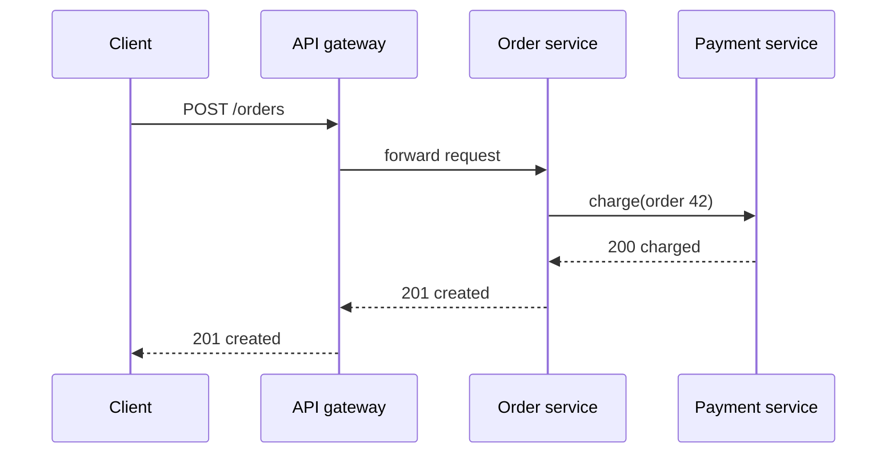
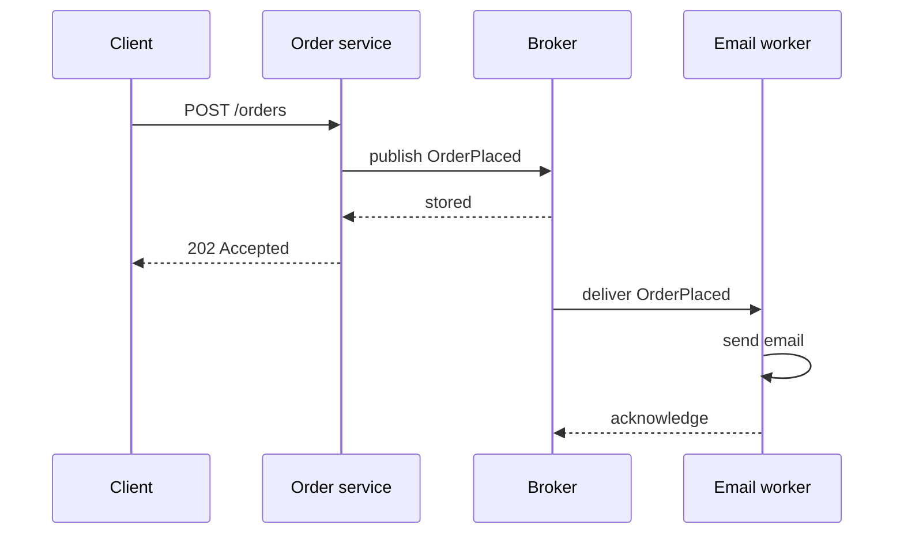
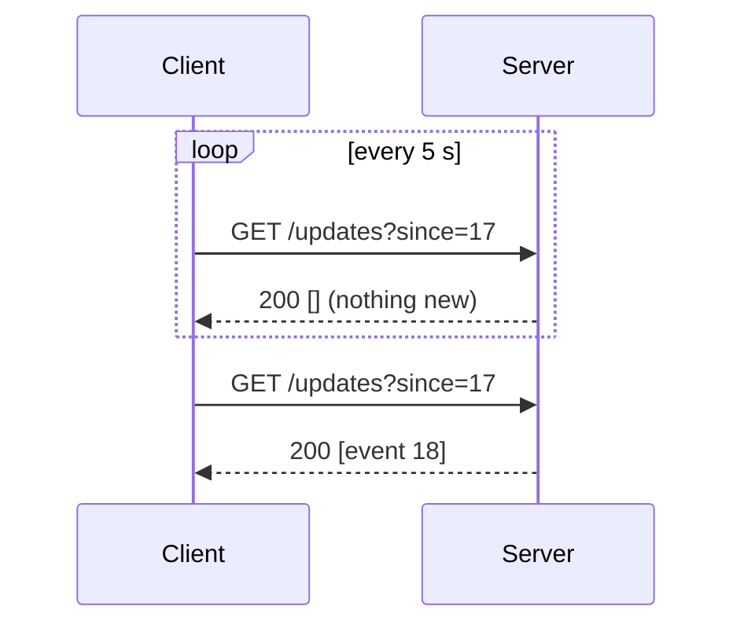
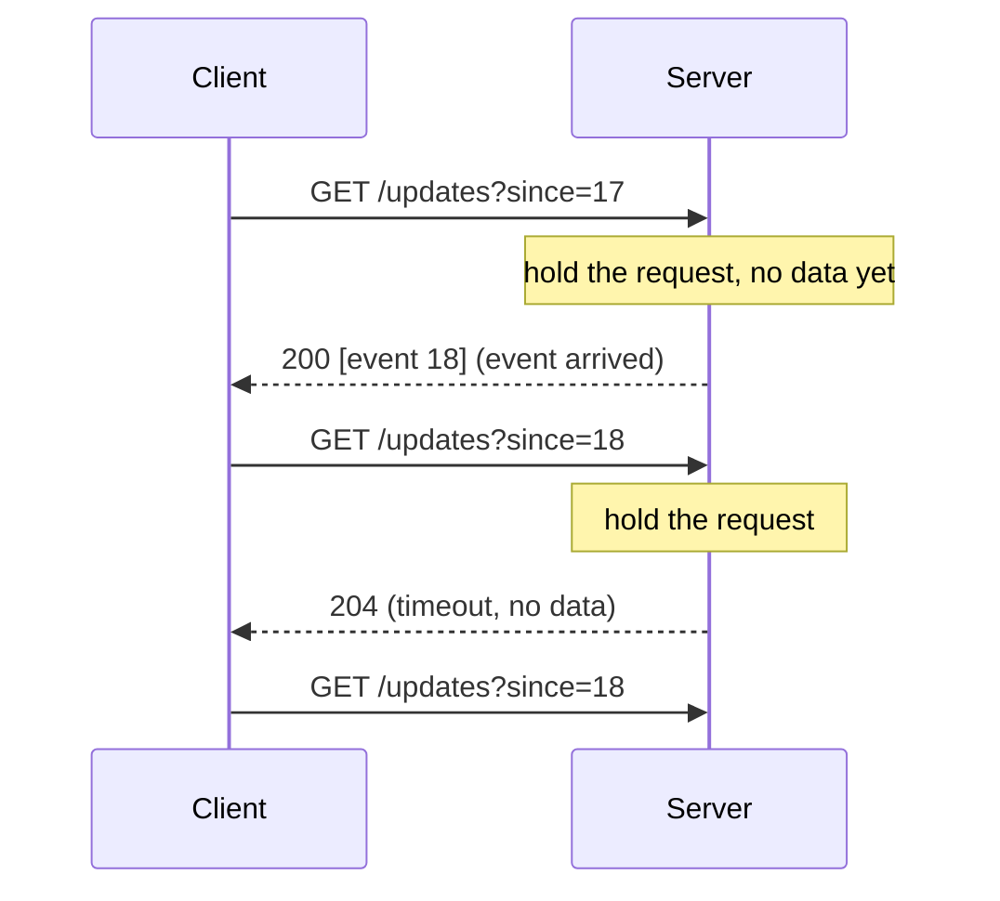
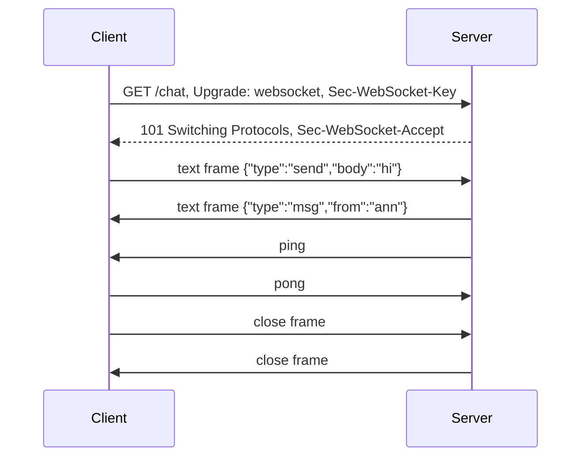
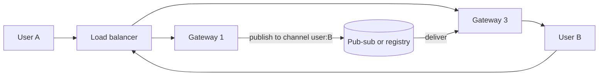
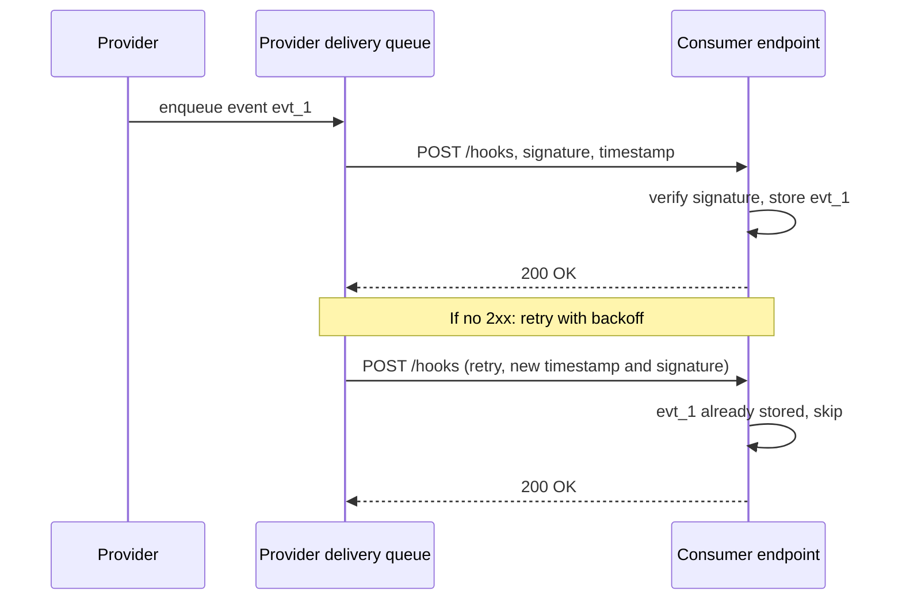

# Communication Patterns

A communication pattern is the way that one part of a system sends data to another part. This page covers synchronous request-response (REST, gRPC), asynchronous messaging (queues, events), the four ways to push data to a client (polling, long polling, Server-Sent Events, WebSocket), webhooks, connection-scale arithmetic, and a decision table that maps a requirement to a pattern.

## Why It Matters

Every HLD design has arrows between boxes, and an interviewer asks about each arrow: "Is this call synchronous? What happens if the receiver is down? How does the phone get the new message?" A candidate who draws a line labeled "HTTP" for every arrow misses the main design decisions: who waits for whom, who holds a connection open, and who retries. The chat, notification, news feed, ride-hailing, and payment case studies all depend on these choices. On the job, the same choices decide the timeout budget of a request, the number of open sockets per server, the behavior of a load balancer in front of long-lived connections, and the way a partner system learns that a payment succeeded. This page gives the vocabulary and the decision rules. Protocol bytes live in the networking pages and the API pages that this page links to.

## Core Concepts

**Synchronous communication**: the caller sends a request and waits for the response before it continues. The caller and the receiver must both be up at the same time. The caller sees the result or the error of the call.

**Asynchronous communication**: the caller sends a message and continues without a result. A broker (a queue or a log) or a later callback carries the outcome. The caller and the receiver do not need to be up at the same time. See [message queues and streams](08-message-queues-and-streams.md).

**Temporal coupling**: the requirement that two components are available at the same moment. A synchronous call creates temporal coupling. A queue removes it.

**Request-response**: a pattern in which the client asks and the server answers on the same connection. HTTP is a request-response protocol.

**Push**: the server sends data to the client without a request for that data. **Pull**: the client asks for data. Polling is a pull. SSE and WebSocket are push.

**REST**: an architectural style for APIs over HTTP, in which URLs name resources and HTTP methods act on them. See `kb/api-design/01-rest-principles.md`.

**RPC** (remote procedure call): a call to a function on another machine, written like a local call. **gRPC** is an RPC framework from Google. It uses HTTP/2 for transport and Protocol Buffers for the message format. See `kb/api-design/03-grpc-and-protobuf.md`.

**Polling**: the client repeats a request at a fixed interval and asks "is there anything new?"

**Long polling**: the client sends a request, and the server holds it open until data exists or a timeout ends. The client then sends the next request at once.

**Server-Sent Events** (SSE): a one-way stream from server to client over one HTTP response. The format is `text/event-stream`. The browser API is `EventSource`. The HTML Living Standard defines it.

**WebSocket**: a protocol that upgrades an HTTP connection into a two-way, message-based channel over one TCP connection. RFC 6455 defines it.

**Webhook**: an HTTP request that a provider system sends to a URL of the consumer system when an event happens. The consumer does not poll. See `kb/api-design/05-webhooks-and-async-apis.md`.

**Heartbeat (keep-alive message)**: a small message that a sender transmits at a fixed interval on an idle connection. It keeps proxies from closing the connection and it shows that the peer is alive.

**Idempotent operation**: an operation that has the same effect when you run it once or many times. Retries are safe only for idempotent operations, or for operations that carry an idempotency key. See [reliability patterns](12-reliability-patterns.md).

**Connection-bound state**: state that the server keeps in memory for each open connection (the socket, buffers, the user identity, subscriptions). Long-lived connections create it. Short requests do not.

## How It Works

### Synchronous Request-Response

The caller opens (or reuses) a connection, sends a request, and waits. The receiver does the work and answers. The caller holds a thread, or a callback slot in an event loop, until the answer arrives or a timeout ends.



Properties of the pattern:

- **Latency adds up.** The latency of the client call is the sum of the latencies in the chain. If the order service makes three sequential calls of 20 ms each, it adds 60 ms.
- **Availability multiplies.** If a call needs service A and service B at the same time, the availability is the product. Two services of 99.9 percent give about 99.8 percent. See [scalability and availability](01-scalability-and-availability.md).
- **Failure travels up the chain.** A slow receiver holds the caller's threads. Without a timeout, a slow service at the bottom of a chain can exhaust the thread pools of every service above it.
- **The caller gets the answer at once.** This is the main benefit. The client knows if the operation succeeded.

Every synchronous call needs a timeout, a retry rule, and a circuit breaker. See [reliability patterns](12-reliability-patterns.md).

#### REST over HTTP

REST uses JSON (usually) over HTTP/1.1 or HTTP/2. Each request is independent, so any server can handle it. That fits stateless services behind a load balancer. REST is the default for public APIs because every client language and every browser can call it, and HTTP caching works with `GET`. The cost is a text format that is larger than a binary format, and no built-in schema or code generation (OpenAPI adds both). Details: `kb/api-design/01-rest-principles.md`, `kb/api-design/02-api-design-practices.md`, and `kb/networking/04-http.md`.

#### gRPC

gRPC defines a service in a `.proto` file. A code generator creates the client and server stubs. The messages use Protocol Buffers, a compact binary format. The transport is HTTP/2, which multiplexes many calls over one connection. gRPC supports four call types: unary (one request, one response), server streaming, client streaming, and bidirectional streaming. Its documented features include deadlines: the client states how long it is willing to wait, and the call fails with `DEADLINE_EXCEEDED` when the time runs out. By default, gRPC sets no deadline, so the gRPC documentation recommends that every client set one. Some language libraries propagate the deadline to the outgoing calls that a server makes while it handles a request: Java and Go do so by default, and C++ needs an explicit setting (gRPC guide "Deadlines").

Browsers cannot call gRPC directly, because browser APIs do not give a page control over HTTP/2 frames. The gRPC project offers gRPC-Web, which needs a proxy that translates the calls (Envoy by default) or a server framework with built-in gRPC-Web support. For that reason, teams use gRPC between services and REST (or GraphQL) at the edge. Details: `kb/api-design/03-grpc-and-protobuf.md`.

!!! note "gRPC and load balancers"
    gRPC keeps one long-lived HTTP/2 connection and sends many calls on it. A layer-4 load balancer picks a backend once per connection, so all calls from one client go to one backend. Use a layer-7 load balancer that understands HTTP/2, or balance on the client. See [load balancing, DNS and CDN](02-load-balancing-dns-cdn.md).

#### REST and gRPC Compared

| Aspect | REST (JSON over HTTP) | gRPC |
|---|---|---|
| Message format | Text (JSON) | Binary (Protocol Buffers) |
| Contract | Optional (OpenAPI) | Required (`.proto`) |
| Transport | HTTP/1.1 or HTTP/2 | HTTP/2 |
| Streaming | Not part of the style (use SSE or WebSocket) | Built in, four call types |
| Browser support | Native | Needs gRPC-Web and a proxy |
| Human debugging | `curl`, browser | Needs tooling (`grpcurl`) |
| HTTP caching | Works for `GET` | Does not apply |
| Typical use | Public APIs, mobile and web clients | Internal service-to-service calls |

### Asynchronous Communication

The sender writes a message to a broker. The broker stores it. A consumer reads it later. The sender does not wait for the consumer.



What the pattern gives:

- **Decoupling in time.** The consumer can be down. The broker keeps the messages until the consumer returns.
- **Load leveling.** A burst of 10 000 messages per second fills the queue. The consumers drain it at their own rate. The queue length, not an error rate, shows the overload.
- **Fan-out.** One event can reach many consumers, and the sender does not know them.
- **Retry without the caller.** A failed message returns to the queue or goes to a dead-letter queue.

What it costs:

- **The caller does not get the result.** The API answers `202 Accepted`, and the client needs another way to learn the outcome: polling a status resource, a push channel, or a webhook.
- **More failure modes.** At-least-once delivery means duplicate messages, so consumers must be idempotent. Ordering holds only inside a partition. See [message queues and streams](08-message-queues-and-streams.md).
- **Harder debugging.** A request becomes several steps on several machines. Tracing needs a correlation ID in each message.
- **Eventual consistency.** Between the publish and the consumer's action, the system is in an intermediate state. See [consistency and CAP](07-consistency-and-cap.md).

A common hybrid: the client calls a synchronous API that validates the request and writes to the database and to an outbox, and the rest of the work (email, search index update, analytics) runs asynchronously. See `kb/hld/distributed-systems/03-distributed-transactions.md` for the transactional outbox, and [event-driven architecture](16-event-driven-architecture.md).

### Real-Time Push: Four Techniques

The problem: the server has new data (a chat message, a price, a ride status) and the client must see it soon. HTTP lets only the client start a request. The four techniques below solve the problem in four ways. Protocol-level details (frames, handshake bytes, close codes) live in `kb/networking/08-websockets-and-realtime.md`.

#### Short Polling

The client sends `GET /updates?since=<cursor>` every T seconds. The server answers at once with new data or an empty body.



- **Connection model:** one short request per interval. No state on the server between requests.
- **Server cost:** the request rate is `clients / T`. With 1 000 000 clients and T = 5 s, the server handles 200 000 requests per second, and most of them return nothing. The cost is requests, not open connections.
- **Latency:** an event waits on average `T / 2` and at most `T` before the client sees it.
- **Proxies and load balancers:** no issue. These are normal requests. They work with caches, CDNs, and every load balancer.
- **Reconnection:** not applicable. The next poll is the retry. The `since` cursor makes a missed poll harmless.
- **Use when:** updates are rare, a delay of seconds is fine, or the infrastructure cannot hold open connections. Example: a job status page that the user opens once.

#### Long Polling

The client sends a request. The server holds it open until an event exists or a timeout ends. Assumption: a long-poll timeout of 20 to 60 seconds, set below the shortest idle timeout of any proxy on the path (Nginx closes a proxied connection after 60 seconds without data by default). The server answers. The client immediately sends the next request.



- **Connection model:** one open HTTP request per client. The server holds it in memory until it answers. After each answer, the client opens a new request (a new TCP connection if the old one closed, or the same connection with HTTP keep-alive).
- **Server cost:** one parked request per client. It needs an asynchronous server (servlet async, Netty, WebFlux). A thread-per-request server needs one thread per parked request, which limits the number of clients to the thread count. Each event costs a response plus a new request, so a high event rate approaches the cost of short polling with T near zero.
- **Latency:** low. The client sees an event after one network delay, plus the gap between the response and the next request. Events that arrive in that gap wait for the new request, so the client sends the `since` cursor to lose nothing.
- **Proxies and load balancers:** works through almost all of them, because it is plain HTTP. The idle timeout of each proxy must be longer than the long-poll timeout. Otherwise the proxy closes the request and the client sees an error. A load balancer may send each new request to a different server, so the event source must be shared (for example a pub-sub channel that every server reads) and the cursor must be stored outside the server's memory.
- **Reconnection:** built in. The client re-sends the request after each answer or error, with exponential backoff after errors, and with the cursor of the last event it received.
- **Use when:** you need push semantics but cannot use SSE or WebSocket, or the client must work through old proxies. It was the fallback transport of early chat libraries.

#### Server-Sent Events (SSE)

The client opens one HTTP request. The server answers with `Content-Type: text/event-stream` and keeps the response open. It writes events as text. Each event ends with an empty line.

```text
id: 18
event: order-status
data: {"orderId": 42, "status": "SHIPPED"}

: keep-alive comment (a line that starts with a colon)

retry: 5000

```

The browser API is `new EventSource(url)`. The HTML Living Standard defines the format and the reconnection rules:

- The client **reconnects by itself** if the connection closes. The initial delay is implementation-defined (the standard says "probably in the region of a few seconds"). The server can set it with a `retry:` field in milliseconds.
- The server sets an event identifier with `id:`. On reconnect, the client sends the last identifier in the `Last-Event-ID` request header. The server can replay the events after that identifier. The server must store recent events to do so.
- A response with a status other than `200`, or with a `Content-Type` other than `text/event-stream`, fails the connection, and the browser does not reconnect. The standard names `204 No Content` as the way for a server to tell the client to stop reconnecting. Redirects (`301`, `307`) are followed as for normal requests.
- The standard advises that the server send a comment line (a line that starts with `:`) about every 15 seconds, because some proxies close idle connections.

Properties:

- **Connection model:** one long-lived HTTP response per client. Data flows in one direction only, from server to client. The client sends data with normal HTTP requests.
- **Server cost:** one open connection per client, and a small amount of memory per connection. No cost per idle second except the keep-alive comments. Events are small writes on an existing connection.
- **Connection limit in browsers:** with HTTP/1.1, a browser allows about 6 connections per domain, shared by all tabs, which limits the number of open SSE streams. With HTTP/2, all streams to one origin share one connection, and the limit is the maximum number of concurrent streams. Each endpoint advertises that limit in its HTTP/2 `SETTINGS_MAX_CONCURRENT_STREAMS` setting, so for SSE the server's value decides it. MDN says the value "defaults to 100". Precisely: RFC 9113 sets no initial limit and recommends that an endpoint not advertise a value below 100, and each server chooses its own value (Nginx `http2_max_concurrent_streams` defaults to 128). Sources: MDN, "Using server-sent events"; RFC 9113, section 6.5.2.
- **Proxies and load balancers:** SSE is plain HTTP, so it passes through HTTP infrastructure. The problems are buffering and idle timeouts. A proxy that buffers the response (for example Nginx with `proxy_buffering on`) holds events until its buffer fills, so the client sees no events. Turn buffering off for the stream route (`proxy_buffering off`), or let the application send the response header `X-Accel-Buffering: no`, which the Nginx proxy module documents as a per-response switch. Set the proxy read timeout (`proxy_read_timeout`, 60 seconds by default in Nginx) longer than the keep-alive interval. A proxy that compresses the response can also hold bytes until its compression buffer fills, so exclude `text/event-stream` from compression. The response has no `Content-Length`. On HTTP/1.1 it uses chunked transfer encoding, and on HTTP/2 it is a stream of DATA frames.
- **Reconnection:** built into `EventSource` with `Last-Event-ID`. This is the best reconnection support of the three push techniques, and the client needs no code for it.
- **Limits:** text only (UTF-8). Binary data needs an encoding such as Base64. The standard `EventSource` API cannot set request headers, so token authentication uses a cookie or a query-string token. A client built on `fetch()` with a stream reader can send headers, but then the client code must implement reconnection and `Last-Event-ID` itself.
- **Use when:** the data flows from server to client only: notifications, live scores, a progress bar, a feed of changes, token streaming from a language model.

#### WebSocket

The client sends an HTTP `GET` with `Upgrade: websocket`, `Connection: Upgrade`, and a random `Sec-WebSocket-Key`. The server answers `101 Switching Protocols` and a `Sec-WebSocket-Accept` value that proves it understood the handshake. The same TCP connection then carries WebSocket frames in both directions. RFC 6455 defines the protocol.



Properties:

- **Connection model:** one long-lived TCP connection per client, two-way, message-based. Text and binary frames. The protocol has ping and pong control frames for liveness, and a close handshake.
- **Server cost:** one open connection and connection-bound state per client. Every server holds its own set of connections, so a message for user B must reach the server that holds B's connection (see [Delivering a Message to the Right Server](#delivering-a-message-to-the-right-server)).
- **Proxies and load balancers:** the upgrade must pass through each hop. `Upgrade` and `Connection` are hop-by-hop headers, so a proxy does not forward them unless its configuration says so. Nginx needs `proxy_set_header Upgrade $http_upgrade` and `proxy_set_header Connection "upgrade"`, and before version 1.29.7 also `proxy_http_version 1.1` (Nginx 1.29.7, March 2026, made 1.1 the default). A layer-7 load balancer that supports WebSocket treats the connection as a long-lived tunnel after the upgrade. Idle timeouts apply: Nginx closes the proxied connection if the backend sends no data for 60 seconds (`proxy_read_timeout`). So the server sends ping frames, or either side sends application heartbeat messages. The browser `WebSocket` API cannot send ping frames. The browser answers the server's pings with pongs automatically, because RFC 6455 requires an endpoint to answer each Ping with a Pong. A layer-4 load balancer passes the bytes through without needing special support. AWS Application Load Balancer documents WebSocket support. An HTTP cache or a CDN may not support it, so check the provider documentation.
- **Reconnection:** **not built in.** The protocol has no event identifiers and no replay. RFC 6455 (section 7.2.3) only tells clients how to pace reconnects after an abnormal closure: delay the first attempt by a random amount ("a value chosen randomly between 0 and 5 seconds is a reasonable initial delay"), then back off, for example with truncated binary exponential backoff. The application implements the rest of reconnection: exponential backoff with jitter on the client, a session or user identity on reconnect, and a "last message identifier" so that the server resends the missed messages. Without backoff and jitter, a server restart makes every client reconnect at the same moment (a reconnect storm). See [reliability patterns](12-reliability-patterns.md).
- **Limits:** no HTTP semantics (no status codes per message, no HTTP caching, no standard authentication per message). The browser `WebSocket` API cannot set custom headers on the handshake, so authenticate with a cookie, a short-lived token in the query string, or a first message after the connection opens. Browsers do not apply the same-origin policy or CORS to WebSocket handshakes, but they send the `Origin` header. RFC 6455 (section 10.2) says that a server meant only for certain sites "SHOULD verify the Origin field" and answer `403 Forbidden` to an unexpected origin. Recommendation: always check `Origin` when the handshake authenticates by cookie. Otherwise a malicious page can open a WebSocket with the user's cookie (cross-site WebSocket hijacking).
- **Use when:** the client sends frequent messages and the server pushes back at low latency: chat, collaborative editing, multiplayer games, trading screens.

#### The Four Techniques Compared

| Aspect | Short polling | Long polling | SSE | WebSocket |
|---|---|---|---|---|
| Direction | Client pulls | Server pushes, one response per request | Server to client | Both ways |
| Connections | Short requests | One held request per client | One held response per client | One held TCP connection per client |
| Server cost | Request rate `N / T` | Held requests plus one new request per event | Held connections | Held connections plus per-connection state |
| Event latency | Up to T | One network delay | One network delay | One network delay |
| Wasted work | High (empty polls) | Low | None | None |
| Reconnection | Next poll | Next request (client code) | Built in, with `Last-Event-ID` | Client code only |
| Proxies, load balancers | Work everywhere | Work, mind idle timeouts | Work, turn buffering off | Need upgrade support and idle-timeout settings |
| Data format | Anything | Anything | UTF-8 text | Text and binary |
| HTTP caching, auth | Full | Full | Full (headers limited in browsers) | Handshake only |
| Typical use | Job status, dashboards that refresh slowly | Fallback for push | Notifications, feeds, live progress | Chat, games, collaboration |

!!! tip "Interview shortcut"
    Ask one question: does the client need to send frequent messages to the server over the same channel? If yes, choose WebSocket. If the data flows only to the client, choose SSE. If neither can run in the environment, use long polling. If updates are rare and delay is fine, use short polling.

### Delivering a Message to the Right Server

A WebSocket or SSE connection lives on one server. A message for user B can arrive at server 1 while B's connection is on server 3. The system needs a way to route the message.



Two designs:

1. **Pub-sub channel per user or per room.** Each gateway subscribes to the channel of each user that it holds. A sender publishes to the channel. Redis Pub/Sub, Kafka, or NATS can carry it. The Redis documentation states that Pub/Sub "exhibits at-most-once message delivery semantics": if a subscriber cannot handle a message (for example after a network disconnect), "the message is forever lost". So a disconnected gateway misses messages. Store messages in a database as well, and let the client fetch what it missed on reconnect. Redis Streams store messages and support at-least-once delivery, if the design needs that from Redis.
2. **Connection registry.** A shared store (for example Redis) maps `userId` to `gatewayId`. The sender looks up the gateway and calls it directly. The registry entry has a TTL that the gateway refreshes, so that entries of crashed gateways expire.

The gateway tier is stateful, so it scales by connection count, not by request rate. Keep business logic out of it. The gateway only holds connections and forwards messages, and stateless services behind it do the work. The [chat case study](../case-studies/06-chat-system.md) uses a variant of the connection registry: each gateway holds one lease for all its entries, instead of a TTL on each entry, so that a crashed gateway's entries expire together and a restarted gateway cannot revive them.

### Connection-Scale Arithmetic

Push techniques cost open connections. Estimate the cost before you choose.

| Quantity | Value | Status |
|---|---|---|
| Concurrent connections on one server in a published case | Over 2 million TCP connections on one server (2 277 845 open sockets reported), FreeBSD 8.2, 24 logical CPUs (Intel Xeon X5675), about 96 GiB of memory (WhatsApp blog, "1 million is so 2011", 6 January 2012) | Measured, but dated: a January 2012 figure for an Erlang server that the team had tuned for connection count. Do not use it as a planning value |
| Memory per idle connection, planning value | 10 to 50 KB | Assumption. It depends on kernel socket buffers, TLS state, and application objects. Measure your own server |
| Planning value for one gateway server with real traffic | 50 000 to 200 000 connections | Assumption. Lower than the record above, because real connections send messages and use TLS |
| Heartbeat interval | 15 to 60 seconds | Assumption. Choose a value below the shortest idle timeout of any proxy on the path |
| Ephemeral ports | 28 232 by default on Linux (`net.ipv4.ip_local_port_range`, default 32768 to 60999, per the kernel `ip-sysctl` documentation) for connections from one client IP to one server IP and port | Exact for the default range. It limits a load balancer or a test client that opens many connections to one destination, not a server that accepts them |

Worked example. A chat product has 10 million daily active users. Assumption: 20 percent are online at the peak, so 2 million concurrent connections. At 100 000 connections per gateway (assumption), the system needs `2 000 000 / 100 000 = 20` gateways, and 30 with headroom for a failure and a deploy. At 20 KB per connection (assumption), the connections hold `2 000 000 x 20 KB = 40 GB` in total, which is 2 GB per gateway.

Now the reconnect storm. If one gateway with 100 000 clients restarts, and each client reconnects within a random delay of 0 to 30 seconds, the arrival rate is about `100 000 / 30 = 3 300` connections per second. Without jitter, all 100 000 arrive in the same second, and each needs a TLS handshake and an authentication call. Jitter turns a spike into a plateau.

For short polling: 2 million clients at T = 10 s produce 200 000 requests per second, and each request is a full HTTP request with authentication. The same clients on WebSocket send nothing while idle except heartbeats: `2 000 000 / 30 s` is about 67 000 tiny frames per second.

### Webhooks

A webhook reverses the direction. The consumer registers a URL. When an event happens, the provider sends an HTTP `POST` with the event to that URL. Payment providers, source-code hosts, and messaging platforms use webhooks to tell a customer system about an event, so the customer does not poll.



**Delivery.** The provider writes each event to a durable queue and delivers from the queue. It sends the request with a timeout (a few seconds) and counts any non-`2xx` response, any timeout, and any connection error as a failure. Delivery is at least once.

**Retries.** The provider retries with exponential backoff. Stripe documents retries for up to three days in live mode with exponential backoff, and three retries over a few hours for sandbox events. Other providers use other schedules, so read the documentation of each. After the retries end, the provider marks the event as failed, may disable the endpoint, and offers a manual resend. The provider does not wait forever, so the consumer must also be able to reconcile: list the events from the provider API after an outage.

**Duplicates and ordering.** Because delivery is at least once, the consumer receives some events twice. Stripe documents that events can arrive more than once and not in the order of creation. The consumer stores the event identifier of each processed event and skips a repeat. The consumer does not rely on arrival order. When order matters, the event carries a version or the consumer fetches the current state of the object from the provider API.

**Signatures.** The consumer must verify that the request comes from the provider, because the URL is public. The common scheme: the provider computes an HMAC-SHA256 of the timestamp and the raw request body with a secret that only the provider and the consumer know, and sends it in a header. Stripe uses the header `Stripe-Signature` with `t=<timestamp>,v1=<signature>`, where the signed string is the timestamp, a dot, and the body. The consumer:

1. Reads the raw body (not a parsed and re-serialized copy, because that changes the bytes).
2. Computes the HMAC with the same secret.
3. Compares the result with the header value in constant time (`MessageDigest.isEqual` in Java), because a normal comparison leaks timing information.
4. Rejects a request whose timestamp is older than a tolerance, to stop replay of a captured request. Stripe's libraries use 5 minutes by default.

The consumer should also rotate secrets and serve the endpoint only over HTTPS. During a rotation, both secrets are valid for a period. Stripe keeps the old secret active for up to 24 hours and sends one `v1` signature per active secret, so the consumer accepts the request if any `v1` value matches. Stripe also tells consumers to ignore every scheme other than `v1`, to prevent downgrade attacks, and offers IP allowlisting as a second check.

**Consumer design.** The consumer endpoint does three things: verify the signature, write the event to its own durable queue or table, and return `2xx`. It does the real work after it returns. Stripe's guidance: return a successful status before any complex logic, and process events with an asynchronous queue, because a spike of deliveries can otherwise overwhelm the endpoint. A slow endpoint makes the provider time out and retry, which adds load.

**Webhooks vs polling vs streaming.** A webhook needs the consumer to be reachable from the internet, which is a problem for a mobile app or a server behind a firewall. Polling needs no inbound access. A webhook is the right tool between two servers, and SSE or WebSocket is the right tool between a server and a browser or a phone.

### Choosing a Pattern

| Requirement | Pattern | Reason |
|---|---|---|
| Public API for web and mobile clients, CRUD on resources | REST over HTTP | Every client calls it. HTTP caching and tooling work |
| Internal calls between services, low latency, strict contract | gRPC | Binary format, generated stubs, deadlines, streaming |
| Client needs the result now, work takes under a second | Synchronous request-response | The caller needs the answer |
| Work takes seconds or minutes (video encode, report) | Asynchronous: `202 Accepted`, queue, status resource or push | Do not hold a connection for minutes |
| Spike of writes that the back end cannot absorb | Queue in front of the back end | Load leveling |
| One event, many independent consumers | Pub-sub or log | Fan-out without the sender knowing the consumers |
| Live notifications, feed updates, progress, server to client only | SSE | One-way push, automatic reconnect, plain HTTP |
| Chat, collaborative editing, games, two-way low latency | WebSocket | Two-way messages on one connection |
| Push needed, but the network blocks upgrades or streams | Long polling | Plain HTTP requests only |
| Rare updates, a delay of seconds is fine, simplest operations | Short polling | No held connections, caches work |
| A partner system must learn about an event | Webhook (with a polling API as a backup) | Partner is a server with a public URL |
| A mobile device is in the background | Platform push notification (APNs, FCM), not your own socket | The operating system closes background sockets. See `kb/hld/case-studies/04-notification-system.md` |
| Many clients read the same stream of live data (stock prices) | SSE or WebSocket fed by a pub-sub topic, behind a CDN or fan-out tier if public | Publish once and fan out at the edge |

## Trade-offs and When to Use

| Decision | Choose the first when | Choose the second when | Cost of the choice |
|---|---|---|---|
| Synchronous vs asynchronous | The caller needs the result to continue | The work is slow, the receiver may be down, or load comes in bursts | Synchronous: coupled availability and latency. Asynchronous: eventual consistency, duplicates, harder debugging |
| REST vs gRPC | Clients are browsers, partners, or unknown | Both sides are your services and you want a strict contract and streaming | REST: larger messages, no schema by default. gRPC: tooling, proxy needs for browsers |
| Polling vs push | Updates are rare or infrastructure cannot hold connections | Updates are frequent and latency matters | Polling: wasted requests. Push: held connections, stateful tier, reconnect logic |
| SSE vs WebSocket | Data flows one way | Data flows both ways at high frequency | SSE: text only, header limits. WebSocket: no built-in reconnect, more infrastructure care |
| Webhook vs polling | You control a public endpoint and want low latency | You cannot accept inbound requests | Webhook: signature checks, dedup, public endpoint. Polling: delay and wasted calls |
| Direct call vs queue | You need the answer and the receiver is reliable | You need to buffer, retry, or fan out | Direct: failure propagation. Queue: a broker to run |

Recommendation: start with synchronous REST for client-facing calls, add a queue for work that the client does not wait for, and add a push channel only for requirements that polling cannot meet. State the latency budget and the connection count in the interview, because the numbers decide between polling and push.

## Java Example

The program below implements the consumer side of a webhook: it parses the signature header, ignores every scheme except `v1`, verifies the HMAC-SHA256 signature in constant time against each `v1` value, rejects a malformed header and an old timestamp, skips a duplicate event identifier, and prints a retry schedule with exponential backoff. The signature scheme follows the shape that Stripe documents (timestamp, a dot, and the body). The program has fixed inputs, so its output is the same on every run.

```java
import java.nio.charset.StandardCharsets;
import java.security.GeneralSecurityException;
import java.security.MessageDigest;
import java.time.Duration;
import java.util.ArrayList;
import java.util.HashSet;
import java.util.HexFormat;
import java.util.List;
import java.util.Set;
import javax.crypto.Mac;
import javax.crypto.spec.SecretKeySpec;

public class Main {
    public static void main(String[] args) throws Exception {
        byte[] secret = "whsec_demo_secret".getBytes(StandardCharsets.UTF_8);
        long now = 1_700_000_000L;
        WebhookVerifier verifier = new WebhookVerifier(secret, Duration.ofMinutes(5));

        String body = "{\"id\":\"evt_1\",\"type\":\"payment.succeeded\"}";
        String header = WebhookVerifier.sign(secret, now, body);

        System.out.println("valid request:   " + verifier.handle("evt_1", header, body, now));
        System.out.println("duplicate:       " + verifier.handle("evt_1", header, body, now + 60));
        String tampered = body.replace("succeeded", "refunded");
        System.out.println("tampered body:   " + verifier.handle("evt_2", header, tampered, now));
        String oldHeader = WebhookVerifier.sign(secret, now - 600, body);
        System.out.println("old timestamp:   " + verifier.handle("evt_3", oldHeader, body, now));
        System.out.println("malformed:       " + verifier.handle("evt_4", "v1=abc", body, now));

        System.out.println("retry delays (seconds), base 30 s, factor 2, cap 3600 s:");
        long delay = 30;
        StringBuilder line = new StringBuilder();
        for (int attempt = 1; attempt <= 8; attempt++) {
            line.append(delay).append(attempt < 8 ? ", " : "");
            delay = Math.min(delay * 2, 3600);
        }
        System.out.println(line);
    }
}

class WebhookVerifier {
    private final byte[] secret;
    private final Duration tolerance;
    private final Set<String> processed = new HashSet<>();

    WebhookVerifier(byte[] secret, Duration tolerance) {
        this.secret = secret;
        this.tolerance = tolerance;
    }

    /** Returns the hex HMAC-SHA256 of the signed string "timestamp.body". */
    static String hmacHex(byte[] secret, long timestamp, String body)
            throws GeneralSecurityException {
        Mac mac = Mac.getInstance("HmacSHA256");
        mac.init(new SecretKeySpec(secret, "HmacSHA256"));
        byte[] sig = mac.doFinal((timestamp + "." + body).getBytes(StandardCharsets.UTF_8));
        return HexFormat.of().formatHex(sig);
    }

    /** Builds the header value "t=<timestamp>,v1=<hex hmac>", as a provider would send it. */
    static String sign(byte[] secret, long timestamp, String body)
            throws GeneralSecurityException {
        return "t=" + timestamp + ",v1=" + hmacHex(secret, timestamp, body);
    }

    String handle(String eventId, String header, String body, long nowSeconds)
            throws GeneralSecurityException {
        long timestamp = -1;
        List<String> signatures = new ArrayList<>();
        for (String element : header.split(",")) {
            String[] pair = element.split("=", 2);
            if (pair.length != 2) {
                continue;
            }
            if (pair[0].equals("t")) {
                try {
                    timestamp = Long.parseLong(pair[1]);
                } catch (NumberFormatException e) {
                    return "reject (malformed header)";
                }
            } else if (pair[0].equals("v1")) {
                signatures.add(pair[1]); // ignore every other scheme
            }
        }
        if (timestamp < 0 || signatures.isEmpty()) {
            return "reject (malformed header)";
        }
        byte[] expected = hmacHex(secret, timestamp, body).getBytes(StandardCharsets.UTF_8);
        boolean signatureOk = false;
        for (String candidate : signatures) {
            // constant-time comparison of each v1 value (several exist during a rotation)
            if (MessageDigest.isEqual(expected, candidate.getBytes(StandardCharsets.UTF_8))) {
                signatureOk = true;
            }
        }
        if (!signatureOk) {
            return "reject (bad signature)";
        }
        if (Math.abs(nowSeconds - timestamp) > tolerance.toSeconds()) {
            return "reject (timestamp outside tolerance)";
        }
        if (!processed.add(eventId)) {
            return "ack (duplicate, skipped)";
        }
        return "ack (processed)";
    }
}
```

<!-- expected-output -->
```text
valid request:   ack (processed)
duplicate:       ack (duplicate, skipped)
tampered body:   reject (bad signature)
old timestamp:   reject (timestamp outside tolerance)
malformed:       reject (malformed header)
retry delays (seconds), base 30 s, factor 2, cap 3600 s:
30, 60, 120, 240, 480, 960, 1920, 3600
```

The program shows three rules. First, the consumer checks the signature before it trusts any field. Second, the consumer stores the event identifier and returns `2xx` for a duplicate, so that the provider stops retrying. Third, retry delays grow by a factor of 2 up to a cap. A real provider adds random jitter so that many failed deliveries do not retry at the same moment.

## Interview Angle

### Questions

??? question "When do you choose a synchronous call and when an asynchronous message between two services?"

    Choose synchronous when the caller needs the result to continue and the work takes milliseconds, for example a price lookup or a permission check. Choose asynchronous when the caller does not need the result now, when the work is slow, when the receiver may be down, or when load arrives in bursts.

    The reason is coupling. A synchronous call couples the two services in time. Their availabilities multiply, their latencies add, and a slow receiver can exhaust the caller's threads. A queue removes the temporal coupling and levels the load, at the price of eventual consistency, duplicate messages (so the consumer must be idempotent), and harder debugging.

    A typical design is a hybrid. The API validates the request, writes it to the database and an outbox in one transaction, and returns `202 Accepted`. Workers process the rest. The client learns the outcome by polling a status resource, by SSE, or by a webhook.

??? question "How do you push updates to a browser? Compare polling, long polling, SSE, and WebSocket."

    Short polling repeats a request every T seconds. It is the simplest and works everywhere, but the delay is up to T and most requests return nothing. Long polling holds the request until data exists, so the delay is one network round trip, but each event costs a new request and the server needs an asynchronous stack. SSE keeps one HTTP response open and streams text events one way. The browser reconnects by itself and sends `Last-Event-ID` so the server can replay. WebSocket upgrades the connection to a two-way channel of messages, with the lowest overhead per message, but it has no built-in reconnection, so the application must implement backoff and replay.

    I choose by direction and frequency. Server-to-client only: SSE. Frequent two-way messages: WebSocket. A network that blocks both: long polling. Rare updates: short polling. Then I check the infrastructure: proxy idle timeouts, proxy buffering for SSE, and upgrade support for WebSocket.

??? question "You pick WebSocket for a chat system with 2 million concurrent users. What does the infrastructure look like?"

    A stateful gateway tier holds the connections. I estimate capacity from an assumption I state out loud: 100 000 connections per gateway at 20 KB each. That gives 20 gateways for 2 million connections, and I add headroom for a failure and a rolling deploy, so about 30.

    The load balancer must support the WebSocket upgrade and a long idle timeout, and clients send heartbeats below that timeout. Gateways hold only connections. A message for user B reaches B's gateway through a pub-sub channel or through a registry that maps users to gateways. Messages are also stored in a database, because Redis Pub/Sub does not store messages, and a disconnected client fetches what it missed with a "last message ID" on reconnect.

    Reconnection uses exponential backoff with jitter. Without jitter, a gateway restart sends 100 000 clients back in the same second, and each needs a TLS handshake and authentication. For deploys, I drain a gateway by asking clients to reconnect gradually.

??? question "Why does a layer-4 load balancer break gRPC load distribution, and what do you do about it?"

    gRPC runs over HTTP/2 and multiplexes many calls on one long-lived connection. A layer-4 load balancer chooses a backend when the connection opens and then forwards bytes. Every call from that client uses the same backend, so a few clients with heavy traffic overload a few backends while others idle.

    The fixes: use a layer-7 load balancer that understands HTTP/2 and balances per call (Envoy and the Nginx gRPC proxy do), or balance on the client with a service-discovery list and a policy such as round robin (gRPC supports client-side load balancing), or use a service mesh sidecar. The server can also close connections after a maximum age, so that clients reconnect and the load spreads. gRFC A9 (server-side connection management) defines `MAX_CONNECTION_AGE` for this purpose, with the motivation "Close connections to encourage load balancing fairness", and a grace period (`MAX_CONNECTION_AGE_GRACE`) so that in-flight calls can finish. In grpc-go the setting is `keepalive.ServerParameters.MaxConnectionAge`.

??? question "Design the way a payment provider tells merchants that a payment succeeded."

    A webhook, with a reconciliation API as a backup. On each event, the provider writes the event to a durable table and a delivery queue. Workers deliver by HTTPS `POST` with a timeout of a few seconds. Any non-`2xx` response, timeout, or connection error counts as a failure, and the provider retries with exponential backoff and jitter over a window of days. After the window, it marks the event failed and lets the merchant resend from a dashboard or fetch missed events from a list API.

    Security: the provider signs each request with HMAC-SHA256 over the timestamp and the raw body, with a secret that is unique per endpoint. The merchant verifies in constant time and rejects old timestamps to stop replay.

    Semantics: delivery is at least once and unordered. Each event has a unique ID. The merchant stores the IDs, skips duplicates, and does not depend on order. The merchant returns `2xx` after it writes the event to its own queue, and processes afterward, so a slow job does not cause timeouts and retries.

    Isolation: one slow merchant endpoint must not block the others, so each endpoint has its own queue or rate limit, and the provider disables an endpoint that fails for too long.

??? question "SSE or WebSocket for a live notification feed? Why?"

    SSE, because the data flows only from server to client. SSE is plain HTTP, so authentication, logging, compression of ordinary responses, and load balancers work as for any request. The browser reconnects automatically and sends `Last-Event-ID`, which gives resume-from-last-event for free if the server keeps recent events. WebSocket would add the upgrade, a second protocol to operate, and reconnection code, and its two-way channel would go unused.

    The limits to state: SSE carries UTF-8 text only, the standard `EventSource` cannot set headers (so use cookies or a token in the URL, or a fetch-based client), and on HTTP/1.1 a browser opens about 6 connections per domain, so use HTTP/2. Switch to WebSocket if the client later needs to send frequent messages on the same channel.

??? question "A long-polling or SSE endpoint works on a laptop and fails behind the company proxy. What do you check?"

    First, buffering. If a proxy buffers the response, the client sees nothing until the buffer fills. For Nginx, turn off `proxy_buffering` on that route or send `X-Accel-Buffering: no`. Second, idle timeouts. A proxy or load balancer closes a connection that sends no bytes for longer than its timeout, so the server sends a comment line or heartbeat more often than that timeout (the HTML standard suggests about every 15 seconds for SSE). Third, response transformations such as compression that wait for the whole body. Fourth, the HTTP version: HTTP/1.1 limits a browser to about 6 connections per domain, and several tabs can use them all. Fifth, for WebSocket, check that every hop forwards the `Upgrade` and `Connection` headers.

??? question "How do you make a webhook consumer correct when the provider sends an event twice or out of order?"

    The consumer is idempotent. It stores the event ID in the same transaction as the effect of the event, with a unique constraint on the ID. A second delivery hits the constraint, so the consumer skips the work and still returns `2xx`.

    For order, the consumer does not trust arrival order. If events carry a version or a sequence number, the consumer applies an event only if its version is newer than the stored one. If they do not, the consumer treats the event as a signal and fetches the current object from the provider API, which returns the latest state whatever the order of events.

??? question "How does a slow synchronous dependency take down a whole service, and how do you prevent it?"

    A request thread waits for the slow dependency. If calls arrive faster than they finish, all threads of the pool wait, and the service cannot accept requests for any endpoint, including those that do not use the dependency. The callers of that service then wait on it, and the failure moves up the chain.

    Prevention: a timeout on every call, set from the dependency's latency percentiles (a little above its p99), a retry budget so that retries do not multiply the load, a circuit breaker that fails fast when the failure rate is high, and a bulkhead (a separate thread pool or semaphore per dependency) so one dependency cannot take all threads. See [reliability patterns](12-reliability-patterns.md). Where the caller does not need the answer now, move the call behind a queue.

??? question "A phone loses its network without closing its WebSocket. How do the server and the client find out, and what happens to messages sent in between?"

    The connection is now half-open: the TCP connection exists on one side and the peer is gone. TCP does not report this by itself while no data flows. TCP keepalive is off unless the socket enables it, and even then Linux sends the first probe only after two hours of idle time by default (`net.ipv4.tcp_keepalive_time`, kernel `ip-sysctl` documentation). That is far too slow for a chat product. So the application detects it with heartbeats.

    Server side: the server sends a WebSocket ping at a fixed interval (assumption: every 30 seconds) and closes the connection if no pong or other frame arrives within a deadline (for example two missed intervals). RFC 6455 requires the peer to answer each ping with a pong, and browsers do this automatically. The server then removes the user from the connection registry, so the router stops sending messages to a dead socket. Client side: the browser API cannot send pings, so the client sends an application heartbeat message and expects a reply. If the reply does not arrive in time, the client closes the socket and reconnects with backoff and jitter.

    Messages: a message that the server wrote to the dead socket is lost, because a successful write only means that the kernel buffered the bytes. So the server treats a message as delivered only after a client acknowledgment. On reconnect, the client sends the identifier of the last message it received, and the server resends the later messages from the message store. Duplicates are possible, so the client deduplicates by message identifier. The heartbeat interval is a trade-off: shorter intervals detect failures sooner but cost bandwidth and phone battery, and the interval must stay below the shortest proxy idle timeout on the path.

### Follow-up Questions

- How do you scale SSE or WebSocket gateways when one user has several devices?
- How do you drain a WebSocket gateway during a deploy without a reconnect storm?
- How do you authenticate a WebSocket connection, and how do you handle token expiry on a connection that lasts hours?
- How does a mobile client decide between keeping a socket and relying on APNs or FCM?
- What changes when the webhook consumer is slower than the event rate?
- How would you give webhook consumers ordering for one object?
- How do you replay missed messages after a WebSocket reconnect without duplicates?
- When does a queue make the system worse than a direct call?

### Red Flags

- Drawing every arrow as a synchronous HTTP call and not stating timeouts or failure behavior.
- Choosing WebSocket for every real-time requirement, including one-way notifications, without comparing SSE.
- Forgetting reconnection: saying "the client reconnects" without backoff, jitter, or message replay.
- Ignoring the connection count: no estimate of how many connections one server holds.
- Putting business logic in the stateful gateway tier.
- Using polling at 1-second intervals for millions of clients without computing the request rate.
- A webhook design with no signature check, no deduplication, or no `2xx`-first handling.
- Treating a queue as exactly-once and skipping idempotent consumers.
- Quoting connection numbers without saying whether they are measured, approximate, or assumed.

## Common Mistakes

| Mistake | Why it hurts | Fix |
|---|---|---|
| No timeout on a synchronous call | A slow dependency holds all threads and the failure spreads up the chain | Set a timeout from the p99 latency of the dependency, and add a circuit breaker |
| Retrying every failed call at once | Retries multiply load on a struggling service (a retry storm) | Exponential backoff with jitter, a retry budget, and retries only for idempotent calls |
| Long idle timeout missing on proxies | The proxy or load balancer closes SSE and WebSocket connections after its idle timeout (60 s by default for Nginx `proxy_read_timeout`) | Raise the timeout for stream routes and send heartbeats at about half the timeout |
| Proxy buffering SSE responses | The client sees no events until the buffer fills | Disable buffering on that route (`X-Accel-Buffering: no` for Nginx) |
| No replay after reconnect | Clients lose the messages sent while they were disconnected | Number the messages. The client sends the last number. The server replays from a store |
| Reconnecting without jitter | A restart sends every client back at the same second | Random delay with exponential backoff on the client |
| Business logic in the connection tier | Deploys of the logic disconnect every client | Keep the gateway thin and call stateless services behind it |
| Holding a thread per long-poll request | Thread count limits the number of clients | Use asynchronous request handling or an event-loop server |
| Parsing the webhook body before verifying the signature | Re-serialized JSON changes the bytes and breaks verification, or the code trusts unverified data | Verify the signature over the raw body first |
| Comparing signatures with `equals` | The comparison time leaks information about the correct value | Use `MessageDigest.isEqual` |
| Doing the work inside the webhook request | A slow job causes a timeout, and the provider retries and duplicates the work | Store the event, return `2xx`, process afterward |
| Using gRPC from a browser without a proxy | Browsers cannot call gRPC directly | Use gRPC-Web with a proxy, or expose REST at the edge |
| Own WebSocket to a background mobile app | The operating system suspends the app and closes the socket | Use APNs or FCM for background delivery |
| Treating a message as delivered when it left the server | A closed or half-open connection loses it | Require a client acknowledgment and resend unacknowledged messages |

## Commonly Confused With

| Looks like | Difference | Deciding question |
|---|---|---|
| Long polling and SSE | Long polling answers and closes the request for each event batch, and the client re-requests. SSE keeps one response open and streams many events | Does the server close the response after each event? |
| SSE and WebSocket | SSE is one-way text over HTTP with built-in reconnect. WebSocket is two-way, text or binary, with its own protocol and no built-in reconnect | Does the client send frequent messages on the same channel? |
| Webhook and polling | A webhook is a push from server to server to your URL. Polling is your request to their API | Who starts the HTTP request? |
| Webhook and WebSocket | A webhook is a separate HTTP request for each event to a public URL. A WebSocket is one long-lived connection | Does the receiver keep a connection open to the sender? |
| Asynchronous API and non-blocking I/O | An asynchronous API returns before the work finishes and reports the result later. Non-blocking I/O is how a server waits for a network call without holding a thread | Does the client get the result in the same response? |
| Message queue and WebSocket | A queue connects services and stores messages. A WebSocket connects a client and a server and does not store messages | Does the message need to survive if the receiver is offline? |
| HTTP/2 server push and SSE | HTTP/2 server push (removed from most browsers) pre-sent resources for a page. SSE streams application events | Is the data an application event or a page resource? |
| gRPC streaming and WebSocket | gRPC streaming is typed, between services, over HTTP/2. WebSocket is a browser-friendly message channel | Is the client a browser? |
| Push notification (APNs, FCM) and WebSocket | A push notification goes through the platform vendor and reaches a sleeping device. A WebSocket needs a running app and an open connection | Is the app in the foreground? |

## Quick Reference Card

- **Synchronous:** the caller waits and needs the result. Latency adds, availability multiplies. Add timeout, retry rule, circuit breaker.
- **Asynchronous:** the caller continues. Queue gives decoupling, load leveling, fan-out. Costs: duplicates, eventual consistency, harder debugging. Answer `202 Accepted`.
- **REST:** public and browser-facing, cacheable. **gRPC:** internal, binary, streaming, deadlines, needs L7 or client-side balancing.
- **Short polling:** requests per second is `N / T`. Delay up to T. Works everywhere.
- **Long polling:** held request, async server needed, idle timeout above the poll timeout, `since` cursor.
- **SSE:** one-way text, auto-reconnect, `Last-Event-ID`, `retry:`, comment heartbeat every 15 s, disable proxy buffering, use HTTP/2 (6 connections per domain on HTTP/1.1).
- **WebSocket (RFC 6455):** two-way, text or binary, `101` upgrade, ping and pong, no built-in reconnect (the RFC asks for a random first delay and backoff), check `Origin` when you authenticate by cookie, stateful tier.
- **Scale:** gateways = connections / connections per gateway (assumption: 50 000 to 200 000). Reconnect storms need jitter.
- **Route to the right server:** pub-sub per user or room, or a user-to-gateway registry with a TTL. Store messages. Redis Pub/Sub does not store them.
- **Webhooks:** at-least-once, retries with backoff for days, HMAC over timestamp and raw body, constant-time compare, tolerance 5 minutes, dedup by event ID, `2xx` first, process after.
- **Choose:** one-way push is SSE. Two-way is WebSocket. Blocked network is long polling. Rare updates is short polling. Partner server is a webhook. Background mobile is APNs or FCM.
- **Say in the interview:** the direction of data, the update frequency, the connection count, and what happens on reconnect.

## Further Reading

- RFC 6455, "The WebSocket Protocol" (`https://www.rfc-editor.org/rfc/rfc6455`). The handshake, frames, ping and pong, close, and the `Origin` check.
- HTML Living Standard, section "Server-sent events" (`https://html.spec.whatwg.org/multipage/server-sent-events.html`). The event stream format, reconnection, `Last-Event-ID`, and the advice on comment keep-alives.
- MDN, "Using server-sent events" (`https://developer.mozilla.org/en-US/docs/Web/API/Server-sent_events/Using_server-sent_events`). The browser connection limits for HTTP/1.1 and HTTP/2.
- gRPC documentation, "Core concepts" (`https://grpc.io/docs/what-is-grpc/core-concepts/`). The four call types, deadlines, and the HTTP/2 transport.
- Stripe documentation, "Receive Stripe events in your webhook endpoint" (`https://docs.stripe.com/webhooks`). A documented example of retries, signatures, replay tolerance, duplicate events, and event ordering.
- WhatsApp engineering blog, "1 million is so 2011" (`https://blog.whatsapp.com/1-million-is-so-2011`). A published connection count per server, with the hardware.
- Kegel, "The C10K problem" (`http://www.kegel.com/c10k.html`). Why servers need event-driven I/O to hold many connections.
- Nginx documentation, "WebSocket proxying" (`https://nginx.org/en/docs/http/websocket.html`). The headers and HTTP version that a proxy needs for the upgrade, and the 60-second read timeout.
- Nginx documentation, `ngx_http_proxy_module` (`https://nginx.org/en/docs/http/ngx_http_proxy_module.html`). `proxy_buffering`, `proxy_read_timeout`, and the `X-Accel-Buffering` response header.
- Kleppmann, *Designing Data-Intensive Applications*, first edition (O'Reilly, 2017), chapter 4 "Encoding and Evolution" (its section on modes of dataflow covers REST, RPC, and message brokers) and chapter 11 "Stream Processing".
- gRPC documentation, "Deadlines" (`https://grpc.io/docs/guides/deadlines/`). The default of no deadline and which languages propagate deadlines.
- gRFC A9, "Server-side Connection Management" (`https://github.com/grpc/proposal/blob/master/A9-server-side-conn-mgt.md`). `MAX_CONNECTION_AGE` and why it helps behind layer-4 load balancers.
- Redis documentation, "Redis Pub/sub" (`https://redis.io/docs/latest/develop/pubsub/`). The at-most-once delivery semantics.
- RFC 9113, "HTTP/2", section 6.5.2 (`https://www.rfc-editor.org/rfc/rfc9113`). `SETTINGS_MAX_CONCURRENT_STREAMS`.
- Related pages: [scalability and availability](01-scalability-and-availability.md), [load balancing, DNS and CDN](02-load-balancing-dns-cdn.md), [caching](03-caching.md), [choosing a database](04-choosing-a-database.md), [replication](05-replication.md), [partitioning and sharding](06-partitioning-and-sharding.md), [consistency and CAP](07-consistency-and-cap.md), [message queues and streams](08-message-queues-and-streams.md), [storage types](10-storage-types.md), [reliability patterns](12-reliability-patterns.md), [event-driven architecture](16-event-driven-architecture.md), `kb/networking/08-websockets-and-realtime.md`, `kb/networking/04-http.md`, `kb/api-design/01-rest-principles.md`, `kb/api-design/03-grpc-and-protobuf.md`, `kb/api-design/05-webhooks-and-async-apis.md`, `kb/hld/case-studies/06-chat-system.md`.
