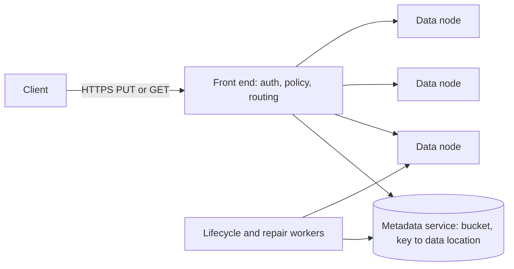
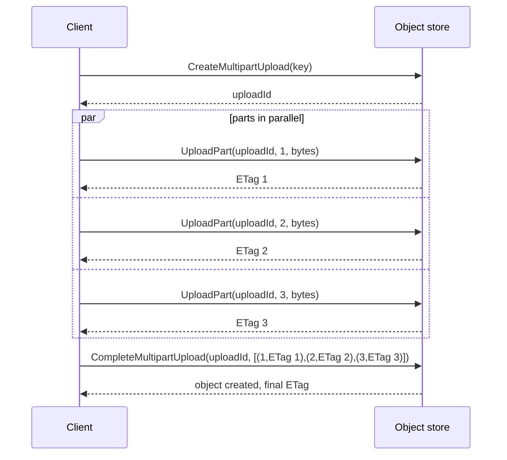
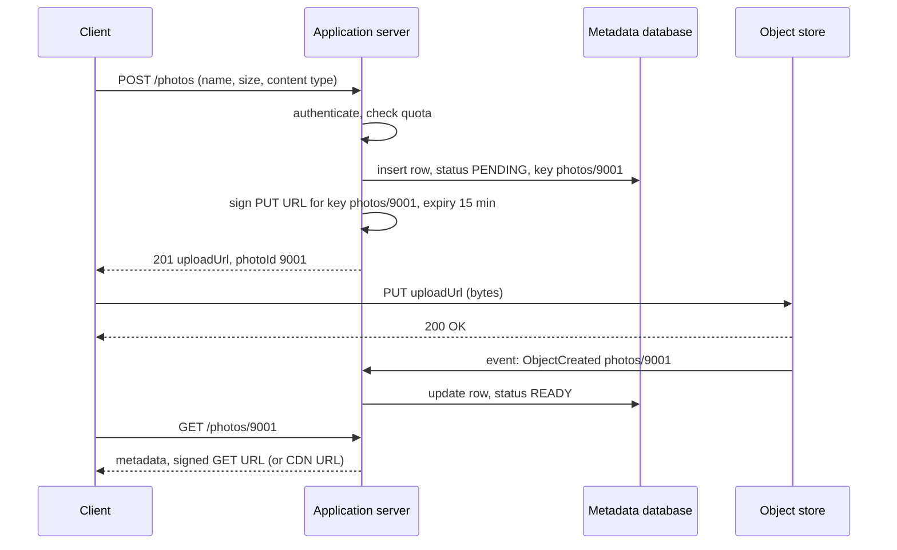
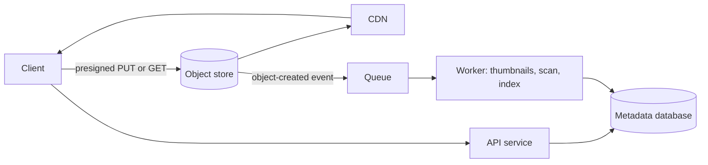
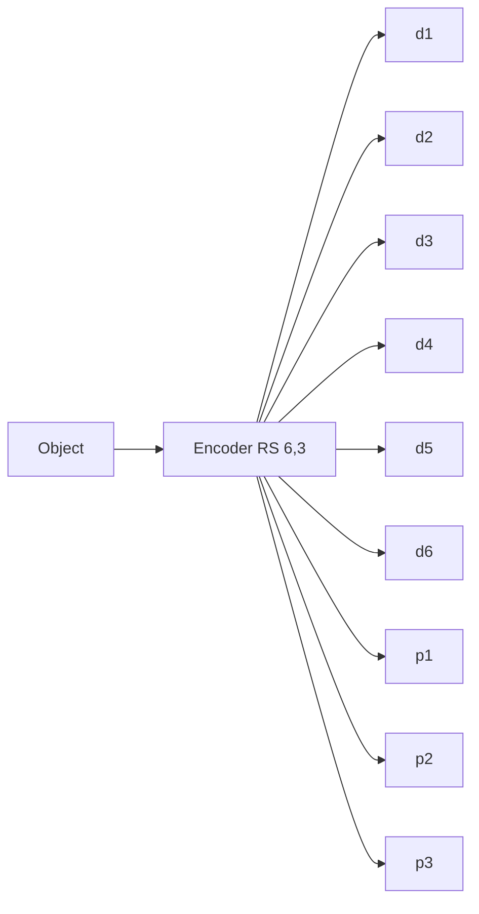

# Storage Types

Storage in a design means more than "the database". Block storage, file storage, and object storage expose different interfaces and suit different jobs. This page covers the three storage types, the design of an object store (buckets, keys, multipart upload, presigned URLs, lifecycle tiers, consistency), the pattern of blob metadata in a database with the blob in object storage, data lakes and the Parquet and ORC formats, and erasure coding against replication.

## Why It Matters

Interviews for photo sharing, video streaming, file sync, backup, and log or analytics systems all need a place for large binary data. The wrong answer is "store the image in the database". The right answer names object storage, explains how the client uploads a 5 GB file, how the system finds the file again, and how the cost falls as the file ages. Interviewers also ask why a database volume uses block storage and a shared home directory uses file storage. On the job, the same knowledge decides the monthly bill (storage class and request counts), the durability of the data, and whether an upload survives a network failure.

## Core Concepts

**Block storage**: storage that exposes a volume as an array of fixed-size blocks. The operating system formats the volume with a file system or hands it to a database. The client reads and writes blocks by address. Examples: Amazon EBS, a local SSD, a SAN volume.

**File storage**: storage that exposes a hierarchy of directories and files through a file-system protocol (NFS or SMB). Many clients mount the same file system, and the protocol provides locking and POSIX-style semantics (in-place writes, rename, append). Examples: Amazon EFS, a NAS appliance. HDFS is a distributed file system with its own API, and it is not POSIX: a file is written once and can only be appended to.

**Object storage**: storage that exposes immutable objects, each addressed by a key in a bucket, through an HTTP API (`PUT`, `GET`, `DELETE`, `LIST`). There are no directories (the key space is flat) and no in-place edit. S3 general purpose buckets have no rename operation: a rename is a copy and a delete. Examples: Amazon S3, Google Cloud Storage, Azure Blob Storage, and the open-source MinIO and Ceph RADOS Gateway. Exception: S3 directory buckets (the bucket type for the S3 Express One Zone storage class) organize objects into hierarchical directories and give single-digit-millisecond access inside one Availability Zone. This page describes general purpose buckets unless it says otherwise.

**Bucket**: the top-level container of objects in an object store. It has a name, a Region, and settings (access policy, versioning, lifecycle rules).

**Object**: the data bytes, plus metadata (system fields such as size and content type, and user-defined key-value pairs).

**Key**: the name of an object within a bucket. A key such as `photos/2026/10/cat.jpg` contains slashes, but the slashes are part of the name. The console shows them as folders. A **prefix** is the leading part of a key, and `LIST` requests can filter by prefix.

**Durability**: the probability that stored data is not lost over a period of time. **Availability**: the probability that the service answers a request. They are different numbers. S3 Standard is designed for 99.999999999 percent durability ("eleven nines") and 99.99 percent availability (AWS storage class comparison table).

**IOPS**: input and output operations per second. **Throughput**: bytes per second. Block storage is sized in both. Object storage is sized mainly in throughput and request rate.

**Multipart upload**: an upload of one object as several parts, each sent in its own request. S3 assembles the parts when the client completes the upload.

**Presigned URL**: a URL that contains a signature made with the credentials of the party that created it. Whoever holds the URL can run the signed operation (for example `PUT` of one key) until the URL expires.

**Lifecycle rule**: a bucket rule that moves objects to another storage class or deletes them after a number of days.

**Erasure coding**: a method that splits data into `k` data fragments, computes `m` parity fragments, and stores all `k + m` fragments on different devices. Any `k` fragments rebuild the data. **Replication**: storing full copies of the data on several devices.

**Data lake**: a store of raw and processed data in open file formats, usually in object storage, that several query engines read. **Columnar format**: a file format that stores the values of one column together (Parquet, ORC).

## How It Works

### Block, File, and Object Storage Compared

| Aspect | Block | File | Object |
|---|---|---|---|
| Interface | Read and write blocks by address (iSCSI, NVMe, a virtual disk) | Open, read, write, rename, lock files in directories (NFS, SMB) | `PUT`, `GET`, `DELETE`, `LIST` over HTTP |
| Unit | Block (often 4 KB or larger) | File, with in-place update and append | Whole object, replaced as a unit |
| Namespace | None. The file system or database above adds structure | Hierarchical directories | Flat keys in a bucket |
| Sharing | Usually one server at a time (EBS Multi-Attach is a limited exception for some volume types) | Many clients mount at the same time | Any number of clients over HTTP |
| Latency | Lowest. Sub-millisecond to low milliseconds (approximate, depends on the product) | Higher than block, because of the network file protocol | Highest of the three. For S3 general purpose buckets, S3 documents "roughly 100–200 milliseconds" for small objects and for the first byte of larger objects (approximate, S3 performance guidelines). S3 Express One Zone documents single-digit milliseconds |
| Consistency | Same as a local disk. The file system above defines it | POSIX-like, with network caching rules that differ by protocol | S3: strong read-after-write for objects and `LIST` since December 2020. Other stores differ, so read their documentation |
| Scale | One volume has a size limit of terabytes | Petabytes in managed services | Practically unlimited number of objects |
| Cost per GB | Highest | Middle | Lowest, with cheaper classes for cold data (check the vendor price list) |
| Typical use | Database volumes, boot disks, anything that needs random in-place writes | Shared home directories, content management, legacy applications that expect a file system | Images, video, backups, logs, data lakes, static website files, ML datasets |
| Unsuitable for | Sharing across many servers | Billions of small files at low cost | Frequent small in-place edits, low-latency random access, file locking |

Rule: if the data is a blob that you write once and read many times, use object storage. If a program needs a mounted file system that many servers share, use file storage. If a database or a boot volume needs fast random writes, use block storage.

!!! info "S3 is object storage, and an `fsync` is not an object write"
    Tools such as `s3fs` or Mountpoint for Amazon S3 present a bucket as a file system, but the semantics remain those of objects. A rename is a copy and a delete. A partial write replaces the whole object. Do not run a database on such a mount.

### The Object Store Model

An object store has three layers:

1. **API and front end.** It authenticates a request, checks the access policy, and routes the request.
2. **Metadata service.** It maps `(bucket, key, version)` to the location of the data and to the object's metadata. It must answer `LIST` by prefix, so it keeps keys in sorted order and is partitioned by key range.
3. **Data nodes.** They store the bytes. They protect the data with replication or erasure coding (see [Erasure Coding Against Replication](#erasure-coding-against-replication)).



The design follows from the interface. Objects are immutable, so a `PUT` of an existing key writes a new object and then switches the metadata pointer. The old bytes become garbage that a background worker removes. Immutability also makes caching, replication, and erasure coding simple, because a stored object does not change in place.

#### Buckets and Keys

A bucket name is unique within its namespace (for S3 general purpose buckets, the global namespace by default). A key is a string up to 1024 bytes in UTF-8 (S3 documents this limit in "Naming Amazon S3 objects").

Key design matters for two reasons.

- **Listing.** `LIST` with a prefix and a delimiter returns the "folders" and objects under a prefix. Put the attribute that you list by at the front of the key. A key such as `user/42/photo/9001.jpg` lets you list one user's photos with one prefix.
- **Request rate.** S3 documents at least 3 500 write requests (`PUT`, `COPY`, `POST`, `DELETE`) and 5 500 read requests (`GET`, `HEAD`) per second **per partitioned prefix**, with no limit on the number of prefixes. S3 scales gradually and can return `503 Slow Down` while it does. To go beyond one prefix, spread keys over several prefixes. Older advice told developers to put a random hash at the front of every key. Current S3 documentation does not require it, but the same idea (spread the load over many prefixes) still applies to very high request rates, and the key-range partitioning is the same problem as in [partitioning and sharding](06-partitioning-and-sharding.md).

A key that embeds a sequential timestamp at the front (`2026-10-15T10:00:01/...`) sends all writes to the newest key range. This is the hot-partition problem of range partitioning.

!!! tip "Do not put meaning only in the key"
    Treat the key as an opaque identifier. Store a generated ID (a UUID or a time-ordered ID, see [unique ID generation](15-unique-id-generation.md)), and keep the business fields (owner, file name, upload date) in a database. A renamed file then needs a database update, not an object copy.

#### Consistency

S3 delivers strong read-after-write consistency for `PUT` and `DELETE` of objects, and for `LIST`, in all Regions. AWS announced it on 1 December 2020, at no additional cost. From the S3 user guide:

- After a successful `PUT` of a new or an existing key, a later `GET` or `LIST` returns the new data.
- After a successful `DELETE`, a later `GET` returns no data and a later `LIST` does not show the key.
- An update to a single key is atomic. A concurrent reader gets the old object or the new one, never a mix.
- There is no locking for concurrent writers. Two simultaneous `PUT` requests to the same key resolve with last-writer-wins by timestamp.
- Updates are per key. A write to two keys is not atomic. If one logical change needs two objects, the application designs for that.
- Bucket configurations (for example enabling versioning, or listing buckets after a delete) are eventually consistent.

Before the announcement, S3 gave read-after-write consistency for new objects but eventual consistency for overwrites, deletes, and `LIST`. Older designs added a consistency layer to work around that: S3Guard in the Hadoop S3A connector, and EMRFS consistent view in Amazon EMR, both of which kept object metadata in a DynamoDB table. Those layers are no longer needed on S3. Hadoop removed S3Guard from its source in 2022 (HADOOP-17409), and AWS documents that EMRFS consistent view reached the end of standard support for future EMR releases on 1 June 2023. Other object stores differ, so check each one.

For concurrent writers, S3 supports conditional writes (S3 User Guide, "How to prevent object overwrites with conditional writes"). `If-None-Match: *` on `PutObject`, `CopyObject`, or `CompleteMultipartUpload` makes the write fail with `412 Precondition Failed` if the key already exists: "create only if absent". `If-Match: <ETag>` makes the write succeed only if the current object still has that ETag, which gives compare-and-swap for optimistic concurrency. If several conditional writes race on one key, the first to finish succeeds and the others get `412`. Use them when two writers can choose the same key.

#### Multipart Upload

A single `PUT` has a size limit (5 GB for one S3 `PutObject` request) and restarts from zero after a network failure. Multipart upload splits the object into parts.

S3 limits (AWS documentation, "Amazon S3 multipart upload limits"):

| Item | Limit |
|---|---|
| Maximum object size | 48.8 TiB |
| Maximum parts per upload | 10 000 |
| Part numbers | 1 to 10 000 |
| Part size | 5 MiB to 5 GiB (the last part may be smaller) |
| Parts returned by one `ListParts` call | 1 000 |

AWS recommends multipart upload for objects of 100 MB or more.



Properties and rules from the documentation:

- **Parallel and resumable.** The client sends parts in any order and in parallel. A failed part is sent again without touching the others. The documentation states that a multipart upload has "no expiry": it stays open until the client completes or stops (aborts) it, so it can pause and resume.
- **Part size choice.** The part size must keep the number of parts at or below 10 000. For a file of `F` bytes, the minimum part size is `ceil(F / 10 000)`, rounded up to at least 5 MiB. A 100 GiB file needs at least 10.24 MiB per part, so 10 MiB parts are too small (they need 10 240 parts). The Java example below rounds up to a whole MiB, which gives 11 MiB. Larger parts mean fewer requests. Smaller parts mean cheaper retries.
- **Record the ETags.** The client keeps its own list of part numbers and ETags and sends it in the complete request. The documentation says not to use the `ListParts` result for that.
- **Checksums.** The client can send a checksum per part or for the whole object, and S3 rejects a mismatch (`BadDigest`). The final ETag of a multipart object is not necessarily an MD5 of the data.
- **Abandoned parts cost money.** S3 keeps uploaded parts, and bills for them, until the upload is completed or aborted. Add a lifecycle rule with the `AbortIncompleteMultipartUpload` action so that abandoned uploads expire.
- **Copy as a part.** `UploadPartCopy` copies a range of an existing object into a part, so you can assemble or copy a large object without downloading it.

A client that talks to a resumable upload of its own design (for example a Dropbox-style sync client) also splits a file into chunks, but it usually picks smaller chunks (a few MB) and deduplicates them by content hash. See `kb/hld/case-studies/10-file-storage-and-sync.md`.

#### Presigned URLs

Large uploads and downloads should not pass through application servers. The server would pay for bandwidth, hold a connection per transfer, and become the bottleneck. The usual design: the application authorizes the request, creates a presigned URL, and the client talks to the object store directly.



Facts from the S3 documentation ("Download and upload objects with presigned URLs"):

- The URL carries the permissions of the IAM principal that signed it. The URL works only if that principal has the permission for the operation.
- A presigned URL is a bearer token: whoever holds it can use it until it expires. Treat it as a secret.
- With the AWS SDKs and Signature Version 4, the maximum validity is 7 days for an IAM user. With temporary credentials (an IAM role, STS), the URL stops working when the credentials expire, even if the URL has a later expiry. The S3 console allows 1 minute to 12 hours.
- S3 checks the expiry when the request starts. A download that started before the expiry continues after it.
- A presigned `PUT` for an existing key overwrites the object. Use a new, generated key for each upload, so one client cannot overwrite another client's object.
- For a multipart upload, the server presigns one URL per part. The client uploads the parts, then the server (or the client with another URL) completes the upload.

Recommendation: use a short expiry (minutes) for uploads, include the content type in the signature, and cap the size. A presigned `PUT` URL does not limit the size by itself. A presigned `POST` with a policy that has a `content-length-range` condition does. Let the object-created event (not the client's word) mark the upload complete. Validate the object after the upload (type, size, virus scan) before you mark it `READY`.

#### Versioning, Lifecycle, and Storage Classes

An object store offers classes with different cost, access latency, and minimum storage time. A lifecycle rule moves objects down the classes as they age. The S3 classes (AWS documentation, "Understanding and managing Amazon S3 storage classes"; check the pricing page for current prices):

| Class | Designed for | Availability (designed) | Min storage duration | Retrieval |
|---|---|---|---|---|
| S3 Standard | Frequently accessed data | 99.99% | None | Milliseconds |
| S3 Intelligent-Tiering | Unknown or changing access | 99.9% | None | Milliseconds in the frequent, infrequent, and archive-instant tiers. Optional archive tiers need a restore |
| S3 Standard-IA | Infrequent access, millisecond access | 99.9% | 30 days | Milliseconds, with a per-GB retrieval fee |
| S3 One Zone-IA | Re-creatable infrequent data, one Availability Zone | 99.5% | 30 days | Milliseconds, with a retrieval fee. Not resilient to loss of the zone |
| S3 Glacier Instant Retrieval | Archive accessed about once a quarter | 99.9% | 90 days | Milliseconds |
| S3 Glacier Flexible Retrieval | Archive accessed about once a year | 99.99% after restore | 90 days | Minutes to hours (restore first) |
| S3 Glacier Deep Archive | Archive accessed less than once a year | 99.99% after restore | 180 days | Hours (restore first) |

All of these classes are designed for 99.999999999 percent durability (S3 Standard to Deep Archive). The colder the class, the lower the price per GB stored, and the higher the price per retrieval and the minimum storage time. Moving a small object (below 128 KB) to a colder class can cost more than it saves. S3 bills a minimum object size of 128 KB for Standard-IA, One Zone-IA, and Glacier Instant Retrieval, and it adds 40 KB of metadata to each object archived in Glacier Flexible Retrieval or Deep Archive. Each transition is also a billed request. Since September 2024, a lifecycle rule by default does not transition objects smaller than 128 KB unless the rule has an object-size filter.

Lifecycle rules once required an object to spend 30 days in S3 Standard before a transition to Standard-IA or One Zone-IA. AWS removed that floor on 16 July 2026, so a rule can now transition an object to those classes from day 0. The minimum storage duration of the destination class is a separate rule. Standard-IA still bills 30 days for an object that is deleted, overwritten, or transitioned before 30 days.

Example lifecycle rule for user photos:

| Age | Action | Reason |
|---|---|---|
| 0 days | Store in Standard | Most reads happen in the first days |
| 30 days | Transition to Standard-IA | Reads fall |
| 365 days | Transition to Glacier Instant Retrieval | Rare reads, still millisecond access |
| Any age | Abort incomplete multipart uploads after 7 days | Free abandoned parts |
| Deleted by user | Expire noncurrent versions after 30 days | Limit the cost of versioning |

**Versioning** keeps every version of a key. A `DELETE` writes a delete marker, and older versions remain until a lifecycle rule expires them. Versioning protects against accidental overwrite and delete, at the cost of storing every version. **Object Lock** adds write-once-read-many protection for compliance.

**Replication.** Cross-region replication copies objects to another Region for disaster recovery and for lower latency. It is asynchronous, so a failover can lose the newest objects. See [multi-region and disaster recovery](19-multi-region-and-disaster-recovery.md).

### Blob Metadata in a Database, Blob in Object Storage

A database stores small structured rows well, and large blobs poorly. A 5 MB image inflates the table, the buffer pool, the backups, and the replication stream. The usual design splits the data:

| Where | What | Why |
|---|---|---|
| Relational or document database | `photo_id`, `owner_id`, `object_key`, `size`, `content_type`, `checksum`, `status`, `created_at`, tags, permissions | Query by owner, date, tag. Update fields. Transactions |
| Object store | The bytes, under `object_key` | Cheap, durable, scalable, served directly or by a CDN |



The split creates consistency problems, because the database and the object store are two systems with no shared transaction:

- **A row without an object.** The row says `READY`, but the upload failed. Fix: create the row as `PENDING`, and set `READY` only after the object-created event (or after the server checks the object with `HEAD`).
- **An object without a row.** The upload succeeded, but the application crashed before it wrote the row, or the user abandoned the flow. Fix: a periodic job lists the bucket, finds objects with no row (or `PENDING` rows older than a limit), and deletes them. A lifecycle rule on a `tmp/` prefix does the same cheaply.
- **Delete order.** Delete the row first (mark it `DELETED`), then delete the object in a background job. A crash leaves an orphan object, which the cleanup job removes. The reverse order leaves a row that points to nothing.
- **Content-addressed keys.** If the key is the hash of the content, an identical upload maps to the same object, so the system deduplicates storage. Reference counts in the database decide when an object can be deleted.
- **Immutable keys.** Do not overwrite a key that a CDN or a client cached. Write a new key and change the row. This avoids stale reads and cache invalidation. See [caching](03-caching.md).

### Data Lakes and Columnar Formats

A **data lake** keeps raw and processed data as files in object storage, in open formats, so that several engines (Spark, Trino, Hive, Athena, Flink) read the same data. The storage layer is cheap and scales with the data, and the compute layer scales separately. A **data warehouse** stores data in a managed, schema-enforced system tuned for SQL queries. The database side of this contrast lives in `kb/databases/10-oltp-olap-and-warehousing.md`. A lake trades the management and speed of a warehouse for lower cost and freedom of format.

A typical lake layout partitions files by directory, for example `events/dt=2026-10-15/hour=10/part-0001.parquet`. A query with a filter on `dt` reads only those directories (partition pruning). Fewer, larger files (hundreds of MB) are better than millions of small ones, because every object read is an HTTP request with its own latency and cost.

**Row format vs columnar format.** A row format (CSV, JSON, Avro) stores all fields of one record together, and it suits writing whole records and reading all fields. A columnar format stores the values of each column together. A query that reads 3 of 50 columns reads about 3/50 of the data, and values of one column compress well together because they have the same type and similar values.

**Parquet** (Apache Parquet file format documentation):

- A file starts and ends with the 4-byte magic number `PAR1`.
- The data is split into **row groups**. A row group holds one **column chunk** for each column. A column chunk is split into **pages**.
- The **file metadata** (footer) is written after the data. It holds the schema and the location of each column chunk, and it holds statistics such as the minimum and maximum of each column chunk. A reader reads the footer first, skips the row groups that the filter excludes (using the statistics), and reads only the needed column chunks.
- The format supports nested data and compression per column.

**ORC** (Apache ORC specification, v1):

- Rows are stored in **stripes**, typically about 200 MB. Each stripe holds index streams, data streams grouped by column, and a stripe footer.
- The index holds column statistics for each row group (10 000 rows by default), and can hold Bloom filters. The file footer holds the schema, the stripe locations, and file-level statistics. The postscript at the end of the file is never compressed, and readers read the end of the file first.

Parquet and ORC serve the same purpose. Parquet has wider support across engines. ORC came from the Hive ecosystem.

**Table formats.** Files alone give no transactions: two writers can leave a half-written set of files, and a rename in object storage is a copy. Table formats (Apache Iceberg, Delta Lake, Apache Hudi) add a metadata layer over Parquet or ORC files with atomic commits, snapshots, schema evolution, and time travel. Their details lie outside this page. They matter for the design question "how do we update a lake table without readers seeing partial data".

!!! note "Object storage is not a database"
    A lake query does a full or partial scan of files. It is fast for analytics over large data, and it is not the way to serve a user request in 20 ms. Serve user-facing queries from a database or a search index, and feed the lake with a pipeline. See [batch and stream processing](17-batch-and-stream-processing.md).

### Erasure Coding Against Replication

An object store must keep data after disk, server, and rack failures. There are two ways.

**Replication.** Store `r` full copies on different failure domains (disks, servers, racks, zones). Any one copy serves a read. The system tolerates `r - 1` lost copies. Storage overhead is `(r - 1) x 100` percent. With `r = 3`, the overhead is 200 percent, so 1 TB of data uses 3 TB.

**Erasure coding (Reed-Solomon, RS(k, m)).** Split the object into `k` data fragments. Compute `m` parity fragments from them. Store the `k + m` fragments on different failure domains. Any `k` of the `k + m` fragments rebuild the object, so the system tolerates `m` lost fragments. Storage overhead is `m / k`. The Apache Hadoop documentation states that 3x replication "has 200% overhead in storage space", and its RS(6,3) example stores 6 data blocks as 9 blocks, which is 50 percent overhead. RS(10,4) has 40 percent (`4 / 10`, computed from the same formula).



| Property | 3x replication | RS(6,3) | RS(10,4) |
|---|---|---|---|
| Fragments stored per object | 3 full copies | 9 fragments (6 data, 3 parity) | 14 fragments (10 data, 4 parity) |
| Storage overhead | 200% | 50% | 40% |
| Storage used for 1 TB | 3 TB | 1.5 TB | 1.4 TB |
| Failures tolerated | 2 | 3 | 4 |
| Read when healthy | One copy, one device | Read `k` data fragments in parallel (6 devices) | 10 devices |
| Repair of one lost unit | Copy one unit from one source: reads 1 unit | Read `k` surviving fragments to rebuild 1: reads 6 units | Reads 10 units |
| Repair network traffic per lost unit | 1x | `k` times (6x) | `k` times (10x) |
| CPU cost | None | Encoding on write, decoding on degraded read and repair | Same, higher |
| Small objects | Fine | Poor: a small object cannot split into useful fragments, and the overhead of metadata grows | Poor |
| Update in place | Rewrite copies | Rewrite or re-encode the stripe | Same |
| Read latency under failure | Same as healthy (read another copy) | Higher: decode from `k` other fragments | Higher |

The trade-off: erasure coding saves a large share of the storage (50 percent overhead against 200 percent for comparable or better fault tolerance), and it pays in repair traffic, CPU, and complexity. The Hadoop documentation states that erasure-coded files spread over racks, so most reads and writes cross racks and depend on network bandwidth between racks. For that reason, systems use replication for **hot** data (frequent reads, small objects, fast repair) and erasure coding for **warm and cold** data (large objects, rare reads, mostly writes once).

A real example: Facebook's f4 (Muralidhar et al., OSDI 2014) stores "warm" blobs (photos and videos that are accessed much less often than new ones). The paper's abstract reports that f4 lowers the effective replication factor from 3.6 (for the earlier Haystack system) to 2.8 or 2.1, for over 65 PB of logical blobs, while it tolerates disk, host, rack, and datacenter failures.

Other points:

- **Durability math.** The chance of data loss needs `m + 1` fragments to fail before a repair finishes. A faster repair shrinks the exposure window. Replication repairs by copying, and erasure coding repairs by reading many fragments, so the repair time and the network cost count in the durability estimate, not only the number of parities.
- **Placement.** Fragments (or copies) must sit in different failure domains, otherwise one rack failure takes several fragments. RS(6,3) needs at least 9 domains to survive 3 domain failures.
- **Local reconstruction codes (LRC).** Windows Azure Storage adds local parity fragments, each computed over a small group of data fragments, so that the repair of one lost fragment reads only its group and not all `k` fragments. Huang et al. (USENIX ATC 2012) write that LRC "reduces the bandwidth and I/Os required for repair reads over prior codes, while still allowing a significant reduction in storage overhead".

The Java example below uses single-parity XOR, which is RS(k, 1), to show how a parity fragment rebuilds a lost fragment. A production system uses Reed-Solomon with `m > 1` over a finite field, which a library provides.

## Trade-offs and When to Use

| Decision | Choose the first when | Choose the second when | Cost |
|---|---|---|---|
| Object vs file storage | Write-once blobs, HTTP access, huge scale, low cost | A mounted shared file system with in-place writes and locking | Object: no in-place edit, higher latency. File: higher price, scale limits |
| Object vs block storage | Data served as files over HTTP | A database or an OS volume needs random writes at low latency | Block: one server at a time, higher price per GB |
| Database blob vs object store with metadata row | Tiny values (a few KB), need one transaction | Anything larger than tens of KB, or many reads of large files | Split design: two systems, orphan cleanup, no shared transaction |
| Server-proxied upload vs presigned URL | Small files, need to process bytes inline, strict control | Large files, high volume, want to save server bandwidth | Presigned: the server learns of completion by event, URL leakage risk |
| Single `PUT` vs multipart upload | Objects below about 100 MB on a stable network | Large objects, spotty network, parallel upload | Multipart: more requests, abandoned-part cleanup |
| Replication vs erasure coding | Hot data, small objects, fast repair | Warm and cold large objects, storage cost matters | Erasure coding: repair traffic, CPU, complexity |
| Hot class vs cheaper class | Frequent reads | Rare reads, long retention | Cheaper class: retrieval fees, minimum duration, latency (archive) |
| Lake in object storage vs warehouse | Many engines, raw data, low cost, large scale | Fast managed SQL, strict schema, many concurrent BI users | Lake: file management, small-file problem, needs a table format for ACID |

Recommendation: in an interview, store blobs in object storage, keep metadata in a database, upload with presigned URLs, serve through a CDN, and add a lifecycle rule. State the durability number and the consistency model of the store you name.

## Java Example

The program does three things with fixed inputs. First, it plans a multipart upload: it picks the smallest whole-MiB part size that keeps the part count at or below 10 000 and is at least 5 MiB, using the S3 limits. Second, it computes the storage overhead of replication and of RS(k, m). Third, it splits an object into 4 data fragments, computes one XOR parity fragment, drops one data fragment, and rebuilds it from the others.

```java
import java.nio.charset.StandardCharsets;
import java.util.Arrays;

public class Main {
    static final long MIB = 1024L * 1024L;
    static final long GIB = 1024L * MIB;
    static final int MAX_PARTS = 10_000;
    static final long MIN_PART = 5 * MIB;
    static final long MAX_PART = 5 * GIB;

    /** Smallest whole-MiB part size that keeps the upload at or below 10 000 parts. */
    static long partSize(long objectBytes) {
        long needed = (objectBytes + MAX_PARTS - 1) / MAX_PARTS;
        long wholeMib = (needed + MIB - 1) / MIB * MIB;
        long size = Math.max(wholeMib, MIN_PART);
        if (size > MAX_PART) {
            throw new IllegalArgumentException("object too large for one multipart upload");
        }
        return size;
    }

    static long partCount(long objectBytes, long partBytes) {
        return (objectBytes + partBytes - 1) / partBytes;
    }

    static byte[] xorOf(byte[]... fragments) {
        byte[] out = new byte[fragments[0].length];
        for (byte[] f : fragments) {
            for (int i = 0; i < out.length; i++) {
                out[i] ^= f[i];
            }
        }
        return out;
    }

    public static void main(String[] args) {
        long[] sizes = {50 * MIB, 100 * GIB, 5 * 1024 * GIB};
        String[] labels = {"50 MiB", "100 GiB", "5 TiB"};
        for (int i = 0; i < sizes.length; i++) {
            long part = partSize(sizes[i]);
            System.out.printf("%-8s part size %6d MiB, parts %5d%n",
                labels[i], part / MIB, partCount(sizes[i], part));
        }

        System.out.println("overhead: 3x replication " + (3 - 1) * 100 + "%, RS(6,3) "
            + 3 * 100 / 6 + "%, RS(10,4) " + 4 * 100 / 10 + "%");

        byte[] object = "object storage splits data into fragments and a parity fragment."
            .getBytes(StandardCharsets.UTF_8);
        int k = 4;
        int fragLen = (object.length + k - 1) / k;
        byte[][] data = new byte[k][fragLen];
        for (int i = 0; i < object.length; i++) {
            data[i / fragLen][i % fragLen] = object[i];
        }
        byte[] parity = xorOf(data);

        int lost = 2;
        byte[] rebuilt = xorOf(data[0], data[1], data[3], parity);
        System.out.println("lost fragment " + lost + ", rebuilt equals original: "
            + Arrays.equals(rebuilt, data[lost]));

        byte[] joined = new byte[k * fragLen];
        for (int i = 0; i < k; i++) {
            byte[] f = (i == lost) ? rebuilt : data[i];
            System.arraycopy(f, 0, joined, i * fragLen, fragLen);
        }
        String text = new String(joined, 0, object.length, StandardCharsets.UTF_8);
        System.out.println("recovered object: " + text);
    }
}
```

<!-- expected-output -->
```text
50 MiB   part size      5 MiB, parts    10
100 GiB  part size     11 MiB, parts  9310
5 TiB    part size    525 MiB, parts  9987
overhead: 3x replication 200%, RS(6,3) 50%, RS(10,4) 40%
lost fragment 2, rebuilt equals original: true
recovered object: object storage splits data into fragments and a parity fragment.
```

The XOR parity works because `d1 ^ d2 ^ d3 ^ d4 ^ p = 0`, so any one missing fragment equals the XOR of the others. One parity fragment tolerates one failure. Reed-Solomon generalizes the idea to `m` parity fragments and `m` failures. To repair one lost fragment, the code reads all `k` survivors, which shows the repair traffic of erasure coding.

## Interview Angle

### Questions

??? question "Where do you store user-uploaded photos and how does the client upload a 2 GB video?"

    The bytes go to object storage (S3 or an equivalent), the metadata goes to a database, and a CDN serves the downloads. Object storage fits because the data is write-once, large, and read over HTTP. It is cheap, durable (S3 is designed for eleven nines), and scales without sharding work on my side.

    Upload flow: the client asks the API for an upload. The API authenticates the user, checks the quota, inserts a `PENDING` row with a generated object key, and returns presigned URLs. For 2 GB, the client uses multipart upload: parts of 8 to 100 MB, sent in parallel, with a retry per part. S3 limits are 10 000 parts, 5 MiB to 5 GiB per part. The client then completes the upload. The object-created event moves the row to `READY` and triggers workers (virus scan, transcoding, thumbnails). A lifecycle rule aborts incomplete multipart uploads so abandoned parts do not cost money.

    The presigned URL keeps the bytes off my servers. The trade-off: the URL is a bearer token, so I keep the expiry short and generate a new key for each upload.

??? question "Compare block, file, and object storage. When do you use each?"

    Block storage gives a raw volume of blocks that one server formats with a file system or gives to a database. It has the lowest latency and supports random in-place writes, so it holds database data files and boot volumes. It costs the most per GB, and one server uses it at a time.

    File storage gives a shared directory tree over NFS or SMB. Many servers mount it, and it has file semantics: in-place writes, rename, locks. It fits shared home directories and legacy applications. It costs more than object storage and has scale limits.

    Object storage gives immutable objects in a flat key space over HTTP. It has the lowest cost per GB and nearly unlimited scale, and it has the highest latency and no in-place update. It fits blobs, backups, logs, static files, and data lakes.

    My rule: random writes with low latency means block, a shared mount means file, a blob that I write once and read many times means object.

??? question "What consistency does S3 give, and why did the change in December 2020 matter?"

    Since 1 December 2020, S3 gives strong read-after-write consistency for `PUT` and `DELETE` of objects and for `LIST`, in every Region, at no extra cost. After a successful write, any later `GET` or `LIST` sees it. Before that, S3 gave read-after-write for new keys but only eventual consistency for overwrites, deletes, and `LIST`.

    It mattered because applications and data tools needed workarounds, such as S3Guard in Hadoop or EMRFS consistent view in EMR (both kept a metadata table in DynamoDB), so that a job saw all the files that a previous job wrote. Those layers are no longer needed: Hadoop removed S3Guard in 2022, and EMRFS consistent view reached the end of standard support in 2023.

    What it does not give: single-key updates are atomic, but there are no multi-key transactions, and no locking for concurrent writers (two simultaneous `PUT`s resolve by last-writer-wins). Bucket configuration changes are still eventually consistent. If I need "create only if absent", I use a conditional write with `If-None-Match: *`. For read-modify-write of one object, I use `If-Match` with the ETag that I read, and retry on `412 Precondition Failed`.

??? question "You store metadata in a database and the file in object storage. What goes wrong and how do you handle it?"

    The two stores have no shared transaction, so they can disagree. Two cases: a row without an object (the upload failed) and an object without a row (the app crashed after the upload).

    For the first, I create the row as `PENDING` and set `READY` only when the object-created event arrives, or after a `HEAD` request confirms the object. For the second, a cleanup job deletes `PENDING` rows and unreferenced objects older than a limit, and a lifecycle rule expires a `tmp/` prefix.

    For deletes, I mark the row `DELETED` first and remove the object in the background, so a crash leaves an orphan that the cleanup removes, not a row that points to nothing. I use generated, immutable keys, and I write a new key for an updated file. That avoids overwrite races and stale CDN copies.

??? question "Compare replication and erasure coding for an object store."

    Replication keeps `r` full copies. With 3 copies, the overhead is 200 percent, a read needs one copy, and a repair copies one unit. Erasure coding RS(k, m) splits the data into `k` fragments and adds `m` parity fragments, so any `k` of the `k + m` rebuild the data. RS(6,3) has 50 percent overhead and tolerates 3 failures, where 3x replication has 200 percent and tolerates 2.

    The cost: a repair reads `k` fragments to rebuild one, so the network traffic is `k` times that of a copy. Decoding costs CPU. A degraded read is slower. Small objects fit poorly.

    So I use replication for hot and small data, where reads are frequent and repair must be fast, and erasure coding for large warm and cold data, where the storage saving is large. Facebook's f4 paper is an example: it reports an effective replication factor of 2.1 to 2.8 for warm blobs, against 3.6 before. I also place fragments in separate failure domains, because durability depends on repair time as well as on the number of parities.

??? question "How would you serve a private video file to its owner only, without proxying the bytes through your servers?"

    I authorize the request in the API and return a short-lived signed URL, either a presigned object-store URL or a signed CDN URL. The client then downloads straight from the object store or the CDN edge.

    The URL is a bearer token, so I keep the expiry short (minutes), I use HTTPS, and I do not log the full URL. With S3, a URL signed by a role stops working when the role credentials expire, even if the URL has a later expiry. For long videos that need repeated access, I issue a new URL for each playback session or use signed cookies at the CDN. If the content must be revocable, I rely on short expiry, because S3 has no call that revokes one presigned URL. The URL stops working when its signing credentials are revoked or deactivated, when the object is deleted or replaced, or when a bucket policy denies the request (for example by signature age with the `s3:signatureAge` condition). See `kb/hld/case-studies/09-video-streaming.md`.

??? question "Design the storage tiers for logs that you must keep 7 years, and that you read often in the first week."

    Write to object storage in a columnar or compressed format, partitioned by date. A lifecycle rule moves the data down the tiers: Standard for the first week (frequent reads), Standard-IA or Intelligent-Tiering for the next weeks, and Glacier Instant Retrieval or Flexible Retrieval for the long tail, then expire at 7 years. I check the minimum storage durations (30, 90, and 180 days for the colder classes) so that I do not pay early-deletion charges, and the minimum billable object size, so I compact small files into larger ones before they transition.

    For search over recent logs, I keep a short window (for example 14 days) in a search index, and I query older data with an engine that reads the Parquet files directly. Compliance retention can use Object Lock. The design trades retrieval time and fees for a lower storage price, and I state the retrieval time of the cold tier to the stakeholders.

??? question "Why is Parquet better than CSV or JSON for analytics on a data lake?"

    Parquet is columnar. A query that reads 3 of 50 columns reads only those column chunks, while CSV and JSON force the reader to parse every field of every row. The values of one column share a type and often repeat, so compression and encoding work better. The file footer holds the schema and per-column-chunk statistics such as the minimum and maximum, so the engine skips row groups that cannot match a filter. Partitioned directories add partition pruning on top.

    Trade-offs: Parquet is poor for writing single records, so writers batch records into files of hundreds of MB. Files are immutable, so updates need a rewrite or a table format (Iceberg, Delta Lake, Hudi) that adds atomic commits. Many small files hurt, because each object read is an HTTP request.

### Follow-up Questions

- How does the metadata service of an object store support `LIST` by prefix at scale?
- How do you deduplicate uploads of the same file by many users?
- How would you design a download of a very large object with resume?
- How do you protect against a user who uploads a malicious file through a presigned URL?
- How do you move 5 PB from an on-premises system to object storage?
- What is the effect of a hot prefix, and how do you spread the load?
- How do you estimate the durability of an erasure-coded system?
- How do you keep a data lake table consistent while a job writes to it?

### Red Flags

- Storing large images or videos in the relational database.
- Proxying every upload and download through the application servers without a reason.
- Saying "S3 is eventually consistent" without the December 2020 change, or saying it supports transactions across keys.
- Treating object storage as a file system: in-place edits, rename as a cheap operation, file locks.
- No plan for orphans (row without object, object without row, abandoned multipart parts).
- A single `PUT` for multi-GB files, with no resume.
- Using a user-supplied file name as the object key.
- Claiming erasure coding is better than replication in every case, without repair cost.
- Quoting durability as availability, or the reverse.
- No lifecycle policy, so all data stays in the most expensive class for ever.

## Common Mistakes

| Mistake | Why it hurts | Fix |
|---|---|---|
| Blob in a database row | Bloats the table, buffer pool, backups, and replication | Store the blob in object storage and a pointer in the row |
| User-supplied file name as key | Collisions, overwrites by other users, odd characters, enumeration | Generate a key (UUID or time-ordered ID) and store the file name in the database |
| Overwriting a key that a CDN caches | Stale copies at the edge | Write a new key and update the row |
| Sequential timestamp at the front of keys | All writes hit one key range | Put a high-cardinality element first, or spread over several prefixes |
| No abort rule for multipart uploads | Abandoned parts stay and cost money | Lifecycle rule `AbortIncompleteMultipartUpload` |
| Part size too small for a large file | More than 10 000 parts is not allowed | Part size at least `ceil(size / 10 000)` |
| Long-lived presigned URLs | A leaked URL gives access for days | Short expiry, new URL per request, HTTPS |
| Marking an upload complete on the client's word | A client can lie or fail | Use the object-created event or a `HEAD` check |
| Moving tiny objects to infrequent-access classes | Minimum billable size and request charges raise the cost | Compact small objects first, or keep them in Standard |
| Millions of tiny files in a data lake | Each read is a request, queries slow down | Compact into files of hundreds of MB |
| Running a database on a bucket mounted as a file system | Object semantics break in-place writes | Use block storage |
| Same failure domain for all fragments or copies | One rack failure loses the data | Spread copies and fragments over racks and zones |
| Erasure coding for hot small objects | Repair traffic and decode latency dominate | Replicate hot data, erasure-code cold data |
| Assuming other object stores match S3 consistency | Behavior differs between products | Read the documentation of the store you use |

## Commonly Confused With

| Looks like | Difference | Deciding question |
|---|---|---|
| Object storage and file storage | Objects are immutable and addressed by key over HTTP. Files live in directories and change in place through a mounted file system | Does the program need in-place writes, rename, or locks? |
| Object storage and block storage | Block gives raw blocks to one server for random I/O. Object gives whole blobs over HTTP | Is it a database or boot volume, or a blob? |
| S3 prefix and folder | In a general purpose bucket, a prefix is part of the key string. There is no directory object, and no cheap rename. (Directory buckets do have real directories) | Do you need to rename a "folder"? It costs a copy of every object |
| Durability and availability | Durability is the chance that data survives. Availability is the chance that a request succeeds now | Is the question "will the data exist" or "can I read it now"? |
| Presigned URL and public object | A presigned URL gives time-limited access to one operation. A public object is open to everyone | Should access expire and be tied to a principal? |
| Multipart upload and chunked transfer encoding | Multipart upload is an S3 API with separate requests for each part and a complete call. Chunked encoding is an HTTP framing of one request | Are there several requests and an upload ID? |
| Erasure coding and RAID | Both use parity. RAID protects disks inside one server. Erasure coding in an object store spreads fragments over servers, racks, and zones | Do the fragments sit in one machine or across failure domains? |
| Replication in storage and database replication | Storage replication copies immutable blocks or objects. Database replication copies a stream of changes, with ordering and lag. See [replication](05-replication.md) | Does the system replicate whole objects or a log of writes? |
| Data lake and data warehouse | A lake keeps open-format files in object storage for many engines. A warehouse is a managed SQL system with an enforced schema | Do you need open files and many engines, or fast managed SQL? |
| Parquet and ORC | Both are columnar. They differ in layout names (row groups against stripes) and ecosystem | Which engines must read the files? |
| Storage class transition and replication | A transition moves the object to another class in place. Replication creates a copy elsewhere | Are you lowering cost or adding a copy? |

## Quick Reference Card

- **Block:** raw volume, one server, lowest latency, random writes. Databases and boot disks.
- **File:** shared directory tree (NFS, SMB), in-place edits and locks. Shared mounts.
- **Object:** immutable blobs, flat keys, HTTP, cheapest, highest latency. Images, video, backups, logs, lakes.
- **S3 consistency:** strong read-after-write for `PUT`, `DELETE`, `LIST` since 1 December 2020. Atomic per key, no multi-key transactions, last-writer-wins for concurrent `PUT`.
- **S3 durability:** designed for eleven nines. Standard availability designed 99.99%.
- **Multipart limits:** up to 10 000 parts, 5 MiB to 5 GiB per part, 48.8 TiB per object. Use from about 100 MB. Abort incomplete uploads with a lifecycle rule.
- **Part size:** at least `ceil(size / 10 000)`, minimum 5 MiB.
- **Presigned URL:** bearer token for one operation. 7 days maximum with an IAM user and SigV4. Role credentials end it sooner. Keep expiry short. New key for each upload.
- **Upload flow:** API creates a `PENDING` row and signs a URL. Client uploads direct. Object-created event sets `READY`. CDN serves.
- **Orphans:** a cleanup job removes `PENDING` rows and unreferenced objects. Delete the row first, then the object.
- **Tiers:** Standard, IA (30 days min), Glacier Instant (90), Flexible (90, restore), Deep Archive (180, restore). Lifecycle rules move data down.
- **Lake:** Parquet (row groups, column chunks, footer statistics) or ORC (stripes). Partition directories. Large files. Table formats for ACID.
- **Replication vs erasure coding:** 3x is 200% overhead, repair reads 1 unit. RS(6,3) is 50%, tolerates 3, repair reads 6 units. Replicate hot data, erasure-code cold data.
- **Say in the interview:** the store, the consistency model, the upload path, the orphan handling, and the lifecycle.

## Further Reading

- Amazon S3 User Guide, "What is Amazon S3?" (`https://docs.aws.amazon.com/AmazonS3/latest/userguide/Welcome.html`). Buckets, keys, and the consistency model: strong read-after-write, atomic per-key updates, and last-writer-wins.
- AWS announcement, "Amazon S3 now delivers strong read-after-write consistency automatically for all applications", 1 December 2020 (`https://aws.amazon.com/about-aws/whats-new/2020/12/amazon-s3-now-delivers-strong-read-after-write-consistency-automatically-for-all-applications/`). The date and the claim of no extra cost.
- Amazon S3 User Guide, "Amazon S3 multipart upload limits" (`https://docs.aws.amazon.com/AmazonS3/latest/userguide/qfacts.html`) and "Uploading and copying objects using multipart upload" (`https://docs.aws.amazon.com/AmazonS3/latest/userguide/mpuoverview.html`). Part and size limits, the three-step process, checksums, and abandoned-part billing.
- Amazon S3 User Guide, "Download and upload objects with presigned URLs" (`https://docs.aws.amazon.com/AmazonS3/latest/userguide/using-presigned-url.html`). Expiry rules for each credential type and the bearer-token warning.
- Amazon S3 User Guide, "Understanding and managing Amazon S3 storage classes" (`https://docs.aws.amazon.com/AmazonS3/latest/userguide/storage-class-intro.html`). The comparison table of durability, availability, and minimum storage duration.
- Amazon S3 User Guide, "Best practices design patterns: optimizing Amazon S3 performance" (`https://docs.aws.amazon.com/AmazonS3/latest/userguide/optimizing-performance.html`). The per-prefix request rates and the `503 Slow Down` behavior.
- Apache Hadoop documentation, "HDFS Erasure Coding" (`https://hadoop.apache.org/docs/stable/hadoop-project-dist/hadoop-hdfs/HDFSErasureCoding.html`). Overhead of replication against RS(6,3), reconstruction reads, and rack requirements.
- Muralidhar et al., "f4: Facebook's Warm BLOB Storage System", OSDI 2014 (`https://www.usenix.org/conference/osdi14/technical-sessions/presentation/muralidhar`). Effective replication factors of 3.6, 2.8, and 2.1 for hot and warm blobs.
- Apache Parquet documentation, "File Format" (`https://parquet.apache.org/docs/file-format/`). Row groups, column chunks, and the footer.
- Apache ORC specification, "ORC v1" (`https://orc.apache.org/specification/ORCv1/`). Stripes, indexes, statistics, and the file tail.
- Ghemawat, Gobioff, Leung, "The Google File System", SOSP 2003 (`https://research.google/pubs/the-google-file-system/`). The design of a large-scale distributed storage system with replicated chunks.
- Kleppmann, *Designing Data-Intensive Applications*, first edition (O'Reilly, 2017), chapters 3 "Storage and Retrieval" and 10 "Batch Processing". Column storage and batch processing over distributed file systems.
- Huang et al., "Erasure Coding in Windows Azure Storage", USENIX ATC 2012 (`https://www.usenix.org/conference/atc12/technical-sessions/presentation/huang`). Local reconstruction codes and their repair cost.
- Amazon S3 User Guide, "How to prevent object overwrites with conditional writes" (`https://docs.aws.amazon.com/AmazonS3/latest/userguide/conditional-writes.html`). `If-None-Match`, `If-Match`, and the `412` response.
- Amazon S3 User Guide, "Transitioning objects using Amazon S3 Lifecycle" (`https://docs.aws.amazon.com/AmazonS3/latest/userguide/lifecycle-transition-general-considerations.html`). Supported transitions, the 128 KB default, and minimum-duration charges.
- AWS announcement, "Amazon S3 removes 30-day minimum for transitions to S3 Standard-IA and S3 One Zone-IA", 16 July 2026 (`https://aws.amazon.com/about-aws/whats-new/2026/07/s3-removes-30-day-transitions-standard-ia-one-zone-ia/`). Transitions to the IA classes from day 0.
- Apache Hadoop documentation, "S3Guard: Consistency and Metadata Caching for S3A (retired)" (`https://hadoop.apache.org/docs/stable/hadoop-aws/tools/hadoop-aws/s3guard.html`). Why S3Guard existed and why Hadoop removed it.
- Related pages: [scalability and availability](01-scalability-and-availability.md), [load balancing, DNS and CDN](02-load-balancing-dns-cdn.md), [caching](03-caching.md), [choosing a database](04-choosing-a-database.md), [replication](05-replication.md), [partitioning and sharding](06-partitioning-and-sharding.md), [consistency and CAP](07-consistency-and-cap.md), [message queues and streams](08-message-queues-and-streams.md), [communication patterns](09-communication-patterns.md), [unique ID generation](15-unique-id-generation.md), [batch and stream processing](17-batch-and-stream-processing.md), [multi-region and disaster recovery](19-multi-region-and-disaster-recovery.md), `kb/databases/10-oltp-olap-and-warehousing.md`, `kb/databases/06-storage-engines.md`, `kb/hld/case-studies/10-file-storage-and-sync.md`, `kb/hld/case-studies/09-video-streaming.md`, `kb/hld/case-studies/18-photo-sharing.md`.
