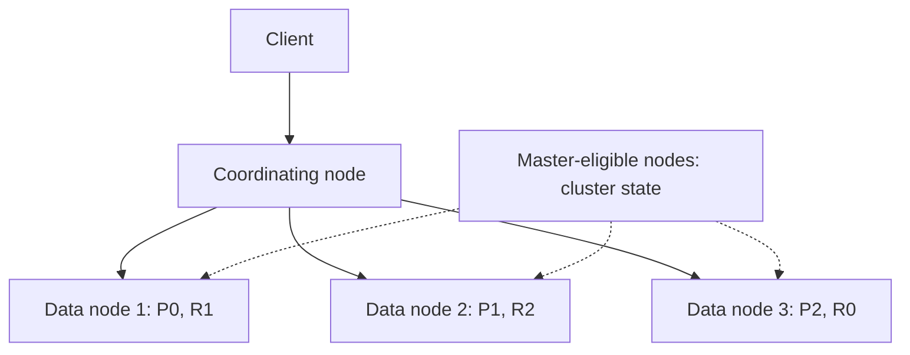
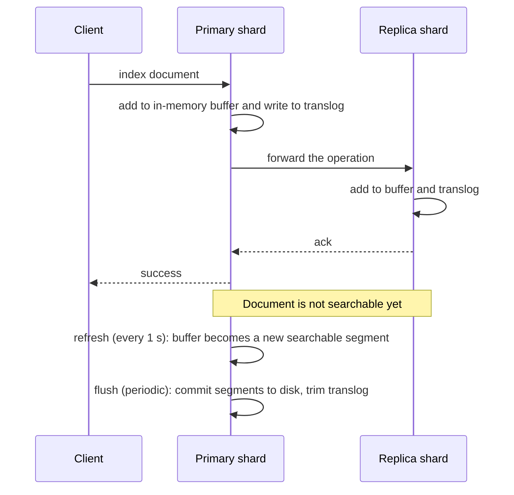
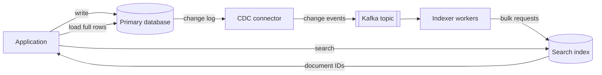

# Search and Indexing

A search engine finds the documents that match a text query and ranks them by relevance. A database index finds rows by an exact key or a range. This page covers the inverted index, text analysis, ranking with TF-IDF and BM25, the architecture of Elasticsearch and OpenSearch (index, shard, replica, segment, refresh, translog), how to keep a search index in step with a database, the difference between search and database queries, and the basics of autocomplete.

## Why It Matters

Search appears in HLD interviews in two forms: a feature inside another design ("search products", "search messages") and a case study of its own (search autocomplete, web crawler plus index). An interviewer expects you to say that a relational `LIKE '%word%'` query scans the whole table, that a dedicated search engine uses an inverted index, that the engine is a derived copy and not the source of truth, and that a change-data-capture pipeline feeds it. On the job, Elasticsearch, OpenSearch, and Solr power product search, log search, and filtering screens, and most of their incidents come from shard sizing, slow indexing, stale results, and deep pagination. This page gives the vocabulary and the mechanisms for those questions.

## Core Concepts

**Document**: the unit that a search engine stores and returns, such as a product, an article, or a log line. In Elasticsearch, a document is a JSON object with fields.

**Corpus**: the whole set of documents.

**Term** (also *token*): the unit of matching, usually a normalized word. **Tokenization** splits text into tokens. **Normalization** changes tokens to a standard form, so that "Running" and "running" match.

**Analyzer**: the chain that turns field text into terms. It has character filters, one tokenizer, and token filters (lowercasing, stop-word removal, stemming, synonyms). The same analysis must run on the indexed text and on the query text, with allowed exceptions (for example, synonyms only at query time).

**Stemming**: reducing a word to a root form so that "searching", "searched", and "searches" match (to "search"). **Lemmatization** uses a dictionary to find the base form. **Stop words**: very common words ("the", "a") that some analyzers drop.

**Inverted index**: a map from each term to the list of documents that contain it. A book's back-of-book index has the same shape: term, then page numbers. The "inverted" name contrasts with the *forward index*, which maps a document to its terms.

**Term dictionary**: the sorted set of all terms in the index, with a pointer from each term to its posting list.

**Posting list** (also *postings*): for one term, the sorted list of document IDs that contain it. Each entry (a *posting*) can also store the term frequency in that document, the positions of the term (for phrase queries), and offsets (for highlighting).

**Term frequency (tf)**: how many times a term occurs in one document. **Document frequency (df)**: how many documents contain the term. **Inverse document frequency (idf)**: a weight that grows as the term gets rarer in the corpus.

**Relevance score**: a number that says how well a document matches a query. The engine sorts the results by it.

**Precision and recall**: *precision* is the share of returned documents that are relevant. *Recall* is the share of relevant documents that the engine returns. Better analysis (stemming, synonyms) raises recall and can lower precision.

**Index** (Elasticsearch meaning): a logical collection of documents with a mapping (the field types). Do not confuse it with a database index: an Elasticsearch index is closer to a table.

**Shard**: a partition of an index. Each shard is a complete Lucene index. A **primary shard** holds the original documents. A **replica shard** is a copy of a primary on another node, for availability and read throughput.

**Segment**: an immutable file set inside a shard that holds a small inverted index. A shard search reads all its segments and merges the results.

**Refresh**: the operation that writes the buffered documents to a new segment and opens it for search.

**Translog**: the transaction log of a shard. It records each indexing operation, so that the shard recovers operations that no commit has yet saved.

**Change data capture (CDC)**: a technique that reads the change log of a database and publishes each row change as an event.

## How It Works

### The Inverted Index

Take three documents after analysis (lowercase, stop words removed):

| Doc | Text | Terms |
|---|---|---|
| 1 | "Java concurrency in practice" | java, concurrency, practice |
| 2 | "Fast search with an inverted index" | fast, search, inverted, index |
| 3 | "Java search engine" | java, search, engine |

The inverted index, with one posting list for each term (the number in brackets is the term frequency):

```text
term         posting list (docId[tf])
concurrency  1[1]
engine       3[1]
fast         2[1]
index        2[1]
inverted     2[1]
java         1[1], 3[1]
practice     1[1]
search       2[1], 3[1]
```

A query for `java search` (both terms required, an AND query) reads two posting lists and intersects them: the lists are sorted, so the engine walks both lists in step and keeps the document IDs that appear in both. The result is document 3. An OR query takes the union, and the score decides the order. A query cost depends on the length of the posting lists that it reads, not on the corpus size.

**Why it is fast.** A scan of a table checks every row. The inverted index jumps to the term in the dictionary and reads one list. Lucene (the library inside Elasticsearch and OpenSearch) keeps the term dictionary on disk in blocks of terms that share a prefix (the `.tim` file). A small *terms index* (the `.tip` file) is a finite state transducer (FST), a compact automaton over term prefixes that points to the block that can hold a term. A lookup walks the FST in time proportional to the term length, then scans one block. Lucene stores the posting lists compressed. The Lucene 10.1 postings format describes the details:

- **Delta encoding.** Document IDs are sorted, and Lucene stores the difference between each ID and the previous one (a *d-gap*). The gaps are small numbers.
- **Bit packing in blocks.** Lucene packs the gaps in blocks of 128 values. Each block uses the bit width of its largest value (a *frame of reference* form of packing). Frequency blocks also use *patching*: the few large values are stored apart, so that they do not widen the whole block. The values after the last full block use variable-length integers.
- **Skip data.** Lucene stores skip data on two levels, before every block and before every 32 blocks. An intersection uses it to jump over blocks of document IDs that cannot match. The skip data also stores *impacts* (the best frequency and length pairs in a block), so a top-k query can skip blocks that cannot reach the current top scores.

The file formats change between Lucene versions. The ideas above (sorted IDs, gaps, block packing, skip data) stay the same.

**Phrase queries** ("quick brown fox" as an exact sequence) need positions. The engine intersects the lists, then checks that the positions of the terms are consecutive. Storing positions increases the index size, and Elasticsearch lets you turn them off for a field that needs no phrase search.

### Text Analysis

Analysis decides what "match" means. A typical English analyzer does these steps in order:

1. **Character filter**: remove HTML tags, map special characters.
2. **Tokenizer**: split the text into tokens at spaces and punctuation (Elasticsearch `standard` tokenizer follows the Unicode text segmentation rules).
3. **Token filters**: lowercase, remove stop words, stem, add synonyms, fold accents ("café" to "cafe").

Choices and consequences:

- **Stemming** raises recall ("running" finds "run") and can match wrongly ("university" and "universe" share a stem in some stemmers). Lemmatization is more precise and slower.
- **Languages** need their own analyzers. Chinese, Japanese, and Korean have no spaces between words, so they need a dictionary-based or n-gram tokenizer.
- **Exact fields** (IDs, email addresses, status codes) use no analysis. Elasticsearch calls this type `keyword`, and the `text` type is analyzed. A field often has both: a `text` field for search, and a `keyword` sub-field for sorting and aggregations.
- **Index-time and query-time analysis** must agree. If the index stores stemmed terms and the query does not stem, the query will not match.

### Ranking Basics

An AND or OR match returns a set. Ranking sorts the set. The basic ideas are: a term that occurs often in a document makes the document more relevant (tf), a term that occurs in few documents of the corpus tells more than a common one (idf), and a match in a short document is stronger than the same match in a long document (length normalization).

**TF-IDF.** The classic score of a document `d` for a query is the sum over the query terms `t` of `tf(t, d) x idf(t)`, with `idf(t) = log(N / df(t))`, where `N` is the number of documents in the corpus. A term in every document has an idf of `log(1) = 0`, so it adds nothing. TF-IDF grows without bound as `tf` grows, so a document that repeats a word 100 times beats one that uses it 10 times by ten times. That does not match how relevance works.

**BM25** (Best Matching 25) is the successor, from the probabilistic relevance framework. Robertson and Walker (SIGIR 1994) derived the term-frequency saturation from the 2-Poisson model, and the BM25 function first appeared in the Okapi system at TREC-3 (Robertson, Walker, Jones, Hancock-Beaulieu, and Gatford, "Okapi at TREC-3", 1994), the paper that Lucene's `BM25Similarity` javadoc cites. Robertson and Zaragoza (2009) give the modern account. Elasticsearch, OpenSearch, and Lucene use BM25 as the default similarity. For a document `D` and a query with terms `q_i`:

```text
score(D, Q) = sum over q_i of  IDF(q_i) * f(q_i, D) * (k1 + 1)
                               -----------------------------------------------
                               f(q_i, D) + k1 * (1 - b + b * |D| / avgdl)
```

Where `f(q_i, D)` is the term frequency in `D`, `|D|` is the length of `D` in terms, and `avgdl` is the average document length in the corpus. Lucene's IDF is `ln(1 + (N - n + 0.5) / (n + 0.5))`, where `n` is the number of documents that contain the term. The parameter `k1` (default 1.2 in Lucene and Elasticsearch) controls *saturation* of term frequency: the score of a term rises with `tf` but approaches a limit. In the formula above, the limit is `IDF x (k1 + 1)`. The parameter `b` (default 0.75) controls length normalization: `b = 0` ignores document length, and `b = 1` applies full normalization.

Lucene's implementation differs in one constant. Since Lucene 8.0 (issue LUCENE-8563, "Remove k1+1 from the numerator of BM25Similarity"), `BM25Similarity` drops the `(k1 + 1)` factor from the numerator, so a term's score approaches `IDF` and not `IDF x (k1 + 1)`. The issue says that the change "doesn't modify ordering", because the factor is the same constant for every term and every document. Lucene 8.0 also added a deprecated `LegacyBM25Similarity` (in the misc module) that keeps the old scale. Lucene stores each document's length in one byte with a lossy encoding, so its `|D|` is approximate.

The two engines differ here (checked in their source code, October 2026). Elasticsearch builds its `BM25` similarity from its own `LegacyBM25Similarity` class, which wraps Lucene's `BM25Similarity` and multiplies the boost by `(1 + k1)`, so Elasticsearch scores keep the classic scale with `(k1 + 1)`. OpenSearch 3.0 changed its default to Lucene's `BM25Similarity`, so OpenSearch 3.x scores are about 2.2 times lower (at `k1` = 1.2) than OpenSearch 2.x scores for the same query, with the same order. An OpenSearch index can set the `LegacyBM25` similarity to keep the old scores. Recommendation: do not compare absolute scores across engines or versions, and do not hard-code a score threshold.

**Beyond text scoring.** Real ranking combines the text score with other signals: popularity, recency, price, personalization, and business rules. Elasticsearch has `function_score` and a rescore phase that applies an expensive model to the top results only. A second stage, *learning to rank*, uses a trained model over many features. Two-stage retrieval is the standard shape: a cheap first stage selects hundreds or thousands of candidates, and a costly second stage reorders the top ones.

**Vector search.** Search by meaning uses embeddings (a dense vector per document) and an approximate nearest-neighbor index such as HNSW. Elasticsearch and OpenSearch support dense vector fields. *Hybrid search* merges the BM25 results and the vector results. This page covers the lexical case only.

### Elasticsearch and OpenSearch Architecture

OpenSearch is a fork of Elasticsearch 7.10.2, the last Elasticsearch release under the Apache 2.0 license. AWS started the fork in January 2021 and announced the OpenSearch project in April 2021. So the core design below (Lucene-based shards, segments, refresh, translog) applies to both. The numbers and defaults below come from the Elasticsearch documentation, and some may differ in OpenSearch.



**Cluster and nodes.** A cluster is a set of nodes. One master node (elected from the master-eligible nodes) holds the *cluster state*: the index mappings and the location of each shard. Data nodes store shards and run indexing and search on them. Any node can act as the *coordinating node* for a request: it routes the request to the right shards and merges the answers.

**Index, shards, replicas.** An index splits into a fixed number of primary shards, chosen at creation. Elasticsearch documents the setting `index.number_of_shards` with a default of 1 primary shard and `index.number_of_replicas` with a default of 1. You cannot change the number of primary shards of an existing index in place, because the shard of a document comes from the formula below. You change it with the split or shrink API or by reindexing into a new index. The number of replicas can change at any time. Elasticsearch never places a replica on the same node as its primary.

**Routing.** To choose the shard for a document, the engine computes `shard_num = hash(_routing) % num_primary_shards`. The `_routing` value is the document ID by default. The current Elasticsearch documentation gives this formula for indices created in 9.4.0 and later. For older indices it gives `shard_num = (hash(_routing) % num_routing_shards) / routing_factor`, with `routing_factor = num_routing_shards / num_primary_shards`. The extra `num_routing_shards` term (the `index.number_of_routing_shards` setting) fixes in advance the shard counts that the split API can reach. A custom routing value (for example the customer ID) puts all documents of a customer on one shard, so a search for that customer reads one shard and not all of them, at the risk of an uneven shard size. This is hash partitioning (see [partitioning and sharding](06-partitioning-and-sharding.md)).

**Segments.** Each shard holds several segments. A segment is immutable: the engine never edits it. A document update writes a new version into a new segment and marks the old version as deleted. A delete only marks the document. The engine drops the deleted documents physically when it merges segments in the background (*segment merge*): it reads several small segments and writes one larger segment. Immutability makes segments safe to cache and to read without locks, and it makes merges necessary. Merges cost disk I/O and CPU, and Elasticsearch throttles them.

**Write path.**



1. The coordinating node routes the request to the primary shard of the document.
2. The primary adds the document to an in-memory indexing buffer and appends the operation to the translog. By default, the translog is fsynced to disk before the request returns (`index.translog.durability` is `request`).
3. The primary forwards the operation to its replicas, and each replica does the same. The primary answers the client after the in-sync replicas acknowledge.
4. At the next **refresh**, the shard writes the buffer into a new segment in the filesystem cache and opens it for search. Elasticsearch documents the default `index.refresh_interval` as 1 s. If no search request arrives for 30 s (`index.search.idle.after`), an index with no explicit `refresh_interval` stops refreshing until a search arrives. This design is called **near-real-time search**: a document is visible to search within about one second, and not at once. The `?refresh=wait_for` parameter makes a request wait for the next refresh, and `?refresh=true` forces one (expensive when it is used for each request).
5. A **flush** runs a Lucene commit: it writes the segments to disk (fsync) and starts a new translog, so that the old translog can go. After a crash, the shard reloads the last commit and replays the translog, so the acknowledged operations come back.
6. Background **merges** reduce the segment count.

**Search path (query then fetch).** The coordinating node sends the query to one copy (primary or replica) of every shard of the index (*scatter*). Each shard searches its segments, scores locally, and returns the document IDs and scores of its top `from + size` hits (the *query phase*). The coordinating node merges these lists into the global top `size`, then asks the shards that hold those documents for the stored fields (the *fetch phase*) and returns the page (*gather*). Costs that follow:

- A search touches every shard (unless routing narrows it), so latency is the slowest shard's latency (the tail-latency effect from "The Tail at Scale"; see [scalability and availability](01-scalability-and-availability.md)). More shards add more fan-out.
- **Deep pagination** costs more per page: page 2000 with 10 hits per page makes each shard return its top 20 000 hits. Elasticsearch limits `from + size` to `index.max_result_window`, default 10 000. For deep paging, the docs recommend `search_after` with a point in time (PIT), which keeps a stable view and a sort cursor, and which replaces the scroll API for this job.
- **Scores are local to a shard.** Each shard computes idf from its own statistics, so small or uneven shards can give odd ranking. The default is a local statistic. The `dfs_query_then_fetch` search type collects global statistics first, at the cost of one more round.

**Failure and recovery.** If a node with a primary shard fails, the master promotes an in-sync replica to primary. The cluster then creates a new replica elsewhere. A replica adds search capacity, because a query can go to either copy.

**Shard sizing.** Each shard has a fixed overhead (memory for segment metadata, file handles, a Lucene index to search). The Elasticsearch documentation recommends shard sizes of 10 GB to 50 GB and fewer than 200 million documents per shard, and it says to keep the number of indices low enough for the master's heap (fewer than 3 000 indices per GB of heap). Too many small shards waste memory and slow cluster-state updates. Too few large shards slow recovery and cannot spread the load. Time-based data (logs, events) uses one index per period with a rollover (an *index lifecycle* policy), so that old indices can move to cheaper storage or be deleted as a whole.

**Updating a mapping.** You cannot change the type of an existing field. The standard method: create a new index with the new mapping, copy the data with the reindex API, and switch an **alias** (a name that points to an index) from the old index to the new one. The application always uses the alias, so the switch is atomic and has no downtime.

### The Indexing Pipeline

The search index is a **derived copy**. The source of truth is the primary database (see [choosing a database](04-choosing-a-database.md)). The pipeline copies each change into the index.



**Options to keep the index in step, from weakest to strongest:**

| Method | How it works | Problem |
|---|---|---|
| Dual write | The application writes to the database and to the index in the same request | The two writes are not atomic. If one fails, the stores differ for good. Two concurrent writers can apply the two writes in different orders |
| Periodic batch reindex | A job copies changed rows (by an `updated_at` column) every few minutes | Delay. Misses deletes unless the table has soft deletes. Load on the database |
| Change data capture | A connector reads the database log (PostgreSQL logical decoding, MySQL binlog) and publishes events. Debezium is a common open-source connector | More components. The delay is seconds. Needs a schema for events |
| Transactional outbox | The application writes the business row and an outbox row in one transaction. A relay publishes the outbox rows to a queue | One more table. Gives the same guarantee as CDC and works on any database (see `kb/hld/distributed-systems/03-distributed-transactions.md`) |

**Recommendation:** use CDC or an outbox with a log such as Kafka (see [message queues and streams](08-message-queues-and-streams.md)). The log gives ordering per key, replay, and a buffer that absorbs bursts.

**Design rules for the indexer:**

- **Idempotent writes.** The log delivers at least once, so an event can arrive twice. Index with the document ID from the row's primary key, so a repeat overwrites the same document.
- **Ordering and versions.** Events for one row must apply in order. Partition the log by row key. Use external versioning (`version_type=external`, with the row's version or the event's log sequence number), so that Elasticsearch rejects an older write that arrives after a newer one.
- **Bulk requests.** Send batches, not single documents. Indexing throughput depends on it. The Elasticsearch "Tune for indexing speed" page says to find the batch size by a benchmark on one node with one shard: start at 100 documents per request, double the count in each run, and stop when the indexing rate stops rising. It also says to avoid "going beyond a couple tens of megabytes per request", because many large requests at the same time put the cluster under memory pressure.
- **Backpressure and retries.** On HTTP 429 (the bulk queue is full), back off with jitter (see [reliability patterns](12-reliability-patterns.md)). Send failed events to a dead-letter queue.
- **Deletes.** CDC captures deletes as events. Apply them as delete operations.
- **Denormalize for search.** The index holds one document that contains the fields to search and filter (for example a product with its category name and brand name). A change in a category name must update all its products. Elasticsearch has `join` fields and nested documents, but they are slower, so most designs denormalize.
- **Return IDs, load rows.** A common choice: the search returns the document IDs and a few display fields, and the application loads current details (price, stock) from the database or a cache. Fields that change often and must be exact do not belong in the index.
- **Initial load and reindex.** Build a new index in the background from a snapshot of the table, replay the log from the snapshot position, and switch the alias. Keep the old index for a rollback.
- **Monitor lag.** Measure the time from database commit to searchable. Alert when it passes the target (for example 10 s). Plan for a search index that is stale for a short time, and design the UI so that a user who just saved an item finds it (for example, show the user's own new item from the write response).

### Search Versus Database Queries

| Need | Relational database | Search engine |
|---|---|---|
| Find rows by primary key or exact value | Index on the column: fast | Possible, but wasteful |
| Prefix match (`LIKE 'abc%'`) | A B-tree index can serve it | Works with prefix or edge n-gram analysis |
| Contains match (`LIKE '%abc%'`) | Full scan (a B-tree cannot help) unless a trigram index exists (PostgreSQL `pg_trgm`) | Fast with n-gram analysis, and normal for word matches |
| Full-text search with ranking, stemming, and synonyms | Basic support (PostgreSQL `tsvector`, MySQL `FULLTEXT`). Limited ranking and language options | Core purpose |
| Typo tolerance (fuzzy match) | Weak | Built in (edit distance) |
| Faceted counts (filter by brand, price range, with counts) | Possible with `GROUP BY`, slow at scale | Aggregations on columnar `doc_values` data |
| Transactions and joins | Strong | Not supported across documents. No multi-document ACID transactions |
| Consistency | Strong | Near-real-time. Eventually consistent with the source |
| Source of truth | Yes | No. Rebuild it from the database |
| Writes | Fast for single rows, strong guarantees | Optimized for bulk. An update rewrites the whole document |

**Recommendation:** start with the database's full-text search (PostgreSQL `tsvector` with a GIN index) if the data is small (up to a few million rows) and the search needs are simple. Move to a search engine when you need relevance tuning, typo tolerance, facets at scale, or many languages. The operational cost of a cluster is real.

### Autocomplete Basics

Autocomplete (search-as-you-type) returns suggestions for a prefix, after each keystroke, under a latency target of about 100 ms. The requirements differ from document search: the data are short strings (queries, product names), the match is by prefix, and ranking is by popularity.

| Technique | How it works | Cost |
|---|---|---|
| Trie with top-k at each node | Each node stores the k best completions for its prefix, so a lookup reads one node | Memory. Rebuild or update as popularity changes |
| Edge n-grams in a search index | The analyzer indexes each prefix of each term ("sea", "sear", ...) as a term, so a prefix query is an exact term lookup | Larger index. Easy to run in Elasticsearch |
| Completion suggester (Elasticsearch) | An in-memory FST over the suggestion strings, built for fast prefix lookups, with a weight for ranking | Memory. Needs a dedicated field type. No full-text features |
| Prefix query on a sorted index | A range scan on a B-tree or a sorted set (Redis `ZRANGEBYLEX`) | Ranking by popularity needs extra structure |

A real design also needs: a data pipeline that aggregates query logs into counts, offline or near real time; a store that holds the top suggestions for each prefix; caching of the most common prefixes in a CDN or in memory; a client that debounces keystrokes (waits 100 to 200 ms) and cancels stale requests; and filtering of unsafe or private queries. The full design, with numbers, is in the planned case study `kb/hld/case-studies/07-search-autocomplete.md`.

## Trade-offs and When to Use

| Decision | Option A | Option B | Choose A when | Choose B when |
|---|---|---|---|---|
| Where to search | Database full-text | Search engine | Small data, simple needs, one system to run | Relevance, facets, typo tolerance, scale |
| How to feed the index | Dual write | CDC or outbox through a log | Almost never. Only for a prototype | Production. Needs no lost updates |
| Shard count | Few large shards | Many small shards | Low fan-out and cheap overhead matter | Parallel indexing and fast recovery matter |
| Replicas | 0 | 1 or more | Bulk load, or a rebuildable index | Availability and read throughput |
| Refresh interval | 1 s | 30 s or `-1` during bulk load | Users need new data soon | Heavy indexing, where throughput matters more than freshness |
| Routing | Default (document ID) | Custom (tenant ID) | Even load matters | Queries always filter by one key, and tenants are small |
| Ranking | BM25 only | BM25 plus signals and rescoring | The text match decides | Popularity, price, or personalization matter |
| Pagination | `from` and `size` | `search_after` with PIT | A few pages, under 10 000 hits | Export or infinite scroll |
| Index per | One index for all | One per time period or tenant | Data does not age | Retention by period, or isolation between tenants |

Alternatives to Elasticsearch and OpenSearch: Apache Solr (also Lucene-based), and Typesense or Meilisearch, which target search-as-you-type on smaller data sets. Elasticsearch and OpenSearch also serve log and metric search, where the ingest rate matters more than the ranking.

## Java Example

The program below builds a small in-memory inverted index. It analyzes text (lowercase, split, remove stop words), stores a posting list with the term frequency per document, and ranks a query with BM25 (`k1` = 1.2, `b` = 0.75, Lucene's IDF form). The numbers show the effects that the page describes. Document 4 repeats "java" and "search" and scores highest. Rarity and length both matter: document 1 matches only "java" (in 2 of 4 documents, idf 0.693) and scores 0.919, while documents 2 and 3 match only "search" (in 3 of 4 documents, idf 0.357) and score 0.330. Document 1 also has 3 terms, against 9 terms in documents 2 and 3 (the average is 7.5). With 9 terms, document 1 would score 0.641, so the rarer term alone gives about twice the score, and the shorter length adds the rest. A query that holds only a stop word has no hits. The code uses the classic formula with the `(k1 + 1)` factor, the scale that Elasticsearch returns. Lucene 8 and later (and OpenSearch 3.x) would give each score divided by 2.2, with the same order. This is a teaching model, not Lucene: it keeps no positions, no segments, and no compression.

```java
import java.util.ArrayList;
import java.util.Comparator;
import java.util.HashMap;
import java.util.List;
import java.util.Locale;
import java.util.Map;
import java.util.Set;
import java.util.TreeMap;

public class Main {
    public static void main(String[] args) {
        InvertedIndex index = new InvertedIndex();
        index.add(1, "Java concurrency in practice");
        index.add(2, "Fast search with an inverted index: the index maps each term to documents");
        index.add(3, "Search engines rank documents. Ranking uses term frequency and rarity");
        index.add(4, "Java search: how a Java search engine ranks Java documents");

        System.out.println("terms in the index: " + index.termCount());
        System.out.println("posting list for 'java': " + index.postings("java"));
        System.out.println("posting list for 'search': " + index.postings("search"));
        System.out.println("analyze: " + Analyzer.analyze("The Fast, FAST search-engines!"));

        for (String query : List.of("java search", "inverted index", "the")) {
            System.out.println("query '" + query + "'");
            List<Hit> hits = index.search(query);
            if (hits.isEmpty()) {
                System.out.println("  no hits");
            }
            for (Hit hit : hits) {
                System.out.println(String.format(Locale.ROOT, "  doc %d score %.3f",
                    hit.docId(), hit.score()));
            }
        }
    }
}

record Hit(int docId, double score) { }

class Analyzer {
    private static final Set<String> STOP_WORDS =
        Set.of("the", "a", "an", "in", "with", "to", "and");

    static List<String> analyze(String text) {
        List<String> tokens = new ArrayList<>();
        for (String raw : text.toLowerCase(Locale.ROOT).split("[^a-z0-9]+")) {
            if (!raw.isEmpty() && !STOP_WORDS.contains(raw)) {
                tokens.add(raw);
            }
        }
        return tokens;
    }
}

class InvertedIndex {
    private static final double K1 = 1.2;
    private static final double B = 0.75;

    private final Map<String, Map<Integer, Integer>> postings = new TreeMap<>();
    private final Map<Integer, Integer> docLengths = new HashMap<>();
    private long totalLength = 0;

    void add(int docId, String text) {
        List<String> tokens = Analyzer.analyze(text);
        docLengths.put(docId, tokens.size());
        totalLength += tokens.size();
        for (String token : tokens) {
            postings.computeIfAbsent(token, t -> new TreeMap<>()).merge(docId, 1, Integer::sum);
        }
    }

    int termCount() {
        return postings.size();
    }

    Map<Integer, Integer> postings(String term) {
        return postings.getOrDefault(term, Map.of());
    }

    List<Hit> search(String query) {
        int docCount = docLengths.size();
        double averageLength = (double) totalLength / docCount;
        Map<Integer, Double> scores = new HashMap<>();
        for (String term : Analyzer.analyze(query)) {
            Map<Integer, Integer> list = postings(term);
            int docFreq = list.size();
            double idf = Math.log(1 + (docCount - docFreq + 0.5) / (docFreq + 0.5));
            for (Map.Entry<Integer, Integer> posting : list.entrySet()) {
                double tf = posting.getValue();
                double length = docLengths.get(posting.getKey());
                double norm = tf + K1 * (1 - B + B * length / averageLength);
                scores.merge(posting.getKey(), idf * tf * (K1 + 1) / norm, Double::sum);
            }
        }
        List<Hit> hits = new ArrayList<>();
        scores.forEach((docId, score) -> hits.add(new Hit(docId, score)));
        hits.sort(Comparator.comparingDouble(Hit::score).reversed()
            .thenComparingInt(Hit::docId));
        return hits;
    }
}
```

<!-- expected-output -->
```text
terms in the index: 20
posting list for 'java': {1=1, 4=3}
posting list for 'search': {2=1, 3=1, 4=2}
analyze: [fast, fast, search, engines]
query 'java search'
  doc 4 score 1.509
  doc 1 score 0.919
  doc 2 score 0.330
  doc 3 score 0.330
query 'inverted index'
  doc 2 score 2.680
query 'the'
  no hits
```

## Interview Angle

### Questions

??? question "How does full-text search work? Why is it faster than `LIKE '%word%'` on a database?"

    A search engine builds an inverted index when it indexes a document. It analyzes the text into terms (lowercase, split, stem, remove stop words) and stores, for each term, a sorted posting list of the documents that contain it, often with term frequencies and positions. A query is analyzed the same way, then the engine looks up each term in a sorted term dictionary and reads its posting list. For an AND query it intersects the sorted lists, and for an OR query it merges them. The cost depends on the list lengths, not on the corpus size.

    `LIKE '%word%'` has a leading wildcard, so a B-tree index cannot narrow the search, and the database scans every row and every character of the column. That is linear in the data size. The trade-offs of the inverted index: it costs index space and write work, it matches analyzed terms (not arbitrary substrings unless you use n-grams), and it is eventually consistent with the source of truth.

??? question "How does BM25 rank results, and why is it better than plain TF-IDF?"

    Both sum a weight for each query term that depends on how often the term occurs in the document (tf) and how rare it is in the corpus (idf). Plain TF-IDF grows linearly with the term frequency, so a document that repeats a word many times wins by a large margin, and it ignores document length. BM25 saturates the term frequency: the score rises with `tf` but approaches a limit, controlled by `k1` (default 1.2 in Elasticsearch). It also normalizes by document length relative to the average, controlled by `b` (default 0.75), so a match in a short document counts more than the same match in a long one. The IDF part, in Lucene `ln(1 + (N - n + 0.5) / (n + 0.5))`, gives rare terms more weight and never goes negative. In practice I would tune with relevance judgments and add signals such as popularity or recency through a rescoring stage, and not tune `k1` and `b` first.

??? question "Describe the architecture of Elasticsearch. What are shards, replicas, and segments?"

    A cluster has nodes. An index is split into primary shards, each of which is a complete Lucene index. Each primary has replicas on other nodes, for availability and for extra read capacity. The shard of a document is `hash(_routing) % number_of_primary_shards`, with the document ID as the default routing, which is why the primary count cannot change in place. Inside a shard, data lives in immutable segments. An update writes a new document version and marks the old one deleted, and background merges combine segments and purge deleted documents.

    A search goes to one copy of every shard, each shard returns its local top hits, and the coordinating node merges them and fetches the documents. Latency is the slowest shard's latency, so shard count is a trade-off: more shards spread the load and add fan-out and overhead. The documentation recommends 10 GB to 50 GB per shard.

??? question "A user saves a new product and does not see it in search for a moment. Why, and what do you do?"

    There are two delays. The first is inside the engine: a new document is in the in-memory buffer and the translog, and becomes searchable at the next refresh, which is 1 s by default (near-real-time search). The second is the pipeline: if a CDC process or a queue feeds the index, the event must travel from the database through the log to the indexer, which takes seconds and grows when the indexer lags.

    I would accept eventual consistency for search and design around it. For the user's own action, I show the new item from the write response, or I read from the database for "my items". I measure the end-to-end lag as a metric and alert on it. I use `refresh=wait_for` only where read-your-writes is a hard requirement, because forcing refreshes for each request hurts indexing throughput. I do not use dual writes to chase freshness, because they cause permanent divergence.

??? question "How do you keep an Elasticsearch index consistent with the primary database?"

    The database is the source of truth and the index is derived. I avoid dual writes, because the two writes are not atomic and two writers can apply them in different orders. I use change data capture (Debezium reading the database log) or a transactional outbox, publish the events to Kafka partitioned by the row key, and run indexer workers that write to Elasticsearch with bulk requests. Writes are idempotent by document ID, and I use external versioning so an older event cannot overwrite a newer document. Deletes flow through as events. For repair, a periodic job compares counts or checksums with the database and reindexes the differences, and I can rebuild the whole index into a new one and switch an alias. I accept a lag of seconds and monitor it.

??? question "Design the search for an e-commerce site with 50 million products."

    Requirements: keyword search with ranking, filters (category, brand, price) with counts, typo tolerance, results in under 200 ms at the p99, and new products visible within about a minute.

    Design: the catalog database is the source of truth. CDC feeds a Kafka topic, and indexers write denormalized product documents (title, description, brand, category names, price, popularity, availability) into Elasticsearch. Mapping: `text` fields with an English analyzer for title and description (boost the title), `keyword` fields for filters and facets, numeric price. Size (approximate): Assumption: an average product document of 2 KB. Then 50 million documents hold about 100 GB of source data, and with the index overhead the total is 100 to 200 GB. At about 30 GB per shard (inside the documented 10 GB to 50 GB range), that is 4 to 7 primary shards, and each shard holds 7 to 13 million documents, far below the 200 million limit. One replica of each shard gives availability and doubles read capacity. I would confirm the numbers by indexing a sample and measuring the index size. Ranking: BM25 on text fields plus a rescoring step with popularity and conversion data. Search returns IDs and display fields, and a cache or database provides live price and stock. Autocomplete uses a separate completion index. Pagination uses `search_after`. For peak load, replicas add read capacity, and a cache holds the most common queries.

??? question "What goes wrong with too many shards, or with deep pagination?"

    Each shard has a fixed cost in heap, file handles, and cluster-state size. Thousands of small shards slow the master, waste memory, and add fan-out to every search, so the tail latency grows. I follow the 10 GB to 50 GB per shard guidance, use rollover for time-based data, and use the shrink API to merge shards of old indices.

    Deep pagination with `from` and `size` makes each shard return `from + size` hits, which the coordinating node sorts. That costs memory and time that grow with the page number, and Elasticsearch caps it at 10 000 by default (`index.max_result_window`). For export or infinite scroll I use `search_after` with a point in time and a unique sort tiebreaker, and I ask whether users need page 500 at all.

### Follow-up Questions

??? question "Why are Lucene segments immutable, and what does that cost?"

    Immutable files need no locks for readers, can be cached by the operating system, and compress well. The cost is that an update writes a new version and marks the old one deleted, so the index holds dead data until a merge removes it, and merges use disk and CPU. A workload with many updates to the same documents has high write amplification, so I avoid frequent updates of large documents and I separate fast-changing fields (such as a counter) into another store.

??? question "How would you make autocomplete fast?"

    I precompute. A trie (or a store keyed by prefix) holds the top-k suggestions for each prefix, built offline from query logs, so a lookup is one key read. I cache the popular prefixes at the edge, debounce keystrokes on the client, and cancel requests that are out of date. In Elasticsearch, a completion suggester (an in-memory FST) or edge n-grams give prefix lookups. The case study `kb/hld/case-studies/07-search-autocomplete.md` has the full design.

??? question "How do you handle multi-tenant search?"

    Three options. One index per tenant isolates data and allows per-tenant settings, but thousands of tenants mean thousands of small shards. One shared index with a tenant filter on every query is cheap, and a missing filter leaks data, so I enforce it in a single query layer (Elasticsearch also offers filtered aliases). A shared index with custom routing by tenant ID sends each tenant's queries to one shard and cuts fan-out, with the risk of a very large tenant creating a hot shard. I choose by tenant count and size distribution: per-tenant indices for a few large tenants, a shared index for many small ones.

??? question "Can Elasticsearch be your primary database?"

    I would not use it as the only copy of important data. It has no multi-document transactions, it is near-real-time, and an update replaces whole documents. Operational mistakes such as a bad mapping need a reindex, which needs a source to reindex from. It fits logs, metrics, and derived search data that I can rebuild.

### Red Flags

- Proposing `LIKE '%term%'` for search at scale.
- Writing to the database and the search index in the same request and calling it consistent.
- Treating the search index as the source of truth, with no way to rebuild it.
- Saying that new documents are searchable immediately.
- Choosing the number of shards with no reasoning, or planning to change the primary shard count in place.
- Ignoring analysis: indexing text without saying how the query is normalized.
- Using deep `from` and `size` pagination for exports.
- Describing ranking as "Elasticsearch sorts it" with no mention of tf, idf, or length normalization.

## Common Mistakes

| Mistake | Why it hurts | Fix |
|---|---|---|
| Index the field with one analyzer and query it with another | The terms do not match, so valid documents are missing | Use the same analyzer, or set the search analyzer on purpose |
| Use a `text` field for exact filters, sorting, or aggregations | Analysis splits the value into terms, so filters misbehave and sorting uses a term | Use a `keyword` field (or a `keyword` sub-field) |
| Leave dynamic mapping on for untrusted fields | A "mapping explosion" creates thousands of fields and strains the cluster state | Define the mapping and set `dynamic` to `strict` or `false` |
| Dual write to the database and the index | The stores diverge after a partial failure | CDC or an outbox with idempotent indexing |
| Index one document at a time | Throughput is low, and the cluster handles many small requests | Bulk requests, sized by a benchmark, under a couple tens of megabytes each |
| Force a refresh after every write | Many tiny segments, slow indexing, and heavy merges | Use the default interval, or `wait_for` only where read-your-writes is required |
| Too many small shards (for example 1 000 shards of 100 MB) | Heap and cluster-state overhead, slow searches | Aim for 10 GB to 50 GB per shard, and use rollover and shrink |
| One huge shard | Slow recovery and no parallelism | Split by planned size |
| Rely on a shard count that you cannot change | A wrong guess needs a reindex | Plan the size, use the split API, or reindex into a new index and switch an alias |
| Deep pagination with `from` and `size` | Memory and time grow with the page number, with a hard cap of 10 000 | `search_after` with a point in time |
| Store frequently changing data (stock, price) in the index and trust it | Stale values show in results | Load these fields from the database, or index them with strict freshness limits |
| No index versioning or aliases | A mapping change needs downtime | Name indices with a version and query through an alias |
| Tune `k1` and `b` first | Little effect with high effort | Fix analysis and mapping, add signals, then tune with relevance judgments |

## Commonly Confused With

| Looks like | Difference | Deciding question |
|---|---|---|
| Inverted index and database B-tree index | An inverted index maps terms to documents, for text matching. A B-tree index maps column values to rows, for equality and range | Do I match words inside text, or a whole column value? |
| Elasticsearch index and database index | An Elasticsearch index is a collection of documents (like a table). A database index is a structure that speeds up a table | Do I mean the data set or the access structure? |
| Shard and replica | A shard is a partition of the data and divides the load. A replica copies a shard and adds availability and read capacity | Does it split the data, or copy it? |
| Shard and segment | A shard is a unit of distribution (a Lucene index on one node). A segment is an immutable file set inside a shard | Is it a unit across nodes, or inside one node? |
| Refresh, flush, and merge | Refresh makes new documents searchable. Flush commits to disk and trims the translog. Merge combines segments | Is it about visibility, durability, or compaction? |
| TF-IDF and BM25 | BM25 saturates term frequency and normalizes by length with tunable parameters. Plain TF-IDF does neither | Does the score grow without limit with repeated words? |
| Search and recommendation | Search answers an explicit query. A recommendation predicts interest with no query | Did the user type a query? |
| Autocomplete and search | Autocomplete matches prefixes of short strings under about 100 ms and ranks by popularity. Search matches full queries over documents and ranks by relevance | Does the input match a prefix of a known string? |
| Full-text search and vector search | Full-text matches the words. Vector search matches meaning through embeddings and approximate nearest neighbors | Do the words need to match? |

## Quick Reference Card

- **Inverted index:** term to sorted posting list (doc ID, tf, positions). AND is a list intersection. Cost follows list length.
- **Analysis:** tokenize, lowercase, stop words, stemming, synonyms. Same analysis at index and at query time. `text` for search, `keyword` for exact values.
- **TF-IDF:** `tf x log(N / df)`. Grows without limit.
- **BM25:** saturating tf (`k1` = 1.2) and length normalization (`b` = 0.75). Default in Elasticsearch, OpenSearch, and Lucene. Lucene 8+ and OpenSearch 3.x drop the `(k1 + 1)` factor, Elasticsearch keeps it: same order, different absolute scores.
- **Shard:** a Lucene index. Document shard is `hash(_routing) % primary shards`. The primary count is fixed at creation. Defaults: 1 primary, 1 replica.
- **Segment:** immutable. Update is write-new plus mark-old-deleted. Merges clean up.
- **Write path:** buffer plus translog, replicate, refresh (1 s, makes it searchable), flush (commit and trim the translog), merge.
- **Search path:** scatter to all shards, local top hits, gather, fetch. Latency is the slowest shard.
- **Sizing:** 10 GB to 50 GB per shard, under 200 million documents per shard, 3 000 indices per GB of master heap at most.
- **Pagination:** `from + size` is capped at 10 000. Use `search_after` and PIT.
- **Sync with the database:** CDC or an outbox, a Kafka log, idempotent indexing with external versions. Never dual write.
- **Mapping change:** new index, reindex, switch the alias.
- **Autocomplete:** trie with top-k, edge n-grams, or a completion suggester. Cache, debounce, precompute.
- **Say in the interview:** the index is derived, near-real-time, and rebuildable. State the lag you accept.

## Further Reading

- Manning, Raghavan, and Schutze, *Introduction to Information Retrieval* (`https://nlp.stanford.edu/IR-book/`). Free book. Chapters 1 to 2 (inverted index, postings) and 6 (scoring, tf-idf).
- Robertson and Zaragoza, "The Probabilistic Relevance Framework: BM25 and Beyond", Foundations and Trends in Information Retrieval 3(4), 2009. The primary source for BM25.
- Elasticsearch reference, "Near real-time search" (`https://www.elastic.co/docs/manage-data/data-store/near-real-time-search`). Segments and refresh.
- Elasticsearch reference, "Size your shards" (`https://www.elastic.co/docs/deploy-manage/production-guidance/optimize-performance/size-shards`). Shard size and count guidance.
- Elasticsearch reference, "Index modules" and "Similarity settings". Defaults for shards, replicas, refresh interval, and BM25.
- Elasticsearch reference, "Paginate search results". `from` and `size` limit, `search_after`, and point in time.
- Elasticsearch reference, "`_routing` field" (`https://www.elastic.co/docs/reference/elasticsearch/mapping-reference/mapping-routing-field`). The routing formulas.
- Elasticsearch reference, "Translog" and "Index modules" (`https://www.elastic.co/docs/reference/elasticsearch/index-settings/translog`). Translog durability and flush.
- OpenSearch documentation (`https://docs.opensearch.org/latest/`). The same concepts in the OpenSearch fork. The "Keyword search" page (`https://docs.opensearch.org/latest/search-plugins/keyword-search/`) describes the BM25 change in OpenSearch 3.0 and the `LegacyBM25` setting.
- AWS Open Source Blog, "Introducing OpenSearch", April 2021 (`https://aws.amazon.com/blogs/opensource/introducing-opensearch/`). The fork from Elasticsearch 7.10.2.
- Elasticsearch reference, "Tune for indexing speed" (`https://www.elastic.co/docs/deploy-manage/production-guidance/optimize-performance/indexing-speed`). How to size bulk requests.
- Apache Lucene javadoc, `BM25Similarity` and `Lucene101PostingsFormat` (`https://lucene.apache.org/core/10_1_0/core/org/apache/lucene/codecs/lucene101/Lucene101PostingsFormat.html`). Lucene's BM25 and the postings encoding. LUCENE-8563 (`https://issues.apache.org/jira/browse/LUCENE-8563`) records the removal of the `(k1 + 1)` factor in Lucene 8.0.
- Elasticsearch source, `SimilarityProviders.java` and `LegacyBM25Similarity.java` (`https://github.com/elastic/elasticsearch/tree/main/server/src/main/java/org/elasticsearch/lucene/similarity`). Shows that Elasticsearch keeps the `(k1 + 1)` scale.
- Robertson, Walker, Jones, Hancock-Beaulieu, and Gatford, "Okapi at TREC-3", Proceedings of TREC-3, 1994. The first description of BM25, and the reference that Lucene's `BM25Similarity` javadoc gives.
- Robertson and Walker, "Some simple effective approximations to the 2-Poisson model for probabilistic weighted retrieval", SIGIR 1994. The term-frequency saturation and length normalization that BM25 uses.
- Apache Lucene documentation, "Index file formats" (`https://lucene.apache.org/core/`). The term dictionary, postings, and segments on disk.
- Debezium documentation (`https://debezium.io/documentation/`). Change data capture from database logs.
- Dean and Barroso, "The Tail at Scale", Communications of the ACM, 2013. Why fan-out search latency follows the slowest shard.
- Related pages: [partitioning and sharding](06-partitioning-and-sharding.md), [choosing a database](04-choosing-a-database.md), [replication](05-replication.md), [caching](03-caching.md), [message queues and streams](08-message-queues-and-streams.md), [reliability patterns](12-reliability-patterns.md), `kb/hld/case-studies/07-search-autocomplete.md`, [batch and stream processing](17-batch-and-stream-processing.md), `kb/databases/03-indexing.md`.
