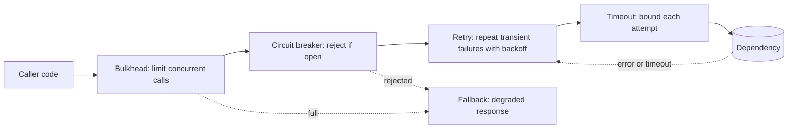
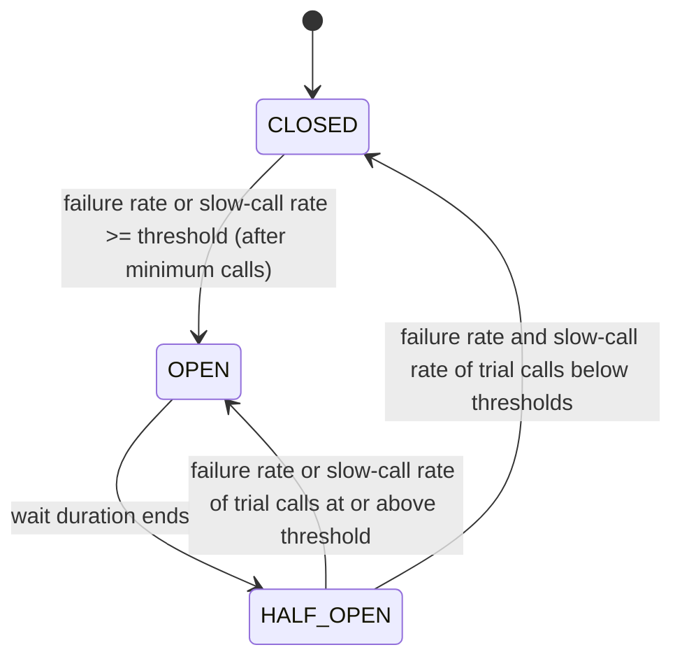
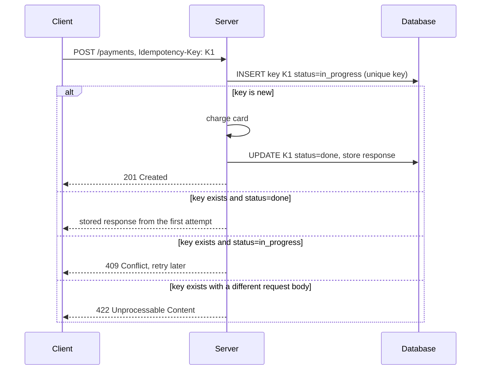

# Reliability Patterns

A distributed system calls other systems over a network, and each call can be slow, fail, or fail halfway. Reliability patterns limit the damage of those failures. This page covers timeouts, retries, exponential backoff with jitter, the circuit breaker, the bulkhead, load shedding, graceful degradation, idempotency keys, health checks, and chaos testing, with one runnable Java circuit breaker.

## Why It Matters

Every HLD interview reaches the question "what happens when this dependency is slow or down?". A candidate who answers "we retry" gets the follow-up "what if all clients retry at once?". A candidate who names timeouts, jittered backoff, a circuit breaker, and a fallback, and who says which calls are safe to retry, shows production experience. On the job, most large outages involve a small failure that spreads: one slow database makes threads wait, the thread pool fills, callers time out and retry, and the retries keep the database overloaded after the original fault has ended. The patterns on this page break that chain at each link. The in-process versions of these ideas appear in the Spring and resilience topics (see [Microservices with Spring](../../java/22-microservices-with-spring.md)).

## Core Concepts

**Failure modes of a remote call**: a call can (1) return an error, (2) return a wrong answer, (3) return late, or (4) never return. The fourth case is the hardest, because the caller cannot tell whether the server processed the request. See [failures and time](../distributed-systems/01-failures-and-time.md) for partial failure in depth.

**Timeout**: the longest time that the caller waits for a response. After the timeout, the caller gives up. The server may still process the request.

**Deadline**: an absolute point in time by which the whole request must finish. The caller passes the deadline to each downstream call, and each downstream call uses the remaining time as its timeout.

**Transient fault**: a fault that disappears without repair, such as a dropped packet, a leader election in progress, or a short overload. A retry can succeed. A **permanent fault** (a bug, a bad request, a missing resource) does not disappear, and a retry always fails.

**Retry**: a repeat of a failed call.

**Backoff**: a wait between retries. **Exponential backoff** doubles the wait ceiling after each failed attempt. **Jitter** adds randomness to the wait, so that many clients do not retry at the same moments.

**Retry storm** (also *retry amplification*): a state in which retries add so much load that the overloaded service cannot recover. If each of three layers makes up to 3 attempts, one user request can cause 3 x 3 x 3 = 27 calls to the lowest layer.

**Retry budget**: a limit on the share of calls that may be retries, so that retries cannot multiply the load.

**Idempotent operation**: an operation that has the same effect when it runs once or many times. `PUT /users/42` with the same body is idempotent. "Add 10 to the balance" is not. An **idempotency key** is a unique value that the client sends with a non-idempotent request, so that the server detects a repeat and does not run it twice.

**Circuit breaker**: a component in the caller that counts recent failures of a dependency. When the failure rate passes a threshold, the breaker opens and rejects calls at once, without calling the dependency.

**Bulkhead**: a limit on the resources (threads, connections, concurrent calls) that one dependency or one caller class can use, so that a failure in one part does not drain the resources of the others. The name comes from the watertight compartments of a ship hull.

**Load shedding**: the deliberate rejection of some requests when a server is near its capacity, so that the server keeps serving the rest at good latency.

**Graceful degradation**: a reduced but useful response when a dependency fails, for example a cached list in place of a personalized list.

**Liveness and readiness**: a *liveness* check says whether the process is alive and must restart if not. A *readiness* check says whether the process can serve traffic now.

**Chaos engineering**: the practice of injecting failures into a running system to test that the patterns above work.

## How It Works

The patterns form layers around one remote call. The diagram shows one valid order, from the outside in: bulkhead, circuit breaker, retry (with backoff), timeout, then the network call. In this order, the breaker sees one call for each logical request, and the retries stay inside it.



Resilience4j, the common Java library, documents decorators for the same set: `CircuitBreaker`, `Retry`, `Bulkhead`, `TimeLimiter`, and `RateLimiter`. The Resilience4j documentation gives the default aspect order of its Spring Boot integration as `Retry ( CircuitBreaker ( RateLimiter ( TimeLimiter ( Bulkhead ( Function ) ) ) ) )`, so Retry is the outermost layer and Bulkhead the innermost. That order differs from the diagram in two points:

- **Retry outside the breaker.** Each retry attempt counts as a separate call in the breaker's window. When the breaker is open, each attempt fails at once with `CallNotPermittedException`. The `Retry` module retries every exception by default, so add `CallNotPermittedException` to its `ignoreExceptions` list if an open breaker must end the retry loop.
- **Bulkhead innermost.** The bulkhead limits concurrent attempts to the dependency, not concurrent logical requests.

To change the order, set the properties `retryAspectOrder`, `circuitBreakerAspectOrder`, `rateLimiterAspectOrder`, `timeLimiterAspectOrder`, and `bulkheadAspectOrder`, or compose the decorators in code. The properties follow the Spring `Ordered` rule: the aspect with the lower value runs further outside. The Resilience4j Spring 6 source gives `retryAspectOrder` the default `Ordered.LOWEST_PRECEDENCE - 5` and `bulkheadAspectOrder` the default `Ordered.LOWEST_PRECEDENCE - 1`, which is why Retry is outermost. The documentation's example sets `circuitBreakerAspectOrder` to 1 and `retryAspectOrder` to 2, so that the breaker wraps the retry and records one result after the retries finish (the order in the diagram above). Both orders are valid. State the order that you choose and why.

### Timeouts

A call without a timeout waits as long as the TCP connection lives. Many clients have no limit by default. For example, the JDK 21 javadoc of `HttpRequest.Builder.timeout` says: "The effect of not setting a timeout is the same as setting an infinite Duration, i.e. block forever." A thread that waits for a dead dependency cannot serve other requests. By Little's law, the number of threads in use equals the arrival rate times the time each request holds a thread (`L = lambda x W`). At 500 requests per second and a normal 20 ms wait, 10 threads are busy. If the dependency stops answering and the wait becomes 30 s, the system needs 15 000 threads, so the pool fills in about 0.4 s at a pool size of 200 and the service stops answering anything.

**Two timeouts.** A *connect timeout* bounds the TCP (and TLS) handshake. It can be short, because a healthy server accepts a connection in about one round trip. Assumption: values from 100 ms to 1 s are common inside one data center. A *request timeout* (read timeout) bounds the wait for the response, and it depends on the operation.

**How to choose a value from percentiles.** Measure the latency distribution of the dependency under normal load, for the same operation. Then:

1. Choose the share of healthy calls that you accept to cancel by mistake (the *false-timeout rate*). Then set the timeout at the matching latency percentile. A false-timeout rate of 0.1 percent gives a timeout at the p99.9. A rate of 1 percent gives the p99. Example: if the p99.9 of the operation is 120 ms, a 120 ms timeout cancels about 1 healthy call in 1 000.
2. Add padding if the distribution is narrow or if clients add network latency (see the article below), but not so much that threads wait in vain. A timeout of 10 times the p99 hides the problem that the timeout should show.
3. Make the timeout shorter than the caller's own timeout. If the caller of service A waits 1 s, and A calls B with a 2 s timeout, B's work is wasted after the first second.
4. Re-measure after releases. A timeout that fits last quarter's latency can fail today.

The Amazon Builders' Library article "Timeouts, retries, and backoff with jitter" (Marc Brooker) describes this method for calls inside one AWS Region: "when we make one service call another service, we choose an acceptable rate of false timeouts (such as 0.1%). Then, we look at the corresponding latency percentile on the downstream service (p99.9 in this example)." The article names two cases in which the method does not work alone. If clients have large network latency (for example, over the internet), the team adds a reasonable worst-case network latency. If the latency distribution is narrow (the p99.9 is close to the p50), the team adds padding, so that a small latency increase does not cause many timeouts (see Further Reading).

**Deadline propagation.** A request that passes through services A, B, and C has one budget. If the user's request has 800 ms, and A used 300 ms, A passes "500 ms left" to B. gRPC supports this directly: a client sets a deadline, and the client library sends the time that remains as the `grpc-timeout` request header (a relative duration such as `500m` for 500 ms, not an absolute time), so each service can see the time that remains. The gRPC over HTTP/2 protocol specification defines the header, and it says: "If Timeout is omitted a server should assume an infinite timeout." The value is at most 8 digits, followed by one unit letter: `H`, `M`, `S`, `m`, `u`, or `n`. Without propagation, each service starts its own full timeout, and the chain keeps working on requests whose user has gone.

### Retries

A retry turns a transient fault into a success. It also adds load. Apply these rules.

**Which errors to retry.**

| Error | Retry? | Reason |
|---|---|---|
| Connection refused, connect timeout | Yes | The request did not reach the server |
| Connection reset after the request was sent | Yes, if the operation is idempotent | The server may have processed the request |
| Request timeout | Yes, if the operation is idempotent | The server may have processed the request |
| HTTP 503 Service Unavailable, HTTP 504 Gateway Timeout | Yes, if idempotent | The server or a proxy reports a temporary condition, such as overload or a restart. Obey `Retry-After` if present |
| HTTP 429 Too Many Requests | Yes, after the `Retry-After` delay | The server asked for a later retry |
| HTTP 500 Internal Server Error | Sometimes | A bug repeats. A transient failure does not. Retry once or twice at most |
| HTTP 409 Conflict from an idempotency layer, because the first request with the same key is still running | Yes, after a backoff | The first attempt is still in progress. A later retry gets its stored result |
| HTTP 400, 401, 403, 404, 422, and other 409 responses | No | The request is wrong, or it conflicts with the resource state, so the same request fails again |
| A response that says "overloaded, do not retry" | No | The server says that retries make it worse |

**Idempotency is required.** A retry can run an operation twice. If the first attempt timed out after the server committed the change, the retry repeats the change. Retry only idempotent operations, or add an idempotency key (see [Idempotency Keys](#idempotency-keys)). RFC 9110 (section 9.2.2) defines `PUT`, `DELETE`, and the safe methods (`GET`, `HEAD`, `OPTIONS`, `TRACE`) as idempotent. `POST` is not idempotent. RFC 5789, which defines `PATCH`, says that `PATCH` is neither safe nor idempotent, although a server can design a specific `PATCH` to be idempotent. The method is a contract: a server that implements `PUT` with a side effect such as "add 10" breaks the contract, and retries then cause duplicates.

**Retry at one layer.** Google's SRE book (chapter "Handling Overload") says that "requests should only be retried at the layer immediately above the layer that is rejecting them", because retries at several layers multiply (3 layers x 3 attempts = 27 calls).

**Retry budgets.** The SRE book describes two limits. A per-request budget allows up to 3 attempts. A per-client budget allows a retry only while retries are below 10 percent of the client's requests. With only the per-request limit, the book says that retries can push the load to "somewhere just below 3X". The per-client budget "reduces the growth to just 1.1x in the general case". Resilience4j has no built-in ratio budget in its `Retry` module. Envoy has one: its retry budget limits the concurrent retries to a percentage (`budget_percent`, default 20 percent) of the active plus pending requests to a cluster, with a floor (`min_retry_concurrency`, default 3). The Envoy circuit-breaking documentation says "we recommend using retry budgets", and that a static limit on retries "should aggressively circuit break retries" (see Further Reading). Treat these numbers as sources' examples, not universal values.

**Hedged requests** are a related tool for tail latency. The client sends a second copy of a request to another replica after a short delay, uses the first answer, and cancels the other copy. Dean and Barroso ("The Tail at Scale", 2013) give two results:

- If the client sends the second copy only after the first request has been outstanding for more than the p95 latency of that class of requests, the extra load is "approximately 5%".
- "In a Google benchmark that reads the values for 1,000 keys stored in a BigTable table distributed across 100 different servers, sending a hedging request after a 10ms delay reduces the 99.9th-percentile latency for retrieving all 1,000 values from 1,800ms to 74ms while sending just 2% more requests."

Recommendation: hedge only idempotent requests (in practice, reads), because the server can run both copies.

### Exponential Backoff and Jitter

If a dependency fails, clients that retry at once keep it overloaded. Exponential backoff spreads the retries over time: the wait ceiling is `min(cap, base x 2^attempt)`. Without jitter, all clients that failed at the same moment retry at the same moments, so the load arrives in synchronized waves. Marc Brooker's article in the AWS Architecture Blog, "Exponential Backoff And Jitter" (2015), simulates this and compares three jitter methods. With `temp = min(cap, base x 2^attempt)`:

| Method | Sleep time | Behavior reported by the article |
|---|---|---|
| No jitter | `temp` | The slowest to finish and the most calls. The article calls it the clear loser |
| Full jitter | `random_between(0, temp)` | Fewest calls. Takes slightly more time than decorrelated jitter |
| Equal jitter | `temp / 2 + random_between(0, temp / 2)` | The loser of the jittered methods: "slightly more work" than full jitter, and "takes much longer", because it keeps half of the wait |
| Decorrelated jitter | `min(cap, random_between(base, previous_sleep x 3))` | Slightly more calls than full jitter, and finishes slightly sooner. Each wait depends on the previous wait, not on the attempt count |

The article's conclusion is that jitter cuts the number of calls sharply ("In the case with 100 contending clients, we've reduced our call count by more than half"), and that it also "significantly improved the time to completion" compared with backoff without jitter. The article calls the choice between full jitter and decorrelated jitter "less clear". Recommendation: use full jitter as the default. The Java example below prints full-jitter delays.

The cap matters. Without a cap, the wait grows to minutes. The base matters too: a base of 100 ms with a cap of 20 s gives ceilings of 100, 200, 400, ... 12 800, 20 000 ms. Also bound the total retry time by the request deadline, and stop retrying when the deadline passes.

### Circuit Breaker

A breaker stops calls to a dependency that is failing, for two reasons. First, the dependency gets time to recover without the load of calls that will fail. Second, the caller fails fast and does not hold a thread for a timeout on each call. The pattern is described in Michael Nygard, *Release It!*, and in Martin Fowler's "CircuitBreaker" article.



**States** (Resilience4j documentation):

- **CLOSED**: calls pass through. The breaker records each result in a sliding window. If the failure rate or the slow-call rate in the window is at or above its threshold, and the window holds at least `minimumNumberOfCalls` calls, the breaker moves to OPEN.
- **OPEN**: the breaker rejects every call at once. Resilience4j throws `CallNotPermittedException`.
- **HALF_OPEN**: after the wait duration, the breaker lets a limited number of trial calls through. It rejects further calls with `CallNotPermittedException` until all trial calls have completed. If the failure rate or the slow-call rate of the trial calls is at or above its threshold, the breaker returns to OPEN. If both rates are below their thresholds, the breaker returns to CLOSED.

Resilience4j also has three special states: `DISABLED` (always allow calls), `FORCED_OPEN` (always reject calls), and `METRICS_ONLY` (allow calls and record metrics, with no state transitions). An operator moves the breaker into them, for example to force a dependency off during an incident.

**Thresholds.** The Resilience4j defaults (from its documentation for the current release) show a typical set of parameters:

| Parameter | Meaning | Default |
|---|---|---|
| `slidingWindowType` | Count of last calls or time window | `COUNT_BASED` |
| `slidingWindowSize` | Calls (or seconds) in the window | 100 |
| `minimumNumberOfCalls` | Calls needed before the breaker may open | 100 |
| `failureRateThreshold` | Failure percentage that opens the breaker | 50 |
| `slowCallDurationThreshold` | A call slower than this counts as slow | 60 000 ms |
| `slowCallRateThreshold` | Slow-call percentage that opens the breaker | 100 |
| `waitDurationInOpenState` | Time in OPEN before HALF_OPEN | 60 000 ms |
| `permittedNumberOfCallsInHalfOpenState` | Trial calls in HALF_OPEN | 10 |

The `minimumNumberOfCalls` parameter prevents a false open: with one call recorded and that call failed, the failure rate is 100 percent, and the breaker should not open on that. By default Resilience4j moves from OPEN to HALF_OPEN only when a call arrives after the wait, and not on a timer (the setting `automaticTransitionFromOpenToHalfOpenEnabled` changes it).

**What counts as a failure.** Count timeouts, connection errors, and 5xx responses. Do not count 4xx responses, because they show a bad request and not an unhealthy dependency. Count slow calls, because a dependency that answers in 20 s is failing in practice.

**Scope.** Keep one breaker per dependency (or per endpoint or per host of the dependency), not one for all. A breaker for "the payment service" must not open because the recommendation service fails.

**What the caller does while the breaker is open.** It returns a fallback or an error at once (see [Graceful Degradation](#graceful-degradation-and-fallbacks)).

**Breakers in a distributed system.** Each caller instance has its own breaker and its own window, so instances open at slightly different times. That is acceptable. A service mesh such as Envoy or Istio can enforce a similar limit in the proxy: Envoy has circuit-breaking limits (maximum connections, pending requests, requests, retries) and *outlier detection* that ejects a failing host from the load-balancing pool (see [microservices and monoliths](14-microservices-and-monoliths.md)).

### Bulkhead

Without a bulkhead, all calls share one thread pool or one connection pool. If the slow dependency B holds all threads, calls to the healthy dependency C also fail, because no thread is free. A bulkhead gives each dependency its own limit.

Resilience4j documents two types: `SemaphoreBulkhead`, which limits concurrent calls with a semaphore (default `maxConcurrentCalls` = 25, `maxWaitDuration` = 0, so excess calls are rejected at once), and `FixedThreadPoolBulkhead`, which runs calls on a dedicated bounded thread pool with a bounded queue (default queue capacity 100). The semaphore type runs on the caller's thread and is cheaper. The thread-pool type also isolates the caller from a call that blocks without a timeout. With virtual threads in Java 21 (see [Virtual Threads, Structured Concurrency, and Scoped Values](../../java/10-virtual-threads.md)), thread count is no longer the limit, so Recommendation: use a semaphore bulkhead. It limits the concurrent calls to one dependency, and not the threads.

Other bulkheads: separate connection pools per dependency; separate server pools for different customers or for critical and non-critical traffic (a *cell-based* or *shard-per-tenant* design, see [partitioning and sharding](06-partitioning-and-sharding.md)); and Kubernetes resource limits per container.

**Sizing rule.** The bulkhead size for a dependency should be near `peak calls per second x p99 latency` (Little's law) plus headroom. For 200 calls per second and a p99 of 100 ms, the concurrency is 200 x 0.1 = 20, so a limit of 30 to 40 lets normal peaks pass and rejects a flood.

### Rate Limiting and Load Shedding

A *rate limiter* caps the request rate of a client, based on a quota. *Load shedding* protects the server based on its current state, such as CPU, queue length, or concurrent requests. Both reject excess work with an early, cheap response (HTTP 429 for a quota, 503 for overload). The algorithms (token bucket, leaky bucket, window counters) have their home in [rate limiting algorithms](13-rate-limiting-algorithms.md).

Load shedding principles:

- **Reject early.** A rejected request should cost far less than a served one. Check the load before parsing the body or calling dependencies.
- **Shed by priority.** Drop low-priority traffic (batch jobs, prefetch, non-critical features) before critical traffic (checkout, login). The Google SRE book describes criticality levels that the server uses to decide which requests to reject first.
- **Recommendation: prefer a concurrency limit to a rate limit** for overload protection. A rate limit of 1 000 requests per second does not help if each request now takes ten times longer. A limit on requests in flight adapts to slowdowns by itself (Little's law again: at a fixed concurrency, a slower request lowers the admitted rate). The Builders' Library article "Using load shedding to avoid overload" explains the feedback loop behind overload: a server gets slower as it takes more concurrent work, clients time out, and the server wastes work on responses that nobody reads.
- **Tell clients what to do.** Return `Retry-After` with a 429 or 503, and make clients obey it. A response of "overloaded, do not retry" stops retry amplification.
- **Test the shed path.** Under overload, the rejection code must not become the bottleneck.

### Graceful Degradation and Fallbacks

When a dependency fails, the caller chooses between an error and a reduced answer. Examples:

| Failed dependency | Fallback |
|---|---|
| Recommendation service | Show a static list of popular items |
| Personalization store | Show the default, non-personalized page |
| Price service | Show a cached price with the label "may be out of date", and re-check at checkout |
| Search service | Show a simple database query with fewer filters, or the recent items |
| Review service | Hide the reviews block and render the rest of the page |
| Write path for a non-critical event (analytics, audit copy) | Buffer in a local queue and send later |

Rules for fallbacks:

1. Decide with the product owner which features are essential. Essential features (payment, authentication) fail visibly and never give a wrong answer. Optional features degrade.
2. A fallback must be simpler than the primary and must not depend on the same failing system. A fallback that calls the same dependency fails with it.
3. Test the fallback path. Code that runs only during an outage often has bugs. Run it in a drill (see [Chaos Testing](#chaos-testing-in-brief)).
4. Show the degraded state to the user when the data can mislead (stale price), and record a metric for each fallback use.
5. Serve stale cached data when the source fails (*stale-if-error*, RFC 5861). See [caching](03-caching.md).

### Idempotency Keys

A retry after a timeout is dangerous for `POST /payments`: the first attempt may have charged the card. The fix is an **idempotency key**: a unique value (a UUID) that the client generates once for the logical operation and sends with every attempt, in a request header such as `Idempotency-Key`. Stripe documents this pattern in its API. The IETF HTTP API working group wrote an Internet-Draft for the header, `draft-ietf-httpapi-idempotency-key-header`. Its latest version, -07, dates from October 2025, and the IETF Datatracker lists it as expired (checked October 2026). It is not an RFC, so treat it as a description of common practice, not as a standard. The draft recommends 400 for a missing key, 409 for a retry that arrives while the first request with the key is still running, and 422 for a reused key with a different request body.

Server procedure:



Design points:

- **Atomic claim.** The key insert uses a unique constraint, so two concurrent requests with the same key cannot both start work. Put the claim and the business change in one database transaction when they share a database. If the effect is outside the database (a call to a card network), store `in_progress` first, and forward the key to the downstream system if it supports one.
- **Request fingerprint.** Store a hash of the request body with the key. If a request arrives with a known key and a different body, reject it, because the client has a bug. For its API v1, Stripe says that its idempotency layer "compares incoming parameters to those of the original request and errors if they're not the same". The Stripe documentation does not name the status code for this error. The IETF draft recommends 422 for this case.
- **Store the response, including errors.** For API v1, Stripe saves the status code and body of the first request after the endpoint starts to run, and returns the saved response to retries, including `500` errors. Stripe saves nothing if the parameters fail validation or if another request with the same key runs at the same time, so the client can retry those requests. Stripe marks a replayed response with the header `Idempotent-Replayed: true`, and its error documentation tells clients to wait and retry with the same key when a `409` says that another request with the key is still running.
- **Scope the key** to the client or tenant, so that one client cannot read the results of another.
- **Retention.** Keep keys for a bounded time. Stripe says that it can remove keys after they are at least 24 hours old, and that a reuse after the removal creates a new request. The client retry window must be shorter than the retention.
- **Natural idempotency.** Prefer idempotent operations where possible: "set the status to shipped" in place of "advance the status", and `PUT` with the full state in place of an increment.
- **The same idea at the consumer.** A message consumer that gets at-least-once delivery de-duplicates with a message ID (see [message queues and streams](08-message-queues-and-streams.md)).

The LLD digital wallet case study implements this pattern in code: [digital wallet](../../lld/case-studies/23-digital-wallet/README.md).

### Health Checks, Readiness and Liveness

A load balancer or an orchestrator uses health checks to decide where to send traffic (see [load balancing, DNS and CDN](02-load-balancing-dns-cdn.md)). Kubernetes defines three probe types:

| Probe | Question | On failure |
|---|---|---|
| Liveness | Is the process stuck beyond repair? | The kubelet kills the container and restarts it, subject to the pod's `restartPolicy` |
| Readiness | Can the process serve requests now? | The pod stays running, but Kubernetes removes it from the Service endpoints until the probe passes again |
| Startup | Has the application finished starting? | Liveness and readiness probes stay disabled until it passes. If it fails `failureThreshold` times, the kubelet kills the container |

Kubernetes probe defaults: `periodSeconds` 10, `timeoutSeconds` 1, `failureThreshold` 3, `successThreshold` 1.

Rules:

- **Do not put dependency checks in the liveness probe.** If the database is down and every pod fails liveness, Kubernetes restarts all pods. The restarts do not fix the database, and they add a restart storm. Liveness should test only the process itself (for example, that the main event loop responds).
- **Readiness may include critical local state**, such as "the cache warm-up finished" or "the service is draining". Be careful with shared dependencies: if a database outage makes every pod unready, the service has zero endpoints and returns errors to everyone, including requests that do not need the database. A common choice is a readiness check that covers only what the pod needs to serve its main traffic, and degrades the rest.
- **Shallow and deep checks.** A shallow check returns 200 if the process runs. A deep check calls the dependencies. Use shallow checks for liveness and for load-balancer checks at high frequency, and deep checks for dashboards and alerts at a lower frequency.
- **Graceful shutdown.** On a termination signal, the process first fails its readiness check, so the load balancer stops new traffic, then finishes the requests in flight (connection draining), then exits. In Kubernetes, the removal of a terminating pod from the Service endpoints and the `SIGTERM` signal happen at the same time, and load balancers learn of the removal with a delay. A short `preStop` sleep (a few seconds) keeps the pod serving until the removal has spread. The pod's `terminationGracePeriodSeconds` (default 30) bounds the whole shutdown.

### Chaos Testing in Brief

Chaos engineering injects real failures to test the assumptions behind the patterns: "the breaker opens", "the fallback works", "the timeout is short enough". The "Principles of Chaos Engineering" (principlesofchaos.org) describe the loop: define the steady state with a measurable output (for example, orders per second), form a hypothesis that the steady state continues in both a control group and an experimental group, inject real-world events into the experimental group (kill an instance, add latency, drop packets, fail a dependency), and try to disprove the hypothesis by looking for a difference between the two groups. Run first in a test environment, then in production with a small blast radius and an abort switch. Netflix's Chaos Monkey (terminates random instances) is the best-known tool. Others: AWS Fault Injection Service (managed fault injection on AWS, formerly AWS Fault Injection Simulator), Gremlin (a commercial platform), Chaos Mesh (a CNCF project for Kubernetes), and Toxiproxy (a network proxy that adds latency and cuts connections, useful in integration tests). A *game day* is a planned exercise in which a team runs failures against a system and practices the response.

## Trade-offs and When to Use

| Pattern | Protects against | Cost or risk | Use when |
|---|---|---|---|
| Timeout | Threads blocked on a slow or dead dependency | A timeout that is too short cancels good work and adds retries. One that is too long hides the fault | Every remote call, with no exception |
| Retry | Transient faults | Load amplification. Duplicate effects if not idempotent | The operation is idempotent (or keyed), and the fault is transient |
| Backoff with jitter | Synchronized retry waves | Longer latency for the retrying caller | Every retry loop |
| Circuit breaker | Sustained dependency failure and wasted waiting | A false open rejects good calls. A bad threshold flaps. Per-instance state | The dependency fails for seconds to minutes, and the caller has a fallback or can fail fast |
| Bulkhead | One dependency draining shared resources | Idle capacity in each compartment. Extra configuration | Several dependencies with different health share one process |
| Rate limit | One client overusing a service | A rejected client must handle 429 | Multi-tenant APIs, public APIs |
| Load shedding | Overload that grows without limit | Rejects some valid requests | A server that can saturate. Always on for a shared service |
| Fallback or degradation | Total failure of a feature | Stale or reduced data, and more paths to test | The feature is not essential |
| Idempotency key | Duplicate effects from retries | Storage, a key lookup in each request, and retention rules | Payments, order creation, any `POST` that clients retry |
| Hedged request | Tail latency | Extra load: about 5 percent with a p95 delay, and 2 percent in the paper's BigTable benchmark with a 10 ms delay (The Tail at Scale) | Idempotent reads with a heavy latency tail |

Retry and circuit breaker answer different questions. A retry asks "will a second attempt succeed?" and fits a short fault. A breaker asks "should I stop trying for a while?" and fits a long fault. Use both: the retry handles short faults, and the breaker takes over when retries keep failing.

The same reliability goals bring a trade-off with consistency and availability (see [consistency and CAP](07-consistency-and-cap.md)): a fallback to a cached read gives availability and gives up freshness.

## Java Example

The program below is a circuit breaker with a count-based sliding window, the three states, and trial calls in HALF_OPEN. It takes the clock as a `LongSupplier`, so the demo moves time by hand and the output is the same on every run. The last part prints full-jitter delays from a `Random` with a fixed seed. This is a teaching model, not a replacement for Resilience4j: it has one window type and no slow-call detection. Also, if a call starts in one state and finishes after the state changes, the breaker records the result in the new state.

```java
import java.util.ArrayDeque;
import java.util.Deque;
import java.util.Random;
import java.util.function.LongSupplier;
import java.util.function.Supplier;

public class Main {
    public static void main(String[] args) {
        ManualClock clock = new ManualClock();
        CircuitBreaker breaker = new CircuitBreaker(4, 4, 50.0, 1_000, 2, clock);
        Backend backend = new Backend();

        System.out.println("--- closed: the backend fails ---");
        backend.healthy = false;
        for (int i = 1; i <= 4; i++) {
            System.out.println("call " + i + ": " + attempt(breaker, backend));
        }
        System.out.println("state: " + breaker.state());

        System.out.println("--- open: calls fail fast ---");
        System.out.println("call 5: " + attempt(breaker, backend));
        System.out.println("backend calls so far: " + backend.calls);

        System.out.println("--- wait ends, trial call fails ---");
        clock.advance(1_000);
        System.out.println("call 6: " + attempt(breaker, backend));
        System.out.println("call 7: " + attempt(breaker, backend));
        System.out.println("state: " + breaker.state());

        System.out.println("--- wait ends again, the backend recovers ---");
        clock.advance(1_000);
        backend.healthy = true;
        System.out.println("call 8: " + attempt(breaker, backend));
        System.out.println("state: " + breaker.state());
        System.out.println("call 9: " + attempt(breaker, backend));
        System.out.println("state: " + breaker.state());
        System.out.println("backend calls total: " + backend.calls);

        System.out.println("--- full jitter delays (base 100 ms, cap 2000 ms, seed 42) ---");
        Random random = new Random(42);
        for (int attempt = 0; attempt < 6; attempt++) {
            System.out.println("attempt " + attempt + ": ceiling "
                + Backoff.ceiling(attempt, 100, 2_000) + " ms, delay "
                + Backoff.fullJitter(attempt, 100, 2_000, random) + " ms");
        }
    }

    static String attempt(CircuitBreaker breaker, Backend backend) {
        try {
            return breaker.call(backend::fetch);
        } catch (CallNotPermittedException e) {
            return "rejected without calling the backend";
        } catch (RuntimeException e) {
            return "backend error: " + e.getMessage();
        }
    }
}

class Backend {
    boolean healthy = true;
    int calls = 0;

    String fetch() {
        calls++;
        if (!healthy) {
            throw new IllegalStateException("503 unavailable");
        }
        return "ok";
    }
}

class ManualClock implements LongSupplier {
    private long nowMillis = 0;

    @Override
    public long getAsLong() {
        return nowMillis;
    }

    void advance(long millis) {
        nowMillis += millis;
    }
}

class CallNotPermittedException extends RuntimeException {
    CallNotPermittedException() {
        super("circuit breaker is open");
    }
}

class CircuitBreaker {
    enum State { CLOSED, OPEN, HALF_OPEN }

    private final int windowSize;
    private final int minimumCalls;
    private final double failureRateThreshold;
    private final long waitInOpenMillis;
    private final int halfOpenCalls;
    private final LongSupplier clock;

    private State state = State.CLOSED;
    private final Deque<Boolean> window = new ArrayDeque<>();
    private int windowFailures = 0;
    private long openedAt = 0;
    private int trialsStarted = 0;
    private int trialsFinished = 0;
    private int trialFailures = 0;

    CircuitBreaker(int windowSize, int minimumCalls, double failureRateThreshold,
                   long waitInOpenMillis, int halfOpenCalls, LongSupplier clock) {
        this.windowSize = windowSize;
        this.minimumCalls = minimumCalls;
        this.failureRateThreshold = failureRateThreshold;
        this.waitInOpenMillis = waitInOpenMillis;
        this.halfOpenCalls = halfOpenCalls;
        this.clock = clock;
    }

    synchronized State state() {
        return state;
    }

    <T> T call(Supplier<T> action) {
        if (!tryAcquire()) {
            throw new CallNotPermittedException();
        }
        try {
            T result = action.get();
            record(true);
            return result;
        } catch (RuntimeException e) {
            record(false);
            throw e;
        }
    }

    private synchronized boolean tryAcquire() {
        if (state == State.OPEN) {
            if (clock.getAsLong() - openedAt < waitInOpenMillis) {
                return false;
            }
            state = State.HALF_OPEN;
            trialsStarted = 0;
            trialsFinished = 0;
            trialFailures = 0;
        }
        if (state == State.HALF_OPEN) {
            if (trialsStarted >= halfOpenCalls) {
                return false;
            }
            trialsStarted++;
        }
        return true;
    }

    private synchronized void record(boolean success) {
        if (state == State.CLOSED) {
            window.addLast(success);
            if (!success) {
                windowFailures++;
            }
            if (window.size() > windowSize && !window.removeFirst()) {
                windowFailures--;
            }
            if (window.size() >= minimumCalls && failureRate(windowFailures, window.size())
                    >= failureRateThreshold) {
                open();
            }
        } else if (state == State.HALF_OPEN) {
            trialsFinished++;
            if (!success) {
                trialFailures++;
            }
            if (trialsFinished == halfOpenCalls) {
                if (failureRate(trialFailures, trialsFinished) >= failureRateThreshold) {
                    open();
                } else {
                    close();
                }
            }
        }
    }

    private static double failureRate(int failures, int total) {
        return 100.0 * failures / total;
    }

    private void open() {
        state = State.OPEN;
        openedAt = clock.getAsLong();
    }

    private void close() {
        state = State.CLOSED;
        window.clear();
        windowFailures = 0;
    }
}

class Backoff {
    static long ceiling(int attempt, long baseMillis, long capMillis) {
        long exponential = baseMillis << Math.min(attempt, 30);
        return Math.min(capMillis, exponential);
    }

    static long fullJitter(int attempt, long baseMillis, long capMillis, Random random) {
        return (long) (random.nextDouble() * ceiling(attempt, baseMillis, capMillis));
    }
}
```

<!-- expected-output -->
```text
--- closed: the backend fails ---
call 1: backend error: 503 unavailable
call 2: backend error: 503 unavailable
call 3: backend error: 503 unavailable
call 4: backend error: 503 unavailable
state: OPEN
--- open: calls fail fast ---
call 5: rejected without calling the backend
backend calls so far: 4
--- wait ends, trial call fails ---
call 6: backend error: 503 unavailable
call 7: backend error: 503 unavailable
state: OPEN
--- wait ends again, the backend recovers ---
call 8: ok
state: HALF_OPEN
call 9: ok
state: CLOSED
backend calls total: 8
--- full jitter delays (base 100 ms, cap 2000 ms, seed 42) ---
attempt 0: ceiling 100 ms, delay 72 ms
attempt 1: ceiling 200 ms, delay 136 ms
attempt 2: ceiling 400 ms, delay 123 ms
attempt 3: ceiling 800 ms, delay 221 ms
attempt 4: ceiling 1600 ms, delay 1064 ms
attempt 5: ceiling 2000 ms, delay 1806 ms
```

## Interview Angle

### Questions

??? question "A service calls a dependency that becomes slow. Walk me through what happens and how you protect the service."

    Without protection, each call waits for the slow dependency, so request threads stay busy. By Little's law the busy threads equal the arrival rate times the wait. At 500 requests per second, a wait of 20 ms uses 10 threads, and a wait of 30 s needs 15 000. The pool fills, the service stops answering all requests (including ones that do not use the dependency), callers time out and retry, and the retries add load. This is a cascading failure.

    My protection, from the inside out: a timeout on every attempt, set at the latency percentile that matches the false-timeout rate I accept (for example, the p99.9 for 0.1 percent), and a deadline for the whole request; retries only for idempotent operations, with jittered backoff and a budget; a circuit breaker that opens when the failure or slow-call rate passes a threshold and fails fast; a bulkhead that caps the concurrent calls to this dependency, so the slow dependency cannot take every thread; and a fallback that returns a reduced answer if the feature is optional. I state the order of the layers, because a library such as Resilience4j has a default order of its own. I would also alert on breaker state changes and on the fallback rate, because a silent fallback hides an outage.

??? question "How do you choose a timeout value?"

    I use the measured latency distribution of that operation, not a guess. I pick the share of healthy calls that I accept to cancel (the false-timeout rate), and set the timeout at the matching percentile. The Amazon Builders' Library example is a 0.1 percent false-timeout rate, which puts the timeout at the p99.9. If the p99.9 of the operation is 120 ms, the timeout starts at 120 ms. I add padding in two cases: when the distribution is narrow (the p99.9 is close to the p50), so that a small latency increase does not time out many calls, and when the clients add network latency of their own.

    Then I check three constraints. The timeout must be shorter than my own caller's timeout, so I do not work on requests that have been abandoned. With retries, the total of all attempts and waits must fit the request deadline, so I propagate a deadline and use the time that remains for each call. And I use a separate, short connect timeout. I re-measure after releases, because the right value moves with the dependency's latency.

??? question "Which failures do you retry, and what can go wrong with retries?"

    I retry transient failures: connection errors, timeouts, 503 and 504, and 429 after the `Retry-After` delay. I do not retry 4xx errors such as 400, 404, or 422, because the same request fails again. Two 4xx codes are exceptions: 429, after the `Retry-After` delay, and a 409 from an idempotency layer that says the first request with the same key is still running. For a timeout, I retry only if the operation is idempotent, because the server may have done the work. For a non-idempotent operation, I add an idempotency key first.

    What goes wrong: duplicate effects (a double charge) if the operation is not idempotent; load amplification, because each layer that retries multiplies the calls (three layers with three attempts give 27 calls to the lowest layer); and a retry storm, in which retries keep a recovering service overloaded. The fixes are to retry at one layer, use exponential backoff with jitter, cap the attempts (the SRE book suggests 3), apply a retry budget (retries below about 10 percent of requests), and stop retrying when the breaker is open or the deadline has passed.

??? question "Explain exponential backoff with jitter. Why is jitter needed?"

    Exponential backoff makes the wait ceiling double after each failure, up to a cap: `min(cap, base x 2^attempt)`. This gives an overloaded service time to recover. But if many clients failed at the same moment, they all wait the same time and retry in a synchronized wave, so the spikes continue. Jitter randomizes the wait and spreads the retries.

    Marc Brooker's AWS Architecture Blog article compares methods by simulation. Full jitter, `random_between(0, min(cap, base x 2^attempt))`, makes the fewest calls. Equal jitter keeps half the delay, does slightly more work than full jitter, and takes much longer. Decorrelated jitter bases each wait on the previous wait, makes slightly more calls than full jitter, and finishes slightly sooner. Backoff without jitter is the worst on both work and time. With 100 contending clients, jitter cut the call count by more than half. I default to full jitter with a cap, and I bound the total time by the request deadline.

??? question "How does a circuit breaker work? Describe the states and how you set the thresholds."

    A breaker wraps calls to one dependency and keeps a sliding window of recent results. In CLOSED state, calls pass. When the failure rate (or slow-call rate) in the window reaches a threshold, and the window has a minimum number of calls, the breaker moves to OPEN and rejects calls at once, without calling the dependency. After a wait duration, it moves to HALF_OPEN and lets a few trial calls through. If the trial calls succeed (the failure rate is below the threshold), it returns to CLOSED. Otherwise it returns to OPEN. Resilience4j defaults are a window of 100 calls, a minimum of 100 calls, a 50 percent failure threshold, a wait of 60 s, and 10 trial calls.

    To set thresholds, I take the dependency's normal error rate and traffic. The minimum number of calls prevents an open on a handful of calls, and the window must be large enough for a stable rate but small enough to react in seconds. The wait should be about the recovery time of the dependency. I count timeouts, connection errors, 5xx, and slow calls, but not 4xx. I keep one breaker per dependency. The trade-off: too sensitive causes false opens and flapping, and too tolerant reacts late.

??? question "What is the difference between a bulkhead and a circuit breaker, and when do you need both?"

    A bulkhead limits how many resources a dependency can take at the same time. It protects the caller from a slow dependency that holds threads, even before the failure rate is high. A circuit breaker reacts to the observed failure rate and stops calls for a time. The bulkhead limits the damage of the first seconds of a slowdown. The breaker stops wasted calls during a sustained fault.

    I use both for a service with several dependencies: each dependency gets its own bulkhead and its own breaker, so one failing dependency cannot starve the rest. With virtual threads, a semaphore bulkhead caps concurrent calls, since threads are no longer scarce.

??? question "How do you make a payment API safe to retry?"

    The client generates an idempotency key (a UUID) once per logical payment, and sends the same key with every retry. The server inserts the key in a table with a unique constraint and the status `in_progress`. If the insert succeeds, the server processes the payment, stores the response with the key, and returns it. If the key exists and is done, the server returns the stored response without charging again. If it exists and is in progress, the server returns a conflict so that the client retries later. The server also stores a hash of the request, and rejects a reused key with a different body.

    Details that a senior answer includes: the claim and the business write share a transaction when they are in one database; the downstream payment processor also gets a key, because the call to it can time out too; keys expire after a bounded time (for example 24 hours) that is longer than the client retry window; and keys are scoped per client.

??? question "How do you protect a service from overload, as opposed to a downstream failure?"

    I shed load at the server. The server limits concurrent requests (and in some designs watches queue time or CPU) and rejects the excess early with 503 and a `Retry-After`. Rejection must cost much less than service, so it happens before parsing and before any downstream call. I shed by priority: batch and prefetch traffic first, checkout and login last. I prefer a concurrency limit to a rate limit for this job, because a concurrency limit adapts when requests slow down. A per-client rate limit (see [rate limiting algorithms](13-rate-limiting-algorithms.md)) is separate: it enforces fairness and quotas, not server health.

    On the client side, clients obey `Retry-After`, use jittered backoff and a retry budget, and treat "overloaded, do not retry" as final. Autoscaling helps with a delay of minutes, so shedding covers the gap.

??? question "What goes into a liveness probe and what goes into a readiness probe?"

    Liveness answers "must the orchestrator restart this process?", so it checks only that the process itself is alive and not stuck. Readiness answers "should traffic come here now?", so it can include local conditions such as finished start-up, a warm cache, or draining state.

    I keep external dependencies out of liveness. If the database fails and every pod fails liveness, Kubernetes restarts all pods, which does not fix the database and adds a restart storm. For readiness, I check only what the pod needs for its core traffic. If one shared dependency makes every pod unready, the service has no endpoints and fails even the requests that did not need that dependency. I also use a startup probe for slow starts, and I fail readiness first on shutdown so that connection draining works.

??? question "What are the ways to degrade gracefully when a dependency fails, and how do you decide?"

    I list each feature on the page and mark it essential or optional with the product owner. For optional features, I serve a fallback: a cached or stale value, a default value, a simpler computation, or I hide the block. For writes that are not critical, I buffer them in a queue and deliver later. For essential features (payment, authentication), I fail with a clear error and never invent an answer.

    A fallback must not depend on the failed system, must be tested in drills, and must be visible: I log a metric for each use and show a label to the user if the data can mislead. When the breaker is open, the caller returns the fallback at once, without waiting for a timeout. The trade-off is that degraded answers can be stale or wrong, so the product must accept that.

### Follow-up Questions

??? question "Retry at the client, at the service, or in the proxy?"

    One layer only. The layer closest to the failing call, which has the best knowledge (error type, idempotency), is the usual choice. A service mesh proxy retries without application code, but it does not know whether the operation is idempotent, so it should retry only on connection-level failures or on methods that the team marks safe. Retrying at two layers multiplies the calls.

??? question "Why can a circuit breaker make an outage worse?"

    If the threshold is too sensitive, it opens on normal error noise, and the caller rejects calls that would succeed. If many callers open and close in step, the dependency sees bursts when they all enter HALF_OPEN together. If the breaker is shared across unrelated endpoints, a failure in one blocks the others. The fixes are a minimum call count, one breaker per dependency or endpoint, a limited number of trial calls, and jitter on the open duration.

??? question "How do hedged requests differ from retries?"

    A retry starts after a failure or timeout. A hedged request starts after a short delay while the first request is still running, and the client uses the first answer and cancels the other copy. The Tail at Scale paper reports that a delay of the p95 latency limits the extra load to about 5 percent, and that in a BigTable benchmark a 10 ms delay cut the p99.9 latency from 1 800 ms to 74 ms with 2 percent more requests. A retry adds load only after a failure. A hedge adds load on every slow request, even when nothing failed. I hedge only idempotent requests (in practice, reads), because the server can run both copies.

??? question "How would you test that your resilience patterns work?"

    Unit tests with an injected clock for the breaker state changes. Integration tests with a fault proxy such as Toxiproxy that adds latency or cuts connections. Load tests that include a dependency outage and a cold cache. In production, controlled chaos experiments with a steady-state metric, a small blast radius, and an abort switch, and game days that practice the response.

### Red Flags

- "We retry on failure" with no mention of idempotency, backoff, jitter, or a cap.
- Calls with no timeout, or a timeout chosen with no measurement.
- Retrying at every layer.
- Using a circuit breaker as a replacement for timeouts, or one global breaker for all dependencies.
- Liveness probes that check the database.
- A fallback that calls the same failing service, or a fallback that nobody tests.
- Retrying `POST` payments with no idempotency key.
- Confusing a rate limiter (client quota) with load shedding (server protection).
- Saying "exactly-once" for a network call.

## Common Mistakes

| Mistake | Why it hurts | Fix |
|---|---|---|
| No timeout on an HTTP client or JDBC call | Threads block for as long as the connection lives, and the pool fills | Set connect and request timeouts on every client. Test with a dependency that never answers |
| Timeout longer than the caller's timeout | The service works on requests that the caller already abandoned | Propagate a deadline and use the time that remains |
| Retry with a fixed delay and no jitter | Clients retry in synchronized waves | Full jitter with a cap |
| Retry on every exception | A 400 fails every time, and the retries only add load | Retry only the transient errors in the table above |
| Retry a non-idempotent call | Duplicate charges and duplicate orders | Idempotency key, or an idempotent design |
| Retry in several layers | 3 x 3 x 3 = 27 calls to the lowest layer | Retry in one layer, add a retry budget |
| Breaker opens on the first failure | A single error blocks all traffic | Set a minimum number of calls |
| Breaker counts 4xx as failures | A client bug opens the breaker for everyone | Count only timeouts, connection errors, 5xx, and slow calls |
| One shared thread pool for all dependencies | The slowest dependency starves the others | A bulkhead per dependency |
| Dependency check in the liveness probe | A dependency outage restarts all pods | Liveness checks the process only |
| Rejecting load with an expensive path | The shedding code becomes the bottleneck | Check the load first and return a small response |
| Silent fallbacks | An outage goes unnoticed for hours | A metric and an alert for each fallback use |
| Idempotency keys that never expire, or that expire before the client stops retrying | Storage grows, or duplicates appear | Retention longer than the retry window, and a cleanup job |

## Commonly Confused With

| Looks like | Difference | Deciding question |
|---|---|---|
| Timeout and deadline | A timeout bounds one call. A deadline is an absolute time for the whole request, shared by all calls | Does the limit cover one call or the whole chain? |
| Retry and circuit breaker | A retry repeats a call after a short fault. A breaker stops calls during a sustained fault | Is the fault expected to last for seconds or longer? |
| Circuit breaker and bulkhead | A breaker reacts to failure rates over time. A bulkhead caps resource use at each moment | Do I limit by observed errors or by concurrent use? |
| Rate limiting and load shedding | A rate limit enforces a per-client quota. Load shedding protects the server based on its current state | Does the rule depend on who calls or on how loaded the server is? |
| Liveness and readiness | Liveness decides on a restart. Readiness decides on traffic | Does failure mean "restart the process" or "stop sending requests"? |
| Idempotency and exactly-once | Idempotency makes repeated execution harmless. Exactly-once delivery is not possible over an unreliable network, and systems get the same effect by at-least-once delivery plus idempotent processing | Does a duplicate change the result? |
| Fallback and retry | A fallback gives a different, reduced answer. A retry tries for the same answer | Does the caller accept a different answer? |
| Health check and monitoring | A health check gives a binary signal to an automated controller. Monitoring gives metrics to people | Does a machine act on the result at once? |

## Quick Reference Card

- **Every remote call:** connect timeout, request timeout, deadline propagation.
- **Timeout:** at the measured percentile that matches the accepted false-timeout rate (0.1 percent gives the p99.9), plus padding for a narrow distribution or client network latency. Shorter than the caller's timeout.
- **Retry:** only transient errors, only idempotent operations (or with a key), one layer, at most 3 attempts, a budget of about 10 percent retries.
- **Backoff:** `sleep = random_between(0, min(cap, base x 2^attempt))` (full jitter). Bound by the deadline.
- **Amplification:** n layers with k attempts give k^n calls.
- **Breaker:** CLOSED, OPEN, HALF_OPEN. Opens at a failure rate (50 percent default in Resilience4j) after a minimum number of calls. One breaker per dependency. Count 5xx, timeouts, slow calls.
- **Bulkhead:** one limit per dependency. Size by `peak QPS x p99` plus headroom.
- **Shedding:** reject early, by priority, with `Retry-After`. Concurrency limits adapt to slowdowns.
- **Fallback:** cached, default, simpler, or hidden. Test it. Emit a metric.
- **Idempotency key:** unique per operation, unique constraint, store the response, hash the body, expire after the retry window.
- **Probes:** liveness is process-only. Readiness gates traffic. Startup protects slow starts.
- **Chaos:** hypothesis, small blast radius, abort switch.
- **Say in the interview:** the failure you handle, the limit you set and its number, and what the user sees.

## Further Reading

- Marc Brooker, "Exponential Backoff And Jitter", AWS Architecture Blog, 2015 (`https://aws.amazon.com/blogs/architecture/exponential-backoff-and-jitter/`). The simulation and the three jitter formulas.
- Resilience4j documentation, CircuitBreaker (`https://resilience4j.readme.io/docs/circuitbreaker`). States, sliding windows, and default parameters.
- Resilience4j documentation, Spring Boot getting started (`https://resilience4j.readme.io/docs/getting-started-3`). The default aspect order and the `*AspectOrder` properties.
- Resilience4j documentation, Retry (`https://resilience4j.readme.io/docs/retry`). Default attempts, wait, and the exception predicates.
- Resilience4j documentation, Bulkhead (`https://resilience4j.readme.io/docs/bulkhead`). Semaphore and thread-pool bulkheads, with defaults.
- Amazon Builders' Library, "Timeouts, retries, and backoff with jitter" (`https://aws.amazon.com/builders-library/timeouts-retries-and-backoff-with-jitter/`, which now redirects to builder.aws.com). How to pick timeouts from a false-timeout rate and a latency percentile, and retry guidance.
- Amazon Builders' Library, "Using load shedding to avoid overload" (`https://aws.amazon.com/builders-library/using-load-shedding-to-avoid-overload/`, which now redirects to builder.aws.com). Why overload feeds itself, and how Amazon services shed load cheaply.
- Beyer et al., *Site Reliability Engineering*, chapters "Handling Overload" and "Addressing Cascading Failures" (`https://sre.google/sre-book/handling-overload/`). Retry budgets, criticality, and cascading failure.
- Dean and Barroso, "The Tail at Scale", Communications of the ACM 56(2), 2013 (`https://www.barroso.org/publications/TheTailAtScale.pdf`). Hedged and tied requests, with the benchmark numbers quoted on this page.
- Michael Nygard, *Release It!*, 2nd edition. The origin of the circuit breaker and bulkhead patterns in this form.
- Martin Fowler, "CircuitBreaker" (`https://martinfowler.com/bliki/CircuitBreaker.html`). A short description of the pattern.
- Kubernetes documentation, "Configure Liveness, Readiness and Startup Probes" (`https://kubernetes.io/docs/tasks/configure-pod-container/configure-liveness-readiness-startup-probes/`). Probe behavior and defaults.
- RFC 9110, "HTTP Semantics", section 9.2.2 (idempotent methods) (`https://www.rfc-editor.org/rfc/rfc9110.html#section-9.2.2`), RFC 5789 (`PATCH`), and RFC 5861 (`stale-if-error`).
- Stripe API reference, "Idempotent requests" (`https://docs.stripe.com/api/idempotent_requests`). Key retention, stored responses, and the parameter check.
- IETF Internet-Draft `draft-ietf-httpapi-idempotency-key-header-07` (`https://datatracker.ietf.org/doc/draft-ietf-httpapi-idempotency-key-header/`). The `Idempotency-Key` header and its error codes. Expired, not an RFC.
- gRPC, "gRPC over HTTP2" protocol specification (`https://github.com/grpc/grpc/blob/master/doc/PROTOCOL-HTTP2.md`). The `grpc-timeout` header.
- Envoy documentation, "Circuit breaking" (`https://www.envoyproxy.io/docs/envoy/latest/intro/arch_overview/upstream/circuit_breaking`), the `RetryBudget` fields in `circuit_breaker.proto` (`https://www.envoyproxy.io/docs/envoy/latest/api-v3/config/cluster/v3/circuit_breaker.proto`), and "Outlier detection" (`https://www.envoyproxy.io/docs/envoy/latest/intro/arch_overview/upstream/outlier`). Proxy-level limits, retry budgets, and host ejection.
- Principles of Chaos Engineering (`https://principlesofchaos.org/`). The experiment loop.
- Related pages: [scalability and availability](../fundamentals/01-scalability-and-availability.md), [load balancing, DNS and CDN](02-load-balancing-dns-cdn.md), [caching](03-caching.md), [replication](05-replication.md), [message queues and streams](08-message-queues-and-streams.md), [rate limiting algorithms](13-rate-limiting-algorithms.md), [microservices and monoliths](14-microservices-and-monoliths.md), [search and indexing](11-search-and-indexing.md), [observability in design](20-observability-in-design.md), [failures and time](../distributed-systems/01-failures-and-time.md), `kb/hld/distributed-systems/03-distributed-transactions.md`, `kb/engineering-practice/08-observability.md`.
