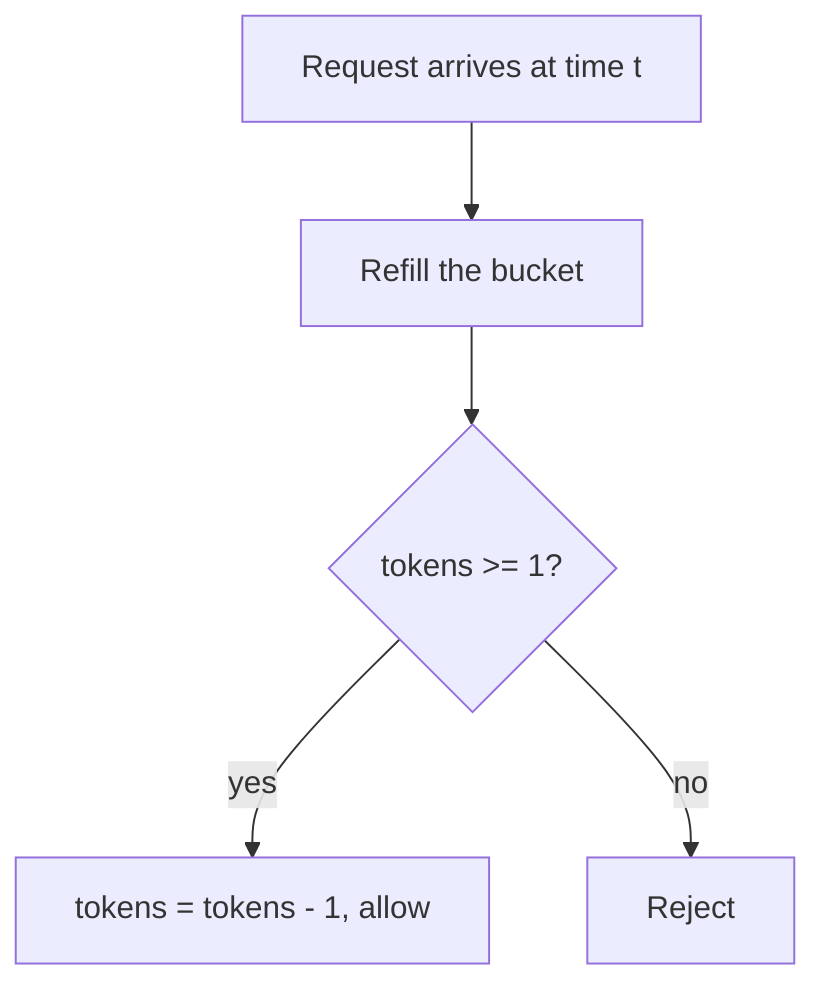
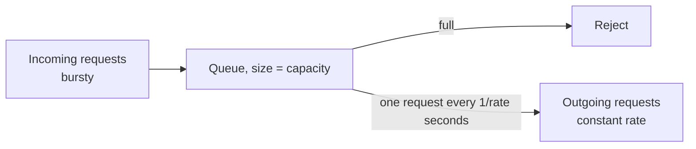
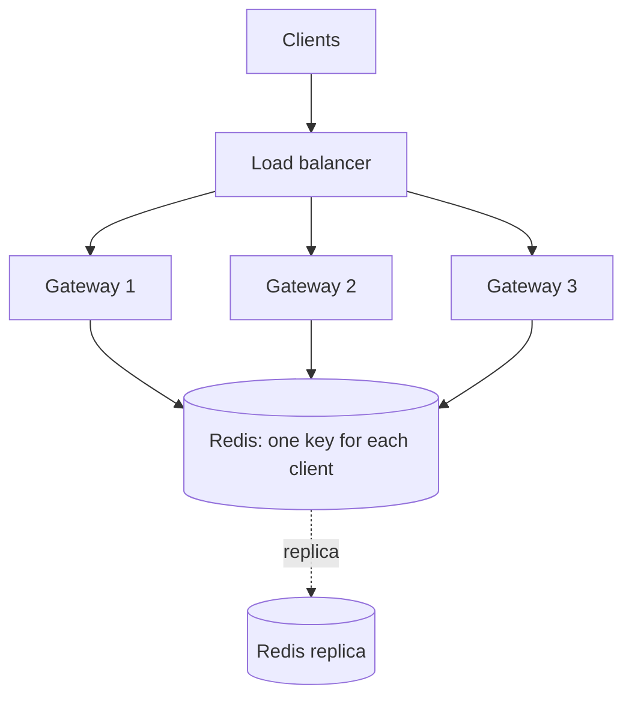

# Rate Limiting Algorithms

A rate limiter decides, for each request, whether a client may proceed now, must wait, or is rejected. This page is the home page for the five rate limiting algorithms: token bucket, leaky bucket, fixed window, sliding window log, and sliding window counter. It gives each algorithm with its memory cost, burst behavior, and accuracy, one runnable Java program with an injected clock for all five, a comparison table, the places where a limiter runs, the distributed version with Redis, and the HTTP response headers.

## Why It Matters

"Design a rate limiter" is one of the most common system design questions, and "how do you protect this API from one noisy client" appears in almost every other design. An interviewer expects you to name an algorithm, state its burst behavior and memory cost, and then move to the distributed problem: many servers, one limit, and a race on the counter. On the job, a rate limiter protects a service from overload, from abusive clients, and from one tenant that uses the capacity of all others. It also bounds cost, because a limit on a paid downstream call is a limit on the bill. This page gives the vocabulary, the exact behavior of each algorithm, and the failure analysis for the follow-up questions.

The in-process, multi-threaded design (classes, locks, one object for each client) is in the [LLD rate limiter case study](../../lld/case-studies/03-rate-limiter/README.md). That page uses the algorithms as code and links here for the theory. The full distributed design (API, data model, estimation) is the HLD case study `kb/hld/case-studies/02-distributed-rate-limiter.md`.

## Core Concepts

**Rate limiting**: the rejection or delay of requests that exceed a stated rate. The stated rate is the **limit**, for example 100 requests per minute for each API key.

**Client key** (also *limit key*): the identity that owns one counter. Examples: a user id, an API key, an IP address, a tenant id, or a pair such as `(user, endpoint)`. The choice of key decides who a limit protects and who it punishes.

**Allowed, delayed, rejected**: a limiter has three possible outcomes for a request. It *allows* the request now, it *delays* the request (a queue holds it until a slot is free), or it *rejects* the request (the server answers with `429`). *Throttling* is a common word for delay or reject. This page uses "reject" for the refusal and "delay" for the wait.

**Window**: a span of time, for example 60 seconds, in which the limiter counts requests. A **fixed window** has aligned boundaries (00:00 to 00:59, then 01:00 to 01:59). A **sliding window** ends at the current time and starts one window length earlier.

**Burst**: many requests that arrive in a short time. Each algorithm has a *burst allowance*, the largest number of requests that it accepts at once after an idle period.

**Average rate**: the long-run number of requests per second that the limiter accepts. The algorithms differ mainly in how they trade the average rate against the burst allowance.

**Refill rate** and **capacity**: the two parameters of a token bucket. The bucket gains *refill rate* tokens each second, up to *capacity* tokens. A request takes one token.

**Injected clock**: a clock object that the limiter receives from its caller instead of reading the system clock. The tests and the program below move this clock by hand, so every decision is exact and repeatable. The clock must never move backward. In production, a monotonic clock (`System.nanoTime()` in Java) satisfies this rule inside one process. Across servers, no clock is exact (see [Distributed Rate Limiting](#distributed-rate-limiting)).

**Atomic read-modify-write**: an operation that reads a counter, decides, and writes the new value, with no other operation in between. Without it, two concurrent requests both read "99" and both pass a limit of 100.

**Fail open** and **fail closed**: the behavior of the system when the limiter itself is unavailable. *Fail open* allows the request. *Fail closed* rejects it.

## How It Works

### Token Bucket

A bucket holds up to `capacity` tokens. The bucket gains `refill rate` tokens each second. A request takes one token. If the bucket has at least one token, the limiter allows the request. If not, the limiter rejects it.

A real implementation does not run a timer. It stores two numbers: the token count and the time of the last refill. At each request, the limiter computes `tokens = min(capacity, tokens + elapsed × refill rate)`, sets the last refill time to now, and then tests for one token.



- **Memory**: two numbers for each client key, which is O(1).
- **Time**: O(1) for each request.
- **Burst behavior**: the bucket starts full, so a client can send `capacity` requests at once. After that, the client gets `rate` requests each second. In any interval of `T` seconds, the limiter allows at most `capacity + rate × T` requests.
- **Accuracy**: exact for its own rule. It does not claim "N requests in each window". It claims "an average of `rate`, with a burst of `capacity`".
- **Retry-after hint**: the time that the refill needs to reach one token, `(1 − tokens) / rate`.
- **Real systems**: the Envoy local rate limit filter applies a token bucket (Envoy documentation).

Recommendation: start with token bucket when the interviewer says only "rate limiter". It allows short bursts, which real clients produce, and it needs two numbers for each key.

### Leaky Bucket

The name covers two different mechanisms. Interview answers must say which one.

**Leaky bucket as a queue (shaper).** Requests enter a first-in, first-out queue of fixed size. The queue releases requests at a fixed rate, one request each interval. If the queue is full when a request arrives, the limiter rejects the request. This mechanism *smooths* traffic: the output rate is constant, no matter how bursty the input is. The cost is added latency, because a request waits in the queue. A queue stores requests, which is O(capacity) memory, but the program below shows that a counter is enough when the limiter only needs the release time of each request: it stores the time of the next free slot, which is O(1).

**Leaky bucket as a meter.** A counter (the *level*) drains at a fixed rate. A request adds one to the level. If the level would pass the capacity, the limiter rejects the request. No request waits. The meter makes the same allow and reject decisions as a token bucket with the same capacity and rate, because `level = capacity − tokens`. The program below shows this on the boundary scenario.



- **Memory**: O(1) for the meter and for the release-time form of the queue. O(capacity) if the queue stores the requests.
- **Burst behavior**: the queue absorbs a burst up to `capacity` requests and releases them at the fixed rate. The output has no burst. The meter has the same burst allowance as a token bucket.
- **Use when**: the downstream system needs a constant rate (a payment gateway with a fixed transactions-per-second contract, an SMS provider), and the added latency is acceptable. Use a token bucket when the client may burst.
- **Real systems**: the Nginx `limit_req` module uses the "leaky bucket" method. With `burst=5`, excess requests wait in a delay queue until their number passes the burst size, and then Nginx rejects them. With `nodelay`, Nginx serves requests inside the burst at once and rejects the rest (Nginx documentation). Nginx rejects with status `503` by default and you set `limit_req_status 429` to change it.
- **Relation to queues**: the queue form is a bounded message queue with a fixed-rate consumer. See [message queues and streams](08-message-queues-and-streams.md) for backpressure and bounded queues.

### Fixed Window Counter

Time divides into aligned windows of length `W`. The limiter keeps one counter for each client key and each window. A request increments the counter of the current window. If the counter would pass the limit `L`, the limiter rejects the request. At the start of a new window, the counter is zero.

- **Memory**: one counter and the window start for each client key, O(1).
- **Time**: O(1).
- **Burst behavior**: the **boundary burst**. A client sends `L` requests at the end of window 1 and `L` requests at the start of window 2. The limiter allows all `2L` requests within a short interval around the boundary, although the stated limit is `L` for each window. The program below shows 6 requests allowed in 200 ms for a limit of 3 per 1000 ms.
- **Accuracy**: exact inside one window. It does not enforce "L in any interval of length W".
- **Strength**: the simplest algorithm, and the cheapest to run in a shared store (one `INCR` on one key with an expiry).
- **Use when**: the limit is a quota or a billing rule that is defined for calendar windows ("1000 calls for each day"), or a coarse protection where a 2× burst at a boundary is acceptable.

### Sliding Window Log

The limiter keeps the timestamp of each allowed request. On a new request at time `t`, it removes all timestamps that are not later than `t − W`. If fewer than `L` timestamps remain, the limiter allows the request and stores `t`. If not, it rejects the request.

- **Memory**: O(L) for each client key, because the log holds at most `L` timestamps. The log must store only *allowed* requests. If it stored rejected requests too, an attacker would grow the log without limit, and the attacker's own rejected requests would keep the attacker locked out.
- **Time**: O(1) amortized. One call can remove up to `L` timestamps, so one call can cost O(L).
- **Burst behavior**: at most `L` requests in *any* interval of length `W`. There is no boundary burst.
- **Accuracy**: exact.
- **Retry-after hint**: exact. The oldest timestamp in the log plus `W`, minus `t`.
- **Cost**: a payload of 8 bytes for each timestamp gives 800 bytes for each key at `L = 100`, and 8 GB for 10 million keys, before the overhead of the data structure. In Redis, the usual structure is a sorted set (`ZADD`, `ZREMRANGEBYSCORE`, `ZCARD`).
- **Use when**: the limit is small (a login attempt limit of 5 in 15 minutes) and exactness matters more than memory.

### Sliding Window Counter

The limiter keeps two counters for each client key: the count of the current fixed window and the count of the previous fixed window. At time `t`, with `elapsed` as the time since the current window started, it estimates the count of the sliding window:

```text
estimate = previous × (W − elapsed) / W + current
```

The term `(W − elapsed) / W` is the part of the previous window that the sliding window still covers. The limiter allows the request if `estimate + 1 ≤ L`, and then increments `current`. The estimate assumes that the requests of the previous window spread evenly over that window.

Worked example: `L = 3`, `W = 1000 ms`. The previous window holds 3 requests. At `elapsed = 600 ms` the current window holds 1 request. The estimate is `3 × 400 / 1000 + 1 = 2.2`. A new request makes it `3.2`, which is above 3, so the limiter rejects it. At `elapsed = 700 ms`, the estimate is `3 × 300 / 1000 + 1 = 1.9`, so the limiter allows the request.

- **Memory**: two counters and a window start for each client key, O(1).
- **Time**: O(1).
- **Burst behavior**: close to the sliding window log. It removes the 2× boundary burst of the fixed window in most traffic.
- **Accuracy**: an estimate. It errs in two directions. If the previous window had its requests at its end, the estimate gives them too little weight, and the true count in the last `W` can approach `2L − 1`. If the previous window had its requests at its start, the estimate gives them too much weight, and the limiter rejects requests that the exact rule allows. The next section gives a measurement.
- **Real systems**: Cloudflare describes this algorithm in its blog post "How we built rate limiting capable of scaling to millions of domains". It needs two numbers for each counter, and one `INCR` and one `GET` to compute the rate.

!!! info "Cloudflare measurement"
    Cloudflare evaluated the sliding window approximation on 400 million requests from 270 000 distinct sources. It reports that 0.003% of requests were wrongly allowed or rate limited, and an average difference of 6% between the real and the approximate rate. This is one measurement on one traffic mix, not a guarantee. A burst at a window edge can produce larger errors.

### Where to Enforce

| Place | What it knows | Strength | Weakness |
|---|---|---|---|
| Client (SDK, mobile app) | Its own calls only | Saves network calls and shows a good error to the user | The client is not trusted. A malicious client skips it. Use it as a courtesy, never as protection |
| Edge or API gateway (see [microservices and monoliths](14-microservices-and-monoliths.md)) | Identity (API key, token, IP), route, and method | Rejects bad traffic before it reaches any service. One policy for all services. Cheap rejection | Knows little about the cost of a request. Coarse keys |
| Service (in-process or sidecar) | The business context: tenant plan, request cost, the state of the database | Can limit by real cost (a heavy report costs more than a read) | The request already consumed a connection and a thread. Each service needs the code, or a shared library |
| Outbound (calls to a dependency) | The contract of the dependency | Keeps you inside the limit of a third-party API | Does not protect your own entry points |

Recommendation: layer them. A coarse limit at the gateway (for example per API key and per IP) protects the system. A finer limit in the service protects expensive operations. Rate limiting protects against *too many requests*. Load shedding and circuit breakers protect against *too little capacity* and *a failing dependency*, see [reliability patterns](12-reliability-patterns.md).

### Distributed Rate Limiting

One process keeps the state in memory (see the LLD page). Many servers need one shared limit for a key, so the state must be shared or the traffic for each key must reach one place.



**Option 1: a central store (the usual choice).** Each gateway calls Redis for each request. The call must be atomic. Two simple forms exist in the Redis documentation:

- `INCR` with an expiry. The "rate limiter" pattern in the `INCR` documentation counts requests in a key that holds the client and the current second, and sets `EXPIRE` in the same `MULTI`/`EXEC` block. The second variant in that page (a single counter, `INCR`, then `EXPIRE` when the value is 1) has a race: if the client runs `INCR` and then fails before `EXPIRE`, the key lives forever. The documentation fixes this with a Lua script that runs through `EVAL`.
- A Lua script for any algorithm. Redis guarantees atomic execution of a script: while the script runs, the server blocks all other activity, so the effects of the script either have not happened or have all happened (Redis scripting documentation). The script can read the state, compute, and write it back, so it implements a token bucket or a sliding window counter without a race.

A token bucket as a Redis Lua script. The key is the only key that the script touches, and it is passed in `KEYS[1]`, as the documentation requires for Redis Cluster. The script reads the time from the Redis server with `TIME`, so all gateways use one clock. Redis 5.0 and later replicate the effects of a script by default (version 7.0 removed the older replication of the script text), and that makes the call to `TIME` safe (Redis scripting documentation).

```lua
-- KEYS[1] = bucket key
-- ARGV[1] = capacity (tokens), ARGV[2] = refill rate (tokens per second)
-- Returns 1 if the request is allowed, 0 if it is rejected.
local t = redis.call('TIME')
local now_ms = t[1] * 1000 + math.floor(t[2] / 1000)
local capacity = tonumber(ARGV[1])
local rate = tonumber(ARGV[2])
local state = redis.call('HMGET', KEYS[1], 'tokens', 'ts')
local tokens = tonumber(state[1])
local ts = tonumber(state[2])
if tokens == nil then
  tokens = capacity
  ts = now_ms
end
tokens = math.min(capacity, tokens + (now_ms - ts) * rate / 1000)
local allowed = 0
if tokens >= 1 then
  tokens = tokens - 1
  allowed = 1
end
redis.call('HSET', KEYS[1], 'tokens', tokens, 'ts', now_ms)
-- After capacity / rate seconds without requests the bucket is full again,
-- so the key can expire and the next request recreates a full bucket.
redis.call('PEXPIRE', KEYS[1], math.ceil(capacity / rate * 1000))
return allowed
```

Operational facts from the Redis documentation: the script cache is volatile (a restart or a failover can clear it), so call `EVALSHA` and, on a `NOSCRIPT` error, load the script with `SCRIPT LOAD` and retry. Most clients do this. Keep the script short, because a running script blocks the server.

For the sliding window counter, the Cloudflare design keeps one counter for each window and needs one `INCR` and one `GET` for each request. For the sliding window log, a Redis sorted set holds the timestamps. Each form needs a script (or a transaction) when the read and the write depend on each other.

**What the central store costs.**

| Concern | Effect | Mitigation |
|---|---|---|
| Latency | One network round trip for each request, about 0.5 ms inside one data center (approximate, see [caching](03-caching.md)) | Keep the store in the same zone. Use a connection pool. Pipeline when one request needs several keys |
| Throughput of one key | One key is one hot spot. A single client with a huge rate sends all its traffic to one Redis shard | Limit at the edge first. Split the key (see Option 3) |
| Capacity | One Redis node handles a bounded number of operations for each second | Partition the keys across nodes with a hash (see [partitioning and sharding](06-partitioning-and-sharding.md)) |
| Store failure | Every request has no limit decision | Choose fail open or fail closed on purpose (see below) |
| Replication lag | After a failover to a replica, the replica can miss the last writes (Redis replicates asynchronously by default), so the counts of the last moments are lost and clients briefly get more than the limit | Accept it. A limiter does not need exact counts after a failover. See [replication](05-replication.md) |

**Fail open or fail closed.** If Redis is down, the gateway decides. *Fail open* keeps the product available and removes the protection at the moment that an incident may already run. *Fail closed* protects the backend and turns a limiter failure into a full outage. Recommendation: fail open for most public APIs, with a local in-process limiter as a coarse fallback that needs no network. Fail closed for a limit that protects money or safety (a login attempt limit, a payment attempt limit). State the choice in the interview.

**Option 2: route by key.** A consistent hash sends all requests of one key to the same limiter node, which keeps the counter in memory. No shared store is needed, and no atomic remote call. The cost: the routing layer must exist, and a node failure loses its counters (a brief over-admission) and moves its keys. See [load balancing](02-load-balancing-dns-cdn.md) and [partitioning and sharding](06-partitioning-and-sharding.md).

**Option 3: local plus global (hybrid).** Each gateway keeps a local limiter and syncs with the central store at intervals, or takes a batch of tokens (a *lease*) from the central store and spends them locally. The central call happens once for each batch, not once for each request. The cost is accuracy: with `N` gateways that each hold a batch of `b` tokens, the system can admit up to `N × b` requests more than the limit in the worst case. Use it when the limit is high and the latency of a central call matters. Recommendation: size the batch as a small part of the limit (for example 1% to 10%) so the overshoot stays small, and give a smaller batch to a key that is close to its limit.

**Clocks.** The sliding algorithms and the window boundaries depend on time. If each gateway uses its own clock, the clocks differ (clock skew), and two gateways disagree about which window a request is in. Use the time of the shared store (`TIME` in a Redis script) or accept an error of the size of the skew. See `kb/hld/distributed-systems/01-failures-and-time.md`.

**Consistency.** A distributed limiter is a counter that many writers update. The limit is a soft bound whenever the update is not atomic or the store is replicated asynchronously. Match the guarantee to the purpose: protection from overload tolerates a few percent of error, while a billing quota needs exact counting in the system that bills. See [consistency and CAP](07-consistency-and-cap.md).

### Response Headers and Status Codes

| Item | Specification | Status | What it says |
|---|---|---|---|
| `429 Too Many Requests` | RFC 6585 | Standards Track RFC | The user sent too many requests in a given time. The response should explain the condition. It may include a `Retry-After` header |
| `Retry-After` | RFC 9110, section 10.2.3 | Internet Standard (STD 97) | A value of either a number of seconds (`Retry-After: 120`) or an HTTP date. The client should wait that long before the next request |
| `RateLimit-Policy` and `RateLimit` | IETF Internet-Draft `draft-ietf-httpapi-ratelimit-headers` | Draft, not an RFC | `RateLimit-Policy` describes the quota policies. `RateLimit` gives the remaining quota |

**Draft status, checked on 15 October 2026:** the IETF datatracker lists `draft-ietf-httpapi-ratelimit-headers-11`, dated 23 May 2026, as an active Internet-Draft of the HTTPAPI working group. It expires on 24 November 2026. It is not an RFC and the content can still change. Do not describe it as a standard. In version 11, `RateLimit-Policy` is a list of quota policy items with a name and the parameters `q` (quota), `w` (window in seconds), `qu` (quota unit, default "requests"), and `pk` (partition key). `RateLimit` is a list of service limit items with the parameters `r` (remaining quota) and `t` (seconds until the window resets).

```text
HTTP/1.1 429 Too Many Requests
Retry-After: 30
RateLimit-Policy: "default";q=100;w=60
RateLimit: "default";r=0;t=30
```

The draft says that a server should not set `Retry-After` to a time earlier than the end of the effective window, that a client must give `Retry-After` precedence over `RateLimit`, and that many throttled clients can retry at the same moment, so a server or a client should add jitter. The headers that many APIs use today, `X-RateLimit-Limit`, `X-RateLimit-Remaining`, and `X-RateLimit-Reset`, are not part of any standard, and the semantics of each name differ between providers. Earlier draft versions used the names `RateLimit-Limit`, `RateLimit-Remaining`, and `RateLimit-Reset`. Check the version that your client library implements. Header and error format design lives in `kb/api-design/02-api-design-practices.md`.

Client behavior: a client that receives `429` must stop, wait for `Retry-After`, and then retry with exponential backoff and jitter. See [reliability patterns](12-reliability-patterns.md).

## Trade-offs and When to Use

| Algorithm | State for each key | Time for each request | Allows a burst? | Accuracy | Smooths output? | Weak point | Use when |
|---|---|---|---|---|---|---|---|
| Token bucket | 2 numbers (tokens, last refill) | O(1) | Yes, up to `capacity` | Exact for "rate `r`, burst `B`" | No | A large capacity allows a large burst | Default choice for APIs. Clients that burst |
| Leaky bucket (queue) | 1 number (next slot) or a queue | O(1) | Absorbs it, releases at a constant rate | Exact output rate | Yes | Added latency. Full queue rejects | A downstream system needs a constant rate |
| Leaky bucket (meter) | 2 numbers (level, last leak) | O(1) | Same as token bucket | Same decisions as token bucket | No | Same as token bucket | Same as token bucket. Chosen when the capacity is described as "queue depth" |
| Fixed window | 1 counter and the window start | O(1) | Yes, and up to `2L` around a boundary | Exact inside one window | No | The boundary burst | Quotas for calendar windows. Coarse protection. Cheapest in a shared store |
| Sliding window log | `L` timestamps | O(1) amortized, O(`L`) worst case | No more than `L` in any window | Exact | No | O(`L`) memory for each key | Small limits that need exactness |
| Sliding window counter | 2 counters and the window start | O(1) | Mostly no. The estimate can allow up to about `2L − 1` | An estimate (0.003% wrong in Cloudflare's measurement) | No | The estimate errs when the previous window was uneven | Large limits for many keys. A good default for a shared store |

Short decision rules:

1. The client may burst and the average rate matters: token bucket.
2. The downstream system needs a constant rate: leaky bucket as a queue.
3. The limit is a quota for a calendar window: fixed window.
4. The limit is small and must be exact: sliding window log.
5. The limit is large, the key count is large, and the boundary burst is not acceptable: sliding window counter.

## Java Example

One program runs all five algorithms with an injected clock (`ManualClock`). It replays a list of request times on each limiter and prints one code for each request: `A` allowed now, `D` denied, `W<n>` accepted and delayed by `n` ms. The token bucket counts tokens in milli-tokens, so all arithmetic is exact. The sliding window counter multiplies its test by the window length, so it needs no floating point. The classes are not thread-safe across several calls, but each `tryAcquire` is `synchronized`, which is enough for a single key. The thread-safe design for many keys is in the [LLD case study](../../lld/case-studies/03-rate-limiter/README.md).

```java
import java.util.ArrayDeque;
import java.util.Deque;
import java.util.List;

public class Main {
    public static void main(String[] args) {
        long[] burst = {0, 100, 200, 300, 900, 950, 1000, 1050, 1100, 1500, 2100};
        System.out.println("Scenario 1: limit 3 per 1000 ms");
        System.out.println("requests at " + java.util.Arrays.toString(burst));
        run("token bucket (cap 3, 1/s)", burst, new TokenBucket(3, 1, new ManualClock()));
        run("leaky bucket queue (3, 1/s)", burst, new LeakyBucketQueue(3, 1000, new ManualClock()));
        run("fixed window", burst, new FixedWindow(3, 1000, new ManualClock()));
        run("sliding log", burst, new SlidingLog(3, 1000, new ManualClock()));
        run("sliding window counter", burst, new SlidingWindowCounter(3, 1000, new ManualClock()));

        long[] edge = {900, 950, 999, 1000, 1050, 1100};
        System.out.println();
        System.out.println("Scenario 2: window boundary, limit 3 per 1000 ms");
        System.out.println("requests at " + java.util.Arrays.toString(edge));
        run("fixed window", edge, new FixedWindow(3, 1000, new ManualClock()));
        run("sliding log", edge, new SlidingLog(3, 1000, new ManualClock()));
        run("sliding window counter", edge, new SlidingWindowCounter(3, 1000, new ManualClock()));
        run("leaky bucket meter (3, 1/s)", edge, new LeakyBucketMeter(3, 1, new ManualClock()));
    }

    // Replays the request times on the limiter's manual clock and prints one code per request:
    // A = allowed now, D = denied, W<n> = accepted but delayed by n ms.
    static void run(String name, long[] times, Limiter limiter) {
        StringBuilder out = new StringBuilder();
        for (long t : times) {
            limiter.clock().set(t);
            long wait = limiter.tryAcquire();
            out.append(wait < 0 ? "D" : wait == 0 ? "A" : "W" + wait).append(' ');
        }
        System.out.printf("%-30s %s%n", name, out.toString().trim());
    }
}

interface Clock {
    long nowMillis();
}

final class ManualClock implements Clock {
    private long now;

    @Override
    public long nowMillis() {
        return now;
    }

    void set(long millis) {
        if (millis < now) {
            throw new IllegalArgumentException("time must not move backward");
        }
        now = millis;
    }
}

// tryAcquire returns -1 if the request is denied, otherwise the wait in milliseconds (0 = now).
abstract class Limiter {
    final ManualClock clock;

    Limiter(ManualClock clock) {
        this.clock = clock;
    }

    ManualClock clock() {
        return clock;
    }

    abstract long tryAcquire();
}

// Tokens are counted in milli-tokens so that all arithmetic stays exact.
// A refill rate of r tokens per second adds exactly r milli-tokens per millisecond.
final class TokenBucket extends Limiter {
    private final long capacityMilli;
    private final long refillPerSecond;
    private long milliTokens;
    private long lastRefill;

    TokenBucket(int capacity, int refillPerSecond, ManualClock clock) {
        super(clock);
        this.capacityMilli = capacity * 1000L;
        this.refillPerSecond = refillPerSecond;
        this.milliTokens = capacityMilli;
        this.lastRefill = clock.nowMillis();
    }

    @Override
    synchronized long tryAcquire() {
        long now = clock.nowMillis();
        milliTokens = Math.min(capacityMilli, milliTokens + (now - lastRefill) * refillPerSecond);
        lastRefill = now;
        if (milliTokens >= 1000) {
            milliTokens -= 1000;
            return 0;
        }
        return -1;
    }
}

// Leaky bucket as a queue: requests wait in a queue of size "capacity" and leave at a fixed
// interval. The code does not store the queue. It stores the time of the next free slot.
final class LeakyBucketQueue extends Limiter {
    private final int capacity;
    private final long intervalMillis;
    private long nextSlot;

    LeakyBucketQueue(int capacity, long intervalMillis, ManualClock clock) {
        super(clock);
        this.capacity = capacity;
        this.intervalMillis = intervalMillis;
    }

    @Override
    synchronized long tryAcquire() {
        long now = clock.nowMillis();
        long start = Math.max(now, nextSlot);
        long queued = (start - now + intervalMillis - 1) / intervalMillis;
        if (queued >= capacity) {
            return -1;
        }
        nextSlot = start + intervalMillis;
        return start - now;
    }
}

// Leaky bucket as a meter: the level drains at a fixed rate. A request adds 1 to the level.
// If the level would pass the capacity, the request is denied.
final class LeakyBucketMeter extends Limiter {
    private final long capacityMilli;
    private final long leakPerSecond;
    private long levelMilli;
    private long lastLeak;

    LeakyBucketMeter(int capacity, int leakPerSecond, ManualClock clock) {
        super(clock);
        this.capacityMilli = capacity * 1000L;
        this.leakPerSecond = leakPerSecond;
        this.lastLeak = clock.nowMillis();
    }

    @Override
    synchronized long tryAcquire() {
        long now = clock.nowMillis();
        levelMilli = Math.max(0, levelMilli - (now - lastLeak) * leakPerSecond);
        lastLeak = now;
        if (levelMilli + 1000 <= capacityMilli) {
            levelMilli += 1000;
            return 0;
        }
        return -1;
    }
}

final class FixedWindow extends Limiter {
    private final int limit;
    private final long windowMillis;
    private long windowStart = Long.MIN_VALUE;
    private int count;

    FixedWindow(int limit, long windowMillis, ManualClock clock) {
        super(clock);
        this.limit = limit;
        this.windowMillis = windowMillis;
    }

    @Override
    synchronized long tryAcquire() {
        long now = clock.nowMillis();
        long start = Math.floorDiv(now, windowMillis) * windowMillis;
        if (start != windowStart) {
            windowStart = start;
            count = 0;
        }
        if (count < limit) {
            count++;
            return 0;
        }
        return -1;
    }
}

final class SlidingLog extends Limiter {
    private final int limit;
    private final long windowMillis;
    private final Deque<Long> log = new ArrayDeque<>();

    SlidingLog(int limit, long windowMillis, ManualClock clock) {
        super(clock);
        this.limit = limit;
        this.windowMillis = windowMillis;
    }

    @Override
    synchronized long tryAcquire() {
        long now = clock.nowMillis();
        while (!log.isEmpty() && log.peekFirst() <= now - windowMillis) {
            log.pollFirst();
        }
        if (log.size() < limit) {
            log.addLast(now);
            return 0;
        }
        return -1;
    }
}

// Estimate = previous * (window - elapsed) / window + current.
// The code multiplies the test by the window length, so it stays in exact long arithmetic.
final class SlidingWindowCounter extends Limiter {
    private final int limit;
    private final long windowMillis;
    private long windowStart = Long.MIN_VALUE;
    private long previous;
    private long current;

    SlidingWindowCounter(int limit, long windowMillis, ManualClock clock) {
        super(clock);
        this.limit = limit;
        this.windowMillis = windowMillis;
    }

    @Override
    synchronized long tryAcquire() {
        long now = clock.nowMillis();
        long start = Math.floorDiv(now, windowMillis) * windowMillis;
        if (start != windowStart) {
            previous = (start - windowStart == windowMillis) ? current : 0;
            current = 0;
            windowStart = start;
        }
        long elapsed = now - windowStart;
        long scaled = previous * (windowMillis - elapsed) + current * windowMillis;
        if (scaled + windowMillis <= (long) limit * windowMillis) {
            current++;
            return 0;
        }
        return -1;
    }
}
```

<!-- expected-output -->
```text
Scenario 1: limit 3 per 1000 ms
requests at [0, 100, 200, 300, 900, 950, 1000, 1050, 1100, 1500, 2100]
token bucket (cap 3, 1/s)      A A A D D D A D D D A
leaky bucket queue (3, 1/s)    A W900 W1800 D D D W2000 D D D W1900
fixed window                   A A A D D D A A A D A
sliding log                    A A A D D D A D A A A
sliding window counter         A A A D D D D D D A A

Scenario 2: window boundary, limit 3 per 1000 ms
requests at [900, 950, 999, 1000, 1050, 1100]
fixed window                   A A A A A A
sliding log                    A A A D D D
sliding window counter         A A A D D D
leaky bucket meter (3, 1/s)    A A A D D D
```

How to read the output:

- **Scenario 1** (limit 3 for each 1000 ms, 4 requests in the first 300 ms). The token bucket allows the first 3 requests, denies the next 3, and allows the request at 1000 ms because the refill has added exactly one token by then (0.2 left at 200 ms plus 0.8 more). The leaky bucket queue accepts the second and third request but delays them (`W900` at 100 ms, `W1800` at 200 ms), because it releases one request each 1000 ms. The fixed window allows 3 requests at 1000, 1050, and 1100 ms because a new window starts at 1000 ms. The sliding log allows 1000 ms and 1100 ms but denies 1050 ms. The sliding window counter denies all three, because the estimate for the previous window is still 3 at 1000 ms.
- **Scenario 2** (the boundary). The fixed window allows all 6 requests in 200 ms. The sliding log, the sliding window counter, and the leaky bucket meter stop at 3.

## Interview Angle

### Questions

??? question "Design a rate limiter. Which algorithm do you choose and why?"

    Direct answer: token bucket for most APIs, with the distributed state in Redis, enforced at the API gateway.

    Reason: a token bucket has two numbers for each client key (tokens and last refill time), O(1) work for each request, and it accepts a burst up to its capacity, which matches real client behavior. The long-run rate equals the refill rate. The code refills lazily at each request, so no background timer exists.

    Trade-off: the capacity sets the largest burst, so choose it from the downstream capacity. If the downstream system needs a constant rate, use a leaky bucket queue instead. If the limit is a billing quota for a calendar period, use a fixed window. If the limit is small and exact, use a sliding window log. State the requirements first: what is the key, what is the limit, is a burst acceptable, is the limiter distributed, and what happens when the limiter fails.

??? question "What is the problem with a fixed window counter, and how do you fix it?"

    The **boundary burst**. A client sends `L` requests in the last moments of window 1 and `L` requests at the start of window 2. The limiter allows all `2L` in a very short interval, although the limit says `L` for each window. The limit does not hold for an interval that crosses a boundary.

    Fixes: a sliding window log (exact, O(`L`) memory), a sliding window counter (an estimate, O(1) memory), or a token bucket (it limits the burst through its capacity). Which one depends on the cost: the log is exact but stores each timestamp, and the counter is cheap but approximate.

    The edge case to mention: a fixed window is still the right choice for a calendar quota ("1000 calls for each day"), because there the window boundary is part of the rule.

??? question "What is the difference between a token bucket and a leaky bucket?"

    A token bucket *allows* bursts and limits the average rate. A leaky bucket as a queue *smooths* bursts and gives a constant output rate.

    In a token bucket, a request takes a token, and an idle client accumulates tokens up to the capacity, so the client can send a burst. The request that finds a token goes through at once. A leaky bucket as a queue puts requests into a bounded FIFO queue, and the queue releases them at a fixed rate. A request waits, and if the queue is full, the limiter rejects it.

    The difference in outcome: a token bucket adds no latency and passes a burst to the downstream system. A leaky bucket adds latency and protects the downstream system from the burst. A leaky bucket as a *meter* (a counter that drains) makes the same decisions as a token bucket, so the difference is only real for the queue form. Nginx `limit_req` is a leaky bucket with a delay queue. The Envoy local rate limit is a token bucket.

??? question "How does a sliding window counter work, and how accurate is it?"

    It keeps the counts of the current and the previous fixed window and estimates the sliding window as `previous × (W − elapsed) / W + current`. The estimate assumes that the previous window's requests were spread evenly. Memory is O(1) for each key.

    The error depends on traffic shape. If the previous window had its requests at its end, the estimate under-counts, and the true count in the last `W` can approach `2L − 1`. If the previous window had its requests at its start, the estimate over-counts and the limiter rejects requests that an exact limiter would allow. Cloudflare measured 0.003% wrong decisions on 400 million requests from 270 000 sources, and a 6% average difference between the real and the approximate rate. That is one measurement on one traffic mix.

    Choose it when the key count is large, the limit is large, and a small error is acceptable. Choose the log when the limit is small and must be exact.

??? question "How do you build a rate limiter that works across many servers?"

    Direct answer: put the state in a shared store such as Redis, and make the check-and-update atomic.

    Reason: if each server keeps its own counter, a client that spreads requests over `N` servers gets `N` times the limit. A shared store gives one counter for each key. The check must be atomic, because two requests that read the same count and then both write let a client pass the limit. In Redis, use a Lua script through `EVAL` or `EVALSHA`: Redis runs a script atomically and blocks other activity while it runs. For a fixed window, `INCR` plus `EXPIRE` in one `MULTI`/`EXEC` block or one script works. A separate `INCR` followed by a conditional `EXPIRE` can leak a key without an expiry if the client fails between the two calls (the Redis `INCR` documentation).

    Trade-offs: each request costs one network round trip (about 0.5 ms in one data center, approximate). The store becomes a dependency, so choose fail open or fail closed. To cut the round trips, use a local limiter with a batch of tokens leased from the store. That gives up accuracy: the overshoot can reach the number of servers times the batch size. To avoid a shared store, route each key to one node with a consistent hash.

??? question "Why use a Lua script, and what are its limits?"

    A rate limit decision is a read-modify-write: read the state, compute the refill, test, write the state. Two concurrent requests that run these steps from outside Redis can interleave and both pass. A Lua script runs as one atomic unit inside Redis, so no other command runs in the middle (Redis scripting documentation).

    Limits: a running script blocks the whole server, so it must be short and must not loop over large data. The script must read and write only the keys that the caller passes in `KEYS`, so that it works in Redis Cluster, and those keys must hash to the same slot. The script cache is volatile, so the client uses `EVALSHA` and handles `NOSCRIPT`. A script is still one Redis node: it is not a distributed transaction across shards.

??? question "Where do you put the rate limiter: client, gateway, or service?"

    At the gateway as the main layer, with a finer limit in the service for expensive operations. The client limit is a courtesy only.

    Reason: the gateway rejects excess traffic before it uses a service thread or a database connection, and one policy covers all services. The gateway knows identity (API key, IP, token) and route, but not the cost of the work. The service knows the cost and the tenant plan, so it limits heavy operations and applies per-tenant fairness. A client cannot be trusted, so a client limit protects nothing, but it saves calls and gives a better message to the user.

    Add a limit on outbound calls when a dependency has its own limit.

??? question "The Redis that holds your counters goes down. What does the limiter do?"

    The answer is a policy decision, and I state it before the design is final. *Fail open* allows requests, so the product stays up and the system loses its protection. *Fail closed* rejects requests, so the system stays protected and the outage grows.

    For a public API, fail open with a local in-process limiter as a coarse fallback, with a short timeout on the Redis call (a few milliseconds) and a circuit breaker so that the gateway stops calling a failing store. For a limit that protects money or security (login attempts, payment attempts), fail closed. Also plan for the replica case: after a failover, the replica can miss recent writes because Redis replicates asynchronously by default, so counts of the last moments are lost and clients can briefly pass the limit. That is acceptable for overload protection.

??? question "What does the response to a rate-limited request contain?"

    Status `429 Too Many Requests` (RFC 6585), a `Retry-After` header with the number of seconds to wait or an HTTP date (RFC 9110), and a body that explains the limit. Optionally, the rate limit headers: `RateLimit-Policy` and `RateLimit` from the IETF Internet-Draft `draft-ietf-httpapi-ratelimit-headers` (version 11 on 15 October 2026), or the unofficial `X-RateLimit-*` headers that many APIs use.

    State the status of the draft: it is an Internet-Draft, not an RFC, and it can change. The retry hint must be exact, so the algorithm must be able to compute it: a token bucket gives `(1 − tokens) / rate`, a sliding log gives the oldest timestamp plus the window minus now.

    Edge case: if all rejected clients get the same `Retry-After`, they all return at the same moment. Add jitter to the value, or tell clients to add jitter.

??? question "One tenant sends 100 times the traffic of any other tenant. What do you do?"

    Limit at the edge by tenant first, so that the traffic does not reach the shared store at its full rate. The key for the limit is the tenant id, and the limit follows the plan of the tenant.

    The hot key problem: all counter updates for one tenant go to one Redis shard. Options: absorb the excess at the gateway with a local limiter before the central call, split the key into `k` sub-counters (each gateway or each shard owns a share of the limit, and the limit is the sum), or lease token batches to each gateway so that the central store sees one call for each batch. The cost of each is accuracy, as in the hybrid option.

    Also consider fairness: a weighted or hierarchical limit (a global limit, then a per-tenant limit) stops one tenant from taking all of a shared limit.

??? question "How do you test a rate limiter that depends on time?"

    Inject the clock. The limiter receives a `Clock` object, and the test uses a manual clock that it moves to exact times. Then each test states "at time 900 the request is denied, at time 1000 it is allowed", with no `Thread.sleep` and no flakiness. The program on this page does this.

    In production, use a monotonic clock for in-process state, because `System.currentTimeMillis()` can move backward when someone changes the system time, and a limiter that assumes the time never decreases then gives wrong results. For a distributed limiter, use one time source for all servers, such as the `TIME` command of the Redis server inside the script.

### Follow-up Questions

??? question "How do you limit by request cost instead of request count?"

    Change the unit. A token bucket takes `cost` tokens for a request, so a heavy report takes 10 tokens and a read takes 1. The Lua script takes the cost as an argument. For a sliding window counter, increment by the cost. The limit then expresses capacity in cost units. The IETF draft has a quota unit parameter (`qu`) for this purpose, with `requests`, `content-bytes`, and `concurrent-requests` as registered units.

??? question "What is the difference between a rate limit and a concurrency limit?"

    A rate limit bounds requests for each unit of time. A concurrency limit bounds the requests that run at the same time. A slow dependency makes requests run longer, so under a fixed rate the number in flight grows, and a rate limit alone does not stop the overload. A concurrency limit (a semaphore or a bulkhead) stops it. Use both for a shared dependency. See [reliability patterns](12-reliability-patterns.md).

??? question "How do you rate limit by IP when many users share one IP address?"

    A shared IP (a company network or a mobile carrier with NAT) makes one limit hit many users. Prefer an authenticated key (user id, API key) after login, and use the IP limit only before authentication (login, signup) with a higher limit. If a proxy or load balancer sits in front, the limiter must read the real client address from a trusted header that only the proxy sets. A client can send a forged `X-Forwarded-For`, so the limiter must trust only the entries that the own proxies add.

??? question "What happens to the keys of clients that left?"

    A limiter with no expiry holds a key for each client forever. Set a TTL on each key. For a token bucket, the TTL is `capacity / rate` seconds, because after that time the bucket is full and a new bucket equals the old one. For a window algorithm, the TTL is one or two windows. The Lua script above sets this expiry.

### Red Flags

- Writing "use a counter in a `HashMap`" for a distributed system, with no shared store and no atomic update.
- Reading the count, comparing, and then writing it in separate Redis calls, with no atomic step.
- Calling a fixed window exact, and not naming the boundary burst.
- Saying "leaky bucket" and not saying whether the bucket is a queue or a meter.
- Giving no policy for the failure of the limiter (fail open or fail closed).
- Putting the limit only in the client.
- Returning `429` with no `Retry-After`, or describing an Internet-Draft as a standard.
- Using the wall clock for in-process state, or separate clocks on each server for a distributed window.

## Common Mistakes

| Mistake | Why it hurts | Fix |
|---|---|---|
| `INCR` and then a separate `EXPIRE` | A failure between the two leaves a key with no expiry. The client stays limited forever, and memory grows | Use `MULTI`/`EXEC` or a Lua script. Set the expiry when the value is 1, inside the script |
| Read, compare, write in separate calls | Concurrent requests pass the limit | Make the decision atomic: a Lua script, or a compare-and-set loop |
| A sliding log that stores rejected requests | An attacker grows the log. The attacker's rejected requests keep the attacker blocked after the attacker stops | Store only allowed requests |
| The wall clock in a limiter | A clock change moves the time back and breaks refill and window logic | Use a monotonic clock in one process and one shared time source for many servers |
| Same limit for every endpoint | A cheap read and an expensive export share one limit | Use separate limits or a cost for each request |
| Limit by IP only | Users behind NAT share a limit and attackers rotate IP addresses | Key by user or API key after authentication, by IP before it |
| No `Retry-After` | Clients retry at once, and retries add load | Return a retry hint and add jitter |
| Unbounded key growth | Memory grows with the number of clients | Put a TTL on each key |
| Fail closed on a public path with no thought | A Redis outage becomes a full outage | Choose the failure policy for each limit |
| Using fixed windows for protection against bursts | The boundary burst gives `2L` | Use a token bucket, a log, or a sliding window counter |

## Commonly Confused With

| Looks like | Difference | Deciding question |
|---|---|---|
| Token bucket and leaky bucket | A token bucket allows a burst and adds no delay. A leaky bucket queue releases at a fixed rate and adds delay | Must the downstream system see a constant rate? |
| Leaky bucket queue and leaky bucket meter | The queue holds and delays requests. The meter only counts and never delays | Does a request wait or get rejected at once? |
| Fixed window and sliding window | A fixed window has aligned boundaries and a 2× boundary burst. A sliding window ends at the current time | Is "L in any interval of length W" required? |
| Sliding window log and sliding window counter | The log stores timestamps and is exact. The counter stores two counts and estimates | Is O(`L`) memory for each key acceptable, and is exactness required? |
| Rate limiting and load shedding | A rate limit applies a per-client rule. Load shedding drops work when the whole system is overloaded, whoever the client is | Is the rule about one client or about total capacity? |
| Rate limit and quota | A rate limit bounds the speed. A quota bounds the total over a long period (a month) | Does the limit reset in seconds or in days? |
| Rate limit and concurrency limit | A rate limit bounds starts for each unit of time. A concurrency limit bounds requests in flight | Does a slow dependency make the load worse? |
| Rate limit and circuit breaker | A rate limit protects *you* from clients. A circuit breaker protects *the caller* from a failing dependency | Who needs protection, and from what? |
| Rate limiting and backpressure | A rate limit rejects or delays by a rule. Backpressure tells the producer to slow down because the consumer is full | Does the signal come from a configured rule or from the state of the consumer? |

## Quick Reference Card

- Token bucket: 2 numbers, O(1), allows a burst up to `capacity`, average rate `refill rate`. The default.
- Leaky bucket queue: bounded FIFO, constant output rate, adds latency. Leaky bucket meter: same decisions as a token bucket.
- Fixed window: 1 counter, boundary burst up to `2L`. Right for calendar quotas.
- Sliding window log: `L` timestamps, exact. Store only allowed requests.
- Sliding window counter: 2 counters, estimate `previous × (W − elapsed) / W + current`. Cloudflare measured 0.003% wrong decisions on 400 million requests.
- Distributed: shared Redis state with an atomic Lua script (`EVALSHA`), or route by key, or a local limiter with leased batches. Use the server's time.
- Failure policy: public API fails open with a local fallback. Money and security fail closed.
- Response: `429` (RFC 6585), `Retry-After` in seconds or HTTP date (RFC 9110), optional `RateLimit-Policy` and `RateLimit` (Internet-Draft version 11, not an RFC).
- Enforce at the gateway, refine in the service, treat the client limit as a courtesy.
- Test with an injected clock.

## Further Reading

- [Redis documentation, "Scripting with Lua"](https://redis.io/docs/latest/develop/programmability/eval-intro/): atomic script execution, `KEYS` and `ARGV`, `EVALSHA`, the volatile script cache, and effects replication.
- [Redis documentation, `INCR`](https://redis.io/docs/latest/commands/incr/): the rate limiter pattern with `INCR` and `EXPIRE`, and its race condition.
- [Redis documentation, `EVAL`](https://redis.io/docs/latest/commands/eval/): the command reference for running a script.
- [IETF Internet-Draft, "RateLimit header fields for HTTP"](https://datatracker.ietf.org/doc/draft-ietf-httpapi-ratelimit-headers/): the proposed `RateLimit-Policy` and `RateLimit` fields. Version 11 is the latest on 15 October 2026. It is a draft.
- [RFC 6585, "Additional HTTP Status Codes"](https://www.rfc-editor.org/rfc/rfc6585): defines `429 Too Many Requests`.
- [RFC 9110, "HTTP Semantics"](https://www.rfc-editor.org/rfc/rfc9110): defines `Retry-After` (section 10.2.3).
- [Cloudflare blog, "How we built rate limiting capable of scaling to millions of domains"](https://blog.cloudflare.com/counting-things-a-lot-of-different-things/): the sliding window counter in production and the 0.003% measurement.
- [Nginx documentation, `ngx_http_limit_req_module`](https://nginx.org/en/docs/http/ngx_http_limit_req_module.html): a leaky bucket in a production proxy, with `burst` and `nodelay`.
- [Envoy documentation, local rate limit filter](https://www.envoyproxy.io/docs/envoy/latest/configuration/listeners/network_filters/local_rate_limit_filter): a token bucket in a production proxy.
- [LLD rate limiter case study](../../lld/case-studies/03-rate-limiter/README.md): the in-process, thread-safe code for four of the algorithms.
- Related pages: [reliability patterns](12-reliability-patterns.md) (retries, backoff, load shedding), [caching](03-caching.md) (latency numbers, Redis), [partitioning and sharding](06-partitioning-and-sharding.md) (consistent hashing), [replication](05-replication.md) (replica lag), [consistency and CAP](07-consistency-and-cap.md), [load balancing](02-load-balancing-dns-cdn.md), [communication patterns](09-communication-patterns.md), [scalability and availability](01-scalability-and-availability.md).
