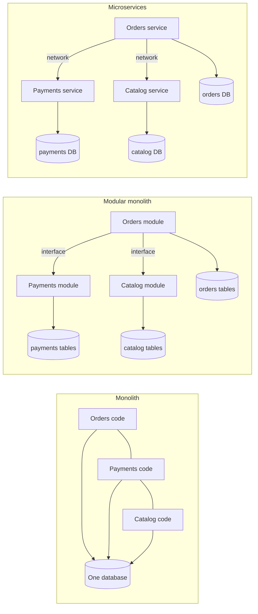
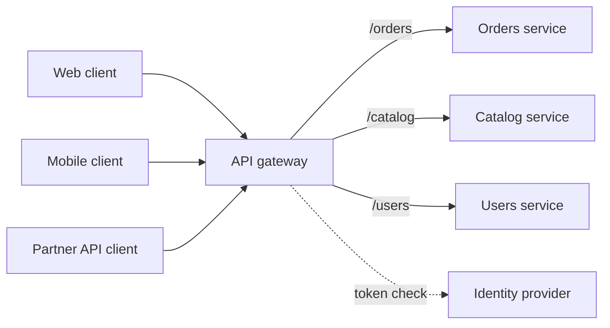
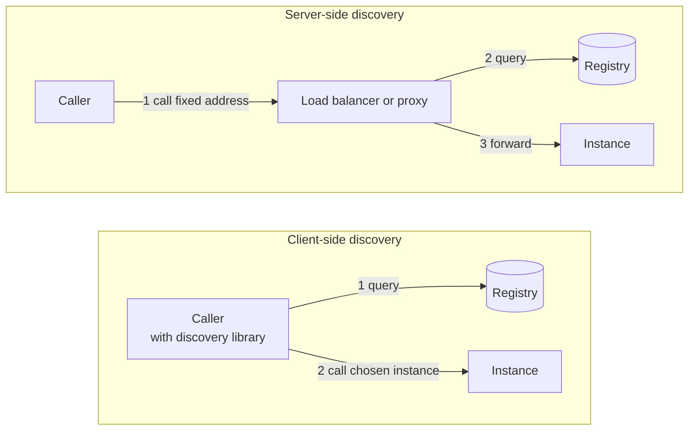
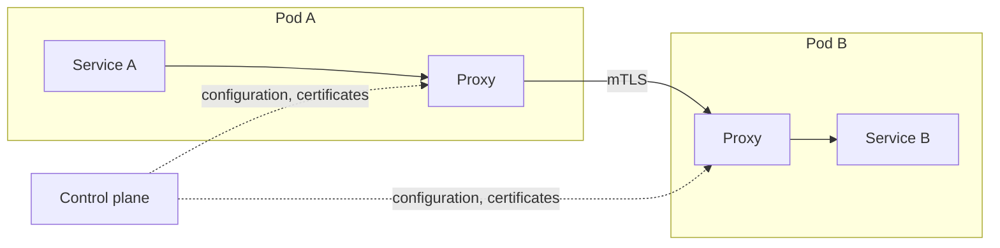
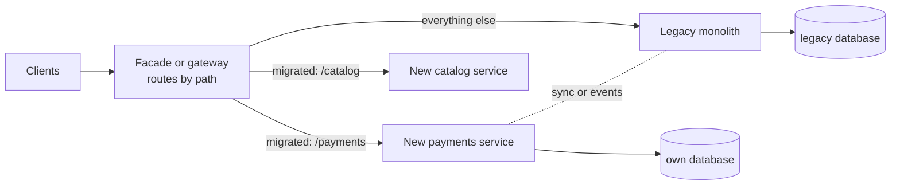

# Microservices and Monoliths

A monolith deploys all of its code as one unit. A microservice architecture deploys many small services, each owned by one team, each with its own data. This page covers the choice between a monolith, a modular monolith, and microservices; how to find service boundaries; data ownership and its consequences; the API gateway; service discovery; the service mesh; inter-service communication; distributed tracing; migration with the strangler fig pattern; and the failure modes of services that were split in the wrong way.

## Why It Matters

Almost every HLD answer draws boxes labeled "service", and the interviewer asks why there are several boxes, where the boundaries are, what each service stores, and what happens when one of them fails. A candidate who splits into twelve services by default gets questions that the split makes hard: how a request that touches three services stays consistent, who owns the join, and how the team debugs a slow request. On the job, the same decision decides how many teams can work without waiting for each other, and how many network failures the system must tolerate. This page gives the criteria for each choice, so that you can defend "one deployable unit with clear modules" as well as "twelve services".

## Core Concepts

**Monolith**: an application that deploys as one unit (one process, or several identical copies of one process) with one codebase and, usually, one database. Calls between its parts are in-process method calls. A monolith is not a synonym for "badly designed". It can have clean modules.

**Modular monolith**: a monolith whose code divides into modules with explicit boundaries. Each module hides its internals and exposes a small interface. Modules call each other through that interface only, and each module owns its own tables. The application still deploys as one unit.

**Microservice**: a service that runs in its own process, deploys independently of other services, and owns one business capability and its data. Lewis and Fowler describe services that are organized around business capabilities, deployed by automated machinery, and communicate through lightweight mechanisms (often an HTTP API). They also state that no precise formal definition exists.

**Service boundary**: the line that separates what one service owns from what another service owns. A good boundary makes most changes touch one service.

**Business capability**: something that the business does, for example "take payments", "manage the catalog", "ship orders". Services organized around business capabilities change for business reasons, one at a time.

**Bounded context**: a term from domain-driven design (Eric Evans, 2003). A bounded context is the part of the system in which one model and one vocabulary are valid. The word "customer" can mean an account holder in billing and a recipient in shipping. Each meaning belongs to its own context. A bounded context is a strong candidate for a service boundary.

**Coupling and cohesion**: *Coupling* is how much one service must change when another service changes. *Cohesion* is how well the parts of one service belong together. A good split gives low coupling between services and high cohesion inside each service.

**Database per service**: each service owns its data store, and no other service reads or writes that store directly. Other services use the API of the owner.

**Conway's law**: the structure of a system copies the communication structure of the organization that builds it (Melvin Conway, 1968). Service boundaries and team boundaries influence each other, so design both together.

**API gateway**: one entry point that receives client requests and routes them to services. It also handles cross-cutting concerns such as authentication, rate limiting, and TLS termination.

**Service discovery**: the mechanism by which a caller finds the network address of a healthy instance of a service. The addresses change as instances start, stop, and move.

**Service registry**: the store that holds the list of instances for each service. Consul and the Kubernetes API (through EndpointSlices) are service registries.

**Service mesh**: an infrastructure layer that moves service-to-service networking (mutual TLS, retries, timeouts, load balancing, metrics) out of the application code and into proxies that run next to each service instance.

**Distributed tracing**: the recording of one request as a tree of timed *spans* across all services that the request touches, linked by a *trace id* that each service passes on.

## How It Works

### Monolith, Modular Monolith, Microservices



| Aspect | Monolith | Modular monolith | Microservices |
|---|---|---|---|
| Deployment unit | One | One | One for each service |
| Call between parts | In-process method call (nanoseconds) | In-process call through a module interface | Network call (about 0.5 ms inside one data center, approximate) |
| Transactions across parts | One database transaction | One database transaction is possible, but modules that own separate tables lose it if they want independence | No shared transaction. Use sagas and eventual consistency (see `kb/hld/distributed-systems/03-distributed-transactions.md`) |
| Data | One schema, shared | One database, one schema for each module | One database for each service |
| Independent scaling | The whole application scales together | The same | Each service scales on its own |
| Independent deployment | No. Every change redeploys everything | No | Yes, if the boundaries are right |
| Technology choice | One | One | One for each service (with a cost) |
| Operational cost | Low: one thing to deploy, monitor, and debug | Low | High: many deployments, a network, discovery, tracing, versioned APIs |
| Failure modes | A bug or a memory leak can take down everything | The same | Partial failure: a service or a network link fails while the rest runs |
| Team scaling | Many teams share one codebase and one release train | Teams own modules, one release train | Teams own services and release on their own |

Why a modular monolith is a serious option: Fowler observes that almost all successful microservice systems started as a monolith that grew too large, and that systems built as microservices from the first day often ran into serious trouble (his "MonolithFirst" article, 2015). He gives two reasons. First, microservices have a cost of managing many services, the "microservice premium", and a new product cannot afford it before it knows whether it will succeed. Second, service boundaries are hard to get right at the start, and moving functionality between services is much harder than moving it inside a monolith. He holds this advice tentatively and names the opposing view. A modular monolith gets most of the structure now, and its module boundaries are the seams for a later split.

### When to Choose Each

| Situation | Choose | Reason |
|---|---|---|
| New product, small team (one to two teams), requirements still change | Modular monolith | Cheapest to build and run. Boundaries can still move |
| One part of the system needs a different scaling profile (an image-processing worker, a search index) | Monolith plus one separate service for that part | Split only where the need is real |
| Many teams (a rule of thumb is more than 8 to 10 engineers working on the same code) block each other's releases | Microservices along team lines | Independent deployment is the benefit that pays for the cost |
| Parts need different availability or compliance (payments with stricter rules) | Separate service for that part | The isolation is the requirement |
| Parts need different technology (a machine learning model in Python, the rest in Java) | Separate service for that part | A process boundary is the cleanest way |
| The team has no automated deployment, no monitoring, and no on-call practice | Monolith | Microservices need infrastructure automation (Lewis and Fowler list it as a characteristic) |

The number "8 to 10 engineers" is a rule of thumb and has no primary source. State the reasoning in an interview (release coordination cost grows with the number of people who share one deployable unit), not the number.

Recommendation: in an interview, state a starting point and the trigger that would change it. For example: "I start with a modular monolith. I split out the payments module when its compliance rules or release rhythm differ from the rest, or when a second team needs to deploy it independently."

### Finding Service Boundaries

Use these criteria in this order.

1. **Business capability.** List what the business does. Each capability with its own data and its own rules is a candidate. "Orders", "payments", "inventory", "notifications" are capabilities. "Database access layer" and "validation" are technical layers, not capabilities, and a split along layers makes every feature touch every service.
2. **Bounded context.** Look for places where the same word has a different meaning, or where the rules differ. These are natural seams.
3. **Data ownership.** A service must own the data that it changes. If two candidates need to update the same rows in one transaction, they probably belong together.
4. **Rate of change.** Parts that change together belong together. Parts that change at different speeds and for different reasons can separate.
5. **Team ownership.** A service should fit one team (Conway's law). A service that two teams must change for each feature has a wrong boundary.
6. **Scaling and failure isolation.** A part that needs ten times the capacity of the rest, or that must stay up when the rest fails, justifies a boundary.

Tests for a boundary after the split: (a) Does a typical feature change one service? (b) Can one service deploy without a coordinated deploy of another? (c) Does a typical request cross only a few services (two or three)? (d) Does each service own its data? If the answer to (a) or (b) is no, the services are coupled. The section "Failure Modes" names this the distributed monolith.

Size: "micro" does not mean a number of lines. A common guideline is that a team can own, understand, and rewrite the service in a short time. Do not give a line count in an interview.

### Data Ownership and Its Consequences

Lewis and Fowler describe decentralized data management: each service manages its own database, and the technologies can differ (polyglot persistence). The consequences are the part that interviewers probe.

| Consequence | What changes | What you do |
|---|---|---|
| No cross-service join | A query that joins orders and customers across two services is not possible in SQL | **API composition**: the caller (or a gateway) calls both services and joins in memory. For read-heavy views, keep a **read model**: a copy of the needed fields, updated from events (see `kb/hld/fundamentals/16-event-driven-architecture.md`) |
| No cross-service ACID transaction | A business action that spans services cannot commit or roll back as one | A **saga**: a sequence of local transactions, each with a compensating action. Lewis and Fowler say to avoid distributed transactions and to accept eventual consistency with compensation. See `kb/hld/distributed-systems/03-distributed-transactions.md` |
| Data duplication | A service keeps a copy of data that another service owns (the customer name on an order) | Name one owner. Copies are read-only caches that the owner's events update. Accept staleness |
| Referential integrity is not enforced by the database | An order can point to a customer that was deleted | Treat ids as references that can dangle. Handle "not found". Use soft deletes or events |
| Reporting across services | One analytics query needs data from all services | Send events or change data capture streams to a warehouse (see `kb/databases/10-oltp-olap-and-warehousing.md`) |
| Atomic "write and publish" | A service updates its database and publishes an event, and one of the two can fail | **Transactional outbox**: write the event to a table in the same local transaction, and a relay publishes it (see [message queues and streams](08-message-queues-and-streams.md)) |
| More databases to run | Each store needs backup, upgrade, and monitoring | Use a few well-understood store types. Do not choose a new database for each service without a reason |

A shared database between services removes these costs and gives up the independence: a schema change in one table can break every service that reads it, and no service can change its storage without the others. That is a reason why "shared database" is the first sign of a distributed monolith. A narrow exception is a shared *read replica* for reporting that no service writes through.

Choice of store for each service: see [choosing a database](04-choosing-a-database.md).

### API Gateway

An API gateway sits between clients and services. It is the single entry point from the Internet.



Functions (each is a decision, and a gateway does not have to do all of them):

| Function | Detail |
|---|---|
| Routing | Map a path, host, or header to a service. Hide internal service names and addresses from clients |
| Authentication | Check the token at the edge, then pass the identity inward. See `kb/hld/fundamentals/21-security-in-design.md` and `kb/security/03-authorization-oauth-oidc-jwt.md` |
| Rate limiting | Limit by key before the traffic reaches a service. See [rate limiting algorithms](13-rate-limiting-algorithms.md) |
| TLS termination | Decrypt at the edge. See [load balancing, DNS, and CDN](02-load-balancing-dns-cdn.md) |
| Protocol translation | Accept REST from clients and call gRPC services inside. See [communication patterns](09-communication-patterns.md) |
| Aggregation (composition) | One client request becomes several service calls, and the gateway merges the answers. This saves round trips for mobile clients |
| Caching and response shaping | Cache public responses. Remove fields that a client must not see |
| Observability entry point | Create the trace id and the access log for each request |

**Backend for frontend (BFF)**: one gateway for each client type (web, mobile, partner). Each BFF returns what its client needs. The cost is more gateways to run. Use it when clients need very different shapes of data.

Risks: the gateway is on the path of every request, so it must scale horizontally and run in several zones (see [scalability and availability](01-scalability-and-availability.md)). Business logic in the gateway turns it into a shared, central component that every team must change. Keep it to routing and cross-cutting concerns. Examples: Kong, Envoy-based gateways, NGINX, and cloud gateways such as Amazon API Gateway.

Gateway versus load balancer versus service mesh: a load balancer spreads traffic across the instances of one service. A gateway is the edge entry point with API-level policies. A mesh handles traffic *between* services inside the system.

### Service Discovery

Instances start, stop, and move. A caller needs the address of a healthy instance.

**Registration.** *Self-registration*: each instance registers itself with the registry and sends heartbeats. *Third-party registration*: the platform registers instances (Kubernetes does this for pods that pass their readiness check). In both cases an instance that stops sending heartbeats, or that fails its health check, leaves the list.

**Client-side discovery.** The caller queries the registry, gets the list of instances, and picks one itself (round robin, least loaded, and so on). The caller needs a discovery library and a load-balancing policy. The benefit is no extra network hop and full control of the policy. The cost is logic in each client, in each language.

**Server-side discovery.** The caller sends the request to a fixed address (a load balancer or a proxy). The proxy queries the registry and forwards the request. The caller needs no discovery code. The cost is one more hop and one more component to keep available.



| Aspect | Client-side | Server-side |
|---|---|---|
| Extra hop | No | Yes |
| Logic in the caller | Yes (library for each language) | No |
| Load-balancing policy | Chosen by the caller | Chosen by the proxy |
| Failure of the registry | The caller can use its cached list | The proxy can use its cached list |
| Examples | gRPC with a name resolver, Netflix Eureka with a client library | Kubernetes Services, a cloud load balancer, a mesh proxy |

**Examples from the documentation.**

- **Kubernetes.** A *Service* gives a set of pods one stable name and virtual IP (the cluster IP). The Service controller continuously matches pods to the Service selector and updates the *EndpointSlices* for the Service. The cluster DNS gives each Service a name of the form `my-svc.my-namespace.svc.cluster.local`, and a pod that asks for `my-svc` in its own namespace resolves it through the search domains. A normal Service resolves to the cluster IP, and the node proxy (`kube-proxy`) spreads the connections over the pods. A *headless* Service (`clusterIP: None`) has no cluster IP, and its DNS name resolves to the IP addresses of all selected pods, so a client can do client-side load balancing. This is server-side discovery by default and client-side discovery with a headless Service.
- **Consul.** Consul keeps a service catalog as the source of truth. A new instance registers with its IP address and port. Health checks remove unhealthy instances from the catalog, so they stop receiving requests. Consumers find services through DNS (or the HTTP API). Consul servers use the Raft protocol for consensus, and agents use gossip through the Serf library.

**Pitfalls.** DNS caching: a client or a library that caches an address for longer than the instance lives sends requests to a dead address. Respect the TTL (see [load balancing, DNS, and CDN](02-load-balancing-dns-cdn.md)). The registry itself must be highly available, because it is a dependency of every call. A health check that is too shallow (the process runs) sends traffic to an instance that cannot reach its database. A check that is too deep (it calls the database) makes every instance fail at once when the database fails. Use a readiness check for "can serve now" and a liveness check for "must restart" (see [reliability patterns](12-reliability-patterns.md)).

### Service Mesh

In a mesh, a proxy handles all network traffic of each service instance. The application code calls the other service as usual, and the proxy adds mutual TLS, retries, timeouts, load balancing, and metrics.



**Data plane and control plane.** The *data plane* is the set of proxies that carry the traffic. The *control plane* configures them and issues certificates. In Istio, the data plane is Envoy proxies that run as sidecars next to each service, and the control plane is `istiod`, which provides service discovery, configuration, and certificate management. Istio lists mutual TLS between workloads, retries, failovers, circuit breakers, fault injection, and percentage-based traffic splits as features (Istio documentation).

**Mutual TLS (mTLS)**: both sides of a connection present a certificate, so each side proves its identity, and the traffic is encrypted. In Linkerd, mTLS applies by default to all TCP traffic between meshed pods. The `identity` component issues each proxy a certificate bound to the Kubernetes ServiceAccount of the pod, and the certificates expire after 24 hours and rotate automatically (Linkerd documentation).

**Retries and timeouts.** Linkerd configures retries and timeouts per route (annotations on HTTPRoute or GRPCRoute resources, or on a Service). Its documentation says to use retries only on idempotent methods and warns that retries add load, so a service that is already under strain can be pushed down further. See [reliability patterns](12-reliability-patterns.md) for retry budgets and storms.

**Sidecar and sidecar-less.** The classic design puts one proxy in each pod. Istio also offers *ambient mode*, which has no sidecar in the application pods. A per-node Layer 4 proxy called `ztunnel` handles mTLS, L4 authorization, and telemetry. An optional *waypoint proxy* (an Envoy deployment) adds Layer 7 features, and you deploy it only where you need them. Sidecar and ambient workloads can coexist in one mesh (Istio documentation). Linkerd uses a proxy in each pod and its documentation does not call it a sidecar on the mTLS page.

**What a mesh does not replace.** A mesh does not give business-level fallback logic, idempotency of operations, or authorization based on business rules. Retries from a proxy are safe only for idempotent calls. A mesh also adds a proxy hop (extra latency and CPU for each call), more components to operate, and an upgrade path. Recommendation: adopt a mesh when you run many services, need uniform mTLS and traffic policy, and cannot rely on every team to use the same client library. Do not adopt it for five services.

### Inter-Service Communication

| Style | Mechanism | Use when | Cost |
|---|---|---|---|
| Synchronous request-response | REST or gRPC (see [communication patterns](09-communication-patterns.md)) | The caller needs the answer now (a price, an authorization) | Temporal coupling: the callee must be up. Latency adds up along the chain. Failures propagate |
| Asynchronous messaging | A queue or a log (see [message queues and streams](08-message-queues-and-streams.md)) | The caller does not need the result now (send an email, update a search index) | Eventual consistency, harder debugging, duplicate messages |
| Event-driven | Services publish events that others consume (see `kb/hld/fundamentals/16-event-driven-architecture.md`) | Many consumers react to one fact, and the publisher must not know them | Hard to see the whole flow. Schema versioning |

Rules for synchronous chains. Every call needs a timeout and a bounded retry with backoff and jitter. A chain multiplies unavailability: if a request needs 10 services in series and each has 99.9% availability, the request has `0.999^10 ≈ 0.990`, that is 99.0%, about 87 hours of downtime a year against about 8.8 hours for one service (the serial availability formula from [scalability and availability](01-scalability-and-availability.md)). Reduce the chain length, make some calls asynchronous, or degrade gracefully when a non-critical call fails. Use a circuit breaker and a bulkhead on each call to a dependency (see [reliability patterns](12-reliability-patterns.md)).

Contract: each service publishes a versioned API. A change must be backward compatible, or the owner runs both versions during a migration. *Consumer-driven contract tests* check that a provider change does not break a consumer (see `kb/engineering-practice/03-testing.md`).

### Distributed Tracing

In a monolith, a stack trace shows what a request did. In services, one request crosses many processes, so no single log shows it. Distributed tracing fixes this.

1. The first service (usually the gateway) creates a **trace id** and a **span id** for the request.
2. Each service that handles the request creates a child **span** with its own span id, the start time, the duration, and tags.
3. Each service passes the trace id to the next call in a header. The W3C Trace Context standard defines the `traceparent` header for this purpose.
4. Each service exports its spans to a collector, which assembles the spans of one trace into a tree.

The model comes from Google's Dapper system (Sigelman et al., 2010), and OpenTelemetry is the common instrumentation standard today. Include the trace id in every log line, so that logs and traces connect. The need grows with the number of services: a request through eight services with no trace is not debuggable. Tracing is a requirement of a microservice system, not an extra. The practice (sampling, tools) lives in `kb/engineering-practice/08-observability.md`, and what to measure in a design is in `kb/hld/fundamentals/20-observability-in-design.md`.

### Migration with the Strangler Fig Pattern

Martin Fowler describes the strangler fig pattern in "StranglerFigApplication". The name comes from strangler fig vines, which grow around a host tree and eventually replace it. He recommends gradual modernization instead of a replacement of the legacy system in one step: build new features next to the legacy code and move behavior from the legacy system to the new code over time. A one-step rewrite often fails, because users cannot wait for new features and much of the old behavior is unwanted. Replace small components first, because that limits the risk and delivers value earlier. Expect to build temporary transitional architecture so that old and new coexist.



Steps:

1. Put a **facade** (a gateway or a reverse proxy) in front of the monolith. At first it forwards all traffic to the monolith.
2. Pick one capability with a clear boundary and low coupling (the "edge" of the system).
3. Build the new service. Copy or sync the data that it needs (change data capture is one way, see `kb/hld/fundamentals/16-event-driven-architecture.md`).
4. Route a small share of traffic for that capability to the new service (a canary), compare results, then route all of it.
5. Remove the old code in the monolith for that capability.
6. Repeat for the next capability.

Hard parts: shared data (the monolith and the new service both need the same tables for a while), an **anti-corruption layer** (a translation layer so that the legacy model does not leak into the new service), and the rollback plan at each step. Fowler also notes that the approach does not make modernization easy. It makes the investment and the returns gradual and visible.

### Failure Modes

| Failure mode | Symptom | Cause | Fix |
|---|---|---|---|
| **Distributed monolith** | Services must deploy together. One feature changes five services. A service cannot run alone | Boundaries along technical layers, a shared database, or tight synchronous coupling | Merge the services that always change together. Give each service its own data. Remove synchronous chains |
| **Chatty services** | One user request causes dozens of calls. High latency. High load | Boundaries too fine. N+1 calls over the network | Coarser boundaries. Batch endpoints. Aggregate in a gateway or a BFF. Copy read-only data |
| **Shared database** | A schema change breaks other services | Services read each other's tables | Each service owns its tables. Others use the API or consume events |
| **Cascading failure** | One slow service makes callers wait, threads run out, and the whole system stops | No timeouts, unbounded retries, no isolation | Timeouts, circuit breakers, bulkheads, load shedding. See [reliability patterns](12-reliability-patterns.md) |
| **Retry storm** | A short fault grows into an overload | Every layer retries | A retry budget. Retry at one layer only. Backoff and jitter |
| **Lockstep versions** | A release needs all services in one order | Breaking API changes | Backward-compatible changes. Versioned APIs. Contract tests |
| **Nano-services** | More services than engineers. Most of the work is plumbing | Splitting by class or by table | Merge. Split by business capability |
| **No ownership** | Nobody knows who runs a service | Services created without a team | One team for each service. A service catalog |
| **Data inconsistency that nobody owns** | Two services show different values for the same fact | Duplicated data without an owner or an update path | One owner. Events for copies. Reconciliation jobs |
| **Debugging blindness** | A slow request has no explanation | No trace ids, no shared logs | Distributed tracing and correlation ids |

## Trade-offs and When to Use

| Benefit of splitting | Cost that comes with it |
|---|---|
| Teams deploy independently | Network calls replace method calls. Latency and partial failure |
| Each service scales on its own | More infrastructure: discovery, gateway, mesh or libraries, tracing |
| Fault isolation: a failing service does not have to take down the rest | Cascading failures if timeouts and breakers are missing |
| Choice of technology for each service | Many technologies to support. Hiring and on-call cost |
| Smaller codebases that a team can understand | The system as a whole is harder to understand. Contracts between services |
| Own data store for each service | No joins, no cross-service transactions, eventual consistency |
| Clear ownership | Duplicated effort: each service needs build, deploy, monitor, secure |

Summary rule: the split pays when the cost of coordination between teams in one deployable unit is higher than the cost of operating a distributed system. A small team pays the cost and does not get the benefit. Fowler calls the cost the "microservice premium".

Decision procedure for the interview:

1. State the scale of the team and of the product. A single team and an early product: modular monolith.
2. List the capabilities and their data. Mark those with different scaling, availability, compliance, or release needs.
3. Split only those parts, and name the trigger for each later split.
4. For each split, state the data owner, the contract, the failure behavior (timeout, fallback), and how the consistency works (saga, events).

## Java Example

A runnable sketch of service discovery and the gateway. The registry keeps a time-to-live (TTL) for each instance. An instance that sends no heartbeat within the TTL is not live. A client-side round-robin picker rotates over the live instances. A gateway maps a path prefix to a service and picks an instance. The clock is injected (`ManualClock`), so the output is exact. The registry is the idea behind a TTL health check, not a replacement for Consul or Kubernetes.

```java
import java.util.ArrayList;
import java.util.LinkedHashMap;
import java.util.List;
import java.util.Map;
import java.util.Optional;
import java.util.TreeMap;

public class Main {
    public static void main(String[] args) {
        ManualClock clock = new ManualClock();
        ServiceRegistry registry = new ServiceRegistry(clock, 10_000);

        // Three instances of "orders" and one of "users" register and send a heartbeat.
        registry.register("orders", "10.0.0.1:8080");
        registry.register("orders", "10.0.0.2:8080");
        registry.register("orders", "10.0.0.3:8080");
        registry.register("users", "10.0.1.1:8080");

        // Client-side discovery: the client reads the instance list and picks one itself.
        RoundRobinClient client = new RoundRobinClient(registry, "orders");
        System.out.println("t=0     orders calls:  " + calls(client, 4));

        // Instance 2 stops sending heartbeats. The others send one at t=8000.
        clock.advance(8_000);
        registry.heartbeat("orders", "10.0.0.1:8080");
        registry.heartbeat("orders", "10.0.0.3:8080");
        registry.heartbeat("users", "10.0.1.1:8080");
        System.out.println("t=8000  orders calls:  " + calls(client, 4));

        // At t=10000 the TTL of instance 2 ends (last heartbeat at t=0). The registry drops it.
        clock.advance(2_000);
        System.out.println("t=10000 orders calls:  " + calls(client, 4));
        System.out.println("t=10000 live orders:   " + registry.instances("orders"));

        // The gateway maps a path prefix to a service. The longest prefix wins.
        Gateway gateway = new Gateway(registry);
        gateway.route("/api/orders", "orders");
        gateway.route("/api/users", "users");
        gateway.route("/api", "users");
        System.out.println("GET /api/orders/42  -> " + gateway.forward("/api/orders/42"));
        System.out.println("GET /api/users/7    -> " + gateway.forward("/api/users/7"));
        System.out.println("GET /api/other      -> " + gateway.forward("/api/other"));
        System.out.println("GET /health         -> " + gateway.forward("/health"));

        // When every instance of a service is gone, the lookup returns no instance.
        clock.advance(10_000);
        System.out.println("t=20000 GET /api/users/7 -> " + gateway.forward("/api/users/7"));
    }

    static List<String> calls(RoundRobinClient client, int count) {
        List<String> result = new ArrayList<>();
        for (int i = 0; i < count; i++) {
            result.add(client.pick().orElse("none"));
        }
        return result;
    }
}

final class ManualClock {
    private long now;

    long nowMillis() {
        return now;
    }

    void advance(long millis) {
        now += millis;
    }
}

// A registry with a time-to-live (TTL) for each instance. An instance that sends no heartbeat
// within the TTL is not live. This is the idea behind Consul TTL checks.
final class ServiceRegistry {
    private final ManualClock clock;
    private final long ttlMillis;
    private final Map<String, Map<String, Long>> lastSeen = new LinkedHashMap<>();

    ServiceRegistry(ManualClock clock, long ttlMillis) {
        this.clock = clock;
        this.ttlMillis = ttlMillis;
    }

    synchronized void register(String service, String address) {
        heartbeat(service, address);
    }

    synchronized void heartbeat(String service, String address) {
        lastSeen.computeIfAbsent(service, s -> new LinkedHashMap<>())
                .put(address, clock.nowMillis());
    }

    synchronized List<String> instances(String service) {
        List<String> live = new ArrayList<>();
        long now = clock.nowMillis();
        for (Map.Entry<String, Long> e : lastSeen.getOrDefault(service, Map.of()).entrySet()) {
            if (now - e.getValue() < ttlMillis) {
                live.add(e.getKey());
            }
        }
        return live;
    }
}

// Client-side load balancing: the client asks the registry and rotates over the live instances.
final class RoundRobinClient {
    private final ServiceRegistry registry;
    private final String service;
    private int next;

    RoundRobinClient(ServiceRegistry registry, String service) {
        this.registry = registry;
        this.service = service;
    }

    synchronized Optional<String> pick() {
        List<String> live = registry.instances(service);
        if (live.isEmpty()) {
            return Optional.empty();
        }
        return Optional.of(live.get(next++ % live.size()));
    }
}

// A gateway routes by the longest matching path prefix, then picks an instance of the service.
final class Gateway {
    private final ServiceRegistry registry;
    private final Map<String, String> routes = new TreeMap<>();
    private final Map<String, RoundRobinClient> clients = new LinkedHashMap<>();

    Gateway(ServiceRegistry registry) {
        this.registry = registry;
    }

    void route(String prefix, String service) {
        routes.put(prefix, service);
    }

    String forward(String path) {
        String bestPrefix = null;
        for (String prefix : routes.keySet()) {
            boolean longer = bestPrefix == null || prefix.length() > bestPrefix.length();
            if (path.startsWith(prefix) && longer) {
                bestPrefix = prefix;
            }
        }
        if (bestPrefix == null) {
            return "404 no route";
        }
        String service = routes.get(bestPrefix);
        RoundRobinClient client = clients.computeIfAbsent(service,
                s -> new RoundRobinClient(registry, s));
        return client.pick().map(address -> address + " (" + service + ")")
                .orElse("503 no live instance of " + service);
    }
}
```

<!-- expected-output -->
```text
t=0     orders calls:  [10.0.0.1:8080, 10.0.0.2:8080, 10.0.0.3:8080, 10.0.0.1:8080]
t=8000  orders calls:  [10.0.0.2:8080, 10.0.0.3:8080, 10.0.0.1:8080, 10.0.0.2:8080]
t=10000 orders calls:  [10.0.0.1:8080, 10.0.0.3:8080, 10.0.0.1:8080, 10.0.0.3:8080]
t=10000 live orders:   [10.0.0.1:8080, 10.0.0.3:8080]
GET /api/orders/42  -> 10.0.0.1:8080 (orders)
GET /api/users/7    -> 10.0.1.1:8080 (users)
GET /api/other      -> 10.0.1.1:8080 (users)
GET /health         -> 404 no route
t=20000 GET /api/users/7 -> 503 no live instance of users
```

How to read the output: at `t=8000` the picker has called four times, so the rotation continues from where it stopped. At `t=10000` the TTL of instance `10.0.0.2` has ended (its last heartbeat was at `t=0`), so the registry drops it and the picker rotates over two instances. The gateway chooses the longest matching prefix: `/api/orders/42` goes to `orders`, `/api/other` matches only `/api` and goes to `users`, and `/health` has no route. At `t=20000` no `users` instance has sent a heartbeat for 12 000 ms, so the gateway answers with a "no live instance" error, which an HTTP gateway maps to status `503`.

## Interview Angle

### Questions

??? question "Monolith or microservices for a new product? How do you decide?"

    Direct answer: start with a modular monolith, and split into services when a specific need appears.

    Reason: microservices solve an organizational and scaling problem (many teams, independent deployment, different scaling needs) and they cost a lot: network calls, partial failure, no cross-service transactions, and heavy operations (discovery, tracing, versioned APIs). Fowler's "MonolithFirst" observes that successful microservice systems mostly began as monoliths, and that service boundaries are hard to place before the domain is known. A modular monolith keeps the module boundaries and one transaction, and it gives the seams for later splits.

    Trade-off and triggers: split a module when it needs a different scaling profile, different availability or compliance, a different technology, or when a second team must release it independently. If the team has no automated deployment, monitoring, and on-call practice, the split will hurt more than it helps.

??? question "How do you decide where the service boundaries go?"

    Along business capabilities and bounded contexts, not technical layers. Then check data ownership, rate of change, and team ownership.

    Procedure: list the business capabilities (orders, payments, inventory). Look for places where one word has two meanings (bounded contexts). Make sure each service owns the data that it changes, because two services that must update the same rows in one transaction probably belong together. Match the boundary to a team (Conway's law).

    Test after the split: a typical feature should change one service, a service should deploy alone, and a typical request should cross two or three services. If not, the boundary is wrong, and the system is a distributed monolith. A split along layers (a "data service" and a "logic service") makes every feature touch every service.

??? question "Each service has its own database. How do you do a query that needs data from two services?"

    Two options: **API composition** and a **read model**.

    API composition: the caller (a gateway, a BFF, or the service that needs the data) calls both services and joins the results in memory. It is simple and always fresh. The cost is latency (two calls, in parallel if possible), and the join is in memory, so it does not suit large result sets.

    Read model: a service keeps a copy of the fields it needs, and the owner's events update the copy. Reads are fast and need no call. The cost is eventual consistency and the work to maintain the copy. This is the query side of CQRS (see `kb/hld/fundamentals/16-event-driven-architecture.md`).

    For analytics across all services, stream events or change data capture into a warehouse.

??? question "How do you keep data consistent across services without distributed transactions?"

    Use a saga, with the transactional outbox to publish events reliably, and accept eventual consistency.

    A saga is a sequence of local transactions. Each step commits in its own service, then triggers the next step. If a step fails, the saga runs compensating actions for the steps that already committed (for example, "cancel the payment"). Choreography (services react to events) and orchestration (one coordinator tells each service what to do) are the two styles. Lewis and Fowler describe this approach: avoid distributed transactions, accept eventual consistency, and fix mistakes with compensation.

    Edge cases: each step and each compensation must be idempotent, because messages are delivered at least once. A service that updates its database and publishes an event must do both atomically, so use the outbox pattern. Some compensations are not possible (an email already sent), so design the order of steps to put the hard-to-undo step last. See `kb/hld/distributed-systems/03-distributed-transactions.md`.

??? question "What does an API gateway do, and what should it not do?"

    It is the single entry point for clients. It routes requests to services, authenticates callers, applies rate limits, terminates TLS, can translate protocols, can aggregate several service calls into one response, and starts the trace for each request.

    It should not hold business logic. A gateway with business rules becomes a shared component that every team must change, which gives back the coupling of a monolith. It also must not become a single point of failure: run it as several stateless instances behind a load balancer in several zones.

    Variation: a backend for frontend (BFF) is one gateway for each client type, so mobile and web each get the response shape they need. The cost is more gateways to run.

??? question "Client-side or server-side service discovery? Give examples."

    In client-side discovery, the caller queries the registry and picks an instance. It saves a hop and gives the caller control of the balancing policy, but each client needs a discovery library. gRPC with a name resolver and Netflix Eureka work this way. A Kubernetes headless Service supports it, because its DNS name resolves to the IP addresses of all selected pods.

    In server-side discovery, the caller sends the request to a fixed address (a load balancer or proxy), and the proxy looks up the instance. The caller needs no library and stays simple, but there is one more hop and one more component to keep available. A normal Kubernetes Service (a cluster IP with `kube-proxy`) and a cloud load balancer work this way.

    Both need health checks, so that unhealthy instances leave the list. In Kubernetes the readiness probe controls whether a pod receives traffic. In Consul a failing health check removes the instance from the catalog. Mention DNS caching as the common failure.

??? question "What is a service mesh, and when do you need one?"

    A service mesh moves service-to-service networking out of the application code into proxies that sit next to each instance. A data plane of proxies carries the traffic, and a control plane configures the proxies and issues certificates. The mesh gives mutual TLS, retries and timeouts, load balancing, traffic splitting for canary releases, and uniform metrics, without code changes. Istio uses Envoy sidecars controlled by `istiod`. Linkerd uses a proxy in each pod and applies mTLS to meshed TCP traffic by default, with certificates that rotate every 24 hours.

    Need: it pays off with many services, in several languages, where you want uniform mTLS and traffic policy and cannot depend on each team to use the same client library. Cost: an extra proxy hop for each call, more components to run and upgrade, and a learning curve. A mesh does not remove the need for idempotent operations: a proxy retry is safe only for idempotent calls. For five services, a client library and a gateway are enough. Istio's ambient mode removes the per-pod sidecar and uses a per-node proxy for L4, with optional waypoint proxies for L7.

??? question "A request goes through eight services and is slow. How do you find out why?"

    Distributed tracing. The gateway creates a trace id and each service creates a span for its part and passes the trace id on in a header (the W3C `traceparent` header). A collector assembles the spans into a tree, so I can see which span took the time: a slow service, a slow call to its database, or a chain of sequential calls that could run in parallel.

    Support: put the trace id in every log line, so that I can read the logs of the slow span. Compare against the metrics of each service (latency percentiles, error rate, saturation). Tracing samples requests to limit cost, so a slow request may need a tail-based or forced sample.

    The point for the interview: tracing is a requirement of a microservice system, because no single log shows a request. See `kb/engineering-practice/08-observability.md`.

??? question "How do you migrate a monolith to microservices?"

    With the strangler fig pattern (Fowler), not with a rewrite. A rewrite in one step often fails, because the business cannot pause new features and much old behavior is unwanted.

    Steps: put a facade (gateway or reverse proxy) in front of the monolith. Pick one capability with a clear boundary. Build it as a service, sync the data that it needs, route a small share of traffic to it, compare results, then route all traffic and remove the old code. Repeat. Replace small components first to limit risk and deliver value earlier.

    Hard parts: the data (the monolith and the new service both need it for a while, so use change data capture or dual reads), an anti-corruption layer so the legacy model does not leak into the new service, and a rollback plan at each step. First make the monolith modular, because a tangled monolith cannot be split cleanly.

??? question "What is a distributed monolith, and how do you recognize it?"

    A system split into services that still behave as one unit. Signs: services must deploy together, one feature changes several services, services share a database, a request needs a long chain of synchronous calls, and a service cannot run or be tested alone.

    It has the cost of microservices (network, partial failure, operations) and none of the benefit (independent deployment). Causes: boundaries along technical layers, a shared database, or tight synchronous coupling and breaking API changes.

    Fix: merge services that always change together, give each service its own data, replace synchronous chains with events where the business allows, and use versioned, backward-compatible contracts. Sometimes the right fix is to go back to a modular monolith.

??? question "A synchronous call chain of 10 services has 99.9% availability for each service. What is the availability of the chain?"

    Serial availability multiplies: `0.999^10 ≈ 0.990`, about 99.0%. That is about 87 hours of downtime a year, against about 8.8 hours for one service at 99.9%.

    Ways to improve it: shorten the chain, move calls that do not need an immediate answer to asynchronous messaging, make non-critical calls optional with a fallback (graceful degradation), and add redundancy so that a service call has more than one instance behind it. Timeouts, circuit breakers, and retries with backoff help the caller to survive a failure, but they do not raise the availability of a dependency that the request cannot do without. See [scalability and availability](01-scalability-and-availability.md).

### Follow-up Questions

??? question "How do services call each other safely when one service is slow?"

    Set a timeout for each call, shorter than the timeout of the caller's own caller. Retry only idempotent calls, with a budget, exponential backoff, and jitter. Put a circuit breaker on the call so that a failing dependency stops receiving traffic, and a bulkhead (a separate thread pool or semaphore for each dependency) so that one slow dependency cannot use all threads. Define a fallback for non-critical data. See [reliability patterns](12-reliability-patterns.md).

??? question "Where do authentication and authorization happen in a microservice system?"

    Authentication at the edge: the gateway validates the token and passes the identity inward (for example in a signed internal token or headers that only the gateway can set). Service-to-service authentication uses mTLS and workload identity, which a mesh can supply. Authorization decisions that depend on business rules belong in the service that owns the data, because only that service knows the rules. See `kb/hld/fundamentals/21-security-in-design.md`.

??? question "How do you version a service API without breaking callers?"

    Prefer backward-compatible changes: add fields, do not remove or rename them, and make new fields optional. When a break is unavoidable, run two versions in parallel (a version in the path or a header), migrate the callers, and then remove the old version. Consumer-driven contract tests tell the provider which callers depend on which fields. Events need schema versioning too (see `kb/hld/fundamentals/16-event-driven-architecture.md`).

??? question "Should each microservice use a different programming language and database?"

    The architecture allows it, and Lewis and Fowler describe decentralized governance and polyglot persistence. The cost is the support burden: build tools, libraries, on-call knowledge, and security patching for each stack. Recommendation: allow a different technology only when it gives a clear benefit for that service (a Python model service, a time-series database for metrics), and keep a small paved path of defaults for the rest.

### Red Flags

- Splitting into many services by default, for a small team and a new product.
- Services that share one database.
- Boundaries along technical layers ("controller service", "data service").
- No answer to "how do you do a transaction across services".
- Long synchronous chains with no timeouts, no breaker, and no availability math.
- Putting business logic in the gateway.
- No tracing or correlation ids in the design.
- A rewrite in one step instead of an incremental migration.
- Saying "a service mesh makes retries safe", with no mention of idempotency.

## Common Mistakes

| Mistake | Why it hurts | Fix |
|---|---|---|
| Microservices on day one | The team pays the premium before it has the benefit. Boundaries are guesses | Start with a modular monolith and split on a trigger |
| Splitting by technical layer | Each feature touches every service | Split by business capability and bounded context |
| Shared database | Hidden coupling through the schema | Each service owns its data. Expose an API or events |
| Synchronous chains without timeouts | Cascading failure and long tail latency | Timeouts, breakers, bulkheads. Shorten the chain |
| Retries at every layer | Retry storms multiply load | One retry layer, a retry budget, backoff with jitter |
| No distributed tracing | Slow requests cannot be explained | Trace ids from the gateway. Spans in each service |
| Business logic in the gateway | The gateway becomes the new monolith | Keep routing and cross-cutting concerns only |
| Breaking API changes with no versioning | Callers fail at deployment | Backward-compatible changes. Contract tests |
| Ignoring eventual consistency in the product | Users see stale or inconsistent data | Design the user experience for it. Name the owner of each fact |
| Big-bang rewrite | The new system never catches up with the old one | Strangler fig: migrate one capability at a time |
| Adopting a mesh for a handful of services | Cost without benefit | Use a client library and a gateway until the number of services justifies a mesh |

## Commonly Confused With

| Looks like | Difference | Deciding question |
|---|---|---|
| Modular monolith and microservices | Both have module boundaries. A modular monolith deploys as one unit and calls in-process. Microservices deploy and fail separately and call over a network | Must the parts deploy and scale independently? |
| Monolith and distributed monolith | A monolith has one deployable unit. A distributed monolith has many deployable units that cannot deploy independently | Can one service deploy without a coordinated release? |
| API gateway and load balancer | A load balancer spreads traffic across instances of one service. A gateway routes by API path to different services and applies API policies | Is the job "pick an instance" or "pick a service and apply policy"? |
| API gateway and service mesh | A gateway handles traffic from clients into the system (north-south). A mesh handles traffic between services (east-west) | Does the traffic come from outside or from another service? |
| Service discovery and load balancing | Discovery finds the instances. Load balancing picks one of them. They often work together | Is the question "which instances exist" or "which one gets this request"? |
| Client-side and server-side discovery | The caller chooses in client-side discovery. A proxy chooses in server-side discovery | Where does the instance choice happen? |
| Service mesh and API gateway products | Some products (Envoy, Istio) can do both roles, but the roles are different | Is this entry traffic or internal traffic? |
| Orchestration and choreography | Orchestration uses one coordinator that tells services what to do. Choreography has services that react to events | Does one component own the workflow? |
| Strangler fig and big-bang rewrite | The strangler fig replaces one capability at a time while the old system runs. A big-bang rewrite replaces everything at once | Can the old system keep serving users during the change? |

## Quick Reference Card

- Default: modular monolith. Split on a trigger: different scaling, availability, compliance, technology, or a second team that must release independently.
- Boundaries: business capability, bounded context, data ownership, rate of change, team. Not technical layers.
- Data: database per service. No cross-service joins (use API composition or a read model) and no cross-service ACID transactions (use sagas and the outbox).
- Gateway: routing, authentication, rate limiting, TLS, aggregation. No business logic. Run it redundant.
- Discovery: registry plus health checks. Client-side (caller picks) or server-side (proxy picks). Kubernetes Service is server-side. A headless Service is client-side.
- Mesh: proxies next to each instance. Control plane configures. mTLS, retries, timeouts, traffic splits. Costs a hop and operations.
- Chains: availability multiplies. 10 services at 99.9% give 99.0%. Use timeouts, breakers, bulkheads, async calls.
- Tracing: trace id from the gateway, a span in each service, `traceparent` header, trace id in logs.
- Migration: strangler fig. Facade, one capability at a time, route traffic gradually, remove old code.
- Anti-patterns: distributed monolith, chatty services, shared database, nano-services, retry storms.

## Further Reading

- [Martin Fowler and James Lewis, "Microservices" (2014)](https://martinfowler.com/articles/microservices.html): the standard description of the characteristics, including decentralized data and design for failure.
- [Martin Fowler, "MonolithFirst" (2015)](https://martinfowler.com/bliki/MonolithFirst.html): the argument for starting with a monolith and the microservice premium.
- [Martin Fowler, "StranglerFigApplication"](https://martinfowler.com/bliki/StranglerFigApplication.html): the pattern for gradual replacement of a legacy system.
- [Microservices.io, "Database per service" and the pattern language by Chris Richardson](https://microservices.io/patterns/data/database-per-service.html): the data patterns (saga, API composition, outbox).
- [Kubernetes documentation, "Service"](https://kubernetes.io/docs/concepts/services-networking/service/) and ["DNS for Services and Pods"](https://kubernetes.io/docs/concepts/services-networking/dns-pod-service/): Services, EndpointSlices, DNS names, headless Services.
- [Consul documentation, service discovery](https://developer.hashicorp.com/consul/docs/concepts/service-discovery) and [architecture](https://developer.hashicorp.com/consul/docs/architecture): the catalog, health checks, and the Raft and gossip layers.
- [Istio documentation, architecture](https://istio.io/latest/docs/ops/deployment/architecture/) and [ambient mode](https://istio.io/latest/docs/ambient/overview/): the data plane, `istiod`, ztunnel, and waypoint proxies.
- [Linkerd documentation, automatic mTLS](https://linkerd.io/2/features/automatic-mtls/) and [retries and timeouts](https://linkerd.io/2/features/retries-and-timeouts/): default mTLS, certificate rotation, retry configuration, and the warning on retries.
- [W3C, "Trace Context"](https://www.w3.org/TR/trace-context/): the `traceparent` header.
- [Sigelman et al., "Dapper, a Large-Scale Distributed Systems Tracing Infrastructure" (Google, 2010)](https://research.google/pubs/dapper-a-large-scale-distributed-systems-tracing-infrastructure/): the origin of the span and trace model.
- Eric Evans, *Domain-Driven Design* (2003): bounded contexts. Sam Newman, *Building Microservices*, 2nd edition (O'Reilly, 2021): boundaries, migration, and operations.
- Related pages: [scalability and availability](01-scalability-and-availability.md), [load balancing, DNS, and CDN](02-load-balancing-dns-cdn.md), [choosing a database](04-choosing-a-database.md), [message queues and streams](08-message-queues-and-streams.md), [communication patterns](09-communication-patterns.md), [reliability patterns](12-reliability-patterns.md), [rate limiting algorithms](13-rate-limiting-algorithms.md).
