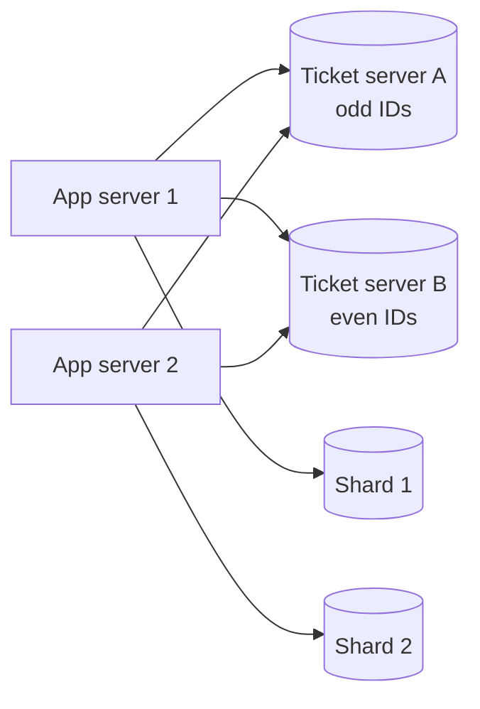
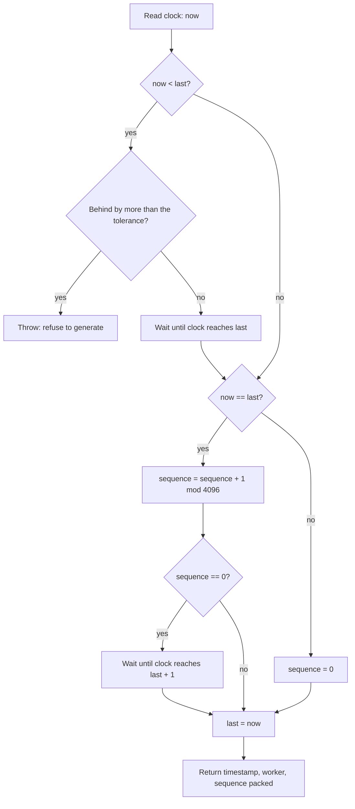

# Unique ID Generation

A unique ID generator gives every new record, message, or event an identifier that no other record has. This page covers the requirements for IDs, the UUID versions in RFC 9562, database counters and ticket servers, the Snowflake layout with a runnable Java generator that handles clock skew, ULID, index locality, and the collision math for random IDs.

## Why It Matters

"Design a URL shortener", "design a chat system", and "design a news feed" all contain the question "how do you generate the ID?". The interviewer checks whether you know that a single database counter stops scaling, that random UUIDs hurt index locality, and that a time-based ID depends on a clock that can move backwards. On the job, the ID format is one of the decisions that you cannot change later: every database, API, log line, and URL carries it. Twitter grew its tweet ID from a smaller size once and described the effort as painful, because over 100 000 code bases used the ID (Twitter, 2010).

## Core Concepts

**Identifier (ID)**: a value that names one entity. A *primary key* is the ID that a database uses to find a row.

**Uniqueness**: no two entities get the same ID. *Global uniqueness* holds across all machines and all time. *Local uniqueness* holds inside one database or one application. RFC 9562, section 6.8, says that you can provide local uniqueness without a shared registry, and that true global uniqueness needs shared knowledge. In practice, a scheme with enough random bits or an assigned node ID gives global uniqueness for all practical purposes.

**Coordination**: communication between machines that generate IDs, for example a call to a central counter. A *coordination-free* (or *uncoordinated*) generator needs no communication at ID generation time. Coordination limits availability and throughput.

**Sortable ID**: an ID whose order matches the order of creation. A *time-ordered* ID puts a timestamp in its most significant bits. A *k-sortable* (or *roughly sortable*) ID is sorted within a bound: IDs created within *k* time units of each other are within *k* positions of each other. Twitter targeted a *k* below one second for Snowflake.

**Monotonic ID**: an ID that is larger than every ID that the same generator produced before. Monotonic is stronger than k-sortable. A time-based generator is monotonic only if it handles a clock that moves backwards and handles many IDs in one tick.

**Index locality**: the property that rows created together get keys that are close together, so that inserts go to the same few pages of an index. Sequential and time-ordered keys have locality. Random keys do not.

**Birthday bound**: the number of random values that you need to draw from a space of size `N` before two values are equal with a given probability. The probability of at least one collision after `n` draws is about `1 - exp(-n^2 / (2N))`.

**Epoch (custom epoch)**: the zero point of a timestamp field. A custom epoch that is close to the launch date of the system saves bits, because the field counts from a recent date and not from 1970.

**Clock skew and clock drift**: *skew* is the difference between two machines' clocks at one moment. *Drift* is the rate at which one clock gains or loses time. A time synchronization protocol such as NTP corrects the clock, and a correction can move the clock backwards. Details live in `kb/hld/distributed-systems/01-failures-and-time.md`.

### Requirements for IDs

State these requirements in an interview before you choose a scheme. Each requirement removes some schemes.

| Requirement | Question to ask | What it rules out |
|---|---|---|
| Uniqueness | Unique per table, per service, or worldwide? | A per-database counter, if records move between databases |
| Coordination | May the generator call another machine for each ID? | A central counter, if the generator must work during a network partition |
| Size | 32 bits, 64 bits, or 128 bits? | UUIDs (128 bits) in systems with 64-bit ID fields in clients, queues, or storage |
| Ordering | Must IDs sort by creation time? Strictly or roughly? | UUID version 4, random 64-bit values |
| Density | May the sequence have gaps? | Nothing: all schemes here have gaps, except a single transactional counter that never rolls back |
| Guessability | May a user guess the next ID? | Plain counters in public URLs (an enumeration attack) |
| Information leak | May the ID reveal creation time, volume, or the host? | Counters (volume), Snowflake (time, worker), UUID version 1 (MAC address) |
| Throughput | How many IDs per second, in total and per node? | A scheme with one database write per ID, when the rate exceeds what one database can write |
| Human use | Does a person read or type the ID? | Long numeric IDs and 36-character UUIDs. Use a short Base62 or Base32 code |
| Index behavior | Is the ID a primary key in a B-tree index? | Random IDs, when the table is larger than memory |

Assumption: the rest of this page assumes a system that must generate IDs on many machines, with no call to a central service at generation time, and that stores the IDs in a B-tree index.

## How It Works

### Database Auto-Increment

The database owns a counter. `AUTO_INCREMENT` in MySQL and `GENERATED ... AS IDENTITY` or `SERIAL` in PostgreSQL hand out the next value on each insert.

Properties:

- **Dense and small.** A 32-bit signed integer holds 2 147 483 647 values. A 64-bit signed integer (`BIGINT`) holds about 9.2 x 10^18.
- **Perfect locality.** Each insert goes to the right-most page of the primary key index.
- **Gaps exist.** A rolled-back transaction keeps the value that it took. PostgreSQL documents that sequence values are not returned to the sequence on rollback. InnoDB documents gaps for rolled-back inserts and for failed statements as well.
- **One counter per table and per database.** Two shards each count `1, 2, 3, ...`, so the same ID appears in both shards. A row that moves from one shard to another can collide.
- **The write leader owns the counter.** All inserts go through one machine. Replicas cannot generate IDs. A multi-leader setup (see [replication](05-replication.md)) creates the same ID on two leaders unless each leader uses its own range.
- **Guessable.** The ID reveals the number of rows and lets a user enumerate records.

Two standard workarounds exist. The first gives each shard its own residue class: with `N` shards, shard `k` uses `auto_increment_increment = N` and `auto_increment_offset = k`. This breaks when you add shards, because `N` changes. The second asks a service for ranges (see below).

### Ticket Servers (Flickr)

A **ticket server** is a dedicated database whose only job is to hand out IDs. Flickr described the design in 2010. It exists because Flickr shards its data across many MySQL servers, and MySQL auto-increment cannot guarantee uniqueness across databases.

The ticket server has one table with one row:

<!-- sql-skip: mysql -->

```sql
CREATE TABLE Tickets64 (
  id   BIGINT UNSIGNED NOT NULL AUTO_INCREMENT,
  stub CHAR(1)         NOT NULL DEFAULT '',
  PRIMARY KEY (id),
  UNIQUE KEY stub (stub)
) ENGINE = InnoDB;
```

A client takes a new ID with two statements on the same connection (MySQL syntax, so SQLite does not run them):

<!-- sql-skip: mysql -->

```sql
REPLACE INTO Tickets64 (stub) VALUES ('a');
SELECT LAST_INSERT_ID();
```

`REPLACE` deletes the old row with the same unique `stub` and inserts a new one, so the table keeps one row, and the auto-increment counter moves forward. `LAST_INSERT_ID()` returns the value for the current connection, so concurrent clients do not see each other's values.

To remove the single point of failure, Flickr runs two ticket servers. One hands out odd IDs and the other hands out even IDs: `auto-increment-increment = 2` on both, with `auto-increment-offset = 1` and `2`. Clients alternate between the servers and use the other server if one is down. The two servers drift apart in count (Flickr reports a difference of a few hundred thousand), which "hurts no one".



| Aspect | Ticket server |
|---|---|
| Uniqueness | Global, by construction |
| Size | 64 bits |
| Ordering | Roughly sequential. The two servers differ in count, so the order across servers is only approximate |
| Coordination | One network call per ID. The call is cheap, but it is a dependency |
| Availability | Two servers survive the loss of one. Losing both stops ID generation |
| Throughput | The limit of one MySQL server doing one write per ID |
| Failure behavior | After a failover, the counter must not go back. Gaps are acceptable, repeats are not |

**Batching** (also called *range allocation* or the *hi/lo scheme*) removes the per-ID network call. An application server asks the ticket server for a block of, say, 1 000 IDs (the server advances its counter by 1 000), then hands out the IDs from memory. If the application server crashes, the unused IDs in its block are lost, which creates gaps and is harmless. The throughput of the ticket server rises by the block size. Assumption: the application accepts that IDs from different servers interleave in blocks, so the IDs are k-sortable only to the size of the block.

Flickr's reasons to reject the alternatives are worth quoting in an interview: UUIDs are big and index badly in MySQL, and the sequential ID gives Flickr easier reporting and debugging.

### UUID

A **UUID** (universally unique identifier) is a 128-bit identifier. RFC 9562 (2024) defines it and replaces RFC 4122. The text form has 36 characters: 32 hexadecimal digits in five groups, for example `f81d4fae-7dec-11d0-a765-00a0c91e6bf6`. The binary form takes 16 bytes. RFC 9562, section 6.13, recommends that databases store the 128-bit binary value, because the text form needs 288 bits in the RFC's count.

Two fields give the layout. The 4-bit **version** field sits in the most significant bits of byte 6 (bits 48 to 51). The 2-bit **variant** field sits in the most significant bits of byte 8 and is `10` for all UUIDs in the RFC. Because these 6 bits are fixed, a random UUID has 122 random bits.

| Version | Source of uniqueness | Sortable by time | Notes |
|---|---|---|---|
| 1 | 60-bit timestamp (100 ns ticks since 15 October 1582), 14-bit clock sequence, 48-bit node (usually a MAC address) | Not as stored. The low part of the timestamp comes first | Leaks the host and the time. The clock sequence handles a clock that moves back |
| 2 | DCE Security, with embedded POSIX UIDs | Not specified in RFC 9562 | The RFC only reserves it |
| 3 | MD5 hash of a namespace and a name | No | Name-based. The same input always gives the same UUID |
| 4 | 122 random bits | No | The most common version. `UUID.randomUUID()` in Java produces it |
| 5 | SHA-1 hash of a namespace and a name | No | Name-based. Prefer it to version 3 |
| 6 | The version 1 timestamp, reordered so that the most significant bits come first | Yes | For systems that already use version 1. The RFC says to prefer version 7 for new systems |
| 7 | 48-bit Unix timestamp in milliseconds, then 74 bits for sub-millisecond precision, a counter, or random data | Yes | The recommended time-ordered version. Needs no MAC address |
| 8 | Custom. Only the version and variant bits are fixed | Your choice | For vendor-specific layouts, for example an embedded node ID |

Notes on the table:

- Version 1 and 6 timestamps cover until the year 5623, and the version 7 timestamp covers until the year 10889, according to RFC 9562, section 6.1.
- RFC 9562, section 5.7, says that implementations "SHOULD utilize UUIDv7 instead of UUIDv1 and UUIDv6 if possible".
- Name-based versions (3 and 5) are not for primary keys. The RFC warns that a "name" that looks permanent, for example a postal code, can change.

**Version 7 layout** (RFC 9562, figure 11):

```text
  0                   1                   2                   3
  0 1 2 3 4 5 6 7 8 9 0 1 2 3 4 5 6 7 8 9 0 1 2 3 4 5 6 7 8 9 0 1
 +-+-+-+-+-+-+-+-+-+-+-+-+-+-+-+-+-+-+-+-+-+-+-+-+-+-+-+-+-+-+-+-+
 |                         unix_ts_ms (high 32 bits)             |
 +-+-+-+-+-+-+-+-+-+-+-+-+-+-+-+-+-+-+-+-+-+-+-+-+-+-+-+-+-+-+-+-+
 |    unix_ts_ms (low 16)        |  ver  |       rand_a (12)     |
 +-+-+-+-+-+-+-+-+-+-+-+-+-+-+-+-+-+-+-+-+-+-+-+-+-+-+-+-+-+-+-+-+
 |var|                       rand_b (62 bits)                    |
 +-+-+-+-+-+-+-+-+-+-+-+-+-+-+-+-+-+-+-+-+-+-+-+-+-+-+-+-+-+-+-+-+
 |                            rand_b                             |
 +-+-+-+-+-+-+-+-+-+-+-+-+-+-+-+-+-+-+-+-+-+-+-+-+-+-+-+-+-+-+-+-+
```

**Monotonicity inside one millisecond.** Version 7 puts a millisecond timestamp first, so two UUIDs from different milliseconds sort correctly. Two UUIDs from the same millisecond have random low bits and sort in random order. RFC 9562, section 6.2, gives three methods to fix this inside one generator:

1. A fixed-length counter in `rand_a` (and the top bits of `rand_b` if more bits are needed).
2. A *monotonic random* counter: a random start value in `rand_b`, incremented by a random positive number for each new UUID in the same millisecond. An increment of 1 is guessable, so the RFC advises against it where unguessability matters.
3. More clock precision: use up to 12 bits of sub-millisecond time in `rand_a`.

**Distributed generation.** RFC 9562, section 6.4, names two ways to reduce collisions across many nodes: a pseudorandom node ID in the layout (use version 8 for a custom layout, and do not use a MAC address), or a central registry. The RFC marks the registry as NOT RECOMMENDED, because it becomes a bottleneck. It also states that implementations should use a cryptographically secure random number generator (section 6.9), and that an overrun of the generator inside one tick must either return an error or wait, and must not return duplicates (section 6.1, "Error Handling").

**Java.** The JDK 21 class `java.util.UUID` generates versions 3 (`nameUUIDFromBytes`) and 4 (`randomUUID`) only. A version 7 generator needs a library or about ten lines of code, as the second Java example shows. PostgreSQL 18 has a built-in `uuidv7()` function.

### Snowflake

**Snowflake** is the ID scheme that Twitter announced on 1 June 2010 and published as open source. It composes a 64-bit ID from a timestamp, a worker number, and a sequence number, so that every machine generates IDs with no coordination.

Twitter's requirements, from the announcement and the repository README:

- Tens of thousands of IDs per second per process (the README states a minimum of 10 000 IDs per second per process).
- No coordination between ID-generating machines, for availability.
- Roughly sortable: tweets posted around the same time have IDs close together. Twitter promised k-sorted IDs within one second and aimed for tens of milliseconds.
- Directly sortable, so that a client can sort without loading the records.
- 64 bits, because a larger ID breaks clients, and "all the schemes we could find" for UUIDs "required 128 bits".

Twitter rejected MySQL ticket servers (they did not give the needed ordering without a re-sync routine) and ZooKeeper sequential nodes (the performance was not enough, and the coordination would lower availability).

**Layout.** The README gives this split:

```text
 63  62                       22 21        12 11            0
+----+---------------------------+-----------+---------------+
| 0  |  timestamp (41 bits)      | worker    | sequence      |
|    |  ms since custom epoch    | (10 bits) | (12 bits)     |
+----+---------------------------+-----------+---------------+
 sign  2^41 ms = about 69.7 years   1024 ids    4096 ids per ms
```

| Field | Bits | Range | What it means |
|---|---|---|---|
| Sign | 1 | 0 | Unused, so that the ID is a positive signed `long` |
| Timestamp | 41 | 0 to 2^41 - 1 ms | Milliseconds since a custom epoch. 2^41 ms is about 69.7 years |
| Worker | 10 | 0 to 1 023 | The machine ID. The original code splits it into 5 bits for the data center and 5 bits for the worker |
| Sequence | 12 | 0 to 4 095 | A counter within one millisecond on one worker |

Calculations:

- Lifetime: 2^41 ms = 2 199 023 255 552 ms. Divide by 31 557 600 000 ms per Julian year (1000 x 60 x 60 x 24 x 365.25) to get about 69.7 years from the epoch. Twitter's epoch in the code is 1 288 834 974 657 ms (4 November 2010, 01:42:54.657 UTC).
- Rate per worker: 4 096 IDs per millisecond is 4 096 000 IDs per second.
- Rate for the fleet: 1 024 workers times 4 096 000 gives about 4.19 x 10^9 IDs per second.

**Generation algorithm** for one worker, with the lock held:

1. Read the clock: `now`.
2. If `now < last`, the clock moved backwards. Apply the clock policy (next section).
3. If `now == last`, increment `sequence` modulo 4 096. If it wrapped to 0, the millisecond is full. Wait until the clock reaches `last + 1`.
4. If `now > last`, set `sequence = 0`.
5. Set `last = now`.
6. Return `((now - epoch) << 22) | (worker << 12) | sequence`.



**Assigning worker IDs.** Two live workers with the same worker ID can generate the same ID in the same millisecond. The scheme is only as unique as the worker assignment. Options:

| Method | How | Risk |
|---|---|---|
| Static configuration | An operator sets the ID per host or per pod | A copy-paste error creates duplicates. Autoscaling needs automation |
| Coordination service lease | The process claims a number in ZooKeeper or etcd at startup and renews it as a lease (Twitter chose the worker number at startup through ZooKeeper, which a config file can override) | A paused process can keep generating after its lease expires. See `kb/hld/distributed-systems/05-distributed-locks-and-leases.md` |
| Database table | A row per worker with a heartbeat | The database becomes a startup dependency |
| Derived from the network address | Use bits of the private IP address | Two environments can share an address. Containers reuse addresses |

Recommendation: claim the worker ID from a coordination service at startup with a lease. Generate IDs only while the lease is valid. Stop on a lease loss.

**What about the sequence reset?** The sequence restarts at 0 in each new millisecond (the Twitter code does the same). A worker that generates one ID per millisecond always produces sequence 0. If the system routes records by `id % number_of_shards`, the shards that match the low sequence values get all the traffic. Fix: start each millisecond with a random sequence value (with a wrap check), or shard on a hash of the ID, not on the ID itself.

### Clock Skew Handling

Snowflake depends on the wall clock, and the wall clock can move backwards: an NTP step correction, a virtual machine that resumes after a pause, a manual change, or a leap second handled with a step. If the clock moves back, the generator can issue a timestamp that it issued before. The same timestamp with the same worker and sequence produces a duplicate ID.

What Twitter did (README, "System Clock Dependency"): "Snowflake protects from non-monotonic clocks... snowflake will refuse to generate ids until a time that is after the last time we generated an id." The code logs an error and rejects requests when the clock is behind. The README also advises to run NTP in a mode that does not move the clock backwards (a *slew*, which changes the clock rate, and not a *step*, which jumps).

A production policy has three parts:

| Situation | Action | Reason |
|---|---|---|
| The clock is behind `last` by at most a small tolerance (for example 5 ms) | Wait until the clock reaches `last`, then continue | The wait is short and keeps IDs unique and monotonic |
| The clock is behind by more than the tolerance | Throw an error. The caller retries on another worker, or the load balancer removes the node | A long wait blocks the thread and hides a problem |
| The process restarts, and the clock is behind the last ID before the restart | Persist the last timestamp (for example every second, with a safety margin) and refuse to start before it | The in-memory `last` is gone after a restart |

Other options exist, each with a cost:

- **Use the monotonic clock for elapsed time.** `System.nanoTime()` never goes backwards in one JVM, so you can compute `wall_clock_at_start + elapsed_monotonic`. The ID stays monotonic inside one process. It drifts away from real time, and after a restart the base is a new wall-clock reading, so the persistence rule still applies.
- **Spend spare bits.** Reserve 1 or 2 bits as a *clock-epoch counter* that you increment on each backward move. IDs after a rewind differ from IDs before it. This reduces capacity.
- **Use a logical clock.** Never let the timestamp field go below `last`. Keep the old timestamp and keep increasing the sequence, and borrow capacity from the future. If the sequence overflows, move the timestamp forward by 1 ms. IDs then run ahead of real time until the clock catches up.

Clock skew between machines does not break uniqueness (the worker IDs differ), but it affects ordering: IDs from two workers sort by their own clocks, so the order is only as good as the time synchronization (typically some milliseconds with NTP, approximate; see `kb/hld/distributed-systems/01-failures-and-time.md`). Never use Snowflake order as a strict causal order.

### ULID

A **ULID** (universally unique lexicographically sortable identifier) is a 128-bit ID that is time-ordered and has a 26-character text form. The specification lives at `github.com/ulid/spec`.

- **Timestamp:** 48 bits, Unix time in milliseconds. It does not run out of space until the year 10889.
- **Randomness:** 80 bits, from a cryptographically secure source when possible.
- **Encoding:** Crockford's Base32, 5 bits per character: 10 characters for the timestamp and 16 for the randomness. The alphabet is `0123456789ABCDEFGHJKMNPQRSTVWXYZ`, which leaves out `I`, `L`, `O`, and `U`. The encoding is case-insensitive and URL-safe.
- **Sorting:** a string comparison of two ULIDs sorts by time. Inside one millisecond, the order is not guaranteed unless the generator uses the monotonic mode.
- **Monotonic mode:** if the generator sees the same millisecond, it increments the random part by 1 in the least significant bit, with carry. If the random part overflows, generation fails. The spec says that more than 2^80 ULIDs in one millisecond is needed to overflow in the ordinary case.
- **Example:** `01ARZ3NDEKTSV4RRFFQ69G5FAV`.

ULID versus UUID version 7: both put a 48-bit millisecond Unix timestamp first and then random bits. A version 7 UUID has 74 usable random or counter bits and fits the UUID type of the database and its tools. A ULID has 80 random bits and a shorter, sortable text form. The binary sizes are equal (128 bits). Recommendation: use version 7 when a database has a native `uuid` type, because the tools and drivers understand it. Use ULID when people read the ID in URLs or logs and you need a compact, case-insensitive text form.

### Index Locality and k-Sortable IDs

A B-tree index keeps keys in sorted order in pages. See `kb/databases/03-indexing.md` for the structure.

- **Sequential or time-ordered keys** (counter, Snowflake, UUID version 7, ULID) insert at the right-most leaf. The hot pages stay in memory. Pages fill completely before they split. The index is compact.
- **Random keys** (UUID version 4) insert into a random leaf. If the index is larger than the buffer pool, many inserts need a disk read to load the leaf. Splits happen all over the index and leave pages about half full. In PostgreSQL, the first change to a page after a checkpoint writes a full-page image to the write-ahead log, so random inserts also increase the log volume.
- **Clustered tables.** InnoDB stores the table rows inside the primary key index, so a random primary key scatters the rows. Every secondary index entry also contains the primary key value, so a 16-byte key makes all secondary indexes larger than an 8-byte key does. Flickr gave this as a reason to avoid GUIDs.
- **LSM-based stores** (see `kb/databases/06-storage-engines.md`) have less insert penalty from random keys, because writes go to a memory table first. Flickr noted that a random scheme fits write-cheap stores better than MySQL.

A time-ordered key has a cost: all new writes land in one key range. In a range-partitioned store (HBase, Bigtable, or a range-sharded SQL database) the newest partition receives all the write traffic, which is a hot spot (see [partitioning and sharding](06-partitioning-and-sharding.md)). Fix: hash-prefix the key, use a salt, or hash-partition on the ID. A time-ordered ID is a good primary key, and a poor partition key for range partitioning.

Time-ordered IDs also leak information: the creation time of a record, and for counters and Snowflake IDs, the volume of records. If this matters, expose an opaque public ID (a random token, or an encrypted form of the internal ID) and keep the time-ordered ID inside.

### Collision Probability for Random IDs

For `n` random values drawn from `N` possible values, the probability of at least one collision is about:

```text
p(n, N) = 1 - exp(-n^2 / (2N))        (the birthday approximation, when n is much less than N)
n at p = 0.5  ~  sqrt(2 ln 2 x N)  =  1.1774 x sqrt(N)
```

For a version 4 UUID, `N = 2^122` (about 5.3 x 10^36), so `sqrt(N) = 2^61` (about 2.3 x 10^18). The 50 percent point is about 2.7 x 10^18 UUIDs. At one billion UUIDs per second, that takes about 86 years. The second Java example computes these values.

| IDs generated (`n`) | p(collision), 122 random bits (version 4) | p(collision), 64 random bits |
|---|---|---|
| 10^9 | 9.4 x 10^-20 | 2.7 x 10^-2 |
| 10^12 | 9.4 x 10^-14 | about 1 |
| 10^15 | 9.4 x 10^-8 | about 1 |
| 2.71 x 10^18 | 0.5 | about 1 |

Read the table this way: random 122-bit IDs are safe for any realistic volume, as long as the random source is good. Random 64-bit IDs are not: a billion IDs already give a 2.7 percent chance of a collision. The numbers assume a uniform and independent source. A weak or badly seeded generator (a cloned virtual machine that restarts with the same seed, or a `java.util.Random` seeded with the time) breaks the assumption, and that failure is far more likely than the mathematical collision. RFC 9562, section 6.9, says implementations should use a cryptographically secure random number generator and reseed it after a process fork.

For a time-ordered ID, the random part only has to be unique within one millisecond (version 7 with 74 bits) or within the worker's sequence. This makes the collision probability much lower than for version 4 at the same total size.

## Trade-offs and When to Use

| Scheme | Size | Coordination | Sortable | Throughput | Leaks | Main weakness | Use when |
|---|---|---|---|---|---|---|---|
| Database auto-increment | 32 or 64 bits | The one database | Strictly | Limited by the leader | Volume, guessable | One counter per database. Breaks with sharding or multiple leaders | One database, one leader, small system |
| Ticket server pair | 64 bits | One call per ID (or per block) | Roughly | Limited by one MySQL write per ID. Blocks raise it | Volume | A dependency. Odd/even drift | Sharded MySQL, need 64-bit sequential IDs |
| UUID version 4 | 128 bits | None | No | Unlimited | Nothing | Poor index locality. Large | Public tokens, rows in small tables, merging data from many sources |
| UUID version 7 | 128 bits | None | Yes, per millisecond (monotonic with counter) | Unlimited | Creation time | Needs a library before JDK support. Time leak | Default primary key for a distributed system that stores 128-bit values |
| Snowflake | 64 bits | Worker ID assignment only | Roughly (within clock skew) | 4 096 000 per second per worker | Time, worker | Clock dependency. Worker ID management | 64-bit sortable IDs at high volume |
| ULID | 128 bits (26 characters) | None | Yes | Unlimited | Creation time | Not a native database type | Sortable, human-readable text IDs |
| Hash of content or name (UUID 5) | 128 bits | None | No | Unlimited | Nothing, but guessable if the input is | The same input gives the same ID. Not for mutable keys | Deduplication, idempotent imports |
| Random 64-bit | 64 bits | None | No | Unlimited | Nothing | Collisions at about 4 x 10^9 IDs (birthday) | Do not use it at scale |

How to choose, as a sequence of questions:

1. One database and no plan to shard? Use the database counter.
2. Must the ID fit in 64 bits (clients, queues, or a legacy schema)? Use Snowflake (no per-ID network call) or a ticket server with blocks (if you already run MySQL and prefer a simple service).
3. Is 128 bits acceptable? Use UUID version 7 as the primary key.
4. Is the ID public, and must it be unguessable? Use version 4 or a random token as the public ID, and keep a time-ordered internal key.
5. Must the same input always give the same ID? Use a name-based UUID (version 5) or a hash.

For a URL shortener, the ID becomes a short code (see `kb/hld/case-studies/01-url-shortener.md`). A 7-character Base62 code holds 62^7 = 3 521 614 606 208 (about 3.5 x 10^12) values. A counter or a range allocator, encoded in Base62, gives dense short codes. A random 7-character code needs a collision check on insert.

## Java Example

### A Snowflake-style generator with an injected clock

The program below is a complete Snowflake-style generator. The generator reads time through the `MillisClock` interface, so the demo controls the clock: it moves the clock back by 3 ms (the generator waits), moves it back by 50 ms (the generator refuses), and fills the 4 096-value sequence inside one millisecond (the generator waits for the next millisecond). The last part runs four threads against one generator and checks that all IDs are unique and that each thread saw increasing IDs.

```java
import java.util.ArrayList;
import java.util.HashSet;
import java.util.List;
import java.util.Set;
import java.util.concurrent.atomic.AtomicLong;

public class Main {
    public static void main(String[] args) throws Exception {
        long start = SnowflakeGenerator.EPOCH + 1_000_000L;
        ManualClock clock = new ManualClock(start);
        SnowflakeGenerator gen = new SnowflakeGenerator(7, clock);

        System.out.println("-- same millisecond, then the next millisecond");
        long a = gen.nextId();
        long b = gen.nextId();
        clock.advance(1);
        long c = gen.nextId();
        for (long id : new long[] {a, b, c}) {
            System.out.println(id + " -> " + SnowflakeGenerator.describe(id));
        }

        System.out.println("-- sequence exhausted inside one millisecond");
        long before = clock.now();
        long last = 0;
        for (int i = 0; i < 4096; i++) {
            last = gen.nextId();
        }
        System.out.println("clock advanced by " + (clock.now() - before) + " ms");
        System.out.println(SnowflakeGenerator.describe(last));

        System.out.println("-- clock moves back 3 ms (within tolerance)");
        long lastTs = clock.now();
        clock.advance(-3);
        long d = gen.nextId();
        System.out.println("waited, clock is " + (clock.now() - lastTs) + " ms from last stamp");
        System.out.println(SnowflakeGenerator.describe(d));

        System.out.println("-- clock moves back 50 ms (over tolerance)");
        clock.advance(-50);
        try {
            gen.nextId();
        } catch (ClockMovedBackwardsException e) {
            System.out.println("rejected: " + e.getMessage());
        }
        clock.advance(50);

        System.out.println("-- two workers, same millisecond");
        SnowflakeGenerator other = new SnowflakeGenerator(8, clock);
        clock.advance(10);
        long w7 = gen.nextId();
        long w8 = other.nextId();
        System.out.println(SnowflakeGenerator.describe(w7));
        System.out.println(SnowflakeGenerator.describe(w8));

        System.out.println("-- four threads, 10000 ids each");
        List<Long> all = new ArrayList<>();
        List<Thread> threads = new ArrayList<>();
        SnowflakeGenerator shared = new SnowflakeGenerator(1, clock);
        List<List<Long>> parts = new ArrayList<>();
        for (int t = 0; t < 4; t++) {
            List<Long> part = new ArrayList<>();
            parts.add(part);
            Thread th = new Thread(() -> {
                for (int i = 0; i < 10_000; i++) {
                    part.add(shared.nextId());
                }
            });
            threads.add(th);
            th.start();
        }
        for (Thread th : threads) {
            th.join();
        }
        for (List<Long> part : parts) {
            all.addAll(part);
        }
        Set<Long> unique = new HashSet<>(all);
        boolean eachThreadIncreasing = true;
        for (List<Long> part : parts) {
            for (int i = 1; i < part.size(); i++) {
                if (part.get(i) <= part.get(i - 1)) {
                    eachThreadIncreasing = false;
                }
            }
        }
        System.out.println("generated=" + all.size() + " unique=" + unique.size());
        System.out.println("each thread saw increasing ids: " + eachThreadIncreasing);
    }
}

/** Time source that the generator reads. Tests replace it. */
interface MillisClock {
    long now();

    /** Blocks until the clock may have moved by about one millisecond. */
    void pause();
}

class ManualClock implements MillisClock {
    private final AtomicLong millis;

    ManualClock(long start) {
        this.millis = new AtomicLong(start);
    }

    public long now() {
        return millis.get();
    }

    public void pause() {
        millis.incrementAndGet();
    }

    void advance(long delta) {
        millis.addAndGet(delta);
    }
}

class ClockMovedBackwardsException extends RuntimeException {
    ClockMovedBackwardsException(String message) {
        super(message);
    }
}

class SnowflakeGenerator {
    static final long EPOCH = 1288834974657L; // Twitter's custom epoch, in Unix milliseconds
    static final int WORKER_BITS = 10;
    static final int SEQUENCE_BITS = 12;
    static final long MAX_WORKER = (1L << WORKER_BITS) - 1;
    static final long SEQUENCE_MASK = (1L << SEQUENCE_BITS) - 1;
    static final long MAX_BACKWARD_WAIT_MS = 5;

    private final long workerId;
    private final MillisClock clock;
    private long lastTimestamp = -1;
    private long sequence = 0;

    SnowflakeGenerator(long workerId, MillisClock clock) {
        if (workerId < 0 || workerId > MAX_WORKER) {
            throw new IllegalArgumentException("worker id must be in 0.." + MAX_WORKER);
        }
        this.workerId = workerId;
        this.clock = clock;
    }

    synchronized long nextId() {
        long now = clock.now();
        if (now < lastTimestamp) {
            long drift = lastTimestamp - now;
            if (drift > MAX_BACKWARD_WAIT_MS) {
                throw new ClockMovedBackwardsException(
                        "clock is " + drift + " ms behind the last id");
            }
            now = waitUntilAtLeast(lastTimestamp);
        }
        if (now == lastTimestamp) {
            sequence = (sequence + 1) & SEQUENCE_MASK;
            if (sequence == 0) {
                now = waitUntilAtLeast(lastTimestamp + 1);
            }
        } else {
            sequence = 0;
        }
        lastTimestamp = now;
        return ((now - EPOCH) << (WORKER_BITS + SEQUENCE_BITS))
                | (workerId << SEQUENCE_BITS)
                | sequence;
    }

    private long waitUntilAtLeast(long target) {
        long now = clock.now();
        while (now < target) {
            clock.pause();
            now = clock.now();
        }
        return now;
    }

    static String describe(long id) {
        long offset = id >>> (WORKER_BITS + SEQUENCE_BITS);
        long worker = (id >>> SEQUENCE_BITS) & MAX_WORKER;
        long seq = id & SEQUENCE_MASK;
        return "offset=" + offset + " worker=" + worker + " sequence=" + seq;
    }
}
```

The output is deterministic, because the demo clock and the sequence of calls fix every value. The decoded `offset` is the timestamp in milliseconds since the Twitter epoch.

<!-- expected-output -->

```text
-- same millisecond, then the next millisecond
4194304028672 -> offset=1000000 worker=7 sequence=0
4194304028673 -> offset=1000000 worker=7 sequence=1
4194308222976 -> offset=1000001 worker=7 sequence=0
-- sequence exhausted inside one millisecond
clock advanced by 1 ms
offset=1000002 worker=7 sequence=0
-- clock moves back 3 ms (within tolerance)
waited, clock is 0 ms from last stamp
offset=1000002 worker=7 sequence=1
-- clock moves back 50 ms (over tolerance)
rejected: clock is 50 ms behind the last id
-- two workers, same millisecond
offset=1000012 worker=7 sequence=0
offset=1000012 worker=8 sequence=0
-- four threads, 10000 ids each
generated=40000 unique=40000
each thread saw increasing ids: true
```

Points to read in the code:

- `nextId` is `synchronized`. One generator serves many threads, and the state (`lastTimestamp`, `sequence`) changes together. A lock-free version needs a single atomic that packs the timestamp and the sequence.
- `waitUntilAtLeast` is the clock policy in one place. The real clock implements `pause()` with `Thread.sleep(1)`, and the test clock advances itself by 1 ms.
- The tolerance `MAX_BACKWARD_WAIT_MS` separates a short wait from a refusal.
- The code does not persist `lastTimestamp`. A production generator must (see the clock skew section).

### UUID version 7 by hand and the birthday bound

The second program builds a version 7 UUID from a timestamp and two random longs, shows the version and variant fields, and prints the collision probabilities from the table above. It uses a fixed timestamp and a fixed seed so that the output repeats. Production code takes the time from the clock and the random values from `SecureRandom`.

```java
import java.util.Random;
import java.util.UUID;

public class Main {
    public static void main(String[] args) {
        // Part 1: build a version 7 UUID by hand (RFC 9562, section 5.7).
        long unixMillis = 1_760_000_000_000L; // fixed, so the output is repeatable
        Random random = new Random(42);       // fixed seed. Production code uses SecureRandom.
        UUID id = uuidV7(unixMillis, random.nextLong(), random.nextLong());
        System.out.println("uuid    = " + id);
        System.out.println("version = " + id.version() + ", variant = " + id.variant());
        long embedded = id.getMostSignificantBits() >>> 16;
        System.out.println("embedded millis = " + embedded);
        UUID later = uuidV7(unixMillis + 1, random.nextLong(), random.nextLong());
        boolean sorted = later.toString().compareTo(id.toString()) > 0;
        System.out.println("later id sorts after: " + sorted);

        // Part 2: birthday bound for random IDs. p ~ 1 - exp(-n^2 / (2 * space)).
        double space122 = Math.pow(2, 122); // random bits in a version 4 UUID
        double space64 = Math.pow(2, 64);
        double[] counts = {1e9, 1e12, 1e15, 2.71e18};
        for (double n : counts) {
            System.out.printf("n=%.2e  p(v4 UUID collision)=%.3e  p(64-bit random)=%.3e%n",
                    n, collision(n, space122), collision(n, space64));
        }
        double half = Math.sqrt(2 * Math.log(2) * space122);
        System.out.printf("50 percent point for 122 random bits: %.3e ids%n", half);
        double years = half / 1e9 / (365.25 * 24 * 3600);
        System.out.printf("at 1e9 ids per second that takes %.1f years%n", years);
    }

    static UUID uuidV7(long unixMillis, long randomA, long randomB) {
        long msb = (unixMillis << 16)           // 48 bits of timestamp
                | 0x7000L                       // version 7 in bits 48..51
                | (randomA & 0x0FFFL);          // 12 random bits (rand_a)
        long lsb = (randomB & 0x3FFFFFFFFFFFFFFFL) // 62 random bits (rand_b)
                | 0x8000000000000000L;          // variant bits 10
        return new UUID(msb, lsb);
    }

    static double collision(double n, double space) {
        return -Math.expm1(-n * n / (2 * space));
    }
}
```

<!-- expected-output -->

```text
uuid    = 0199c82c-c000-7af7-aee7-bbe10c45c028
version = 7, variant = 2
embedded millis = 1760000000000
later id sorts after: true
n=1.00e+09  p(v4 UUID collision)=9.404e-20  p(64-bit random)=2.674e-02
n=1.00e+12  p(v4 UUID collision)=9.404e-14  p(64-bit random)=1.000e+00
n=1.00e+15  p(v4 UUID collision)=9.404e-08  p(64-bit random)=1.000e+00
n=2.71e+18  p(v4 UUID collision)=4.987e-01  p(64-bit random)=1.000e+00
50 percent point for 122 random bits: 2.715e+18 ids
at 1e9 ids per second that takes 86.0 years
```

## Interview Angle

### Questions

??? question "Design an ID generator for a system with many servers. Which scheme do you pick?"

    First I ask four things: must the ID fit in 64 bits, must it sort by time, may the generator call another service for each ID, and is the ID public.

    My default answer for a sharded system with 64-bit IDs is a Snowflake-style ID: 41 bits of milliseconds since a custom epoch, 10 bits of worker ID, and 12 bits of sequence. Each server generates IDs from memory with no network call. One worker makes up to 4 096 IDs per millisecond. The IDs are roughly sorted by time, and the primary key index stays compact because new keys go to the right-most page.

    The costs: the generator trusts the wall clock, so I need a policy for a clock that moves backwards, and I need to assign worker IDs without duplicates (a lease in ZooKeeper or etcd). If 128 bits are acceptable, I use a UUID version 7 instead, because it needs no worker assignment and the database has a native type for it.

??? question "Why not use UUID version 4 as the primary key?"

    A version 4 UUID is unique for any realistic volume (122 random bits), and it needs no coordination. The problem is index locality, not uniqueness.

    Random keys insert into random leaf pages of the B-tree. When the index is larger than memory, many inserts read a page from disk. Page splits leave pages about half full, so the index grows. In InnoDB the table is clustered on the primary key, so rows scatter, and every secondary index entry holds the 16-byte key, which makes all indexes larger. In PostgreSQL, random inserts also cause more full-page images in the write-ahead log after a checkpoint.

    I use version 4 for public tokens and for small tables. For a large table, I use UUID version 7 or a Snowflake ID, which put the timestamp first and so insert at the right edge of the index.

??? question "What is in a Snowflake ID, and how many IDs per second can one machine make?"

    64 bits: 1 unused sign bit, 41 bits of milliseconds since a custom epoch, 10 bits of worker ID, 12 bits of sequence.

    Capacity: the 12-bit sequence holds 4 096 values per millisecond, so one worker makes 4 096 000 IDs per second. The 10-bit worker field allows 1 024 workers, so the fleet makes about 4.19 x 10^9 IDs per second. The 41-bit timestamp lasts 2^41 ms, about 69.7 years from the epoch. Twitter's epoch is in November 2010, so the original layout lasts until about 2080.

    If a worker needs more than 4 096 IDs in one millisecond, it waits for the next millisecond. If I need more workers, I take bits from the timestamp or the sequence, or I use a larger ID.

??? question "What happens to a Snowflake generator when the clock moves backwards? How do you handle it?"

    The generator can issue a timestamp that it already issued. With the same worker ID and the same sequence, that produces a duplicate ID, which is a data-corruption bug.

    Twitter's implementation refuses to generate IDs until the clock passes the last timestamp. My policy has three rules. If the clock is behind by a few milliseconds (5 ms in my example), wait until it catches up. If it is behind by more, throw an error so the caller uses another worker or the load balancer removes the node. Across a restart, persist the last timestamp and refuse to start before it, because the in-memory value is gone.

    I also configure NTP to slew and not step the clock, because a step is what moves it back. Alternatives: keep the timestamp at the last value and let the sequence run ahead (borrowing from the future), or reserve a bit that flips on each rewind. Each costs capacity or accuracy.

??? question "How do you give each Snowflake worker a unique worker ID?"

    Two live workers with one worker ID can make the same ID, so the assignment must be unique at any moment.

    Options: static configuration (simple, but a copy error makes duplicates), a lease in ZooKeeper or etcd (the process claims a free number at startup and renews it; Twitter used ZooKeeper this way), a database table with heartbeats, or bits of the IP address (risky when containers reuse addresses).

    My choice is a lease. The process stops generating IDs if it loses the lease, because a paused process (a long garbage-collection pause or a suspended virtual machine) can wake up after another process took its number. A fencing check or a lease-validity check before each batch closes that gap.

??? question "Explain Flickr's ticket server. What are its good and bad points?"

    A ticket server is a dedicated MySQL database with a table that holds one row. A client runs `REPLACE INTO Tickets64 (stub) VALUES ('a')` and then `SELECT LAST_INSERT_ID()`. `REPLACE` deletes the old row and inserts a new one, so the table stays at one row and the auto-increment counter advances. Flickr runs two servers, one with odd IDs and one with even IDs, and alternates between them.

    Good: 64-bit, globally unique, almost sequential, very simple, and survives the loss of one server.

    Bad: one network call and one database write per ID, a new dependency in the write path, the two sequences drift apart, and the IDs reveal volume. I reduce the calls with range allocation: the application server takes a block of 1 000 IDs and hands them out from memory. A crash wastes the rest of the block, which is harmless.

??? question "UUID version 7 or ULID?"

    Both are 128 bits, both start with a 48-bit Unix millisecond timestamp, and both sort by time. The differences: a version 7 UUID is a standard UUID (RFC 9562) with 74 bits of random or counter data, and databases and drivers have a native `uuid` type. A ULID is a 26-character Crockford Base32 string with 80 random bits, case-insensitive and URL-safe.

    I pick version 7 when the database has a UUID type, because the binary form takes 16 bytes and tools understand it. I pick ULID when people see the ID in URLs or logs. Both need a monotonic mode to order IDs from the same millisecond.

??? question "How likely is a collision with random UUIDs? Show the math."

    A version 4 UUID has 122 random bits, so `N = 2^122`, about 5.3 x 10^36. The birthday approximation gives `p = 1 - exp(-n^2 / (2N))`. The 50 percent point is `n = sqrt(2 ln 2 x N)`, about 2.7 x 10^18 IDs. At one billion IDs per second, that takes about 86 years. For n = 10^12, p is about 9 x 10^-14.

    So the mathematical risk is negligible. The practical risk is a bad random source: a virtual machine that clones with the same seed, or a `Random` seeded with the clock. I use `SecureRandom` (RFC 9562 says to use a cryptographically secure generator), and I add a unique constraint on the key as the last defense. With 64 random bits the result is very different: 10^9 IDs already give about 2.7 percent.

??? question "How do you generate IDs for a URL shortener that needs 7-character codes?"

    A 7-character Base62 code gives 62^7, about 3.5 x 10^12 values. Two designs.

    Counter plus encoding: a range allocator (or a ticket server) hands out integers, and the application encodes the integer in Base62. Codes are dense and never collide, and no collision check is needed. The codes are guessable in order, so I can scramble the integer with a bijective function (for example a block cipher on the counter) before I encode it.

    Random codes: draw 7 random Base62 characters and insert with a unique constraint. Retry on a conflict. The conflict rate grows with the table size, so this works while the table holds far fewer than the 3.5 x 10^12 codes.

    I choose the counter for predictable behavior, and the random code when unguessability matters and the volume is modest.

??? question "Is a Snowflake ID safe to use as the exact order of events across machines?"

    No. Two workers use their own clocks. NTP keeps clocks within some milliseconds (approximate, and it depends on the network), but not equal. An event that happens after another on a second machine can get a smaller ID. Within one worker the IDs are monotonic.

    Snowflake gives k-sortable IDs: Twitter promised IDs within one second of real order. For a strict causal order, I need a logical clock, a version vector, or a single sequencer (a log partition). See `kb/hld/distributed-systems/01-failures-and-time.md`. I tell the interviewer which ordering the feature needs: "newest first" in a feed tolerates the skew, and "apply these two writes in order" does not.

### Follow-up Questions

??? question "Can the same Snowflake ID be generated twice? Name every cause."

    Yes. Causes: two live workers with the same worker ID; a clock that moved back without a policy; a restart with the clock behind the last ID and no persisted timestamp; a sequence that wraps inside one millisecond without waiting; a bit-width change that overlaps old and new IDs; and a bug that shares one generator state without a lock. Each cause has a control: unique worker lease, backward-clock rule, persisted last timestamp, wait on wrap, and a lock or atomic state.

??? question "How would you generate IDs when the database has multiple leaders?"

    Each leader needs its own part of the ID space. Options: interleave with `increment = number of leaders` and `offset = leader index` (breaks when you add a leader), give each leader a range block, or use IDs with a node field (Snowflake with a worker ID per leader, UUID version 7, or UUID version 8 with an embedded node ID). The IDs are then unique without a cross-leader check. See [replication](05-replication.md).

??? question "How do you migrate from auto-increment IDs to Snowflake IDs without downtime?"

    Add a new column or a new ID type, backfill with generated IDs, write both IDs in new rows, move readers to the new ID, and then drop the old one. Keep a mapping table while clients still send old IDs. If the old ID is a 32-bit integer in a client schema, plan for a client release that reads 64-bit values. JavaScript clients read a number above 2^53 with a loss of precision, so send 64-bit IDs as strings in JSON.

??? question "Why send Snowflake IDs as strings in a JSON API?"

    A JSON number in JavaScript is a 64-bit floating-point value that stores integers exactly only up to 2^53 - 1. A Snowflake ID uses up to 63 bits, so a browser that parses it as a number changes the low digits. Twitter's API returns both `id` (a number) and `id_str` (a string) for this reason. I return the ID as a string.

### Red Flags

- "Just use the database auto-increment" for a sharded or multi-leader system.
- "UUID version 4 is fine for every primary key" without a word about index locality.
- A Snowflake design with no clock-skew policy, or with "NTP keeps the clocks right" as the whole answer.
- No plan for the worker ID assignment, or a plan where two machines can get the same number.
- Using `System.currentTimeMillis()` directly, so that the generator cannot be tested.
- Claiming that Snowflake IDs give a strict global order.
- Using `Math.random()` or `java.util.Random` for IDs.
- Calling a central ID service on every insert, with no mention of its availability or of block allocation.
- Putting a time-ordered ID in a range-partitioned key without noticing the write hot spot.
- Exposing sequential IDs in public URLs, with no thought for enumeration.

## Common Mistakes

| Mistake | Why it hurts | Fix |
|---|---|---|
| No handling for a backward clock | Duplicate IDs, or a crash on the first NTP step | Wait for a small drift, reject a large drift, persist the last timestamp |
| Two workers with the same worker ID | Duplicate IDs in the same millisecond | Assign worker IDs with a lease. Stop generating when the lease ends |
| A new `Random` per call, or a seed from the clock | Repeated values and collisions | One `SecureRandom` per process, or a thread-local instance |
| Random UUID primary key on a large InnoDB table | Page splits, a large index, slow inserts | Use a time-ordered ID (version 7, Snowflake, ULID) |
| Storing UUIDs as `CHAR(36)` | More than twice the space of the 16-byte binary, and slower comparison | Use the native `uuid` type or `BINARY(16)` |
| Resetting the sequence to 0 in every millisecond, then sharding by `id % n` | Skewed shards, because low sequence values dominate | Start from a random sequence, or shard on a hash of the ID |
| Sending 64-bit IDs as JSON numbers | A JavaScript client loses precision above 2^53 | Send the ID as a string |
| Using the ID as a security token | Time-ordered IDs are predictable | Use a separate random token for secrets and unguessable links |
| Exposing counters in public URLs | Enumeration, and a leak of business volume | Use an opaque public ID |
| Taking IDs one at a time from a remote service | The network call limits throughput and adds a failure point | Allocate blocks and hand out from memory |
| Choosing a name-based UUID (version 3 or 5) as a primary key | The name can change, and the key then changes | Use a version 4 or 7 UUID, and store the natural key as an attribute |
| Putting a time-ordered key in a range-partitioned store | All new writes hit one partition | Hash-prefix or salt the key, or partition by hash |

## Commonly Confused With

| Looks like | Difference | Deciding question |
|---|---|---|
| UUID and GUID | GUID is the Microsoft name for the same 128-bit identifier. Microsoft COM stores some fields little-endian (RFC 9562, section 4) | Do two systems agree on the byte order of the binary form? |
| UUID version 4 and version 7 | Version 4 is 122 random bits. Version 7 starts with a millisecond timestamp, so it sorts by time | Do inserts need index locality? |
| UUID version 1 and version 7 | Version 1 uses a 1582-epoch timestamp, a MAC-address node, and an unsorted layout. Version 7 uses a Unix timestamp and random bits | Does the ID have to avoid leaking the host? |
| UUID version 3 and version 5 | Both are name-based. Version 3 uses MD5 and version 5 uses SHA-1 | Is a name-based ID what you need at all? |
| Snowflake and UUID version 7 | Snowflake is 64 bits and needs worker IDs. Version 7 is 128 bits and needs none | Must the ID fit in 64 bits? |
| Snowflake and ULID | Snowflake is a 64-bit number with a worker field. ULID is 128 bits with 80 random bits and a Base32 string | Do you need a number or a string, and how many bits? |
| Ticket server and auto-increment | A ticket server is an auto-increment table that serves IDs to many databases | Do many databases share one ID space? |
| k-sortable and monotonic | k-sortable means sorted within a bound. Monotonic means each new ID is larger than all earlier IDs from the generator | Does the feature tolerate small reordering? |
| Unique ID and idempotency key | A unique ID names a new entity. An idempotency key identifies a retry of one request (see [reliability patterns](12-reliability-patterns.md)) | Is the ID created by the server for a new record, or sent by the client to deduplicate a retry? |
| Clock skew and clock drift | Skew is the difference between two clocks now. Drift is the rate of change of one clock | Are you comparing two machines, or one clock over time? |

## Quick Reference Card

- **Requirements to state:** uniqueness scope, coordination, size, ordering, guessability, leaks, throughput.
- **Auto-increment:** dense, ordered, one counter per database. Breaks under sharding and multi-leader. Has gaps after rollback.
- **Ticket server (Flickr):** `REPLACE INTO` on a one-row table, odd and even servers, blocks of IDs to cut calls.
- **UUID:** 128 bits. Version 4 is 122 random bits. Version 7 is a 48-bit millisecond timestamp, then a counter or random bits. RFC 9562 says to prefer version 7 to versions 1 and 6.
- **Snowflake:** 1 + 41 + 10 + 12 bits. 4 096 IDs per millisecond per worker. About 69.7 years. Custom epoch.
- **Clock policy:** wait for a small backward step, refuse a large one, persist the last timestamp, slew and do not step NTP.
- **Worker IDs:** lease from ZooKeeper or etcd. No lease, no IDs.
- **ULID:** 48-bit timestamp, 80 random bits, 26 Base32 characters. Monotonic mode increments the random part.
- **Index locality:** time-ordered keys insert at the right edge. Random keys split pages all over. A time-ordered key can create a hot spot in a range-partitioned store.
- **Collisions:** `p = 1 - exp(-n^2 / 2N)`. 122 bits: 50 percent at about 2.7 x 10^18 IDs. 64 bits: 2.7 percent at 10^9 IDs.
- **API:** send 64-bit IDs as strings in JSON.
- **Say in the interview:** the size and ordering requirements, the clock policy, the worker ID assignment, and the public-ID decision.

## Further Reading

- RFC 9562, "Universally Unique IDentifiers (UUIDs)", 2024 (`https://www.rfc-editor.org/rfc/rfc9562`). The layout of versions 1 to 8, monotonicity methods, collision resistance, and database advice.
- Twitter Engineering, "Announcing Snowflake", 1 June 2010 (`https://blog.x.com/engineering/en_us/a/2010/announcing-snowflake`). The requirements and the options that Twitter rejected.
- Twitter Snowflake repository (`https://github.com/twitter-archive/snowflake`, tag `snowflake-2010`). The README states the 41, 10, and 12 bit layout and the clock rule. `IdWorker.scala` is the reference code.
- Flickr Code, "Ticket Servers: Distributed Unique Primary Keys on the Cheap", 8 February 2010 (`https://code.flickr.net/2010/02/08/ticket-servers-distributed-unique-primary-keys-on-the-cheap/`). The `REPLACE INTO` design and its reasons.
- ULID specification (`https://github.com/ulid/spec`). Layout, Crockford Base32, and monotonic mode.
- PostgreSQL documentation, "UUID Functions" (`https://www.postgresql.org/docs/18/functions-uuid.html`). `uuidv7()` in PostgreSQL 18.
- MySQL documentation, "AUTO_INCREMENT Handling in InnoDB" (`https://dev.mysql.com/doc/refman/8.4/en/innodb-auto-increment-handling.html`). Lock modes and the gaps that rolled-back inserts leave.
- Kleppmann, *Designing Data-Intensive Applications*, chapter 8, section "Unreliable Clocks". Why a timestamp from a wall clock does not give a safe order.
- Related pages: [partitioning and sharding](06-partitioning-and-sharding.md), [replication](05-replication.md), [choosing a database](04-choosing-a-database.md), [message queues and streams](08-message-queues-and-streams.md), [reliability patterns](12-reliability-patterns.md), [caching](03-caching.md), [event-driven architecture](16-event-driven-architecture.md).
