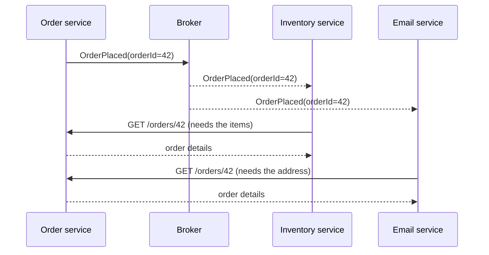
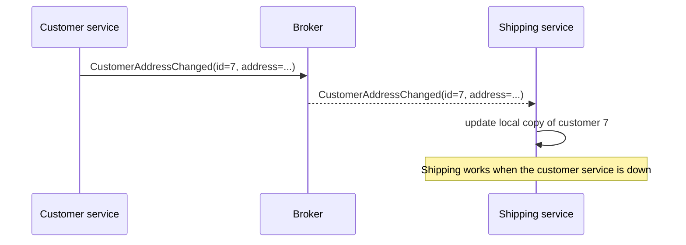
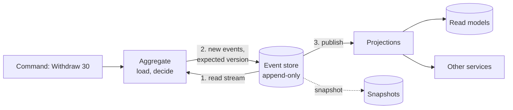
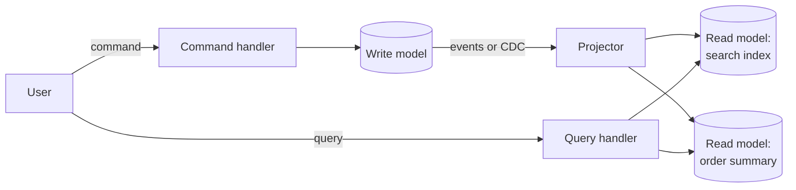
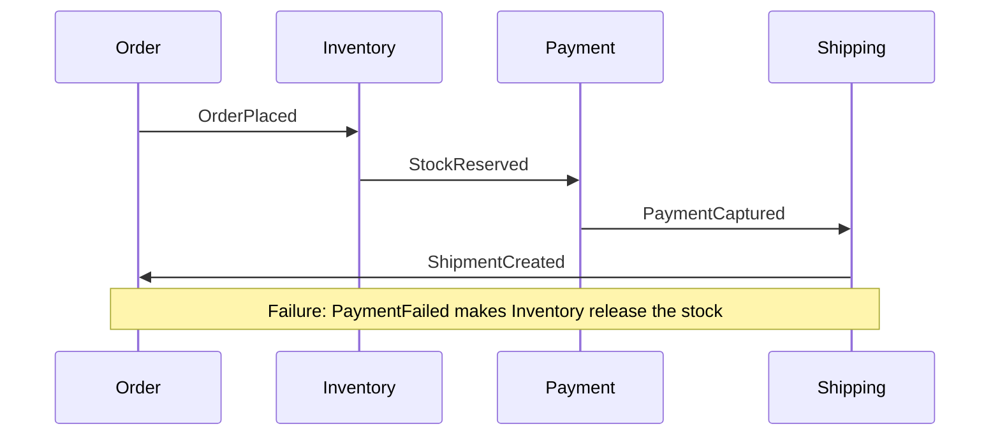
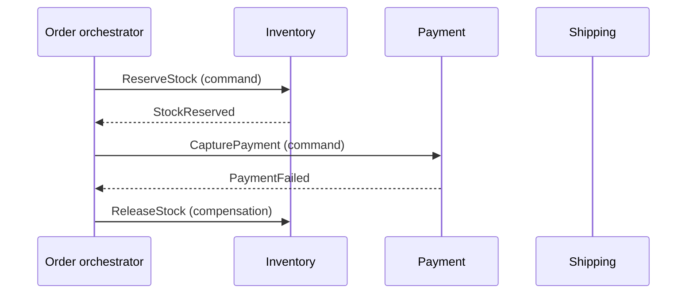
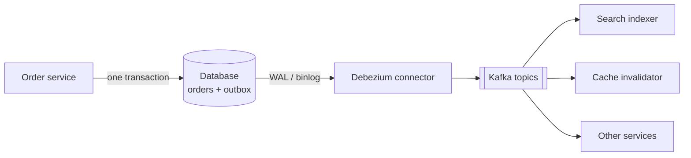

# Event-Driven Architecture

An event-driven architecture (EDA) is a design in which components communicate by publishing records of things that happened, and other components react. This page is the home page for events and commands, the four patterns that Fowler separates under the name "event-driven" (event notification, event-carried state transfer, event sourcing, CQRS), choreography and orchestration, change data capture, and the versioning of event schemas.

## Why It Matters

Interviewers use the words "event-driven", "event sourcing", and "CQRS" as if they mean one thing, and they probe whether you know that they do not. Questions such as "how does the search index learn about a new order?", "how do you keep a read model in sync?", and "how do you audit every change to an account?" all lead to this page. On the job, the choice between "tell the other service" (a command) and "announce what happened" (an event) sets the coupling of your services for years, and event sourcing and CQRS are expensive to adopt and hard to remove. Fowler reports that "the majority of cases" of CQRS that he has run into "have not been so good".

## Core Concepts

**Message**: a unit of data that one process sends to another through a channel (a queue, a log, or an HTTP call). *Message* is the general word. Events and commands are two kinds of message. Queues and logs are covered in [message queues and streams](08-message-queues-and-streams.md).

**Command**: a message that asks a specific receiver to do something. It has an imperative name (`ReserveSeat`, `ChargeCard`). The sender expects the receiver to act, and the receiver may reject it. A command has one intended receiver.

**Event**: a message that states that something already happened. It has a past-tense name (`SeatReserved`, `CardCharged`). The receiver cannot reject it, because the fact is true. The publisher does not know the consumers, and zero or many consumers can react. An event is immutable.

**Query**: a message that asks for data and does not change state.

| | Command | Event | Query |
|---|---|---|---|
| Tense | Imperative: do this | Past: this happened | Question |
| Receivers | One, known by the sender | Zero to many, unknown to the publisher | One |
| Can the receiver refuse? | Yes | No. It can ignore the event | Yes |
| Changes state? | Yes, at the receiver | Already changed at the source | No |
| Coupling | The sender knows the receiver | The consumer knows the publisher's event type only | The sender knows the receiver |

**Publisher** (*producer*): the component that emits events. **Consumer** (*subscriber*): the component that reacts to them. **Event broker**: the infrastructure that stores and delivers events, for example Kafka, RabbitMQ, or a cloud topic service.

**Aggregate**: a group of objects that the code changes as one unit, with one entry object (the aggregate root). An aggregate is the consistency boundary: one command changes one aggregate in one transaction. See [Domain Modeling](../../lld/fundamentals/05-domain-modeling.md). In event sourcing, each aggregate has its own *stream* of events.

**Idempotent consumer**: a consumer that produces the same result when it processes the same event twice. Brokers deliver at least once, so consumers must be idempotent (see [reliability patterns](12-reliability-patterns.md)).

**Eventual consistency**: the state in which, if no new updates arrive, all copies of the data become equal after some time. A read model that updates from events is eventually consistent with the write model. See [consistency and CAP](07-consistency-and-cap.md).

**Dual write**: a write to two systems (a database and a broker) with no shared transaction. If one write succeeds and the other fails, the systems disagree. The transactional outbox and change data capture solve it (see below).

## How It Works

### Four Meanings of "Event-Driven"

Fowler (2017) reports a workshop where Thoughtworks developers found that "when people talk about 'events', they actually mean some quite different things". He names four patterns. Each solves a different problem, and a system can use any one of them without the others.

| Pattern | What the event carries | What the consumer does | Main benefit | Main cost |
|---|---|---|---|---|
| Event notification | An identifier and perhaps a link to the source. Little data | Calls the source for details, if it needs them | Low coupling. Simple to set up | The business flow is implicit and hard to see. Extra calls back to the source |
| Event-carried state transfer | The changed data | Updates its own copy of the data | The consumer works if the source is down. No query load on the source. Lower latency | Many copies of the data. The consumer must keep the state |
| Event sourcing | Every state change of an aggregate | Anyone can rebuild state by replaying | A full history, audit, replay | Schema evolution, replay with external systems, complexity |
| CQRS | Not about events. Separate models for read and write | Reads from a model built for queries | Each model fits its use. Independent scaling | Two models, eventual consistency, more code |

The sections below take the patterns in this order. Fowler's own words on the confusion: a project manager told him that "event sourcing had been a disaster - any change took twice the work to update both the read and write models", which mixed up event sourcing and CQRS.

### Event Notification

The source announces that something changed, and the consumers decide what to do.



The order service does not know the inventory and email services. A new consumer (for example, an analytics service) subscribes without a change in the order service. This is the loose coupling that people want from EDA.

Fowler gives the trap: when a flow runs across several notifications, "it can be hard to see such a flow as it's not explicit in any program text", and the only way to see it may be to watch a live system. A second trap is the *command in disguise* ("passive-aggressive command" in Fowler's words): the source expects a specific receiver to act, and it names the message as an event. If you expect a reaction, send a command, or accept the explicit coupling.

### Event-Carried State Transfer

The event carries the data, so the consumer does not call back.



Trade-offs, from Fowler: more data moves, and there are many copies, but the receiver keeps working when the source is down, the latency drops (no remote call), and the source has no query load from its consumers. The receiver needs more code to maintain the state. The local copy is a cache with eventual consistency (see [caching](03-caching.md) for invalidation, and [microservices and monoliths](14-microservices-and-monoliths.md) for data ownership).

Design rules for such events:

- Send the **full new state** of the entity (or a documented subset) with a version number. A consumer that misses one event then recovers at the next one. A "delta only" event needs every earlier event.
- Include the **entity ID and a monotonic version** (or a timestamp from the source). The consumer ignores an event with a version lower than the one it holds. This protects against reordering.
- Use the **entity ID as the partition key** (see [message queues and streams](08-message-queues-and-streams.md)), so one entity's events stay in order.

### Event Sourcing

**Event sourcing** stores every change to an aggregate as an event, and the sequence of events is the source of truth. Fowler (2005): the idea is "ensuring every change to the state of an application is captured in an event object, and that these event objects are themselves stored in the sequence they were applied for the same lifetime as the application state itself."

The current state is a function of the events: `state = fold(apply, initialState, events)`. A bank account does not store a balance column. It stores `AccountOpened`, `MoneyDeposited`, and `MoneyWithdrawn` events, and the balance is the sum.



**The event store** is an append-only log organized by stream (one stream per aggregate). Its operations:

- `append(stream, expectedVersion, events)`: adds events only if the stream is at `expectedVersion`. If another writer appended first, the call fails with a concurrency error. This is *optimistic concurrency control*: the writer reloads, decides again, and retries. It replaces row locks.
- `read(stream, fromVersion)`: returns the events of one aggregate in order.
- A *global order* (a position in the whole log) lets projections read all events in order.

**Global position and commit order.** If the store is a relational table, an identity column or a sequence gives the global position. PostgreSQL and MySQL assign that value when the row is inserted, not when the transaction commits. Transaction T1 can take position 10, transaction T2 can take position 11, and T2 can commit first. A projection that reads up to position 11 and stores "last position = 11" never sees event 10 when T1 commits. The event is lost for that projection. Fixes:

- Let a single writer append to the log, so that the position order is the commit order.
- Read only up to a safe high-water mark, below which no transaction is still in flight. In PostgreSQL 13 and later, one way is to store the transaction ID (`pg_current_xact_id()`) with each event. The projection reads only events whose transaction ID is below `pg_snapshot_xmin(pg_current_snapshot())`, the oldest transaction that is still active. It orders the events by `(transaction_id, position)` and stores that pair as its checkpoint, not the position alone. PostgreSQL assigns the transaction ID at the first write of the transaction, so a transaction with a lower ID can still hold a higher position, and a position-only checkpoint would again skip events.
- Track progress per stream (by stream version) where the projection allows it, and accept that a cross-stream order is only approximate.

Assumption: the transaction-ID method is a technique that PostgreSQL-based event stores use. The PostgreSQL documentation describes the functions, not this use of them.

A relational database works as an event store. The table needs a unique constraint on `(stream_id, version)`, which gives the optimistic concurrency check for free: the second concurrent insert with the same version fails.

**Command handling** in four steps:

1. Load the aggregate: read its events (or a snapshot plus the later events) and apply them.
2. Decide: the aggregate checks the business rules against its state and returns new events, or rejects the command. Decisions use state and no side effects.
3. Append the new events with the expected version.
4. Publish the events to projections and other consumers (from the store itself, with the outbox pattern, or through CDC).

**Facilities.** Fowler lists three: *complete rebuild* (discard the state and re-run the events), *temporal query* (state at any past point), and *event replay* (correct a past event and recompute the consequences). Add the audit trail: the history cannot be edited, so it records what the system believed at each time.

**Projections.** A **projection** is a function that reads events and builds a view for one purpose: a balance per account, a search index, a daily report. Projections are disposable: if the logic changes, delete the view and rebuild it from position 0. This is the main way that event sourcing supports new features: a new projection over old events answers a question that nobody asked when the events were written.

**Snapshots.** Replaying a stream with a million events on every command is slow. A **snapshot** stores the aggregate state at a version. To load, read the latest snapshot and then the events after its version. Fowler (2005) states the principle behind it: "Since an application state is purely derivable from the event log, you can cache it anywhere you like." He describes snapshots of the state, for example one at the end of each working day. Rules:

- A snapshot is an optimization. Delete it, and the system still works from events.
- Take a snapshot every `N` events (for example every 100 to 1 000, depending on the event size and the load time) or on a schedule, in a background job.
- Store the snapshot schema version. If the aggregate code changes, discard the old snapshots.
- Most aggregates are short-lived (an order has tens of events) and need no snapshots. Keep streams short by design.

**Schema evolution.** Events are stored for ever, so every version that was ever written must stay readable. See the section on event schemas below. Fowler lists this among the problems: "We have to figure out how to deal with changes in the schema of events over time."

**Replay with external systems.** If processing an event calls an outside system (sends an email, charges a card), a replay repeats the call. Fowler: "Replaying events becomes problematic when results depend on interactions with outside systems." The fix: separate *state building* (pure, safe to replay) from *side effects* (run once, when the event is first handled). A projection that rebuilds state must not send email.

**Deletion and privacy.** An append-only log conflicts with a deletion duty such as the right to erasure in the GDPR. Techniques: keep personal data outside the events (the event holds a reference, and the personal data lives in a table that you can delete); or encrypt the personal fields with a per-subject key and delete the key (*crypto-shredding*), which leaves the events unreadable in those fields. Ask a lawyer for the rule that applies. This is the recommended approach, not a claim from a source.

**When not to use event sourcing.** Event sourcing has a high price: a new way to think, schema evolution for ever, projections for every query, and eventual consistency between the log and the views. Use it when the history is part of the product:

| Use event sourcing when | Do not use it when |
|---|---|
| The domain needs an audit trail or a legal history (ledgers, trading, compliance) | The data is plain CRUD, with no need for history |
| The business asks "what was the state at time T?" or "what changed?" | The team has no experience with it, and the deadline is near |
| Many different views of the same facts are needed (projections) | You need strong consistency across many aggregates in one query |
| You need to replay events to fix a bug or build a new feature | The events carry large or sensitive data that you must delete |
| The domain is naturally a sequence of facts (orders, shipments, bank accounts) | The system is a simple lookup service, a cache, or a configuration store |

Recommendation: apply event sourcing to the one bounded context that needs it. Keep CRUD elsewhere. A separate append-only *audit table* gives most of the audit benefit at a lower cost.

**Is Kafka an event store?** Kafka stores a log per partition with a retention period or compaction, and consumers replay from an offset. It lacks the per-stream optimistic concurrency check (`append` only if the version matches) and the cheap read of one aggregate's events by key. Teams that event-source on Kafka usually keep the aggregate's events in a database with the version constraint and publish to Kafka for the consumers. Assumption: this describes the common arrangement, and specialized event stores (for example EventStoreDB) provide the per-stream operations.

### CQRS

**CQRS** (command query responsibility segregation) uses a different model to update information than the model that it uses to read information. Fowler (2011) writes that he "first heard [it] described by Greg Young".

- The **write model** (command side) enforces the business rules. It is shaped for correctness: normalized tables, or an aggregate with an event stream.
- The **read model** (query side) answers queries. It is shaped for the screens: denormalized, pre-joined, indexed for the access path. It can live in a different database, for example Elasticsearch for search, Redis for lookups, and a column store for reports.
- A **synchronization** mechanism moves changes from the write side to the read side: events from the write model, a CDC stream, or a database view.



Fowler's description of the variation: the models can be different object models in different processes, they can share one database (the database acts as the link), or they can use separate databases (the query database then becomes, in Fowler's words, a "real-time ReportingDatabase"). In the lightest form, the same objects offer different interfaces for command and query, like views in a relational database. CQRS is a spectrum, and the cheap end (separate classes and separate query code over one database) gives much of the clarity at a small cost.

**CQRS is not event sourcing.** Fowler: "Strictly CQRS isn't really about events, since you can use CQRS without any events present in your design." The two combine well: events from the write side feed the projections of the read side. But you can have CQRS with a plain SQL write model and a CDC-fed read model, and event sourcing with one read path (replay).

**Eventual consistency and read-your-writes.** If the read model updates asynchronously, a user who writes and then reads can see the old state. Fixes, in order of cost:

| Fix | How | Cost |
|---|---|---|
| Return the new state in the command response | The client shows the response and does not query | Only the one client sees it |
| Read your own writes from the write side | After a write, read that entity from the write model for a short time, or route the session there | Load on the write side. Session logic |
| Version token | The command returns the version or position. The query says "at least version V". The read side waits (with a timeout) until it has applied V | Waiting. A timeout path is needed |
| Optimistic UI | The client updates the screen at once and reconciles later | Client complexity. A rollback path for rejected commands |
| Synchronous projection for the key view | Update that one view in the same transaction as the write | Couples the models. Works only when the view is in the same database |

**When CQRS is worth it.** Fowler's warning, in his bliki post: "for most systems CQRS adds risky complexity". He found that in the majority of cases that he met, CQRS was "a significant force for getting a software system into serious difficulties", and he says to use it only inside a bounded context, not for a whole system. It helps in two cases: a complex domain where one model for reads and writes does both badly, and a large difference between the read and write load (many reads, few writes) or shape (the screens need joins that the write model should not carry).

| Use CQRS when | Do not use it when |
|---|---|
| Read and write loads differ by orders of magnitude, so you scale and tune them separately | The application is CRUD, and one model serves both |
| Queries need a shape (search, aggregates, joins across services) that the write model does not give | Users need to read their own write at once, and the delay is not tolerable |
| The write side has complex rules, and the read side is simple, or the reverse | The team cannot operate two data stores |
| Different teams own the read and write sides | A read replica or a materialized view already solves the problem |

Recommendation: before you adopt CQRS, try an index, a read replica, a materialized view, or a cache. Each solves many "slow read" problems with no second model. CQRS at code level (command and query handler classes) is covered in [Architectural Patterns](../../lld/fundamentals/10-architectural-patterns.md).

### Choreography and Orchestration

A business process that spans services (place an order: reserve stock, charge the card, create the shipment) can be coordinated in two ways.

**Choreography**: no central coordinator. Each service listens for events and publishes its own. The flow emerges from the subscriptions.



**Orchestration**: a central component (the *orchestrator*) holds the process definition. It sends commands to the services and reacts to their replies.



| Aspect | Choreography | Orchestration |
|---|---|---|
| Coupling | Services know only events | Services know the orchestrator's commands. The orchestrator knows every service |
| Visibility of the flow | Spread over many services. Hard to see (Fowler's trap) | One place. A state machine you can read and monitor |
| Adding a step | Subscribe a new service. No change elsewhere | Change the orchestrator |
| Failure handling | Each service publishes failure events and compensations. Cycles are possible | The orchestrator drives compensation in a known order |
| Single point of failure | None | The orchestrator, which must be durable and replicated |
| Testing | Needs the whole group of services | Test the orchestrator against stubs |
| Fits | Short flows of three or four steps, or independent reactions (email, analytics) | Long flows with branches, timeouts, and compensation |

Recommendation: use choreography for loose reactions (side effects that the source does not depend on), and orchestration for a flow that has a defined outcome and compensation. Write down the flow in either case, because choreography hides it. The compensation logic, saga failure handling, and the guarantees of the pattern live in [distributed transactions](../distributed-systems/03-distributed-transactions.md).

### Publishing Events Reliably: Outbox and Change Data Capture

A service that updates its database and then publishes an event has a dual-write problem. If it commits and then crashes before the publish, the event is lost. If it publishes and then the commit fails, a consumer sees an event for a change that did not happen.

The **transactional outbox** pattern fixes it: the service writes the event into an `outbox` table in the same database transaction as the state change. A separate process reads the outbox and publishes to the broker. The commit makes the state change and the event atomic. The pattern's details, and its place among sagas, are in [distributed transactions](../distributed-systems/03-distributed-transactions.md); the broker side is in [message queues and streams](08-message-queues-and-streams.md).

<!-- sql-skip: postgresql -->

```sql
BEGIN;
UPDATE orders SET status = 'PLACED' WHERE id = 42;
INSERT INTO outbox (id, aggregate_type, aggregate_id, type, payload)
VALUES (gen_random_uuid(), 'Order', '42', 'OrderPlaced', '{"orderId": 42}');
COMMIT;
```

The block uses `gen_random_uuid()`, which PostgreSQL provides, so SQLite does not run it.

**Change data capture** (CDC) reads a database's change log and turns each committed row change into an event. The relay for the outbox can be CDC. Compared with other ways to find changes:

| Method | How it works | Cost and limits |
|---|---|---|
| Polling | A job queries `WHERE updated_at > last_seen` or reads the outbox table | Adds load. Delay equals the poll interval. Misses deletes and rows that change between polls, unless the table is an outbox |
| Triggers | A database trigger writes changes to an audit table | Slows every write. Hard to maintain. Part of the write transaction |
| Log-based CDC | A connector reads the write-ahead log or binlog | Low load. Sees every change in commit order, including deletes. Needs database settings and access |

**Debezium** is an open-source platform for log-based CDC. From its documentation:

- It runs as connectors on Kafka Connect, as Debezium Server, or embedded in an application as the Debezium Engine.
- The PostgreSQL connector reads the logical decoding stream with the `pgoutput` plug-in (PostgreSQL 10 and later) through a *replication slot*. The MySQL connector reads the binlog.
- On first start it takes a consistent **snapshot** of the existing rows (`snapshot.mode` defaults to `initial`), and then it streams changes from the log position that matches the snapshot.
- Each change event has an *envelope* with `before` and `after` row states, a `source` block (database, table, log position, transaction), an operation code `op` (`c` create, `u` update, `d` delete, `r` snapshot read, and `t` truncate for a truncate event), and a timestamp `ts_ms`. A delete event is followed by a *tombstone* (the same key and a null value) so that Kafka log compaction can remove the key.
- Delivery is **at least once**: "while it is recovering from the fault, it's possible that the connector might emit some duplicate change events". Consumers must be idempotent.
- For PostgreSQL, the table's `REPLICA IDENTITY` setting decides how much of the old row an update or delete event carries. With the default setting, an update event carries the old primary key columns only, and a table with no primary key gets create events only.
- A replication slot that nobody reads makes PostgreSQL keep WAL files, and the disk fills. The documentation names this risk (for a low-traffic database on a busy server, it recommends a heartbeat to acknowledge positions and "prevents unbounded WAL growth").
- The **outbox event router** is a Debezium transformation that reads rows from an outbox table and routes each to a topic that is chosen by a column such as the aggregate type, with the aggregate ID as the message key.



CDC does more than the outbox. Common uses: feeding a search index (see [search and indexing](11-search-and-indexing.md)), invalidating a cache from the commit log (see [caching](03-caching.md)), keeping a read model of CQRS in sync, and migrating a database with no downtime. A caveat: CDC on the tables of the service exposes its internal schema to every consumer. An outbox table with a deliberate event format keeps the schema private.

### Event Schemas and Versioning

An event is a contract between a publisher and every present and future consumer. The log keeps old events for ever (in event sourcing) or for the retention period (in a broker), so old and new versions are alive together.

**Envelope and payload.** Keep a stable envelope: event ID (a unique ID, see [unique ID generation](15-unique-id-generation.md)), type, schema version, aggregate ID, a version or sequence number, a timestamp, and a correlation ID. The CloudEvents specification (a CNCF project) standardizes such an envelope. Its required context attributes are `id`, `source`, `specversion`, and `type`. Its optional context attributes are `datacontenttype`, `dataschema`, `subject`, and `time`. The payload, `data`, is not a context attribute. The specification defines it separately as optional event data, so that a router can read the attributes without parsing the payload.

**Compatibility rules.** Names from the Confluent Schema Registry documentation:

| Mode | Meaning | Checked against | Safe change | Upgrade order |
|---|---|---|---|---|
| `BACKWARD` (the default) | Consumers with the new schema read data written with the old schema | The latest registered version | Delete a field. Add an optional field | Consumers first |
| `BACKWARD_TRANSITIVE` | As `BACKWARD` | All registered versions | As `BACKWARD` | Consumers first |
| `FORWARD` | Consumers with the old schema read data written with the new schema | The latest registered version | Add a field. Delete an optional field | Producers first |
| `FORWARD_TRANSITIVE` | As `FORWARD` | All registered versions | As `FORWARD` | Producers first |
| `FULL` | Both backward and forward | The latest registered version | Add or delete an optional field | Either order |
| `FULL_TRANSITIVE` | As `FULL` | All registered versions | As `FULL` | Either order |
| `NONE` | No check | Nothing | Any change | Plan each upgrade by hand |

Confluent gives the reason for the `BACKWARD` default: consumers can rewind to the beginning of a topic and read the old messages. With `FORWARD`, old messages are not guaranteed to be readable.

The plain modes check a new schema only against the latest version. An event store keeps every version for ever, and a replay reads them all from version 1. Recommendation: for event-sourced streams and for topics that you replay from the start, use `BACKWARD_TRANSITIVE` or `FULL_TRANSITIVE`.

Rules of practice:

1. **Add, do not change.** Add an optional field with a default. Do not rename a field or change its type or meaning.
2. **Never reuse a name for a new meaning.** Create a new event type (`AddressChangedV2`) if the meaning changes.
3. **Consumers ignore unknown fields** (the tolerant reader rule).
4. **Test compatibility in the build.** A schema registry (Avro, Protobuf, or JSON Schema) rejects an incompatible change when the publisher registers it.
5. **Do not put a database row in the event** (the internal schema leaks). Design the event as a public API (see `kb/api-design/02-api-design-practices.md`).

**Upcasting.** In event sourcing you cannot rewrite history, so you convert old events on read. An **upcaster** is a function that turns a stored event of an old version into the current version in memory: for example, it adds `currency = "USD"` to a schema 1 event that had no currency. The aggregate code then handles one current version only. The Java example shows an upcaster. Other options:

| Option | How | Cost |
|---|---|---|
| Upcast on read | Convert each old event when you load | Code for every old version for ever. No data change |
| Copy and transform | Write a new stream, with converted events, and switch (a migration) | A migration job and a switch. Cleans old code |
| Weak schema | Store JSON, and read missing fields as defaults | Fast to change. Mistakes appear at run time |

**Event naming.** Use the past tense and the business language: `OrderPlaced`, not `OrderTableRowInserted` or `OrderUpdated`. A generic `Updated` event forces consumers to compare before and after to find out what happened, and it exposes the structure of the table.

## Trade-offs and When to Use

| Dimension | Direct calls (REST, gRPC) | Event notification | Event-carried state transfer | Event sourcing | CQRS |
|---|---|---|---|---|---|
| Coupling in time | Both sides must be up | Decoupled | Decoupled | Decoupled for consumers | Decoupled read side |
| Coupling in data | A fixed API | An event ID, plus a call back | The event schema | The event schema, for ever | The projection format |
| Latency | One round trip | Delay of the broker, then more calls | Delay of the broker | Delay of the projection | Delay of the projection |
| Consistency | Immediate, if one database | Eventual | Eventual | Strong inside one stream. Eventual in views | Eventual between models |
| Observability | A request trace | Needs a correlation ID and a trace through the broker | Same | Full history in the store | Two paths to trace |
| Failure mode | Cascading failure | A lost or duplicate event | Stale copy | A bad event that stays for ever | A stalled projection |
| Complexity | Low | Medium | Medium | High | Medium to high |
| Fits | A query that needs the answer now | Reactions, integrations | Reducing calls between services | Ledgers, audit, history-based features | Read-heavy or complex views |

| Question | Use |
|---|---|
| Does the caller need an answer to continue? | A synchronous call. See [communication patterns](09-communication-patterns.md) |
| Does the source only announce a fact, and others react? | Event notification |
| Do consumers need the data without calling back? | Event-carried state transfer |
| Must you keep the full history of changes? | Event sourcing, in that bounded context |
| Do reads and writes need different shapes or scales? | CQRS, after you tried an index, a replica, or a cache |
| A multi-service process with compensation? | A saga, orchestrated, or choreographed for short flows |
| Must a state change and an event be atomic? | Transactional outbox, with CDC or a poller as the relay |

## Java Example

### An event-sourced account with a projection

The program has an append-only event store with the optimistic concurrency check, an aggregate that decides events, an upcaster for a schema 1 event, a snapshot, and a read model that stores its last applied position, so that a duplicate delivery does nothing. It uses Java 21 records, a sealed interface, and a pattern-matching `switch`. It uses the JDK only.

```java
import java.util.ArrayList;
import java.util.HashMap;
import java.util.List;
import java.util.Map;
import java.util.TreeMap;

public class Main {
    public static void main(String[] args) {
        EventStore store = new EventStore();
        String id = "acct-1";

        // Commands become events. The store is the source of truth.
        Account acct = Account.load(store, id);
        store.append(id, acct.version(), acct.open("Asha"));
        acct = Account.load(store, id);
        store.append(id, acct.version(), acct.deposit(100));
        acct = Account.load(store, id);
        store.append(id, acct.version(), acct.withdraw(30));
        // An event from an old producer that still writes schema version 1 (no currency field).
        store.appendRaw(id, 3, "Deposited", 1, Map.of("amount", "50"));
        System.out.println("-- stream " + id);
        for (StoredEvent e : store.read(id, 0)) {
            System.out.println("#" + e.seq() + " " + e.type() + " (schema " + e.schema() + ") "
                    + new TreeMap<>(e.data()));
        }

        System.out.println("-- replay with upcasting");
        Account replayed = Account.load(store, id);
        System.out.println("balance=" + replayed.balance + " version=" + replayed.version());

        System.out.println("-- optimistic concurrency");
        Account writerA = Account.load(store, id);
        Account writerB = Account.load(store, id);
        store.append(id, writerA.version(), writerA.withdraw(20));
        try {
            store.append(id, writerB.version(), writerB.withdraw(20));
        } catch (ConcurrencyException e) {
            System.out.println("writer B rejected: " + e.getMessage());
        }
        Account retried = Account.load(store, id);
        store.append(id, retried.version(), retried.withdraw(20));
        System.out.println("after retry balance=" + Account.load(store, id).balance);

        System.out.println("-- business rule");
        try {
            Account.load(store, id).withdraw(1_000);
        } catch (IllegalStateException e) {
            System.out.println("rejected: " + e.getMessage());
        }

        System.out.println("-- snapshot");
        Snapshot snap = Account.load(store, id).snapshot();
        store.append(id, snap.version(), Account.load(store, id).deposit(5));
        Account fromSnapshot = Account.fromSnapshot(snap, store.read(id, snap.version()));
        System.out.println("snapshot at version " + snap.version() + ", balance " + snap.balance());
        System.out.println("snapshot + tail balance=" + fromSnapshot.balance
                + " version=" + fromSnapshot.version());
        System.out.println("full replay   balance=" + Account.load(store, id).balance);

        System.out.println("-- projection (read model)");
        BalanceView view = new BalanceView();
        view.catchUp(store);
        System.out.println("view: " + new TreeMap<>(view.balances));
        view.handle(store.globalLog().get(2)); // duplicate delivery of an old event
        System.out.println("after duplicate: " + new TreeMap<>(view.balances));
        BalanceView rebuilt = new BalanceView();
        rebuilt.catchUp(store);
        System.out.println("rebuilt from position 0: " + new TreeMap<>(rebuilt.balances));
    }
}

record StoredEvent(String stream, int seq, long position, String type, int schema,
                   Map<String, String> data) { }

class ConcurrencyException extends RuntimeException {
    ConcurrencyException(String message) {
        super(message);
    }
}

/** Append-only log. Each stream accepts an append only at its expected version. */
class EventStore {
    private final List<StoredEvent> log = new ArrayList<>();
    private final Map<String, Integer> versions = new HashMap<>();

    synchronized void append(String stream, int expected, List<DomainEvent> events) {
        for (DomainEvent e : events) {
            appendRaw(stream, expected++, e.type(), 2, e.toData());
        }
    }

    synchronized void appendRaw(String stream, int expected, String type, int schema,
                                Map<String, String> data) {
        int current = versions.getOrDefault(stream, 0);
        if (current != expected) {
            throw new ConcurrencyException("expected version " + expected
                    + " but stream is at " + current);
        }
        log.add(new StoredEvent(stream, current + 1, log.size(), type, schema, data));
        versions.put(stream, current + 1);
    }

    synchronized List<StoredEvent> read(String stream, int afterSeq) {
        List<StoredEvent> out = new ArrayList<>();
        for (StoredEvent e : log) {
            if (e.stream().equals(stream) && e.seq() > afterSeq) {
                out.add(e);
            }
        }
        return out;
    }

    synchronized List<StoredEvent> globalLog() {
        return List.copyOf(log);
    }
}

sealed interface DomainEvent permits Opened, Deposited, Withdrawn {
    String type();

    Map<String, String> toData();
}

record Opened(String owner) implements DomainEvent {
    public String type() { return "Opened"; }

    public Map<String, String> toData() { return Map.of("owner", owner); }
}

record Deposited(long amount, String currency) implements DomainEvent {
    public String type() { return "Deposited"; }

    public Map<String, String> toData() {
        return Map.of("amount", Long.toString(amount), "currency", currency);
    }
}

record Withdrawn(long amount, String currency) implements DomainEvent {
    public String type() { return "Withdrawn"; }

    public Map<String, String> toData() {
        return Map.of("amount", Long.toString(amount), "currency", currency);
    }
}

/** Converts a stored event of any schema version to the current event type. */
class Upcaster {
    static DomainEvent toCurrent(StoredEvent e) {
        String currency = e.schema() == 1 ? "USD" : e.data().get("currency");
        return switch (e.type()) {
            case "Opened" -> new Opened(e.data().get("owner"));
            case "Deposited" -> new Deposited(Long.parseLong(e.data().get("amount")), currency);
            case "Withdrawn" -> new Withdrawn(Long.parseLong(e.data().get("amount")), currency);
            default -> throw new IllegalArgumentException("unknown event " + e.type());
        };
    }
}

record Snapshot(int version, long balance, String owner) { }

/** The aggregate. Commands decide events. Events change state. */
class Account {
    long balance;
    String owner;
    private int version;

    static Account load(EventStore store, String id) {
        Account a = new Account();
        for (StoredEvent e : store.read(id, 0)) {
            a.apply(Upcaster.toCurrent(e));
            a.version = e.seq();
        }
        return a;
    }

    static Account fromSnapshot(Snapshot s, List<StoredEvent> tail) {
        Account a = new Account();
        a.balance = s.balance();
        a.owner = s.owner();
        a.version = s.version();
        for (StoredEvent e : tail) {
            a.apply(Upcaster.toCurrent(e));
            a.version = e.seq();
        }
        return a;
    }

    int version() { return version; }

    Snapshot snapshot() { return new Snapshot(version, balance, owner); }

    List<DomainEvent> open(String name) {
        if (owner != null) {
            throw new IllegalStateException("account already open");
        }
        return List.of(new Opened(name));
    }

    List<DomainEvent> deposit(long amount) {
        return List.of(new Deposited(amount, "USD"));
    }

    List<DomainEvent> withdraw(long amount) {
        if (amount > balance) {
            throw new IllegalStateException("insufficient funds: balance " + balance
                    + ", requested " + amount);
        }
        return List.of(new Withdrawn(amount, "USD"));
    }

    private void apply(DomainEvent e) {
        switch (e) {
            case Opened o -> owner = o.owner();
            case Deposited d -> balance += d.amount();
            case Withdrawn w -> balance -= w.amount();
        }
    }
}

/** A read model. It stores the last position it applied, so a duplicate is harmless. */
class BalanceView {
    final Map<String, Long> balances = new HashMap<>();
    private long lastPosition = -1;

    void catchUp(EventStore store) {
        for (StoredEvent e : store.globalLog()) {
            handle(e);
        }
    }

    void handle(StoredEvent e) {
        if (e.position() <= lastPosition) {
            return;
        }
        switch (Upcaster.toCurrent(e)) {
            case Opened o -> balances.put(e.stream(), 0L);
            case Deposited d -> balances.merge(e.stream(), d.amount(), Long::sum);
            case Withdrawn w -> balances.merge(e.stream(), -w.amount(), Long::sum);
        }
        lastPosition = e.position();
    }
}
```

<!-- expected-output -->

```text
-- stream acct-1
#1 Opened (schema 2) {owner=Asha}
#2 Deposited (schema 2) {amount=100, currency=USD}
#3 Withdrawn (schema 2) {amount=30, currency=USD}
#4 Deposited (schema 1) {amount=50}
-- replay with upcasting
balance=120 version=4
-- optimistic concurrency
writer B rejected: expected version 4 but stream is at 5
after retry balance=80
-- business rule
rejected: insufficient funds: balance 80, requested 1000
-- snapshot
snapshot at version 6, balance 80
snapshot + tail balance=85 version=7
full replay   balance=85
-- projection (read model)
view: {acct-1=85}
after duplicate: {acct-1=85}
rebuilt from position 0: {acct-1=85}
```

Points to read in the code:

- `EventStore.appendRaw` is the optimistic concurrency check. Writer B loaded the stream at version 4, writer A appended first, so B's append fails. B reloads, decides again on the new state, and retries.
- `Account.withdraw` decides from state and returns events. `apply` is the only place that changes state, and it is the same code for new events and for replay.
- `Upcaster` turns the schema 1 `Deposited` event (no currency) into the current record. The account code never sees schema 1.
- The snapshot is a copy of the state at a version. The state from the snapshot plus the later events equals the state from a full replay.
- `BalanceView` stores `lastPosition`. A duplicate delivery of an old event changes nothing, which is how an idempotent consumer works with at-least-once delivery. A new `BalanceView` rebuilds the same state from position 0.
- `BalanceView` can trust `lastPosition` because the in-memory store appends under one lock, so the position order is the commit order. With a database sequence as the position, that is not true (see "Global position and commit order" above).
- The store is in memory and uses `synchronized`. A real store writes to a database with a unique constraint on `(stream_id, version)`, as the next block shows.

### An event store in SQL

The SQL block creates an event table with the unique constraint that gives optimistic concurrency, and loads the same events. SQLite runs it, and PostgreSQL uses the same idea with `jsonb` for the payload.

```sql
CREATE TABLE events (
  position       INTEGER PRIMARY KEY AUTOINCREMENT,
  stream_id      TEXT    NOT NULL,
  version        INTEGER NOT NULL,
  type           TEXT    NOT NULL,
  schema_version INTEGER NOT NULL DEFAULT 2,
  payload        TEXT    NOT NULL,
  UNIQUE (stream_id, version)
);

INSERT INTO events (stream_id, version, type, payload) VALUES
  ('acct-1', 1, 'Opened',    '{"owner":"Asha"}'),
  ('acct-1', 2, 'Deposited', '{"amount":100,"currency":"USD"}'),
  ('acct-1', 3, 'Withdrawn', '{"amount":30,"currency":"USD"}'),
  ('acct-2', 1, 'Opened',    '{"owner":"Ben"}'),
  ('acct-2', 2, 'Deposited', '{"amount":40,"currency":"USD"}');
```

A projection can be a query over the log. This query computes the balance of each stream:

```sql
SELECT stream_id,
       SUM(CASE type
             WHEN 'Deposited' THEN json_extract(payload, '$.amount')
             WHEN 'Withdrawn' THEN -json_extract(payload, '$.amount')
             ELSE 0
           END) AS balance
FROM events
GROUP BY stream_id
ORDER BY stream_id;
```

<!-- sql-result -->

```text
stream_id | balance
acct-1 | 70
acct-2 | 40
```

A second writer that inserts `('acct-1', 3, ...)` after the third event exists violates `UNIQUE (stream_id, version)`, and the database rejects the insert. That error is the concurrency conflict of the Java example.

## Interview Angle

### Questions

??? question "What is the difference between an event and a command? Why does it matter?"

    A command asks one known receiver to do something, and it can be refused: `ChargeCard`. An event states a fact that already happened, and the receiver cannot refuse it: `CardCharged`. A command has an imperative name and one receiver. An event has a past-tense name and zero to many consumers that the publisher does not know.

    It matters for coupling. If a service publishes an event, a new consumer joins with no change to the publisher. If a service sends a command, it depends on the receiver. A common mistake is a command named as an event: the source publishes `OrderPlaced` but expects the inventory service to reserve stock. That is a hidden command, and the dependency is real but invisible. Fowler warns about this trap. If you expect a reaction, send a command, or accept and document the coupling.

??? question "People say 'event-driven'. What can that mean?"

    Fowler separates four patterns, and a system can use one without the others.

    Event notification: the event is a signal with little data, and the consumer calls back for details. Event-carried state transfer: the event carries the changed data, so consumers keep their own copy and work when the source is down. Event sourcing: the events are the source of truth, and state is derived by replay. CQRS: separate models for read and write, which is not about events at all, although the two are often combined.

    In an interview I ask which one the interviewer means, because each solves a different problem and costs something different. The common failure is to mix up event sourcing and CQRS and to blame one for the cost of the other.

??? question "Explain event sourcing. What do you gain and what does it cost?"

    Instead of storing the current state, I store every state change as an immutable event in an append-only log, one stream per aggregate. The state is the fold of the events. A command loads the aggregate by replaying its events (or from a snapshot plus later events), the aggregate decides new events, and the store appends them with an expected version, so a concurrent writer gets a conflict and retries.

    Gains: a complete audit trail, temporal queries (state at time T), rebuild of any view from the log, new projections over old data, and a natural source of events for other services.

    Costs: schema evolution for ever (old events stay readable through upcasters), a projection for every query, eventual consistency between the log and the views, replay that must not repeat side effects, and a conflict with deletion duties (I keep personal data outside the events or use crypto-shredding). I use it only in the bounded context where the history is the product, such as a ledger, and I use CRUD elsewhere.

??? question "How do snapshots work in event sourcing, and when do you need them?"

    A snapshot is the aggregate state at a stream version. To load, I read the latest snapshot and then the events with a higher version. It is an optimization and not a source of truth: I can delete all snapshots and rebuild from events.

    I take one every N events (N depends on the event size and the load time, for example 100 to 1 000) or in a background job. I store the snapshot schema version, and I discard snapshots when the aggregate code changes. Most aggregates have short streams, so I do not need snapshots, and I design aggregates to stay small. A very long stream suggests a wrong aggregate boundary.

??? question "How do you change the schema of an event that is already stored?"

    I cannot rewrite history, so old versions must stay readable. First choice: make additive changes only. Add an optional field with a default, and keep consumers tolerant of unknown fields. If the change is not additive, I add an upcaster: a function that converts a stored event of version 1 to the current version at read time, so the aggregate code handles only the current version. I do not reuse a name for a new meaning. I publish a new event type instead.

    For compatibility I use a schema registry with compatibility checks in the build, which rejects a breaking change before it ships. I choose a transitive mode (`BACKWARD_TRANSITIVE` or `FULL_TRANSITIVE` in Confluent Schema Registry), because a replay reads every version from the first one, and the plain modes check only against the latest version. If the old versions become too many, I run a migration that copies the stream into a new one with converted events and switch to it.

??? question "What is CQRS, and when would you use it?"

    CQRS separates the model that handles writes from the model that handles reads. The write side enforces the rules. The read side is shaped for the queries (denormalized, indexed, maybe in another database), and a mechanism such as events or CDC keeps it in sync.

    I use it when read and write loads or shapes differ a lot: a read-heavy screen that needs joins across services, a search view, or a complex domain where one model does both jobs badly. I do not use it for CRUD. Fowler warns that "for most systems CQRS adds risky complexity" and that most cases that he saw went badly. Before I use it, I try an index, a read replica, a materialized view, or a cache. I apply it to one bounded context, not to the whole system. The price is eventual consistency and two models to keep correct.

??? question "With CQRS, a user submits a form and then sees the old data. How do you fix it?"

    The read model updates asynchronously, so the query can run before the projection applies the event. Options from cheap to costly: return the new state in the command response and let the client show it; read that entity from the write side for a short time after a write; return a version token and make the query wait (with a timeout) until the read model reaches that version; update the UI optimistically and reconcile; or update one critical view in the same transaction as the write.

    I choose by the requirement. For a "my profile" page, the response and a short read from the write side are enough. For a shared view, I accept a delay of seconds and tell the user ("your order is processing").

??? question "Choreography or orchestration for an order process?"

    Choreography: each service reacts to events and publishes its own, so there is no central component, and adding a consumer needs no change elsewhere. The flow is spread over services and hard to see, and failure handling is a web of compensating events. Orchestration: a coordinator holds the process as a state machine, sends commands, and runs compensations in a known order. The flow is in one place, but the coordinator is a component that I must make durable.

    I use choreography for loose reactions that the source does not depend on (email, analytics, search indexing) and for flows of three or four steps. I use orchestration for a flow with a defined outcome, branches, timeouts, and compensation, such as checkout with payment, stock, and shipping. In both cases I write the flow down. The saga mechanics are in the distributed transactions page.

??? question "A service updates its database and publishes an event. How do you make it reliable?"

    Two separate writes can fail separately, so the database and the broker can disagree: that is the dual-write problem. I use the transactional outbox: in the same transaction as the state change, I insert the event in an outbox table. A relay reads the outbox and publishes to the broker. The commit makes the change and the event atomic.

    The relay can poll the table, or it can be log-based CDC, such as Debezium reading the WAL or binlog, which has low load and keeps the commit order. Delivery is at least once (Debezium's documentation says that duplicates are possible after a failure), so consumers are idempotent: they deduplicate by event ID or by a position. I key the events by aggregate ID, so one aggregate's events stay in order in a partition.

??? question "What are the risks of log-based CDC with Debezium?"

    Duplicates after a connector restart (at-least-once), so consumers must be idempotent. In PostgreSQL, a replication slot that nobody consumes makes the server keep WAL, and the disk can fill, so I monitor slot lag and use heartbeats on low-traffic databases. The `REPLICA IDENTITY` setting decides how much of the old row an update carries, and a table with no primary key gives create events only with the default setting. The initial snapshot of a large table takes time and load. And the events expose the table schema, so a change to a column breaks consumers. An outbox table with an event format that I design avoids that last problem.

??? question "Can you replay events safely if processing an event sends an email?"

    Not if the same code path sends the email. I separate state building from side effects. Projections and aggregates are pure: replaying them repeats nothing. Side effects run in a separate consumer that records which events it handled, so a replay of the projections does not trigger it, and a rerun of the side-effect consumer deduplicates by event ID. Fowler names this problem: replay is hard when results depend on outside systems.

### Follow-up Questions

??? question "Does event sourcing need Kafka?"

    No. An event store needs an append-only log per stream with an optimistic concurrency check, and a relational table with a unique `(stream_id, version)` constraint does this. Kafka serves well to distribute events to consumers, but it has no per-stream version check and no cheap read of one aggregate's events. A common arrangement stores events in a database and publishes them to Kafka through an outbox.

??? question "How do you keep ordering in an event-driven system?"

    A broker orders events inside one partition. I use the aggregate or entity ID as the partition key, so all events of one entity go to one partition, in order. There is no global order across partitions. Consumers that need to order events across entities use a version or timestamp from the source, or a single-partition topic (which limits throughput). See the message queues page.

    If the event store is a SQL table, I watch one more trap: a sequence assigns the global position at insert time, not at commit time. A projection that stores the highest position it saw can skip an event whose transaction commits late. I let one writer append to the log, or I read only below a safe high-water mark (no transaction in flight below it) and checkpoint on the pair of transaction ID and position.

??? question "What is an idempotent consumer, and how do you build one?"

    A consumer that gives the same result when it handles the same event twice. Ways: store the IDs of processed events in the same transaction as the state change and skip a known ID; store the last applied position per stream and skip anything at or below it (as the `BalanceView` does); or make the operation naturally idempotent (a `SET` of a state, not an increment). Exactly-once processing at the broker level only covers part of the path, so I make the consumer idempotent anyway. The inbox pattern and its table design are on the [distributed transactions](../distributed-systems/03-distributed-transactions.md) page.

??? question "How do you test and operate an event-driven system?"

    Contract tests for event schemas (a schema registry in the build), a correlation ID in every event and log line so I can trace one business flow across services, lag monitoring per consumer group (the age of the oldest unprocessed event), a dead-letter queue with an alert for poison messages, and a way to replay a stream into a new projection. See the message queues page and `kb/engineering-practice/08-observability.md`.

### Red Flags

- Using "event-driven", "event sourcing", and "CQRS" as synonyms.
- Calling a message an event when the sender expects a specific reaction (a hidden command).
- Proposing event sourcing for a simple CRUD service, or for the whole system.
- Proposing CQRS before trying an index, a replica, a materialized view, or a cache.
- Publishing to the broker after the commit, with no outbox or CDC, and claiming "it works".
- Assuming exactly-once delivery, with no idempotent consumer.
- No plan for schema changes of stored events.
- Replaying events through code that sends emails or charges cards.
- Naming events `Updated` or `RowChanged`, which exposes the table and hides the business meaning.
- Ignoring the read-your-writes problem after a write in CQRS.
- A choreography of many services with no document of the flow and no tracing.

## Common Mistakes

| Mistake | Why it hurts | Fix |
|---|---|---|
| Treating event sourcing and CQRS as one pattern | The cost of one gets blamed on the other. Teams adopt both when they need one | Decide each separately. Fowler: CQRS is not about events |
| Event sourcing everywhere | Schema evolution and projections for every entity, with no benefit for CRUD data | Use it in the one bounded context that needs history |
| Hidden commands named as events | An invisible dependency. The flow breaks when a consumer is removed | Send a command, or document the dependency |
| Dual write to the database and the broker | Lost or phantom events | Transactional outbox, with polling or CDC |
| Non-idempotent consumers | A redelivery double-charges or double-counts | Deduplicate by event ID or position |
| An event with only an ID, when consumers all call back | A load spike on the source, and coupling at run time | Use event-carried state transfer for the common fields |
| Delta-only state events | A missed event corrupts the copy for ever | Send the full new state with a version |
| No partition key | Events of one entity arrive out of order | Use the entity ID as the key |
| Breaking change in an event | Consumers fail, and old events in the log cannot be read | Additive changes, a schema registry, upcasters |
| Putting the database row in the event | Consumers depend on your table layout | Design the event as a public contract, with an outbox |
| Side effects inside a projection | A rebuild repeats the side effect | Keep projections pure and side effects in their own consumer |
| No lag monitoring on projections | The read model is stale and nobody knows | Alert on the age of the oldest unprocessed event |
| Unconsumed PostgreSQL replication slot | WAL grows until the disk is full | Monitor slot lag. Use heartbeats. Drop unused slots |
| A projection that tracks the highest global position from a database sequence | A transaction that took a lower position commits later, and the projection skips its event for ever | Use a single writer for the log, or read only below a safe high-water mark and checkpoint on `(transaction_id, position)` |
| Unbounded streams without snapshots | Slow loading of an aggregate | Keep aggregates small. Add snapshots when a stream is long |
| Storing personal data in immutable events with no plan | A deletion request cannot be met | Keep the data outside the events or use per-subject keys |

## Commonly Confused With

| Looks like | Difference | Deciding question |
|---|---|---|
| Event and command | An event states a fact and has many consumers. A command asks one receiver to act and can be refused | Does the sender expect a specific reaction? |
| Event and message | Message is the general term. An event is a message that states a fact | Does the message report something that happened? |
| Event notification and event-carried state transfer | A notification carries an ID and the consumer calls back. A state transfer carries the data | Does the consumer need to call the source? |
| Event sourcing and an audit log | An audit log is a side record. In event sourcing the events are the source of truth, and the state is derived | Can you delete the state tables and rebuild them from the log? |
| Event sourcing and CQRS | Event sourcing is how you store state. CQRS is the split of read and write models | Are you asking about storage or about the model split? |
| Event sourcing and event-driven | Event-driven means components react to events. Event sourcing stores state as events inside one component | Do the events leave the service, or are they its storage? |
| CQRS and a read replica | A replica is a copy of the same model. CQRS uses a different model for reads | Is the read data shaped differently from the write data? |
| CDC and the outbox | CDC reads the log of any table. The outbox is a table that holds events by design. The two combine: CDC relays the outbox | Does the event format come from the table schema or from a design? |
| Choreography and orchestration | Choreography has no coordinator. Orchestration has one | Is the process defined in one place? |
| Event store and message broker | A store keeps events per stream with version checks for ever. A broker delivers events and removes them after retention | Do you need to load one aggregate's history, or deliver to consumers? |
| Projection and snapshot | A projection builds a read view from events. A snapshot caches one aggregate's state for faster loading | Is the data for a query, or for loading the aggregate? |
| Schema registry and upcaster | A registry checks compatibility when you publish. An upcaster converts old events when you read | Are you preventing a breaking change, or reading an old one? |

## Quick Reference Card

- **Command** asks (imperative, one receiver, can fail). **Event** states a fact (past tense, many consumers, cannot fail).
- **Fowler's four:** event notification, event-carried state transfer, event sourcing, CQRS. Independent patterns.
- **Notification:** low coupling, hidden flow, callbacks. **State transfer:** resilience and low latency, many copies. Send full state with a version and key by entity ID.
- **Event sourcing:** append-only events per aggregate, state is the fold, optimistic concurrency with an expected version, snapshots as a cache, projections as disposable views.
- **Use event sourcing** for ledgers, audit, history. **Avoid** for CRUD. Keep personal data out of events or use crypto-shredding.
- **Schema evolution:** add optional fields, tolerant readers, never reuse a name, schema registry (Confluent default `BACKWARD`; use a `_TRANSITIVE` mode for replayed logs), upcasters on read.
- **CloudEvents:** required `id`, `source`, `specversion`, `type`. Optional `datacontenttype`, `dataschema`, `subject`, `time`.
- **CQRS:** separate read and write models. Fowler: "for most systems CQRS adds risky complexity". Try an index, a replica, a materialized view, or a cache first.
- **Read-your-writes:** response with new state, read from the write side, version token, optimistic UI.
- **Choreography** for short, loose reactions. **Orchestration** for long flows with compensation (see sagas).
- **Outbox:** the event row in the same transaction as the state. **CDC (Debezium):** reads the WAL or binlog, at-least-once, snapshot first, watch the replication slot.
- **Consumers:** idempotent. Dedupe by event ID or position. Pure projections.
- **Say in the interview:** which of the four patterns you mean, the consistency model of the read side, and how you publish reliably.

## Further Reading

- Martin Fowler, "What do you mean by 'Event-Driven'?", 2017 (`https://martinfowler.com/articles/201701-event-driven.html`). The four patterns and the confusion between them.
- Martin Fowler, "Event Sourcing", 2005 (`https://martinfowler.com/eaaDev/EventSourcing.html`). Rebuild, temporal query, replay, snapshots, and where to put the handler logic.
- Martin Fowler, "CQRS", 2011 (`https://martinfowler.com/bliki/CQRS.html`). The pattern, its variations, and the warning about complexity.
- Debezium documentation (`https://debezium.io/documentation/`). The PostgreSQL connector page (snapshots, `pgoutput`, replica identity, WAL growth, at-least-once delivery) and the outbox event router page.
- CloudEvents specification (`https://cloudevents.io/`, text at `https://github.com/cloudevents/spec/blob/main/cloudevents/spec.md`). The required and optional context attributes of a standard event envelope.
- Confluent documentation, "Schema Evolution and Compatibility" (`https://docs.confluent.io/platform/current/schema-registry/fundamentals/schema-evolution.html`). Backward, forward, and full compatibility, their transitive variants, `NONE`, and the default.
- Kleppmann, *Designing Data-Intensive Applications*, chapters 11 and 12. Event logs, CDC, event sourcing, and derived data.
- Chris Richardson, *Microservices Patterns*, chapters 4 to 7 and `microservices.io`. Sagas, outbox, event sourcing, and CQRS for microservices.
- Related pages: [message queues and streams](08-message-queues-and-streams.md), [communication patterns](09-communication-patterns.md), [reliability patterns](12-reliability-patterns.md), [microservices and monoliths](14-microservices-and-monoliths.md), [unique ID generation](15-unique-id-generation.md), [consistency and CAP](07-consistency-and-cap.md), [replication](05-replication.md), [Architectural Patterns (LLD)](../../lld/fundamentals/10-architectural-patterns.md), [distributed transactions](../distributed-systems/03-distributed-transactions.md).
