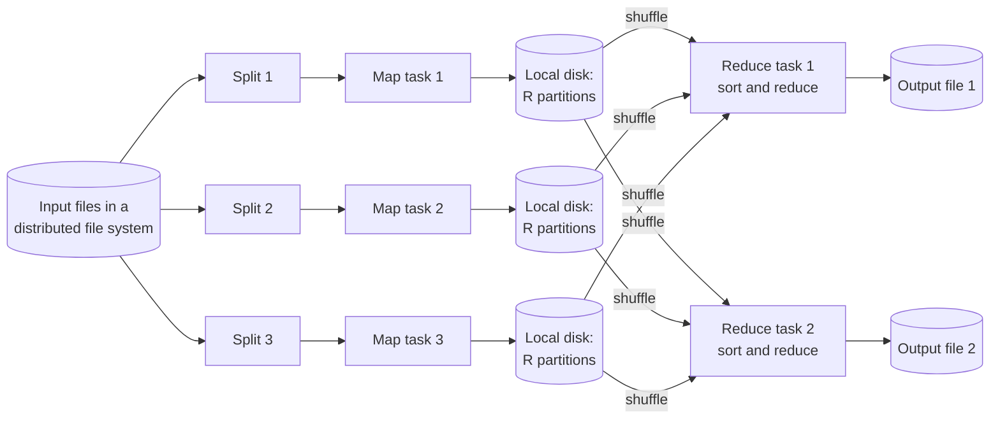
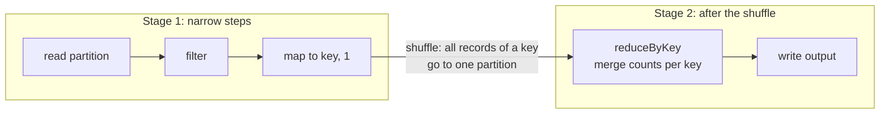
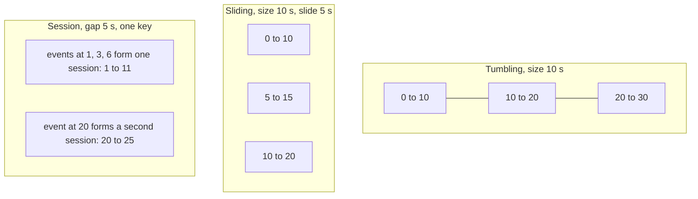
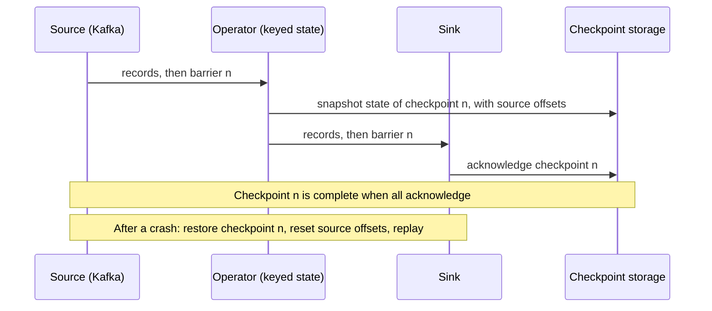
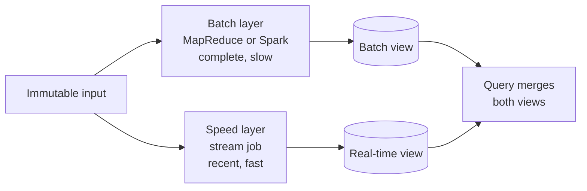

# Batch and Stream Processing

Batch processing computes a result over a bounded, complete input. Stream processing computes results over an unbounded input that never ends, and it emits results while the data arrives. This page covers the difference between the two, the MapReduce model, Spark, event time and windows, watermarks and late data, state and checkpoints in Flink and Kafka Streams, what "exactly-once" means, and the Lambda and Kappa architectures.

## Why It Matters

Many HLD prompts contain a pipeline: "count ad clicks per minute", "compute the top 10 videos per hour", "detect fraud within seconds", "rebuild the search index every night". The interviewer wants to hear which parts run as a batch job, which parts run as a stream job, how the stream job handles events that arrive late, and what happens to the numbers when a worker crashes. A candidate who says "we use Kafka and Spark" and stops gets a follow-up on windows, duplicates, and reprocessing. On the job, the same questions decide whether a dashboard shows wrong numbers after a restart, or whether a bug fix can correct last month's results. This page gives the vocabulary and the failure analysis. The message log that feeds a stream job lives on [message queues and streams](08-message-queues-and-streams.md).

## Core Concepts

**Bounded data and unbounded data**: *bounded* data has a known end (a file, a table snapshot, one day of logs). *Unbounded* data has no end (clicks, sensor readings, a change log). The Dataflow paper (Akidau et al., 2015) separates these two kinds of data from the two kinds of engine, because a stream engine can also process bounded data.

**Batch processing**: a job reads a bounded input, computes, writes an output, and ends. The result is complete for that input. Latency is minutes to hours. A failed job runs again from the start of its input.

**Stream processing**: a long-running job reads unbounded input, keeps state, and emits results continuously. Latency is milliseconds to minutes. A failed job restarts from a saved position and a saved state.

**Event time**: the time at which the event happened, as recorded by the source (for example, a timestamp that the phone writes into a click).

**Processing time**: the time at which the stream job sees the event. Event time and processing time differ because of network delay, retries, offline devices, and queue backlogs. The gap between them is the *skew*, and it changes over time.

**Window**: a finite slice of an unbounded stream, over which the job computes an aggregate. A window has a start and an end in event time.

**Watermark**: a job's estimate of event-time progress. A watermark with value *t* says "the job expects no more events with event time below *t*". The Dataflow paper defines it as a lower bound, often built by a heuristic, on the event times that the job has processed.

**Late event**: an event that arrives after the watermark has passed its event time.

**Trigger**: the rule that decides when a window emits a result, for example "when the watermark passes the end of the window" or "every 30 seconds of processing time".

**State**: data that the job remembers between events, for example a running count per key, or the open sessions.

**Checkpoint**: a consistent snapshot of the job's state and of its read positions in the sources. After a failure, the job restores the last checkpoint and reads again from the saved positions.

**Shuffle**: the redistribution of records between workers so that all records with the same key reach the same worker. A shuffle moves data over the network and often writes it to disk, so it is the main cost in a distributed job.

**Exactly-once processing**: the result of the job is the same as if each input record had affected the state and the output one time, even after failures. Section [Exactly-Once](#exactly-once-processing-what-it-means) explains what this does and does not promise.

## How It Works

### Batch Versus Stream

| Question | Batch | Stream |
|---|---|---|
| Input | Bounded: a file, a table, a day of data | Unbounded: a log or a queue |
| Output timing | After the job ends | Continuously, while data arrives |
| Latency | Minutes to hours | Milliseconds to minutes |
| Completeness | The result covers a known input | The result is an estimate that later events can change |
| Failure handling | Run the failed task or the whole job again | Restore a checkpoint, replay the log |
| State | None between runs, or tables that the job writes | Keyed state inside the job, snapshotted |
| Time problem | None: all data is present | Late and out-of-order events |
| Reprocessing | Run the job again on the old input | Replay the retained log from an old offset |
| Typical tools | MapReduce, Spark, Hive, `dbt` on a warehouse | Flink, Kafka Streams, Spark Structured Streaming |
| Typical use | Nightly reports, index rebuilds, model training, backfills | Fraud checks, live metrics, alerts, change-data pipelines |

Recommendation: ask for the latency requirement first. If the product accepts hours of delay, use a batch job, because it is simpler to build, test, and repair. Use a stream job when the product needs results in seconds, or when the input never stops and a window of recent data is the question.

### The MapReduce Model

MapReduce (Dean and Ghemawat, OSDI 2004) is the programming model that started the batch era of large clusters. The programmer writes two functions:

- `map(k1, v1) -> list(k2, v2)`: reads one input record and emits intermediate key-value pairs.
- `reduce(k2, list(v2)) -> list(v2)`: receives one intermediate key with all its values and emits the result for that key.

The library handles the rest: it splits the input, schedules tasks, moves data between the phases, and recovers from failures.



The steps, as the paper describes them:

1. The library splits the input into *M* pieces. The paper says a piece is typically 16 MB to 64 MB of input data.
2. One *master* assigns *M* map tasks and *R* reduce tasks to idle workers. The master prefers a worker that holds a copy of the input split on its local disk (*locality*), because network bandwidth is scarce.
3. A map task reads its split, calls `map` on each record, and buffers the intermediate pairs. It writes them to its local disk, in *R* regions. A *partitioning function* (by default `hash(key) mod R`) picks the region for a key.
4. A reduce task reads its region from every map worker over the network (the *shuffle*), sorts the pairs by key, and calls `reduce` for each key.
5. The reduce task writes its output to the distributed file system. The job ends when all tasks end.

A **combiner** is an optional function that runs on the map worker. It merges the pairs of one map task before the shuffle. Word count is the classic case: the combiner turns `(the, 1), (the, 1), (the, 1)` into `(the, 3)`, and the shuffle moves less data. A combiner is valid only when the reduce operation is associative and commutative.

**Fault tolerance in the paper.**

| Failure | What the paper says happens |
|---|---|
| A worker stops answering the master's ping | The master marks the worker as failed. It resets all map tasks that the worker completed, and all tasks in progress on it, to idle, and schedules them again |
| A completed map task on a failed worker | The task runs again, because its output is on the failed machine's local disk |
| A completed reduce task on a failed worker | The task does not run again, because its output is in the global file system |
| The master fails | The paper's implementation aborts the job. The client can retry |
| A *straggler* (a machine that is slow on one of the last tasks) | Near the end of the job, the master starts *backup executions* of the remaining tasks. The first copy to finish wins. The paper reports that the sort benchmark takes 44 percent longer with backup tasks disabled |

The output is safe against duplicate execution because each task writes to private temporary files. A reduce task renames its file to the final name with an atomic rename, so the final file system holds the output of exactly one execution. If the map and reduce functions are deterministic, the output equals the output of a sequential run.

**What MapReduce lacks, and what replaced it.** A MapReduce job writes the output of every stage to the file system. A multi-stage pipeline pays disk and replication cost between stages, and the programmer writes the chaining by hand. Spark and Flink keep the same model (partition, shuffle, aggregate) and add a graph of operators, in-memory data between stages, and a query optimizer. Hadoop MapReduce is rare in new systems, but its vocabulary (map, shuffle, reduce, combiner, straggler) remains the vocabulary of every successor.

### Spark

Apache Spark is a batch engine that also runs micro-batch streams. Its data structures are:

- **RDD** (resilient distributed dataset): an immutable collection that Spark splits into partitions across the cluster. The programmer applies functions to it.
- **DataFrame**: a table with named, typed columns on top of the RDD layer. Spark's query optimizer (Catalyst) reads the whole query plan and rewrites it before it runs. Use DataFrames and SQL by default. Use RDDs only when the data has no table shape.

**Lazy evaluation.** The Spark programming guide says that all transformations are lazy: they do not compute a result right away, they remember the transformations applied to a base dataset, and Spark computes them when an *action* needs a result for the driver program. `map`, `filter`, and `reduceByKey` are transformations. `count`, `collect`, `reduce`, and `saveAsTextFile` are actions. Laziness lets Spark see the whole plan, so it can combine steps and skip work.

**Fault tolerance by lineage.** Spark does not replicate each dataset. It remembers the chain of transformations that built each partition (the *lineage*). If a node fails and a partition is lost, Spark computes only that partition again, from its lineage. The guide states that a lost cached partition "will automatically be recomputed using the transformations that originally created it". The programmer can call `persist()` or `cache()` to keep a dataset in memory for reuse. The RDD guide says `cache()` on an RDD uses the `MEMORY_ONLY` level. The Java and Scala Dataset API documents a different default for `cache()` on a DataFrame: `MEMORY_AND_DISK`.

**Narrow and wide transformations, and the shuffle.**

- A *narrow* transformation (`map`, `filter`) computes each output partition from one input partition. No data crosses the network.
- A *wide* transformation (`groupByKey`, `reduceByKey`, `join`, `repartition`) needs records from many input partitions to build one output partition. It triggers a *shuffle*.

The guide calls the shuffle "a complex and costly operation", because it involves disk I/O, data serialization, and network I/O. Spark cuts the job into *stages* at the shuffle boundaries. All narrow steps inside one stage run in a pipeline on one partition without a network step.



Rules that keep a Spark job fast:

1. Use `reduceByKey` (or a DataFrame aggregate), not `groupByKey`. The first combines values on the map side, as a combiner does, before the shuffle.
2. Filter and project early, so that less data enters the shuffle.
3. Watch for *data skew*: if one key holds most of the records, one task gets most of the work, and the job waits for it. Fixes: add a random *salt* to the hot key, then aggregate twice; or broadcast the small side of a join, so the large side does not shuffle.
4. Choose the partition count so that a partition is not too small (task overhead) and not too large (memory spill).

**Structured Streaming.** Spark's stream API uses the same DataFrame operations. By default, the engine runs the query as a series of small batch jobs (*micro-batches*). The programming guide says this reaches end-to-end latencies as low as 100 milliseconds. Spark also has a *continuous processing* mode (since Spark 2.3). The guide marks it as experimental, and it gives latencies of about 1 millisecond with only an at-least-once guarantee. The Spark documentation states that Structured Streaming gives end-to-end exactly-once semantics under any failure when three conditions hold: each source is replayable (for example Kafka, which lets the engine re-read an offset range), the engine records the offset range of each trigger with checkpointing and write-ahead logs, and each sink is idempotent. The engine tracks event-time windows and uses `withWatermark` to bound the state that it keeps and to decide when to drop late data. The cost of micro-batching is a latency floor of about the batch interval. Flink processes record by record and reaches lower latency.

### Event Time, Windows, and Watermarks

Consider a phone that records a click at 12:00:05, loses the network in a tunnel, and uploads the click at 12:03:40. The click has event time 12:00:05 and processing time 12:03:40. A job that groups by processing time puts the click in the wrong minute. A job that groups by event time puts it in the right minute, but it must now decide when the minute 12:00 is complete. It cannot know. The Dataflow paper says so in a footnote: for most real data sets, the system lacks the knowledge to build a 100 percent correct watermark, because (the paper's example) a device in the wilderness may upload views much later.

**Window types** (Dataflow paper, section 2):

| Window | Definition | Example | Overlap |
|---|---|---|---|
| Tumbling (fixed) | Fixed size, no gaps, no overlap | Clicks per 1 minute | No |
| Sliding (hopping) | Fixed size and a slide period smaller than the size | Average of the last 5 minutes, updated every 1 minute | Yes: each event belongs to `size / slide` windows |
| Session | A burst of activity, closed by a gap of inactivity per key | A user session that ends after 30 minutes without a click | No: windows have different lengths per key |

The paper notes that fixed windows are a special case of sliding windows where size equals period. It calls fixed and sliding windows *aligned* (they cover all keys at the same time) and sessions *unaligned* (they exist per key). A session window needs *merging*: a new event can bridge the gap between two sessions and join them into one.



**Watermarks.** The job tracks one watermark per stream. In Flink, a common watermark strategy is bounded out-of-orderness: the watermark equals the largest event time seen so far, minus a fixed bound (the Flink documentation example uses 20 seconds). A window fires when the watermark passes the end of the window. A larger bound lets more late events in, and it adds the same delay to every result.

A watermark is a trade-off between two failures, and the Dataflow paper names them:

- **Too fast**: the watermark passes a window while events for it are still in transit. Those events are late.
- **Too slow**: a single slow source holds the watermark back. The watermark is a global progress metric, so every window waits. In Flink, a source with no events can stall the watermark, because the operator takes the minimum over its inputs. Flink's `withIdleness` marks such an input as idle so that the other inputs advance.

**Late data.** The job has four options for an event behind the watermark:

| Option | Effect | When to use |
|---|---|---|
| Drop | The result stays as emitted. Count the drops in a metric | A small error is acceptable (live dashboards) |
| Allowed lateness | The job keeps the window state for an extra period and emits an updated result when a late event arrives | The consumer can accept updates (an upsert into a table) |
| Side output | The job sends late events to a separate stream, for example a dead-letter topic | A later batch job corrects the numbers |
| Retractions | The job emits "remove the old value" and then "add the new value" | The downstream operator cannot update in place |

**The four questions of the Dataflow model.** The paper structures every pipeline by four questions: *what* results are computed (the transformation), *where* in event time they are computed (windowing), *when* in processing time they are emitted (triggers, with watermarks as one trigger input), and *how* later results relate to earlier ones for the same window. The paper lists three answers to the last question: **discarding** (each pane holds only the new data), **accumulating** (each pane holds the running total), and **accumulating and retracting** (as accumulating, plus a retraction of the previous pane). A single window can then emit an early result (a *speculative* pane, before the watermark), an *on-time* pane (at the watermark), and *late* panes. The paper's argument: watermarks alone cannot decide when to emit, because they are sometimes too fast and sometimes too slow, so a system needs triggers and multiple panes per window. The open-source descendant of the model is Apache Beam.

### State and Checkpoints

A stream job that counts per key must remember the counts. The state must survive a crash. Two designs, from the documentation of each system:

**Flink.**

- *Keyed state* lives in an embedded key-value store that is partitioned together with the stream. An operator reads and writes only the state of the key of the current event, so updates are local and need no transaction. Keys are grouped into *key groups*, the unit that Flink redistributes when the job rescales. The number of key groups equals the maximum parallelism.
- A **state backend** decides where the state lives (a heap hash map or RocksDB on local disk) and how snapshots are taken.
- **Checkpointing** (disabled by default) uses a variant of the Chandy-Lamport snapshot algorithm. The job injects *barriers* into the stream at the sources. A barrier flows with the records and never overtakes a record. When an operator has received the barrier on all its inputs, it snapshots its state. When all sinks acknowledge, the checkpoint is complete. On failure, Flink restores the latest completed checkpoint and resets each source to the position that the checkpoint recorded.
- With *aligned* checkpoints, an operator with several inputs pauses an input after its barrier arrives, until the barrier arrives on the other inputs. This alignment adds latency. *Unaligned* checkpoints (since Flink 1.11) let barriers overtake in-flight records and store those records in the snapshot, which helps when alignment is slow and costs more I/O.
- A **savepoint** is a manually triggered checkpoint. It does not expire when newer checkpoints finish. Operators use it to upgrade the job code or the cluster without losing state.



**Kafka Streams.** Kafka Streams is a library, not a cluster. The application runs as normal Java processes, and Kafka provides the log, the partitioning, and the group membership. It keeps state in local *state stores*. The DSL's stateful operators use RocksDB by default (`dsl.store.suppliers.class` defaults to the RocksDB store suppliers). Each state store has a *changelog topic* in Kafka, a compacted log of every update to the store. After a failure or a rebalance, a task rebuilds its store by reading the changelog. *Standby replicas* keep warm copies on other instances to shorten that recovery. The setting `num.standby.replicas` sets their number, and its default is 0. The unit of parallelism is the input partition. For each sub-topology, Kafka Streams creates as many *tasks* as the largest partition count among the sub-topology's input topics, and task *i* reads partition *i* of each input topic. Kafka Streams supports tumbling, hopping, sliding, and session windows. Its *grace period* controls how long a window waits for out-of-order records. A record that arrives after the grace period is dropped for that window.

| Aspect | Flink | Kafka Streams | Spark Structured Streaming |
|---|---|---|---|
| Deployment | A cluster (JobManager and TaskManagers) | A library inside your Java application | A Spark cluster |
| Input | Many sources (Kafka, files, and others) | Kafka only | Many sources (Kafka, files, and others) |
| Processing | Record by record | Record by record | Micro-batch |
| State storage | Heap or RocksDB, snapshots to durable storage | RocksDB plus changelog topic in Kafka | State store in the executors, snapshots to checkpoint storage |
| Recovery | Restore checkpoint, reset sources | Replay changelog topic, resume from committed offsets | Restore checkpoint and replay from offsets |
| Exactly-once | Checkpoints, plus transactional or idempotent sinks | Kafka transactions (`processing.guarantee=exactly_once_v2`) | Replayable source, checkpoint, idempotent sink |

### Exactly-Once Processing: What It Means

A distributed pipeline has three delivery behaviors for one record:

- **At-most-once**: the system never repeats a record, and it can lose one.
- **At-least-once**: the system never loses a record, and it can repeat one. After a crash, the job re-reads from the last checkpoint, so it processes some records a second time.
- **Exactly-once**: the *effect* on the state and the output is as if the system processed each record one time.

No system sends a message over a network exactly one time. A sender that gets no acknowledgment must send the message again, and the receiver then sees a duplicate. "Exactly-once" therefore describes the **effect**, and it comes from at-least-once delivery combined with one of two techniques:

1. **Idempotent writes**: applying the same write two times gives the same result as applying it once. Example: `UPSERT` by a deterministic key, or "set value to 7". Counting with `value = value + 1` is not idempotent.
2. **Atomic commit of state, output, and input position**: the job commits the new state, the output, and the new read offset in one transaction. After a crash, either all three happened or none happened.

How each system applies this:

- **Flink**: a checkpoint makes the *internal state* exactly-once. The Flink documentation says that for end-to-end exactly-once, the sink must take part in the checkpoint mechanism, and its table lists the guarantees per connector. The Kafka producer sink reaches exactly-once with transactional producers. Flink's approach for such sinks is a two-phase commit that ties the Kafka transaction to the checkpoint (see `kb/hld/distributed-systems/03-distributed-transactions.md`). In at-least-once mode, Flink can skip barrier alignment, so after a restore an operator can see some records twice.
- **Kafka Streams**: with `processing.guarantee=exactly_once_v2`, the library groups the consumed offsets, the state store changes (through the changelog topic), and the output records into one Kafka transaction. The Confluent documentation states that this couples state persistence, data production, and the commit in one transaction. The guarantee covers Kafka-to-Kafka processing only. It cannot cover a call to an outside system.
- **Spark Structured Streaming**: a replayable source, offsets and state in the checkpoint, and an idempotent sink give exactly-once for the sink's contents.

**What exactly-once does not cover.** An email, an HTTP call to a payment provider, or a write to a database that is not part of the transaction cannot be undone. If the job repeats the step after a crash, the side effect happens twice. For such steps, send an idempotency key (see [reliability patterns](12-reliability-patterns.md)) or write to an outbox and let a separate consumer perform the action once (see `kb/hld/distributed-systems/03-distributed-transactions.md`). Also, a consumer downstream of an at-least-once sink must be idempotent. In an interview, say "exactly-once effect through at-least-once delivery plus idempotence or transactions", and name the boundary where it ends.

### Lambda and Kappa Architectures

**Lambda architecture.** The input goes to two paths at the same time. The *batch layer* recomputes accurate results over all the data in the immutable master dataset, with high latency. The *speed layer* computes approximate results over recent data, with low latency. A *serving layer* merges both results at query time.



Jay Kreps, in "Questioning the Lambda Architecture" (O'Reilly Radar, 2014), describes Lambda as an approach to build stream processing applications on top of MapReduce and Storm. He credits its good idea (keep the input immutable and make reprocessing explicit). He then names its cost: "You implement your transformation logic twice, once in the batch system and once in the stream processing system", and the team must maintain code that has to produce the same result in two complex distributed systems. About frameworks that compile one program to both systems (for example Summingbird), he wrote: "This definitely makes things a little better, but I don't think it solves the problem."

**Kappa architecture.** Kreps proposes one processing path. The system retains the full input log in Kafka (for 30 days of reprocessing, set the retention to 30 days). To change the logic:

1. Start a second instance of the new job from the beginning of the retained log, writing to a new output table.
2. When the new job catches up, switch the application to the new table.
3. Stop the old job and delete its table.

Kreps notes that the cost is temporary extra storage for the second output table during the reload. He calls the efficiency and resource trade-offs between the two approaches "somewhat of a wash", and the gain is that the team builds, tests, debugs, and operates one system. Kreps proposed the name himself: "Maybe we could call this the Kappa Architecture, though it may be too simple of an idea to merit a Greek letter."

| Aspect | Lambda | Kappa |
|---|---|---|
| Code paths | Two (batch and stream) | One (stream) |
| Reprocessing | Batch layer recomputes from the master dataset | Replay the log into a new job and a new table |
| Serving | Merge two views at query time | Read one table |
| Needs | A batch system, a stream system, a merge step | A log with long retention, a stream engine that handles replay |
| Main cost | Two codebases that must agree | Log storage, replay time, and a stream engine that can hold large state |
| Weak point | Logic drift between the paths | Very large history, or logic that needs data that the log does not hold |

Recommendation: choose Kappa when the stream engine can express the whole computation and the log retention covers the reprocessing horizon (Kafka tiered storage, KIP-405, moves old log segments to object storage and makes long retention cheaper. It was early access in Kafka 3.6 and became production-ready in Kafka 3.9). Choose Lambda, or a batch layer next to the stream, when you must recompute over data that is much older than the log, or when the batch job needs full-scan operations that the stream engine does not express. A *lakehouse* variant writes the stream to table formats on object storage (see [storage types](10-storage-types.md)), so that the same table serves streaming reads and batch queries. Flink runs the same DataStream program as a batch job when you set `execution.runtime-mode` to `BATCH` (the default is `STREAMING`, and `AUTOMATIC` chooses from the boundedness of the sources). Spark runs the same DataFrame logic as a batch job (`spark.read`) or as a stream (`spark.readStream`). Both narrow the gap that Lambda was built around. The Dataflow paper makes a related point: the Lambda architecture does not solve the completeness problem by producing correct answers sooner. It gives a low-latency estimate, with a promise of correctness once the batch job runs, and the paper's model gives that behavior inside one pipeline through triggers and multiple panes.

### Where Each Appears in a Design

| Design problem | Batch or stream | Reason |
|---|---|---|
| Ad click counts per minute, billing reports | Stream for the live number, batch for the reconciled number (see `kb/hld/case-studies/21-ad-click-aggregation.md`) | The live number needs seconds, billing needs completeness |
| Top-K trending items | Stream with sliding windows (see `kb/hld/case-studies/16-leaderboard-and-top-k.md`) | The question is about the recent past |
| Metrics pipeline | Stream, with windowed aggregation (see `kb/hld/case-studies/17-metrics-and-monitoring.md`) | Continuous input, alert latency in seconds |
| Search index rebuild, recommendation model training | Batch | Full scans over history, no latency need |
| Keep a cache, search index, or replica in sync with a database | Stream of change events (see [event-driven architecture](16-event-driven-architecture.md)) | Each change flows to the derived store |
| Count unique users in huge streams | Stream with a sketch (see `kb/hld/distributed-systems/04-probabilistic-data-structures.md`) | Exact distinct counts need too much state |

## Trade-offs and When to Use

| Choice | Gain | Cost | Choose when |
|---|---|---|---|
| Batch job | Simple, easy to rerun and test, complete input, high throughput | High latency | Hours of delay are acceptable, or the logic scans history |
| Stream job | Low latency, continuous output | State, late data, checkpoints, harder to test and operate | The product needs seconds, or the input is endless |
| Micro-batch (Spark) | Same code as batch, strong tooling, easy exactly-once for replayable sources | Latency floor near the batch interval | Latency of seconds is enough and the team knows Spark |
| Record-at-a-time (Flink, Kafka Streams) | Millisecond latency, rich state and time control | More operational skill | Latency under one second, or complex event-time logic |
| Kafka Streams | No cluster to run, scales as normal application instances, tight Kafka integration | Kafka-only input and output | The data is already in Kafka and the team wants a library |
| Flink | Best event-time and state features, many sources and sinks | A cluster to operate | Large state, complex windows, multiple sources |
| Large watermark bound | Fewer late drops | Higher delay on every result | Accuracy matters more than freshness |
| Small watermark bound | Fresh results | More late events | Freshness matters more, and a batch job corrects later |
| Lambda | Accurate batch plus fast speed layer, uses existing batch tools | Two codebases | A batch system already exists and recompute scope is huge |
| Kappa | One codebase | Needs log retention and a capable engine | Logic fits in the stream engine |

## Java Example

The first program shows the MapReduce data flow in one process: three map tasks with a combiner, a hash partitioner into two reduce partitions, and the reduce step. It uses no cluster. It shows the *shape* of the model, not the fault tolerance.

```java
import java.util.ArrayList;
import java.util.List;
import java.util.Map;
import java.util.TreeMap;

public class Main {
    public static void main(String[] args) {
        List<String> splits = List.of("to be or not to be", "to do is to be", "not to do");
        int reducers = 2;

        // Map phase: each split emits (word, 1). The combiner adds up counts inside one split.
        // mapOutput: split -> partition -> counts
        List<List<Map<String, Integer>>> mapOutput = new ArrayList<>();
        for (String split : splits) {
            List<Map<String, Integer>> partitions = new ArrayList<>();
            for (int r = 0; r < reducers; r++) {
                partitions.add(new TreeMap<>());
            }
            for (String word : split.split(" ")) {
                int partition = Math.floorMod(word.hashCode(), reducers); // hash partitioner
                partitions.get(partition).merge(word, 1, Integer::sum);   // combiner
            }
            mapOutput.add(partitions);
        }

        // Shuffle and reduce phase: reducer r reads partition r of every map output.
        for (int r = 0; r < reducers; r++) {
            Map<String, Integer> result = new TreeMap<>(); // keys arrive sorted, as in MapReduce
            for (List<Map<String, Integer>> partitions : mapOutput) {
                partitions.get(r).forEach((word, count) -> result.merge(word, count, Integer::sum));
            }
            System.out.println("reducer " + r + ": " + result);
        }
    }
}
```

<!-- expected-output -->
```text
reducer 0: {is=1}
reducer 1: {be=3, do=2, not=2, or=1, to=5}
```

The second program shows event-time tumbling windows with a bounded-out-of-orderness watermark. The window size is 10 seconds and the lateness bound is 5 seconds. The watermark is the largest event time seen, minus 5. A window fires when the watermark reaches its end. The event with event time 8 arrives after window `[0,10)` has fired, so the job drops it. The `flush` call at the end stands for the end of a bounded input.

```java
import java.util.ArrayList;
import java.util.List;
import java.util.Map;
import java.util.TreeMap;

public class Main {
    record Event(String key, long eventTimeSec, int value) { }

    /** Tumbling event-time windows with a bounded-out-of-orderness watermark. */
    static class WindowedSum {
        private final long windowSec;
        private final long maxLatenessSec;
        private long maxEventTime = Long.MIN_VALUE;
        // window start -> sum, ordered so that windows fire in time order
        private final TreeMap<Long, Integer> open = new TreeMap<>();
        final List<String> output = new ArrayList<>();

        WindowedSum(long windowSec, long maxLatenessSec) {
            this.windowSec = windowSec;
            this.maxLatenessSec = maxLatenessSec;
        }

        long watermark() {
            return maxEventTime == Long.MIN_VALUE ? Long.MIN_VALUE : maxEventTime - maxLatenessSec;
        }

        void process(Event e) {
            long start = e.eventTimeSec() - Math.floorMod(e.eventTimeSec(), windowSec);
            if (start + windowSec <= watermark()) {
                output.add("LATE   dropped " + e + " (window [" + start + "," + (start + windowSec)
                        + ") already fired)");
                return;
            }
            open.merge(start, e.value(), Integer::sum);
            maxEventTime = Math.max(maxEventTime, e.eventTimeSec());
            // Fire every window whose end is at or before the watermark.
            while (!open.isEmpty() && open.firstKey() + windowSec <= watermark()) {
                Map.Entry<Long, Integer> w = open.pollFirstEntry();
                output.add("FIRE   window [" + w.getKey() + "," + (w.getKey() + windowSec)
                        + ") sum=" + w.getValue() + " at watermark " + watermark());
            }
        }

        void flush() {
            for (Map.Entry<Long, Integer> w : open.entrySet()) {
                output.add("FLUSH  window [" + w.getKey() + "," + (w.getKey() + windowSec)
                        + ") sum=" + w.getValue());
            }
            open.clear();
        }
    }

    public static void main(String[] args) {
        // Events arrive in processing order. Event times are out of order.
        List<Event> arrival = List.of(
                new Event("clicks", 3, 1),
                new Event("clicks", 7, 1),
                new Event("clicks", 4, 1),   // out of order, still within the lateness bound
                new Event("clicks", 12, 1),
                new Event("clicks", 9, 1),   // out of order, window [0,10) is still open
                new Event("clicks", 21, 1),  // watermark moves to 16, window [0,10) fires
                new Event("clicks", 8, 1),   // too late: window [0,10) already fired
                new Event("clicks", 14, 1),  // window [10,20) is still open
                new Event("clicks", 33, 1)); // watermark moves to 28, window [10,20) fires

        WindowedSum job = new WindowedSum(10, 5);
        for (Event e : arrival) {
            job.process(e);
        }
        job.flush();
        job.output.forEach(System.out::println);
    }
}
```

<!-- expected-output -->
```text
FIRE   window [0,10) sum=4 at watermark 16
LATE   dropped Event[key=clicks, eventTimeSec=8, value=1] (window [0,10) already fired)
FIRE   window [10,20) sum=2 at watermark 28
FLUSH  window [20,30) sum=1
FLUSH  window [30,40) sum=1
```

Assumption: the code keeps one global watermark and ignores the `key` field. A real job keeps state per key and one watermark per input partition, and it takes the minimum.

## Interview Angle

### Questions

??? question "When do you choose a batch job and when a stream job?"

    The direct answer: choose by the latency that the product needs and by the shape of the input.

    - If the product accepts delay of hours, and the logic scans a large history (a model, an index rebuild, a nightly report), use batch. A batch job has complete input, is easy to test and rerun, and has high throughput.
    - If the product needs a result in seconds (fraud checks, live counters, alerts), or the input never ends, use a stream job.
    - Many systems use both: a stream job for the live number and a batch job that recomputes the reconciled number later (ad billing is the usual example).

    Trade-off: a stream job carries extra cost. It must handle state, late events, checkpoints, and restarts. I start with the simplest option that meets the latency requirement.

??? question "What is the difference between event time and processing time, and why does it matter?"

    Event time is when the event happened at the source. Processing time is when the job sees it. They differ because of network delay, retries, offline devices, and backlogs, and the gap changes over time.

    If the job windows by processing time, a delayed event lands in the wrong window, and the result changes with the load on the pipeline. If it windows by event time, the result is the same on a replay, which also lets a backfill reproduce the live numbers. The cost: the job must decide when a window is complete. It uses a watermark for that, and a watermark is an estimate, so some events arrive late.

    I use event time for any business metric and processing time only when arrival time is the thing to measure (for example, ingestion lag).

??? question "What is a watermark? What happens to events that arrive after it?"

    A watermark is the job's estimate of event-time progress. Watermark *t* means "I expect no more events with event time below *t*". A common rule is the largest event time seen minus a fixed bound. A window fires when the watermark passes its end.

    The watermark can be wrong in two ways (Akidau et al.): too fast (late events arrive behind it) or too slow (one slow input holds back every window). The bound trades freshness against completeness.

    For a late event, I choose one of four handlings: drop it and count the drops, keep the window state for an allowed-lateness period and emit an updated result, send it to a side output for a later batch correction, or emit a retraction and a new value. The choice depends on whether the consumer can accept updates. For money, I let a batch job reconcile the numbers.

??? question "Explain tumbling, sliding, and session windows. Give a use case for each."

    - Tumbling: fixed size, no overlap. Use for "orders per minute". Each event is in one window.
    - Sliding: fixed size, smaller slide, overlapping. Use for "average latency of the last 5 minutes, updated every minute". Each event is in `size / slide` windows, so the state and the compute grow with that ratio.
    - Session: closed by a gap of inactivity per key, so windows have different lengths. Use for user sessions. A late event can bridge the gap between two sessions and merge them, so the job must support window merging.

    Tumbling is a sliding window where the size equals the slide.

??? question "What does exactly-once mean in stream processing? Is it possible?"

    A network cannot deliver a message exactly one time, because a sender without an acknowledgment must retry. So exactly-once means exactly-once *effect* on state and output. It comes from at-least-once delivery plus either idempotent writes or an atomic commit.

    - Flink: checkpoints with barriers give exactly-once state. For end-to-end, the sink must join the checkpoint (a transactional Kafka producer, or an idempotent sink).
    - Kafka Streams: `processing.guarantee=exactly_once_v2` commits the consumed offsets, the state changes, and the output records in one Kafka transaction.
    - Spark Structured Streaming: a replayable source, offsets recorded in the checkpoint and write-ahead log, and an idempotent sink. The experimental continuous processing mode gives only at-least-once.

    The limit: the guarantee covers state and the transactional sink. It does not cover a side effect outside the transaction, such as an email or a payment API call. For those, I use an idempotency key or an outbox.

??? question "How does a stream job recover from a crash without losing or double-counting data?"

    The job periodically takes a consistent snapshot of its state together with the read positions of its sources. In Flink, the job injects a barrier at the sources, each operator snapshots when the barrier has reached all its inputs, and the checkpoint completes when the sinks acknowledge. After a crash, the job restores the last completed checkpoint and re-reads from the saved offsets. The source must be replayable, which is why the log (Kafka) matters. Kafka Streams rebuilds its state stores from changelog topics and resumes from the committed offsets.

    The records between the checkpoint and the crash are processed again. State is correct because it was restored to the checkpoint. The output is correct if the sink is transactional or idempotent. If the sink is neither, the output has duplicates.

??? question "Compare the Lambda and Kappa architectures. Which would you choose?"

    Lambda runs a batch layer and a speed layer in parallel over the same input, and merges their views at query time. It gives accurate results (batch) and fast results (speed), and it costs two codebases that must agree. Kreps's objection is that maintaining code that must produce the same result in two distributed systems is very hard.

    Kappa runs one stream path. To change the logic or fix a bug, the team starts a second job from the start of the retained log, writes a new table, switches readers when it catches up, and deletes the old job and table.

    I choose Kappa when the stream engine can express the whole computation and the log retention covers the reprocessing horizon. I keep a batch layer when the history is far older than the log, or when the batch job needs operations that the stream engine lacks. Modern engines that run the same code in batch and stream mode reduce the cost of the Lambda split.

??? question "A Spark job is slow because one task runs ten times longer than the others. What is the cause and what do you do?"

    The likely cause is *data skew*: one key holds a large share of the records, so after the shuffle one partition holds far more data than the rest. The stage ends only when its slowest task ends.

    Steps: confirm in the Spark UI that the task input size is much larger than the median. Then pick the fix: salt the hot key and aggregate in two steps, broadcast the small table of a join so that the large side does not shuffle, filter early so less data enters the shuffle, or use `reduceByKey` or a DataFrame aggregate instead of `groupByKey` so that the map side combines first. If the slow machine is the cause, not the key, speculative execution (the same idea as MapReduce backup tasks) can help.

??? question "How does MapReduce tolerate a slow or failed machine?"

    The master pings workers. If a worker does not answer, the master marks it failed and schedules its tasks again. A completed map task on the failed machine also runs again, because its output is on that machine's local disk. A completed reduce task does not run again, because its output is in the global file system. For slow machines (stragglers), the master starts backup executions of the last tasks near the end of the job, and the first copy to finish wins. The paper reports that the sort program takes 44 percent longer without backup tasks. Duplicate execution is safe because each task writes private temporary files, and a reduce task commits with an atomic rename. This gives sequential-equivalent output if the functions are deterministic.

### Follow-up Questions

??? question "How do you size and rescale the state of a long-running stream job?"

    State size is the number of keys times the size of the state per key, plus window state (the number of open windows per key). Choose a state backend for that size: heap state for small state, RocksDB for state larger than memory. To rescale, take a savepoint and restart at a new parallelism. Flink redistributes state by key groups, so the maximum parallelism, which sets the number of key groups, must be large enough at the first start. Kafka Streams scales by the partition count of the input topic, so it cannot run more tasks than partitions.

??? question "How do you join two streams?"

    A stream-stream join keeps both sides in state for a time bound (a window), because a match can arrive later on either side. The state size grows with the window length times the event rate. A stream-table join keeps one side as a table (a compacted topic or a keyed state) and looks up each event, which uses less state. For large reference data that changes slowly, I prefer the stream-table join. Both joins need the two inputs to use the same key and partitioning.

??? question "How do you backfill or fix a bug in a stream job's past results?"

    Under Kappa: run the fixed job from the start of the retained log into a new table, switch readers, delete the old table. Under Lambda: rerun the batch layer. Both need the input to be immutable and retained. If the log is short, keep a copy of the raw events in object storage, and replay from there.

??? question "Why is the shuffle the main cost in a distributed job?"

    A shuffle moves records between machines so that equal keys meet. It serializes data, writes it to disk, and sends it over the network. The Spark guide lists disk I/O, serialization, and network I/O as its cost. Reduce it with map-side combining, early filtering, and by avoiding a second shuffle when the data already has the right partitioning.

### Red Flags

- "Exactly-once delivery" stated as a network property. No network gives it. Say "exactly-once effect".
- Windowing by processing time for a business metric, with no mention of event time.
- No answer for late data: "events arrive in order".
- Choosing a stream engine for a nightly report, or a nightly batch job for a fraud check that must answer in seconds.
- Claiming that Kafka Streams exactly-once covers an HTTP call or an email.
- Proposing Lambda without naming the cost of two codebases, or proposing Kappa without naming the log retention requirement.
- Using `groupByKey` on a skewed key and ignoring the shuffle.

## Common Mistakes

| Mistake | Why it hurts | Fix |
|---|---|---|
| Window by processing time | The result changes with load and differs on replay | Window by event time and set a watermark |
| A watermark with no bound for out-of-order events | The job drops many valid events | Measure the lateness distribution and set the bound from a percentile, then send drops to a side output |
| One idle partition stalls all windows | The watermark takes the minimum over inputs | Mark idle inputs (Flink `withIdleness`), or fix the producer |
| A non-idempotent sink behind an at-least-once job | A restart writes duplicates | Upsert by a deterministic key, or use a transactional sink |
| State grows without bound | Memory or disk fills and checkpoints slow down | Set a state TTL, a window end, or a watermark that lets the job drop old state |
| No checkpoint or savepoint plan | A code upgrade loses state | Use savepoints for upgrades and test the restore path |
| A combiner on a non-associative function | The result depends on the grouping | Use a combiner only for associative and commutative operations |
| Counting with `value + 1` in a retried step | A retry counts twice | Make the step idempotent, or commit with the offset in one transaction |
| Streaming where batch is enough | Extra cost and operational work | Ask for the latency requirement first |

## Commonly Confused With

| Looks like | Difference | Deciding question |
|---|---|---|
| Event time vs processing time | Event time is when it happened. Processing time is when the job saw it | Does the result have to be the same on a replay? Then use event time |
| Watermark vs trigger | A watermark estimates event-time progress. A trigger decides when a window emits | Is the question "how far has time moved" or "when do I emit"? |
| Tumbling vs sliding window | Tumbling has no overlap. Sliding overlaps | Does one event belong to one window or to several? |
| Checkpoint vs savepoint | A checkpoint is automatic, for recovery, and expires. A savepoint is manual, for upgrades, and stays | Do I recover from a crash or upgrade the job? |
| At-least-once vs exactly-once | At-least-once can repeat records. Exactly-once makes the effect equal to a single run | Does the sink tolerate duplicates? |
| Message queue vs stream processor | The queue or log stores and delivers events. The processor computes over them | Does the component keep state and windows, or only move records? See [message queues and streams](08-message-queues-and-streams.md) |
| Lambda vs Kappa | Lambda has two paths and merges. Kappa has one path and replays | Can one stream engine express all the logic and replay the log? |
| Batch OLAP query vs stream aggregation | A query reads stored data when asked. A stream job computes as data arrives | Does the answer need to exist before someone asks? See `kb/databases/10-oltp-olap-and-warehousing.md` |
| MapReduce vs Spark | Spark keeps the model and adds an operator graph, memory, and an optimizer | Is a multi-stage pipeline written by hand against the disk? |

## Quick Reference Card

- **Batch:** bounded input, high latency, complete result, rerun on failure. **Stream:** unbounded input, low latency, state, restore from a checkpoint.
- **MapReduce:** `map` emits pairs, shuffle by `hash(key) mod R`, `reduce` per key. Combiner cuts shuffle data. Re-run failed tasks, back up stragglers, commit with atomic rename.
- **Spark:** lazy transformations, actions run the plan, lineage recovers lost partitions, a wide transformation causes a shuffle and a stage boundary. Fix skew with salting or a broadcast join.
- **Event time** for business logic. **Watermark** is an estimate: too fast gives late data, too slow gives delay.
- **Windows:** tumbling (no overlap), sliding (overlap, size/slide copies), session (gap per key, merging).
- **Late data:** drop and count, allowed lateness, side output, retraction.
- **Dataflow questions:** what, where (event time), when (processing time, triggers), how (discarding, accumulating, retracting).
- **Flink:** keyed state, RocksDB or heap, barrier checkpoints, savepoints for upgrades. **Kafka Streams:** library, RocksDB with changelog topics, `exactly_once_v2`. **Spark SS:** micro-batch by default (continuous mode is experimental and at-least-once), replayable source, checkpoint, idempotent sink.
- **Exactly-once is an effect:** at-least-once delivery plus idempotence or an atomic commit. It stops at side effects outside the transaction.
- **Lambda:** two paths plus a merge, two codebases. **Kappa:** one path, replay a retained log into a new table, switch, delete the old.
- **Say in the interview:** the latency requirement, the time domain, the watermark bound, the late-data policy, and the sink's duplicate behavior.

## Further Reading

- Dean and Ghemawat, "MapReduce: Simplified Data Processing on Large Clusters", OSDI 2004 (`https://research.google/pubs/mapreduce-simplified-data-processing-on-large-clusters/`). The model, the master and worker design, locality, backup tasks, and atomic commit of task output.
- Akidau et al., "The Dataflow Model: A Practical Approach to Balancing Correctness, Latency, and Cost in Massive-Scale, Unbounded, Out-of-Order Data Processing", Proceedings of the VLDB Endowment 8(12), 2015 (`https://www.vldb.org/pvldb/vol8/p1792-Akidau.pdf`). Event time, windows, watermarks, triggers, and accumulation modes.
- Jay Kreps, "Questioning the Lambda Architecture", O'Reilly Radar, 2014 (`https://www.oreilly.com/radar/questioning-the-lambda-architecture/`). The argument for one stream path with replay.
- Apache Spark, "RDD Programming Guide" (`https://spark.apache.org/docs/latest/rdd-programming-guide.html`). Lazy transformations, shuffle cost, persistence, and recovery.
- Apache Spark, "Structured Streaming Programming Guide" (`https://spark.apache.org/docs/latest/streaming/index.html`), with its "Getting Started" page (`https://spark.apache.org/docs/latest/streaming/getting-started.html`) for the exactly-once conditions and its "Performance Tips" page for continuous processing. Micro-batch model, watermarks, and fault tolerance.
- Apache Flink documentation, "Execution Mode (Batch/Streaming)" (`https://nightlies.apache.org/flink/flink-docs-stable/docs/dev/datastream/execution_mode/`). The `execution.runtime-mode` setting.
- Apache Kafka 3.9.0 release announcement (`https://kafka.apache.org/blog/2024/11/06/apache-kafka-3.9.0-release-announcement/`). Tiered storage (KIP-405) declared production-ready.
- Apache Flink documentation, "Stateful Stream Processing" (`https://nightlies.apache.org/flink/flink-docs-stable/docs/concepts/stateful-stream-processing/`). Keyed state, state backends, barriers, and savepoints.
- Apache Flink documentation, "Fault Tolerance Guarantees of Data Sources and Sinks" (`https://nightlies.apache.org/flink/flink-docs-stable/docs/connectors/datastream/guarantees/`). Which connectors give exactly-once.
- Apache Flink documentation, "Generating Watermarks" (`https://nightlies.apache.org/flink/flink-docs-stable/docs/dev/datastream/event-time/generating_watermarks/`). Bounded out-of-orderness and idleness.
- Apache Kafka documentation, "Kafka Streams" (`https://kafka.apache.org/documentation/streams/`) and Confluent's "Kafka Streams Concepts" (`https://docs.confluent.io/platform/current/streams/concepts.html`). State stores, grace periods, and `processing.guarantee`.
- Chandy and Lamport, "Distributed Snapshots: Determining Global States of Distributed Systems", ACM TOCS, 1985. The snapshot algorithm that Flink's checkpoints build on.
- Kleppmann, *Designing Data-Intensive Applications*, chapters 10 and 11. Batch and stream processing, and the reasoning about exactly-once.
- Related pages: [scalability and availability](01-scalability-and-availability.md), [load balancing, DNS and CDN](02-load-balancing-dns-cdn.md), [caching](03-caching.md), [choosing a database](04-choosing-a-database.md), [replication](05-replication.md), [partitioning and sharding](06-partitioning-and-sharding.md), [consistency and CAP](07-consistency-and-cap.md), [message queues and streams](08-message-queues-and-streams.md), [communication patterns](09-communication-patterns.md), [storage types](10-storage-types.md), [search and indexing](11-search-and-indexing.md), [reliability patterns](12-reliability-patterns.md), [rate limiting algorithms](13-rate-limiting-algorithms.md), [microservices and monoliths](14-microservices-and-monoliths.md), [unique ID generation](15-unique-id-generation.md), [event-driven architecture](16-event-driven-architecture.md), [geospatial indexing](18-geospatial-indexing.md), [multi-region and disaster recovery](19-multi-region-and-disaster-recovery.md), [observability in design](20-observability-in-design.md), [security in design](21-security-in-design.md).
