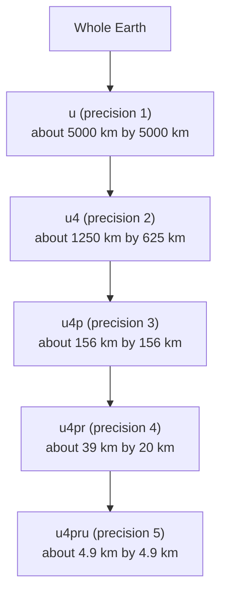
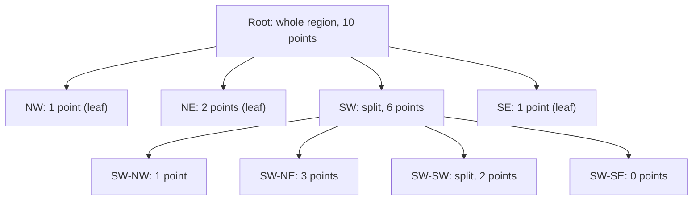
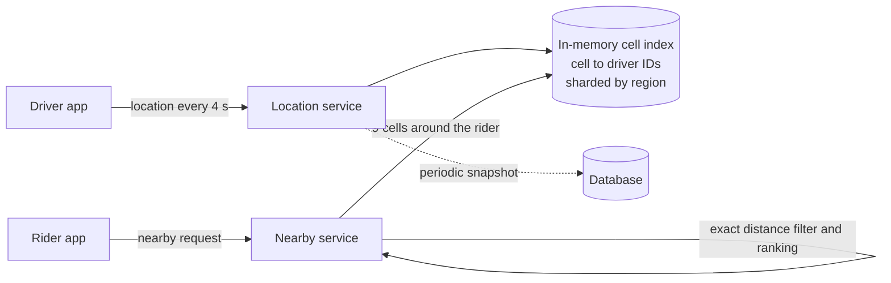

# Geospatial Indexing

A geospatial index is a data structure that finds points and regions by location: "the 10 drivers within 2 km of this rider", "all restaurants inside this map view". This page covers why an ordinary index fails for location, then geohash, quadtrees, S2 cells, H3 hexagons, R-trees with PostGIS, a nearby-search design, and a comparison.

## Why It Matters

Ride hailing, food delivery, maps, dating apps, and "stores near me" all ask the same question: which objects are near this point? The interviewer wants to hear why a plain database index cannot answer it, how you cut the plane into cells, how you handle a query near a cell border, and how you keep the index fresh when objects move. Candidates who say "use a geohash" without the border problem lose points on the first follow-up. On the job, the same choice decides whether a nearby query reads 20 rows or 2 million. The full ride-hailing design lives in `kb/hld/case-studies/11-ride-hailing-and-proximity.md`. This page gives the building blocks.

## Core Concepts

**Latitude and longitude**: latitude is the angle north or south of the equator (-90 to 90 degrees). Longitude is the angle east or west of the prime meridian (-180 to 180 degrees).

**Point query, range query, nearest-neighbor query**: a *range query* (also *bounding-box query*) returns all objects inside a rectangle. A *radius query* returns all objects within a distance of a point. A *k-nearest-neighbor query* (*kNN*) returns the *k* closest objects. Most nearby-search products need the radius query or the kNN query.

**Spatial index**: an index that maps a location to the nearby objects, so that a query reads only the objects in the right area.

**Cell**: one region of the space that a spatial index defines. A *grid* cuts space into equal cells. A *hierarchy* cuts each cell into smaller cells.

**Space-filling curve**: a curve that visits every cell of a grid in one order, so that a two-dimensional position becomes a one-dimensional number. A one-dimensional number can use an ordinary B-tree. Geohash uses the *Z-order curve* (also *Morton order*). S2 uses the *Hilbert curve*.

**Haversine distance**: the great-circle distance between two points on a sphere. It treats the Earth as a sphere with a mean radius of about 6371 km. The error against the real Earth shape is up to about 0.5 percent (the Redis `GEOADD` documentation gives this worst-case figure for its sphere model).

**Edge problem** (also *boundary problem*): two points that are close in space lie in different cells, so a query that reads only one cell misses a close neighbor.

### Why a Plain Index Fails

Consider a table `places(id, lat, lon)` with two B-tree indexes, one on `lat` and one on `lon`. The query "within 2 km of (51.5, -0.1)" becomes `lat BETWEEN a AND b AND lon BETWEEN c AND d`. A B-tree range scan works on one column. The database scans the `lat` range, which is a horizontal band around the whole Earth that holds millions of rows, and then filters by `lon`. It cannot use both columns at once, because a B-tree sorts in one dimension and a rectangle is a two-dimensional shape. A composite index `(lat, lon)` has the same limit: it narrows the first column and then scans within it.

A spatial index fixes this by mapping the two dimensions to cells, so that the rows in a rectangle sit in a few contiguous ranges of the index. All structures below do this in one of two ways:

| Way | Structures | Idea |
|---|---|---|
| Map each point to a cell ID, then use a normal sorted index or hash map on the ID | Geohash, S2, H3 | A query computes the cell IDs that cover the search area, then reads those IDs |
| Build a tree whose nodes are regions | Quadtree, k-d tree, R-tree | A query walks down the tree and skips the regions that do not overlap the search area |

## How It Works

### Geohash

Gustavo Niemeyer invented geohash in 2008 and placed it in the public domain (`geohash.org`). Morton described the Z-order idea in 1966. Geohash adds a base-32 text encoding.

**Encoding, step by step.**

1. Start with the interval for longitude, -180 to 180, and for latitude, -90 to 90.
2. Take the longitude interval. Split it in the middle. If the longitude is in the upper half, write bit `1` and keep the upper half. Otherwise write bit `0` and keep the lower half.
3. Do the same for latitude.
4. Alternate: longitude bit, latitude bit, longitude bit, and so on. Longitude gets the first bit, so for an odd number of bits longitude gets one more bit than latitude.
5. Cut the bit string into groups of 5 bits. Map each group to a character of the alphabet `0123456789bcdefghjkmnpqrstuvwxyz` (digits and lowercase letters, without `a`, `i`, `l`, `o`).

Each character adds 5 bits, so each extra character divides the cell into 32 smaller cells. A geohash names a **rectangle**, not a point. A longer hash names a smaller rectangle that lies inside the rectangle of its prefix.



**Prefix property.** All points in one cell share the geohash prefix of that cell. A database can therefore find all places in the cell `u4pru` with a B-tree prefix scan (`WHERE geohash LIKE 'u4pru%'`, or a range `>= 'u4pru' AND < 'u4prv'`). A hash map keyed by the prefix works too.

**Precision table.** The cell size depends on the number of bits. The sizes below are approximate: they come from the bit counts (5 bits per character, longitude first), the cell width and height in degrees (360 / 2^longitude bits and 180 / 2^latitude bits), and 111.19 km per degree (a sphere of radius 6371 km). They are the sizes **at the equator**. Cell *width* in kilometers shrinks by `cos(latitude)` away from the equator, and cell height stays the same. At latitude 60 degrees, the width is about half. The bit counts agree with the Wikipedia article "Geohash".

| Precision (characters) | Bits (latitude, longitude) | Cell width (approximate) | Cell height (approximate) |
|---|---|---|---|
| 1 | 2, 3 | 5000 km | 5000 km |
| 2 | 5, 5 | 1250 km | 625 km |
| 3 | 7, 8 | 156 km | 156 km |
| 4 | 10, 10 | 39 km | 19.5 km |
| 5 | 12, 13 | 4.9 km | 4.9 km |
| 6 | 15, 15 | 1.2 km | 610 m |
| 7 | 17, 18 | 153 m | 153 m |
| 8 | 20, 20 | 38 m | 19 m |
| 9 | 22, 23 | 4.8 m | 4.8 m |
| 10 | 25, 25 | 1.2 m | 60 cm |
| 11 | 27, 28 | 15 cm | 15 cm |
| 12 | 30, 30 | 3.7 cm | 1.9 cm |

Recommendation: choose the precision so that the cell side is at least as large as the search radius. Then a radius query needs only the query cell and its 8 neighbors (9 cells). For a 2 km radius, precision 5 (4.9 km cells) fits. Precision 6 (1.2 km by 0.6 km) does not, because a 2 km radius would cross more than one ring of neighbors.

**Neighbor search.** A radius query follows these steps:

1. Encode the query point at the chosen precision. This gives the *query cell*.
2. Compute the 8 neighbor cells.
3. Read all objects in the 9 cells from the index.
4. Compute the exact distance to each object, and keep those within the radius (the cells are only a coarse filter).
5. Sort by distance for kNN.

To compute a neighbor, the code in the Java example finds the center of the cell, moves it by one cell width or height, and encodes again. Production libraries use lookup tables on the last character instead, and recurse into the prefix when the neighbor crosses the border of the parent cell.

**Edge problems.** These are the failure modes that interviewers probe.

| Problem | What happens | Fix |
|---|---|---|
| Border split | Two points 20 m apart lie on both sides of a cell border, so they share a short prefix, or none | Always query the 9-cell neighborhood, never one cell |
| Z-order jumps | The Z-order curve jumps. Cells next to each other in space can be far apart in the sorted order, for example across the middle of the grid | A prefix match means "close". The reverse is false. Do not use "similar prefix" as a distance measure |
| Prime meridian and equator | Points on both sides of the equator or of longitude 0 are in different halves at the first split, so they share no prefix at all. The Java example shows this: two points 21 m apart at longitude 0 have no common prefix | The 9-cell query handles it, because the neighbor calculation crosses the line |
| 180-degree meridian | Longitude wraps from 180 to -180. Neighbor calculation must wrap | Wrap longitude when computing the neighbor |
| Poles | Cells near the poles are very narrow, and the neighbors of a polar cell are special | Restrict the index to latitudes that you serve. Redis rejects latitudes beyond about plus or minus 85.05 degrees |
| Cell shape changes with latitude | A cell is a rectangle in degrees, so its width in meters falls with the cosine of the latitude, and a "square" cell becomes a thin strip | Pick the precision per region, or compute the cell window from the radius at the query latitude |
| Dense cells | A cell in a city center holds thousands of objects, while a rural cell holds none | Use a finer precision in dense regions, or use a quadtree that adapts |

**Real systems.** Redis stores geo data as a sorted set and says `GEOADD` interleaves latitude and longitude bits into a 52-bit integer geohash that serves as the sorted-set score. The command documentation says a bounding-box or radius query checks the 1 + 8 areas that cover the shape and discards members outside it. The valid latitudes are -85.05112878 to 85.05112878 degrees. Redis computes distance with the Haversine formula and says the worst-case error is up to 0.5 percent. Elasticsearch and several other stores also use geohash-style cells for geo aggregations.

### Quadtree

A **quadtree** divides a square region into four equal quadrants (NW, NE, SW, SE) and divides a quadrant again when it holds too many points. Finkel and Bentley introduced the point-search structure in 1974 ("Quad Trees: A Data Structure for Retrieval on Composite Keys", *Acta Informatica* 4(1)).



**Dynamic quadtree.** Each leaf holds up to a *capacity* of points (for example 100). When an insert pushes a leaf over the capacity, the leaf splits into four children and hands its points down. A dense area gets deep, small cells. An empty area stays one large cell. The tree adapts to the data.

- *Insert*: walk from the root to the leaf that contains the point, add it, and split if the leaf is over capacity. Cost: O(depth).
- *Range query*: start at the root. If the node's square does not overlap the query rectangle, skip the whole subtree. If the node is a leaf, test its points. Otherwise recurse into the four children.
- *kNN*: walk down to the leaf of the query point. Collect candidates. Use a priority queue ordered by the distance to each region, and stop when the nearest unexplored region is farther than the *k*-th best point. For a radius query, start with the range query on the square around the radius.
- *Delete*: remove the point. If four sibling leaves together hold less than the capacity, merge them.
- *Move*: delete and insert (an object that moves often makes the tree churn).

A dynamic quadtree lives in memory, because its shape changes. Each node holds four child pointers or a short list of points. Assumption: 500 000 points with a leaf capacity of 100 give about 5000 leaves at minimum, and in practice a few tens of thousands of nodes, which is small (a few megabytes). The index therefore fits easily in the memory of one server, and it rebuilds from the database after a restart in seconds to minutes.

**Static quadtree** (or fixed grid). Fix the depth in advance, for example 12 levels, so that every point maps to a cell ID by arithmetic. There are no splits and no pointers to maintain, and the cell ID works as a key in a database or hash map. The cost is that dense areas overload one cell, and the depth is a global choice. Geohash is a static quadtree variant with 32 children per step, and S2 is a static quadtree on a sphere.

| Property | Dynamic quadtree | Static quadtree or grid |
|---|---|---|
| Adapts to density | Yes | No |
| Needs memory-resident structure | Yes | No: the cell ID is a plain key |
| Insert and move cost | Walk the tree, maybe split or merge | Compute an ID, update one list |
| Works in a database column | No | Yes |
| Rebalancing after bursts | Splits and merges | None, or a re-keying job |

**Depth guard.** If many points have the same coordinates, splitting never separates them, and the tree recurses forever. Cap the depth, or let a leaf at the maximum depth exceed the capacity. The runnable example below omits this guard to stay short.

### S2 Cells

S2 is a library from Google that indexes the sphere. The S2 documentation describes the construction:

1. Project the sphere onto the six faces of a cube. The top-level cells (level 0) are the six faces.
2. Subdivide each cell recursively into four children, down to level 30. A nonlinear transform between the cube face and the sphere keeps cells at one level close in size. A leaf cell at level 30 is about 1 cm across.
3. Order the cells with a **Hilbert curve**: six Hilbert curves, one per face, connected into a single loop over the sphere.
4. Give each cell a 64-bit `S2CellId`: 3 bits for the face, 2 bits for each level, then a single 1 bit and zeros. The position of the lowest set bit gives the level. The documentation says that cells that are close in ID order are generally close in space.

Because the curve is a Hilbert curve, a cell and its descendants have contiguous ID ranges. A range scan on a B-tree (or a Bigtable or Spanner key range) reads a whole cell. S2 also handles the whole sphere with no pole singularities and no wrap-around at 180 degrees.

**Region covering.** `S2RegionCoverer` approximates any region (a circle, a polygon) with a small set of cells of different levels, an `S2CellUnion`. Its `max_cells` option (default 8 in the documentation) sets the number of cells, with more cells giving a tighter fit. A query becomes "for each covering cell, scan the ID range of that cell in the index, then filter by exact distance".

Approximate S2 cell sizes (from the S2 "Cell Statistics" page; the values are averages, and cells vary in area by about a factor of two inside one level):

| Level | Average area (approximate) | Typical use |
|---|---|---|
| 0 | 85 million km2 (one cube face) | Face |
| 10 | 81 km2 | Metropolitan area |
| 12 | 5.1 km2 | City district |
| 14 | 0.32 km2 | City block cluster |
| 16 | 19 800 m2 | Building block |
| 20 | 77 m2 | Part of a building |
| 30 | 0.74 cm2 | Leaf |

MongoDB (its `2dsphere` index) and CockroachDB (its spatial index) build on S2 cells. Check the vendor documentation of the product version that you use before you state this in an interview.

### H3 Hexagons

H3 is Uber's hexagonal hierarchical grid (open source at `h3geo.org`). It divides the globe into hexagonal cells at 16 resolutions, 0 to 15.

**Why hexagons.** Each hexagon has 6 neighbors, and the center of a hexagon is the same distance from the center of each neighbor. A square has 4 edge neighbors at one distance and 4 corner neighbors at a longer distance (the ratio is the square root of 2). With equal neighbor distances, "within *k* rings" approximates a circle well. This suits demand and supply analysis, such as surge pricing, where each cell is a unit of a map and its neighbors matter equally.

**Facts from the H3 documentation.**

- H3 resolutions run from 0 (average hexagon area about 4.36 million km2, 122 cells for the whole Earth) to 15 (average area about 0.9 m2, about 569.7 trillion cells).
- There are always exactly 12 **pentagons** at every resolution. The shape of an icosahedron (the base shape) forces them. Code that processes cells must accept a pentagon with 5 neighbors.
- The hierarchy has an aperture of 7: a cell has seven children. The H3 documentation says hexagons do not cleanly subdivide into seven finer hexagons, and that the grid approximates the subdivision by rotating its orientation at each level. A child cell is therefore **not exactly contained** in its parent, so a parent-child relation is an approximation and not an exact containment (unlike geohash and S2).

| Resolution | Average hexagon area (approximate) | Average edge length (approximate) | Typical use |
|---|---|---|---|
| 0 | 4 357 449 km2 | 1281 km | Continent |
| 4 | 1770 km2 | 26.1 km | Region |
| 7 | 5.16 km2 | 1.41 km | City district |
| 8 | 0.737 km2 | 531 m | Neighborhood |
| 9 | 0.105 km2 | 201 m | Several blocks |
| 10 | 0.015 km2 | 75.9 m | One block |
| 12 | 307 m2 | 10.8 m | Building |
| 15 | 0.895 m2 | 58 cm | Fine |

The values come from the H3 "Table of Cell Areas" page (`https://h3geo.org/docs/core-library/restable`).

Typical use in a nearby search: `latLngToCell(lat, lng, 9)` gives the cell of a driver. `gridDisk(cell, k)` returns the cell and all cells within *k* steps. The service keeps `cell -> set of driver IDs` and unions the sets of the cells in the disk.

### R-tree and PostGIS

An **R-tree** (Guttman, 1984) is a balanced tree like a B-tree, but each node stores a **minimum bounding rectangle** (MBR) that covers all the objects below it. Leaves hold the MBRs of the objects. A range query descends into every child whose MBR overlaps the query rectangle. Unlike a quadtree, the regions of sibling nodes can overlap, and the tree stays balanced. It handles **extents** (polygons, roads, regions) and not only points, which is why it is the standard index for geographic databases. R-tree variants (R\*-tree, STR bulk loading) change how nodes split and pack.

**PostGIS.** The PostGIS documentation says that PostGIS uses an R-tree index implemented on top of GiST (Generalized Search Tree), and calls GiST the most commonly used and versatile spatial index method. Practical points:

- `CREATE INDEX ... USING GIST (geom)` builds the index. The `&&` operator compares bounding boxes and uses the index.
- `ST_DWithin(a, b, distance)` is the radius filter that uses the index. `ST_Distance(a, b) < d` on its own does not use the index efficiently, so write `ST_DWithin`.
- The `<->` operator returns a distance that a GiST index can use to order results, so `ORDER BY geom <-> point LIMIT k` is an indexed kNN query.
- The `geography` type measures in meters on a spheroid. The `geometry` type works on a plane in the units of its coordinate system.
- The PostGIS documentation says SP-GiST (quad-tree and k-d tree style) and BRIN are available for some data. It states that SP-GiST and BRIN have no kNN support at present. Check the documentation of your version.

<!-- sql-skip: PostgreSQL -->
```sql
-- PostgreSQL with the PostGIS extension. SQLite does not run this block.
CREATE EXTENSION IF NOT EXISTS postgis;

CREATE TABLE places (
    id   bigserial PRIMARY KEY,
    name text NOT NULL,
    geog geography(Point, 4326) NOT NULL   -- longitude, latitude in degrees
);

CREATE INDEX places_geog_gist ON places USING GIST (geog);

-- Radius query: places within 2000 meters of a point, nearest first.
SELECT id, name, ST_Distance(geog, ST_SetSRID(ST_MakePoint(-0.1, 51.5), 4326)::geography) AS meters
FROM places
WHERE ST_DWithin(geog, ST_SetSRID(ST_MakePoint(-0.1, 51.5), 4326)::geography, 2000)
ORDER BY meters
LIMIT 20;
```

The block above is PostgreSQL syntax with the PostGIS extension, so the SQL runner skips it. Note the argument order: `ST_MakePoint(longitude, latitude)`, x before y.

### A Nearby-Search Design

Requirements to ask for: the object count, whether objects move, how often they move, the radius, and the freshness that the product needs.

| Case | Object count and change rate | Choice | Reason |
|---|---|---|---|
| Static places (restaurants, stores) | Millions, change rarely | PostGIS (GiST), or Elasticsearch `geo_point`, or a geohash column with a B-tree index | The data is durable and joins with other attributes (rating, open now) |
| Moving objects (drivers, couriers) | Hundreds of thousands, a location update every 3 to 5 seconds each | In-memory index sharded by region: Redis `GEOADD`, or a cell map (H3 or geohash) in service memory | Update rate of tens of thousands per second would overload a disk index |
| Heavy analytics by region (surge, supply and demand) | Aggregate counts per cell | H3 or S2 cell IDs as group keys | Equal neighbor distance and a stable cell ID per area |
| Polygons (delivery zones, geofences) | Thousands of shapes | PostGIS, or S2 coverings stored per shape | Containment tests on shapes |



Steps of a nearby query:

1. The service computes the cell of the rider, at the precision that matches the radius.
2. It builds the 9 cells of the neighborhood (or the H3 `gridDisk`, or an S2 covering).
3. It reads the set of object IDs for each cell from the in-memory index.
4. It fetches the current positions, computes exact distances, filters by radius, and ranks.
5. If the result is too small, it widens the search by one ring and repeats.

**Update path for moving objects.** On each location update the service computes the new cell. If the cell changed, it removes the ID from the old cell and adds it to the new one. If the cell did not change, it only updates the stored position. Most updates stay in the same cell, so the index changes rarely. Keep a TTL on each entry, so a driver whose app died disappears from the index. Shard the index by region (a coarse cell prefix), so that one shard owns a city, and a query near a shard border asks both shards. See [partitioning and sharding](06-partitioning-and-sharding.md).

**Scale numbers (approximate, assumption-based).** Assume 500 000 drivers online and a location update every 4 seconds: 500 000 / 4 = 125 000 updates per second. One in-memory shard handles tens of thousands of simple updates per second, so the index needs a handful of shards, grouped by region. Each entry holds an ID and two coordinates, so a record costs about 50 to 100 bytes with overhead, and 500 000 entries take about 25 to 50 MB. The memory is not the limit. The update rate and the hot cities are.

## Trade-offs and When to Use

| Structure | Space | Moves | Border handling | Shape | Best for | Weak point |
|---|---|---|---|---|---|---|
| Geohash | A string column in any store | Re-key on cell change | 9-cell query | Rectangles that distort with latitude | Quick start, Redis, SQL prefix scans, sharding keys | Edge problems, Z-order jumps, poles |
| Dynamic quadtree | In memory, adapts to density | Delete and insert | Tree search handles it | Squares of varied size | Uneven density, single-server in-memory index | Not a database column, rebalance cost |
| S2 | 64-bit integers | Re-key on cell change | Coverings, with contiguous ranges | Quadrilaterals on a sphere, almost equal area | Global scale, region coverings, range-scan stores | A larger library, quadrilateral neighbors differ |
| H3 | 64-bit integers | Re-key on cell change | `gridDisk` rings | Hexagons (and 12 pentagons), equal neighbor distance | Analytics, surge pricing, smooth neighborhoods | Parent and child do not nest exactly |
| R-tree (PostGIS GiST) | On disk, balanced | In-place insert and delete | Overlap test on MBRs | Rectangles of any size, objects with extent | Durable data, polygons, SQL joins, kNN with `<->` | Write cost under heavy moves |
| Plain B-tree on lat and lon | Two normal indexes | Cheap | None possible | None | Nothing spatial | Scans a whole latitude band |

Recommendation: for a static data set in a database, use PostGIS. For moving objects at high update rates, use an in-memory cell index (geohash, S2, or H3) sharded by region. For a quick interview answer, pick geohash for simplicity, name the edge problem, and fix it with the 9-cell query. Pick H3 or S2 when you need neighbor rings, analytics, or global coverage, and say why.

## Java Example

The first program is a geohash encoder, a decoder for the cell bounds, a neighbor function, and a nearby search. It indexes places by 6-character geohash, so each cell is about 1.2 km by 0.6 km (approximate). It then shows the edge problem: two places 21 m apart, one on each side of longitude 0, have no common prefix, and a query of only the query cell misses one of them. The 9-cell query finds both. The encoder reproduces the example from the Wikipedia article: the point 57.64911, 10.40744 gives `u4pruydqqvj` at 11 characters.

```java
import java.util.ArrayList;
import java.util.HashMap;
import java.util.List;
import java.util.Map;

public class Main {
    public static void main(String[] args) {
        // 1. Encode a known point. Wikipedia gives u4pruydqqvj for this point.
        String hash = Geohash.encode(57.64911, 10.40744, 11);
        System.out.println("encode(57.64911, 10.40744, 11) = " + hash);
        System.out.println("prefixes: " + hash.substring(0, 1) + " " + hash.substring(0, 5)
                + " " + hash.substring(0, 7));

        // 2. Decode the cell of a 6-character hash.
        double[] box = Geohash.bounds("u4pruy");
        System.out.printf("bounds(u4pruy) lat %.5f..%.5f lon %.5f..%.5f%n",
                box[0], box[1], box[2], box[3]);

        // 3. Neighbors of a cell.
        System.out.println("neighbors(u4pruy) = " + Geohash.neighbors("u4pruy"));

        // 4. The edge problem: two points 30 m apart on both sides of the prime meridian.
        double lat = 51.5000;
        String west = Geohash.encode(lat, -0.0001, 7);
        String east = Geohash.encode(lat, 0.0002, 7);
        System.out.println("west cell " + west + ", east cell " + east
                + ", common prefix length " + commonPrefix(west, east));
        System.out.printf("distance = %.1f m%n", Geohash.distanceMeters(lat, -0.0001, lat, 0.0002));

        // 5. Nearby search: index places by 6-character geohash, then query 9 cells.
        List<Place> places = List.of(
                new Place("A", 51.5000, -0.0001),
                new Place("B", 51.5000, 0.0002),
                new Place("C", 51.5100, 0.0100),
                new Place("D", 51.5400, 0.0500),
                new Place("E", 48.8566, 2.3522));
        int precision = 6;
        Map<String, List<Place>> index = new HashMap<>();
        for (Place p : places) {
            String cell = Geohash.encode(p.lat(), p.lon(), precision);
            index.computeIfAbsent(cell, k -> new ArrayList<>()).add(p);
        }
        double qLat = 51.5000;
        double qLon = 0.0002;
        double radius = 2000;
        String queryCell = Geohash.encode(qLat, qLon, precision);
        System.out.println("query cell only: "
                + search(index, List.of(queryCell), qLat, qLon, radius));
        List<String> cells = new ArrayList<>();
        cells.add(queryCell);
        cells.addAll(Geohash.neighbors(queryCell));
        System.out.println("query 9 cells:   " + search(index, cells, qLat, qLon, radius));
    }

    static int commonPrefix(String a, String b) {
        int i = 0;
        while (i < a.length() && i < b.length() && a.charAt(i) == b.charAt(i)) {
            i++;
        }
        return i;
    }

    static List<String> search(Map<String, List<Place>> index, List<String> cells,
                               double lat, double lon, double radiusMeters) {
        List<String> found = new ArrayList<>();
        for (String cell : cells) {
            for (Place p : index.getOrDefault(cell, List.of())) {
                double d = Geohash.distanceMeters(lat, lon, p.lat(), p.lon());
                if (d <= radiusMeters) {
                    found.add(p.name() + "(" + Math.round(d) + " m)");
                }
            }
        }
        java.util.Collections.sort(found);
        return found;
    }
}

record Place(String name, double lat, double lon) { }

class Geohash {
    private static final String BASE32 = "0123456789bcdefghjkmnpqrstuvwxyz";

    static String encode(double lat, double lon, int length) {
        double latMin = -90, latMax = 90, lonMin = -180, lonMax = 180;
        StringBuilder sb = new StringBuilder();
        boolean lonBit = true; // bit 0 is longitude, then the bits alternate
        int bits = 0;
        int ch = 0;
        while (sb.length() < length) {
            if (lonBit) {
                double mid = (lonMin + lonMax) / 2;
                if (lon >= mid) {
                    ch = ch * 2 + 1;
                    lonMin = mid;
                } else {
                    ch = ch * 2;
                    lonMax = mid;
                }
            } else {
                double mid = (latMin + latMax) / 2;
                if (lat >= mid) {
                    ch = ch * 2 + 1;
                    latMin = mid;
                } else {
                    ch = ch * 2;
                    latMax = mid;
                }
            }
            lonBit = !lonBit;
            if (++bits == 5) {
                sb.append(BASE32.charAt(ch));
                bits = 0;
                ch = 0;
            }
        }
        return sb.toString();
    }

    /** Returns {latMin, latMax, lonMin, lonMax}. */
    static double[] bounds(String hash) {
        double latMin = -90, latMax = 90, lonMin = -180, lonMax = 180;
        boolean lonBit = true;
        for (char c : hash.toCharArray()) {
            int v = BASE32.indexOf(c);
            for (int i = 4; i >= 0; i--) {
                int bit = (v >> i) & 1;
                if (lonBit) {
                    double mid = (lonMin + lonMax) / 2;
                    if (bit == 1) lonMin = mid; else lonMax = mid;
                } else {
                    double mid = (latMin + latMax) / 2;
                    if (bit == 1) latMin = mid; else latMax = mid;
                }
                lonBit = !lonBit;
            }
        }
        return new double[] {latMin, latMax, lonMin, lonMax};
    }

    /** The 8 neighbors: step one cell size from the center and encode again. */
    static List<String> neighbors(String hash) {
        double[] b = bounds(hash);
        double h = b[1] - b[0];
        double w = b[3] - b[2];
        double cLat = (b[0] + b[1]) / 2;
        double cLon = (b[2] + b[3]) / 2;
        List<String> result = new ArrayList<>();
        for (int dy = 1; dy >= -1; dy--) {
            for (int dx = -1; dx <= 1; dx++) {
                if (dx == 0 && dy == 0) {
                    continue;
                }
                double lat = cLat + dy * h;
                if (lat > 90 || lat < -90) {
                    continue; // no neighbor beyond a pole in this simple version
                }
                double lon = cLon + dx * w;
                if (lon >= 180) lon -= 360;
                if (lon < -180) lon += 360;
                result.add(encode(lat, lon, hash.length()));
            }
        }
        return result;
    }

    static double distanceMeters(double lat1, double lon1, double lat2, double lon2) {
        double r = 6_371_008.8; // mean Earth radius in meters
        double p1 = Math.toRadians(lat1);
        double p2 = Math.toRadians(lat2);
        double dp = p2 - p1;
        double dl = Math.toRadians(lon2 - lon1);
        double a = Math.sin(dp / 2) * Math.sin(dp / 2)
                + Math.cos(p1) * Math.cos(p2) * Math.sin(dl / 2) * Math.sin(dl / 2);
        return 2 * r * Math.asin(Math.sqrt(a));
    }
}
```

<!-- expected-output -->
```text
encode(57.64911, 10.40744, 11) = u4pruydqqvj
prefixes: u u4pru u4pruyd
bounds(u4pruy) lat 57.64526..57.65076 lon 10.40405..10.41504
neighbors(u4pruy) = [u4prux, u4pruz, u4prvp, u4pruw, u4prvn, u4prut, u4pruv, u4prvj]
west cell gcpuzzr, east cell u10hbp2, common prefix length 0
distance = 20.8 m
query cell only: [B(0 m)]
query 9 cells:   [A(21 m), B(0 m)]
```

Limits of this code: the `neighbors` method skips the neighbors beyond a pole and does not merge cells near the poles. It computes a neighbor by re-encoding the shifted center, which is simple and correct away from the poles. A cell with 6 characters (about 1.2 km wide at the equator, narrower at latitude 51.5) is smaller than the 2 km query radius, so the 9-cell query in this demo would not cover the whole 2 km radius in general. The demo uses points that are close to the query point so that the border behavior stays visible. In a real service, choose the precision from the radius, as the recommendation above says.

The second program is a dynamic point quadtree with a leaf capacity of 3. It prints the tree size, and it shows that a range query visits fewer nodes in a sparse area (5 of 13 nodes) than in a dense one. The counter includes each child that the code looks at before the overlap check rejects it.

```java
import java.util.ArrayList;
import java.util.Collections;
import java.util.List;

public class Main {
    public static void main(String[] args) {
        // The root square covers x and y from 0 to 100. A leaf splits at 3 points.
        Quadtree tree = new Quadtree(0, 0, 100, 100, 3);
        String[] names = {"A", "B", "C", "D", "E", "F", "G", "H", "I", "J"};
        double[][] xy = {{10, 10}, {12, 14}, {15, 11}, {80, 85}, {82, 88},
                         {55, 45}, {60, 40}, {90, 10}, {11, 90}, {13, 12}};
        for (int i = 0; i < names.length; i++) {
            tree.insert(new Pt(names[i], xy[i][0], xy[i][1]));
        }
        System.out.println("points = " + tree.size() + ", nodes = " + tree.nodeCount()
                + ", depth = " + tree.depth());

        int[] visited = new int[1];
        List<String> hits = new ArrayList<>();
        tree.query(5, 5, 20, 20, hits, visited); // a box that covers the dense corner
        Collections.sort(hits);
        System.out.println("query box (5,5)-(20,20) = " + hits
                + ", nodes visited = " + visited[0]);

        visited[0] = 0;
        hits.clear();
        tree.query(50, 35, 65, 50, hits, visited);
        Collections.sort(hits);
        System.out.println("query box (50,35)-(65,50) = " + hits
                + ", nodes visited = " + visited[0]);
    }
}

record Pt(String name, double x, double y) { }

class Quadtree {
    private final double x0, y0, x1, y1; // the square [x0, x1) x [y0, y1)
    private final int capacity;
    private List<Pt> points = new ArrayList<>(); // null after a split
    private Quadtree[] kids;                     // NW, NE, SW, SE after a split

    Quadtree(double x0, double y0, double x1, double y1, int capacity) {
        this.x0 = x0;
        this.y0 = y0;
        this.x1 = x1;
        this.y1 = y1;
        this.capacity = capacity;
    }

    void insert(Pt p) {
        if (kids != null) {
            kids[childIndex(p)].insert(p);
            return;
        }
        points.add(p);
        if (points.size() > capacity) {
            split();
        }
    }

    private void split() {
        double mx = (x0 + x1) / 2;
        double my = (y0 + y1) / 2;
        kids = new Quadtree[] {
            new Quadtree(x0, my, mx, y1, capacity), new Quadtree(mx, my, x1, y1, capacity),
            new Quadtree(x0, y0, mx, my, capacity), new Quadtree(mx, y0, x1, my, capacity)};
        List<Pt> old = points;
        points = null;
        for (Pt p : old) {
            kids[childIndex(p)].insert(p);
        }
    }

    private int childIndex(Pt p) {
        double mx = (x0 + x1) / 2;
        double my = (y0 + y1) / 2;
        return (p.y() >= my ? 0 : 2) + (p.x() >= mx ? 1 : 0);
    }

    void query(double qx0, double qy0, double qx1, double qy1, List<String> out, int[] visited) {
        visited[0]++;
        if (qx1 < x0 || qx0 >= x1 || qy1 < y0 || qy0 >= y1) {
            return; // the box does not touch this square: skip the whole subtree
        }
        if (kids == null) {
            for (Pt p : points) {
                if (p.x() >= qx0 && p.x() <= qx1 && p.y() >= qy0 && p.y() <= qy1) {
                    out.add(p.name());
                }
            }
            return;
        }
        for (Quadtree k : kids) {
            k.query(qx0, qy0, qx1, qy1, out, visited);
        }
    }

    int size() {
        if (kids == null) {
            return points.size();
        }
        int n = 0;
        for (Quadtree k : kids) {
            n += k.size();
        }
        return n;
    }

    int nodeCount() {
        if (kids == null) {
            return 1;
        }
        int n = 1;
        for (Quadtree k : kids) {
            n += k.nodeCount();
        }
        return n;
    }

    int depth() {
        if (kids == null) {
            return 0;
        }
        int d = 0;
        for (Quadtree k : kids) {
            d = Math.max(d, k.depth());
        }
        return d + 1;
    }
}
```

<!-- expected-output -->
```text
points = 10, nodes = 13, depth = 3
query box (5,5)-(20,20) = [A, B, C, J], nodes visited = 13
query box (50,35)-(65,50) = [F, G], nodes visited = 5
```

## Interview Angle

### Questions

??? question "Why can't you use two B-tree indexes on latitude and longitude for a nearby query?"

    A B-tree sorts in one dimension. A query for a rectangle or a circle is a two-dimensional shape. The database can use the `lat` index to read the band of latitudes inside the range. That band stretches around the whole Earth, so it holds millions of rows. It then filters each row by longitude. A composite index `(lat, lon)` has the same limit, because it narrows only the first column.

    A spatial index fixes the dimension problem. A cell-ID scheme (geohash, S2, H3) turns a position into a cell ID, so the rows of one area share an ID or a contiguous ID range. A tree scheme (quadtree, R-tree) stores regions in a hierarchy and skips the regions that do not overlap the query.

??? question "How does geohash work, and what are its problems?"

    Geohash alternates the bits of longitude and latitude, each from a repeated halving of the interval, starting with longitude. It encodes each 5 bits as one base-32 character. A longer hash names a smaller rectangle inside the rectangle of its prefix, so points in one cell share a prefix, and a prefix scan on a normal index finds a cell.

    Problems: (1) Two close points on both sides of a cell border can share a short prefix or none, for example on both sides of the equator or longitude 0. A shared prefix implies closeness, but closeness does not imply a shared prefix. (2) The Z-order curve jumps, so neighbors in space can be far apart in the sorted order. (3) Cells are rectangles in degrees, so their width in meters changes with latitude. (4) Poles and the 180-degree meridian need special handling. (5) Density varies, so one cell in a city can hold thousands of points.

    The standard fix for the border problem is to query the cell and its 8 neighbors, and then filter by exact distance. Choose the precision so that the cell is at least as large as the radius.

??? question "Design the 'find nearby drivers' lookup. Which index would you use?"

    Drivers move, and each sends a location every few seconds. At 500 000 drivers with an update every 4 seconds, that is 125 000 updates per second, which is too much write load for a disk-based spatial index. I keep the current positions in memory: a map from a cell (geohash, S2, or H3) to the set of driver IDs, sharded by region, and I snapshot to a database only for recovery.

    A nearby request computes the rider's cell, reads the 9 neighboring cells (or an H3 `gridDisk`), fetches exact positions, filters by radius, ranks by distance or ETA, and widens by one ring if too few drivers return. An update that stays in the same cell only rewrites the position. An update that crosses a cell border moves the ID between two sets. A TTL removes drivers who stop reporting. For the full system, see `kb/hld/case-studies/11-ride-hailing-and-proximity.md`.

??? question "Compare geohash, quadtree, S2, and H3."

    - Geohash: strings, rectangles, a Z-order curve, easy to use anywhere (Redis, SQL), with border and latitude distortion issues.
    - Quadtree: a tree that splits dense regions, which adapts to uneven density, but it is an in-memory structure and not a database key.
    - S2: 64-bit cell IDs on a cube projected to the sphere, ordered by a Hilbert curve, so a cell is a contiguous ID range. It covers the whole globe and gives coverings of arbitrary regions with a few cells.
    - H3: hexagons with equal distance to all neighbors, which suits rings, smoothing, and analytics such as surge pricing. It has 12 pentagons at each resolution, and a child cell does not nest exactly in its parent.

    For a quick design I pick geohash or H3. For range-scan stores and region coverings I pick S2. For durable data with polygons and SQL I pick PostGIS.

??? question "What is an R-tree, and when would you use PostGIS instead of a geohash column?"

    An R-tree is a balanced tree where each node stores the minimum bounding rectangle of its children. A query descends only into children whose rectangle overlaps the query. It indexes objects with extent (polygons, lines), and it supports kNN. PostGIS builds it on GiST, and `ST_DWithin` and `ORDER BY geom <-> point` use it.

    I use PostGIS when data is durable, has shapes, and joins with other attributes (for example "restaurants within 2 km, open now, rated above 4"). I use a geohash or H3 column when I need a simple shard key, a hash-map lookup, or an in-memory index at a high update rate.

??? question "A rider stands on a cell border. How do you make sure the search finds drivers on the other side?"

    I never search one cell. I compute the query cell and its 8 neighbors, read the drivers from all nine, compute the exact distance to each, and keep those within the radius. The cell size must be at least the radius, or the search must go out one more ring. With S2, `S2RegionCoverer` covers a circle with cells and gives the same effect. With H3, `gridDisk(cell, k)` returns the rings. The cell lookup is a coarse filter, and the exact distance check is the real filter.

??? question "How do you handle a very dense area, such as a stadium after a match, in a cell index?"

    A fixed-size cell in the stadium holds thousands of objects, and one shard owns it, so that shard gets all the load. Options: use a finer precision (more cells, fewer objects in each) in regions that are dense, or use a quadtree that splits dense leaves. Split hot cells across shards by hashing the object ID within the cell, and query all the sub-shards. Cap the result size per query, because a rider needs the 20 nearest drivers, not 5000. Cache the result for a short time for the hot cell.

### Follow-up Questions

??? question "How do you choose the geohash precision?"

    Use the radius. The cell side should be at least as large as the radius, so the 9 cells cover the circle. Use the precision table: 5 characters give cells of about 4.9 km, 6 give about 1.2 km by 0.6 km, and 7 give about 153 m. At latitudes away from the equator, the cell width shrinks by the cosine of the latitude, so choose the precision from the narrower side.

??? question "How do you find the k nearest neighbors, not only the ones in a radius?"

    Start with a small radius, run the 9-cell query, and count the results. If you have fewer than k results, double the radius or add a ring, and repeat. When you have at least k, sort by exact distance and take k. The *k*-th distance must be no larger than the covered radius, or an unseen object could be nearer. A quadtree or an R-tree does this directly with a priority queue on region distance. PostGIS does it with `ORDER BY geom <-> point LIMIT k` on a GiST index.

??? question "Why is the Haversine distance good enough, and when is it not?"

    Haversine treats the Earth as a sphere. The Redis documentation gives a worst-case error of up to 0.5 percent for that model. For ride and store search, 0.5 percent of 2 km is 10 m, which is acceptable. For surveying, parcel boundaries, or legal distances, use an ellipsoid model (PostGIS `geography` does).

??? question "How would you index geofences (polygons), for example delivery zones?"

    Cover each polygon with S2 cells (`S2RegionCoverer`), and store the cell IDs in an index that maps each cell to the polygon IDs. A point query computes the point's cell, finds the candidate polygons from the cells that contain it (checking the point's ancestors too), and runs an exact point-in-polygon test. Or store the polygons in PostGIS and use `ST_Contains` with a GiST index.

### Red Flags

- Using two ordinary indexes on `lat` and `lon` for a radius query and calling it done.
- Querying only the cell of the point, with no neighbors, and not mentioning the border problem.
- Saying that points with a similar geohash prefix are nearby without stating that the reverse fails.
- Ignoring that cell width changes with latitude.
- Putting 125 000 location updates per second into a disk-based index without a reason.
- Computing distances with plain Euclidean degrees.
- Choosing a structure without asking whether the objects move or have extent.

## Common Mistakes

| Mistake | Why it hurts | Fix |
|---|---|---|
| Searching one geohash cell | Misses close neighbors across the border | Search the 9 cells, then filter by exact distance |
| Precision too fine for the radius | The 9 cells do not cover the circle | Choose the cell side at least as large as the radius, or add rings |
| Treating the cell as the answer | The cell gives candidates, not results | Always compute the exact distance and filter |
| Swapping latitude and longitude | Points land on the wrong continent. Redis, PostGIS, and GeoJSON all take longitude first | Put "longitude, latitude" in the API contract and test with one known city |
| Euclidean distance on degrees | A degree of longitude is shorter away from the equator | Use Haversine, or a geography type |
| One disk index for moving objects | Update rate overloads it | Keep current positions in memory, snapshot for recovery |
| No TTL on moving objects | Offline drivers stay in the index | Expire entries that stop updating |
| Hot city on one shard | One shard gets all the load | Shard by a finer cell, and replicate or split hot cells |
| Assuming H3 children nest in their parents exactly | Aggregation by parent gives edge errors | Treat the parent relation as approximate, or use S2 |
| Quadtree with identical points and no depth cap | Infinite recursion | Cap the depth |

## Commonly Confused With

| Looks like | Difference | Deciding question |
|---|---|---|
| Geohash vs S2 | Geohash: Z-order, rectangles, text keys. S2: Hilbert curve, cube-to-sphere cells, 64-bit IDs | Do I need global coverage and better locality, or the simplest key? |
| S2 vs H3 | S2 cells are quadrilaterals with exact nesting. H3 cells are hexagons with equal neighbor distance and approximate nesting | Do I need rings and analytics, or exact containment and ID ranges? |
| Quadtree vs R-tree | A quadtree splits space into fixed quadrants. An R-tree groups objects by bounding rectangles, with overlap | Are the objects points in memory, or shapes on disk? |
| Static grid vs dynamic quadtree | A grid has uniform cells. A quadtree has small cells where data is dense | Is the density uniform? |
| Range query vs kNN | A range query returns everything inside an area. A kNN query returns the k closest, however far | Is the limit a distance or a count? |
| Geometry vs geography (PostGIS) | `geometry` uses plane units. `geography` uses meters on a spheroid | Do I need meters on the real Earth? |
| Geospatial index vs search index | A spatial index finds by location. An inverted index finds by terms (see [search and indexing](11-search-and-indexing.md)) | Is the key a position or a word? |

## Quick Reference Card

- **Why:** a B-tree sorts one dimension, so two indexes on lat and lon scan a whole latitude band.
- **Cell IDs:** geohash, S2, and H3 turn a position into a key. **Trees:** quadtree and R-tree skip regions that do not overlap the query.
- **Geohash:** interleave bits (longitude first), 5 bits per base-32 character. Same prefix means same cell. Precision 5 is about 4.9 km, 6 about 1.2 km by 0.6 km, 7 about 153 m (approximate, at the equator).
- **Border fix:** query the cell and its 8 neighbors, then filter by exact distance. Cell side at least the radius.
- **Geohash faults:** close points can share no prefix, Z-order jumps, width shrinks with latitude, poles, dense cells.
- **Quadtree:** split a leaf at capacity. Skip subtrees that miss the box. Adapts to density. Lives in memory. Cap the depth.
- **S2:** cube faces, Hilbert curve, 64-bit IDs, levels 0 to 30, leaf about 1 cm, region coverings.
- **H3:** hexagons, equal neighbor distance, resolutions 0 to 15, 12 pentagons per resolution, children do not nest exactly.
- **R-tree and PostGIS:** GiST index, `ST_DWithin` for radius, `<->` for kNN, `geography` for meters, longitude before latitude.
- **Moving objects:** in-memory cell index, shard by region, TTL, move an ID only when the cell changes.
- **Say in the interview:** whether objects move, the radius, the cell size, the 9-cell query, and the exact-distance filter.

## Further Reading

- Gustavo Niemeyer, geohash (`http://geohash.org/` and the Wikipedia article "Geohash", `https://en.wikipedia.org/wiki/Geohash`). The origin, the base-32 alphabet, and the edge-case discussion.
- Finkel and Bentley, "Quad Trees: A Data Structure for Retrieval on Composite Keys", *Acta Informatica* 4(1), 1974. The original quadtree. I did not open the paper while drafting this page.
- Guttman, "R-Trees: A Dynamic Index Structure for Spatial Searching", ACM SIGMOD 1984. The original R-tree.
- S2 Geometry documentation, "The S2 Cell Hierarchy" (`https://s2geometry.io/devguide/s2cell_hierarchy`) and "S2 Cell Statistics" (`https://s2geometry.io/resources/s2cell_statistics`). Cell construction, the Hilbert curve, 64-bit IDs, `S2RegionCoverer`, and the size table.
- H3 documentation (`https://h3geo.org/docs/`), including "Table of Cell Areas" (`https://h3geo.org/docs/core-library/restable`) and "Indexing" (`https://h3geo.org/docs/highlights/indexing`). Resolutions, the 12 pentagons, and the aperture-7 hierarchy.
- PostGIS documentation, "Spatial Indexes" (`https://postgis.net/docs/using_postgis_dbmanagement.html`). GiST as an R-tree, SP-GiST, BRIN, and the `&&` operator.
- Redis documentation, `GEOADD` (`https://redis.io/docs/latest/commands/geoadd/`). The 52-bit geohash score, the latitude limits, and the Haversine error bound.
- Kleppmann, *Designing Data-Intensive Applications*, chapter 3, section on multi-column indexes. Why a B-tree fails for two-dimensional queries.
- Related pages: [scalability and availability](01-scalability-and-availability.md), [load balancing, DNS and CDN](02-load-balancing-dns-cdn.md), [caching](03-caching.md), [choosing a database](04-choosing-a-database.md), [replication](05-replication.md), [partitioning and sharding](06-partitioning-and-sharding.md), [consistency and CAP](07-consistency-and-cap.md), [message queues and streams](08-message-queues-and-streams.md), [communication patterns](09-communication-patterns.md), [storage types](10-storage-types.md), [search and indexing](11-search-and-indexing.md), [reliability patterns](12-reliability-patterns.md), [rate limiting algorithms](13-rate-limiting-algorithms.md), [microservices and monoliths](14-microservices-and-monoliths.md), [unique ID generation](15-unique-id-generation.md), [event-driven architecture](16-event-driven-architecture.md), [batch and stream processing](17-batch-and-stream-processing.md), [multi-region and disaster recovery](19-multi-region-and-disaster-recovery.md), [observability in design](20-observability-in-design.md), [security in design](21-security-in-design.md), `kb/hld/case-studies/11-ride-hailing-and-proximity.md`, `kb/databases/03-indexing.md`.
