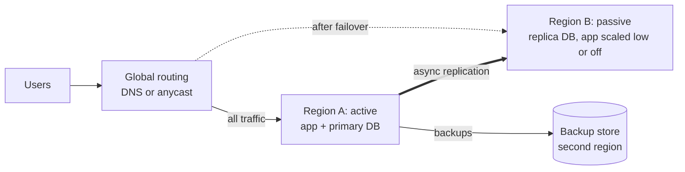
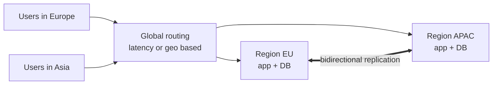
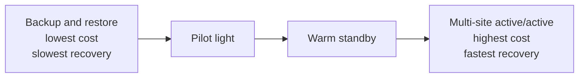
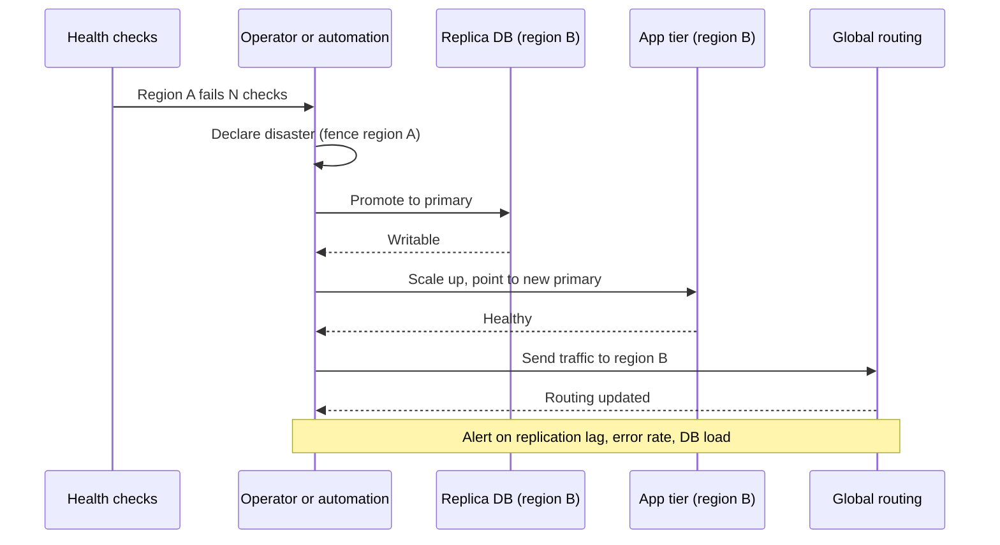

# Multi-Region Design and Disaster Recovery

A multi-region system runs in more than one geographic region, so that a regional failure, a distance to the user, or a legal rule does not decide the system's fate. This page covers why a design goes multi-region, active-passive against active-active, replication and conflicts across regions, RPO and RTO with worked examples, the four disaster recovery strategies of the AWS whitepaper, failover and failback, data residency, and latency-based routing.

## Why It Matters

Interviewers ask "what happens if the whole region goes down?" in the last third of many HLD rounds, usually after the single-region design is complete. A strong answer names the recovery objectives first (RPO and RTO), picks a strategy that fits them, and states the cost: money, write latency, and conflict handling. On the job, the same questions decide budgets. A warm standby costs a fraction of an active-active deployment, and most products do not need the second. This page gives the vocabulary, the numbers, and the trade-offs, so that you can say "we need an RPO of 1 minute and an RTO of 15 minutes, so we use warm standby with asynchronous replication" and defend it.

## Core Concepts

**Region**: a geographic area that holds several data centers. A cloud provider builds regions to fail independently of each other. **Availability zone** (AZ): one or more data centers inside a region, with separate power and network. AWS, Google Cloud, and Azure use these terms with small differences. A design that survives the loss of one AZ is *multi-AZ*. A design that survives the loss of a whole region is *multi-region*.

**Disaster**: an event that makes a whole site unavailable or destroys its data. Examples: a regional power or network outage, a flood, a faulty deployment that reaches every instance in a region, a corrupted or deleted database, a ransomware attack, and a compromised account. The AWS whitepaper "Disaster Recovery of Workloads on AWS: Recovery in the Cloud" separates disasters of *availability* (a site is down) from disasters of *data* (the data is wrong or gone). Replication protects against the first kind. Replication copies the second kind to the other region, so you also need backups with point-in-time recovery.

**RPO** (recovery point objective): the maximum amount of data loss that the business accepts, measured as a time span before the disaster. An RPO of 5 minutes means that after recovery the system may lack the last 5 minutes of writes. **RTO** (recovery time objective): the maximum time from the start of the outage until the service works again. An RTO of 15 minutes means users are without the service for up to 15 minutes. These are *targets*. Test the actual values that a recovery achieves, because a target that nobody tests is a guess.

**Failover**: the switch of traffic and of the write role from the failed site to the recovery site. **Failback**: the return to the original site after it recovers.

**Active-passive**: one region serves traffic. The other region receives replicated data and serves no traffic until a failover. **Active-active**: two or more regions serve traffic at the same time. The AWS whitepaper calls the full form *multi-site active/active*. It also names *hot standby*: a full-capacity copy in a second region that serves no traffic.

**Replication lag**: the delay between a write on the primary and its arrival on the replica. With asynchronous replication, the lag at the moment of the disaster is the data loss (see [replication](05-replication.md)).

**Data residency**: a legal or contractual rule that data about people or companies stays inside a country or a region.

**Static stability**: a design in which the recovery path does not depend on actions that can fail during the disaster. The AWS whitepaper advises that a failover uses only *data plane* operations (the services that carry live traffic) and not *control plane* operations (the services that create and configure resources), because data planes are built for higher availability than control planes.

**Cell**: an independent, complete copy of the stack that serves a subset of the users. A cell-based design limits the blast radius of a failure to one cell, and a region can host many cells.

## How It Works

### Why Go Multi-Region

| Reason | Meaning | Does a single region with multi-AZ solve it? |
|---|---|---|
| Survive a regional outage | Regional failures are rare but they happen (provider network or control plane faults, natural disasters) | No |
| Low latency for users far from the region | Light in fiber travels about 200 000 km/s. New York to London is about 5 570 km, so the one-way time is at least about 28 ms and the round trip at least about 56 ms (approximate, physics bound, real paths are longer) | No |
| Data residency | A law or contract requires that data stays in a country or a region | No |
| Contractual availability | An SLA above what one region can offer. Two independent regions of 99.9 percent each give 99.9999 percent only if their failures are independent. Shared causes (a bad deployment, a shared dependency, a global control plane) break that assumption | Partly |
| Disaster of a whole provider | Rare. A multi-cloud design addresses it, at a high cost | No |

Recommendation: do not go multi-region before you can state which of these reasons applies. Multi-region multiplies cost, operational work, and the number of consistency problems. If the only goal is to survive a data center failure, multi-AZ in one region is the cheaper answer (see [scalability and availability](01-scalability-and-availability.md)).

### Active-Passive



All writes go to region A. Region B holds a replica. On failover, the operators or the automation promote the replica in region B to primary, scale up the application tier, and move the traffic. The recovery strategies in the next section differ in how much of region B runs before the disaster.

Strengths: one writer, so no write conflicts. The consistency model is the same as in a single-region system. Weaknesses: the passive region may hide faults, because nobody uses it (a stale configuration, a missing quota, an expired certificate). The failover is a rare event that people do not practice. Users far from region A pay the distance in latency.

### Active-Active



Each region serves reads and writes. The hard question is what happens when two regions write the same item at the same time. The AWS whitepaper lists three write strategies:

| Strategy | Behavior | Conflicts | Example from the whitepaper |
|---|---|---|---|
| Write global (read local) | All writes go to one region. Every region serves reads from a local replica. If the write region fails, another region is promoted | None, because one region writes. Writes from far regions pay the latency | Aurora global database: promote a secondary region in less than one minute (AWS docs) |
| Write local | Each region accepts writes for any item and replicates them to the others | Yes. The system must resolve concurrent writes | DynamoDB global tables: last writer wins |
| Write partitioned | Each item has a home region by a partition key (user ID, tenant). The home region takes the writes | Rare. A conflict can happen only if the same item is written outside its home region, for example during a failover | S3 bidirectional replication with separate key spaces |

Recommendation: prefer write partitioned (a "home region" for each user or tenant) when the data model allows it. Most data has an owner. A user edits their own profile, cart, and orders. The design then gets local latency for the owner and no conflicts in the normal path. Data that all users write (a global counter, a shared document, an inventory item) needs a different tool: a single home region for that item, a conflict-free data type, or consensus.

### Data Replication and Conflict Handling

Replication between regions is asynchronous in almost every design. A synchronous commit waits for the remote region on every write, so each commit pays at least the round trip between the regions (56 ms or more for New York to London, approximate), and a partition between the regions then blocks the writes. The exceptions are databases that run a consensus protocol across regions (Google Spanner and CockroachDB). They accept the cross-region latency on the write path, and they stay correct when a region fails. The consensus protocols are in `kb/hld/distributed-systems/02-consensus-and-leader-election.md`.

With asynchronous replication and more than one writing region, the same item can change in two regions before the changes meet. Options for handling the conflict:

| Method | How it works | Cost |
|---|---|---|
| Avoid it | Give each item one home region (write partitioned) | You need a routing key, and you must handle a failed home region |
| Last writer wins (LWW) | Each write carries a timestamp. The write with the higher timestamp wins. DynamoDB global tables use it | The losing write disappears with no error. Clock differences between regions decide the winner. Fine for "latest value" data such as a profile photo. Wrong for a balance or a counter |
| Merge in the application | Keep both versions (siblings). The application or the user merges them. Dynamo-style stores use vector clocks to detect concurrent versions (see [replication](05-replication.md)) | The application code grows |
| Conflict-free replicated data types (CRDTs) | Data types with a merge function that is commutative, associative, and idempotent, so all regions converge without coordination. Examples: counters, sets | Fits only data that has such a type. Metadata can grow. See `kb/hld/distributed-systems/06-crdts-and-conflict-resolution.md` |
| Coordinate | Route the write through one region, or use consensus | Latency, and lower availability during a partition |

The choice follows the CAP trade-off and the PACELC extension (see [consistency and CAP](07-consistency-and-cap.md)). During a partition between regions, an active-active system either keeps accepting writes in both regions (available, and the data diverges) or stops writing in one region (consistent, and some users lose service). Without a partition, the system still chooses between low latency and a strong guarantee.

!!! warning "Money and inventory"
    Do not use last writer wins for a balance, a stock count, or a seat. Two concurrent decrements in two regions can both succeed against the same last unit. Route such writes to the home region of the item, or use a design that checks the invariant in one place. See `kb/hld/case-studies/12-ticket-booking.md` and `kb/hld/case-studies/13-payment-system.md`.

### RPO and RTO

The two numbers set the design.


**What sets the RPO.** With backups, the RPO is the time between backups. With asynchronous replication, the RPO is the replication lag at the moment of the failure, which grows when the write rate peaks or the link degrades. With synchronous replication, the RPO is zero for committed writes, at the cost of write latency. Monitor the lag as a metric and alert on it (see [observability in design](20-observability-in-design.md)).

**What sets the RTO.** The RTO is the sum of these steps:

| Step | What happens | Typical lever |
|---|---|---|
| Detect | Health checks and alarms notice the failure | Check interval times the failure threshold. Three checks at 10 s intervals take 30 s |
| Decide | A human or a rule declares a disaster | Automatic failover is fast and risks a false alarm. Manual failover is slower and safer |
| Promote data | The replica becomes the primary | Aurora global database: under one minute (AWS docs). RDS read replica promotion: a few minutes (AWS whitepaper) |
| Scale and start | The recovery region starts or scales the application | Pre-provisioned capacity (warm standby) against start on demand (pilot light) |
| Shift traffic | DNS or anycast routing sends users to the recovery region | DNS TTL, and resolvers that ignore TTL. Anycast avoids the DNS cache |
| Warm up | Caches and connection pools fill. The database must take a cold-cache load | Pre-warm, and shed load for the first minutes |

**Worked example 1: a nightly backup.** A database backs up at 02:00 each night and copies the backup to a second region. A disaster at 01:50 the next day loses the data since 02:00 the previous day: 23 hours and 50 minutes. The worst case is just below 24 hours, so the RPO of this design is 24 hours. The RTO is the time to restore the backup and redeploy the application, which depends on the data size. If the restore reads 2 TB at an effective 200 MB/s, the data copy alone takes 2 000 000 MB / 200 MB/s = 10 000 s, which is about 2.8 hours (assumption: this throughput, with no extra steps). The whole RTO is higher.

**Worked example 2: asynchronous replication.** An orders database replicates to a second region. The 99th percentile of the replication lag is 3 s (assumption). The write rate is 400 orders per second. If the primary region fails at a moment when the lag is at its 99th percentile, about 3 s x 400 = 1 200 acknowledged orders are not in the second region. The RPO target must be above the lag that you can observe at the peak, with a margin, or the design must change to synchronous replication or to a reconciliation process with the payment provider. The RTO: 90 s to detect (three failed checks at 30 s), 5 minutes for a human to decide and approve, 60 s to promote the replica, 2 minutes for the DNS change to reach most clients (a TTL of 60 s plus resolvers that cache longer). The sum is 90 + 300 + 60 + 120 = 570 s, about 9.5 minutes. To reduce it, automate the decision for clear cases, or cut the detection interval.

**Worked example 3: set the targets from the business.** A product loses 20 000 currency units per hour of downtime. An active-active design costs 40 000 more per month. If a regional outage happens once in four years (assumption) and lasts 3 hours without the design, the expected loss avoided is 60 000 per 48 months, which is 1 250 per month. The design does not pay for itself on this measure. This is the argument that you make in an interview: tie the RPO and RTO to a number, not to a feeling.

### The Four DR Strategies (AWS Whitepaper)

The AWS whitepaper describes four strategies. It orders them from low cost and slow recovery to high cost and fast recovery.



| Strategy | What runs in the recovery region before the disaster | What happens at failover | Cost | RTO and RPO (indicative) |
|---|---|---|---|---|
| Backup and restore | Only backups, copied to the recovery region. No servers | Redeploy the infrastructure from code (infrastructure as code), restore the data, and start the application | Lowest | Hours. The RPO is the backup interval |
| Pilot light | The data stores run and receive continuous replication. The application servers are deployed but switched off, or not deployed | Switch on and scale out the application servers, then move the traffic | Low | Tens of minutes. The RPO is the replication lag |
| Warm standby | A scaled-down but complete and running copy of the stack. It can handle traffic at reduced capacity | Scale up, then move the traffic | Medium | Minutes. The RPO is the replication lag |
| Multi-site active/active | A full stack in each region, and all regions serve traffic | No failover. The routing stops sending traffic to the failed region, and the others must carry the load | Highest | Near zero for the disaster of availability. A data disaster still needs a backup, so its RTO is above zero |

Details from the whitepaper:

- **Backup and restore** suits a data loss or corruption disaster and a regional disaster when hours are acceptable. Back up the code, the configuration, and the machine images, not only the data. Use infrastructure as code, or the redeployment is slow and error-prone. Test the restore, because an untested backup may not restore. Restoring from a backup is a control plane operation, so the whitepaper suggests a scheduled restore, which gives a running data store that you can use if the control plane fails during the disaster.
- **Pilot light** keeps the "pilot flame": the core that is hard to rebuild (the data stores) runs and replicates. Everything else exists as a definition that you switch on. Continuous replication does not protect against corruption or deletion, so add point-in-time backups or versioning in the recovery region.
- **Warm standby** differs from pilot light in one point: it can handle requests at once, at reduced capacity. Its recovery step is only "scale up". It also allows continuous testing, because the recovery region runs real traffic in a small test. The whitepaper warns that scale-up through Auto Scaling is a control plane dependency, and that service quotas in the recovery region must allow the full production size.
- **Multi-site active/active** serves traffic from all regions. The whitepaper calls it the most complex and costly approach. It notes that a data corruption event still depends on backups and has a non-zero recovery point. The difference from **hot standby**: hot standby holds full capacity in the second region and sends it no traffic.

Failover can start automatically or manually. The whitepaper advises caution with automatic failover on health checks and alarms: a false alarm costs availability and data, because the recovery time and recovery point are never zero. Many teams start the failover manually and automate every step behind a single action.

### Failover



Points that decide whether the failover works:

1. **Fence the old primary.** If region A is only unreachable and not dead, it may still accept writes. Two writers produce split brain. Stop the old primary (revoke its credentials or network access, or use a fencing token) before the promotion. See [replication](05-replication.md).
2. **Use data plane actions.** Route 53 health checks with the Application Recovery Controller (ARC) routing controls, and Global Accelerator health checks, are data plane operations (AWS whitepaper). A weighted DNS change goes through the control plane and is less resilient.
3. **Check capacity before the shift.** The recovery region needs quota, instances, and database capacity for the full load. Request quota increases in advance. Pre-warm the caches (see [caching](03-caching.md)) or limit the traffic during the first minutes.
4. **Keep dependencies in the recovery region.** A service that calls a dependency in the failed region fails with the region. List every dependency: authentication, configuration, secrets, the message queue, the third-party APIs.
5. **Keep the failover code path alive.** Run the failover in a game day every quarter. A recovery path that never runs breaks silently.

### Failback

Failback is a second migration, and it carries the same risks as the failover. After the failover, region B has the newest data. Region A has data from before the disaster. Steps: rebuild region A, replicate from region B to region A (reverse replication), wait until the lag is near zero, pause the writes or accept a short write outage, move the write role back, and move the traffic. Decide on the old data in region A that did not reach region B: keep it for reconciliation, review it, and replay what is safe. Many teams do not fail back. They make region B the new primary and rebuild region A as the new recovery region, which removes the second switch. Avoid *flapping*, a loop of automatic failovers and failbacks caused by a marginal fault, by adding hold-down timers and manual approval for failback.

### Data Residency

A residency rule changes the architecture, not only the configuration. Examples of such rules are the EU General Data Protection Regulation (GDPR), which limits the transfer of personal data out of the EU and EEA unless conditions apply, and national rules for finance and health data. A lawyer defines the rule for your product. The design follows these steps:

1. **Classify the data.** Mark which fields are personal or regulated, and which are not. Non-personal data (product catalog, static content) can live anywhere.
2. **Assign a home region to each user or tenant.** A regional cell holds all the regulated data of its users. Routing sends a request to the user's home cell.
3. **Keep a thin global layer.** A global directory maps a user or tenant identifier to a home region. Keep personal data out of the directory, or use an opaque identifier.
4. **Keep every copy in the region.** This includes the replicas, the backups, the logs, the metrics and traces that contain identifiers, the search indexes, the caches, and the analytics exports. A recovery region for a residency-bound dataset must be inside the same jurisdiction, so that "multi-region" can mean "two regions in the EU".
5. **Keep keys in the region.** Use a regional key management service and a separate key per region, so that deleting a key makes the regional data unreadable (see [security in design](21-security-in-design.md)).
6. **Plan cross-region features.** A user who travels, a global search, and a support tool that reads data from another region need an explicit, audited path with a legal basis.

The effect on active-active: a residency rule rules out "write local, replicate everywhere". It requires write partitioned with regional data that does not replicate out of the region. The effect on disaster recovery: the recovery region options shrink to the regions in the same jurisdiction. If a country has one region only, the recovery for that data may need a second availability-zone-based design or a provider that offers a second region in the country.

### Latency-Based and Other Global Routing

A global routing layer sends each user to a region. The options:

| Method | How it works | Notes |
|---|---|---|
| Latency-based DNS | The DNS service answers with the region that has the lowest measured latency to the user's resolver network. Amazon Route 53 latency routing uses latency measurements between user networks and AWS regions | The answer follows measured latency, not distance. The DNS service sees the resolver and not the user, unless EDNS client subnet is present. The answer is cached for the TTL |
| Geolocation or geoproximity DNS | The answer depends on the user's country or location, with an optional bias | Use geolocation for residency rules. Use geoproximity to shift load between regions |
| Failover routing | Primary and secondary records. Health checks decide | The classic active-passive switch |
| Weighted routing | A percentage of traffic to each region | Gradual migration, canary, or a load shift |
| Anycast (for example AWS Global Accelerator) | The same IP address is announced in many places. The network sends the user to the nearest edge, and then over the provider backbone to a healthy endpoint | No DNS cache delay. Traffic dials and health checks control the endpoints |
| Client-side or application routing | The client reads a directory and calls the home region directly | Needed for data residency, and for write partitioned designs |

DNS-based routing depends on caching. A resolver may keep an answer longer than the TTL, so a failover through DNS is never instant. The AWS whitepaper names this as one reason to use Global Accelerator, because it avoids the DNS caching problem (see [load balancing, DNS and CDN](02-load-balancing-dns-cdn.md), and `kb/networking/06-dns.md` for the protocol). Combine the methods: geolocation to pick the legal region, latency inside the allowed set, and health checks to remove the failed region.

!!! tip "Health checks must test what users need"
    A health check that returns 200 from a static page keeps a region in service while its database is down. Make the check depend on the database and the critical dependencies, with a threshold that avoids flapping.

## Trade-offs and When to Use

| Strategy | Cost | Operational load | Write latency | Conflicts | Fits when |
|---|---|---|---|---|---|
| Single region, multi-AZ | Lowest | Low | Lowest | None | Survive a data center loss. A regional outage is acceptable |
| Backup and restore | Low | Low | No change | None | The RTO is hours, the RPO is hours, and the data is not critical |
| Pilot light | Low to medium | Medium | No change (asynchronous) | None | The RTO is tens of minutes. The data stores matter most |
| Warm standby | Medium | Medium to high | No change (asynchronous) | None | The RTO is minutes, and a running copy helps test the recovery |
| Active-passive, hot standby | High | High | No change | None | The RTO is near zero, and the second region must carry full load at once |
| Active-active, write global | High | High | Writes from far regions pay the distance | None | Global reads, a single write region is acceptable |
| Active-active, write partitioned | High | High | Local for the owner | Rare | Data has a clear owner (user, tenant), and a residency rule may apply |
| Active-active, write local | High | Highest | Local | Yes | Conflicts are acceptable (LWW) or removed by data types (CRDTs) |
| Cross-region consensus (Spanner, CockroachDB) | Highest | High | Every commit pays a cross-region round trip | None | Strong consistency across regions with automatic failover |

Decision procedure:

1. Write down the RPO and RTO, and the cost of an hour of downtime and of a minute of data loss.
2. Ask whether a legal rule fixes where data may live.
3. If the RTO is hours, use backup and restore with tested restores. If it is tens of minutes, use pilot light. If it is minutes, use warm standby. If it is near zero, use hot standby or active-active.
4. If users are global and latency matters, add read-local, and prefer a home region for writes.
5. Name how you detect the disaster, who decides, and how you test the recovery.

## Java Example

The program models two regions with asynchronous and synchronous replication. A primary region accepts writes. The replication log reaches the replica region only when the program delivers it. After 10 acknowledged writes, the primary fails. The asynchronous cluster lost the writes that it had acknowledged but not delivered (the RPO in writes). The synchronous cluster lost nothing and paid the round trip on each write.

```java
import java.util.ArrayList;
import java.util.List;

public class Main {
    static final int ROUND_TRIP_MS = 60; // assumption: cross-region round trip

    public static void main(String[] args) {
        Cluster async = new Cluster(false, 4);
        Cluster sync = new Cluster(true, 4);
        for (int i = 1; i <= 10; i++) {
            async.write("order-" + i);
            sync.write("order-" + i);
        }
        report("asynchronous", async);
        report("synchronous", sync);
    }

    static void report(String name, Cluster c) {
        System.out.println(name + ": acknowledged=" + c.acknowledged()
            + ", on replica=" + c.replica.size()
            + ", lost at failover=" + c.lostAtFailover()
            + ", write latency added=" + c.latencyAddedMs() + " ms");
    }
}

class Cluster {
    final List<String> primary = new ArrayList<>();
    final List<String> replica = new ArrayList<>();
    private final boolean synchronous;
    private final int batchSize; // the asynchronous log ships after this many writes
    private int addedLatencyMs;

    Cluster(boolean synchronous, int batchSize) {
        this.synchronous = synchronous;
        this.batchSize = batchSize;
    }

    // The client receives the acknowledgment when this method returns.
    void write(String value) {
        primary.add(value);
        if (synchronous) {
            ship();
            addedLatencyMs += Main.ROUND_TRIP_MS;
        } else if (primary.size() % batchSize == 0) {
            ship();
        }
    }

    private void ship() {
        for (int i = replica.size(); i < primary.size(); i++) {
            replica.add(primary.get(i));
        }
    }

    int acknowledged() { return primary.size(); }
    int lostAtFailover() { return primary.size() - replica.size(); }
    int latencyAddedMs() { return addedLatencyMs; }
}
```

<!-- expected-output -->
```text
asynchronous: acknowledged=10, on replica=8, lost at failover=2, write latency added=0 ms
synchronous: acknowledged=10, on replica=10, lost at failover=0, write latency added=600 ms
```

Replication ships the log in batches of 4 in the asynchronous cluster, so writes 9 and 10 are acknowledged and lost. In a real system, the batch is a lag measured in time, and you measure it, alarm on it, and compare it with the RPO.

## Interview Angle

### Questions

??? question "Explain RPO and RTO, and how they drive a multi-region design."

    The RPO is the data loss that the business accepts, measured in time. The RTO is the time that the service may stay down. They are separate targets. A design can have a zero RPO (synchronous replication) and an RTO of an hour (a manual failover), or the reverse.

    They drive the choice. The RPO sets the replication method: backups give an RPO of the backup interval, asynchronous replication gives the lag (seconds), and synchronous replication or consensus gives zero, with a write latency cost of at least one cross-region round trip. The RTO sets how much of the recovery region runs before the disaster: nothing (backup and restore, hours), the data stores only (pilot light, tens of minutes), a scaled-down copy (warm standby, minutes), or everything (active-active, near zero).

    I would also say that I get both numbers from the business as a cost of downtime and a cost of lost data, then I test the actual values in a game day. An RTO that nobody measured is a guess.

??? question "Compare the four AWS disaster recovery strategies and say when you pick each."

    Backup and restore keeps only backups in the recovery region. The recovery redeploys the infrastructure from code and restores the data. It has the lowest cost and the slowest recovery, with an RPO of the backup interval. Pilot light keeps the data stores running and replicating, and keeps the application servers switched off. Warm standby keeps a complete but scaled-down copy that can serve traffic at once at reduced capacity, so the recovery is "scale up". Multi-site active/active serves traffic from all regions, so there is no failover, only the removal of a failed region from the routing.

    The line between pilot light and warm standby: pilot light cannot process requests without an action first, and warm standby can. I pick by the RTO and the budget. For a business that tolerates hours, backup and restore. For tens of minutes, pilot light. For minutes, warm standby. For near zero and a global user base, active-active. I add that all four need point-in-time backups, because replication copies corruption and deletions to the second region.

??? question "How do you handle write conflicts in an active-active, multi-region system?"

    First I try to avoid conflicts: I give each user or tenant a home region and route writes for that item to the home region (write partitioned). Reads can be local. This works for data with an owner, and it also fits data residency rules.

    For data that several regions write, I choose by the data type. For "latest value wins" data such as a profile photo, last writer wins is acceptable (DynamoDB global tables do this), and I state that the losing write disappears and that clock differences decide the winner. For counters and sets, I use CRDTs, which merge without coordination. For money, stock, and seats, I do not allow concurrent writes in two regions: I route the write to a single region for that item, or I use a consensus-based database, and I accept the latency. I also state the partition behavior: during a partition between regions, the system either keeps writing in both (and reconciles later) or refuses writes in one region.

??? question "The primary region fails. Walk through the failover of a database-backed service."

    1. Detect: health checks from outside the region fail a threshold of times, and an alarm fires. I use checks that exercise the database path, and I set a threshold that avoids flapping.
    2. Decide: automation or an on-call engineer declares the disaster. Automatic failover is faster and a false alarm costs availability and data, so many teams automate the steps and keep the trigger manual.
    3. Fence: stop the old primary from taking writes, so a partially failed region cannot cause split brain.
    4. Promote: the replica in the recovery region becomes the primary. I check the replication lag at this moment, because it is the data loss that I will report.
    5. Scale: start or scale up the application tier, with quotas already in place, and point it to the new primary.
    6. Shift traffic through the routing layer, with data plane operations. DNS caching delays the shift, and anycast does not have that delay.
    7. Protect the cold system: the new primary has cold caches and may see the full load, so I shed load and pre-warm.
    8. Afterwards: reconcile the writes that did not replicate, decide on failback, and write the post-incident review.

??? question "What changes in your design when a law requires that user data stays in the EU?"

    I classify the data, then I give each user a home region inside the EU and keep all personal data in that region's cell: the database, the replicas, the backups, the logs and traces that contain identifiers, the search indexes, and the analytics copies. The recovery region must also be in the EU. A thin global directory maps user identifiers to home regions, and it holds no personal data. Routing sends requests to the home region, so I use geolocation or application-level routing and not only latency-based routing.

    This rules out "write local and replicate everywhere". Keys also live in the region, so deleting a key makes the regional data unreadable. Cross-region features (global search, a support tool, a traveling user) need an explicit, audited path with a legal basis. I add that I would ask a lawyer for the exact rule, because I design for the stated requirement and I do not guess the law.

??? question "Is active-active always better than active-passive?"

    No. Active-active gives lower latency for distant users and near-zero RTO for an availability disaster. It costs more, it needs conflict handling or a home region design, and it makes each deployment, schema change, and incident more complex. It also does not remove the need for backups, because a corrupt write replicates to every region. A capacity trap hides in it: if two regions run at 60 percent each and one fails, the other must carry 120 percent. So each region needs headroom, or the failover needs load shedding.

    Warm standby serves most products better. It is cheaper, it has one writer, and it reaches an RTO of minutes. I pick active-active when the RTO must be near zero, when users are global and latency decides the experience, or when the business case pays for it.

??? question "Why does synchronous cross-region replication hurt, and what do systems do instead?"

    Every commit waits for an acknowledgment from the remote region, so each write adds at least the round trip. New York to London is at least about 56 ms by physics (approximate), and real paths are higher. A partition or a slow link between the regions then blocks writes, or the system must give up the zero RPO. Most designs therefore replicate asynchronously and accept an RPO of the lag. Some designs use semi-synchronous replication inside a region or across nearby regions. Spanner and CockroachDB use consensus across regions and accept the latency on the commit path.

### Follow-up Questions

??? question "How do you test a disaster recovery plan?"

    Restore a backup on a schedule and verify the data. Run a game day in which you fail over to the recovery region on purpose, with real traffic if you can (a warm standby makes that easy). Measure the actual RPO and RTO. Test the loss of a region in an active-active system by removing it from the routing and checking the capacity of the others. Test a data disaster, such as a deleted table, by restoring to a point in time. Test the runbook with a person who did not write it. The AWS whitepaper has a section on testing, and it stresses that you must be confident in invoking the recovery.

??? question "How do you avoid a shared failure between two regions?"

    Deploy changes to one region at a time with a delay and with automatic rollback, so that a faulty change does not reach both regions. Keep separate accounts or projects, credentials, and configuration per region (the whitepaper recommends a different account per region for isolation). Avoid a global dependency that both regions need, such as one global control plane, one DNS provider with one configuration, or one certificate authority account. Use cells to limit the blast radius.

??? question "How does a CDN or anycast change the multi-region picture?"

    A CDN serves cacheable content from edge locations, so it removes much of the read latency without multi-region application servers (see [load balancing, DNS and CDN](02-load-balancing-dns-cdn.md)). It does not help uncacheable writes. Anycast puts users on the provider network at the nearest edge and removes the DNS cache delay for failover, but the origin still lives in some region, and the data layer still decides the RPO.

### Red Flags

- "We replicate to a second region, so we are safe from disasters." Replication also copies corruption and deletion. There is no backup or point-in-time recovery.
- No RPO and RTO numbers, or a claim of "zero downtime" and "zero data loss" with no cost.
- Active-active with "last writer wins" for money or inventory.
- A failover plan that needs the control plane or the failed region to work.
- No fencing of the old primary, so split brain is possible.
- A recovery region that has no capacity, no quota, or no cached data for the full load.
- A failover that nobody tested.
- Ignoring data residency, or placing the backup of EU data in another continent.
- Assuming that DNS failover is instant.

## Common Mistakes

| Mistake | Why it hurts | Fix |
|---|---|---|
| Treating replication as a backup | A bad write or a delete replicates at once | Keep point-in-time backups and versioning in the recovery region, in a separate account |
| Picking the strategy before the RPO and RTO | The design is too costly or too weak | Get the numbers first, and map them to the four strategies |
| Never testing the recovery | The first real failover finds a missing quota, an old image, or an expired secret | Run game days and scheduled restores |
| Using the control plane in the failover path | The control plane can fail with the region | Use data plane operations (health-check routing, anycast), and pre-provision capacity |
| Automatic failover on a single noisy check | A false alarm causes an outage and data loss | Use several checks, a threshold, and a hold-down timer. Consider a manual trigger with automated steps |
| No capacity in the recovery region | The region cannot carry the load and fails too | Raise quotas, pre-scale, and size each active region for the load after a failure |
| Forgetting a dependency in the failed region | The recovery region calls a service that is down | Map every dependency, including secrets, identity, and third parties |
| Keeping logs, backups, or analytics copies outside the legal region | A residency violation | Include every copy of the data in the residency design |
| Relying on DNS TTL for a fast shift | Resolvers and clients cache longer | Plan for the delay, or use anycast |
| Failing back in a hurry | A second outage, or lost writes | Reverse-replicate, check the lag, move in a planned window, or make the recovery region the new primary |
| Same deployment to all regions at once | One bad release is a global outage | Roll out region by region |

## Commonly Confused With

| Looks like | Difference | Deciding question |
|---|---|---|
| RPO and RTO | RPO measures lost data in time. RTO measures downtime | Is the question "how much data can we lose" or "how long can we be down"? |
| High availability (multi-AZ) and disaster recovery | High availability keeps the service up through the failure of a component or a data center. Disaster recovery restores the service after the loss of a whole site | Does the failure take down more than one AZ, or the data? |
| Backup and replication | A backup is a point-in-time copy that you can restore. Replication keeps a live copy that follows every change, including bad ones | Can I restore the state of yesterday at 10:00? |
| Pilot light and warm standby | Pilot light runs only the data tier. Warm standby runs a full stack at low capacity and can serve requests at once | Can the recovery region process a request without a new start? |
| Warm standby and hot standby | Warm standby is scaled down. Hot standby has full capacity but serves no traffic | Does the recovery region need to scale up before it carries the load? |
| Hot standby and active-active | Hot standby sends no traffic to the second region. Active-active sends traffic to all regions | Do both regions serve users now? |
| Failover and failback | Failover moves to the recovery site. Failback returns to the original | Which direction does the traffic move? |
| Data residency and data sovereignty | Residency says where the data is stored. Sovereignty says which country's law controls it, and who can compel access | Is the rule about storage location or about legal control? |
| Latency-based and geolocation routing | Latency routing follows measured network latency. Geolocation follows the user's location and a policy | Is the goal speed (latency) or a legal rule (geolocation)? |

## Quick Reference Card

- **RPO:** data loss in time. **RTO:** downtime. Set them from the cost of downtime and of lost data, then test the actual values.
- **Strategies (AWS):** backup and restore (hours), pilot light (data runs, app off), warm standby (scaled-down full stack), multi-site active/active (all regions serve). Cost and speed rise in that order.
- **Replication is not a backup.** Keep point-in-time backups and versioning, in a separate account.
- **RPO with async replication** equals the lag at the failure. **Sync replication** gives RPO zero and adds at least one cross-region round trip to every write (about 56 ms for New York to London, approximate).
- **Active-active writes:** write global (one writer region), write local (conflicts, LWW or CRDTs), write partitioned (home region per user or tenant, preferred).
- **Do not use LWW for money or inventory.**
- **Failover steps:** detect, decide, fence the old primary, promote, scale, shift traffic, warm up. Use data plane actions.
- **Automatic failover** risks false alarms. A common choice is a manual trigger with automated steps.
- **Failback** is a second migration. Many teams make the recovery region the new primary.
- **Residency:** classify data, assign a home region, keep all copies and keys in the region, keep the recovery region in the jurisdiction.
- **Routing:** latency-based for speed, geolocation for law, failover for active-passive, anycast to avoid the DNS cache.
- **Capacity:** after a region fails, the others carry its load. Size them for it.

## Further Reading

- AWS Whitepaper, "Disaster Recovery of Workloads on AWS: Recovery in the Cloud" (`https://docs.aws.amazon.com/whitepapers/latest/disaster-recovery-workloads-on-aws/disaster-recovery-workloads-on-aws.html`). The four strategies, the data plane against control plane advice, write global, write local, and write partitioned, and testing.
- AWS documentation, "Amazon Aurora Global Database" (`https://docs.aws.amazon.com/AmazonRDS/latest/AuroraUserGuide/aurora-global-database.html`). Cross-region replication, lag, and regional promotion.
- AWS documentation, "Amazon DynamoDB global tables" (`https://docs.aws.amazon.com/amazondynamodb/latest/developerguide/GlobalTables.html`). Multi-region, multi-writer replication with last writer wins.
- AWS documentation, "Choosing a routing policy" for Amazon Route 53 (`https://docs.aws.amazon.com/Route53/latest/DeveloperGuide/routing-policy.html`). Latency, geolocation, geoproximity, weighted, and failover routing.
- Corbett et al., "Spanner: Google's Globally-Distributed Database", OSDI 2012. Synchronous cross-region replication with consensus.
- Shapiro, Preguica, Baquero, Zawirski, "Conflict-free Replicated Data Types", 2011. The merge approach for active-active data.
- Kleppmann, *Designing Data-Intensive Applications*, chapter 5 (multi-leader replication, conflict resolution) and chapter 8 (partial failure).
- Related pages: [scalability and availability](01-scalability-and-availability.md), [load balancing, DNS and CDN](02-load-balancing-dns-cdn.md), [caching](03-caching.md), [choosing a database](04-choosing-a-database.md), [replication](05-replication.md), [partitioning and sharding](06-partitioning-and-sharding.md), [consistency and CAP](07-consistency-and-cap.md), [reliability patterns](12-reliability-patterns.md), [microservices and monoliths](14-microservices-and-monoliths.md), [event-driven architecture](16-event-driven-architecture.md), [observability in design](20-observability-in-design.md), [security in design](21-security-in-design.md), `kb/hld/distributed-systems/06-crdts-and-conflict-resolution.md`.
