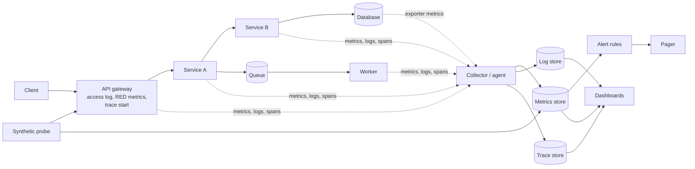
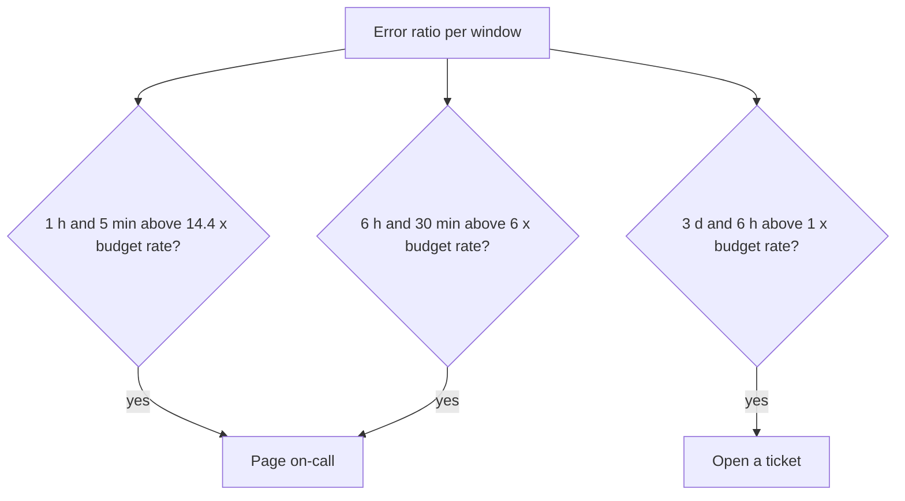

# Observability in System Design

Observability is the ability to understand what a system does from the data that it emits. This page covers the HLD view: what to measure in a design, the four golden signals, the RED and USE methods in brief, where metrics, logs, and traces sit in a design diagram, SLO-based alerting, and the capacity signals that tell you when to scale. The full practice (instrumentation, OpenTelemetry, dashboards, query languages) lives in `kb/engineering-practice/08-observability.md`.

## Why It Matters

A design interview that ends at "and we add monitoring" loses points. Senior interviewers ask "how do you know the system works?" and "what do you alert on?" A strong answer names the few signals per service, ties them to an SLO, and says where the data flows. On the job, the numbers you pick in the design decide whether the on-call engineer finds a fault in 5 minutes or in 2 hours, and whether a pager wakes someone for a real problem or for noise. Observability is also part of the design of the data path: telemetry has volume, cost, and failure modes of its own.

## Core Concepts

**Telemetry**: the data that a system emits about itself. The three common kinds are metrics, logs, and traces.

**Metric**: a number that the system samples or counts over time, stored as a time series with labels (for example `http_requests_total{route="/orders", status="500"}`). Metrics are cheap to store and fast to query, and they answer "how much" and "how often". Metrics have low cardinality by design.

**Log**: a record of one event, with a timestamp and fields. Logs answer "what happened in this request or at this time", and they carry detail that metrics lack. A **structured log** is a log in a machine-readable format (JSON) with fixed field names.

**Trace**: the record of one request as it passes through services. A trace has many **spans**. A span is one unit of work (one call, one query) with a start time, a duration, and a parent. A **trace ID** ties the spans together, and services pass it in a request header (the W3C Trace Context standard defines `traceparent`). Traces answer "where did the time go" and "which service failed in this request".

**Cardinality**: the number of distinct label combinations of a metric. A label with an unbounded value (user ID, request ID) creates a time series for each value and breaks the metrics store. Put high-cardinality values in logs and traces.

**SLI** (service level indicator): a measurement of the behavior of a service, such as the share of requests that succeed in under 300 ms. **SLO** (service level objective): the target for an SLI over a window, such as 99.9 percent over 30 days. **Error budget**: `1 - SLO`, the amount of failure that the SLO permits. A 99.9 percent SLO over 30 days leaves a budget of 0.1 percent, which is 43.2 minutes of full outage (30 x 24 x 60 x 0.001). See [scalability and availability](01-scalability-and-availability.md).

**Symptom and cause**: the Google SRE book chapter "Monitoring Distributed Systems" states: "Your monitoring system should address two questions: what's broken, and why?" The chapter explains that "what's broken" indicates the symptom and "why" indicates a (possibly intermediate) cause. Recommendation: alert on symptoms that users feel, and use cause-level data to diagnose.

**Histogram**: a metric that counts observations in buckets (for example, requests faster than 100 ms, 250 ms, 500 ms). The metrics store adds the bucket counts of all instances and then estimates a percentile from the sum. A percentile that each instance computes on its own cannot be averaged across instances.

**Black-box and white-box monitoring**: black-box monitoring tests the system from outside, as a user does (a synthetic probe). White-box monitoring uses internal data (metrics, logs, traces). The SRE book describes Google's practice as "heavy use of white-box monitoring with modest but critical uses of black-box monitoring".

## How It Works

### What to Measure: The Four Golden Signals

The Google SRE book chapter "Monitoring Distributed Systems" names four signals. If you can measure only four things about a user-facing system, measure these:

| Signal | Definition (SRE book) | Example in a design | Pitfall |
|---|---|---|---|
| Latency | The time that it takes to serve a request. Separate the latency of successful requests from the latency of failed requests | p50, p99, and p99.9 of `/checkout`, as a histogram | A fast error response lowers the average. Track successes and errors apart. Averages hide the tail (see [scalability and availability](01-scalability-and-availability.md)) |
| Traffic | The demand on the system, measured in a unit that fits the system | Requests per second, messages consumed per second, bytes per second | A sudden drop in traffic can be an outage that nobody sees as an error |
| Errors | The rate of requests that fail, explicitly (HTTP 500), implicitly (HTTP 200 with a wrong body), or by policy (a response slower than a limit counts as an error) | 5xx ratio, timeouts, failed payments | Count the failures that the user sees, not only the status code |
| Saturation | How full the service is. It emphasizes the resource that constrains the service most | Queue depth, thread-pool use, disk fill, memory, connection-pool use | Many systems degrade before they reach 100 percent. Set the alert below the limit |

The book states: "If you measure all four golden signals and page a human when one signal is problematic (or, in the case of saturation, nearly problematic), your service will be at least decently covered by monitoring."

### RED and USE in Brief

Two shorter recipes cover most services.

**RED method** (Tom Wilkie, who devised it in 2015 and presented it at GrafanaCon EU 2018): for each *service* that handles requests, measure **R**ate (requests per second), **E**rrors (failed requests per second), and **D**uration (the distribution of request time). RED is the golden signals without saturation, aimed at request-driven microservices. It gives each service the same dashboard.

**USE method** (Brendan Gregg): for each *resource* (CPU, memory, disk, network interface, thread pool, connection pool), measure **U**tilization (the share of time or capacity in use), **S**aturation (the amount of queued work that the resource cannot serve), and **E**rrors (the count of error events). USE finds resource bottlenecks.

| | RED | USE | Golden signals |
|---|---|---|---|
| Subject | A service or an endpoint | A resource | A user-facing service |
| Measures | Rate, errors, duration | Utilization, saturation, errors | Latency, traffic, errors, saturation |
| Question | Are requests healthy? | Is any resource overloaded or failing? | Is the service healthy for users, and how close to the limit? |
| Use it for | Microservice dashboards and alerts on symptoms | Capacity and bottleneck diagnosis | Alerts, and the first dashboard of a service |

Recommendation: use RED for the services, and USE for the machines and pools under them. The golden signals combine both views. The home page for the method details is `kb/engineering-practice/08-observability.md`.

### Where Telemetry Sits in a Design

Draw telemetry in the design diagram. It is part of the system, with its own data path, and the interviewer expects to see it.



| Place in the design | What to emit | Why there |
|---|---|---|
| Edge (CDN, load balancer, API gateway) | Request count, status codes, latency, and the access log. The gateway creates the trace ID and the request ID if the client sent none | The edge sees every request, so its numbers are the user view. Black-box probes also start here |
| Each service | RED metrics per endpoint, structured logs with the trace ID, spans for each outbound call and each query, and the saturation of its pools | The service knows its own internals |
| Datastores | Query latency, connections, replication lag, cache hit ratio, disk | Data stores are the usual bottleneck. Replication lag is the RPO signal (see [multi-region design and disaster recovery](19-multi-region-and-disaster-recovery.md)) |
| Queues and streams | Queue depth, the age of the oldest message, consumer lag, dead-letter count | Lag is saturation for asynchronous work (see [message queues and streams](08-message-queues-and-streams.md)) |
| Cache | Hit ratio, evictions, latency, memory (see [caching](03-caching.md)) | A falling hit ratio predicts database overload |
| Collector or agent | Buffering, batching, sampling, and routing of telemetry | Keeps the application out of the storage path and absorbs bursts |
| Metrics store | Time series with retention and downsampling | Alerts and dashboards |
| Log store | Searchable logs with retention | Detail for diagnosis |
| Trace store | Sampled traces | The path of a request |
| Alert rules and the pager | SLO-based rules that route to on-call | The human part of the system |
| Synthetic probes | A scripted user journey from outside, from several regions | Detects failures that internal metrics cannot see (DNS, certificate, routing) |

**Propagate context.** Each service passes the trace ID (the `traceparent` header in W3C Trace Context) on every outbound call, and onto messages in a queue. Without it, the trace breaks at the first hop. Log the trace ID in every log line, so that an engineer jumps from a trace to its logs.

**Sample traces.** Storing every trace costs too much at scale. Head sampling decides at the start of the request (for example 1 percent). Tail sampling decides after the request ends, so it keeps all traces with errors or high latency. Tail sampling needs a collector that sees the whole trace, so it adds components to the design. The details are in `kb/engineering-practice/08-observability.md`.

**Telemetry must not take the service down.** The path must use asynchronous, bounded buffers, and drop data under load rather than block requests. The telemetry system must run apart from the system that it watches. If the alerting depends on the failed region, nobody is paged (see [multi-region design and disaster recovery](19-multi-region-and-disaster-recovery.md)).

**Estimate the telemetry volume.** An interview answer gains weight with a number. Example (assumptions): 200 service instances, each with 500 time series scraped every 15 s. Samples per second: 200 x 500 / 15 = 6 667. At about 2 bytes per compressed sample (Prometheus documents about 1 to 2 bytes per sample), 6 667 x 2 bytes x 86 400 s is about 1.15 GB per day, which is small. Logs dominate the cost: 10 000 requests per second at 1 KB per request is 10 MB/s, which is 864 GB per day. That is why logs get sampling, short retention for debug detail, and structured fields only for what you query.

### Choosing SLIs

An SLO cannot be better than the SLI that it uses: if the SLI counts the wrong events, the SLO tracks the wrong thing. The SRE Workbook chapter "Implementing SLOs" recommends one form for every SLI: the number of good events divided by the number of valid events. The SLI then runs from 0 percent ("nothing works") to 100 percent ("nothing is broken"), and the same burn-rate alerts work for every SLI.

The Workbook gives an "SLI menu" by type of component:

| Component type | SLI types | Example SLI in a design |
|---|---|---|
| Request-driven (an API, a web front end) | Availability, latency, quality | The share of `POST /orders` requests that return a non-5xx status. The share of `GET /feed` requests served in under 300 ms. The share of responses served without degradation (for example, not from a fallback that drops recommendations) |
| Pipeline (a batch job, a stream processor, a queue consumer) | Freshness, correctness, coverage | The share of records processed within 10 minutes of their arrival. The share of output records that pass a correctness check. The share of input partitions processed in the last run |
| Storage (a database, an object store) | Durability | The share of written objects that the system can read back. A sampling job that reads old objects checks it |

The place where you measure the SLI decides what it sees. The Workbook compares four places:

| Measured at | Sees | Misses or costs |
|---|---|---|
| Application server logs or metrics | The detail of each request in the service | Requests that fail before they reach the backend (a load balancer fault, a crashed process) |
| Load balancer | Every request that reaches the site, close to the user's experience | Failures before the load balancer (DNS, the client network) |
| Black-box probe | Failures of the full path, including DNS and TLS | Problems that affect only a subset of users, because the probe sends a few synthetic requests |
| Client-side instrumentation (browser, mobile app) | The experience of the user, including the client network | Code changes in the client, its own telemetry path, and noise from slow user networks |

Recommendation: in an interview, measure the main SLIs at the load balancer or the gateway, add a black-box probe for the full path, and name client-side data as the next step for a mobile or web product.

**Worked example: what to measure for a checkout service.** Assumptions: a `POST /checkout` endpoint behind a gateway, a payment provider call, an orders database, and a queue that feeds an email worker.

| Component | Signal (type) | SLI or threshold | Alert |
|---|---|---|---|
| Gateway, `POST /checkout` | Availability (errors) | Good = status not 5xx and not a timeout. SLO 99.9 percent over 30 days | Burn-rate pages and ticket (next section) |
| Gateway, `POST /checkout` | Latency | Good = served in under 1 s. SLO 99 percent over 30 days | Burn-rate pages and ticket |
| Gateway | Traffic | Requests per second, compared with the same hour last week | Page if traffic drops by more than half for 10 minutes (a silent outage that the error SLI cannot see) |
| Checkout service | Saturation | Thread-pool and connection-pool use, with the wait time to acquire | Dashboard. Cause alert only if the wait time grows for 10 minutes |
| Payment provider call | Errors and latency of the dependency | Error ratio and p99 per provider | Dashboard. The SLO alert on checkout covers the user impact |
| Orders database | Saturation, replication lag | Connections, lock waits, replication lag in seconds | Page if the lag exceeds the RPO (see [multi-region design and disaster recovery](19-multi-region-and-disaster-recovery.md)) |
| Email queue and worker | Freshness (pipeline) | Good = email sent within 5 minutes of the order. SLO 99 percent | Ticket on a slow burn. Page if the oldest message is older than 30 minutes |
| Outside probe | Black-box availability | A scripted checkout with a test card from three regions, every minute | Page if two regions fail |

All thresholds in the table are assumptions for the example. The table shows the method: one SLI per user-visible behavior, saturation and dependency data on dashboards, and a few cause alerts for failures that need action before users see them.

### SLO-Based Alerting

Alert on the user-visible symptom that threatens the SLO, not on every cause. The SRE Workbook chapter "Alerting on SLOs" builds this in steps, and the last step is the one to propose in an interview.

**Burn rate**: how fast the service consumes its error budget, relative to the SLO. A burn rate of 1 uses the budget exactly at the end of the SLO window. For an SLO of 99.9 percent, a steady error ratio of 0.1 percent is a burn rate of 1. The formula: `burn rate = error ratio / (1 - SLO)`. The budget consumed in a window: `burn rate x window / SLO period`.

**Why simple thresholds fail.** An alert on "error ratio above 0.1 percent over 10 minutes" fires often on small blips that do not threaten the budget (low precision). An alert with a long window detects slowly and keeps firing after the problem ends (long reset time). A short window on a low-traffic service is noisy.

**The multiwindow, multi-burn-rate alert.** Each alert condition uses two windows. The long window shows that the burn is significant. The short window (about 1/12 of the long window) shows that the burn is still happening, so the alert resets soon after the problem ends. The Workbook recommends this set for a 99.9 percent SLO over 30 days:

| Severity | Long window | Short window | Burn rate | Budget consumed before the alert |
|---|---|---|---|---|
| Page | 1 hour | 5 minutes | 14.4 | 2 percent |
| Page | 6 hours | 30 minutes | 6 | 5 percent |
| Ticket | 3 days | 6 hours | 1 | 10 percent |

Check one row: 14.4 x 1 hour / 720 hours (30 days) = 0.02, which is 2 percent of the budget. At a burn rate of 14.4, the 43.2-minute budget lasts 30 days / 14.4 = about 2.1 days. The alert fires when both windows exceed the threshold: the error ratio must be above `burn rate x (1 - SLO)` in the long window and in the short window. For a 99.9 percent SLO, the first row means an error ratio above 1.44 percent.



**Properties.** Fast, severe failures page within minutes. Slow, mild burns page later or create a ticket. Short blips that spend little budget do not page. For a low-traffic service, the Workbook discusses other options, such as combining services or generating synthetic traffic.

**Other alert rules for design.** Alert on symptoms (golden signals, the SLO burn rate). Add a small set of cause alerts only for failures that need action before users see them: a disk that fills in hours, a certificate that expires in days, replication lag above the RPO, a queue with no consumers. The SRE book chapter "Monitoring Distributed Systems" gives four rules for pages, in its section "Tying These Principles Together":

- "Every time the pager goes off, I should be able to react with a sense of urgency."
- "Every page should be actionable."
- "Every page response should require intelligence. If a page merely merits a robotic response, it shouldn't be a page."
- "Pages should be about a novel problem or an event that hasn't been seen before."

### Capacity Signals

Capacity planning in a design needs signals that predict saturation before the SLO breaks.

| Signal | What it shows | Typical action |
|---|---|---|
| CPU utilization and run-queue length | Compute saturation | Scale out when the sustained value passes a target (for example 60 to 70 percent, which leaves headroom for a failed node) |
| Memory use and garbage collection time (JVM) | Memory pressure | Raise limits, fix leaks, or scale out |
| Thread-pool and connection-pool use, with the wait time to acquire | Concurrency saturation | Size pools, add instances, or shed load |
| Request queue depth and queue wait time | Overload. A growing queue means arrivals exceed service rate | Autoscale, apply backpressure, or rate-limit (see [rate limiting algorithms](13-rate-limiting-algorithms.md)) |
| Message queue depth, the age of the oldest message, and consumer lag | Asynchronous backlog | Add consumers or partitions (see [message queues and streams](08-message-queues-and-streams.md)) |
| Database: connections, lock waits, replication lag, disk, IOPS | Datastore saturation | Add replicas, partition, or tune (see [partitioning and sharding](06-partitioning-and-sharding.md)) |
| Cache hit ratio and evictions | Cache sizing | Resize, or fix the key design (see [caching](03-caching.md)) |
| Disk and network use | Storage and bandwidth | Provision more, or tier the data |
| Throughput against the load-tested limit | Distance to the limit | Keep the peak below a safe share of the tested maximum |

Use **headroom**: the share of capacity kept free for peaks and failures. With N instances and a requirement to survive the loss of one, each instance may run at most `(N - 1) / N` of its limit. With 4 instances, that is 75 percent. For the loss of a whole region in an active-active design, the remaining regions must carry the load of the failed one (see [multi-region design and disaster recovery](19-multi-region-and-disaster-recovery.md)).

**Forecast.** Track the trend (requests per day, storage per day) and extrapolate to the date when a limit is reached. Alert on the forecast ("the disk is full in 4 days") as a ticket, not a page. Load test to find the actual limit, because the limit depends on the workload mix.

## Trade-offs and When to Use

| Decision | Option A | Option B | Choose |
|---|---|---|---|
| Alert basis | Cause alerts (CPU above 80 percent) | Symptom and SLO burn-rate alerts | Symptom alerts for paging. Cause data on dashboards. Few cause alerts for time-critical resource limits |
| Window design | One threshold over one window | Multiwindow, multi-burn-rate | Multiwindow for SLO alerts: better precision and reset time, at the cost of complexity |
| Log volume | Log everything at debug level | Sample, and log at info with structured fields | Sample. Keep full detail only for errors and for a short retention |
| Trace sampling | Head sampling | Tail sampling | Head for low cost and simple setups. Tail when you need every error and every slow trace, and can run the collector |
| Metrics cardinality | Rich labels (user, request) | Bounded labels | Bounded labels. Put identifiers in logs and traces |
| Telemetry path | Direct write to the backend | An agent or collector with buffering | A collector, so a backend outage does not block the services |
| Hosted or self-run | A managed backend | Self-run (Prometheus, Grafana, Loki, Tempo, Elasticsearch, Jaeger) | Managed for small teams. Self-run for cost control or data residency |
| Black-box and white-box | Probes only | Internal telemetry only | Both. Probes catch what the inside cannot see |

Use the full set (golden signals, SLOs, tracing) for any user-facing system in a design. Skip tracing for a small monolith where the logs suffice. Do not over-instrument a prototype: choose the four signals and one SLO first.

## Java Example

The program implements the multiwindow, multi-burn-rate check from the SRE Workbook for a 99.9 percent SLO. Each rule fires only if the error ratio in both windows is above `burn rate x (1 - SLO)`. The scenarios show a fast burn that pages, a burn that has already ended (the short window blocks the page), a slow burn that pages on the second rule, and a very slow burn that opens a ticket.

```java
import java.util.List;

public class Main {
    static final double SLO = 0.999;

    record Rule(String severity, String longWindow, String shortWindow, double burnRate) {}

    record Scenario(String name, double[] ratios) {} // 1h, 5m, 6h, 30m, 3d, 6h

    public static void main(String[] args) {
        double budget = 1.0 - SLO;
        System.out.printf("budget of full outage per 30 days: %.1f minutes%n",
            30 * 24 * 60 * budget);

        List<Rule> rules = List.of(
            new Rule("page", "1h", "5m", 14.4),
            new Rule("page", "6h", "30m", 6.0),
            new Rule("ticket", "3d", "6h", 1.0));

        List<Scenario> scenarios = List.of(
            new Scenario("outage now", new double[] {0.020, 0.050, 0.010, 0.030, 0.002, 0.004}),
            new Scenario("outage ended", new double[] {0.020, 0.0005, 0.010, 0.0004, 0.002, 0.004}),
            new Scenario("slow burn", new double[] {0.004, 0.008, 0.007, 0.008, 0.002, 0.004}),
            new Scenario("very slow burn", new double[] {0.0012, 0.0012, 0.0012, 0.0012, 0.0012,
                0.0013}));

        for (Scenario s : scenarios) {
            StringBuilder fired = new StringBuilder();
            for (int i = 0; i < rules.size(); i++) {
                Rule r = rules.get(i);
                double threshold = r.burnRate() * budget;
                double longRatio = s.ratios()[i * 2];
                double shortRatio = s.ratios()[i * 2 + 1];
                if (longRatio > threshold && shortRatio > threshold) {
                    fired.append(r.severity()).append("(").append(r.longWindow()).append(") ");
                }
            }
            String result = fired.length() == 0 ? "no alert" : fired.toString().trim();
            System.out.println(s.name() + ": " + result);
        }
    }
}
```

<!-- expected-output -->
```text
budget of full outage per 30 days: 43.2 minutes
outage now: page(1h) page(6h) ticket(3d)
outage ended: ticket(3d)
slow burn: page(6h) ticket(3d)
very slow burn: ticket(3d)
```

The scenario "outage ended" shows the reset time: the two page rules stop firing at once, because their short windows (5 minutes and 30 minutes) show a low error ratio, while the ticket rule still sees the burn in its 3-day window.

## Interview Angle

### Questions

??? question "What do you measure for a new service, and what do you alert on?"

    I start from the four golden signals of the Google SRE book: latency (split by success and failure, as percentiles), traffic, errors (including wrong responses and responses over the latency limit), and saturation. For request-driven services this is the RED view (rate, errors, duration), and for resources it is the USE view (utilization, saturation, errors) on CPU, pools, disks, and queues.

    I alert on symptoms tied to an SLO, using burn-rate alerts with two windows: page on a fast burn (14.4 times over 1 hour and 5 minutes) and a medium burn (6 times over 6 hours and 30 minutes), and open a ticket on a slow burn (1 times over 3 days and 6 hours). I add a few cause alerts only for time-critical failures: a disk that fills within hours, an expiring certificate, replication lag above the RPO. Everything else is a dashboard for diagnosis. Each page must need a human decision.

??? question "Explain metrics, logs, and traces. When do you use each, and where do they sit in the design?"

    Metrics are cheap, aggregated numbers over time. I use them for dashboards, alerts, and trends. They have low cardinality, so they cannot hold a user ID. Logs are event records with detail. I use them to see what happened in a specific request. They cost the most per event, so I use structured logs, sampling, and short retention for debug data. Traces follow one request across services as spans that share a trace ID. I use them to find which hop is slow or failing.

    In the diagram: the gateway creates the trace ID and emits the first RED metrics and the access log. Every service emits RED metrics, structured logs with the trace ID, and spans for outbound calls, and passes the trace context on every call and on queue messages. Agents or collectors buffer and route the data to separate metrics, log, and trace stores. Alert rules read the metrics store. Synthetic probes test from outside. Debugging flows from an alert (metric) to a trace (which hop) to the logs of that trace (why).

??? question "Why are percentiles and not averages the right latency measure, and how do you alert on latency?"

    An average hides the tail. If 1 percent of requests take 5 s and 99 percent take 50 ms, the average is about 100 ms and looks fine, but one in a hundred users waits 5 s, and in a system where one user request fans out to many calls, many user requests hit a slow call. With 100 calls per request and a 1 percent chance of a slow call each, the chance that a request meets at least one slow call is 1 - 0.99^100, which is about 63 percent ("The Tail at Scale" gives this example). So I measure p50, p99, and p99.9 from histograms. Percentiles do not average across instances, so the metrics system must aggregate histogram buckets and compute the percentile after that.

    For alerts, I make latency an SLI: the share of requests faster than a threshold (for example 300 ms), with an SLO (99 percent). A slow response then counts against the error budget, and the burn-rate alert applies in the same way as for errors. The SRE book also says to track the latency of failed requests apart, because a fast failure improves the average and hides the problem.

??? question "What is a burn rate alert, and why is it better than 'error rate above 1 percent for 5 minutes'?"

    The burn rate is the error ratio divided by `1 - SLO`. A burn rate of 1 consumes the whole error budget in exactly the SLO window. A fixed threshold ignores the SLO. A 5-minute alert at 1 percent fires on blips that spend a tiny share of the budget (low precision), and for an SLO of 99.99 percent it would fire too late, because 1 percent is a burn rate of 100.

    The multiwindow burn-rate alert fires when the burn is high in a long window (it matters) and in a short window (it still happens). The long window gives precision. The short window gives a quick reset. With a 99.9 percent SLO over 30 days, a burn rate of 14.4 over 1 hour consumes 2 percent of the budget, and a burn rate of 6 over 6 hours consumes 5 percent. Fast severe outages page in minutes, and slow leaks open tickets. The cost is complexity, and low-traffic services need extra care (the Workbook covers it).

??? question "How do you trace a request across services and queues, and what does it cost?"

    The edge creates a trace ID and the services pass it in a header on each call (W3C Trace Context `traceparent`). For queues, the producer puts the context in the message headers, and the consumer starts a span with that parent. Each service logs the trace ID, so a trace links to its logs.

    The costs are CPU and network overhead on each request, and storage. At scale I sample: head sampling decides at the start (for example 1 percent) and is cheap, and tail sampling keeps all errors and slow traces by deciding after the request ends, at the price of a collector that buffers whole traces. I also say that tracing breaks wherever a service forgets to propagate the context, so the standard library or the service mesh should do it for every service.

??? question "How do you know when to scale? Which capacity signals do you watch?"

    I watch saturation signals, not only utilization: CPU run queue, memory and GC time, thread-pool and connection-pool use and wait time, request queue depth, message queue depth and consumer lag, database connections, lock waits and replication lag, and the hit ratio of the cache. I compare throughput with the limit from a load test. I keep headroom: with 4 instances that must survive the loss of one, each runs at no more than 75 percent. I autoscale on a signal that leads the problem (queue depth or request rate per instance), and I forecast the date on which storage or throughput reaches the limit, as a ticket.

??? question "How do you choose SLIs for a service and for a data pipeline in your design?"

    I write each SLI as good events over valid events, so it runs from 0 to 100 percent and the same alerting works for all of them. For a request-driven service, the SLI types are availability (the share of requests that do not fail), latency (the share served under a threshold, such as 300 ms), and quality (the share served without degradation). For a pipeline, the SLI types are freshness (the share of records processed within a time limit), correctness (the share of output that passes a check), and coverage (the share of input that the run processed). For storage, the SLI type is durability (the share of written data that reads back). This is the SLI menu of the SRE Workbook.

    Then I say where I measure. Server metrics miss requests that never reach the server. The load balancer sees every request that reaches the site, so I use it for the main SLIs. A black-box probe catches DNS and TLS faults but sees only its synthetic requests. Client-side data is closest to the user but needs client code and its own pipeline. I pick SLO targets from what users need and from the history of the service, not 100 percent, because the error budget pays for releases and experiments.

### Follow-up Questions

??? question "A dashboard shows all green, but users complain. What went wrong?"

    The measurements miss what users feel. Possible causes: the metrics come from inside and omit the edge (DNS, TLS, CDN, a regional routing fault), so I add probes from outside; the SLI counts the wrong thing (a 200 with an error body); averages hide the tail; the failing group is a small segment that the aggregate hides (one tenant, one region, one app version), so I slice by the dimension that matters, within the cardinality budget; the metrics are late or missing, so I alert on absent data; or a client-side failure never reaches the server.

??? question "How do you keep the observability system from failing together with the system?"

    Run it apart from the workload (another account, cluster, or region where the budget allows), buffer and drop under load rather than block requests, avoid a dependency on the failed component for alert delivery, and monitor the monitoring: a heartbeat alert: an alert rule that always fires on purpose, and an external service that pages when the heartbeat stops arriving. Test the path in the disaster recovery game day.

??? question "How do you design the audit of who did what, and how is it different from logging?"

    Application logs help engineers debug and may be dropped, sampled, and deleted. An audit log is a security and compliance record of who did what to which resource and when, written to append-only, access-controlled storage with a long retention. It is a separate path. See [security in design](21-security-in-design.md).

### Red Flags

- "We add monitoring" with no signals, no SLO, and no alert policy.
- Alerting on CPU and memory only, or paging on every cause.
- Average latency as the main number.
- A user ID or request ID as a metric label.
- No trace ID propagation, so a request cannot be followed.
- No answer to "what happens to telemetry when the system is overloaded".
- Treating logs as the only tool, with no metrics or traces.
- Observability that depends on the failing region.
- No capacity signals, and no headroom for a failed instance.

## Common Mistakes

| Mistake | Why it hurts | Fix |
|---|---|---|
| Alert on causes (CPU 80 percent) | Pages with no user impact, and alert fatigue | Alert on symptoms and SLO burn rate. Keep cause data on dashboards |
| One fixed-threshold alert for the SLO | Low precision or slow detection | Multiwindow, multi-burn-rate alerts |
| Averages for latency | The tail is hidden | Histograms and percentiles, success and failure apart |
| High-cardinality labels on metrics | The metrics store runs out of memory or cost | Bounded labels. Put IDs in logs and traces |
| Logging everything at debug | Cost and noise, and sensitive data in logs | Structured info logs, sampling, short retention, no secrets or personal data |
| Lost trace context at a queue or an async call | Broken traces | Put the context in message headers. Use a standard library |
| Only internal monitoring | DNS, certificate, and routing faults stay invisible | Add black-box probes from outside |
| No alert on missing data | A broken pipeline looks like a healthy system | Alert when a metric stops arriving |
| Watching utilization but not saturation | The queue grows while the CPU looks fine | Add queue depth, wait time, and lag |
| Never testing the alerts | The alert does not fire when needed | Test alert rules with fault injection or in a game day |

## Commonly Confused With

| Looks like | Difference | Deciding question |
|---|---|---|
| Monitoring and observability | Monitoring checks known failure modes with set questions. Observability lets you ask new questions of the data | Can I diagnose a failure that I did not predict? |
| Metrics, logs, and traces | Metrics are numbers over time, logs are events, traces are request paths | Do I need a trend, a detail, or a path? |
| RED and USE | RED is for services (rate, errors, duration). USE is for resources (utilization, saturation, errors) | Am I looking at a request flow or at a machine or a pool? |
| Four golden signals and RED | The golden signals add saturation to RED's three | Do I need to know how close to the limit the service is? |
| SLI, SLO, SLA | The SLI is the measurement, the SLO is the internal target, the SLA is the contract with consequences | Is it a measurement, a goal, or a promise? |
| Utilization and saturation | Utilization is how busy a resource is. Saturation is the queued work that it cannot serve | Is work waiting? |
| Alerting and logging | An alert asks a human to act. A log records an event | Does a person need to act now? |
| Audit log and application log | The audit log is a security record with tamper protection and long retention. An application log helps debugging | Who needs it, and for how long? |

## Quick Reference Card

- **Four golden signals (Google SRE book):** latency (success and failure apart), traffic, errors, saturation.
- **RED (Wilkie):** rate, errors, duration, per service. **USE (Gregg):** utilization, saturation, errors, per resource.
- **Metrics** for trends and alerts. **Logs** for detail. **Traces** for the request path. Link them with the trace ID.
- **Cardinality:** bounded metric labels. IDs go to logs and traces.
- **Burn rate** = error ratio / (1 - SLO). Budget consumed = burn rate x window / SLO period.
- **Workbook alerts for 99.9 percent, 30 days:** page at 14.4 (1 h and 5 min, 2 percent), page at 6 (6 h and 30 min, 5 percent), ticket at 1 (3 d and 6 h, 10 percent).
- **Budget:** 99.9 percent over 30 days is 43.2 minutes of full outage.
- **Capacity:** watch saturation, queue depth, lag, pool use. Keep headroom of `(N - 1) / N` to survive one loss.
- **Draw it:** gateway (trace start, RED), services, collectors, three stores, alert rules, pager, synthetic probes.
- **Telemetry path:** buffer, sample, drop under load, run apart from the workload, alert on missing data.
- **Full practice:** `kb/engineering-practice/08-observability.md`.

## Further Reading

- Beyer et al., *Site Reliability Engineering*, chapter 6, "Monitoring Distributed Systems" (`https://sre.google/sre-book/monitoring-distributed-systems/`). The four golden signals, symptoms against causes, and the paging guidelines.
- Beyer et al., *The Site Reliability Workbook*, chapter 5, "Alerting on SLOs" (`https://sre.google/workbook/alerting-on-slos/`). Burn rate, and the multiwindow, multi-burn-rate alerts.
- Brendan Gregg, "The USE Method" (`https://www.brendangregg.com/usemethod.html`). The method and its resource checklists.
- Tom Wilkie, "The RED Method: How to Instrument Your Services", Grafana Labs blog, 2018 (`https://grafana.com/blog/2018/08/02/the-red-method-how-to-instrument-your-services/`). A recap of the talk that presents RED.
- Google, *The Site Reliability Workbook*, chapter 2, "Implementing SLOs" (`https://sre.google/workbook/implementing-slos/`). SLIs as good events over valid events, the SLI menu, and where to measure.
- W3C, "Trace Context" Recommendation (`https://www.w3.org/TR/trace-context/`). The `traceparent` header.
- OpenTelemetry documentation (`https://opentelemetry.io/docs/`). The vendor-neutral standard for metrics, logs, and traces.
- Dean and Barroso, "The Tail at Scale", Communications of the ACM, 2013. Why percentiles matter in a fan-out system.
- Related pages: [scalability and availability](01-scalability-and-availability.md), [caching](03-caching.md), [replication](05-replication.md), [message queues and streams](08-message-queues-and-streams.md), [reliability patterns](12-reliability-patterns.md), [rate limiting algorithms](13-rate-limiting-algorithms.md), [microservices and monoliths](14-microservices-and-monoliths.md), [multi-region design and disaster recovery](19-multi-region-and-disaster-recovery.md), [security in design](21-security-in-design.md), `kb/engineering-practice/08-observability.md`, `kb/hld/case-studies/17-metrics-and-monitoring.md`.
