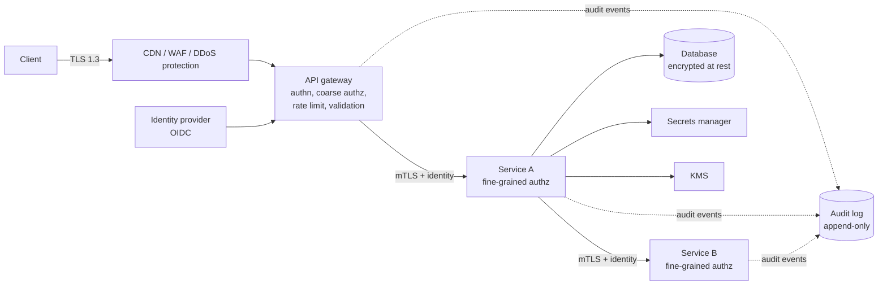
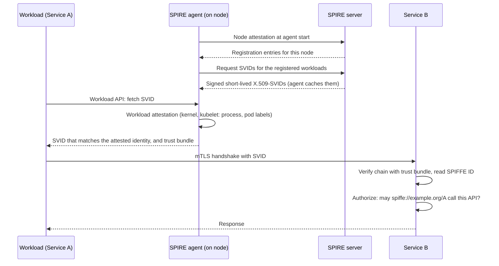
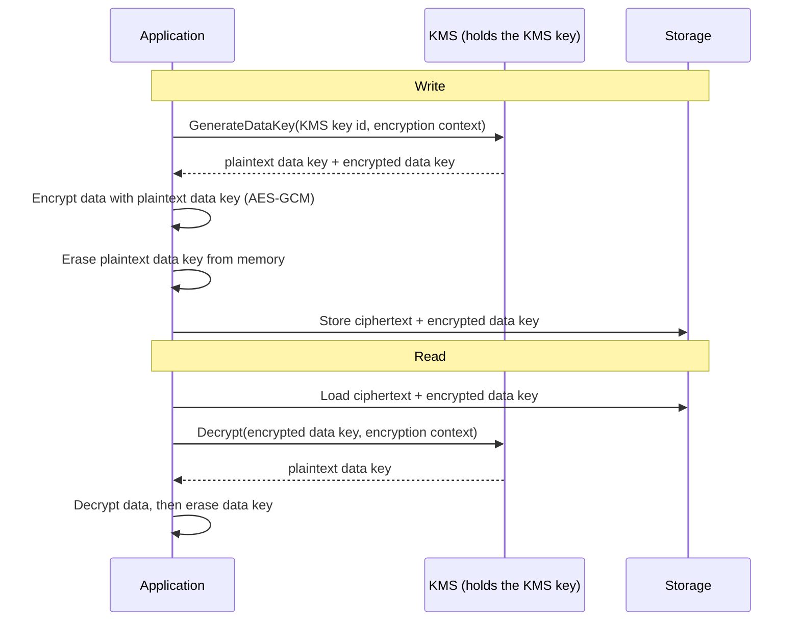

# Security in System Design

Security in a design is the set of decisions that decide who can call what, how data stays protected, and how the system survives abuse. This page gives the HLD view: authentication at the edge, service-to-service authentication, where to place authorization, encryption in transit and at rest, key management with envelope encryption, secrets, rate limiting and DDoS protection, input validation at boundaries, and audit logs. Each topic has its depth in the `kb/security/` pages, which this page names and does not repeat.

## Why It Matters

Interviewers add security questions to many designs: "how do you authenticate the user?", "how do services trust each other?", "where is the data encrypted?" A senior answer puts each control at a named place in the diagram, says what it protects against, and says what remains. On the job, a diagram review finds design gaps that lead to breaches: a service that trusts any caller inside the network, a long-lived secret in a repository, one shared key for all data, or an endpoint without a limit. This page is a checklist of those places.

## Core Concepts

**Authentication (authn)**: proving who the caller is. **Authorization (authz)**: deciding what that caller may do. Authentication comes first, and authorization uses its result. The full treatment is in `kb/security/02-authentication.md` and `kb/security/03-authorization-oauth-oidc-jwt.md`.

**Principal**: the identity that makes a request: a user, a service, or a device.

**Trust boundary**: a line in the diagram where the level of trust changes (the internet to the gateway, the gateway to the services, a service to a third party). Each crossing needs authentication, validation, and logging. The method to find them is threat modeling with STRIDE (see `kb/security/01-security-fundamentals.md`).

**Defense in depth**: several independent controls, so one failure does not open the system.

**Least privilege**: each principal gets only the permissions that it needs.

**Zero trust**: a model in which the network location grants no trust. Every request is authenticated and authorized, also inside the data center (see `kb/security/07-infrastructure-security.md`).

**Token**: a credential that a client presents instead of a password. An **access token** is short-lived and grants access to an API. A **JWT** (JSON Web Token) is a signed token format that carries claims. An **opaque token** is a random string that the server looks up.

**Encryption in transit**: protecting data while it moves over a network. **Encryption at rest**: protecting stored data. Both rely on keys, and key management decides whether the encryption has value (see `kb/security/05-cryptography-basics.md`).

**Envelope encryption**: encrypting data with a *data key*, and encrypting that data key with a *key-encryption key* (KEK) that a key management service holds.

**Secret**: a credential that a program needs: a database password, an API key, a private key.

**Audit log**: an append-only record of security-relevant actions: who did what, to which resource, when, and with what result.

## How It Works

### The Security Layers in One Diagram



### Authentication at the Edge

The edge is the first trust boundary. The gateway (or the edge service) authenticates each request once, so the services behind it do not each implement the login. Designs for the user side:

1. **A user signs in** at an identity provider (IdP). The IdP checks the password and the second factor (MFA). Standards: OAuth 2.0 for delegated access and OpenID Connect (OIDC) for the sign-in identity (see `kb/security/03-authorization-oauth-oidc-jwt.md`).
2. **The IdP issues tokens**: a short-lived access token (minutes) and a longer-lived refresh token, kept on the client with care.
3. **The client sends the access token** in the `Authorization: Bearer` header over TLS.
4. **The gateway validates the token**: signature, expiry, issuer, audience. A JWT is validated locally with the public keys of the issuer, which the gateway fetches from the issuer's key set and caches. An opaque token needs a call to the IdP (token introspection) or a lookup in a shared store, so it costs a network call and it supports instant revocation.
5. **The gateway passes the identity on** to the services, as a verified internal token or as headers that only the gateway can set. The services must not accept those headers from the outside.

| Credential | How it works | Revocation | Cost | Use |
|---|---|---|---|---|
| Server-side session ID in a cookie | The server stores the session and looks it up on each request | Immediate (delete the session) | A shared session store (see [scalability and availability](01-scalability-and-availability.md)) | Browser applications on one domain |
| JWT access token | A signed token with claims. The gateway verifies the signature without a lookup | Hard until it expires. Use short lifetimes (minutes) and a deny list for emergencies | No lookup, so it scales. Larger requests | APIs, mobile apps, service calls |
| Opaque token with introspection | A random string. The server asks the IdP what it means | Immediate | One lookup per request, which a cache can reduce | When instant revocation matters |
| API key | A static secret that identifies a client application | Rotate or delete the key | A lookup | Server-to-server calls from partners. Not for end users |
| Mutual TLS client certificate | The client proves its identity with a certificate in the TLS handshake | Revoke or let the certificate expire | Certificate issuance and rotation | Service identity, and some partner APIs |

Design points to name: the gateway accepts only the signature algorithms that it configures, checks the audience and the issuer, and the access token lifetime stays short. Browser and mobile clients use the authorization code flow with PKCE (Proof Key for Code Exchange). RFC 9700 states that public clients "MUST use PKCE" and recommends it for confidential clients. The JWT pitfalls, token storage in the browser, and password storage are in `kb/security/03-authorization-oauth-oidc-jwt.md` and `kb/security/02-authentication.md`.

### Service-to-Service Authentication

A request that has passed the gateway still crosses more boundaries inside. A design that trusts "anything inside the private network" fails when one service is compromised: the attacker then calls every other service. Each service therefore authenticates its callers.

**Mutual TLS (mTLS).** In normal TLS, the client verifies the server. In mTLS, the server also requests a certificate from the client and verifies it, so both sides know who the other is, and the channel is encrypted. In TLS 1.3 (RFC 8446), the server sends a `CertificateRequest` message, and the client answers with its `Certificate` and a `CertificateVerify` message (a signature over the handshake that proves that the client holds the private key). The challenge is the lifecycle of the certificates: issue, distribute, rotate before expiry, and revoke. The common solution is a **service mesh** (Istio, Linkerd) or a sidecar proxy (Envoy) that issues short-lived certificates to each workload and terminates mTLS, so application code does not handle certificates (see [microservices and monoliths](14-microservices-and-monoliths.md)).

**Workload identity.** The identity of a service must not come from a network address or from a secret that an operator copies by hand. It comes from the platform: the system *attests* what a workload is (which node, which container image, which Kubernetes service account) and then issues a short-lived credential. **SPIFFE** (Secure Production Identity Framework for Everyone) standardizes this. A **SPIFFE ID** is a URI of the form `spiffe://trust-domain/path`, for example `spiffe://example.org/payments/api`. A **SVID** (SPIFFE Verifiable Identity Document) is "the document with which a workload proves its identity to a resource or caller" (spiffe.io). It has two formats: an X.509 certificate (an X.509-SVID) and a JWT (a JWT-SVID). An X.509-SVID carries the SPIFFE ID as a URI in the Subject Alternative Name (SAN) extension, and it "MUST contain exactly one URI SAN" (SPIFFE X.509-SVID standard). A **trust bundle** is the set of CA root certificates that a workload uses to verify the SVIDs of its peers. A workload fetches its SVID and the trust bundle from a local **Workload API**, and the Workload API does not require the workload to hold a secret or to know its own identity. **SPIRE** is "a production-ready implementation of the SPIFFE APIs". A SPIRE server is the signing authority for its trust domain. A SPIRE agent runs on each node, proves the node's identity to the server (*node attestation*), identifies each calling process from local sources such as the kernel or the kubelet (*workload attestation*), and serves the Workload API. Cloud providers offer similar mechanisms (for example IAM roles for service accounts), where the platform gives a workload a temporary credential.



**Passing the user identity.** Service A calls service B on behalf of a user. B must know both the calling service (from mTLS) and the user (from a token). Options: forward the user's token (B verifies it, and the token carries the audience for B), or exchange the token for a narrower one (OAuth 2.0 token exchange, RFC 8693). Do not let services accept a user ID in a plain header from a peer without verifying the service identity.

### Authorization Placement

Where the check runs decides what it can see and how it fails.

| Place | What it checks | Strength | Weakness |
|---|---|---|---|
| Gateway (coarse) | Is the token valid? Does the scope allow this route? Is the tenant active? | One place, rejects early, cheap | Cannot see the data, so it cannot decide "may this user read this order" |
| Service (fine-grained) | Does this user own this order? Is the user a manager of that team? | Has the data and the business rules | Every service must implement it correctly |
| Central policy engine (for example Open Policy Agent, or a relationship-based service in the style of Google Zanzibar) | A policy language evaluates the request, with data from the service | One policy, consistent and auditable | A network call or a sidecar, and policy data must be fresh |
| Database (row-level security) | The database filters rows by the caller | The final control that still works if a service misses a check | Needs the user identity at the database, and it constrains the data model |

Recommendation: combine them. The gateway rejects invalid and out-of-scope requests (coarse). Each service decides object-level access (fine-grained), because only the service knows the data. Broken object level authorization (a user changes an ID in the URL and reads another user's record) is the first item, API1:2023, of the OWASP API Security Top 10 2023 (the OWASP Top 10 lists are covered in `kb/security/04-owasp-top-10.md`). Default to deny. Put the check in a shared library or a policy engine, and not in copied code. Models: RBAC (roles), ABAC (attributes), and relationship-based access (see `kb/security/03-authorization-oauth-oidc-jwt.md`).

### Encryption in Transit

Encrypt every network hop that carries data: client to edge, edge to services, service to service, and service to database and queue. Use **TLS 1.3** (RFC 8446) where possible. Facts from the RFC:

- TLS provides authentication, confidentiality, and integrity. The RFC states: "The server side of the channel is always authenticated; the client side is optionally authenticated." The client side is the mTLS case.
- In a full handshake, the client sends application data after one round trip. The RFC calls this data *1-RTT data*.
- A client that resumes with a pre-shared key (PSK) from an earlier connection can send *0-RTT early data* in its first flight. The RFC lists the cost: 0-RTT data "is not forward secret", and "there are no guarantees of non-replay between connections". Appendix E.5 says that replayable data is safe only if the application is "specifically engineered to be safe under replay (minimally, this means idempotent ...)". The RFC also states: "Application protocols MUST NOT use 0-RTT data without a profile that defines its use." Recommendation: leave 0-RTT off unless a profile allows it, and then accept it only for idempotent requests.
- The RFC states: "Static RSA and Diffie-Hellman cipher suites have been removed; all public-key based key exchange mechanisms now provide forward secrecy." *Forward secrecy* means that a later leak of the server's long-term key does not decrypt recorded traffic. A resumption with a PSK alone, without a new (EC)DHE exchange, gives up forward secrecy for its data (RFC 8446, section 2.2).

Where TLS ends is a design choice. **TLS termination** at the load balancer removes the cost from the services and lets the load balancer read the request for routing (see [load balancing, DNS and CDN](02-load-balancing-dns-cdn.md)). It leaves the traffic behind the load balancer in plain text unless you **re-encrypt** to the backend. For sensitive data, use TLS or mTLS from the load balancer to the service. In a service mesh, the sidecars encrypt the pod-to-pod traffic. Certificates: automate issuance and renewal (for example ACME), because an expired certificate is a common outage (see [observability in design](20-observability-in-design.md)). The protocol details are in `kb/networking/05-tls-and-https.md`.

### Encryption at Rest

Encrypt stored data: database volumes, backups, object storage, search indexes, and message queue logs. The levels differ in what they protect against:

| Level | What it protects against | What it does not protect against |
|---|---|---|
| Disk or volume encryption (cloud-managed, LUKS, the database's transparent data encryption) | Theft of a disk or a snapshot | An attacker who has database access through the running system. The disk is decrypted for the running server |
| Database or object-store encryption with managed keys | The same, with key access control and audit | A compromised application that has valid credentials |
| Application-level or field-level encryption | A database administrator, a database breach, and a leaked backup, because the database holds ciphertext | Costs: no search or sort on the ciphertext (unless you use special schemes), and the application owns the key use |
| Client-side encryption (end-to-end) | The service operator, because the service never sees the plain text | The service cannot process the data (no search, no analysis) |

Choose by the threat. Volume encryption is the default and is cheap. Field-level encryption for the most sensitive fields (card numbers, national IDs, health data) limits the damage of a database breach. Tokenization (replacing a card number with a random token and keeping the number in a small vault) reduces the scope of audits such as PCI DSS (see `kb/hld/case-studies/13-payment-system.md`).

### Key Management and Envelope Encryption

A key that sits beside the data it protects protects nothing. A **key management service** (KMS) stores key-encryption keys in hardware security modules, does the cryptographic operations on request, enforces who may use a key, and logs each use. Examples: AWS KMS, Google Cloud KMS, Azure Key Vault, HashiCorp Vault Transit.

**Envelope encryption** (AWS KMS documentation): encrypt the data with a data key, then encrypt the data key under another key. KMS keys never leave the KMS hardware security modules unencrypted, and you call KMS to use one.



Why envelope encryption and not "send the data to KMS":

- **Size and speed.** The AWS KMS `Encrypt` operation "encrypts plaintext of up to 4,096 bytes" with a symmetric key (AWS KMS API Reference). RSA keys accept less, from 190 to 470 bytes, by key size and padding. Large objects use a local data key, with fast symmetric encryption on the application side. Only the small key travels to KMS.
- **Cost and load.** One KMS call per object or per file is cheap compared with one call per byte. Quotas apply to KMS calls (the AWS KMS developer guide lists a shared quota for cryptographic operations). A cache of data keys (the AWS Encryption SDK offers it) lowers the call rate, at the price of a longer life of the plaintext key.
- **Re-encryption under a new key.** To move data under a different KMS key (for example, a new tenant key or a key in another account), re-encrypt the small data keys, not the data. The AWS KMS guide names this benefit: "Instead of re-encrypting raw data multiple times with different keys, you can re-encrypt only the data keys that protect the raw data." Automatic rotation in AWS KMS is a different operation. AWS KMS generates new key material for the same KMS key, keeps all old key material, and decrypts each ciphertext with the material that encrypted it. The guide states: "Key rotation has no effect on the data that the KMS key protects. It does not rotate the data keys that the KMS key generated or re-encrypt any data protected by the KMS key." So rotation of the KMS key does not help if a data key leaks.
- **Separation of duty and audit.** The KMS key policy controls who may decrypt, and the KMS logs every use. Deleting a key makes all data under it unreadable (crypto-shredding), which helps with deletion requests and residency (see [multi-region design and disaster recovery](19-multi-region-and-disaster-recovery.md)). AWS KMS deletes a key only after a waiting period of 7 to 30 days (default 30), and a data key that an application holds in plaintext in memory keeps working until the application drops it.
- **Encryption context.** A set of non-secret key-value pairs (for example the tenant ID) that KMS uses as additional authenticated data. Decryption needs "the same (an exact case-sensitive match)" context, or it fails. The context stops a ciphertext from being used in the wrong place. The API reference warns that the context "may be displayed in plaintext in CloudTrail logs", so it must not hold confidential data.

Design choices: one data key per object, per tenant, or per file; one KMS key per tenant, per service, or per environment; separate keys per region for residency. Per-tenant keys give a clean delete and isolation, and they raise the number of keys to manage. AWS KMS rotates AWS managed keys every year. For customer managed keys, automatic rotation is optional, with a default period of 365 days that the owner can change, and on-demand rotation is also available. AWS KMS keeps the key material that it generates and deletes it only when the owner deletes the key, so the design does not back up that material. Plan what happens if KMS is unavailable: a cache of data keys keeps reads alive for a while. The primitives (AES-GCM, key sizes, nonce rules) are in `kb/security/05-cryptography-basics.md`.

### Secrets

A secret in source code, in an image, or in a plain environment variable leaks through repositories, logs, and crash dumps. Rules:

1. **Keep secrets in a secrets manager** (AWS Secrets Manager, HashiCorp Vault, Google Secret Manager, Kubernetes Secrets with encryption at rest and strict access). The service reads them at start or at use, with its workload identity, so no bootstrap secret exists in the configuration.
2. **Prefer short-lived and dynamic credentials.** Vault can create a database user for each lease and revoke it after. Cloud roles give temporary credentials. A leaked credential then expires by itself.
3. **Rotate.** Rotation must work without downtime (two valid versions at once during the change).
4. **Scope.** One secret per service and per purpose, with least privilege, so a leak has a small blast radius.
5. **Keep secrets out of logs, error messages, and URLs.** Scan repositories and images for secrets in the pipeline.
6. **Audit access.** The secrets manager logs each read.

See `kb/security/06-secure-coding-in-java.md` for secrets in code and `kb/security/07-infrastructure-security.md` for secrets management in infrastructure.

### Rate Limiting and DDoS Protection

Rate limiting protects a service from overload and from abuse, such as credential stuffing, scraping, and brute force. Layer the limits:

| Layer | What it limits | Protects against |
|---|---|---|
| Network edge or DDoS service (CDN, Anycast scrubbing, cloud DDoS protection) | Volumetric floods (layers 3 and 4), and some layer 7 floods | Traffic that would fill the link or the load balancers |
| WAF (web application firewall) | Requests that match attack signatures, and bot rules | Common injection and scanning patterns, known bad clients |
| API gateway | A limit per API key, per user, per IP, and per route, with a clear `429 Too Many Requests` and a `Retry-After` header | A single client that overloads the API, and fair use per tenant |
| Service | A concurrency limit, a queue bound, and load shedding | Overload from inside (a retry storm) |
| Sensitive actions | A strict limit and a lockout or a delay on login, password reset, and one-time-code checks, per account and per IP | Brute force and credential stuffing |

The algorithms (token bucket, sliding window) and the distributed design are on [rate limiting algorithms](13-rate-limiting-algorithms.md) and in `kb/hld/case-studies/02-distributed-rate-limiter.md`. Reliability controls (timeouts, circuit breakers, bulkheads) protect the service from slow dependencies, and they are on [reliability patterns](12-reliability-patterns.md). Design points for DDoS: put the system behind a CDN or an anycast edge so that the origin address stays hidden and traffic gets absorbed at many locations (see [load balancing, DNS and CDN](02-load-balancing-dns-cdn.md)), scale the stateless tier horizontally, cache what you can, and prepare a degradation mode that serves the critical paths first. A limit by IP alone fails against a botnet and hurts users behind a shared address (a NAT), so combine it with an account and a token limit.

### Input Validation at Boundaries

Treat every input that crosses a trust boundary as untrusted: request bodies, query strings, headers, file uploads, messages from a queue, and responses from third parties. Validate at the boundary where the data enters, and again where a different interpreter uses it.

- **Validate the shape**: type, length, range, format, and an allow list of values, before the data reaches business code. Reject what does not match. Do not try to fix it.
- **Bound the size**: a maximum body size, a maximum number of items in a list, a maximum depth of JSON. Otherwise one request exhausts memory.
- **Encode for the destination**: use parameterized queries for SQL, and context-aware output encoding for HTML. Validation does not replace these (see `kb/security/06-secure-coding-in-java.md` and `kb/security/04-owasp-top-10.md`).
- **Validate files**: check type by content and not by the file name, limit the size, store uploads outside the web root and in a separate domain or a bucket, and scan them.
- **Server-side request forgery (SSRF)**: when the service fetches a URL that a user supplies, use an allow list and block internal addresses (including the cloud metadata address).
- **Validate messages from queues and services** also, because a compromised internal service is a threat.
- **Use a schema** (OpenAPI, JSON Schema, protobuf) at the gateway and in the service, so that validation is declared and shared.

### Audit Logs

An audit log answers "who did what to which resource, when, from where, and was it allowed?" It differs from an application log (see [observability in design](20-observability-in-design.md)).

| Property | Requirement |
|---|---|
| Content | Actor (user and service identity), action, resource, time, source address, result (allowed or denied), request or trace ID, and the reason for a denial. Do not log secrets or full personal data |
| Events | Sign-in and failures, permission changes, access to sensitive data, administrative actions, key and secret use (the KMS and the secrets manager log it), and changes to configuration |
| Integrity | Append-only storage, and write access limited to the logging pipeline. Hash chains or write-once storage detect tampering. Send a copy to a separate account |
| Delivery | A reliable path (a queue, with at-least-once delivery, see [message queues and streams](08-message-queues-and-streams.md)). Decide if the business action fails when the audit write fails (for money and permissions, yes) |
| Retention | Set by the rules that apply (law, contract). Often months to years, in cheaper storage |
| Access | Read access limited, and the reads logged |
| Residency | Audit data about people stays in the region (see [multi-region design and disaster recovery](19-multi-region-and-disaster-recovery.md)) |

### Other Design Controls in Brief

- **Network segmentation**: put data stores in private subnets, with no public address, and allow only the services that need them (see `kb/security/07-infrastructure-security.md`).
- **Dependency and supply-chain control**: pin and scan dependencies and images.
- **Multi-tenancy**: carry the tenant ID in the identity, and enforce it at every data access. A missing tenant filter is a data leak between customers.
- **Secure defaults and a threat model**: run a STRIDE review of the diagram, at each trust boundary (see `kb/security/01-security-fundamentals.md`).

## Trade-offs and When to Use

| Decision | Option A | Option B | Choose |
|---|---|---|---|
| Token type | JWT, validated locally | Opaque token with introspection | JWT with short lifetime for scale. Opaque when you need instant revocation |
| Where to authenticate | At the gateway only | At the gateway and in every service | Both. The gateway for the user, the service for the caller identity (zero trust) |
| Service identity | Shared secret or API key | mTLS with workload identity (SPIFFE or a platform equivalent) | Workload identity with short-lived credentials. A static key only for third parties |
| mTLS implementation | In application code | In a mesh or sidecar | A mesh when you run many services. Library code when you have few |
| Where TLS ends | At the load balancer, plain text behind it | End to end, or re-encrypted | Re-encrypt for sensitive data and for zero trust. Terminate at the edge for public static content |
| Encryption at rest | Volume encryption | Field-level or client-side encryption | Volume by default. Field-level for the most sensitive fields |
| Key hierarchy | One key for everything | A key per tenant or per service | A key per boundary that you may need to revoke or delete, within the limits of KMS cost and quotas |
| Authorization place | Gateway only | Gateway plus service plus policy engine | Gateway for coarse checks. Service for object-level. A policy engine when the rules change often |
| Rate limit key | IP address | User, API key, and IP | A combination, with stricter limits on sensitive actions |
| Audit failure | Continue if the audit write fails | Fail the action | Fail the action for money, permission, and data-access events |

Security has a cost in latency (a token check, an extra TLS handshake, a KMS call), in operations (certificates, keys, rotation), and in developer speed. A design review should state which threats the controls address and which threats remain.

## Java Example

The program shows envelope encryption with the JDK only. A `FakeKms` class holds the key-encryption key and imitates the two KMS operations that matter: generating a data key (returned in plain and in encrypted form) and decrypting a data key. In production, a real KMS service holds the key, and the application never sees it. The data key encrypts the payload with AES-GCM. The encryption context goes in as additional authenticated data (AAD), so a wrong context makes the decryption fail.

```java
import java.nio.charset.StandardCharsets;
import java.security.GeneralSecurityException;
import java.security.SecureRandom;
import java.util.Arrays;
import javax.crypto.AEADBadTagException;
import javax.crypto.Cipher;
import javax.crypto.KeyGenerator;
import javax.crypto.SecretKey;
import javax.crypto.spec.GCMParameterSpec;
import javax.crypto.spec.SecretKeySpec;

public class Main {
    public static void main(String[] args) throws Exception {
        FakeKms kms = new FakeKms();
        String context = "tenant=acme";
        byte[] plain = "card=4111111111111111".getBytes(StandardCharsets.UTF_8);

        // Write path: generate a data key, encrypt the data, keep only the encrypted key.
        FakeKms.DataKey dk = kms.generateDataKey(context);
        byte[] stored = Aes.encrypt(dk.plainKey(), plain, context);
        byte[] storedKey = dk.encryptedKey();
        Arrays.fill(dk.plainKey(), (byte) 0); // best effort: SecretKeySpec keeps its own copy

        // Read path: ask KMS to decrypt the data key, then decrypt the data.
        byte[] key = kms.decryptDataKey(storedKey, context);
        byte[] back = Aes.decrypt(key, stored, context);
        System.out.println("envelope decrypts: " + Arrays.equals(plain, back));

        System.out.println("wrong context rejected: " + fails(() -> kms.decryptDataKey(storedKey,
            "tenant=other")));

        byte[] tampered = stored.clone();
        tampered[tampered.length - 1] ^= 1;
        System.out.println("tampered data rejected: " + fails(() -> Aes.decrypt(key, tampered,
            context)));
        System.out.println("plaintext not in stored bytes: "
            + !new String(stored, StandardCharsets.ISO_8859_1).contains("4111"));
        Arrays.fill(key, (byte) 0);
    }

    interface Action { void run() throws GeneralSecurityException; }

    // True only if the GCM tag check rejects the input. Other errors still propagate.
    static boolean fails(Action a) throws GeneralSecurityException {
        try {
            a.run();
            return false;
        } catch (AEADBadTagException e) {
            return true;
        }
    }
}

class Aes {
    private static final SecureRandom RANDOM = new SecureRandom();

    // A fresh random 12-byte IV for every call. NIST SP 800-38D allows at most 2^32 calls
    // per key with random IVs. Output layout: IV, then the ciphertext with the 16-byte tag.
    static byte[] encrypt(byte[] key, byte[] data, String aad) throws GeneralSecurityException {
        byte[] iv = new byte[12];
        RANDOM.nextBytes(iv);
        Cipher c = Cipher.getInstance("AES/GCM/NoPadding");
        c.init(Cipher.ENCRYPT_MODE, new SecretKeySpec(key, "AES"), new GCMParameterSpec(128, iv));
        c.updateAAD(aad.getBytes(StandardCharsets.UTF_8));
        byte[] ct = c.doFinal(data);
        byte[] out = new byte[iv.length + ct.length];
        System.arraycopy(iv, 0, out, 0, iv.length);
        System.arraycopy(ct, 0, out, iv.length, ct.length);
        return out;
    }

    static byte[] decrypt(byte[] key, byte[] in, String aad) throws GeneralSecurityException {
        Cipher c = Cipher.getInstance("AES/GCM/NoPadding");
        c.init(Cipher.DECRYPT_MODE, new SecretKeySpec(key, "AES"),
            new GCMParameterSpec(128, in, 0, 12));
        c.updateAAD(aad.getBytes(StandardCharsets.UTF_8));
        return c.doFinal(in, 12, in.length - 12);
    }
}

// Stands in for a key management service. The key-encryption key never leaves this class.
class FakeKms {
    record DataKey(byte[] plainKey, byte[] encryptedKey) {}

    private final byte[] kek;

    FakeKms() throws GeneralSecurityException {
        KeyGenerator g = KeyGenerator.getInstance("AES");
        g.init(256);
        SecretKey k = g.generateKey();
        this.kek = k.getEncoded();
    }

    DataKey generateDataKey(String context) throws GeneralSecurityException {
        KeyGenerator g = KeyGenerator.getInstance("AES");
        g.init(256);
        byte[] plain = g.generateKey().getEncoded();
        return new DataKey(plain, Aes.encrypt(kek, plain, context));
    }

    byte[] decryptDataKey(byte[] encrypted, String context) throws GeneralSecurityException {
        return Aes.decrypt(kek, encrypted, context);
    }
}
```

<!-- expected-output -->
```text
envelope decrypts: true
wrong context rejected: true
tampered data rejected: true
plaintext not in stored bytes: true
```

The stored record holds the ciphertext and the encrypted data key. An attacker who steals the database gets neither the key-encryption key nor the plaintext data key. Decrypting needs a call to the KMS, which checks the caller and logs the use.

The AES-GCM rules that the code follows: each encryption uses a new 12-byte (96-bit) IV from `SecureRandom`, because GCM loses its confidentiality and its integrity if one key encrypts two messages with the same IV. The tag is 128 bits (`GCMParameterSpec(128, ...)`), and `doFinal` appends it to the ciphertext. The IV is not secret, so the code stores it in front of the ciphertext, and decryption reads it back from there. NIST SP 800-38D (section 8.3) limits a key to 2^32 encryptions when the IVs are random. A data key per object stays far below that limit. A key-encryption key that wraps many data keys counts every wrap. AWS KMS avoids this limit: it derives a separate 256-bit key for every encryption call with a key derivation function (AWS KMS cryptography essentials). The `fails` method catches only `AEADBadTagException`, so the output proves that the GCM tag check rejected the wrong context and the tampered byte. Erasing a key array in Java is best effort: `SecretKeySpec` copies the bytes, and the garbage collector may have moved copies. A real KMS client library limits how long the plaintext data key lives.

## Interview Angle

### Questions

??? question "Design the authentication and authorization for a system with a mobile app, a web app, and 30 microservices."

    At the edge, users sign in at an identity provider with OpenID Connect and the authorization code flow with PKCE, with MFA for sensitive actions. The IdP issues a short-lived access token (assumption: 5 to 15 minutes, a common choice and not a standard) and a refresh token. The clients send the access token over TLS to the API gateway. The gateway validates the signature, expiry, issuer, and audience locally with the cached public keys, enforces coarse scopes per route and the rate limits, and passes a verified identity to the services.

    Inside, each service authenticates its caller with mutual TLS and a workload identity (SPIFFE or the platform's equivalent, issued by a mesh), so no service trusts the network. A service gets the user's identity from a forwarded or exchanged token. Each service checks object-level authorization (does this user own this order), because only the service has the data, with a shared library or a policy engine, and defaults to deny. Revocation: short token lifetimes, a deny list for emergencies, and refresh-token rotation. Everything sensitive writes an audit event. The remaining risks that I name: a stolen refresh token, a compromised service (limited by least privilege and per-service identity), and clock and key-rotation errors.

??? question "How do services authenticate each other, and why not trust the internal network?"

    A private network is a location and not an identity. If one service is compromised, an attacker on the network can call every service that trusts the network. So each call carries a verified identity. With mutual TLS, both sides present certificates, and each side checks the peer's identity against a trust bundle, over an encrypted channel. Certificates must be short-lived and rotated automatically, so the identity comes from workload attestation (SPIFFE and SPIRE, or a cloud role), and a mesh or sidecar handles the TLS. After authentication comes authorization: service B has a rule about which service identities may call which API, which gives least privilege between services. The trade-offs are certificate operations, a small latency cost for the handshake (reduced by connection reuse), and the need to debug an encrypted path.

??? question "Where do you put authorization checks in a microservice design?"

    In layers. The gateway makes coarse decisions: valid token, required scope, active tenant. It rejects early and protects the services. Each service makes the fine-grained decision about the object and the business rule, because the gateway cannot see the data. A broken object-level check (changing an ID in the URL) is API1:2023, the first risk in the OWASP API Security Top 10 2023, so I make it a rule that every data access passes through a check with the caller identity and the tenant. For rules that change often or span services, I use a central policy engine (OPA, or a relationship-based service like Zanzibar) with local caching of decisions, and I accept the consistency and latency cost. Optionally I add row-level security in the database, which still filters rows if a service misses a check. Default to deny, and log the denials.

??? question "Explain envelope encryption and why a system uses it with a KMS."

    The application asks the KMS for a data key. The KMS returns the key in plaintext and encrypted under a KMS key that never leaves the KMS hardware. The application encrypts the data locally with the plaintext data key (AES-GCM), erases that key from memory, and stores the ciphertext together with the encrypted data key. To read, the application sends the encrypted data key to the KMS, which decrypts it if the caller's policy allows it, and then the application decrypts the data.

    The reasons: the KMS accepts only small payloads (up to 4,096 bytes for the AWS KMS `Encrypt` call with a symmetric key), and bulk encryption is cheaper locally; one KMS call per object, not per byte, keeps cost and load low; a move to a new KMS key re-encrypts the small data keys and not the data; the KMS enforces who may decrypt and logs each use; and deleting the KMS key makes the data unreadable after the waiting period (crypto-shredding). Automatic rotation of the KMS key keeps the old key material, so it re-encrypts nothing and old data keys still decrypt. An encryption context binds the ciphertext to its purpose, such as a tenant ID. Trade-offs: the KMS is now a dependency on the read path (so I plan for its failure, with a short-lived data key cache), and the number of keys and the quotas need design.

??? question "What do you encrypt in transit and at rest, and what does each protect against?"

    In transit, every hop: client to edge with TLS 1.3, edge to service, service to service (mTLS), and service to data stores. TLS gives confidentiality, integrity, and authentication of the server. With TLS 1.3, every public-key key exchange gives forward secrecy. The exceptions are 0-RTT early data and a resumption with a pre-shared key alone, so I leave 0-RTT off unless a profile defines its use and the requests are idempotent. Without internal encryption, an attacker on the network or a compromised host reads the traffic. At rest: volumes, backups, snapshots, object storage, and queues, with keys in a KMS. This protects against stolen disks and leaked backups. It does not protect against an attacker who uses the running application with valid credentials, because the disk is decrypted for the running server. For the most sensitive fields (card numbers, national IDs), I add field-level encryption or tokenization, so a database breach yields ciphertext. I state what remains: the application and its credentials, which is why I add least privilege, audit, and secrets management.

??? question "How do you protect a public API from abuse and DDoS?"

    I place a CDN or anycast DDoS protection at the edge, which absorbs volumetric floods at many locations and hides the origin address, and a WAF for signature and bot rules. At the gateway I apply rate limits by API key, user, IP, and route, with `429` and `Retry-After`, and stricter limits and lockouts on login and reset flows. The algorithm is a token bucket or a sliding window, with a shared counter store for a distributed limit. Behind that, the stateless tier scales horizontally, the service sheds load and uses concurrency limits, and caching absorbs repeated reads. I add a degradation mode (serve the critical paths first). A limit by IP alone fails against a botnet and hurts users behind a shared NAT, so I combine keys. I also say that retry storms from our own clients are a form of self-inflicted DDoS, so clients use backoff and jitter (see [reliability patterns](12-reliability-patterns.md)).

??? question "How do you manage secrets in a service that runs in containers?"

    The secrets live in a secrets manager (Vault, AWS Secrets Manager, or similar), not in the image, the repository, or plain environment variables. The service authenticates to the manager with its workload identity (a platform role or a SPIFFE identity), so no bootstrap secret sits in the configuration. I prefer dynamic, short-lived credentials (a database user per lease), so a leak expires. Each service gets its own secrets with least privilege. Rotation runs without downtime, with two valid versions overlapping. The manager logs each read. The pipeline scans for committed secrets. If a secret leaks, the runbook is: revoke, rotate, check the audit log for use, and find the root cause.

### Follow-up Questions

??? question "A JWT is stolen. What can you do, given that JWTs are stateless?"

    Keep the lifetime short (minutes) so the exposure window is small. Keep a deny list of token IDs or of users for emergencies, which the gateway checks (this adds state, and it is small because entries expire with the token). Rotate refresh tokens and detect reuse, which signals theft and ends the session. Bind tokens to the client where possible (sender-constrained tokens, such as mTLS-bound or DPoP tokens). For high-risk actions, ask for a fresh authentication. For the pitfalls of JWT, see `kb/security/03-authorization-oauth-oidc-jwt.md`.

??? question "Does TLS termination at the load balancer break your security model?"

    It moves the trust boundary. Traffic behind the load balancer is plain text, so anyone on that network segment can read it. For low-sensitivity systems in a tightly controlled network, many teams accept this. For sensitive data or a zero-trust model, re-encrypt to the backend with TLS or mTLS, or use a mesh. A load balancer that terminates TLS can inspect the request, which gives WAF and routing at layer 7, and that is a reason for termination.

??? question "What goes in an audit log, and what happens if the audit store is down?"

    The actor, the action, the resource, the time, the source, the result, and a request ID. It does not contain secrets or full personal data. The log is append-only, with limited write and read access, and a copy goes to a separate account. If the audit store is down, I buffer in a durable queue and retry. For actions where an unaudited change is not acceptable (money movement, permission changes), the action fails when the audit write cannot be made durable. For low-risk reads, I may accept a bounded buffer and alert on it.

### Red Flags

- "The services are in a private network, so they trust each other."
- Authentication only at the gateway, with services that accept a user ID header from anyone.
- Authorization only at the gateway, with no object-level check.
- Long-lived tokens or static API keys between internal services.
- Secrets in source code, in images, or in plain environment variables.
- "We encrypt the database" with no mention of keys, who holds them, or rotation.
- Sending large payloads to the KMS, or one key for everything.
- No rate limit on login or password reset.
- Inventing a custom encryption scheme or authentication protocol.
- No audit trail, or audit logs that an administrator can edit.
- Trusting client-side validation.

## Common Mistakes

| Mistake | Why it hurts | Fix |
|---|---|---|
| Trusting the internal network | One compromised service reaches all | mTLS with workload identity and per-service authorization |
| Checking the role but not the object | A user reads another user's data by changing an ID | An object-level check in the service on every access |
| Accepting identity headers from any caller | An attacker sets `X-User-Id` | Only the gateway sets them, and services verify the caller identity or a signed token |
| Long-lived access tokens | A stolen token works for days | Short lifetimes, refresh token rotation, and revocation for emergencies |
| Not validating `aud` and `iss` on a JWT | A token for another service is accepted | Validate signature, expiry, issuer, and audience, with a fixed list of algorithms |
| TLS termination with plain text behind it for sensitive data | Internal sniffing | Re-encrypt to the backend, or use a mesh |
| Encryption key stored with the data | The encryption protects nothing | A KMS, with access policy and audit |
| One KMS key and one data key for all data | A large blast radius and no per-tenant deletion | Keys per tenant or boundary, with envelope encryption |
| Secrets in the repository or the image | Leaks through source control and registries | A secrets manager and short-lived credentials |
| Rate limit by IP only | A botnet gets through, and shared-IP users are blocked | Combine IP, account, and key limits |
| Validation only on the client | An attacker skips the client | Server-side validation at every boundary, with a schema |
| Logging tokens, passwords, or personal data | The log becomes a breach source | Redact fields, and review the log schema |
| Treating the audit log as an application log | It can be dropped, edited, or deleted | Append-only, separate path, long retention |

## Commonly Confused With

| Looks like | Difference | Deciding question |
|---|---|---|
| Authentication and authorization | Authentication proves who you are. Authorization decides what you may do | Am I checking identity or permission? |
| OAuth 2.0 and OpenID Connect | OAuth 2.0 delegates access to an API. OIDC adds a sign-in identity on top of it | Do I need to know who the user is, or only to call an API for them? |
| TLS and mTLS | TLS authenticates the server. mTLS authenticates both sides | Does the server need to know the identity of the client? |
| Encryption in transit and at rest | In transit protects data on the network. At rest protects stored data | Is the data moving or stored? |
| Hashing and encryption | A hash is one way. Encryption can be reversed with a key | Do I need the original value back? |
| Data key and key-encryption key (KMS key) | The data key encrypts data. The KEK encrypts data keys and stays in the KMS | Which key touches the bulk data? |
| Secrets manager and KMS | A secrets manager stores and serves secrets. A KMS holds keys and does cryptographic operations | Do I need to fetch a value, or to have an operation done with a key that never leaves? |
| WAF and API gateway | A WAF filters attack patterns. A gateway authenticates, routes, and limits | Is the control about attack signatures or about API policy? |
| Rate limiting and DDoS protection | Rate limiting caps each client. DDoS protection absorbs floods from many sources at the edge | Is one client too active, or is traffic overwhelming from many? |
| Audit log and application log | The audit log is a security record. The application log helps debugging | Who reads it, and what must be proven? |
| Workload identity and a user identity | Workload identity names a service. A user identity names a person | Is the caller a program or a person? |

## Quick Reference Card

- **Edge:** TLS 1.3, WAF and DDoS protection, gateway authenticates (validate signature, expiry, issuer, audience), coarse authorization, rate limit, validate input.
- **Inside:** mTLS with workload identity (SPIFFE ID in an SVID, SPIRE issues it), authorize each call, pass the user identity as a verified token.
- **Authorization:** coarse at the gateway, object-level in the service, a policy engine for shared rules, default deny.
- **Transit:** TLS 1.3 gives 1-RTT full handshakes and forward secrecy for every public-key exchange. 0-RTT data is not forward secret and can replay, so use it only under a profile and for idempotent requests. Re-encrypt behind a terminating load balancer for sensitive data.
- **At rest:** volume encryption by default, field-level for the most sensitive data, keys in a KMS.
- **Envelope encryption:** a data key encrypts the data, the KMS key encrypts the data key. Store the encrypted key with the data. Move to a new KMS key by re-encrypting the data keys. KMS rotation keeps old key material and re-encrypts nothing. Use an encryption context, with no secrets in it.
- **Secrets:** a secrets manager, workload identity to fetch them, short-lived dynamic credentials, rotation, no secrets in code or logs.
- **Abuse:** CDN and anycast edge, WAF, per-key and per-user limits, strict limits on login and reset, backoff for clients.
- **Validation:** server-side, at every boundary, a schema, size bounds, allow lists, parameterized queries, SSRF allow lists.
- **Audit:** who, what, which resource, when, result. Append-only, separate path, long retention, no secrets.
- **Say in the interview:** where each control sits in the diagram, the threat it stops, and the threat that remains.
- **Depth:** `kb/security/01-security-fundamentals.md` to `kb/security/07-infrastructure-security.md`.

## Further Reading

- RFC 8446, "The Transport Layer Security (TLS) Protocol Version 1.3" (`https://www.rfc-editor.org/rfc/rfc8446`). The handshake, forward secrecy, 0-RTT replay warning, and client authentication.
- AWS Key Management Service Developer Guide, "AWS KMS cryptography essentials" (`https://docs.aws.amazon.com/kms/latest/developerguide/kms-cryptography.html`). Envelope encryption and its benefits, and the KMS operations.
- AWS KMS API Reference, `Encrypt` (`https://docs.aws.amazon.com/kms/latest/APIReference/API_Encrypt.html`) and `GenerateDataKey`. The payload size limits, the encryption context, and the data key operation.
- AWS KMS Developer Guide, "Rotate AWS KMS keys" (`https://docs.aws.amazon.com/kms/latest/developerguide/rotate-keys.html`) and "Delete an AWS KMS key" (`https://docs.aws.amazon.com/kms/latest/developerguide/deleting-keys.html`). What rotation does and does not do, and the deletion waiting period.
- NIST SP 800-38D, "Recommendation for Block Cipher Modes of Operation: Galois/Counter Mode (GCM) and GMAC", 2007 (`https://nvlpubs.nist.gov/nistpubs/Legacy/SP/nistspecialpublication800-38d.pdf`). The IV uniqueness rule and the limit on invocations per key with random IVs (section 8.3).
- SPIFFE documentation, "SPIFFE Concepts" (`https://spiffe.io/docs/latest/spiffe-about/spiffe-concepts/`). SPIFFE ID, SVID, Workload API, and trust bundle.
- SPIFFE documentation, "SPIRE Concepts" (`https://spiffe.io/docs/latest/spire-about/spire-concepts/`). The SPIRE server and agent, node attestation, and workload attestation.
- SPIFFE standard, "X509-SVID" (`https://github.com/spiffe/spiffe/blob/main/standards/X509-SVID.md`). The SPIFFE ID in the URI SAN.
- RFC 8693, "OAuth 2.0 Token Exchange" (`https://www.rfc-editor.org/rfc/rfc8693`). Exchanging a user token for a service-specific token.
- RFC 9700, "Best Current Practice for OAuth 2.0 Security", 2025 (`https://www.rfc-editor.org/rfc/rfc9700`). Current guidance for token and flow security, including PKCE.
- OWASP API Security Top 10 2023 (`https://api-security.owasp.org/editions/2023/en/0x11-t10/`). API1:2023 Broken Object Level Authorization and the other API risks.
- NIST SP 800-207, "Zero Trust Architecture", 2020 (`https://csrc.nist.gov/pubs/sp/800/207/final`). The zero-trust model.
- Related pages: [scalability and availability](01-scalability-and-availability.md), [load balancing, DNS and CDN](02-load-balancing-dns-cdn.md), [message queues and streams](08-message-queues-and-streams.md), [communication patterns](09-communication-patterns.md), [reliability patterns](12-reliability-patterns.md), [rate limiting algorithms](13-rate-limiting-algorithms.md), [microservices and monoliths](14-microservices-and-monoliths.md), [multi-region design and disaster recovery](19-multi-region-and-disaster-recovery.md), [observability in design](20-observability-in-design.md), `kb/security/01-security-fundamentals.md`, `kb/security/02-authentication.md`, `kb/security/03-authorization-oauth-oidc-jwt.md`, `kb/security/04-owasp-top-10.md`, `kb/security/05-cryptography-basics.md`, `kb/security/06-secure-coding-in-java.md`, `kb/security/07-infrastructure-security.md`.
