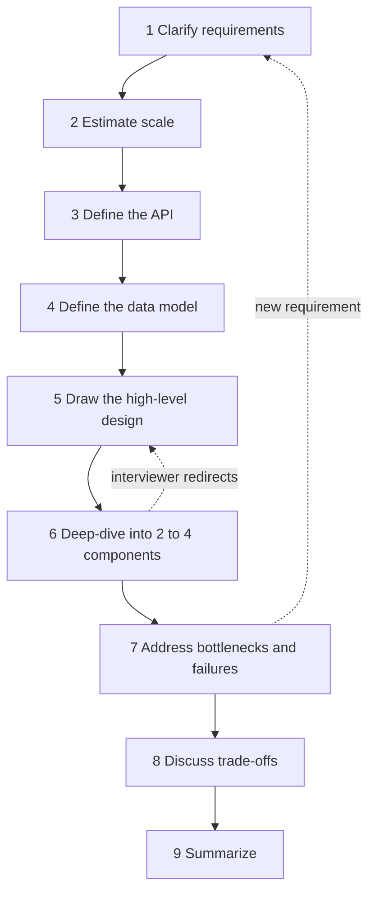
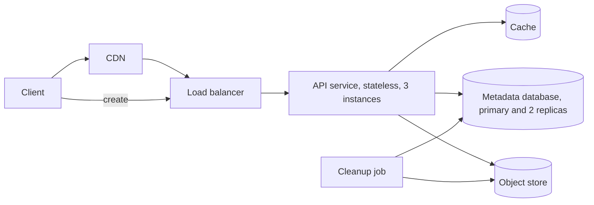

# How to Approach an HLD Interview

A high-level design (HLD) interview gives you one open problem, such as "design a URL shortener" or "design a chat system", and 45 to 60 minutes. You design a distributed system: its services, data stores, and the communication between them. This page gives one procedure with nine steps, a time budget, a scoring rubric, ways to drive the conversation, and a full worked example (a paste service). The pages in [`fundamentals/`](fundamentals/01-scalability-and-availability.md) and [`distributed-systems/`](distributed-systems/01-failures-and-time.md) give the building blocks for each step.

## Why It Matters

An HLD interview has no single correct answer. The interviewer scores how you find the real requirements, how you size the problem, how you choose components, and how you reason about trade-offs and failure. Candidates with good knowledge of components still fail when they draw a database and a cache at minute 2 without a requirement, or when they spend 30 minutes on one component and do not present the whole system. A fixed procedure gives each minute a purpose and gives the interviewer a structure to follow. On the job, the same steps apply to a design review or a design document: state the requirements, size the load, define the interfaces and the data, draw the system, then examine the risks and the alternatives. For the code-level version of this skill, read [how to approach an LLD interview](../lld/how-to-approach-lld.md).

## Core Concepts

**High-level design (HLD)**: the design of a distributed system: its services, data stores, queues, and the communication between them. **Low-level design (LLD)** designs the classes inside one program. See the [HLD index](README.md) and the [LLD index](../lld/README.md).

**Functional requirement**: a statement of what the system does. Example: "A user creates a paste and gets a URL."

**Non-functional requirement**: a statement of how well the system does it: latency, availability, durability (stored data survives failures), consistency (readers see the latest write), and scale. Example: "A read returns in 200 ms at the 99th percentile." See [scalability and availability](fundamentals/01-scalability-and-availability.md) for percentiles, SLI, SLO, and SLA.

**Scope**: the set of features that the design covers. A design that covers everything covers nothing in depth, so you cut the scope with the interviewer in the first minutes.

**Estimation**: a calculation with rounded numbers that gives the load and the data size. See [back-of-envelope estimation](back-of-envelope-estimation.md).

**Access pattern**: a query that the system runs often, with its key, its filter, and its rate. Example: "Read one paste by its key, 100 times per second." The access patterns choose the data store.

**Component**: one deployable part of the design: a service, a database, a cache, a queue, a load balancer, an object store.

**Deep dive**: a detailed discussion of one component or one problem, after the high-level design. A deep dive shows depth.

**Bottleneck**: the part of the system that limits the whole system as the load grows. The part with the least capacity, or the part that cannot scale out, is the bottleneck.

**Single point of failure (SPOF)**: a component whose failure stops the whole system. See [scalability and availability](fundamentals/01-scalability-and-availability.md).

**Trade-off**: a choice where each option wins on one property and loses on another. Example: a cache gives lower read latency and may return stale data.

### The nine steps

| Step | Name | Output | Building blocks that the step uses |
|---|---|---|---|
| 1 | Clarify requirements | Numbered functional and non-functional requirements, scope, assumptions | [Scalability and availability](fundamentals/01-scalability-and-availability.md), [consistency and CAP](fundamentals/07-consistency-and-cap.md) |
| 2 | Estimate scale | QPS, storage, bandwidth, cache size, servers | [Back-of-envelope estimation](back-of-envelope-estimation.md) |
| 3 | Define the API | The endpoints or the messages, with inputs, outputs, and errors | [Communication patterns](fundamentals/09-communication-patterns.md), [rate limiting](fundamentals/13-rate-limiting-algorithms.md), [unique IDs](fundamentals/15-unique-id-generation.md) |
| 4 | Define the data model | Entities, keys, indexes, the choice of database | [Choosing a database](fundamentals/04-choosing-a-database.md), [storage types](fundamentals/10-storage-types.md), [search](fundamentals/11-search-and-indexing.md) |
| 5 | Draw the high-level design | One diagram of 6 to 10 components and the data flow of each use case | [Load balancing, DNS, CDN](fundamentals/02-load-balancing-dns-cdn.md), [caching](fundamentals/03-caching.md), [microservices](fundamentals/14-microservices-and-monoliths.md), [queues](fundamentals/08-message-queues-and-streams.md) |
| 6 | Deep-dive into two to four components | A detailed design of the parts that carry the risk | [Replication](fundamentals/05-replication.md), [partitioning](fundamentals/06-partitioning-and-sharding.md), [event-driven architecture](fundamentals/16-event-driven-architecture.md), [consensus and leader election](distributed-systems/02-consensus-and-leader-election.md), and the other distributed systems pages in the deep-dive table below |
| 7 | Address bottlenecks and failures | The first things that fail, with the fix for each | [Reliability patterns](fundamentals/12-reliability-patterns.md), [observability](fundamentals/20-observability-in-design.md), [security](fundamentals/21-security-in-design.md), [multi-region](fundamentals/19-multi-region-and-disaster-recovery.md) |
| 8 | Discuss trade-offs | Each key decision, with the alternatives that you rejected | [Consistency and CAP](fundamentals/07-consistency-and-cap.md) |
| 9 | Summarize | A one-minute recap, the open issues, the next steps | |



The dotted arrows show that a design is not a straight line. An interviewer can redirect you in the middle of a deep dive, or add a requirement ("now it must work in three regions"). When that happens, go back to the step that the change touches, update the board, and continue.

Steps 7 and 8 overlap with step 6. While you explain a component, you name its failure and its alternative at once. Steps 7 and 8 are the moment where you review the whole system and say what you did not cover. They are not a second design phase.

## How It Works

### Step 1. Clarify requirements

Spend the first 5 minutes on questions. An HLD problem is vague on purpose: "design a chat system" has no user count, no feature list, and no target for latency. The interviewer checks whether you find the gaps. Ask in groups, state your assumption for each answer, and write the numbered list on the board.

| Group | Question to ask | Example for a paste service |
|---|---|---|
| Users and use cases | Who uses the system, and what are the two or three main actions? | Anyone with a link. Create a paste, read a paste |
| Scope | Which features are in scope, and which are out? | Accounts, editing, and search: out |
| Scale | How many users, and how many requests? Is this a new product or a large one? | 1 million new pastes a day |
| Read-write ratio | Does the system mostly read or mostly write? | 10 reads for each write |
| Data | How large is one item, and how long do we keep it? | 10 KB on average, 1 MB at most, optional expiry |
| Latency | What response time do users expect, and at which percentile? | A read returns in 200 ms at p99 |
| Availability | What must keep working during a failure? Which side wins, availability or consistency? | Reads must stay up. 99.9% |
| Consistency | Who must see a write at once, and who may see it late? | A new paste is readable at once by anyone with the URL |
| Durability | May the system lose data? | No loss of an acknowledged paste |
| Geography | Where are the users? One region or many? | One region now. Several later |
| Security and abuse | Is the data private? Who can abuse the system? | Unlisted URL. Spam and large uploads are risks |
| Platform | Web, mobile, public API? | A web client and a public API |

Rules for this step:

- Ask about the scale, the read-write ratio, and the top two use cases first. They decide the rest of the round.
- Ask closed questions that have a short answer ("Is search in scope?"). An open question ("What do you want?") wastes time.
- Write each answer as a numbered requirement. Write an unanswered question as an assumption: "Assumption: one region."
- Separate the functional requirements (what) from the non-functional requirements (how well). The non-functional requirements choose the architecture. Two systems with the same features and different targets for latency and consistency have different designs.
- Stop at 5 minutes. If the interviewer says "your choice", pick the simpler option and say so.

### Step 2. Estimate scale

Take about 3 minutes (4 in a 60-minute slot). Compute the requests per second (average and peak), the storage for the retention period, the bandwidth, the cache size, and the number of servers. Use rounded numbers and show each step. Compute only the numbers that can change a decision. If the interviewer says "skip the math" or gives the scale, state the two or three numbers that decide the design and compute the others later, when a decision needs them. The [back-of-envelope estimation page](back-of-envelope-estimation.md) gives the formulas, the constants, and four worked examples.

End the step with a sentence that states what the numbers decide: "The peak is 300 reads per second, so one primary database handles the throughput, and I do not shard. The content is 18 TB in 5 years, so the content goes to an object store." The interviewer wants to see that the numbers change the design.

### Step 3. Define the API

Write the 3 to 6 operations that the use cases need. For each operation give the method, the path, the input, the output, and the errors. Choose the style by the requirement (see [communication patterns](fundamentals/09-communication-patterns.md): REST or gRPC for request and response, WebSocket or Server-Sent Events for push, a queue for asynchronous work).

Decide these points for each endpoint:

- **Identifiers**: how the system creates an ID (see [unique ID generation](fundamentals/15-unique-id-generation.md)).
- **Pagination**: a list endpoint returns a page and a cursor, not the full list.
- **Idempotency**: a retry of a create request must not create two items. Use an idempotency key: the client sends a unique value in a header such as `Idempotency-Key`, and the server stores the key with the result. The header is described in an IETF Internet-Draft, not in an RFC (see [reliability patterns](fundamentals/12-reliability-patterns.md)).
- **Errors**: use the status codes of HTTP (RFC 9110): 201 for a created item, 404 for an unknown item, 410 for an item that existed and is gone, 413 for a body that is too large, and 429 for a rate limit (RFC 6585). See [rate limiting algorithms](fundamentals/13-rate-limiting-algorithms.md).
- **Authentication**: how the caller proves its identity. See [security in design](fundamentals/21-security-in-design.md).

Keep the API short. It shows that you know the use cases and the contract before you draw boxes. For API design in depth, see `kb/api-design/06-api-design-in-interviews.md`.

### Step 4. Define the data model

List the entities, their attributes, their keys, and the access patterns. Then choose the data store from the access patterns, not from a habit.

1. Write the access patterns with their rate: "read one paste by key: 100 reads per second", "find expired pastes: one scan each minute".
2. Give each entity a primary key that serves its main access pattern.
3. Choose the database family from the patterns, the size, and the consistency need. The [choosing a database page](fundamentals/04-choosing-a-database.md) has the decision procedure. Internals live in `kb/databases/07-nosql-families.md` and `kb/databases/01-relational-model-and-sql.md`.
4. Decide where large objects live. A blob does not belong in a row. Store the blob in an object store and keep a reference in the database (see [storage types](fundamentals/10-storage-types.md)).
5. Add the indexes for the other access patterns. If one pattern needs full-text queries, use a search index (see [search and indexing](fundamentals/11-search-and-indexing.md)).
6. State how the data will grow past one machine: the partition key and the replication plan (see [partitioning and sharding](fundamentals/06-partitioning-and-sharding.md) and [replication](fundamentals/05-replication.md)). If the estimate shows that one machine is enough, say so.

Give the reason for the choice in one sentence that names the access pattern: "Lookups by primary key with 365 GB of metadata in 5 years fit a relational database, and the primary key constraint enforces unique keys."

### Step 5. Draw the high-level design

Draw one diagram with 6 to 10 components. Start from the client and follow one request through the system. Add a component only when a requirement or a number needs it.

| Component | Add it when | Page |
|---|---|---|
| DNS, CDN | Users are far away, or the system serves static or cacheable content | [Load balancing, DNS, CDN](fundamentals/02-load-balancing-dns-cdn.md) |
| Load balancer | More than one instance of a service | [Load balancing, DNS, CDN](fundamentals/02-load-balancing-dns-cdn.md) |
| API gateway | Many services need one entry for authentication and rate limits | [Microservices](fundamentals/14-microservices-and-monoliths.md) |
| Stateless service | In every design, for the request-handling logic | [Scalability and availability](fundamentals/01-scalability-and-availability.md) |
| Cache | The estimate shows many reads of a small working set, or the latency target is below what the data stores give | [Caching](fundamentals/03-caching.md) |
| Database | In every design. The choice comes from step 4 | [Choosing a database](fundamentals/04-choosing-a-database.md) |
| Object store | Large blobs: images, video, files | [Storage types](fundamentals/10-storage-types.md) |
| Message queue or log | Slow work, spikes, several consumers, or decoupling | [Message queues and streams](fundamentals/08-message-queues-and-streams.md) |
| Search index | Full-text or ranked search | [Search and indexing](fundamentals/11-search-and-indexing.md) |
| Push channel | The server must send data to the client | [Communication patterns](fundamentals/09-communication-patterns.md) |
| Batch or stream job | Aggregation, analytics, or a data pipeline | [Batch and stream processing](fundamentals/17-batch-and-stream-processing.md) |

After the diagram, walk through each use case from step 1 along the arrows: "A create request goes from the client through the load balancer to the API service. The service ..." Name the protocol or the data at each arrow. The walkthrough finds gaps in the diagram, and it shows the interviewer the data flow. Name the simple parts and move on. Keep the time for the deep dives.

Do not draw a component that you cannot justify. A diagram with a queue, a cache, and a search index that no requirement needs is a red flag (see the red flags below).

### Step 6. Deep-dive into two to four components

A deep dive is where the interviewer sees your depth. Choose the topics with these rules, in this order:

1. **The risk that the estimate shows.** If the estimate shows 20,000 writes per second, the write path is a deep dive. If it shows a 1.9 Tbit/s egress, the CDN design is a deep dive.
2. **The part that makes this problem different.** A chat system: message delivery and ordering. A news feed: fan-out. A payment system: idempotency and the ledger.
3. **The interviewer's interest.** If the interviewer asks "how does that work?", that is the deep dive.

Say the plan aloud: "I see three risks: key generation, the write path, and expiry. I will start with the write path. Is that the right priority?" The question costs 10 seconds and aligns you with the interviewer.

For each deep dive, use the same pattern:

1. State the problem in one sentence.
2. Give the simplest design, and say where it fails (with a number if you can).
3. Give the improvement and the mechanism, in detail.
4. State the cost of the improvement and the alternative that you rejected.
5. State the failure behavior: what happens when a node, a network link, or a dependency fails.

The table maps common problems to the pages that hold the mechanism.

| Problem in the design | Mechanism | Page |
|---|---|---|
| One database cannot hold the data or the write rate | Partitioning, consistent hashing, hot-key handling | [Partitioning and sharding](fundamentals/06-partitioning-and-sharding.md) |
| One database is a single point of failure, or reads are too slow | Replication, failover, replication lag | [Replication](fundamentals/05-replication.md) |
| Stale reads, conflicting writes, "is it CP or AP?" | Consistency models, quorums, CAP and PACELC | [Consistency and CAP](fundamentals/07-consistency-and-cap.md) |
| Repeated reads of the same data | Cache-aside, invalidation, stampede, hot keys | [Caching](fundamentals/03-caching.md) |
| Unique, sortable IDs without coordination | UUID v7, Snowflake, ticket servers | [Unique ID generation](fundamentals/15-unique-id-generation.md) |
| One service call slows or fails another | Timeouts, retries with jitter, circuit breaker, bulkhead | [Reliability patterns](fundamentals/12-reliability-patterns.md) |
| A client sends too many requests | Token bucket, sliding window counter | [Rate limiting algorithms](fundamentals/13-rate-limiting-algorithms.md) |
| Work must not be lost, or must run once | Queues, delivery semantics, outbox, idempotent consumers | [Message queues and streams](fundamentals/08-message-queues-and-streams.md), [distributed transactions](distributed-systems/03-distributed-transactions.md) |
| One business action spans several services | Saga, choreography, orchestration | [Event-driven architecture](fundamentals/16-event-driven-architecture.md), [distributed transactions](distributed-systems/03-distributed-transactions.md) |
| One node must lead, or many nodes must agree | Raft, leader election, ZooKeeper, etcd | [Consensus and leader election](distributed-systems/02-consensus-and-leader-election.md) |
| "Has this been seen?", counts, or membership at huge scale | Bloom filter, count-min sketch, HyperLogLog | [Probabilistic data structures](distributed-systems/04-probabilistic-data-structures.md) |
| Only one worker may act on a resource | Leases, fencing tokens | [Distributed locks and leases](distributed-systems/05-distributed-locks-and-leases.md) |
| Concurrent edits on several replicas | CRDTs, version vectors | [CRDTs and conflict resolution](distributed-systems/06-crdts-and-conflict-resolution.md) |
| Time, ordering, and failure detection across machines | Lamport clocks, vector clocks, timeouts | [Failures and time](distributed-systems/01-failures-and-time.md) |
| Location queries | Geohash, quadtree, S2 | [Geospatial indexing](fundamentals/18-geospatial-indexing.md) |
| Large-scale aggregation | Batch and stream processing, windows | [Batch and stream processing](fundamentals/17-batch-and-stream-processing.md) |

The case studies show the whole procedure on 25 problems. The table below maps the common problem families to the case study that shows them.

| Problem family | Case study | Main building blocks |
|---|---|---|
| Read-heavy lookup | [URL shortener](case-studies/01-url-shortener.md) | Unique IDs, caching, CDN |
| Shared state with limits | [Distributed rate limiter](case-studies/02-distributed-rate-limiter.md) | Rate limiting, Redis, failure mode |
| Storage with replication | `kb/hld/case-studies/03-key-value-store.md` | Partitioning, replication, quorums, gossip |
| Fan-out | `kb/hld/case-studies/04-notification-system.md`, `kb/hld/case-studies/05-news-feed.md` | Queues, fan-out on write or on read |
| Real-time messaging | `kb/hld/case-studies/06-chat-system.md` | WebSocket, ordering, presence |
| Indexing and crawling | `kb/hld/case-studies/07-search-autocomplete.md`, `kb/hld/case-studies/08-web-crawler.md` | Trie, pipelines, deduplication |
| Large objects | `kb/hld/case-studies/09-video-streaming.md`, `kb/hld/case-studies/10-file-storage-and-sync.md` | Object store, CDN, chunking |
| Geography and contention | `kb/hld/case-studies/11-ride-hailing-and-proximity.md`, `kb/hld/case-studies/12-ticket-booking.md` | Geospatial index, holds, idempotency |
| Money | `kb/hld/case-studies/13-payment-system.md` | Ledger, idempotency, reconciliation |
| Ranking | `kb/hld/case-studies/16-leaderboard-and-top-k.md` | Sorted sets, approximate top-k |

### Step 7. Address bottlenecks and failures

Walk the diagram from the client to the data and ask three questions for each component:

1. **What fails first when the load grows by 10 times?** Use the estimate to find the answer, and fix it (see [scalability and availability](fundamentals/01-scalability-and-availability.md)).
2. **What happens if this component fails?** Find each single point of failure, and add redundancy or a fallback (see [reliability patterns](fundamentals/12-reliability-patterns.md), [replication](fundamentals/05-replication.md)).
3. **How do we know that it fails?** Name the metrics, the logs, and the alerts for the top two risks (see [observability in design](fundamentals/20-observability-in-design.md)).

Add these topics when the requirements need them: security (authentication at the edge, encryption, abuse; see [security in design](fundamentals/21-security-in-design.md)), regions (see [multi-region and disaster recovery](fundamentals/19-multi-region-and-disaster-recovery.md)), and data privacy. Take 3 to 4 minutes. Pick the top three risks and fix them. Do not list 20 risks with no fix.

### Step 8. Discuss trade-offs

Every decision that you made has an alternative. Say the decision, the alternative, and the reason in one pass:

```text
Decision:    cache-aside in front of the metadata database and the object store
Alternative: write-through cache
Reason:      pastes are immutable, so a cached entry never holds old content, and the
             TTL never exceeds the remaining lifetime. Write-through would fill the
             cache with every new paste, read or not. A cache failure only costs latency.
Cost:        the first read of each paste misses the cache
```

Use the properties that the requirements ranked in step 1: latency, consistency, availability, cost, simplicity, and operational effort. Common pairs:

| Pair | What you give up | Page |
|---|---|---|
| Consistency and availability (during a partition) | Either rejected writes or stale reads | [Consistency and CAP](fundamentals/07-consistency-and-cap.md) |
| Latency and consistency (without a partition) | Synchronous replication adds latency | [Consistency and CAP](fundamentals/07-consistency-and-cap.md), [replication](fundamentals/05-replication.md) |
| Read speed and write cost | Fan-out on write, indexes, and caches | [Caching](fundamentals/03-caching.md), [event-driven architecture](fundamentals/16-event-driven-architecture.md) |
| Cost and durability | More replicas cost more storage | [Storage types](fundamentals/10-storage-types.md) |
| Simplicity and scale | A monolith is simple, services scale teams | [Microservices and monoliths](fundamentals/14-microservices-and-monoliths.md) |
| Accuracy and memory | Probabilistic structures use less memory and give approximate answers | [Probabilistic data structures](distributed-systems/04-probabilistic-data-structures.md) |
| Freshness and load | A longer TTL cuts load and raises staleness | [Caching](fundamentals/03-caching.md) |

### Step 9. Summarize

Use the last 2 minutes. Say the design in one minute: the requirements, the main components, the data flow, the key decision, and the main risk. Then say what you did not cover and what you would do next ("with more time I would add multi-region replication and an abuse filter"). Ask if the interviewer wants to go deeper anywhere. The summary shows that you see the whole system, and it leaves the interviewer with a clear picture.

### Time budget

Recommendation: the budget below is this KB's recommendation, not a published standard. A scheduled slot is not all working time. The introductions at the start and your questions to the interviewer at the end take part of the slot, so the budget plans for about 40 working minutes in a 45-minute slot and about 54 in a 60-minute slot. Change the proportions if the interviewer asks for more depth or more breadth.

| Phase | 45-minute slot | 60-minute slot |
|---|---|---|
| Introductions, and your questions at the end | 5 | 6 |
| 1. Clarify requirements | 5 | 6 |
| 2. Estimate scale | 3 | 4 |
| 3. Define the API | 3 | 4 |
| 4. Define the data model | 3 | 4 |
| 5. Draw the high-level design | 7 | 10 |
| 6. Deep dives (two to four) | 13 | 18 |
| 7-8. Bottlenecks, failures, and trade-offs | 4 | 6 |
| 9. Summarize | 2 | 2 |
| **Total** | **45** | **60** |

The deep dives get the largest share, because they show the depth that separates a senior answer from a mid-level answer (see the rubric below). Recommendation: shift the split by level. A mid-level candidate may spend more time on the high-level design and let the interviewer choose the deep dives. A senior or staff candidate keeps steps 2 to 4 short, reaches the deep dives by minute 26, and chooses the deep dives without a prompt.

Checkpoints for a 45-minute slot, counted from the start of the slot (the checkpoints place the introductions at the start, as on the [LLD page](../lld/how-to-approach-lld.md)): by minute 13, the requirements and the estimate are on the board. By minute 19, the API and the data model are done. By minute 26, the diagram is complete and the deep dives start. By minute 39, the deep dives end. If you are behind at a checkpoint, cut the next phase and say that you cut it. Steps 3 and 4 are the usual place to cut: give three endpoints and one table, and move on.

### What interviewers score

Companies publish no common rubric for HLD interviews. The rubric below is this KB's model of the criteria that interview guides and candidate reports repeat. It is a study tool and not an official standard, and no company uses it as written. The levels describe the bar that a candidate meets, from the lowest to the highest.

| Criterion | Mid-level | Senior | Staff |
|---|---|---|---|
| Requirements | Asks for the main features and the scale. Needs a prompt to ask about latency, availability, or consistency | Asks about the read-write ratio, latency, availability, and consistency. States assumptions. Cuts the scope | Finds the requirement that the interviewer did not state, and the business goal behind it. Ranks the requirements and says which one decides the design |
| Estimation | Computes QPS and storage with correct units | Computes peak load, bandwidth, and cache size. Uses the numbers to choose components | Uses the numbers to rule out designs, and checks them against known systems. Finds the number that the design depends on |
| Design | A working design with the standard components. Follows the interviewer's lead | A design that fits the numbers. Each component has a reason. Names real systems and their properties | A design that fits the requirements, the team, and the cost. Moves fast through the standard parts. Starts simple, and shows a path to the larger design |
| Depth | Explains one component well when the interviewer chooses it | Chooses the deep dives without a prompt. Goes deep on two or three components. Knows the internals and the failure modes | Finds the hard problem before the interviewer names it. Goes deep on it and on its second-order effects. Compares designs by operational cost |
| Trade-offs | Names the alternative when asked | Names the alternative, the criterion, and the cost for each key decision | Frames the decision in terms of the business and the risk. Accepts a worse technical option for a stated reason |
| Failure and scale | Adds replication and a load balancer | Finds the bottlenecks and the single points of failure, with fixes. Plans for 10 times the load | Plans failure domains, rollout, migration, and observability. Names what will break in a year |
| Communication | Explains the diagram when asked | Drives the conversation. Checks in. Uses the board | Leads the discussion as a design review. Brings the interviewer into the decisions. Calibrates depth to the audience |
| Scope of ownership | One system | One system and its neighbors | The system and its effect on other teams, cost, and long-term evolution |

An interview is also scored on judgment: a candidate who builds the simplest design that meets the numbers, and who says why, scores above a candidate who draws a large design that the numbers do not need.

### How to drive the conversation

- Say the step that you are in: "I am at the estimate step. I will compute the requests per second first."
- State a plan after the diagram: "I see three risks. I will go deep on the write path, then on expiry. I will leave search out."
- Use the board as shared memory. Write the numbered requirements, the numbers, and the decisions, so the interviewer can point at a line.
- Give each decision a reason and an alternative: "I use an object store for the content, because it is 18 TB, and a relational database is costly at that size."
- Check in after each phase with one sentence: "Does this match what you expect?" It costs 10 seconds and finds a misunderstanding early.
- When the interviewer redirects, follow at once and say what you park: "I will come back to the key generation after this."
- When you do not know a technology, say what you know, state the property that you need, and describe the design from the property: "I do not know this product. I need a key-value store with single-key transactions and range scans."
- When you are stuck, say what blocks you. An interviewer gives a hint, and a hint that you use well is a positive signal.
- Treat a challenge as information. If the point is right, say "that is a good point, I would change X to Y". If your design is right, explain the reason.
- Do not lecture. A definition of a topic that the interviewer did not ask about wastes time.
- Quantify. "The cache hit ratio must be above 90% to keep the database below 100 reads per second" is stronger than "the cache reduces load".

### Red flags during the round

- Drawing a database or a cache before the requirements are clear.
- No estimate, or an estimate that does not change the design.
- A design that is larger than the numbers need (a cluster, a queue, and a cache for 100 requests per second).
- Naming a technology with no reason ("I use Kafka") or with a wrong property ("the queue gives exactly-once delivery").
- A single database as the answer to every problem, or a different database for every table with no reason.
- No answer to "what happens when this fails?" or "what if the load grows by 10 times?"
- No mention of consistency or availability.
- Spending more than 10 minutes on one component, or presenting no deep dive.
- A silent period of more than two minutes, or reading a memorized template.
- Defending a choice against a correct point from the interviewer.
- A diagram with unlabeled arrows.

## Trade-offs and When to Use

The procedure is a default. These variants exist, and each fits a different round.

| Choice | Option A | Option B | Recommendation |
|---|---|---|---|
| Order of work | Requirements, estimate, API, data, diagram | Diagram first, then fill in the details | The default order. Draw the diagram first only if the interviewer asks for it, and then do the estimate to confirm it |
| Breadth against depth | Cover every component at a shallow level | Cover two or three components in detail | Cover the whole system in the high-level design, then go deep on two to four. A shallow tour of everything scores below depth in the hard areas |
| API step | Full endpoint list | Three endpoints | Three to six endpoints. Add more only if the interviewer asks |
| Estimation depth | Every number | The numbers that decide the design | The numbers that decide the design. Skip a number that changes nothing |
| Data model before diagram | Data model first | Diagram first | Data model first when the problem is data-centric (a key-value store). Diagram first when the problem is a flow (a notification system). Either is acceptable if you say why |
| Start simple or start large | A single-server design, then scale it | The scaled design at once | A simple design, then scale it with the numbers. It shows the reasoning |
| Technology names | Generic components ("a key-value store") | Named products ("DynamoDB") | Name the family, then give one product as an example, with the property that you rely on |
| Failure discussion | At the end | During each component | During each component. Repeat the top risks at the end |

The procedure does not fit these cases:

- **LLD questions.** If the interviewer asks for classes, interfaces, and code, the round is an LLD round. See [how to approach an LLD interview](../lld/how-to-approach-lld.md). Ask: "Do you want classes in one process, or services across machines?"
- **Machine learning system design.** The steps for the data pipeline, the training, and the serving differ. Use the same first two steps, then follow the machine learning pipeline.
- **Improving an existing system.** Start from the current architecture and its measurements. Ask for the bottleneck, then follow steps 6 to 8.
- **A very short round (30 minutes).** Cut the API step to one sentence, give one deep dive, and keep the estimate to the one number that matters.
- **Product design with little technical content.** Spend more time on step 1, and keep the technical steps short.

## Java Example

The worked example is a paste service. The statement, as the interviewer says it: "Design a service where a user pastes a block of text, gets a short URL, and anyone with the URL reads the text. A paste can expire." The example follows the nine steps. It is a small system on purpose: the estimate shows that the load is low, and the lesson is to design for the numbers and not for a larger system.

### Step 1: requirements and assumptions

| # | Requirement | Source |
|---|---|---|
| R1 | A client creates a paste with text up to 1 MB and gets a short URL | Statement |
| R2 | A client reads a paste by the URL | Statement |
| R3 | A paste can have an expiry time. After it, a read fails | Statement |
| R4 | The service needs no account. A paste is unlisted: it appears in no list or search, so a reader needs the URL. The key must be random, so that nobody can derive one key from another. A paste is not secret: anyone who has the URL can read it | Question: "Is a paste private?" |
| N1 | Read availability is 99.9% (about 8.8 hours of downtime a year; see [scalability and availability](fundamentals/01-scalability-and-availability.md)) | Question: "What must stay up?" |
| N2 | A read returns in 200 ms at p99 | Question: "What latency do users expect?" |
| N3 | The service does not lose an acknowledged paste (durability) | Question: "May we lose data?" |
| N4 | After a create call returns, a read of the new URL finds the paste at once (read-your-writes for the creator, who has the URL first) | Question: "Who must see a write at once?" |
| A1 | Assumption: 1 million new pastes a day. 10 reads for each write. 10 KB on average. 200 bytes of metadata for each paste. Retention 5 years. Peak factor 3. Replication factor 3 | Stated to the interviewer |
| A2 | Assumption: one region. Out of scope: accounts, editing, search, custom aliases | Stated to the interviewer |

### Step 2: estimate

Each line uses the rounding rule of the [estimation page](back-of-envelope-estimation.md) (one day is 10^5 seconds). The Java program below recomputes every line.

| Quantity | Calculation | Result |
|---|---|---|
| Writes per second | 1,000,000 / 10^5 | 10, peak 30 |
| Reads per second | 10 × 10 | 100, peak 300 |
| Content per day | 1,000,000 × 10 KB | 10 GB |
| Content in 5 years | 10 GB × 365 × 5 | 18.25 TB |
| Content with 3 replicas | 18.25 TB × 3 | 54.75 TB |
| Metadata in 5 years | 1,000,000 × 200 B × 365 × 5 | 365 GB (assumption: 200 bytes for each paste) |
| Read bandwidth | 100 × 10 KB × 8 | 8 Mbit/s, peak 24 Mbit/s |
| Cache for 20% of the daily reads (rule of thumb, an upper bound) | 100 × 10^5 × 0.2 × 10 KB | 20 GB |
| Key space | 62^8 | 2.18 × 10^14 |
| Share of the key space used in 5 years | 1.825 × 10^9 / 2.18 × 10^14 | 0.00084% |
| Expected key collisions in 5 years | (1.825 × 10^9)^2 / (2 × 2.18 × 10^14) | about 7,600, each one a retry |

What the numbers decide: the throughput is low (300 reads per second at the peak), so one primary database with two replicas (one synchronous, one asynchronous) serves the metadata, and the service tier needs 2 or 3 servers only for availability. The throughput needs no cache. The size is the issue: 18.25 TB of content in 5 years does not belong in database rows, so the content goes to an object store. The 8-character key space is about 120,000 times larger than the number of pastes in 5 years, so a random key rarely collides (one new key collides with probability 8.4 × 10^-6). Over 5 years, the service sees about 7,600 collisions in total (the birthday approximation n^2 / 2N), and each one costs one retry.

### Step 3: API

| Operation | Method and path | Request | Response | Errors |
|---|---|---|---|---|
| Create a paste | `POST /v1/pastes` | JSON body: `content` (up to 1 MB), `ttl_seconds` (optional, 0 for no expiry). Header `Idempotency-Key` (optional) | `201 Created`: `key`, `url`, `expires_at` | `400` bad input, `413` content too large, `429` rate limit |
| Read a paste | `GET /v1/pastes/{key}` | none | `200 OK`: `content`, `created_at`, `expires_at` | `404` unknown key, `410` expired |

A client that retries a create request after a timeout sends the same `Idempotency-Key`, and the service returns the first result instead of creating a second paste. The write endpoint has a rate limit for each client address (see [rate limiting algorithms](fundamentals/13-rate-limiting-algorithms.md)).

### Step 4: data model

The access patterns: (1) read one paste by key, 100 per second; (2) insert one paste, 10 per second; (3) find the pastes that expired, one scan each minute; (4) look up an idempotency key on each create, 10 per second.

The metadata goes to a relational database, and the content goes to an object store. The reason: the metadata is small (365 GB in 5 years), the reads are lookups by primary key, and the primary key constraint enforces the uniqueness of the key. The content is large, immutable, and read as a whole, which is the use case of an object store. Recommendation: this choice is the simplest one that meets the numbers. A key-value store would also work (see [choosing a database](fundamentals/04-choosing-a-database.md)).

The metadata table and the idempotency table. Times are epoch seconds. The `object_id` is the name of the content in the object store. It is not the key, and the reason is in deep dive 2. The `idempotency_keys` table stores each `Idempotency-Key` with a hash of the request body and the paste that the first request created. A retry with the same key and the same body gets the same paste. A retry with the same key and a different body is a client error. A cleanup job deletes rows after one day.

```sql
CREATE TABLE pastes (
    paste_key  TEXT PRIMARY KEY,
    object_id  TEXT NOT NULL,
    size_bytes INTEGER NOT NULL,
    created_at INTEGER NOT NULL,
    expires_at INTEGER
);
CREATE INDEX idx_pastes_expires_at ON pastes (expires_at);
CREATE TABLE idempotency_keys (
    idempotency_key TEXT PRIMARY KEY,
    request_hash    TEXT NOT NULL,
    paste_key       TEXT NOT NULL REFERENCES pastes (paste_key),
    expires_at      INTEGER NOT NULL
);
INSERT INTO pastes VALUES ('aaaaaaaa', 'obj-1', 5, 1000, 4600);
INSERT INTO pastes VALUES ('bbbbbbbb', 'obj-2', 5, 1000, NULL);
INSERT INTO pastes VALUES ('cccccccc', 'obj-3', 9, 2000, 3000);
```

The cleanup job finds the pastes that expired. The index on `expires_at` serves this scan. At time 4000, only `cccccccc` has expired.

```sql
SELECT paste_key, object_id FROM pastes
WHERE expires_at IS NOT NULL AND expires_at <= 4000
ORDER BY expires_at
LIMIT 100;
```

<!-- sql-result -->
```text
paste_key | object_id
cccccccc | obj-3
```

### Step 5: high-level design



| Component | Responsibility |
|---|---|
| CDN | Caches `200` responses of `GET`. The `Cache-Control` max-age is the smaller of the remaining lifetime of the paste and one day, so the CDN does not serve a paste after it expires. A `404` response carries `Cache-Control: no-store`, so the CDN never serves a stale "not found" for a paste that exists |
| Load balancer | Spreads requests over the API instances. Checks health (see [load balancing, DNS, CDN](fundamentals/02-load-balancing-dns-cdn.md)) |
| API service | Stateless. Validates input, creates keys, writes and reads the metadata and the content, enforces the rate limit |
| Cache | Cache-aside for the metadata and for small contents. Entries live for the smaller of 5 minutes and the remaining lifetime of the paste. The cache does not store "not found". The reason for the cache is the latency target N2 at the tail, not the throughput: an object store read adds a network call with a variable tail (see deep dive 3 and [caching](fundamentals/03-caching.md)) |
| Metadata database | One primary and two replicas, the replication factor 3 of A1. One replica is synchronous: the primary confirms a commit only after that replica has the write (N3). The other replica is asynchronous and serves reads. Primary key: `paste_key` (see [replication](fundamentals/05-replication.md)) |
| Object store | Holds the content as immutable objects (see [storage types](fundamentals/10-storage-types.md)) |
| Cleanup job | Deletes the expired pastes in batches |

Create flow: the client sends `POST` to the load balancer. The API service checks the idempotency key, creates a key, writes the content to the object store, and inserts the metadata row. It returns `201`. Read flow: the CDN answers from its cache if it can. If not, the request reaches the API service, which reads the metadata from the cache or the replica (and from the primary if the replica has no row), checks the expiry, reads the content from the cache or the object store, and returns it.

### Step 6: deep dives

**Deep dive 1: key generation.** The requirement is a random key that nobody can derive from another key (R4). A counter with base62 encoding gives short keys, but the next key is predictable, and a shared counter is a coordination point (see [unique ID generation](fundamentals/15-unique-id-generation.md)). A hash of the content gives the same key for the same text, which leaks whether someone else pasted the same text, and two pastes with the same text would share one key. The design uses 8 random base-62 characters from a cryptographically secure generator. The key space is 62^8 = 2.18 × 10^14. After 5 years there are 1.825 × 10^9 pastes, so one new key collides with probability 8.4 × 10^-6. The database enforces uniqueness with the primary key. If an insert fails because the key exists, the service takes a new key and retries (at most 5 times). The retry is rare and cheap. The alternative that the design rejected is a pre-generated pool of keys: it removes the collision check but adds a service to run.

The same ratio limits the protection against guessing. After 5 years, a random 8-character key matches an existing paste with probability 8.4 × 10^-6, so a scanner that sends 1 million guesses finds about 8 pastes. That is acceptable for unlisted pastes (R4), with a rate limit on reads for each client address and an alert on the rate of `404` responses. If the interviewer says that a paste can hold secrets, the key must be longer: 62^12 = 3.2 × 10^21, so one guess succeeds with probability 5.7 × 10^-13. A senior answer states this number, because "random" alone does not mean "hard to guess".

**Deep dive 2: the write path and durability.** The requirement is that the service does not lose an acknowledged paste (N3) and that a read of a new URL finds the paste at once (N4). The order of the steps matters:

1. The API service looks up the `Idempotency-Key` in the `idempotency_keys` table. If the key exists with the same request hash, the service returns the stored paste and stops.
2. The API service writes the content to the object store under a new `object_id` (a random identifier, not the paste key) and waits for the acknowledgment.
3. The service inserts the metadata row and the idempotency row in one transaction. The commit on the primary waits until the synchronous replica has the write.
4. The service returns `201`.

If the service wrote the content under the paste key and the key collided, the second write would overwrite the first paste. With a separate `object_id`, a key collision only repeats step 3 with a new key. If the service crashes between step 2 and step 3, the object has no metadata row. This is an orphan, and a daily reconciliation job deletes objects with no row that are older than one day. If the service crashes after step 3 and before the response, the client retries with its `Idempotency-Key`, and step 1 returns the paste that already exists. Two concurrent retries with the same `Idempotency-Key` can both pass step 1. Then the primary key of `idempotency_keys` lets only one transaction commit. The other request gets a conflict on the idempotency key, reads the committed row, and returns that paste. Its object becomes an orphan for the reconciliation job. Only a conflict on `paste_key` means "retry with a new key".

Durability (N3): with only asynchronous replicas, a failover can lose writes that no replica has received. The write rate is 30 per second at the peak, so the cost of a synchronous replica (one round trip in the data center, about 0.5 ms, approximate) is small. The design uses one synchronous replica and one asynchronous replica. If the synchronous replica fails, the database makes the asynchronous replica synchronous, so writes continue and every acknowledged paste is still on two nodes. This is the configuration that DDIA calls semi-synchronous. Do not confuse it with MySQL semi-synchronous replication, which falls back to asynchronous mode after a timeout and can then lose confirmed writes (see the warning on the [replication page](fundamentals/05-replication.md)).

Read-your-writes (N4): pastes are immutable, so the only stale state is "the replica does not have the row yet". A synchronous commit can confirm that the replica stored the write before the replica applies it, so a replica read can still miss for a moment. The read path handles this: if the replica has no row for the key, the service reads the primary before it returns `404`. Every reader then finds a new paste at once, and the service does not need to know which reader is the creator. The cost is a primary read for each unknown key, which the read rate limit bounds. The cache and the CDN never store a `404`, so an early read does not hide a paste that exists. See [replication](fundamentals/05-replication.md) for replication lag and read-your-writes.

**Deep dive 3: expiry and caching.** The requirement is that a read fails after the expiry (R3). The service checks `expires_at` on every read, so an expired paste returns `410` even before the cleanup job runs (lazy expiry). The cleanup job reclaims the space: each minute, it reads a batch of 100 expired rows with the query in step 4, deletes the object, and then deletes the row. If the job crashes between the two deletes, the next run finds the row again, and the object delete is idempotent. The cache and the CDN must not outlive the paste, so both use a lifetime that is at most the remaining lifetime. The CDN is the main protection for a paste that becomes popular: it takes the repeated reads, so the origin sees one read for each CDN node and each lifetime (see [caching](fundamentals/03-caching.md) for hot keys and stampedes). The cache in the service tier has a different reason. 300 reads per second do not need a cache for throughput. The p99 target of 200 ms (N2) does: a read that misses the CDN makes a database call and an object store call. AWS documents median latencies "in the tens of milliseconds" for small Amazon S3 requests, and the tail is higher, so a cache of small contents keeps the slow path off most reads. Recommendation: say that the cache is optional at this load, and that you would add it if the measured p99 exceeds the target.

### Step 7: bottlenecks and failures

| Risk | Effect | Fix |
|---|---|---|
| The metadata primary fails | Creates fail. Reads of cached and CDN-cached pastes continue | Automatic failover to the synchronous replica, which has every acknowledged paste (N3). Fencing stops the old primary from accepting writes (see [replication](fundamentals/05-replication.md)). The asynchronous replica becomes the new synchronous replica, and a new replica replaces the old primary |
| The object store is slow or down | Creates fail, and reads of uncached content fail | Timeouts and retries with jitter, a circuit breaker (see [reliability patterns](fundamentals/12-reliability-patterns.md)). The object store is a managed service with its own redundancy |
| One paste becomes very popular | One key takes all the reads | The CDN and the cache absorb it |
| A scanner guesses keys | Many `404` responses, and each one reads the primary | Rate limit reads for each address. Alert on the `404` rate. Longer keys if pastes hold secrets (deep dive 1) |
| A client floods the create endpoint | Storage fills with spam | Rate limit for each address, a content size limit, and a quota (see [rate limiting algorithms](fundamentals/13-rate-limiting-algorithms.md)) |
| The cleanup job falls behind | Expired data uses space | Alert on the age of the oldest expired row. Run more workers on different key ranges |
| The load grows by 10 times | 3,000 reads per second at the peak | The cache and the CDN absorb the reads. Add API instances and read replicas. Partition by `paste_key` only if the metadata exceeds one machine (see [partitioning and sharding](fundamentals/06-partitioning-and-sharding.md)) |
| One region fails | The service is down | Out of scope (A2). The path is a second region with replication (see [multi-region and disaster recovery](fundamentals/19-multi-region-and-disaster-recovery.md)) |

Metrics for the top risks: the create and read error rates, the p99 read latency (N2), the cache hit ratio, the replication lag, and the age of the oldest expired row (see [observability in design](fundamentals/20-observability-in-design.md)).

### Step 8: trade-offs

| Decision | Alternative that the design rejected | Reason |
|---|---|---|
| Random 8-character keys | Counter with base62; content hash; pre-generated pool | Unguessable and no coordination. The collision cost is a rare retry |
| Content in an object store | Content in database rows | 18.25 TB in 5 years is large and costly in a database, and the content is read as a whole |
| Relational database for the metadata | A key-value store | Small data, lookups by primary key, and a unique constraint. A key-value store is also valid |
| Cache-aside with a short TTL | Write-through | Pastes are immutable, so cache-aside never serves old content. Write-through fills the cache with pastes that nobody reads |
| Lazy expiry plus a cleanup job | A timer for each paste | A timer for each paste does not scale, and the lazy check gives correctness |
| One synchronous and one asynchronous replica | Asynchronous replicas only; one synchronous replica only | N3 forbids the loss of an acknowledged paste, and an asynchronous failover can lose recent writes. At 30 writes per second, the extra round trip costs little. With one synchronous replica only, its failure blocks writes. The second replica takes over the synchronous role. The cost: a third copy of 365 GB |
| Read the primary on a replica miss | Route the creator's reads to the primary | Without accounts, the service cannot tell which reader is the creator. Immutable pastes make a miss the only stale state |
| One region | Several regions | The numbers do not need it, and the requirement leaves it out (A2) |

### Step 9: summary

"The service has a stateless API behind a load balancer. The content goes to an object store as immutable objects, and the metadata goes to a relational database with the key as the primary key, one synchronous and one asynchronous replica, so no acknowledged paste is lost. A CDN and a cache take the reads, and a read that misses on the replica checks the primary. Keys are 8 random base-62 characters, and the primary key constraint handles collisions. Expired pastes return 410 at once, and a cleanup job reclaims the space. The load is low: 300 reads per second at the peak and 18 TB of content in 5 years. The main risks are the metadata primary and abuse. With more time I would add a second region and an abuse filter."

### The code

The program below checks the estimate of step 2 and the key space of deep dive 1, and it runs the core of the service: key creation with a retry on a collision, the size limit, the expiry check, and the cleanup. The key generator and the clock are injected, so the output is deterministic. The in-memory `ConcurrentHashMap` stands in for the database, and `putIfAbsent` plays the role of the primary key constraint. Production code uses `SecureRandom` for the keys.

```java
import java.nio.charset.StandardCharsets;
import java.util.ArrayList;
import java.util.List;
import java.util.Locale;
import java.util.Map;
import java.util.Random;
import java.util.concurrent.ConcurrentHashMap;
import java.util.function.LongSupplier;

public class PasteDemo {
    public static void main(String[] args) {
        // Step 2: estimation (all inputs are assumptions of the worked example).
        double day = 100_000;
        double newPerDay = 1_000_000;
        double writes = newPerDay / day;
        double reads = writes * 10;
        out("writes per second = %.0f, peak = %.0f", writes, writes * 3);
        out("reads per second = %.0f, peak = %.0f", reads, reads * 3);
        double perDayBytes = newPerDay * 10_000;
        out("content per day = %.0f GB", perDayBytes / 1e9);
        out("content for 5 years = %.2f TB", perDayBytes * 365 * 5 / 1e12);
        out("content for 5 years, 3 replicas = %.2f TB", perDayBytes * 365 * 5 * 3 / 1e12);
        out("metadata for 5 years = %.1f GB", newPerDay * 200 * 365 * 5 / 1e9);
        out("read bandwidth = %.0f Mbit/s, peak = %.0f Mbit/s",
                reads * 10_000 * 8 / 1e6, reads * 3 * 10_000 * 8 / 1e6);
        out("cache for 20%% of daily reads = %.0f GB", reads * day * 0.2 * 10_000 / 1e9);

        // Deep dive 1: the key space and the chance of a collision.
        double keySpace = Math.pow(62, 8);
        double pastes = newPerDay * 365 * 5;
        out("key space 62^8 = %.3e", keySpace);
        out("pastes in 5 years = %.3e", pastes);
        out("share of the key space used = %.5f%%", pastes / keySpace * 100);
        out("chance that one new key collides = %.2e", pastes / keySpace);
        out("expected collisions in 5 years = %.0f", pastes * pastes / (2 * keySpace));
        out("chance that one guess hits a paste, 12 characters = %.2e",
                pastes / Math.pow(62, 12));

        // The service: scripted keys show the retry after a collision.
        ManualClock clock = new ManualClock();
        List<String> scripted = List.of("aaaaaaaa", "aaaaaaaa", "bbbbbbbb", "cccccccc");
        PasteService service = new PasteService(new ScriptedKeys(scripted), clock);

        Created first = service.create("hello", 3600);
        out("first key = %s, attempts = %d", first.key(), first.attempts());
        Created second = service.create("world", 0);
        out("second key = %s, attempts = %d", second.key(), second.attempts());
        out("read first = %s", service.read(first.key()));
        clock.advanceSeconds(3601);
        out("read first after 3601 s = %s", service.read(first.key()));
        out("read second after 3601 s = %s", service.read(second.key()));
        out("read unknown = %s", service.read("zzzzzzzz"));
        out("cleanup removed = %d", service.cleanup());
        out("stored after cleanup = %d", service.size());
        try {
            service.create("x".repeat(1_000_001), 0);
        } catch (IllegalArgumentException e) {
            out("too large: %s", e.getMessage());
        }

        // A seeded generator gives 8 characters of base 62.
        String random = new RandomKeys(new Random(7)).next();
        out("random key length = %d", random.length());
    }

    static void out(String format, Object... args) {
        System.out.println(String.format(Locale.ROOT, format, args));
    }
}

interface KeyGenerator {
    String next();
}

// Production code uses SecureRandom. A seeded Random keeps this demo deterministic.
class RandomKeys implements KeyGenerator {
    private static final String ALPHABET =
            "0123456789ABCDEFGHIJKLMNOPQRSTUVWXYZabcdefghijklmnopqrstuvwxyz";
    private final Random random;

    RandomKeys(Random random) {
        this.random = random;
    }

    public String next() {
        StringBuilder key = new StringBuilder();
        for (int i = 0; i < 8; i++) {
            key.append(ALPHABET.charAt(random.nextInt(ALPHABET.length())));
        }
        return key.toString();
    }
}

class ScriptedKeys implements KeyGenerator {
    private final List<String> keys;
    private int position;

    ScriptedKeys(List<String> keys) {
        this.keys = new ArrayList<>(keys);
    }

    public String next() {
        return keys.get(position++);
    }
}

class ManualClock implements LongSupplier {
    private long millis = 1_000_000;

    public long getAsLong() {
        return millis;
    }

    void advanceSeconds(long seconds) {
        millis += seconds * 1000;
    }
}

record Paste(String key, String content, long expiresAtMillis) { }

record Created(String key, int attempts) { }

class PasteService {
    private static final int MAX_BYTES = 1_000_000;
    private static final int MAX_ATTEMPTS = 5;
    private final Map<String, Paste> store = new ConcurrentHashMap<>();
    private final KeyGenerator keys;
    private final LongSupplier clock;

    PasteService(KeyGenerator keys, LongSupplier clock) {
        this.keys = keys;
        this.clock = clock;
    }

    // ttlSeconds == 0 means the paste does not expire.
    Created create(String content, long ttlSeconds) {
        if (content.getBytes(StandardCharsets.UTF_8).length > MAX_BYTES) {
            throw new IllegalArgumentException("content above " + MAX_BYTES + " bytes (413)");
        }
        long expiresAt = ttlSeconds == 0 ? 0 : clock.getAsLong() + ttlSeconds * 1000;
        for (int attempt = 1; attempt <= MAX_ATTEMPTS; attempt++) {
            String key = keys.next();
            // putIfAbsent plays the role of a unique constraint on the key column.
            if (store.putIfAbsent(key, new Paste(key, content, expiresAt)) == null) {
                return new Created(key, attempt);
            }
        }
        throw new IllegalStateException("no free key after " + MAX_ATTEMPTS + " attempts");
    }

    String read(String key) {
        Paste paste = store.get(key);
        if (paste == null) {
            return "404 not found";
        }
        if (paste.expiresAtMillis() != 0 && paste.expiresAtMillis() <= clock.getAsLong()) {
            return "410 gone";
        }
        return "200 " + paste.content();
    }

    int cleanup() {
        int before = store.size();
        long now = clock.getAsLong();
        store.values().removeIf(p -> p.expiresAtMillis() != 0 && p.expiresAtMillis() <= now);
        return before - store.size();
    }

    int size() {
        return store.size();
    }
}
```

<!-- expected-output -->
```text
writes per second = 10, peak = 30
reads per second = 100, peak = 300
content per day = 10 GB
content for 5 years = 18.25 TB
content for 5 years, 3 replicas = 54.75 TB
metadata for 5 years = 365.0 GB
read bandwidth = 8 Mbit/s, peak = 24 Mbit/s
cache for 20% of daily reads = 20 GB
key space 62^8 = 2.183e+14
pastes in 5 years = 1.825e+09
share of the key space used = 0.00084%
chance that one new key collides = 8.36e-06
expected collisions in 5 years = 7627
chance that one guess hits a paste, 12 characters = 5.66e-13
first key = aaaaaaaa, attempts = 1
second key = bbbbbbbb, attempts = 2
read first = 200 hello
read first after 3601 s = 410 gone
read second after 3601 s = 200 world
read unknown = 404 not found
cleanup removed = 1
stored after cleanup = 1
too large: content above 1000000 bytes (413)
random key length = 8
```

Read the output against the design:

| Output | Meaning |
|---|---|
| `writes per second = 10, peak = 30`, `reads per second = 100, peak = 300` | The estimate of step 2 |
| `content for 5 years = 18.25 TB`, `... 3 replicas = 54.75 TB` | Why the content goes to an object store |
| `share of the key space used = 0.00084%` | Why random 8-character keys rarely collide |
| `expected collisions in 5 years = 7627` | The total number of retries over 5 years (n^2 / 2N) |
| `chance that one guess hits a paste, 12 characters = 5.66e-13` | The key length for pastes that hold secrets (deep dive 1) |
| `second key = bbbbbbbb, attempts = 2` | The second create call drew `aaaaaaaa` again, hit the unique constraint, and retried with a new key |
| `read first after 3601 s = 410 gone` | Lazy expiry. The paste expired, and the cleanup job has not run yet |
| `read second after 3601 s = 200 world` | A paste with `ttl 0` does not expire |
| `cleanup removed = 1`, `stored after cleanup = 1` | The cleanup job removed the one expired paste |
| `too large: content above 1000000 bytes (413)` | The size limit of R1 |

## Interview Angle

### Questions

??? question "Walk me through how you approach a system design problem."

    I follow nine steps, and I say the step that I am in.

    1. I clarify requirements for about 5 minutes. I ask about the users, the two or three main use cases, the scale, the read-write ratio, the latency, the availability, the consistency, and the durability. I write numbered requirements and label my assumptions.
    2. I estimate the scale: requests per second (average and peak), storage, bandwidth, and cache size. I end with what the numbers decide.
    3. I define the API: three to six operations with inputs, outputs, and errors.
    4. I define the data model from the access patterns, and I choose the database from them.
    5. I draw the high-level design with 6 to 10 components, and I walk a request through it.
    6. I deep-dive into two to four components: the risks from the estimate and the parts that make the problem different.
    7. I look for bottlenecks and single points of failure, and I fix the top three.
    8. I state the trade-offs of the key decisions, with the rejected alternatives.
    9. I summarize in one minute, and I name what I did not cover.

    The reason for this order: each step produces the input of the next step, and the numbers from step 2 decide the components in step 5.

??? question "What do you ask first in a system design interview, and why?"

    I ask the questions that change the design. The first group is the scale (users, requests, data size), the read-write ratio, and the two or three main use cases. The second group is the non-functional requirements: latency target and percentile, availability, consistency (who must see a write at once), and durability (may we lose data). The third group is the scope, the geography, and security or abuse. I ask closed questions with a short answer, and I state my assumption after each answer. The reason: two systems with the same features and different targets (for example 99.9% against 99.999% availability, or strong against eventual consistency) have different architectures, so the targets are part of the problem. I stop at about 5 minutes. If the interviewer says "your choice", I choose the simpler option and I say so.

??? question "How do you decide which components to deep-dive into?"

    I use three rules in this order. First, the risk that the estimate shows: if the estimate gives 20,000 writes per second, I go deep on the write path. Second, the part that makes the problem different from others: delivery and ordering for a chat system, fan-out for a news feed, idempotency and the ledger for a payment system. Third, the interviewer's interest: if the interviewer asks "how does that work?", I follow. I say the plan aloud ("I see three risks and I will start with the write path; is that right?"), so the interviewer can redirect me. In each deep dive I give the simple design, where it fails, the improvement with its mechanism, its cost, and the failure behavior.

??? question "How much time do you spend on the estimate, and how do you use it?"

    About 3 minutes in a 45-minute round, and no more than 5. I compute the average and the peak requests per second, the storage over the retention period (with replication), the bandwidth, and the cache size, and I show each step with rounded numbers and units. The use is the important part: I end the estimate with the decisions that it drives. For example: "300 reads per second at the peak means that one primary database handles the throughput, so I do not shard. 18 TB of content in 5 years means that the content goes to an object store." If the estimate does not change the design, I skipped something, or the estimate was not needed. If the interviewer tells me to skip the math, I state the two or three numbers that decide the design and move on. See [back-of-envelope estimation](back-of-envelope-estimation.md).

??? question "How do you present a trade-off?"

    I say the decision, the alternative, the criterion, and the cost, in that order. For example: "I use cache-aside in front of the metadata database. The alternative is write-through. Pastes are immutable, so cache-aside never serves old content, and write-through would fill the cache with pastes that nobody reads. The cost is a miss on the first read of each paste." The criteria come from the requirements that I wrote in step 1 (latency, consistency, availability, cost, simplicity). I do not say "it depends" and stop: I choose, with a reason, and I say what would change my choice. For example: "If pastes became editable, a cached entry could hold old text, so I would delete the cache entry on each edit and shorten the TTL."

??? question "What is the difference between a senior and a staff answer to the same question?"

    This KB's model: both give a correct design with numbers and trade-offs. A senior answer goes deep on two or three components, knows the internals and the failure modes, and drives the conversation. A staff answer adds the surrounding context. It finds the requirement that nobody stated, frames the decisions in terms of the business and the risk, starts with the simplest design and shows the path to the larger one, and considers operation, migration, cost, and the effect on other teams. It also names what will break in a year. The depth of the technical content is similar. The scope of the judgment is larger. No company publishes this rubric, and the levels in this KB are a study model.

??? question "What do you do when the interviewer redirects you in the middle of a deep dive?"

    I follow the redirect at once, because the interviewer is telling me what to score. I say what I park ("I will come back to key generation after this"), I go to the step that the redirect touches, and I update the board. If the redirect adds a requirement (for example, "now it must work in three regions"), I go back to the requirements step, I state which numbers and components change, and I continue. I do not defend the plan that I made. I note the time, because a redirect takes time from the rest of the plan, and I cut the lowest-value part.

??? question "What do you do when you do not know the technology that the interviewer names?"

    I say that I do not know it, and I describe the property that the design needs. For example: "I do not know this product. I need a key-value store with single-key transactions and range scans, and I know that class of store, so I describe the design from the properties." Then I ask the interviewer to confirm the properties. Guessing the features of a product is worse than saying that I do not know it, because a wrong claim costs points. If I know a similar product, I say what it does and I note that the product that the interviewer names may differ.

??? question "How do you finish an HLD interview?"

    I use the last 2 minutes for a one-minute summary: the requirements, the main components, the data flow, the key decision, and the main risk. Then I say what I did not cover and what I would do with more time (for example, a second region, an abuse filter, or a migration plan). I ask whether the interviewer wants to go deeper anywhere. The summary shows that I see the whole system, and it gives the interviewer a clear picture for the written feedback.

??? question "What is the difference between an HLD interview and an LLD interview?"

    An HLD interview designs a distributed system: services, data stores, queues, APIs, and the estimates of load and storage. The scoring focuses on scale, availability, consistency, and trade-offs. An LLD interview designs the classes, interfaces, and code of one program, and the scoring focuses on the object model, SOLID, patterns, and extensibility. Some problems appear in both, for example a rate limiter or a notification service. The LLD version designs the classes and the algorithm. The HLD version designs the services, the shared state, and the failure handling. If I am not sure which one the interviewer wants, I ask. See [how to approach an LLD interview](../lld/how-to-approach-lld.md).

??? question "Summarize your paste service design in one minute."

    A stateless API behind a load balancer. The content goes to an object store as immutable objects, because it grows by 10 GB a day and reaches 18 TB in 5 years. The metadata (key, object id, size, times) goes to a relational database with the key as the primary key, one primary with one synchronous and one asynchronous replica, because the service must not lose an acknowledged paste. A read that misses on the replica checks the primary, so a new paste is visible at once. A CDN and a cache-aside cache take the reads, and their lifetimes do not exceed the remaining life of the paste. The key is 8 random base-62 characters, and the primary key constraint turns a collision into a retry. A read checks the expiry and returns 410 for an expired paste, and a cleanup job reclaims the space. The load is low (300 reads per second at the peak), so the design stays simple. The main risks are the metadata primary and abuse, and the fixes are failover and rate limits.

### Follow-up Questions

??? question "Why does the paste service store the content under an `object_id` and not under the paste key?"

    If the content used the paste key as its name and two creates drew the same key, the second write would overwrite the first paste before the database insert detects the collision. With a separate `object_id`, a collision only repeats the insert with a new key, and the content is not touched. The cost is a crash between the object write and the insert, which leaves an orphan object. A reconciliation job deletes orphans that are older than a day.

??? question "How do you keep a CDN from serving an expired paste?"

    The service sets `Cache-Control: max-age` to the smaller of the remaining lifetime of the paste and a fixed maximum, such as one day. The CDN then drops the entry no later than the expiry time. For a paste with no expiry, the fixed maximum applies. The cost is more origin reads for a paste that is close to its expiry.

??? question "The interviewer says the service must keep 10 times more data. What changes?"

    I first ask whether 10 times more data means 10 times more pastes or larger pastes, because the two change different numbers. Assume 10 times more pastes. I recompute: about 183 TB of content in 5 years (before replication), 300 writes and 3,000 reads per second at the peak, and about 3.65 TB of metadata. The object store scales without a change in the design. 3.65 TB of metadata still fits on one server with large SSDs, and 300 writes per second is low for one primary. The problems are operational: the index no longer fits in memory, so more reads go to disk, and a backup restore or a new replica takes hours. So I plan to partition the metadata by a hash of the paste key (see [partitioning and sharding](fundamentals/06-partitioning-and-sharding.md)) when one node's size or restore time crosses a limit that I state, not at once. The cleanup job then runs for each partition. The key space also matters: with 1.8 × 10^10 pastes, one new 8-character key collides with probability 8.4 × 10^-5, which is still a rare retry. The API, the CDN, and the cache do not change. I state the first component that breaks, and I give the fix.

??? question "Your design has a cache, but the peak is only 300 reads per second. Why?"

    The throughput does not need a cache: one database server serves 300 primary-key lookups per second. The cache serves the latency target and the hot keys. A read that misses the CDN makes a database call and an object store call, and AWS documents median latencies in the tens of milliseconds for small Amazon S3 requests, with a higher tail. With a p99 target of 200 ms, a cache of small contents keeps most reads off that path. I would also accept a design without the cache at first: I start with the CDN, measure the p99, and add the cache if the p99 exceeds the target. What I would not do is justify the cache with the throughput, because the numbers do not support it.

??? question "Can an attacker find pastes by guessing keys?"

    Yes, at a rate that the key length sets. After 5 years there are 1.825 × 10^9 pastes in a space of 62^8 = 2.18 × 10^14 keys, so one random guess hits a paste with probability 8.4 × 10^-6, and 1 million guesses find about 8 pastes. For unlisted pastes I accept that, and I add a read rate limit for each client address and an alert on the rate of `404` responses. Each unknown key also costs a primary read in my design, so the rate limit protects the database too. If pastes can hold secrets, I make the keys longer: with 12 characters, one guess hits with probability 5.7 × 10^-13. The cost is a longer URL. Random keys stop a reader from deriving one key from another, but only the size of the key space stops guessing.

### Red Flags

- Starting to draw before the requirements and the scale are clear.
- An estimate that does not change the design, or no estimate.
- A large design for a small load (shards, queues, and a search cluster for 300 reads per second).
- Technology names with no reason, or with a wrong property.
- No answer for failure ("what if the database fails?") or for growth ("what if the load grows 10 times?").
- No statement about consistency and availability.
- One deep dive that takes the whole round, or no deep dive.
- A silent period of more than two minutes, or reading a memorized template.
- Defending a choice against a correct point from the interviewer.
- Unlabeled arrows and boxes in the diagram.

## Common Mistakes

| Mistake | Why it hurts | Fix |
|---|---|---|
| Skipping the clarifying questions | The design solves the wrong problem. The interviewer sees no judgment | Spend 5 minutes on grouped questions, and write the assumptions |
| Skipping the estimate, or doing it and ignoring it | Components have no justification | Estimate, and end with the decisions that the numbers drive |
| Starting from a favorite architecture | The design does not fit the requirements | Go from the requirements to the numbers to the components |
| Drawing components with no reason | The diagram looks large and cannot be defended | Add a component only for a requirement or a number, and say which |
| Spending the whole round on one component | The rest of the system is missing | Use the time budget and the checkpoints |
| Covering everything at a shallow level | No depth in the hard parts | Cover the whole system in step 5, then go deep on two to four parts |
| Naming a product with no reason | It sounds like a memorized list | Name the property that you need, then a product as an example |
| Saying "it depends" and stopping | No decision | Choose, give the reason, and say what would change the choice |
| Ignoring failure | A design for the good day only | For each component, ask what happens when it fails |
| Forgetting consistency | The design has hidden stale reads or lost writes | State the consistency of each data path (see [consistency and CAP](fundamentals/07-consistency-and-cap.md)) |
| Not talking | The interviewer cannot give hints or score the reasoning | Say the step, the reason, and the alternative |
| Not summarizing | The interviewer sees parts and no whole | Use the last 2 minutes |

## Commonly Confused With

| Looks like | Difference | Deciding question |
|---|---|---|
| HLD round vs LLD round | HLD designs services and data stores. LLD designs classes and code in one program | Is the output a component diagram with estimates, or a class diagram with code? |
| HLD interview vs a design document at work | The interview is a 45 to 60 minute performance with one problem and a live reader. A design document is written over days, with data and review | Do I have to decide with the information in the room? |
| Functional vs non-functional requirement | A functional requirement is a feature. A non-functional requirement is a quality such as latency or availability | Does the sentence say what the system does or how well? |
| Estimation vs capacity planning | Estimation gives an order of magnitude in minutes. Capacity planning uses measurements and margins | Is the number a first guess or a purchase decision? See [back-of-envelope estimation](back-of-envelope-estimation.md) |
| High-level design vs deep dive | The high-level design shows all components and the data flow. A deep dive explains one component in detail | Does the discussion cover the whole system or one part? |
| Bottleneck vs single point of failure | A bottleneck limits the throughput. A single point of failure stops the system when it fails | Does the problem appear at high load or at a failure? |
| Scalability vs availability | Scalability is the capacity to handle more load. Availability is the share of time the system works | Does the question ask about more load or about failures? See [scalability and availability](fundamentals/01-scalability-and-availability.md) |
| Trade-off vs weakness | A trade-off is a choice with a stated cost that the requirements accept. A weakness is a gap that nobody examined | Did I say the cost and why it is acceptable? |

## Quick Reference Card

Read this before an interview.

**The nine steps**

1. Clarify (5 min): users, use cases, scale, read-write ratio, data size, latency, availability, consistency, durability, scope, geography, abuse. Write numbered requirements and assumptions.
2. Estimate (3 min): peak and average QPS, storage with replication, bandwidth, cache, servers. End with what the numbers decide.
3. API (3 min): 3 to 6 operations with inputs, outputs, and errors. Idempotency and pagination.
4. Data model (3 min): access patterns, keys, the choice of database with a reason, blobs in an object store.
5. High-level design (7 min): 6 to 10 components, one request walked through the diagram.
6. Deep dives (13 min): two to four. The risk from the estimate, the part that makes the problem different, and the interviewer's interest. Simple design, where it fails, improvement, cost, failure behavior.
7. Bottlenecks (together with step 8, 4 min): what fails at 10 times the load, what fails when a component fails, how we know.
8. Trade-offs: decision, alternative, criterion, cost.
9. Summary (2 min): the design in one minute, what is not covered, next steps.

**Time (45-minute slot)**: intro and closing 5, clarify 5, estimate 3, API 3, data model 3, diagram 7, deep dives 13, bottlenecks and trade-offs 4, summary 2. Checkpoints at minutes 13, 19, 26, and 39. This is a recommendation of this KB.

**Building blocks by need**: scale a service, [scalability](fundamentals/01-scalability-and-availability.md). Spread traffic, [load balancing](fundamentals/02-load-balancing-dns-cdn.md). Cut read latency, [caching](fundamentals/03-caching.md). Choose a store, [choosing a database](fundamentals/04-choosing-a-database.md). Survive a failure, [replication](fundamentals/05-replication.md). Outgrow one machine, [partitioning](fundamentals/06-partitioning-and-sharding.md). Decide consistency, [consistency and CAP](fundamentals/07-consistency-and-cap.md). Decouple work, [queues](fundamentals/08-message-queues-and-streams.md).

**Say out loud**: the step, the number, the reason, the rejected alternative, the failure behavior.

**Avoid**: drawing before the requirements, no estimate, a large design for a small load, a product name with no reason, no failure discussion, one deep dive for the whole round, silence.

## Further Reading

- Kleppmann. *Designing Data-Intensive Applications*. 1st edition, O'Reilly, 2017. The reference for the building blocks in steps 4 to 8: storage, replication, partitioning, transactions, and the trouble with distributed systems.
- [Google SRE book, chapter 4: Service Level Objectives](https://sre.google/sre-book/service-level-objectives/). The vocabulary for the non-functional requirements of step 1: SLI, SLO, and the use of percentiles.
- [Google SRE book, chapter 3: Embracing Risk](https://sre.google/sre-book/embracing-risk/). Why availability targets have a cost, and how to choose one.
- Dean, Barroso. ["The Tail at Scale"](https://doi.org/10.1145/2408776.2408794). *Communications of the ACM* 56(2), 2013. Why a latency target uses a percentile, and why fan-out raises the tail latency.
- Jeff Dean. ["Designs, Lessons and Advice from Building Large Distributed Systems"](https://www.cs.cornell.edu/projects/ladis2009/talks/dean-keynote-ladis2009.pdf). LADIS 2009 keynote. The latency numbers and the style of estimation that step 2 uses.
- [RFC 9110: HTTP Semantics](https://www.rfc-editor.org/rfc/rfc9110). The definitions of the status codes that the paste API uses: 201, 404, 410, 413, and the `Cache-Control` semantics in the companion RFC 9111.
- [Amazon S3 performance guidelines](https://docs.aws.amazon.com/AmazonS3/latest/userguide/optimizing-performance-guidelines.html). The source for the latency of small S3 requests ("median latencies are often in the tens of milliseconds range") that justifies the cache in the paste example.
- [RFC 6585: Additional HTTP Status Codes](https://www.rfc-editor.org/rfc/rfc6585). The definition of status code 429, which the create endpoint returns on a rate limit.
- [Mermaid flowchart syntax](https://mermaid.js.org/syntax/flowchart.html). The notation for the diagram of step 5.
- The next pages to read: [back-of-envelope estimation](back-of-envelope-estimation.md) for step 2, the [HLD index](README.md) for the building blocks, and [how to approach an LLD interview](../lld/how-to-approach-lld.md) for the code-level procedure.
