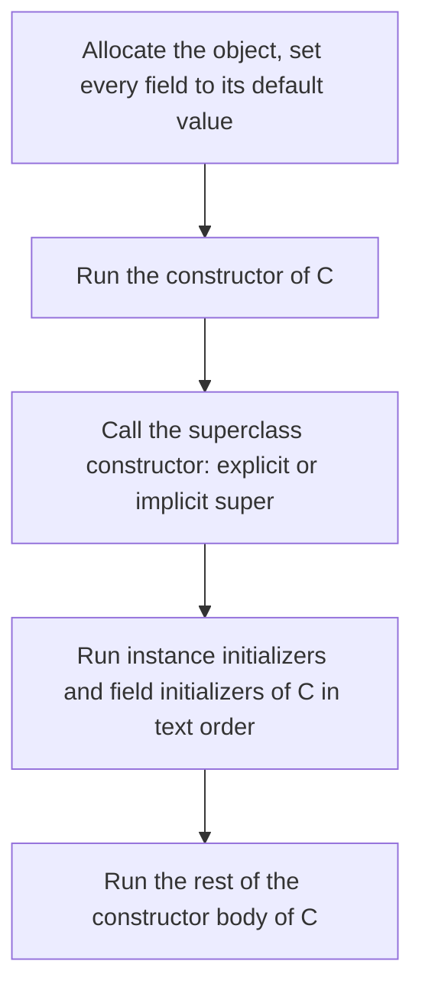

# Java Language Core

## Why It Matters

Interviewers use the core language to find out whether a candidate knows what the code does, not only what it looks like. The standard questions are: "Is Java pass-by-value or pass-by-reference?", "What happens if you override `equals` and not `hashCode`?", "Why is `new String("a") == "a"` false?", "Why is `Integer` 127 `==` 127 but 128 `==` 128 false?", "What is the difference between a static nested class and an inner class?", and "What is the difference between overloading and overriding?". On the job, the same topics cause real defects: lost entries in a `HashMap`, a `NullPointerException` from unboxing, a memory leak through an inner class, and a shared mutable object that one thread changes while another thread reads it. This page covers the rules from the Java Language Specification (JLS) and shows each rule in a program that you can run. The hash table that makes `hashCode` matter is on [hash tables](../dsa/foundations/04-hash-tables.md). Generics have their own page: [generics](02-generics.md). Exceptions are on [exceptions](03-exceptions.md).

## Core Concepts

**Pass-by-value**: when a method is called, Java copies the value of each argument expression into a new parameter variable (JLS 8.4.1). For a primitive, the value is the number. For an object, the value is a **reference**: a value that identifies an object, or `null` (JLS 4.3.1). The method gets a copy of the reference, not a copy of the object.

**Reference equality and value equality**: `a == b` on references tests whether both references identify the same object. `a.equals(b)` tests whether the class considers the two objects equal. `Object.equals` is the same test as `==`. A class overrides it to define value equality.

**`equals` contract**: the `Object.equals` javadoc requires that `equals` is *reflexive* (`x.equals(x)`), *symmetric* (`x.equals(y)` if and only if `y.equals(x)`), *transitive* (`x.equals(y)` and `y.equals(z)` imply `x.equals(z)`), *consistent* (repeated calls give the same answer while the compared state does not change), and false for `null`.

**`hashCode` contract**: equal objects must have equal hash codes. The rules and the effect on hash tables are on [hash tables](../dsa/foundations/04-hash-tables.md). The summary rule: **if you override `equals`, override `hashCode` with the same fields.**

**Immutable object**: an object whose state cannot change after construction (see the glossary). **Defensive copy**: a copy that a class makes of a mutable object that it receives or returns, so that the caller cannot change the internal state.

**String pool (string intern pool)**: a table that the JVM keeps of unique `String` instances. Every string literal, and every string that is the value of a constant expression, refers to an instance in this pool (JLS 3.10.5). `String.intern()` returns the pooled instance that equals the string.

**Constant variable**: a `final` variable of primitive type or type `String` that is initialized with a constant expression (JLS 4.12.4). A **constant expression** is an expression that the compiler can evaluate: literals, operators, casts to primitives or `String`, and names of constant variables (JLS 15.29).

**Boxing and unboxing**: boxing converts a primitive value to its wrapper object (`int` to `Integer`). Unboxing converts it back (JLS 5.1.7, 5.1.8). The compiler inserts both: `Integer.valueOf(int)` for boxing and `intValue()` for unboxing.

**`final`**: on a variable, the variable gets one assignment. On a method, subclasses cannot override it. On a class, nobody can extend it. **`static`**: the member belongs to the class, not to an instance.

**Nested class**: a class declared inside another class (JLS 8.1.3, 8.5). Four kinds exist:

| Kind | Declared | Has an outer instance | Can capture local variables |
|---|---|---|---|
| Static nested class | `static class N` as a member | No | No |
| Inner class | `class I` as a member, without `static` | Yes | No |
| Local class | A named class in a block | Yes, in a non-static context | Yes, if effectively final |
| Anonymous class | `new T() { ... }` | Yes, in a non-static context | Yes, if effectively final |

**Overloading**: several methods in one class (or hierarchy) share a name and differ in the parameter list. The compiler picks one at compile time. **Overriding**: a subclass instance method replaces a superclass instance method that has the same signature. The JVM picks it at run time. **Hiding**: a field, a static method, or a member type in a subclass has the same name as one in the superclass. The compiler picks it from the static type.

### Which pages continue this topic

- [Generics](02-generics.md): type parameters, erasure, wildcards.
- [Exceptions](03-exceptions.md): the exceptions that these rules throw.
- [Collections internals](04-collections-internals.md): how `HashMap` and `HashSet` use `equals` and `hashCode`.
- [Concurrency basics](07-concurrency-basics.md): the Java Memory Model, which gives `final` fields their thread-safety guarantee.
- [Modern Java](13-modern-java.md): records, sealed types, and pattern matching in more detail.
- [OOP in LLD](../lld/fundamentals/01-oop.md): inheritance, polymorphism, and encapsulation as design tools.

## How It Works

### Pass-by-value for primitives and references

Java has one rule: the argument expression is evaluated, and its value initializes the parameter. The parameter is a separate variable that lives in the stack frame of the callee. The method can change that variable without any effect on the caller.

With an object argument, the copied value is a reference. Two consequences follow:

1. **The method can change the object.** `list.add("x")` uses the copied reference to reach the same object that the caller has. The caller sees the change.
2. **The method cannot change the caller's variable.** `list = new ArrayList<>()` inside the method changes only the parameter. The caller's variable still holds the old reference.

This is why a `swap(a, b)` method cannot swap two variables, for primitives and for references. Program 1 in "Java Example" shows both. The phrase "objects are passed by reference" is wrong, because Java does not pass the caller's variable. A language with pass-by-reference (C++ `int&`, C# `ref`) lets the callee reassign the caller's variable.

### The `equals` contract and the bugs from breaking it

The default `Object.equals` returns `this == obj`. A class that needs value equality overrides it. A correct override follows this recipe:

1. Compare references first for speed (`this == o`), if the comparison is costly.
2. Test the type: `o instanceof Point p` (or `getClass() != o.getClass()`).
3. Compare each significant field. Use `==` for primitives except `float` and `double`. For those, use `Float.compare` and `Double.compare`, so that `NaN` equals `NaN` and `0.0` differs from `-0.0`, as `Float.equals` and `Double.equals` do, `Objects.equals` for references, and `Arrays.equals` for arrays.

Four bugs cause most defects:

| Bug | What happens | Fix |
|---|---|---|
| Override `equals` and not `hashCode` | Equal objects have different hash codes. `HashSet.contains` and `HashMap.get` miss the entry | Override both from the same fields |
| Write `equals(Point p)` instead of `equals(Object o)` | The method overloads `equals`. Collections call `equals(Object)` and use the identity version | Annotate with `@Override`. The compiler then reports the error |
| `instanceof` in a class that has a subclass with extra state | The relation becomes asymmetric: `point.equals(colorPoint)` is true and `colorPoint.equals(point)` is false | Make the class final, use composition, or accept the `getClass()` trade-off (see "Trade-offs") |
| Use a mutable field in `equals` and `hashCode` of an object that sits in a hash table | The entry stays in the old bucket after the field changes | Use immutable keys |

Effective Java, 3rd edition, item 10 (obey the general contract when overriding `equals`) and item 11 (always override `hashCode` when you override `equals`) discuss all four. Item 10 also shows that there is no way to extend an instantiable class and add a value component while you keep the `equals` contract, unless you give up the benefits of object-oriented abstraction (for example, with a `getClass()` test).

**Records.** A `record` (JLS 8.10, final in Java 16 by JEP 395) generates the canonical constructor, one private final field and one accessor per component, and `equals`, `hashCode`, and `toString` (JLS 8.10.3). The generated `equals` returns true if the other object has the same record class and each component is equal: `Objects.equals` for a reference component, and the `compare` method of the wrapper class for a primitive component (`Record.equals` javadoc). The generated `hashCode` is consistent with `equals`, and the exact formula is not specified, so do not depend on it. The generated `toString` contains the record name, the component names, and the component values. On JDK 21 it prints `Pair[a=1, b=a]`. The `Record.toString` javadoc says that the precise format can change, so do not parse it. A record is *shallowly* immutable: the fields are final, but a `List` component is as mutable as the list. The compact constructor is the place to validate and copy components (see Program 3).

### Immutability

Effective Java item 17 gives five rules for an immutable class:

1. Provide no methods that change the state.
2. Make the class final (or use private constructors and static factories), so that no subclass can add mutable state.
3. Make all fields final.
4. Make all fields private.
5. Give no caller access to a mutable component: copy mutable inputs in the constructor, and copy or wrap mutable outputs.

**The final-field guarantee (JLS 17.5).** If a thread reads the reference to an object that has final fields, and the constructor did not leak `this`, the thread sees the values that the constructor wrote into the final fields. It also sees the state of objects that those fields reference, as of the end of the constructor. The JLS achieves this with a "freeze" action at the end of the constructor. A non-final field has no such guarantee: a thread that reads the object through a data race can see the default value. This is why a properly built immutable object needs no `synchronized` to be shared. The memory-model details are on [concurrency basics](07-concurrency-basics.md). If the constructor lets `this` escape (for example, it registers `this` in a static list), the guarantee does not hold.

**Cost.** Each change creates a new object. For small objects this is cheap. For large structures, use a persistent data structure or a builder (`StringBuilder` to build a `String`). `String` itself is immutable, but not every field of it is final. `hashCode()` computes the hash on its first call and stores it in the non-final field `hash` (or sets the non-final field `hashIsZero` if the hash is 0). Two threads can race on these fields. The JDK 21 source comment of `String.hashCode` calls this a "benign data race": the computation is idempotent and reads only immutable state, so every thread that computes the hash gets the same value.

### String pool, `intern`, and compile-time constants

The compiler places each string literal in the constant pool of the class file. At run time, the JVM resolves the literal to a `String` object and **interns** it: all literals with the same characters, in all classes, share one object (JLS 3.10.5). Hence `"hello" == "hello"` is true.

`new String("hello")` always creates a new object, so `new String("hello") == "hello"` is false. `s.intern()` looks the characters up in the pool and returns the pooled instance. If the pool has none, it adds `s`.

**Constant expressions (JLS 15.29).** An expression that has only literals, operators, and names of *constant variables* is a constant expression. The compiler evaluates it and, for a `String`, interns the result. So:

- `"a" + "b"` is a constant expression. `"a" + "b" == "ab"` is true.
- `final String f = "a"; f + "b" == "ab"` is true, because `f` is a constant variable.
- `String s = "a"; s + "b" == "ab"` is false, because `s` is not final. The concatenation runs at run time and creates a new object.
- A `final` variable that the code initializes with a method call is not a constant variable, so the expression is not constant.

For a runtime concatenation, javac 9 and later emits an `invokedynamic` instruction that calls `StringConcatFactory` (JEP 280), not a chain of `StringBuilder.append` calls.

**Where the pool lives.** Since JDK 7, HotSpot allocates interned strings in the main part of the heap (the young and old generations). Earlier versions allocated them in the permanent generation (JDK 7 release notes, RFE 6962931 "move interned strings out of the perm gen"). In HotSpot, the pool is a hash table called the `StringTable`. `-XX:StringTableSize` sets its initial bucket count, rounded up to a power of 2. The default is 65536 on a 64-bit JVM. In JDK 21 the table grows when the average number of entries per bucket exceeds 2 (JDK 21 source, `stringTable.cpp` and `globals.hpp`).

**Recommendation:** compare strings with `equals`, never with `==`. Use `intern` only when a profile shows many duplicate long-lived strings. Consider string deduplication (`-XX:+UseStringDeduplication`) instead. JEP 192 added it to G1 in JDK 8u20, and JDK 18 added it to the Serial, Parallel, and Z collectors (JDK-8273364, JDK-8267185, JDK-8267186). Deduplication makes equal strings share one backing array. It does not merge the `String` objects, so `==` still returns false for two deduplicated strings (JEP 192).

### Autoboxing and the `Integer` cache

Two sources define which boxed values are shared:

- **JLS 5.1.7** covers only values that come from a *constant expression* (JLS 15.29) of type `boolean`, `byte`, `char`, `short`, `int`, or `long`. If the result is `true`, `false`, a character from `\u0000` to `\u007f`, or an integer from -128 to 127, then two boxing conversions of that value give the same object. `Integer a = 127, b = 127;` falls under this rule, because `127` is a constant expression.
- **The `Integer.valueOf(int)` javadoc** covers every call: "This method will always cache values in the range -128 to 127, inclusive, and may cache other values outside of this range." Boxing calls `valueOf`, so a boxed `int` from a computation (`Integer x = i + 1`) in that range is also the cached object.

In HotSpot, the option `-XX:AutoBoxCacheMax=<size>` raises the upper bound of the `Integer` cache (the comment on `Integer.IntegerCache` in the JDK 21 source). `Long.valueOf` has the same javadoc sentence, and its JDK 21 implementation caches exactly -128 to 127, with no option to change it.

The consequences:

- `Integer a = 127, b = 127; a == b` is true: both are the cached object.
- `Integer a = 128, b = 128; a == b` is false on a default JVM: two objects. The result is not a guarantee: another JVM setting can change it. Use `equals`.
- `Integer == int` unboxes the `Integer` and compares numbers (JLS 15.21.1). It is true for 128.
- `Integer.equals(Long)` is false, because `equals` checks the class first.
- `new Integer(5)` always creates a new object. Java 9 deprecated the wrapper class constructors, and Java 16 deprecated them for removal (JEP 390). The JDK 21 source has `@Deprecated(since="9", forRemoval = true)`. Use `Integer.valueOf(5)` or autoboxing.

**Unboxing `null`.** The compiler turns `int n = integerRef` into `integerRef.intValue()`. If the reference is `null`, the call throws `NullPointerException`. A common hidden case is the conditional operator: in `flag ? 1 : nullInteger`, one operand is `int` and the other is `Integer`, so the type of the expression is `int` (JLS 15.25, table 15.25-A). If `flag` is false, the JVM selects `nullInteger` and unboxes it, which throws, even if the code assigns the result to an `Integer`. A second hidden case is `map.get(key) + 1` for a missing key.

**Overloads that box.** `List<Integer>.remove(1)` calls `remove(int index)`, because phase 1 of overload resolution (no boxing) finds it. To remove the *value* 1, call `remove(Integer.valueOf(1))`.

**Cost.** Boxing outside the cache allocates an object. An `Integer` is about 16 bytes on a 64-bit HotSpot JVM with compressed class pointers (approximate: a 12-byte object header, plus the 4-byte `int` field, rounded to the 8-byte object alignment; see [memory and GC](06-memory-and-gc.md)). A `List<Integer>` also stores a reference per element. In hot loops, use primitive arrays or primitive streams.

### `final` and `static`

**`final`:**

| Where | Meaning |
|---|---|
| Local variable or parameter | One assignment. The compiler checks definite assignment (JLS 16) |
| Field | Definitely assigned exactly once: an instance field in its initializer, an instance initializer, or every constructor; a `static` field in its initializer or a static initializer (JLS 8.3.1.2). The JLS 17.5 guarantee applies to instance fields |
| Reference variable | The variable cannot point to another object. The object can still change |
| Method | No subclass can override it |
| Class | No subclass can exist. `String`, `Integer`, and every record are final |

**`static`:**

- A static field exists once per class, not once per instance.
- A static method has no `this` and no dynamic dispatch. A subclass method with the same signature *hides* it. The compiler picks the method from the static type (JLS 8.4.8.2).
- A static initializer block (`static { ... }`) runs once when the class initializes.

**Class initialization (JLS 12.4).** The JVM initializes a class before its first *active use*, which is one of these (JLS 12.4.1): an instance creation, a call to a static method, an assignment to or a read of a static field that is not a constant variable. Reading a constant variable (for example `static final int CONSTANT = 5`) does not initialize the class, because javac copies the value into the caller. A subclass initialization first initializes the superclass. The JVM initializes a class under a lock, so that exactly one thread runs the static initializer (JLS 12.4.2). This is why the lazy-holder singleton idiom is thread-safe (see [Concurrency Coding Problems: Classic Thread-Coordination Exercises](11-concurrency-coding-problems.md)). Class loading and initialization in the JVM are on [JVM architecture](05-jvm-architecture.md).

**Instance creation order (JLS 12.5).** `new C()` runs these steps:



The superclass constructor runs first, through the same steps, and before the fields of the subclass get their initializer values. If the superclass constructor calls an overridable method, the override runs while the subclass fields still hold their default values (`null`, 0). Program 6 shows this. **Recommendation:** do not call an overridable method from a constructor.

!!! info "Java 22 to 25: statements before `super(...)`"
    Before Java 25, `super(...)` or `this(...)` had to be the first statement of a constructor. JEP 513 (Flexible Constructor Bodies, final in Java 25) allows statements before the call, for example to validate an argument and throw early. Code before the call must not use `this`, read fields, or call instance methods. It may assign a field of its own class if that field has no initializer. This exception lets a subclass set its field before the superclass constructor calls an overridable method, which removes the `name=null` problem of Program 6. The Java 21 rules above are unchanged for code that does not use the feature. The JEP 513 status was checked on openjdk.org on 2026-10-22.

### Nested classes, the hidden outer reference, and leaks

A **static nested class** is an ordinary class that sits in the namespace of its outer class. It has no reference to an outer instance. It can read the private static members of the outer class, and the outer class can read its private members (JLS 6.6.1: private access is allowed anywhere inside the body of the top-level class). Before Java 11, the JVM allowed private access only inside one class file, so javac generated synthetic package-private accessor methods (named `access$000` and similar) for private access between nested classes. Java 11 added nest-based access control (JEP 181): the JVM allows private access between classes of one nest, and javac no longer needs the accessors.

An **inner class** needs an enclosing instance: `outer.new Inner()` or `new Inner()` inside an instance method. The code in the inner class reaches the instance with `Outer.this`. javac passes the outer instance as an extra constructor parameter and stores it in a synthetic field, `this$0`, if the inner class uses it (see "When javac emits `this$0`" below). A **local class** and an **anonymous class** can also capture local variables, which must be final or effectively final (JLS 8.1.3). The compiler copies each captured value into a synthetic field (`val$n` in Program 7). Before Java 16, an inner class could not declare static members except constants. JEP 395 removed this limit.

**The leak.** An inner or anonymous class object that uses the outer instance keeps the outer object reachable. If a long-lived object holds the inner object (a listener in a static registry, a task in a long queue, a cache entry), the outer object, and everything that it references, cannot be collected. Typical sources:

- An anonymous `Runnable` or `Comparator` that the code stores in a static field.
- The double-brace initializer `new ArrayList<>() {{ add(1); }}` in an instance method. It creates an anonymous subclass of `ArrayList` that holds a `this$0` reference to the surrounding instance, even though the body does not use it (see the next paragraph: `ArrayList` is `Serializable`).
- A non-static inner class used as a `ThreadLocal` value or as an `Executor` task.

**When javac emits `this$0`.** Before JDK 18, javac always generated the `this$0` field for an inner class, even if the class never used the outer instance. Since JDK 18, javac omits the field when the inner class does not use the outer instance (JDK-8271623, release note JDK-8277604). Two limits apply:

- The constructor still takes the outer instance as a parameter, so `outer.new Inner()` still needs a non-null outer object. Only the stored field disappears.
- The change does not apply to classes that implement `java.io.Serializable`. They keep `this$0` in all cases. A double-brace `ArrayList` or `HashMap` subclass is serializable, so it keeps the outer object reachable on JDK 21 (verified with javac 21: the declared fields of such a class are `[this$0]`).

Program 7 prints the declared fields: `UsesOuter` has `this$0`, and `IgnoresOuter` has none. Code compiled by javac 17 or earlier keeps `this$0` in both. **Recommendation:** make a nested class `static` unless it needs the outer instance. Do not rely on the compiler to drop the field.

A lambda is not an inner class. JLS 15.27.2 defines `this` in a lambda body as the `this` of the enclosing code. Whether the lambda object holds the enclosing instance is a compiler and runtime decision, not a JLS rule. On JDK 21, the lambda object holds the enclosing instance only if the body uses `this` or an instance member (observed: the class of `() -> {}` has no fields, and the class of `() -> System.out.print(x)` for an instance field `x` has one field of the outer type). See [functional programming and streams](12-functional-and-streams.md).

### Access modifiers

| Modifier | Same class | Same package | Subclass in another package | Everywhere |
|---|---|---|---|---|
| `private` | Yes | No | No | No |
| (none, package-private) | Yes | Yes | No | No |
| `protected` | Yes | Yes | Yes, through its own type | No |
| `public` | Yes | Yes | Yes | Yes, if the package is exported (JLS 7.7) |

Rules from JLS 6.6:

- A top-level class is `public` or package-private. A member class can have any of the four levels.
- `protected` outside the package: code in a subclass `S` can access a protected instance member only through an expression of type `S` or a subclass of `S` (JLS 6.6.2.1). A subclass cannot call a protected method on a plain superclass reference.
- An interface member without an access modifier is implicitly `public`. Since Java 9, an interface can also declare `private` methods (JLS 9.4). An interface cannot declare `protected` or package-private members.
- An overriding method cannot reduce the access of the method that it overrides (JLS 8.4.8.3).

### Overloading versus overriding

| Aspect | Overloading | Overriding |
|---|---|---|
| Same name | Yes | Yes |
| Parameter list | Different | The same signature (JLS 8.4.2, subsignature) |
| Chosen | At compile time, from the *static* types of the arguments (JLS 15.12.2) | At run time, from the *runtime* class of the receiver (JLS 15.12.4) |
| Return type | Any | The same, or a subtype for reference types: a covariant return (JLS 8.4.5) |
| Access | Any | Not narrower (JLS 8.4.8.3) |
| `throws` | Any | No new or broader checked exception (JLS 8.4.8.3) |
| Applies to | Static and instance methods, constructors | Instance methods only. Static methods and fields are hidden, not overridden (JLS 8.4.8.2, 8.3) |
| `private`, `final` | Overloadable | Cannot be overridden |

**Overload resolution (JLS 15.12.2)** has three phases. The compiler stops at the first phase that finds an applicable method:

1. *Strict invocation*: no boxing or unboxing, no varargs. Widening of primitives and references is allowed.
2. *Loose invocation*: boxing and unboxing allowed.
3. *Variable arity invocation*: varargs.

Inside a phase, the compiler picks the *most specific* method. If no method is more specific than all others, the call is ambiguous and does not compile. A `null` argument matches every reference type, so `show(null)` with overloads for `Object` and `String` calls the `String` version (`String` is more specific). With `String` and `Integer` overloads, `show(null)` does not compile.

Programs 5 and 8 show these rules. The point that interviews test: the method *signature* is selected at compile time from static types, and the *implementation* of an overridden method is selected at run time. A call `show(o)` where `Object o = "text"` binds to `show(Object)` at compile time, even though the object is a `String`.

## Trade-offs and When to Use

| Decision | Option A | Option B | Choose |
|---|---|---|---|
| `equals` type test | `instanceof` | `getClass() ==` | `instanceof` keeps the Liskov substitution principle and works with subclasses that add no state. It forces `final` or a defined `equals` for subclasses. `getClass()` makes a subclass instance never equal to a superclass instance, even for an anonymous subclass. Use `instanceof` with a final class or a record, and `getClass()` only when subclasses must stay distinct |
| Value type | `record` | Hand-written class | A record for a transparent data carrier. A class when the representation must differ from the constructor arguments, or when the type needs inheritance |
| Immutable | Copy on change | Mutable with locking | Immutable if objects are small, shared, or used as keys. Mutable if the object is large and has one owner |
| Nested class | `static` nested | Inner | `static`, unless the class needs `Outer.this` |
| Anonymous class | Anonymous class | Lambda | A lambda for a functional interface. An anonymous class when the body needs state, several methods, or its own `this` |
| Null-safe equality | `a.equals(b)` | `Objects.equals(a, b)` | `Objects.equals` when `a` can be `null` |
| Number in a collection | `Integer` | `int[]` or primitive stream | Primitives in hot paths. `Integer` where the API needs objects |
| Constant | `static final` primitive or `String` | `static final` object | A constant variable is inlined into callers. If its value changes, recompile the callers |

## Java Example

### Program 1: pass-by-value

The program calls four methods and prints the effect on the caller.

```java
import java.util.ArrayList;
import java.util.List;

public class PassByValue {
    static class Box {
        int value;
        Box(int value) { this.value = value; }
    }

    static void swapInts(int a, int b) {
        int t = a; a = b; b = t;
    }

    static void swapBoxes(Box a, Box b) {
        Box t = a; a = b; b = t;
    }

    static void swapContents(Box a, Box b) {
        int t = a.value; a.value = b.value; b.value = t;
    }

    static void reassign(List<String> list) {
        list = new ArrayList<>();
        list.add("lost");
    }

    static void mutate(List<String> list) {
        list.add("kept");
    }

    public static void main(String[] args) {
        int x = 1, y = 2;
        swapInts(x, y);
        System.out.println("ints after swapInts: x=" + x + " y=" + y);

        Box p = new Box(1), q = new Box(2);
        swapBoxes(p, q);
        System.out.println("boxes after swapBoxes: p=" + p.value + " q=" + q.value);

        swapContents(p, q);
        System.out.println("boxes after swapContents: p=" + p.value + " q=" + q.value);

        List<String> names = new ArrayList<>();
        reassign(names);
        System.out.println("after reassign: " + names);
        mutate(names);
        System.out.println("after mutate: " + names);
    }
}
```

<!-- expected-output -->
```text
ints after swapInts: x=1 y=2
boxes after swapBoxes: p=1 q=2
boxes after swapContents: p=2 q=1
after reassign: []
after mutate: [kept]
```

How to read the output:

- `swapInts` and `swapBoxes` swap the local parameters only. The caller's variables are unchanged.
- `swapContents` changes the fields of the objects that both references identify, so the caller sees the swap.
- `reassign` replaces its parameter with a new list. The caller's list stays empty. `mutate` uses the copied reference to add to the caller's list.

### Program 2: broken `equals` and `hashCode`

The program shows three bugs and the record behavior. `NoHash` has no `hashCode`. `Overload` declares `equals(Overload)`, which does not override `Object.equals`. `ColorPoint` breaks symmetry.

```java
import java.util.HashSet;
import java.util.Objects;
import java.util.Set;

public class EqualsBugs {
    // Bug 1: equals without hashCode.
    static class NoHash {
        final int x, y;
        NoHash(int x, int y) { this.x = x; this.y = y; }
        @Override public boolean equals(Object o) {
            return o instanceof NoHash n && n.x == x && n.y == y;
        }
    }

    // Bug 2: overload instead of override. The parameter type is Overload, not Object.
    static class Overload {
        final int x;
        Overload(int x) { this.x = x; }
        public boolean equals(Overload o) { return o != null && o.x == x; }
        @Override public int hashCode() { return x; }
    }

    // Bug 3: symmetry broken by a subclass that adds state.
    static class Point {
        final int x, y;
        Point(int x, int y) { this.x = x; this.y = y; }
        @Override public boolean equals(Object o) {
            if (!(o instanceof Point p)) return false;
            return p.x == x && p.y == y;
        }
        @Override public int hashCode() { return Objects.hash(x, y); }
    }

    static class ColorPoint extends Point {
        final String color;
        ColorPoint(int x, int y, String color) { super(x, y); this.color = color; }
        @Override public boolean equals(Object o) {
            if (!(o instanceof ColorPoint c)) return false;
            return super.equals(o) && c.color.equals(color);
        }
        @Override public int hashCode() { return Objects.hash(super.hashCode(), color); }
    }

    record Pair(int a, String b) { }

    public static void main(String[] args) {
        Set<NoHash> set = new HashSet<>();
        set.add(new NoHash(1, 2));
        System.out.println("equals: " + new NoHash(1, 2).equals(new NoHash(1, 2)));
        System.out.println("set contains equal object: " + set.contains(new NoHash(1, 2)));

        Set<Overload> overloads = new HashSet<>();
        overloads.add(new Overload(7));
        Object asObject = new Overload(7);
        System.out.println("overload equals(Overload): " + new Overload(7).equals(new Overload(7)));
        System.out.println("overload equals(Object): " + new Overload(7).equals(asObject));
        System.out.println("set contains equal object: " + overloads.contains(new Overload(7)));

        Point p = new Point(1, 2);
        ColorPoint cp = new ColorPoint(1, 2, "red");
        System.out.println("p.equals(cp): " + p.equals(cp));
        System.out.println("cp.equals(p): " + cp.equals(p));

        Pair r1 = new Pair(1, "a"), r2 = new Pair(1, "a");
        System.out.println("record equals: " + r1.equals(r2));
        System.out.println("record hashCodes equal: " + (r1.hashCode() == r2.hashCode()));
        System.out.println("record toString: " + r1);
    }
}
```

<!-- expected-output -->
```text
equals: true
set contains equal object: false
overload equals(Overload): true
overload equals(Object): false
set contains equal object: false
p.equals(cp): true
cp.equals(p): false
record equals: true
record hashCodes equal: true
record toString: Pair[a=1, b=a]
```

How to read the output:

- `NoHash`: `equals` is true, and the set does not contain the equal object. The identity hash codes differ (with near certainty), so the set looks in another bucket.
- `Overload`: `equals(Overload)` works when the static type is `Overload`. `equals(Object)` is the inherited identity test, so it fails. Also, the set fails: `HashSet` calls `equals(Object)`. Adding `@Override` makes the compiler reject the method.
- `Point` and `ColorPoint`: `p.equals(cp)` is true and `cp.equals(p)` is false. The `equals` contract requires symmetry.
- The record has `equals`, `hashCode`, and `toString` without code.

### Program 3: immutability and defensive copies

`LeakyRange` stores the caller's objects. `SafeRange` copies them. The record `Team` copies its list in the compact constructor.

```java
import java.util.ArrayList;
import java.util.Date;
import java.util.List;

public class Immutable {
    // Broken: it stores and returns the caller's mutable objects.
    static final class LeakyRange {
        private final Date start;
        private final List<String> tags;
        LeakyRange(Date start, List<String> tags) { this.start = start; this.tags = tags; }
        Date start() { return start; }
        List<String> tags() { return tags; }
    }

    // Correct: it copies on the way in and does not hand out mutable state.
    static final class SafeRange {
        private final long startMillis;
        private final List<String> tags;
        SafeRange(Date start, List<String> tags) {
            this.startMillis = start.getTime();
            this.tags = List.copyOf(tags);
        }
        Date start() { return new Date(startMillis); }
        List<String> tags() { return tags; }
    }

    record Team(String name, List<String> members) {
        Team {
            members = List.copyOf(members);
        }
    }

    public static void main(String[] args) {
        Date d = new Date(1000L);
        List<String> tags = new ArrayList<>(List.of("a"));

        LeakyRange leaky = new LeakyRange(d, tags);
        d.setTime(2000L);
        tags.add("b");
        System.out.println("leaky start=" + leaky.start().getTime() + " tags=" + leaky.tags());

        Date d2 = new Date(1000L);
        List<String> tags2 = new ArrayList<>(List.of("a"));
        SafeRange safe = new SafeRange(d2, tags2);
        d2.setTime(2000L);
        tags2.add("b");
        safe.start().setTime(3000L);
        System.out.println("safe start=" + safe.start().getTime() + " tags=" + safe.tags());

        List<String> members = new ArrayList<>(List.of("ann"));
        Team team = new Team("core", members);
        members.add("bob");
        System.out.println("team members=" + team.members());
        try {
            team.members().add("eve");
        } catch (UnsupportedOperationException e) {
            System.out.println("team list is unmodifiable");
        }
    }
}
```

<!-- expected-output -->
```text
leaky start=2000 tags=[a, b]
safe start=1000 tags=[a]
team members=[ann]
team list is unmodifiable
```

`List.copyOf` returns an unmodifiable list. The `Team` list is a copy, so a later change to `members` has no effect.

### Program 4: strings and the pool

```java
public class StringPool {
    static final String CONST = "ab";

    public static void main(String[] args) {
        String a = "hello";
        String b = "hello";
        String c = new String("hello");
        System.out.println("literal == literal: " + (a == b));
        System.out.println("literal == new String: " + (a == c));
        System.out.println("literal == c.intern(): " + (a == c.intern()));
        System.out.println("equals: " + a.equals(c));

        String x = "a";
        final String fx = "a";
        System.out.println("constant expression: " + ("ab" == "a" + "b"));
        System.out.println("final constant variable: " + ("ab" == fx + "b"));
        System.out.println("non-final variable: " + ("ab" == x + "b"));
        System.out.println("static final constant: " + (CONST == "a" + "b"));
        System.out.println("runtime concat then intern: " + ("ab" == (x + "b").intern()));
    }
}
```

<!-- expected-output -->
```text
literal == literal: true
literal == new String: false
literal == c.intern(): true
equals: true
constant expression: true
final constant variable: true
non-final variable: false
static final constant: true
runtime concat then intern: true
```

The output matches JLS 3.10.5 and 15.29. `"ab" == fx + "b"` is true because `fx` is a constant variable. `"ab" == x + "b"` is false because `x` is not final.

### Program 5: boxing, the `Integer` cache, and unboxing `null`

```java
import java.util.ArrayList;
import java.util.List;

public class Boxing {
    public static void main(String[] args) {
        Integer i1 = 127, i2 = 127, i3 = 128, i4 = 128;
        System.out.println("127 == 127: " + (i1 == i2));
        System.out.println("128 == 128: " + (i3 == i4));
        System.out.println("128 equals 128: " + i3.equals(i4));
        System.out.println("Integer == int: " + (i3 == 128));
        Long l = 127L;
        System.out.println("Integer.equals(Long): " + Integer.valueOf(127).equals(l));

        Integer missing = null;
        try {
            int n = missing;
            System.out.println(n);
        } catch (NullPointerException e) {
            System.out.println("unboxing null throws NullPointerException");
        }
        boolean flag = false;
        try {
            Integer r = flag ? 1 : missing;
            System.out.println(r);
        } catch (NullPointerException e) {
            System.out.println("ternary with int and Integer unboxes null");
        }
        Integer ok = flag ? Integer.valueOf(1) : missing;
        System.out.println("ternary with two Integers: " + ok);

        List<Integer> list = new ArrayList<>(List.of(10, 20, 30));
        list.remove(1);
        System.out.println("remove(int index 1): " + list);
        list.remove(Integer.valueOf(10));
        System.out.println("remove(Object 10): " + list);
    }
}
```

<!-- expected-output -->
```text
127 == 127: true
128 == 128: false
128 equals 128: true
Integer == int: true
Integer.equals(Long): false
unboxing null throws NullPointerException
ternary with int and Integer unboxes null
ternary with two Integers: null
remove(int index 1): [10, 30]
remove(Object 10): [30]
```

The result for 128 depends on the default cache range of -128 to 127. The `remove` lines show the overload with `int` winning in phase 1.

### Program 6: initialization order

The program reads a constant variable, reads a static field that a method computes, and creates a `Child`.

```java
public class InitOrder {
    static class Config {
        static final int CONSTANT = 5;           // constant variable
        static final int COMPUTED = compute();   // not a constant variable
        static { System.out.println("Config initialized"); }
        static int compute() { return 6; }
    }

    static class Parent {
        static { System.out.println("1 Parent static"); }
        { System.out.println("3 Parent instance initializer"); }
        Parent() {
            System.out.println("4 Parent constructor");
            describe();
        }
        void describe() { System.out.println("Parent.describe"); }
    }

    static class Child extends Parent {
        static { System.out.println("2 Child static"); }
        private String name = "set";
        { System.out.println("5 Child instance initializer, name=" + name); }
        Child() {
            super();
            System.out.println("6 Child constructor");
        }
        @Override void describe() { System.out.println("Child.describe name=" + name); }
    }

    public static void main(String[] args) {
        System.out.println("read constant: " + Config.CONSTANT);
        System.out.println("before COMPUTED");
        System.out.println("read computed: " + Config.COMPUTED);
        System.out.println("main creates Child");
        new Child();
    }
}
```

<!-- expected-output -->
```text
read constant: 5
before COMPUTED
Config initialized
read computed: 6
main creates Child
1 Parent static
2 Child static
3 Parent instance initializer
4 Parent constructor
Child.describe name=null
5 Child instance initializer, name=set
6 Child constructor
```

How to read the output:

- Reading `Config.CONSTANT` does not print "Config initialized": javac inlined the constant. Reading `Config.COMPUTED` initializes the class.
- The static blocks run in superclass-first order, before the first instance is created.
- The `Parent` constructor calls `describe()`, and the override in `Child` runs when `name` is still `null`. The field initializer of `Child` runs after `super()` returns.

### Program 7: nested classes and the outer reference

The program lists the declared fields of each nested class. A `*` marks a synthetic field.

```java
import java.lang.reflect.Field;
import java.util.ArrayList;
import java.util.List;

public class Nested {
    private final String label;
    Nested(String label) { this.label = label; }
    private static int created = 0;

    class UsesOuter {
        String show() { return label; }
    }

    class IgnoresOuter {
        int one() { return 1; }
    }

    static class StaticNested {
        // cannot read label: no outer instance exists
        int count() { return created; }
    }

    Runnable anonymous() {
        return new Runnable() {
            @Override public void run() { System.out.println("anonymous sees " + label); }
        };
    }

    Runnable local(int n) {
        class Local implements Runnable {
            @Override public void run() { System.out.println("local sees " + n); }
        }
        return new Local();
    }

    static List<String> fields(Class<?> c) {
        List<String> names = new ArrayList<>();
        for (Field f : c.getDeclaredFields()) names.add(f.getName() + (f.isSynthetic() ? "*" : ""));
        return names;
    }

    public static void main(String[] args) {
        Nested outer = new Nested("outer");
        Nested.UsesOuter u = outer.new UsesOuter();
        System.out.println(u.show());
        System.out.println("UsesOuter fields: " + fields(UsesOuter.class));
        System.out.println("IgnoresOuter fields: " + fields(IgnoresOuter.class));
        System.out.println("StaticNested fields: " + fields(StaticNested.class));
        System.out.println("anonymous fields: " + fields(outer.anonymous().getClass()));
        System.out.println("local fields: " + fields(outer.local(3).getClass()));
        outer.anonymous().run();
        outer.local(3).run();
    }
}
```

<!-- expected-output -->
```text
outer
UsesOuter fields: [this$0*]
IgnoresOuter fields: []
StaticNested fields: []
anonymous fields: [this$0*]
local fields: [val$n*]
anonymous sees outer
local sees 3
```

`UsesOuter` and the anonymous class have `this$0`, because they read `label`. `IgnoresOuter` has no field, because javac 18 and later omit an unused outer reference (JDK-8271623). Its constructor still takes the outer instance as a parameter. The local class has `val$n`, the copy of the captured variable. The static nested class has no field of this kind.

### Program 8: overloading, overriding, and hiding

```java
public class Dispatch {
    static class Animal {
        String name = "animal";
        static String kind() { return "Animal.kind"; }
        String speak() { return "..."; }
        Animal self() { return this; }
    }

    static class Dog extends Animal {
        String name = "dog";
        static String kind() { return "Dog.kind"; }
        @Override String speak() { return "woof"; }
        @Override Dog self() { return this; }   // covariant return type
    }

    static String show(Object o) { return "Object"; }
    static String show(String s) { return "String"; }
    static String show(Animal a) { return "Animal"; }
    static String num(long x) { return "long"; }
    static String num(Integer x) { return "Integer"; }
    static String num(int... x) { return "varargs"; }

    public static void main(String[] args) {
        Animal a = new Dog();
        System.out.println("speak: " + a.speak());          // overriding: runtime type
        System.out.println("field: " + a.name);              // hiding: static type
        System.out.println("static: " + a.kind());           // hiding: static type
        System.out.println("covariant: " + a.self().getClass().getSimpleName());

        Object o = "text";
        System.out.println("show(Object holding String): " + show(o));
        System.out.println("show(String): " + show("text"));
        System.out.println("show(Animal holding Dog): " + show(a));
        System.out.println("show((String) null): " + show((String) null));

        System.out.println("num(5): " + num(5));
        System.out.println("num(Integer): " + num(Integer.valueOf(5)));
        System.out.println("num(): " + num());
    }
}
```

<!-- expected-output -->
```text
speak: woof
field: animal
static: Animal.kind
covariant: Dog
show(Object holding String): Object
show(String): String
show(Animal holding Dog): Animal
show((String) null): String
num(5): long
num(Integer): Integer
num(): varargs
```

How to read the output:

- `a.speak()` calls `Dog.speak`: overriding uses the runtime class.
- `a.name` and `a.kind()` use `Animal`: fields and static methods are hidden, so the static type decides.
- `show(o)` picks `show(Object)` from the static type of `o`. `show((String) null)` picks the `String` version.
- `num(5)` picks `long`: widening in phase 1 wins over boxing in phase 2. `num()` has only the varargs version.

## Interview Angle

### Questions

??? question "Is Java pass-by-value or pass-by-reference?"

    Java is always pass-by-value (JLS 8.4.1). The method receives a copy of each argument value. For a primitive, the copy is the number. For an object, the copy is the reference, so the callee and the caller hold two references to one object.

    The effect: the callee can change the object through its copy of the reference, and the caller sees that change. The callee cannot make the caller's variable point to another object. Proof: a `swap(a, b)` method cannot swap the caller's variables. Pass-by-reference (C++ `&`, C# `ref`) would let it.

??? question "What is the contract between `equals` and `hashCode`, and what breaks if you override only `equals`?"

    If `a.equals(b)` is true, `a.hashCode() == b.hashCode()` must be true. The hash code must also stay the same while the fields that `equals` uses do not change. Unequal objects may share a hash code.

    If you override only `equals`, the class keeps the identity-based `hashCode` of `Object`. Two equal objects then have different hash codes with near certainty. `HashMap` and `HashSet` find the bucket from the hash code, so `contains` and `get` miss the entry that `put` stored. The bug does not show in `equals` tests. It shows in collections.

??? question "What are the five rules of the `equals` contract, and can you show a violation?"

    Reflexive, symmetric, transitive, consistent, and false for `null`. The usual violation is symmetry with inheritance. `Point.equals` uses `instanceof Point`. `ColorPoint extends Point` adds a color and compares it. Then `point.equals(colorPoint)` is true (the color is ignored) and `colorPoint.equals(point)` is false (it is not a `ColorPoint`).

    If you make `ColorPoint.equals` ignore the color when it compares to a plain `Point`, symmetry returns and transitivity breaks: `red(1,2).equals(p(1,2))` and `p(1,2).equals(blue(1,2))` are true, and `red(1,2).equals(blue(1,2))` is false. A `getClass()` test in `Point.equals` keeps the contract, but then a subclass that adds no state is never equal to a `Point`, which breaks substitution. Effective Java item 10 concludes that there is no way to extend an instantiable class and add a value component while you keep the `equals` contract, unless you give up the benefits of object-oriented abstraction. Fix: use composition (`ColorPoint` has a `Point` field and an `asPoint()` view), or make the base class final.

??? question "Why is `new String(\"a\") == \"a\"` false, and what does `intern` do?"

    A string literal is interned: every literal with the same characters refers to the same `String` instance (JLS 3.10.5), so two equal literals are the same object. `new String("a")` always creates a new object on the heap, so `==` compares two different references. The expression involves two objects: the pooled literal `"a"` (created when the JVM resolves the literal, if no class has resolved it before) and the new copy.

    `s.intern()` returns the pooled instance with the same characters, and it adds `s` to the pool if there is none (`String.intern` javadoc). So `new String("a").intern() == "a"` is true. Since JDK 7 the pool is in the main heap, so the garbage collector can reclaim interned strings that nothing references (before JDK 7 they lived in the permanent generation, which had a fixed maximum size). In practice, compare strings with `equals`. Use `intern` only to save memory on many duplicate long-lived strings, measure first, and consider string deduplication (`-XX:+UseStringDeduplication`), which shares the backing arrays without code changes.

??? question "Is `\"a\" + \"b\" == \"ab\"` true? What about with a variable?"

    `"a" + "b"` is a constant expression (JLS 15.29), so the compiler evaluates it to `"ab"` and interns it. The comparison is true. If `s` is a non-final variable that holds `"a"`, then `s + "b"` is built at run time as a new object, and the comparison is false.

    If the variable is `final` and initialized with a literal, it is a constant variable, so the expression is constant again and the comparison is true. If the final variable is initialized with a method call, it is not a constant variable.

??? question "Why is `Integer a = 127, b = 127; a == b` true, and `128` false?"

    Autoboxing calls `Integer.valueOf`. Its javadoc says that it "will always cache values in the range -128 to 127, inclusive". JLS 5.1.7 also requires that two boxings of a constant expression in that range give the same object, and `127` is a constant expression. So both variables refer to one cached object, and `==` on references is true. Two boxings of 128 allocate two objects on a default HotSpot JVM, so `==` is false.

    The result for 128 is not a guarantee in either direction. The javadoc allows caching of other values, and HotSpot raises the `Integer` cache limit with `-XX:AutoBoxCacheMax`. Compare boxed values with `equals`, or unbox them first. `Integer == int` is a numeric comparison, because the `Integer` unboxes (JLS 15.21.1). `Long` has the same -128 to 127 cache, and `Integer.valueOf(1).equals(1L)` is false because the classes differ.

??? question "When does autoboxing throw `NullPointerException`?"

    When the code unboxes a `null` reference. The compiler converts `int n = ref` to `ref.intValue()`, and that call throws on `null`. Typical cases: `map.get(key) + 1` for a missing key, a method that returns `Integer` and is assigned to `int`, and a conditional expression such as `flag ? 1 : nullInteger`. In that last case, one operand is `int` and the other is `Integer`, so the type of the whole expression is `int` (JLS 15.25). When the condition selects the `null` operand, the JVM unboxes it and throws, even if the code assigns the result to an `Integer`. Two more cases: a `null` `Integer` compared with `==` to an `int` (`nullInteger == 0`, JLS 15.21.1), and a `switch` on a `null` `Integer` that has no `case null` label (JLS 14.11.3).

    Fix: use `getOrDefault` or `merge`, check for `null`, or give both operands the same wrapper type.

??? question "What is the difference between a static nested class and an inner class?"

    A static nested class is an ordinary class in the namespace of its outer class. It has no outer instance, and `new Outer.Nested()` creates it. An inner class (non-static member class) needs an enclosing instance: `outer.new Inner()` creates it, and its code can use the members of the outer instance through `Outer.this`. javac passes the outer instance to the inner constructor and stores it in a synthetic `this$0` field. Since JDK 18, javac omits the field if the inner class does not use the outer instance, except for `Serializable` classes, which always keep it (JDK-8271623). Both kinds can access each other's private members (JLS 6.6.1), which Java 11 nestmates (JEP 181) implement without synthetic accessor methods.

    The trade-off: an inner object that holds `this$0` keeps its outer object reachable. If something long-lived holds the inner object, the outer object cannot be garbage collected. Use a static nested class unless you need the outer instance. Anonymous and local classes in instance methods behave in the same way. A lambda is different: on JDK 21 it holds the enclosing instance only if its body uses `this` or an instance member.

??? question "How can an inner class cause a memory leak?"

    An inner or anonymous class that uses the outer instance holds a reference to it in the synthetic field `this$0`. If the inner object is stored in a long-lived place (a static list of listeners, an executor queue, a cache, a `ThreadLocal`), the outer object stays reachable with everything it references. A common source is the double-brace initializer `new HashMap<>() {{ put(k, v); }}` in an instance method. It creates an anonymous subclass of `HashMap`, and because `HashMap` is `Serializable`, javac keeps `this$0` even on JDK 18 and later, where it drops the field for other inner classes that do not use it. Code compiled by javac 17 or earlier keeps `this$0` in every inner class.

    Fix: use a static nested class or a lambda that does not use `this`, pass only the data that the code needs, and remove listeners when the owner closes. A heap dump shows the path from a GC root, through the `this$0` field, to the outer object (see [memory and GC](06-memory-and-gc.md)).

??? question "What is the difference between overloading and overriding?"

    Overloading means several methods with one name and different parameter lists. The compiler picks the method at compile time from the static types of the arguments. Overriding means a subclass instance method with the same signature replaces the inherited one. The JVM picks the implementation at run time from the runtime class of the receiver.

    Rules for overriding: the return type is the same or a subtype, access is the same or wider, the method throws no new or broader checked exceptions, and it cannot override `static`, `private`, or `final` methods. Static methods and fields are hidden, not overridden. Use `@Override` so that the compiler checks the signature.

??? question "Given `show(Object)` and `show(String)`, which one does `Object o = \"x\"; show(o)` call?"

    `show(Object)`. The compiler selects the overload from the static type of the argument, and the static type of `o` is `Object`. The runtime type, `String`, plays no role in overload selection. If `show` were an instance method that a subclass overrides, the runtime class of the *receiver* would choose the implementation, but only among the overrides of the signature that the compiler picked.

??? question "How do you build an immutable class? Is a `record` immutable?"

    Make the class final, make all fields private and final, provide no mutators, and copy any mutable input in the constructor and any mutable output in the accessor (or return an unmodifiable view). JLS 17.5 then gives a thread-safety guarantee: a thread that sees the reference sees the final fields as the constructor left them, if `this` did not escape.

    A record has private final fields and no setters, so it is immutable in its own fields. It is only shallowly immutable. A record with a `List` component exposes a mutable list unless the compact constructor copies it with `List.copyOf`.

### Follow-up Questions

??? question "Why is `String` immutable?"

    Each reason depends on the fact that the characters cannot change:

    - **Sharing.** The pool can give one instance to every literal with the same characters. If one user could change it, every other user would see the change.
    - **Hash keys and cached hash.** A `String` key in a `HashMap` cannot change its hash after insertion. `String` computes the hash once and stores it in a field.
    - **Thread safety.** Threads can share a string without locks.
    - **Security.** A file path, a URL, or a class name passed to a security check cannot change between the check and the use.

    The cost is that every change creates a new string. For repeated changes, use `StringBuilder`.

??? question "What does `final` on a reference variable guarantee?"

    Only that the variable is assigned once. The object that it identifies can still change. `final List<String> xs = new ArrayList<>(); xs.add("a");` compiles. For a deeply constant value, the object itself must be immutable.

??? question "In which order do static blocks, instance initializers, and constructors run?"

    The class initializes once, at its first active use (JLS 12.4.1), not at program start. The superclass initializes first. Inside one class, static field initializers and static blocks run in text order. Then, for each `new`, the JVM sets all fields to default values, the superclass constructor runs (with the superclass instance initializers), then the instance initializers and field initializers of the subclass run in text order, then the rest of the subclass constructor body (JLS 12.5). Reading a constant variable such as `static final int N = 5` does not initialize the class, because javac copies the value into the caller (Program 6).

??? question "Why does calling an overridable method from a constructor cause bugs?"

    The superclass constructor runs before the subclass fields get their initializer values. The override sees the default values (`null`, 0, `false`). In Program 6 the override prints `name=null`. Fix: do not call overridable methods in a constructor, or make the method `final` or `private`.

??? question "Does a `final` class guarantee that its fields are visible to other threads?"

    No. `final` on the class only prevents subclassing. The visibility guarantee comes from `final` *fields* (JLS 17.5), and only if the constructor does not let `this` escape. A class with non-final fields needs safe publication through a lock, a `volatile` field, or a thread-safe collection (see [concurrency basics](07-concurrency-basics.md)).

### Red Flags

- Saying "Java passes objects by reference".
- Comparing strings or boxed numbers with `==` and explaining it as "it works for me".
- Overriding `equals` without `hashCode`, or writing `equals(Point p)` without `@Override`.
- Using a mutable field in `hashCode` of a map key.
- Claiming that `final` makes an object immutable.
- Claiming that `String s = new String("a")` creates one object (it creates a new object in addition to the pooled literal).
- Using an inner class where a static nested class is enough, and not knowing about the outer reference.
- Saying that overloading is resolved at run time.
- Saying that `static` methods are overridden.
- Calling an overridable method in a constructor.

## Common Mistakes

| Mistake | Why it fails | Fix |
|---|---|---|
| `equals(Foo f)` without `@Override` | It overloads. Collections call `equals(Object)` | Always write `@Override` |
| `equals` without `hashCode` | Hash-based collections miss equal keys | Override both, or use a `record` |
| `==` on strings | It compares references, and the result depends on the pool | `equals`, or `Objects.equals` if either side can be `null` |
| `==` on `Integer` and `Long` | It works from -128 to 127 and fails above | `equals`, or unbox |
| `map.get(k) + 1` for a missing key | Unboxing `null` throws | `getOrDefault`, `merge` |
| `list.remove(i)` on `List<Integer>` with a value `i` | It removes the index | `list.remove(Integer.valueOf(i))` |
| Store a caller's `Date` or `List` in an "immutable" class | The caller can change the state | `List.copyOf`, copy `Date`, or use `java.time` types, which are immutable |
| Return an internal mutable list | The caller can change it | Return `List.copyOf(list)` or `Collections.unmodifiableList(list)` (a view, not a copy) |
| Use `+` on strings in a loop | Each step creates a new string: O(n²) work in total | `StringBuilder` |
| Anonymous `Runnable` stored in a static field | It keeps the outer instance alive | A static nested class, or a lambda that does not use `this` |
| Call an overridable method in a constructor | The override sees default field values | Make it `final` or `private`, or move the call out of the constructor |
| Expect the `Integer` cache to hold at 128 | The range is a default, not a guarantee | Compare with `equals` |
| Assume a `final` field is constant everywhere | A `final` instance field set from a constructor is not a constant variable | Use `static final` with a literal for a compile-time constant |

## Commonly Confused With

| Looks like | Difference | Deciding question |
|---|---|---|
| Pass-by-value vs pass-by-reference | Java copies the reference value. The callee cannot rebind the caller's variable | Can the callee reassign the caller's variable? In Java, no |
| `==` vs `equals` | Identity vs the class's own definition of equality | Do you ask "same object" or "same value"? |
| `equals` vs `hashCode` | `equals` confirms the key. `hashCode` picks the bucket | "Is it the same?" or "where do I look?" |
| `String` vs `StringBuilder` | Immutable vs mutable | Does the code change the text repeatedly? |
| `final` variable vs immutable object | One assignment vs no state change | Does the object itself change? |
| `final` vs `static final` vs constant variable | A per-instance single assignment, a per-class single assignment, a `static final` or `final` primitive or `String` that has a constant initializer | Does the compiler know the value? |
| Static nested vs inner class | No outer instance vs a hidden outer reference | Does the class need `Outer.this`? |
| Anonymous class vs lambda | New class with its own `this` vs a function that shares the enclosing `this` | Is the target a functional interface and is the body short? |
| Overloading vs overriding | Compile-time selection by name and static types vs run-time selection by receiver class | Which part decides: the argument types or the receiver object? |
| Overriding vs hiding | Instance methods dispatch on the runtime class. Static methods and fields use the static type | Is the member `static` or a field? Then it is hidden |
| `Integer.valueOf` vs `new Integer` | Cached for small values vs always a new object (deprecated for removal) | Use `valueOf` |
| Defensive copy vs unmodifiable view | An independent copy vs a read-only window on the original | Can the original change later, and should the holder see it? |

## Quick Reference Card

- Java passes everything by value. For objects, the value is the reference. A callee can change an object and cannot rebind the caller's variable.
- Override `equals` and `hashCode` together, with the same fields, and with `@Override`. `equals` is reflexive, symmetric, transitive, consistent, and false for `null`. Records generate all three methods.
- Immutable class: final class, private final fields, no setters, defensive copies. JLS 17.5: final fields are visible to every thread that gets the reference, if `this` does not escape. A record is only shallowly immutable.
- Strings: literals and constant expressions are interned. `new String(...)` and runtime concatenation make new objects. Compare with `equals`.
- Boxing: `valueOf` caches -128 to 127 (`Integer`, `Long`, `Short`, `Byte`); JLS 5.1.7 guarantees this only for constant expressions. Compare with `equals`. Unboxing `null` throws `NullPointerException`. `list.remove(int)` beats `remove(Object)`.
- `final`: one assignment, no override, no subclass. `static`: per class, hidden and not overridden. A constant variable is inlined and does not trigger class initialization.
- Order: superclass static, subclass static, then per `new`: superclass constructor with initializers, subclass initializers, subclass body. An overridable call from a constructor sees default values.
- Nested: use `static` unless the class needs the outer instance. Inner, local, and anonymous classes that use it keep the outer object alive through `this$0`. Since JDK 18, javac drops an unused `this$0`, except in `Serializable` classes (double-brace `ArrayList` and `HashMap` keep it).
- Overloading: compile time, static types, three phases (strict, loose, varargs), most specific wins. Overriding: run time, receiver class, access not narrower, covariant return, no broader checked exceptions.

## Further Reading

- [JLS 8.4.1: Formal parameters (Java SE 21)](https://docs.oracle.com/javase/specs/jls/se21/html/jls-8.html#jls-8.4.1): the rule that argument values initialize new parameter variables.
- [`Object.equals` javadoc (JDK 21)](https://docs.oracle.com/en/java/javase/21/docs/api/java.base/java/lang/Object.html#equals(java.lang.Object)): the five-property contract.
- [JLS 8.10: Record classes](https://docs.oracle.com/javase/specs/jls/se21/html/jls-8.html#jls-8.10): the implicitly declared members and the rules for the compact constructor.
- [JEP 395: Records](https://openjdk.org/jeps/395): final in Java 16, and the relaxed static members of inner classes.
- [JLS 17.5: final field semantics](https://docs.oracle.com/javase/specs/jls/se21/html/jls-17.html#jls-17.5): the freeze action and the guarantee for immutable objects.
- [JLS 3.10.5: String literals](https://docs.oracle.com/javase/specs/jls/se21/html/jls-3.html#jls-3.10.5) and [JLS 15.29: Constant expressions](https://docs.oracle.com/javase/specs/jls/se21/html/jls-15.html#jls-15.29): why some concatenations are interned.
- [`String.intern` javadoc (JDK 21)](https://docs.oracle.com/en/java/javase/21/docs/api/java.base/java/lang/String.html#intern()): the pool contract.
- [JLS 5.1.7: Boxing conversion](https://docs.oracle.com/javase/specs/jls/se21/html/jls-5.html#jls-5.1.7) and [`Integer.valueOf(int)` javadoc](https://docs.oracle.com/en/java/javase/21/docs/api/java.base/java/lang/Integer.html#valueOf(int)): the cache range.
- [JLS 12.4: Initialization of classes and interfaces](https://docs.oracle.com/javase/specs/jls/se21/html/jls-12.html#jls-12.4) and [JLS 12.5: Creation of new class instances](https://docs.oracle.com/javase/specs/jls/se21/html/jls-12.html#jls-12.5): the order of initialization.
- [JLS 15.12.2: Compile-time step 2, determine method signature](https://docs.oracle.com/javase/specs/jls/se21/html/jls-15.html#jls-15.12.2): the three phases of overload resolution.
- [JLS 8.4.8: Inheritance, overriding, and hiding](https://docs.oracle.com/javase/specs/jls/se21/html/jls-8.html#jls-8.4.8): the rules for overriding and hiding.
- [JLS 6.6: Access control](https://docs.oracle.com/javase/specs/jls/se21/html/jls-6.html#jls-6.6): the four access levels and the `protected` rule.
- [JEP 513: Flexible Constructor Bodies](https://openjdk.org/jeps/513): final in Java 25.
- [JEP 280: Indify String Concatenation](https://openjdk.org/jeps/280): how javac compiles runtime concatenation since Java 9.
- [JDK 7 release notes](https://www.oracle.com/java/technologies/javase/jdk7-relnotes.html): RFE 6962931, interned strings move from the permanent generation to the main heap.
- [JEP 192: String Deduplication in G1](https://openjdk.org/jeps/192): deduplication shares backing arrays, not `String` objects.
- [JEP 390: Warnings for Value-Based Classes](https://openjdk.org/jeps/390): the wrapper class constructors deprecated for removal in Java 16.
- [JDK-8277604: Enclosing instance fields omitted from inner classes that don't use them](https://bugs.openjdk.org/browse/JDK-8277604): the JDK 18 release note for the `this$0` change and its `Serializable` exception.
- [JEP 181: Nest-Based Access Control](https://openjdk.org/jeps/181): private access between nested classes without synthetic accessors, since Java 11.
- Joshua Bloch, *Effective Java*, 3rd edition: items 10, 11, 17, 24, and 50 (equals, hashCode, immutability, static member classes, defensive copies).
