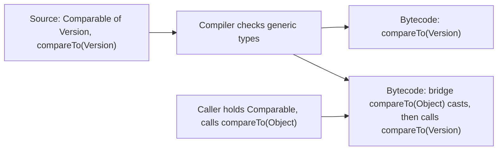

# Generics

## Why It Matters

Generics appear in every Java interview that goes beyond syntax. The standard questions are: "What is type erasure?", "Why can you not write `new T[10]`?", "Why is `List<Integer>` not a `List<Number>`?", "What does PECS mean?", "What is the difference between `List<?>` and `List<Object>`?", and "What is a raw type?". On the job, generics decide whether a library API is safe to use. A wrong wildcard makes an API unusable, and a raw type or an unchecked cast moves a type error from the compiler to a `ClassCastException` far from its cause. This page explains what the compiler checks, what it emits, and which rules follow from erasure. The language rules for classes and methods are on [language core](01-language-core.md). The JDK collection classes that use generics are on [collections internals](04-collections-internals.md).

## Core Concepts

**Generic class or interface**: a class or interface that declares one or more **type parameters**, for example `class Box<T>` (JLS 8.1.2). **Type argument**: the type that code supplies for a type parameter, for example `String` in `Box<String>`. **Parameterized type**: a generic type with type arguments, such as `List<String>` (JLS 4.5).

**Generic method**: a method that declares its own type parameters before the return type, for example `static <T> T first(List<T> list)` (JLS 8.4.4). A method of a generic class that uses the class type parameter is not a generic method.

**Type erasure**: the process by which the compiler removes type parameters and type arguments from the generated bytecode (JLS 4.6). The compiler checks the types, inserts casts where needed, and emits code that uses the erased types. The JVM does not know about `List<String>`: at run time it sees `List`.

**Bridge method**: a synthetic method that the compiler generates so that a class with a more specific signature still overrides an erased method. `Method.isBridge()` reports it.

**Bounded type parameter**: a type parameter with an upper bound, `<T extends Number>`. Several bounds join with `&`: `<T extends Number & Comparable<T>>`. The first bound can be a class, an interface, or a type variable. Each additional bound must be an interface, and a type variable bound cannot have additional bounds (JLS 4.4).

**Wildcard**: `?` as a type argument (JLS 4.5.1). `List<?>` is a list of an unknown type. `List<? extends Number>` is a list of an unknown subtype of `Number` (an upper-bounded wildcard). `List<? super Integer>` is a list of an unknown supertype of `Integer` (a lower-bounded wildcard).

**Invariance**: `List<Integer>` is not a subtype of `List<Number>`, even though `Integer` is a subtype of `Number`. **Covariance**: `Integer[]` is a subtype of `Number[]`. Java arrays are covariant. Generic types are invariant, unless the code uses a wildcard.

**PECS**: "producer extends, consumer super". If a parameter produces values that the method reads, declare `? extends T`. If it consumes values that the method writes, declare `? super T` (Effective Java item 31).

**Raw type**: a generic type used without type arguments, such as `List` (JLS 4.8). **Unchecked warning**: a compiler warning that the code does something that the compiler cannot prove type-safe. **Heap pollution**: a state in which a variable of a parameterized type refers to an object that is not of that type (JLS 4.12.2).

**Reifiable type**: a type whose full type information exists at run time (JLS 4.7). These types are reifiable: primitives, non-generic classes and interfaces, raw types, parameterized types in which every type argument is an unbounded wildcard (`List<?>`), and arrays of reifiable types. `List<String>` and `T` are not reifiable.

**Recursive bound**: a type parameter whose bound mentions the type parameter itself, such as `T extends Comparable<T>` or `E extends Enum<E>`.

### Which pages continue this topic

- [Language core](01-language-core.md): overloading, overriding, and the rules that erasure interacts with.
- [Collections internals](04-collections-internals.md): the generic JDK collections.
- [Functional programming and streams](12-functional-and-streams.md): generic functional interfaces such as `Function<? super T, ? extends R>`.
- [Modern Java](13-modern-java.md): records, sealed types, and pattern matching, which use generics.
- [Java toolkit](../dsa/java-toolkit.md): the generic collection APIs for problem solving.

## How It Works

### Why generics exist

Before Java 5, a collection held `Object`. Code cast every element on the way out, and a wrong cast failed at run time:

```text
List names = new ArrayList();
names.add(42);
String s = (String) names.get(0);   // ClassCastException at run time
```

Generics move this check to compile time. `List<String>` accepts only strings, and `get` returns `String` with no cast in the source. Generics also document the intent of an API in its signature: `Map<String, List<Order>>` tells the reader the structure.

Java 5 added generics with *erasure*. The JLS states the reason in its discussion of reifiable types (JLS 4.7): "Ultimately, the most important motivation for this decision is compatibility with existing code." With erasure, a library such as `java.util` could add type parameters, and class files compiled before Java 5 still linked and ran against it, and new generic code could call old non-generic libraries. Java 5 added a `Signature` attribute to the class file format to record generic declarations (JVMS 4.7.9), but the JVM does not use it to check types or to run code. That choice causes the limits in the next sections.

### Type erasure

JLS 4.6 defines erasure by three rules:

- The erasure of a parameterized type `G<T1, ..., Tn>` is the erasure of `G`, the raw type. So `List<String>` becomes `List`.
- The erasure of a type variable is the erasure of its *leftmost bound*. `T` with no bound becomes `Object`. `T extends Number & Comparable<T>` becomes `Number`.
- The erasure of an array type `T[]` is the erasure of `T`, followed by `[]`.

The compiler uses erasure in three steps:

1. **Check** the program with the full generic types.
2. **Insert casts** where erased code returns `Object` but the source needs a specific type. In `String s = list.get(0)`, the compiler emits `checkcast String` after the call to `List.get`.
3. **Generate bridge methods** where erasure changes the signature of an overriding method.

**Bridge methods.** `Comparable<T>` has the erased method `compareTo(Object)`. A class `Version implements Comparable<Version>` declares `compareTo(Version)`. These have different signatures after erasure, so the compiler adds a synthetic `compareTo(Object)` that casts its argument to `Version` and calls `compareTo(Version)`. A covariant return type needs the same mechanism. The first program prints both methods of `Version`, with the synthetic one marked `bridge`.



**What erasure keeps.** The class file keeps the generic signatures in a `Signature` attribute. Reflection reads them: `Field.getGenericType()` returns `java.util.List<java.lang.String>` for a field `List<String> names`. The compiler and frameworks (Jackson, Spring) use this to find the type arguments of a *declaration*. The class file does not record the type arguments of an *instance*. `new ArrayList<String>()` and `new ArrayList<Integer>()` have the same class at run time.

### Consequences of erasure

The compiler rejects each construct below. The messages come from javac 21.

<!-- fragment -->
```java
boolean a(Object o)    { return o instanceof List<String>; }
// error: Object cannot be safely cast to List<String>

static class B<T> {
    T[] array = new T[3];
    // error: generic array creation
    T value   = new T();
    // error: unexpected type
    static T shared;
    // error: non-static type variable T cannot be referenced from a static context
}

List<String>[] lists = new List<String>[3];
// error: generic array creation

void f(List<String> a)  { }
void f(List<Integer> b) { }
// error: name clash: f(List<Integer>) and f(List<String>) have the same erasure

class E<T> extends Exception { }
// error: a generic class may not extend java.lang.Throwable

List<int> numbers;
// error: unexpected type; required: reference, found: int

Class<?> c = List<String>.class;
// error: <identifier> expected
```

The reasons:

| Construct | Why it fails |
|---|---|
| `o instanceof List<String>` | At run time, nothing distinguishes `List<String>` from `List<Integer>`. The check could not work. Since Java 16, JLS 15.20.2 allows the test if the cast from the operand type is checked (not unchecked): `List<String> l; l instanceof ArrayList<String>` compiles, because the type argument follows from the static type. Up to Java 15, JLS 15.20.2 required a reifiable type after `instanceof`, so that line did not compile |
| `new T()`, `new T[n]` | `T` is `Object` at run time, so `new T()` would create an `Object`, and `new T[n]` an `Object[]`. Array creation needs a reifiable element type (JLS 15.10.1) |
| `new List<String>[3]` | Arrays check the element type at run time (`ArrayStoreException`) and generics check at compile time only. The two checks do not combine. If the language allowed it, an array of `List<String>` could hold a `List<Integer>` and the store check would pass |
| `static T x` | One static field serves all instantiations, so it cannot have the type of one instantiation |
| Two overloads that differ only in type arguments | Both erase to `f(List)`. The compiler reports a name clash |
| `class E<T> extends Exception` | A `catch` clause tests the exception class at run time. It cannot tell `E<String>` from `E<Integer>` (JLS 8.1.2) |
| `List<int>` | A type argument must be a reference type, because erased code stores `Object` |
| `List<String>.class` | A class literal names a run-time class. There is only `List.class` |

**Casts and `instanceof`.** `(List<String>) obj` compiles with an *unchecked warning*: the cast checks only `List` at run time. A bad element shows up later, at the first use that the compiler checked with a `checkcast String`.

### Bounded types

An upper bound lets the generic code call the methods of the bound:

```text
static <T extends Comparable<T>> T max(T a, T b) { return a.compareTo(b) >= 0 ? a : b; }
```

Without the bound, `a.compareTo(b)` does not compile, because `T` is only an `Object`. The erasure of `T` is the leftmost bound, here `Comparable`.

Multiple bounds: `<T extends Number & Comparable<T>>`. The class (if any) comes first, then interfaces. The erasure is the first bound, `Number`, and the compiler inserts casts to `Comparable` where the code calls `compareTo`. The order therefore changes the bytecode. A type parameter has no lower bound. Only a wildcard can have one (`? super T`).

`Collections.max` shows a reason to put `Object` first: its signature is `<T extends Object & Comparable<? super T>> T max(Collection<? extends T>)` (JDK 21 javadoc). The erasure is `Object max(Collection)`, the same as the pre-generics signature, so old class files keep working.

### Wildcards and PECS

Take a method that sums a list of numbers. `static double sum(List<Number> list)` accepts only `List<Number>`, not `List<Integer>`, because of invariance. The wildcard `List<? extends Number>` accepts `List<Integer>`, `List<Double>`, and `List<Number>`.

The subtype relations:

```text
List<Integer>  <:  List<? extends Number>  <:  List<? extends Object>  =  List<?>
List<Number>   <:  List<? super Number>    <:  List<? super Integer>
List<Object>   <:  List<? super Number>
```

What the code can do with each wildcard (from capture conversion, JLS 5.1.10: the compiler replaces `?` with a fresh unknown type, `CAP#1`):

| Type | Read | Write |
|---|---|---|
| `List<? extends Number>` | Yes: the element is a `Number` | No, except `null`. The compiler does not know the exact type `CAP#1`, so it cannot check an `Integer` |
| `List<? super Integer>` | Only as `Object` | Yes: `Integer` values (and `null`) |
| `List<?>` | Only as `Object` | No, except `null` |
| `List<T>` | `T` | `T` |

The rule "producer extends, consumer super" (PECS) follows: use `? extends T` for a parameter that you only read, and `? super T` for a parameter that you only write. A parameter that you both read and write takes no wildcard.

**Example: `Collections.copy`.** The signature is `static <T> void copy(List<? super T> dest, List<? extends T> src)` (JDK 21 javadoc). The source *produces* elements of `T`, so it is `? extends T`. The destination *consumes* elements of `T`, so it is `? super T`. With this signature, `Collections.copy(List<Number>, List<Integer>)` compiles. The second program does that.

**Rules of thumb (Effective Java item 31):**

- Do not use a wildcard as a return type. The caller then needs wildcards too.
- `Comparable<? super T>` and `Comparator<? super T>` are always consumers. A class `Cat extends Animal` where `Animal implements Comparable<Animal>` is `Comparable<Animal>`, not `Comparable<Cat>`. With `<T extends Comparable<T>>`, a `List<Cat>` fails. With `<T extends Comparable<? super T>>`, it works. The fourth program shows this.
- If a type parameter appears once in the signature, replace it with a wildcard: `void reverse(List<?> list)` instead of `<T> void reverse(List<T> list)`.

**The wildcard helper.** A method that takes `List<?>` cannot call `set` on it. To write, name the unknown type with a private generic method. The compiler captures `?` as `T`. The second program does this in `swapFirstTwo`.

**`List<?>` versus `List<Object>` versus raw `List`.** `List<Object>` is a list that holds any object, and you can add anything. A `List<String>` is not a `List<Object>`. `List<?>` accepts a list of any type, and you can read objects and add only `null`. A raw `List` accepts anything and turns off the checks (see below).

### Invariance and covariant arrays

If `List<Integer>` were a `List<Number>`, this would compile:

```text
List<Integer> ints = new ArrayList<>();
List<Number> numbers = ints;   // does not compile: List<Integer> is not a List<Number>
numbers.add(1.5);              // would put a Double in a list of Integer
```

Invariance stops this at compile time. Arrays made the opposite choice in Java 1.0: `Integer[]` is a subtype of `Number[]`. A store into the wrong element type fails at run time with `ArrayStoreException` (JLS 10.5). The third program shows both. This is why arrays and generics mix badly. Effective Java item 28 recommends lists over arrays when the element type is generic.

### Raw types, heap pollution, and `@SafeVarargs`

A **raw type** is a generic type with no type arguments. It exists so that code from before Java 5 compiles. A call on a raw type is unchecked: the compiler cannot check the elements and prints a warning. **Recommendation:** do not write raw types in new code. Use `List<?>` if the type is unknown. One place needs the raw form: a class literal (`List.class`).

**Heap pollution** happens when a variable of type `List<String>` refers to a list that holds an `Integer`. The compiler warns about the operation that can cause it (an unchecked cast, a raw call, a generic varargs array). The `ClassCastException` appears later, at an unrelated line, at the compiler-inserted cast. The fifth program shows two ways: an array alias, and a generic method that returns its varargs array.

**Varargs of a generic type.** A parameter `T... items` is an array `T[]`. The array has the erased type `Object[]` when the caller itself is generic, and it is not a reifiable type. The compiler warns at the declaration ("possible heap pollution") and at each call that creates such an array. The method is safe if it only reads the array and does not let it escape: it must not store into it and must not return it or hand it to code that does. `@SafeVarargs` tells the compiler that the method is safe and removes the warnings. The annotation is allowed on constructors, `static` methods, `final` instance methods, and, since Java 9, `private` instance methods (`SafeVarargs` javadoc), because only these cannot be overridden. `Arrays.asList`, `List.of`, and `EnumSet.of` use it. Effective Java item 32 states the rule.

### Generic methods and type inference

A generic method declares its type parameters before the return type: `static <T> List<T> listOf(T... items)`. The compiler infers `T` from the arguments and from the target type of the assignment (JLS chapter 18):

- `List<String> l = Collections.emptyList();` infers `T = String` from the target type.
- `Collections.emptyList()` as a method argument also works since Java 8, because the compiler treats the call as a poly expression whose type depends on its context.
- You can give the argument explicitly: `Wildcards.<Number>copyAll(sink, ints)`, and `List.<String>of()`. Explicit arguments are rare. They help when inference picks a type that is too narrow.
- The diamond `new ArrayList<>()` infers the type arguments of a constructor call (Java 7). Java 9 allows the diamond with an anonymous class when the inferred type is denotable (JEP 213). Program 6 uses it: `new TypeRef<>() { }`.
- `var` infers a local variable type from the initializer (JEP 286). `var list = new ArrayList<String>()` has the type `ArrayList<String>`. `var x = new ArrayList<>()` has the type `ArrayList<Object>`, because no target type exists.
- Since Java 21, the compiler infers the type arguments of a record pattern (JEP 440).

**Recommendation:** write a generic method when the type argument links two or more places in the signature (an input and the output, or two inputs). If the type parameter appears once, use a wildcard.

### Recursive bounds

A recursive bound says "T can be compared with itself", or "T is its own subclass".

**`Comparable<T>`.** `<T extends Comparable<T>>` means that `T` has a `compareTo(T)`. The version `<T extends Comparable<? super T>>` is more general, because the comparison can be defined in a superclass (the `Cat` and `Animal` example).

**`Enum<E extends Enum<E>>`.** Every enum `Color` extends `Enum<Color>`. The bound lets `Enum` declare methods in terms of the concrete enum: `compareTo(E other)` accepts only a `Color` for a `Color`, and `getDeclaringClass()` returns `Class<E>`. `EnumSet<E extends Enum<E>>` and `static <E extends Enum<E>> E first(Class<E> type)` use the same bound. A `Color` cannot be compared to a different enum at compile time.

**The self type for a fluent builder.** The class `Builder<B extends Builder<B>>` has an abstract `self()` that returns `B`. The methods of the base class return `B`, so a call chain keeps the subclass type: `new CarBuilder().name("car").wheels(4)` compiles even though `name` is declared in the base class. The fourth program shows it. The bound does not force a subclass to pass itself as `B`: `class Bad extends Builder<CarBuilder>` compiles. The pattern is a convention.

### Reifiable types and how to get type information back

A type is reifiable if the JVM has all of its information at run time (definition in "Core Concepts"). Only a reifiable type works with `instanceof`, array creation, and exact `catch` clauses.

| Type | Reifiable |
|---|---|
| `int`, `String`, `Map.Entry` | Yes |
| `List` (raw) | Yes |
| `List<?>`, `Map<?, ?>` | Yes: unbounded wildcards |
| `List<? extends Number>` | No |
| `List<String>`, `T` | No |
| `String[]`, `List<?>[]` | Yes |
| `List<String>[]`, `T[]` | No |

Three techniques bring type information back:

1. **A class token.** Pass `Class<T>` and call `Array.newInstance(type, n)` to create a `T[]`, `type.cast(obj)` to check a cast at run time, or `type.getEnumConstants()`. The cast `(T[]) Array.newInstance(...)` is still unchecked, and the code is correct because the class token proves the type. The sixth program shows it.
2. **An array generator.** `Collection.toArray(IntFunction<T[]>)` (Java 11) takes `String[]::new`. The caller supplies the array constructor.
3. **A super type token.** An anonymous subclass `new TypeRef<Map<String, List<Integer>>>() { }` keeps its superclass type arguments in the class file, and `getGenericSuperclass()` reads them. Jackson (`TypeReference`) and Guava (`TypeToken`) use this method, and the sixth program implements it.

### Java 22 to 25

No JEP up to Java 25 changed erasure or the rules above. Project Valhalla is the line of work that may change the cost of generics. JEP 401 (Value Objects, a preview feature) has the status "Integrated" with release 28 on openjdk.org (checked 2026-10-22). JEP 401 says that a field of type `T` "usually has erased type `Object`", so the JVM cannot flatten a value object stored in it. Generic classes can hold value objects as type arguments, but erasure stays. JEP 218 (Generics over Primitive Types) has the status "Candidate", has no target release, and was last updated in 2017. Neither JEP is part of Java 21.

## Trade-offs and When to Use

| Decision | Option A | Option B | Choose |
|---|---|---|---|
| Parameter type | `List<T>` with a type parameter | `List<?>` or a bounded wildcard | A wildcard if `T` appears once. A type parameter if the signature links two types |
| Read or write | `? extends T` for input | `? super T` for output | PECS: extends to read, super to write |
| Return type | Concrete `List<Number>` | `List<? extends Number>` | The concrete type. A wildcard return type forces wildcards on every caller |
| Create `T[]` | Cast `(T[]) new Object[n]` | `Array.newInstance(Class<T>, n)` or an `IntFunction` | The cast if the array is private and never exposed. The class token or generator if the array leaves the class |
| Collection of generics | `List<List<String>>` | `List<String>[]` | The list. Arrays of parameterized types are not type-safe |
| Unknown type | Raw `List` | `List<?>` | `List<?>`. It keeps the compiler checks |
| Self-referential API | Recursive bound `B extends Builder<B>` | Cast in the subclass | The recursive bound, when a builder hierarchy has more than one level |
| Type safe heterogeneous values | `Map<String, Object>` with casts | `Map<Class<T>, T>` type-safe container (Effective Java item 33) | The type-safe container when keys are types |
| Generic exception | Not allowed | Use a non-generic exception class with fields | The non-generic class |
| Varargs of a generic type | `T...` without annotation | `T...` with `@SafeVarargs` after proof that the method is safe | Annotate only after you check that the method does not store into the array or return it |

## Java Example

### Program 1: erasure, bridge methods, and heap pollution through a raw type

The program shows that two parameterized types share one class, prints the methods of `Version` with its bridge, reads generic signatures by reflection, and causes a `ClassCastException` through a raw alias.

```java
import java.lang.reflect.Field;
import java.lang.reflect.Method;
import java.util.ArrayList;
import java.util.List;

public class Erasure {
    static class Version implements Comparable<Version> {
        final int n;
        Version(int n) { this.n = n; }
        @Override public int compareTo(Version o) { return Integer.compare(n, o.n); }
    }

    static class Holder<T extends Number & Comparable<T>> {
        T value;
        List<String> names;
        T get() { return value; }
    }

    public static void main(String[] args) throws Exception {
        List<String> strings = new ArrayList<>();
        List<Integer> ints = new ArrayList<>();
        System.out.println("same runtime class: " + (strings.getClass() == ints.getClass()));

        List<String> methods = new ArrayList<>();
        for (Method m : Version.class.getDeclaredMethods()) {
            methods.add(m.getReturnType().getSimpleName() + " " + m.getName() + "("
                    + m.getParameterTypes()[0].getSimpleName() + ")"
                    + (m.isBridge() ? " bridge" : ""));
        }
        methods.sort(null);
        System.out.println("Version methods: " + methods);

        Field value = Holder.class.getDeclaredField("value");
        Field names = Holder.class.getDeclaredField("names");
        System.out.println("erased type of T value: " + value.getType().getSimpleName());
        System.out.println("generic type of value: " + value.getGenericType());
        System.out.println("generic type of names: " + names.getGenericType());
        Method get = Holder.class.getDeclaredMethod("get");
        System.out.println("get() returns: " + get.getReturnType().getSimpleName());

        @SuppressWarnings({"unchecked", "rawtypes"})
        List<Integer> hacked = (List) strings;
        hacked.add(42);
        System.out.println("42 went into a List<String>: " + strings.size());
        try {
            String s = strings.get(0);
            System.out.println(s);
        } catch (ClassCastException e) {
            System.out.println("ClassCastException at the read, not the write");
        }
    }
}
```

<!-- expected-output -->
```text
same runtime class: true
Version methods: [int compareTo(Object) bridge, int compareTo(Version)]
erased type of T value: Number
generic type of value: T
generic type of names: java.util.List<java.lang.String>
get() returns: Number
42 went into a List<String>: 1
ClassCastException at the read, not the write
```

How to read the output:

- `strings.getClass() == ints.getClass()`: the type arguments are gone at run time.
- `Version` has two `compareTo` methods. The one that takes `Object` is the bridge that the compiler generated.
- The erased type of the field `T value` is `Number`, its leftmost bound. The generic type is still available as `T`. The field `names` keeps its generic type `java.util.List<java.lang.String>` in the `Signature` attribute.
- The raw alias `(List) strings` lets the code add an `Integer` to a `List<String>`. The `add` works, because the list stores `Object`. The failure comes at the read, where the compiler put the cast to `String`.

### Program 2: wildcards and PECS

`sum` reads (extends). `fillInts` writes (super). `Collections.copy` and `copyAll` use both. `swapFirstTwo` uses the wildcard helper.

```java
import java.util.ArrayList;
import java.util.Collections;
import java.util.List;

public class Wildcards {
    static double sum(List<? extends Number> numbers) {
        double total = 0;
        for (Number n : numbers) total += n.doubleValue();
        return total;
    }

    static void fillInts(List<? super Integer> sink) {
        for (int i = 1; i <= 3; i++) sink.add(i);
    }

    static <T> void copyAll(List<? super T> dest, List<? extends T> src) {
        for (T t : src) dest.add(t);
    }

    // The wildcard helper: capture conversion names the unknown type as T.
    static void swapFirstTwo(List<?> list) { swapHelper(list); }
    private static <T> void swapHelper(List<T> list) {
        T t = list.get(0);
        list.set(0, list.get(1));
        list.set(1, t);
    }

    public static void main(String[] args) {
        List<Integer> ints = List.of(1, 2, 3);
        List<Double> doubles = List.of(1.5, 2.5);
        System.out.println("sum ints: " + sum(ints) + ", sum doubles: " + sum(doubles));

        List<Number> numbers = new ArrayList<>();
        List<Object> objects = new ArrayList<>();
        fillInts(numbers);
        fillInts(objects);
        System.out.println("numbers: " + numbers + ", objects: " + objects);

        List<Number> dest = new ArrayList<>(Collections.nCopies(3, (Number) 0));
        Collections.copy(dest, ints);
        System.out.println("Collections.copy: " + dest);

        List<Object> sink = new ArrayList<>();
        Wildcards.<Number>copyAll(sink, ints);
        System.out.println("copyAll: " + sink);

        List<String> words = new ArrayList<>(List.of("a", "b", "c"));
        swapFirstTwo(words);
        System.out.println("after swap: " + words);

        List<Integer> mutable = new ArrayList<>(ints);
        List<? extends Number> readOnly = mutable;
        Number first = readOnly.get(0);
        readOnly.add(null); // only null compiles; add(Integer.valueOf(1)) does not
        System.out.println("first=" + first + ", size=" + readOnly.size());
    }
}
```

<!-- expected-output -->
```text
sum ints: 6.0, sum doubles: 4.0
numbers: [1, 2, 3], objects: [1, 2, 3]
Collections.copy: [1, 2, 3]
copyAll: [1, 2, 3]
after swap: [b, a, c]
first=1, size=4
```

The last lines add `null` to a `List<? extends Number>`: this is the only value that the compiler accepts. The call `readOnly.add(Integer.valueOf(1))` does not compile.

### Program 3: arrays are covariant and generics are not

```java
import java.util.ArrayList;
import java.util.List;

public class Invariance {
    public static void main(String[] args) {
        Number[] array = new Integer[2];
        try {
            array[0] = 1.5;
        } catch (ArrayStoreException e) {
            System.out.println("array covariance: ArrayStoreException at run time");
        }
        List<Integer> ints = new ArrayList<>();
        // List<Number> numbers = ints;   // does not compile: List<Integer> is not a List<Number>
        List<? extends Number> view = ints;
        System.out.println("List<? extends Number> view accepts List<Integer>: " + view.size());
    }
}
```

<!-- expected-output -->
```text
array covariance: ArrayStoreException at run time
List<? extends Number> view accepts List<Integer>: 0
```

### Program 4: bounds, `Comparable<? super T>`, and recursive bounds

`Cat` is a `Comparable<Animal>`. The method `max` compiles for `List<Cat>` only because it uses `? super T`.

```java
import java.util.ArrayList;
import java.util.Collection;
import java.util.Collections;
import java.util.List;

public class Bounds {
    static <T extends Comparable<? super T>> T max(Collection<? extends T> items) {
        T best = null;
        for (T t : items) if (best == null || t.compareTo(best) > 0) best = t;
        return best;
    }

    static class Animal implements Comparable<Animal> {
        final int weight;
        Animal(int weight) { this.weight = weight; }
        @Override public int compareTo(Animal o) { return Integer.compare(weight, o.weight); }
        @Override public String toString() { return getClass().getSimpleName() + weight; }
    }
    static class Cat extends Animal { Cat(int w) { super(w); } }

    // Recursive bound: the self type lets a builder chain keep the subclass type.
    static abstract class Builder<B extends Builder<B>> {
        protected String name;
        abstract B self();
        B name(String n) { this.name = n; return self(); }
    }
    static class CarBuilder extends Builder<CarBuilder> {
        int wheels;
        @Override CarBuilder self() { return this; }
        CarBuilder wheels(int w) { this.wheels = w; return this; }
        String build() { return name + ":" + wheels; }
    }

    enum Color { RED, GREEN }

    static <E extends Enum<E>> E first(Class<E> type) { return type.getEnumConstants()[0]; }

    static <T extends Number & Comparable<T>> T larger(T a, T b) {
        return a.compareTo(b) >= 0 ? a : b;
    }

    public static void main(String[] args) {
        List<Cat> cats = List.of(new Cat(3), new Cat(9), new Cat(5));
        // Cat is Comparable<Animal>, not Comparable<Cat>. Only "? super T" accepts it.
        Cat heaviest = max(cats);
        System.out.println("heaviest: " + heaviest);
        System.out.println("Collections.max: " + Collections.max(cats));

        System.out.println(new CarBuilder().name("car").wheels(4).build());
        System.out.println("first enum constant: " + first(Color.class));
        System.out.println("larger: " + larger(3, 8) + " " + larger(2.5, 1.5));
    }
}
```

<!-- expected-output -->
```text
heaviest: Cat9
Collections.max: Cat9
car:4
first enum constant: RED
larger: 8 2.5
```

How to read the output:

- `max(cats)` infers `T = Cat`. The bound `Comparable<? super Cat>` accepts `Comparable<Animal>`.
- `CarBuilder` extends `Builder<CarBuilder>`. The call chain `name(...)` then `wheels(...)` compiles, because `name` returns `B`, which is `CarBuilder`.
- `first(Color.class)` uses the bound `E extends Enum<E>`.
- `larger` has two bounds, and the erasure of `T` is `Number`.

### Program 5: generic varargs and heap pollution

`listOf` is a safe generic varargs method. `arrayOf` returns its varargs array. When a generic method calls it, the array has the erased type `Object[]`, and the cast at the caller fails.

```java
import java.util.ArrayList;
import java.util.Arrays;
import java.util.List;

public class HeapPollution {
    // Safe: the method only reads the array and does not let it escape.
    @SafeVarargs
    static <T> List<T> listOf(T... items) {
        return new ArrayList<>(Arrays.asList(items));
    }

    // Unsafe: it returns the varargs array. Its runtime type depends on the caller.
    static <T> T[] arrayOf(T... items) {   // javac warns: possible heap pollution
        return items;
    }

    // The generic caller creates an Object[] for T..., because T is erased to Object.
    static <T> T[] pair(T a, T b) {
        return arrayOf(a, b);
    }

    @SuppressWarnings("unchecked")
    public static void main(String[] args) {
        System.out.println(listOf("a", "b"));
        String[] direct = arrayOf("a", "b");
        System.out.println("direct call, runtime type: " + direct.getClass().getSimpleName());
        try {
            String[] viaGeneric = pair("a", "b");
            System.out.println(viaGeneric.length);
        } catch (ClassCastException e) {
            System.out.println("pair: ClassCastException at the caller, far from arrayOf");
        }

        List<String>[] lists = new List[1];
        Object[] alias = lists;
        alias[0] = List.of(42);
        try {
            String s = lists[0].get(0);
            System.out.println(s);
        } catch (ClassCastException e) {
            System.out.println("alias: ClassCastException at the read");
        }
    }
}
```

<!-- expected-output -->
```text
[a, b]
direct call, runtime type: String[]
pair: ClassCastException at the caller, far from arrayOf
alias: ClassCastException at the read
```

`javac -Xlint:unchecked` prints two warnings for this program: "possible heap pollution" at `arrayOf`, and "unchecked generic array creation" at the call in `pair`. The direct call `arrayOf("a", "b")` works, because the caller knows `T = String` and creates a `String[]`. The same method fails when `T` is a type variable of the caller. The result depends on the caller, which is why the warning exists.

### Program 6: class tokens, super type tokens, and reifiable checks

```java
import java.lang.reflect.Array;
import java.lang.reflect.ParameterizedType;
import java.lang.reflect.Type;
import java.util.ArrayList;
import java.util.Arrays;
import java.util.List;
import java.util.Map;
import java.util.function.IntFunction;

public class Reifiable {
    static class Stack<T> {
        private final T[] items;
        private int size;

        @SuppressWarnings("unchecked")
        Stack(Class<T> type, int capacity) {
            this.items = (T[]) Array.newInstance(type, capacity);
        }
        void push(T t) { items[size++] = t; }
        T[] snapshot() { return Arrays.copyOf(items, size); }
    }

    // A super type token: the subclass keeps the type argument in its class file.
    abstract static class TypeRef<T> {
        final Type type;
        TypeRef() {
            this.type = ((ParameterizedType) getClass().getGenericSuperclass())
                    .getActualTypeArguments()[0];
        }
    }

    static <T> T[] toArray(List<T> list, IntFunction<T[]> maker) {
        return list.toArray(maker.apply(0));
    }

    public static void main(String[] args) {
        Stack<String> stack = new Stack<>(String.class, 4);
        stack.push("x");
        stack.push("y");
        String[] snapshot = stack.snapshot();
        System.out.println("snapshot runtime type: " + snapshot.getClass().getSimpleName());

        TypeRef<Map<String, List<Integer>>> ref = new TypeRef<>() { };
        System.out.println("captured type: " + ref.type);

        String[] words = toArray(new ArrayList<>(List.of("a", "b")), String[]::new);
        System.out.println("toArray with generator: " + words.length);

        Object o = new ArrayList<String>();
        if (o instanceof List<?> list) {
            System.out.println("instanceof List<?> works: " + list.size());
        }
        System.out.println("List<?> is reifiable; List<String> is not");
    }
}
```

<!-- expected-output -->
```text
snapshot runtime type: String[]
captured type: java.util.Map<java.lang.String, java.util.List<java.lang.Integer>>
toArray with generator: 2
instanceof List<?> works: 0
List<?> is reifiable; List<String> is not
```

How to read the output:

- `Stack` creates a `String[]` from the token `String.class`, so `snapshot()` returns a real `String[]`. `(T[]) Array.newInstance(...)` is an unchecked cast that the token makes correct.
- `TypeRef` reads the type argument from the anonymous subclass, and prints the full generic type.
- `o instanceof List<?>` compiles, because `List<?>` is reifiable.

## Interview Angle

### Questions

??? question "What is type erasure, and what does the compiler do?"

    Erasure removes type parameters and type arguments from the bytecode (JLS 4.6). The compiler first checks the program with the full generic types. Then it replaces each type variable with its leftmost bound (`Object` if there is none), drops the type arguments (`List<String>` becomes `List`), inserts casts where erased code returns `Object` but the source needs a specific type, and adds bridge methods where erasure changes an overriding signature.

    The reason is compatibility. JLS 4.7 says that "the most important motivation for this decision is compatibility with existing code": `java.util` could become generic in Java 5, and class files compiled for Java 1.4 still ran against it, with no change to how the JVM executes code. The class file keeps generic declarations in the `Signature` attribute for the compiler and reflection, but not the type arguments of an object. The cost: the JVM cannot tell `List<String>` from `List<Integer>` at run time, so `new T[]`, `instanceof List<String>`, and overloads that differ only in type arguments do not compile.

??? question "Why can you not write `new T[10]` or `new T()`?"

    At run time `T` is its bound, usually `Object`. `new T()` would create an `Object`, not a `T`. `new T[10]` would create an `Object[]`, and an array must know its exact element type to check stores. The JLS requires a reifiable element type for array creation (JLS 15.10.1), and `T` is not reifiable.

    Workarounds: pass a `Class<T>` and call `Array.newInstance(type, n)`, or accept an `IntFunction<T[]>` like `Collection.toArray(String[]::new)`. For a private internal array, `(T[]) new Object[n]` is common, and the unchecked cast is safe if the array never leaves the class.

??? question "Why is `List<Integer>` not a `List<Number>`?"

    Generic types are invariant. If `List<Integer>` were a `List<Number>`, code could add a `Double` through the `List<Number>` view, and the original `List<Integer>` would hold a `Double`. Java prevents this at compile time. Arrays are covariant (`Integer[]` is a `Number[]`) and catch the wrong store at run time with `ArrayStoreException`.

    To accept a list of any subtype for reading, use `List<? extends Number>`. You can read `Number` values, and you cannot add anything except `null`.

??? question "Explain PECS with an example."

    Producer extends, consumer super. A parameter that produces values for the method uses `? extends T`. A parameter that consumes values uses `? super T`. `Collections.copy(List<? super T> dest, List<? extends T> src)` is the standard example: the source produces `T` values and the destination consumes them. So `copy(List<Number>, List<Integer>)` compiles.

    The reason: with `? extends T` the compiler knows that reads give a `T`, and it blocks writes because it does not know the exact type. With `? super T` the compiler knows that a `T` can be written, and reads return only `Object`. Do not use a wildcard in a return type.

??? question "What is the difference between `List<?>`, `List<Object>`, and a raw `List`?"

    `List<Object>` is a list whose element type is exactly `Object`: you can add any object, and you cannot pass a `List<String>` to it. `List<?>` is a list of an unknown element type: it accepts a list of any type, you read `Object`, and you add only `null`. A raw `List` has no type arguments: the compiler stops checking and warns, and you can add anything and read `Object`.

    Prefer `List<?>` when the type is unknown. `List<?>` is also reifiable, so `o instanceof List<?>` compiles.

??? question "What is heap pollution, and how does `@SafeVarargs` relate to it?"

    Heap pollution is a state in which a variable of a parameterized type refers to an object that is not of that type (JLS 4.12.2). It comes from raw types, unchecked casts, and generic varargs arrays. The compiler warns where it can happen. The `ClassCastException` appears later, at a compiler-inserted cast, far from the cause.

    A generic varargs parameter is an array of an erased type, so it can be a source of pollution. `@SafeVarargs` is the author's promise that the method only reads the array and does not store into it or let it escape. It is allowed on constructors, `static` and `final` methods, and, since Java 9, `private` methods, because these cannot be overridden.

??? question "Why does `Collections.sort` or `max` use `Comparable<? super T>`?"

    A class can inherit its comparison from a superclass. If `Cat extends Animal` and `Animal implements Comparable<Animal>`, then `Cat` is a `Comparable<Animal>` and not a `Comparable<Cat>`. A bound `T extends Comparable<T>` rejects `List<Cat>`. The bound `T extends Comparable<? super T>` accepts it, because `Comparable<Animal>` is a `Comparable<? super Cat>`. A `Comparable` or `Comparator` only consumes values of `T`, so PECS gives `super`.

??? question "What is a bridge method?"

    A synthetic method that the compiler generates to keep overriding working after erasure. `Comparable<T>` erases to `compareTo(Object)`. A class `Version implements Comparable<Version>` declares `compareTo(Version)`. The compiler adds a bridge `compareTo(Object)` that casts the argument to `Version` and calls the real method. A covariant return type also gets a bridge. Reflection marks the method with `isBridge()`, and a stack trace can show the bridge frame.

??? question "Why can two overloads `f(List<String>)` and `f(List<Integer>)` not coexist?"

    Both erase to `f(List)`, so the class file would have two methods with the same name and descriptor, and the JVM selects a method by descriptor. The compiler rejects this with "name clash: f(List<Integer>) and f(List<String>) have the same erasure" (JLS 8.4.8.3). Fix: use different method names (`sumInts`, `joinStrings`), or add a distinguishing parameter. A related erasure limit, with a different rule: a generic class cannot extend `Throwable` (JLS 8.1.2), because a `catch` clause tests the run-time class, and `E<String>` and `E<Integer>` share one class.

??? question "What is a reifiable type, and why does it matter?"

    A reifiable type is a type whose full information exists at run time (JLS 4.7): primitives, non-generic types, raw types, parameterized types with only unbounded wildcards, and arrays of those. Array creation needs a reifiable element type (JLS 15.10.1). A cast to a non-reifiable type is unchecked (it gives a warning) unless the static type of the operand already implies the type arguments, and `instanceof` accepts a non-reifiable type only in that checked case (JLS 5.5, 15.20.2). `List<String>` and `T` are not reifiable. The practical result: checks that you want at run time need a `Class<T>` token or a super type token.

??? question "How do frameworks such as Jackson read the type `List<Order>` if erasure removes it?"

    Erasure removes the type arguments of instances, but the class file keeps the generic signature of declarations (fields, method parameters and return types, superclasses) in the `Signature` attribute. Reflection reads it with `getGenericType()` and `getGenericSuperclass()`. For a value that exists only at run time, the caller passes a super type token, an anonymous subclass such as `new TypeReference<List<Order>>() { }`, which records the type in its superclass declaration.

### Follow-up Questions

??? question "What is the difference between `<T extends Comparable<T>>` and `<T extends Comparable<? super T>>`?"

    The second accepts a type that gets `Comparable` from a superclass, as `Cat` does from `Animal`. It is the more general signature and the one that the JDK uses (`Collections.sort`, `Collections.max`).

??? question "What does `<E extends Enum<E>>` mean?"

    `E` is an enum type that extends `Enum` of itself. The recursive bound lets `Enum` declare `compareTo(E)` and `getDeclaringClass()` in terms of the concrete enum. It prevents a comparison between two different enums at compile time. It is also the bound of `EnumSet<E>` and `EnumMap<K, V>` keys.

??? question "Can you catch or throw a generic type, or put a generic type in a `static` field?"

    A generic class cannot extend `Throwable` (JLS 8.1.2), so a generic exception class does not exist. A `catch` parameter cannot be a type variable: `catch (X e)` does not compile, because the JVM tests the run-time class (JLS 14.20). A type variable can appear in a `throws` clause: `<X extends Throwable> void f(Supplier<? extends X> s) throws X { throw s.get(); }` compiles. This is how `Optional.orElseThrow(Supplier<? extends X>)` declares that it throws the caller's exception type. A `static` field cannot have the type of a class type parameter, because one static field serves all instantiations.

??? question "Is `var` the same as a raw type?"

    No. `var` infers the full type from the initializer. `var l = new ArrayList<String>()` is an `ArrayList<String>`. `var l = new ArrayList<>()` is an `ArrayList<Object>`, because the diamond has no target type. A raw type is `ArrayList` with no type arguments and no checks.

??? question "Why does `list.toArray(new String[0])` take an array?"

    The method `<T> T[] toArray(T[] a)` needs the run-time element type to create the result, and erasure removes `T`. The caller supplies the type through the array. Since Java 11, `toArray(String[]::new)` does the same through an `IntFunction`.

### Red Flags

- Saying "generics are a compile-time feature only" and not mentioning casts, bridge methods, and the `Signature` attribute.
- Saying that `List<Integer>` is a `List<Number>`, or confusing covariant arrays with invariant generics.
- Using raw types in new code, or suppressing unchecked warnings without a comment that proves safety.
- Putting `@SafeVarargs` or `@SuppressWarnings("unchecked")` on code that stores into a generic array.
- Returning a wildcard type from a method.
- Writing `<T extends Comparable<T>>` for a sort or `max` method, and not knowing why the JDK uses `? super T`.
- Saying that `new T[n]` fails "because Java is old" instead of "because `T` is not reifiable".
- Believing `List<String>` and `List<Integer>` are different classes at run time.

## Common Mistakes

| Mistake | Why it fails | Fix |
|---|---|---|
| Raw `List` in a new API | The compiler stops checking. A wrong element causes a `ClassCastException` later | `List<String>`, or `List<?>` for an unknown type |
| `List<Object>` where any list should be accepted | A `List<String>` is not a `List<Object>` | `List<?>`, or `List<? extends Foo>` |
| `void f(List<Number>)` called with `List<Integer>` | Invariance | `void f(List<? extends Number>)` |
| Add to a `List<? extends T>` | The compiler does not know the exact type | Use `? super T` for a parameter that you write to |
| `(T[]) new Object[n]` returned to the caller | The caller gets a `ClassCastException` when `T` is `String` | `Array.newInstance(type, n)` or an `IntFunction<T[]>` |
| `@SafeVarargs` on a method that stores into the array | The annotation hides real heap pollution | Remove it, or take a `List<T>` |
| Two overloads that differ only in type arguments | Same erasure | Rename the methods |
| `<T extends Comparable<T>>` | Rejects a class that inherits `Comparable` from a superclass | `<T extends Comparable<? super T>>` |
| Unchecked cast `(List<String>) obj` | It checks only `List` at run time | Check each element, or pass a `Class` token and use `cast` |
| Using `instanceof List<String>` | Does not compile | `instanceof List<?>`, then check the elements |
| A generic method with a type parameter that appears once | A needless type variable in the API | A wildcard: `List<?>` |
| Expect `new ArrayList<String>().getClass()` to differ from `ArrayList<Integer>` | Erasure | Use a type token if you need the type argument at run time |
| Mix arrays and generics: `List<String>[]` | Not type-safe, and the compiler rejects `new List<String>[3]` | `List<List<String>>` |

## Commonly Confused With

| Looks like | Difference | Deciding question |
|---|---|---|
| `List<?>` vs `List<Object>` | Unknown element type (read-only in practice) vs exactly `Object` (writable, accepts only `List<Object>`) | Do you need to accept lists of any type? |
| `List<?>` vs raw `List` | `List<?>` keeps the checks. Raw turns them off | Is the type unknown but you still want safety? |
| `? extends T` vs `? super T` | Read (producer) vs write (consumer) | Does the method read the values or write them? |
| `<T> void f(List<T>)` vs `void f(List<?>)` | The type parameter can link two places. The wildcard cannot be named | Does `T` appear more than once? |
| `T extends A & B` vs `? extends A` | A bound on a declared type parameter vs a wildcard in a use. Only a type parameter can have several bounds, and only a wildcard can have a lower bound | Are you declaring a type or using one? |
| Generics vs arrays | Compile-time check, invariant, erased vs run-time check, covariant, reified | Is the type known at run time? |
| Erasure vs the `Signature` attribute | Instances lose the type arguments. Declarations keep them in the class file | Is it a declaration (field, method) or an instance? |
| Bridge method vs overload | A synthetic override that has the erased signature vs a method that you wrote with another signature | Did the compiler generate it? (`isBridge()`) |
| `Class<T>` vs `Type` | `Class<T>` is a run-time class (reified). `Type` can also describe a parameterized type | Do you need the type arguments? Then use `Type` |
| Generic method vs method of a generic class | A method declares its own `<T>` vs it uses the class's `T` | Where is `T` declared? |

## Quick Reference Card

- Generics check types at compile time. Erasure removes the type arguments in bytecode. The compiler inserts casts and bridge methods (JLS 4.6).
- Erasure of a type variable is its leftmost bound. `List<String>` and `List<Integer>` are one class at run time.
- No `new T()`, `new T[n]`, `new List<String>[n]`, `instanceof List<String>`, `static T`, generic `Throwable`, or `List<int>`. Two overloads with the same erasure clash.
- Reifiable: primitives, non-generic types, raw types, `List<?>`, and arrays of those. Use `Class<T>`, `IntFunction<T[]>`, or a super type token to recover type information.
- Generic types are invariant: `List<Integer>` is not a `List<Number>`. Arrays are covariant and fail with `ArrayStoreException`.
- PECS: `? extends T` to read (producer), `? super T` to write (consumer). `Collections.copy(List<? super T>, List<? extends T>)`. No wildcard in return types.
- `List<?>`: read `Object`, add only `null`. Raw `List`: no checks. `List<Object>`: exactly `Object`.
- `Comparable<? super T>` because a class can inherit its ordering. `Enum<E extends Enum<E>>` and the builder self type are recursive bounds.
- Raw types and unchecked casts cause heap pollution, and the `ClassCastException` appears far from the cause. `@SafeVarargs` only if the method does not store into or return the array.
- No JEP up to Java 25 changed erasure. Valhalla (JEP 401, integrated for release 28 as a preview) keeps it.

## Further Reading

- [JLS 4.6: Type erasure (Java SE 21)](https://docs.oracle.com/javase/specs/jls/se21/html/jls-4.html#jls-4.6): the exact erasure rules.
- [JLS 4.4: Type variables](https://docs.oracle.com/javase/specs/jls/se21/html/jls-4.html#jls-4.4): the rules for bounds and intersection types.
- [JLS 4.5: Parameterized types](https://docs.oracle.com/javase/specs/jls/se21/html/jls-4.html#jls-4.5) and [JLS 4.5.1: Type arguments and wildcards](https://docs.oracle.com/javase/specs/jls/se21/html/jls-4.html#jls-4.5.1): wildcards and their containment rules.
- [JLS 4.7: Reifiable types](https://docs.oracle.com/javase/specs/jls/se21/html/jls-4.html#jls-4.7) and [JLS 4.8: Raw types](https://docs.oracle.com/javase/specs/jls/se21/html/jls-4.html#jls-4.8): the list of reifiable types, the raw-type rules, and the JLS statement that compatibility motivated erasure.
- [JLS 4.12.2: Variables of reference type](https://docs.oracle.com/javase/specs/jls/se21/html/jls-4.html#jls-4.12.2): the definition of heap pollution.
- [JLS 5.1.10: Capture conversion](https://docs.oracle.com/javase/specs/jls/se21/html/jls-5.html#jls-5.1.10): why you cannot write to `List<? extends T>`.
- [JLS chapter 18: Type inference](https://docs.oracle.com/javase/specs/jls/se21/html/jls-18.html): how the compiler infers type arguments.
- [JLS 15.10.1: Array creation expressions](https://docs.oracle.com/javase/specs/jls/se21/html/jls-15.html#jls-15.10.1) and [JLS 15.20.2: The `instanceof` operator](https://docs.oracle.com/javase/specs/jls/se21/html/jls-15.html#jls-15.20.2): the reifiability rules for arrays and `instanceof`.
- [`Collections.copy` and `Collections.max` javadoc (JDK 21)](https://docs.oracle.com/en/java/javase/21/docs/api/java.base/java/util/Collections.html): the signatures used as PECS examples.
- [`SafeVarargs` javadoc (JDK 21)](https://docs.oracle.com/en/java/javase/21/docs/api/java.base/java/lang/SafeVarargs.html): where the annotation is allowed.
- [`Method.isBridge` javadoc (JDK 21)](https://docs.oracle.com/en/java/javase/21/docs/api/java.base/java/lang/reflect/Method.html#isBridge()): the reflection view of bridge methods.
- [JEP 394: Pattern Matching for instanceof](https://openjdk.org/jeps/394) and [JEP 440: Record Patterns](https://openjdk.org/jeps/440): the Java 16 `instanceof` rule and type-argument inference for record patterns.
- [JEP 401: Value Objects (Preview)](https://openjdk.org/jeps/401): what erasure limits in the Valhalla design.
- [JEP 218: Generics over Primitive Types](https://openjdk.org/jeps/218): the Candidate JEP for specialized generics (no target release).
- [JVMS 4.7.9: The `Signature` attribute (Java SE 21)](https://docs.oracle.com/javase/specs/jvms/se21/html/jvms-4.html#jvms-4.7.9): where the class file keeps generic declarations.
- [JEP 213: Milling Project Coin](https://openjdk.org/jeps/213): the Java 9 diamond with anonymous classes and `@SafeVarargs` on private methods.
- Joshua Bloch, *Effective Java*, 3rd edition: items 26 to 33 (raw types, unchecked warnings, lists over arrays, generic types and methods, bounded wildcards, varargs, type-safe heterogeneous containers).
- Maurice Naftalin and Philip Wadler, *Java Generics and Collections*: the "get and put principle" behind PECS and the detailed treatment of erasure.
