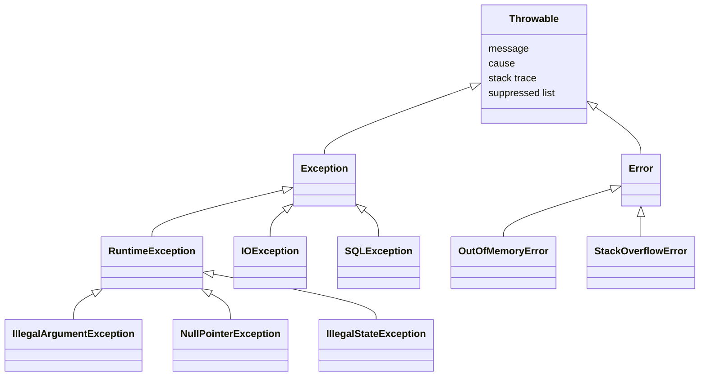

# Exceptions

## Why It Matters

Exception handling appears in almost every Java interview, in three forms: the definition question ("checked versus unchecked"), the puzzle question ("what does this `try`-`finally` return?"), and the design question ("how do you handle errors in a layered service?"). On the job, a swallowed exception hides a production bug, a `finally` block that throws replaces the original failure, and an `InterruptedException` that a developer ignores makes a service impossible to shut down. This page covers the language rules (JLS chapter 11 and sections 14.20.2 and 14.20.3), the mechanics of `try-with-resources`, the cost of an exception, and the design rules of *Effective Java* items 69 to 77. Spring's rollback rule for checked and unchecked exceptions is in [Spring Data and Transactions](19-spring-data-and-transactions.md). Thread interruption in depth is in [concurrency basics](07-concurrency-basics.md).

## Core Concepts

**Exception**: an object that describes an abnormal condition. A method **throws** an exception to stop normal execution. The JVM then looks for a matching `catch` clause in the current method, and then in each calling method, in order. If none matches, the thread ends with the **uncaught** exception.

**Stack trace**: the list of method calls that were active when the exception object was created. `printStackTrace` prints it. A `Throwable` captures the trace in its constructor, in the method `fillInStackTrace`.

**Cause**: another `Throwable` that led to this one. The cause keeps the original failure when a method translates a low-level exception into a higher-level one.

**Suppressed exception**: an exception that the program could not throw because another exception had priority. `Throwable.addSuppressed` attaches it to the primary exception.

### The hierarchy

The JLS defines the hierarchy in section 11.1.1. Every thrown object is an instance of `Throwable`.



| Class | Meaning | Checked? | Typical example |
|---|---|---|---|
| `Throwable` | The root. Holds the message, the cause, the stack trace, and the suppressed exceptions | Checked (it is not a subclass of `RuntimeException` or `Error`) | Almost never thrown or caught directly |
| `Error` | A serious problem that a program usually cannot recover from (javadoc) | Unchecked | `OutOfMemoryError`, `StackOverflowError`, `NoClassDefFoundError`, `AssertionError` |
| `Exception` | A condition that a program may want to catch (javadoc) | Checked, except `RuntimeException` and its subclasses | `IOException`, `SQLException`, `InterruptedException` |
| `RuntimeException` | An exception that the JVM or the code throws during normal operation (javadoc) | Unchecked | `NullPointerException`, `IllegalArgumentException`, `ClassCastException`, `IndexOutOfBoundsException` |

### Checked and unchecked

JLS 11.1.1 defines the terms. The **unchecked exception classes** are `RuntimeException`, `Error`, and their subclasses. All other exception classes are **checked exception classes**. JLS 11.2 gives the consequence: the compiler requires that a method or constructor that can throw a checked exception either catches it or lists it in its `throws` clause. The compiler does not check unchecked exceptions.

Note that `Throwable` itself is a checked class, and so is every direct subclass that is not `Error` or `RuntimeException`. A `catch (Throwable t)` also catches `Error`.

The arguments, as the JDK community states them:

| Position | Arguments for | Arguments against |
|---|---|---|
| Checked exceptions | The signature documents the failure. The compiler forces the caller to decide. Suited to conditions that the caller can recover from (*Effective Java* item 70) | Every caller must catch or declare the exception, even when it cannot recover. The exception type leaks the implementation: a `throws SQLException` in a repository interface ties the callers to JDBC. Adding a checked exception to a method breaks every caller. They do not work with `java.util.function` interfaces and streams. Developers write empty `catch` blocks to silence the compiler |
| Unchecked exceptions | Less code. No leak of implementation types. Work with lambdas. Suited to programming errors, which the caller cannot repair (*Effective Java* item 70) | The signature does not show the failure. The caller can forget to handle a failure that is recoverable. The javadoc must carry the information (`@throws`) |

Recommendation: use a checked exception only if the caller can recover and you want the compiler to force it to consider the recovery. Use an unchecked exception for a violated precondition or a failure that the caller cannot repair. Most modern frameworks follow this rule: Spring translates the checked `SQLException` into the unchecked `DataAccessException` hierarchy.

## How It Works

### Throw, catch, and propagation

When `throw` runs (the `athrow` bytecode), the JVM looks up the **exception table** of the current method (JVM specification sections 2.10 and 4.7.3). Each row of the table gives a range of bytecode, an exception class, and a handler address. The JVM searches the rows in the order of the table and takes the first row whose range contains the failing instruction and whose class is the thrown class or a superclass of it. If no row matches, the JVM discards the frame of the current method and repeats the search in the caller, at the call instruction. This is **stack unwinding**. `javac` writes the rows in the order of the `catch` clauses in the source. The compiler also rejects a `catch` clause for a class when an earlier `catch` clause of the same `try` already catches that class or a superclass of it (JLS 11.2.3), because the later handler could never run.

### `try`-`catch`-`finally`

JLS 14.20.2 defines `try`-`finally`. The rules:

1. The `finally` block runs when the `try` block (and any `catch` block) ends, whether the end is normal, by `return`, `break`, `continue`, or by an exception.
2. If the `try` block ends by `return expr`, the JVM evaluates `expr` first and saves the value. Then `finally` runs. A later change of the variable in `finally` does not change the saved value, but a change to the object that a reference points to is visible.
3. If `finally` completes normally, the `try` statement completes for the reason that the `try` block or `catch` block had (the saved value, or the exception).
4. If `finally` completes **abruptly** (it throws, or it runs `return`, `break`, or `continue`), the JVM discards the reason for which the `try` block ended. A `return` in `finally` discards the returned value and also discards a pending exception. An exception that `finally` throws replaces the pending exception.

The `finally` block does not run if the JVM stops while the thread is still in the `try` block (`System.exit`, `Runtime.halt`, a crash, or a kill signal), or if the thread loops forever or is blocked forever in the `try` block. A JVM exit runs the registered shutdown hooks, but it does not unwind the other threads, so their pending `finally` blocks do not run. This is also true for a `SIGTERM` that starts an orderly shutdown. A daemon thread can stop in the middle of a `try` block when the JVM exits.

```java
public class FinallyDemo {
    @SuppressWarnings("finally")
    static int returnInFinally() {
        try {
            return 1;
        } finally {
            return 2; // discards the return value 1
        }
    }

    @SuppressWarnings("finally")
    static String swallowed() {
        try {
            throw new IllegalStateException("from try");
        } finally {
            return "exception lost"; // discards the exception
        }
    }

    static int copyOfValue() {
        int x = 10;
        try {
            return x;       // the JVM saves the value 10 here
        } finally {
            x = 20;         // changes the variable, not the saved value
        }
    }

    static String replacedException() {
        try {
            try {
                throw new IllegalStateException("original");
            } finally {
                throw new IllegalArgumentException("from finally");
            }
        } catch (RuntimeException e) {
            return e.getMessage() + ", suppressed=" + e.getSuppressed().length;
        }
    }

    public static void main(String[] args) {
        System.out.println("returnInFinally = " + returnInFinally());
        System.out.println("swallowed = " + swallowed());
        System.out.println("copyOfValue = " + copyOfValue());
        System.out.println("replacedException = " + replacedException());
    }
}
```

<!-- expected-output -->
```text
returnInFinally = 2
swallowed = exception lost
copyOfValue = 10
replacedException = from finally, suppressed=0
```

Read the four results. `returnInFinally` returns 2: the `return` in `finally` replaces the saved value 1. `swallowed` returns a value, and the exception is gone, with no trace in any log. `copyOfValue` returns 10: the JVM saved the value before `finally` ran. `replacedException` shows that the exception from `finally` wins, and the original `IllegalStateException` is lost: it is not even in the suppressed list, because `try`-`finally` does not call `addSuppressed`. This loss is one reason why `try-with-resources` exists.

Recommendation: never use `return`, `break`, or `continue` in `finally`. The compiler warns about it with `-Xlint:finally`.

### `try-with-resources`

A **resource** is an object that holds a scarce external thing (a file, a socket, a database connection) and that implements `java.lang.AutoCloseable`. The `close` method of `AutoCloseable` declares `throws Exception`. The sub-interface `java.io.Closeable` narrows it to `throws IOException`, and its javadoc requires that `close` is idempotent (a second call has no effect). The `AutoCloseable` javadoc advises the same, and advises that `close` does not throw `InterruptedException`.

JLS 14.20.3 defines the statement. A `try` with resources behaves, in effect, like this nested form for one resource (the JLS uses synthetic variable names):

<!-- fragment -->
```java
{
    final R resource = init;
    Throwable primary = null;
    try {
        body
    } catch (Throwable t) {
        primary = t;
        throw t;
    } finally {
        if (resource != null) {
            if (primary != null) {
                try {
                    resource.close();
                } catch (Throwable s) {
                    primary.addSuppressed(s);
                }
            } else {
                resource.close();
            }
        }
    }
}
```

The rules that follow from it:

- **Close order**: with several resources, the compiler nests the translation. The resources close in the **reverse** order of their declaration.
- **A `null` resource is skipped**: the `close` call is guarded by a `null` check.
- **Suppression**: if the body throws and `close` throws, the body exception is the primary exception, and the `close` exception is attached with `addSuppressed`. If only `close` throws, that exception propagates as the primary exception. If several resources fail to close, each later failure is added to the same primary exception.
- **A failed initialization**: if the initializer of the second resource throws, the first resource is closed, and the second is never created.
- **Order against `catch` and `finally`**: all resources close **before** a `catch` or `finally` clause of the same statement runs. Inside a `catch` block, the resource is already closed.
- **An existing variable** (Java 9, JEP 213): `try (shared)` accepts a `final` or effectively final variable that is declared outside the statement.

```java
import java.util.Arrays;

public class ResourceDemo {
    static class Res implements AutoCloseable {
        private final String name;
        private final boolean failOnClose;

        Res(String name, boolean failOnInit, boolean failOnClose) {
            if (failOnInit) throw new IllegalStateException("init " + name);
            this.name = name;
            this.failOnClose = failOnClose;
            System.out.println("open " + name);
        }

        @Override
        public void close() {
            System.out.println("close " + name);
            if (failOnClose) throw new IllegalStateException("close " + name);
        }
    }

    public static void main(String[] args) {
        // Close order is the reverse of the open order. catch runs after the close calls.
        try (Res a = new Res("A", false, false); Res b = new Res("B", false, false)) {
            System.out.println("body");
        } finally {
            System.out.println("finally");
        }

        System.out.println("--- body and close both throw");
        try (Res a = new Res("A", false, true); Res b = new Res("B", false, true)) {
            throw new RuntimeException("body");
        } catch (RuntimeException e) {
            System.out.println("caught " + e.getMessage());
            for (Throwable s : e.getSuppressed()) {
                System.out.println("suppressed " + s.getMessage());
            }
        }

        System.out.println("--- only close throws");
        try (Res a = new Res("A", false, true)) {
            System.out.println("body");
        } catch (RuntimeException e) {
            System.out.println("caught " + e.getMessage()
                    + ", suppressed=" + e.getSuppressed().length);
        }

        System.out.println("--- second resource fails to open");
        try (Res a = new Res("A", false, false); Res b = new Res("B", true, false)) {
            System.out.println("not reached");
        } catch (RuntimeException e) {
            System.out.println("caught " + e.getMessage());
        }

        System.out.println("--- null resource is skipped");
        try (Res n = null) {
            System.out.println("body with null resource");
        }

        System.out.println("--- existing variable (Java 9)");
        Res shared = new Res("S", false, false);
        try (shared) {
            System.out.println("body");
        }
    }
}
```

<!-- expected-output -->
```text
open A
open B
body
close B
close A
finally
--- body and close both throw
open A
open B
close B
close A
caught body
suppressed close B
suppressed close A
--- only close throws
open A
body
close A
caught close A, suppressed=0
--- second resource fails to open
open A
close A
caught init B
--- null resource is skipped
body with null resource
--- existing variable (Java 9)
open S
body
close S
```

In the second scenario, `B` closes before `A`, both `close` calls throw, and the caller sees the body exception with two suppressed exceptions. The old `try`-`finally` idiom loses the body exception in this case (see `replacedException` above). *Effective Java* item 9 says: prefer `try-with-resources` to `try`-`finally`.

### Multi-catch and precise rethrow

A **multi-catch** clause lists several alternatives with `|`: `catch (IOException | SQLException e)`. JLS 14.20 sets two rules. The alternatives must not be related by subclassing (the compiler reports an error, because one alternative would be redundant). The parameter `e` is implicitly `final`, and its static type is the least upper bound of the alternatives.

**Precise rethrow** (Java 7): if a `catch` parameter is `final` or effectively final, and the block rethrows it with `throw e`, the compiler treats the thrown types as the checked exceptions that the `try` block can throw, not as the declared type of the parameter. A `catch (Exception e) { throw e; }` therefore needs a `throws` clause with only the actual checked exceptions of the `try` block. The method in the example below declares `IOException` and `SQLException`, not `Exception`. If the code assigns a new value to `e` before the `throw`, the compiler falls back to the declared type.

### Exception chaining

A method that translates an exception must pass the original as the **cause**, so that the stack trace of the root failure survives (*Effective Java* item 73). Two ways exist: a constructor with a `Throwable cause` parameter (`new RuntimeException("message", cause)`), and the method `initCause`, for types that have no such constructor. `initCause` works once. The second call, or a call after a constructor already set the cause, throws `IllegalStateException`. `printStackTrace` prints each cause under the heading `Caused by:` and uses `... n more` for the frames that the cause shares with the enclosing trace.

```java
import java.io.IOException;
import java.sql.SQLException;

public class RethrowDemo {
    static void mayFail(int mode) throws IOException, SQLException {
        if (mode == 1) throw new IOException("io");
        if (mode == 2) throw new SQLException("sql");
    }

    // Precise rethrow: the compiler knows that only IOException and SQLException can escape.
    static void passThrough(int mode) throws IOException, SQLException {
        try {
            mayFail(mode);
        } catch (Exception e) {
            System.out.println("log " + e.getMessage());
            throw e;
        }
    }

    static class DataAccessException extends RuntimeException {
        DataAccessException(String message, Throwable cause) { super(message, cause); }
    }

    static void load() {
        try {
            mayFail(2);
        } catch (IOException | SQLException e) { // multi-catch: e is implicitly final
            throw new DataAccessException("cannot load", e);
        }
    }

    public static void main(String[] args) throws Exception {
        try {
            passThrough(1);
        } catch (IOException | SQLException e) {
            System.out.println("caught " + e.getClass().getSimpleName());
        }

        try {
            load();
        } catch (DataAccessException e) {
            Throwable cause = e.getCause();
            System.out.println(e.getMessage() + " <- " + cause.getClass().getSimpleName()
                    + ": " + cause.getMessage());
        }

        // initCause for a type that has no cause constructor
        IllegalStateException ise = new IllegalStateException("wrapper");
        ise.initCause(new ArithmeticException("root"));
        System.out.println(ise + " caused by " + ise.getCause());
        try {
            ise.initCause(new RuntimeException("second"));
        } catch (IllegalStateException e) {
            System.out.println("second initCause fails: " + e.getClass().getSimpleName());
        }
    }
}
```

<!-- expected-output -->
```text
log io
caught IOException
cannot load <- SQLException: sql
java.lang.IllegalStateException: wrapper caused by java.lang.ArithmeticException: root
second initCause fails: IllegalStateException
```

### Standard methods of `Throwable`

| Method | What it does |
|---|---|
| `getMessage()` | The detail message, or `null` |
| `getCause()` | The cause, or `null` |
| `getStackTrace()` | The trace as `StackTraceElement[]`. The JVM builds this array on the first call, so the call has its own cost |
| `addSuppressed(Throwable)`, `getSuppressed()` | Attach and read suppressed exceptions. `addSuppressed(this)` throws `IllegalArgumentException` |
| `fillInStackTrace()` | Records the current thread's stack in the object. Called by the constructor |
| `toString()` | The class name, then `": "` and the message if it is not `null` |

### Exceptions in threads and executors

An exception that nothing catches ends the thread. The thread's `UncaughtExceptionHandler` runs, and by default the JVM prints the trace to `System.err`. Other threads continue. Inside an `ExecutorService`, `execute(Runnable)` lets an exception reach the worker thread's handler. `submit` catches the exception and stores it in the `Future`. The caller sees it only when it calls `get`, which throws `ExecutionException` with the original exception as the cause. If the caller never calls `get`, the failure stays silent. The executors are in [`java.util.concurrent`](08-java-util-concurrent.md).

An exception in a static initializer becomes `ExceptionInInitializerError`, with the original exception as its cause. Every later use of the class throws `NoClassDefFoundError: Could not initialize class X`, because the class is in an erroneous state (JLS 12.4.2). Before JDK 18, the later errors had no cause, so only the first error showed the root cause. Since JDK 18 (JDK-8048190), the later `NoClassDefFoundError` has a cause: an `ExceptionInInitializerError` whose message names the original exception, its message, and the thread, for example `Exception java.lang.ArithmeticException: / by zero [in thread "main"]` (observed on JDK 21). Search the log for the first error anyway, because it carries the complete original stack trace.

### The cost of an exception

Most of the cost of an exception is in its creation, not in the `throw`. The cost has three parts:

1. **Stack capture**: the `Throwable` constructor calls `fillInStackTrace`, which calls a native method. Its cost grows with the stack depth, because it walks every frame. HotSpot records at most `-XX:MaxJavaStackTraceDepth` frames (default 1024, from `globals.hpp` in the JDK 21 source), so the depth of the recorded trace has that upper limit. A deep stack in a framework (a web request in a servlet container passes through many framework frames) makes each exception cost far more than a normal method call. The exact number depends on the JVM, the stack depth, and the flags: measure with JMH before you claim a number.
2. **Trace conversion**: the first call to `getStackTrace` or `printStackTrace` converts the internal data into `StackTraceElement` objects.
3. **Unwinding**: the JVM searches the exception tables of each frame. If the C2 JIT compiler has inlined the method that throws into the method that catches, C2 connects the throw directly to the handler inside the compiled code, so the runtime does not search the frames (the `_athrow` case in `parse2.cpp` and `Parse::catch_inline_exceptions` in `doCall.cpp`, JDK 21 source). If not, the runtime unwinds the frames. This optimization removes only the unwinding cost. The `Throwable` constructor still captures the stack.

The protected four-argument constructor lets a subclass remove parts of the cost: `Throwable(String message, Throwable cause, boolean enableSuppression, boolean writableStackTrace)`. With `writableStackTrace` set to `false`, `fillInStackTrace` does nothing, and `getStackTrace` returns an empty array. With `enableSuppression` set to `false`, `addSuppressed` does nothing. The alternative is to override `fillInStackTrace` to return `this`.

```java
public class CostDemo {
    // A control-flow exception without a stack trace and without suppression.
    static class Lightweight extends RuntimeException {
        Lightweight(String message) {
            super(message, null, false, false);
        }
    }

    static void deep(int depth, RuntimeException toThrow) {
        if (depth == 0) throw toThrow;
        deep(depth - 1, toThrow);
    }

    public static void main(String[] args) {
        try {
            deep(50, new RuntimeException("normal")); // the constructor runs at depth 0 of main
        } catch (RuntimeException e) {
            System.out.println("normal: trace length > 0 = " + (e.getStackTrace().length > 0));
        }
        try {
            deep(50, new Lightweight("light"));
        } catch (RuntimeException e) {
            System.out.println("lightweight: trace length = " + e.getStackTrace().length);
        }

        // The trace records where the exception was created, not where it was thrown.
        RuntimeException created = new RuntimeException("created in main");
        try {
            deep(5, created);
        } catch (RuntimeException e) {
            System.out.println("top frame: " + e.getStackTrace()[0].getMethodName());
        }
    }
}
```

<!-- expected-output -->
```text
normal: trace length > 0 = true
lightweight: trace length = 0
top frame: main
```

Use this technique only for an exception that the program uses for control flow in a measured hot path, because a missing stack trace makes a real failure hard to diagnose. *Effective Java* item 69 says that you should not use exceptions for ordinary control flow. The cost is one reason. The other reason is that code which uses an exception to leave a loop is harder to read than a loop with a test.

HotSpot also has an optimization that changes diagnostics. An **implicit exception** is one that the JVM throws by itself, not a `throw` statement. If the same bytecode in a C2-compiled method throws an implicit exception often, C2 recompiles the method and throws a preallocated exception object instead of a new one. The JDK 21 source (`GraphKit::builtin_throw` in `graphKit.cpp`) does this for five classes: `NullPointerException`, `ArithmeticException`, `ArrayIndexOutOfBoundsException`, `ClassCastException`, and `ArrayStoreException`. The preallocated object has no stack trace, and C2 clears its detail message. The log then shows `java.lang.NullPointerException` with no frames and no message, not even the helpful message of JEP 358. The flag `OmitStackTraceInFastThrow` controls this. It is `true` by default (`globals.hpp`), and `-XX:-OmitStackTraceInFastThrow` turns the optimization off. In a test on JDK 21, a loop that called `s.length()` on `null` 200,000 times got exceptions with an empty stack trace and a `null` message after about 22,000 iterations. With the flag off, every exception had its trace. If a production log shows such an exception, search the log for the first occurrences, which have the full trace, or restart with the flag off.

### Exceptions in lambdas and streams

The standard functional interfaces of `java.util.function` declare no checked exceptions. A lambda for `Function` cannot call a method that throws `IOException` without a `try`-`catch`. `Callable` differs: its `call` method declares `throws Exception`. Three techniques exist:

1. **Catch inside the lambda** and return a result value (an error marker, an `Optional`, or a result object). Use this when the pipeline must continue after a failure.
2. **Wrap in an unchecked exception**, at the lambda or in a wrapper such as the `unchecked` method below. The JDK does this itself: `Files.lines` and `Files.walk` throw `UncheckedIOException` while the stream runs, and `BufferedReader.lines` does the same. `UncheckedIOException` carries the original `IOException` as its cause.
3. **Define a functional interface** that declares the exception type, as `ThrowingFunction` does below, and adapt it.

A fourth technique, the "sneaky throw" (a generic method that casts a checked exception to an unchecked type), compiles because of type erasure and hides the checked exception from the compiler. Avoid it: the caller cannot know that the exception can occur.

Streams are lazy, so an exception from a stage appears at the terminal operation, not when the stage is declared. If a stage throws, the pipeline stops and no further element is processed (in a sequential stream). Parallel streams: the exception from one worker propagates to the caller, and the other workers may still run for a while.

```java
import java.io.IOException;
import java.io.UncheckedIOException;
import java.util.List;
import java.util.function.Function;
import java.util.stream.Stream;

public class LambdaDemo {
    @FunctionalInterface
    interface ThrowingFunction<T, R, E extends Exception> {
        R apply(T t) throws E;
    }

    // Adapts a function that throws a checked exception to java.util.function.Function.
    static <T, R> Function<T, R> unchecked(ThrowingFunction<T, R, IOException> f) {
        return t -> {
            try {
                return f.apply(t);
            } catch (IOException e) {
                throw new UncheckedIOException(e);
            }
        };
    }

    static int parse(String s) throws IOException {
        if (s.isEmpty()) throw new IOException("empty input");
        return s.length();
    }

    public static void main(String[] args) {
        // Does not compile: Function.apply declares no checked exception.
        // Stream.of("a", "").map(s -> parse(s)).toList();

        System.out.println(Stream.of("ab", "cde").map(unchecked(LambdaDemo::parse)).toList());

        try {
            Stream.of("ab", "", "cde").map(unchecked(LambdaDemo::parse)).toList();
        } catch (UncheckedIOException e) {
            System.out.println("caught " + e.getCause().getMessage());
        }

        // Laziness: the exception appears at the terminal operation, not at map().
        Stream<Integer> lazy = Stream.of("x", "").map(unchecked(LambdaDemo::parse));
        System.out.println("pipeline built, nothing thrown yet");
        try {
            lazy.forEach(n -> System.out.println("element " + n));
        } catch (UncheckedIOException e) {
            System.out.println("thrown at forEach: " + e.getCause().getMessage());
        }

        // A per-element result type keeps the other elements.
        List<String> results = Stream.of("ab", "", "cde").map(s -> {
            try {
                return "ok:" + parse(s);
            } catch (IOException e) {
                return "error:" + e.getMessage();
            }
        }).toList();
        System.out.println(results);
    }
}
```

<!-- expected-output -->
```text
[2, 3]
caught empty input
pipeline built, nothing thrown yet
element 1
thrown at forEach: empty input
[ok:2, error:empty input, ok:3]
```

### `InterruptedException`

A thread interrupts another thread with `Thread.interrupt()`. This sets the target's **interrupt status** (a boolean flag). The methods that block (`Thread.sleep`, `Object.wait`, `Thread.join`, `BlockingQueue.take`, `CountDownLatch.await`, `Lock.lockInterruptibly`) check the flag when they start and respond to an interrupt while they wait. If the flag is set, or the thread is interrupted during the wait, they clear the flag and throw `InterruptedException` (the javadoc of each method states this). A method that throws it tells the caller: "I stopped early because someone asked this thread to stop."

The flag is **cleared** when the exception is thrown. If your code catches the exception and does nothing, the request to stop is lost, and the code above it never learns about it. Brian Goetz, *Java Concurrency in Practice* (chapter 7), gives two correct choices:

1. **Propagate**: declare `throws InterruptedException` and let the caller decide. This is the right choice for a library method.
2. **Restore the flag**: catch the exception, finish the cleanup, and call `Thread.currentThread().interrupt()`. Use this when the method cannot throw the exception (for example inside `Runnable.run`).

Goetz states one exception to the rule: only the code that implements the thread's interruption policy may swallow the interrupt. That code is the owner of the thread, for example the worker loop of a thread pool, or a thread that your own code created and stops.

```java
import java.util.concurrent.CountDownLatch;

public class InterruptDemo {
    static String worker(boolean restore) throws InterruptedException {
        StringBuilder log = new StringBuilder();
        CountDownLatch never = new CountDownLatch(1);
        Thread t = new Thread(() -> {
            try {
                never.await(); // blocks until interrupted
            } catch (InterruptedException e) {
                log.append("flag after catch=").append(Thread.currentThread().isInterrupted());
                if (restore) {
                    Thread.currentThread().interrupt(); // restore the flag for the caller
                    log.append(", flag after restore=")
                            .append(Thread.currentThread().isInterrupted());
                }
            }
        });
        t.start();
        t.interrupt();
        t.join();
        return log.toString();
    }

    public static void main(String[] args) throws InterruptedException {
        System.out.println("swallow: " + worker(false));
        System.out.println("restore: " + worker(true));
    }
}
```

<!-- expected-output -->
```text
swallow: flag after catch=false
restore: flag after catch=false, flag after restore=true
```

In the first run, the flag is `false` after the `catch` block, and the interrupt request is lost. In the second run, the thread restores the flag, and the code that called the thread (or the thread pool) can see it. The result is deterministic, because a thread that is already interrupted throws `InterruptedException` at its first blocking call, so the order of `t.interrupt()` and `never.await()` does not change it.

An executor shuts down its workers with `shutdownNow`, which interrupts them. A task that swallows the interrupt makes `shutdownNow` ineffective. More about interruption: [concurrency basics](07-concurrency-basics.md).

## Trade-offs and When to Use

### Ways to signal a failure

| Technique | Use when | Cost |
|---|---|---|
| Checked exception | The caller can recover, and the compiler should force the decision (a missing file, a failed payment that can be retried) | Boilerplate. Leaks the implementation type if the exception comes from a lower layer |
| Unchecked exception | A violated precondition, a bug, or a failure that no caller can repair | The signature does not show the failure. Document it with `@throws` |
| Return `Optional` | "No result" is a normal outcome (a lookup that finds nothing) | The caller must unwrap. The failure reason is lost |
| Return a result type or a status code | A failure is a normal, frequent outcome, and the reason matters (a validation result with many errors) | More code. The caller can ignore the value |
| `null` | Avoid in new APIs. Use only to follow an existing API | The caller can forget the check, and gets a `NullPointerException` far from the cause |
| `assert` | An internal invariant that must hold. Assertions are off by default | Not a substitute for argument checks in a public method |

### Design rules (*Effective Java*, 3rd edition, items 69 to 77)

| Item | Rule | In practice |
|---|---|---|
| 69 | Use exceptions only for exceptional conditions | Do not loop until `ArrayIndexOutOfBoundsException`. Give a class a state-test method (`hasNext`) or an `Optional` return instead of forcing callers to catch |
| 70 | Use checked exceptions for recoverable conditions and runtime exceptions for programming errors | See the table above |
| 71 | Avoid unnecessary use of checked exceptions | If the caller cannot do anything useful in the `catch` block, make the exception unchecked, or return an `Optional` |
| 72 | Favor the use of standard exceptions | `IllegalArgumentException`, `IllegalStateException`, `NullPointerException` (through `Objects.requireNonNull`), `IndexOutOfBoundsException`, `UnsupportedOperationException`, `ConcurrentModificationException` |
| 73 | Throw exceptions appropriate to the abstraction | Translate a low-level exception into one of your layer and pass the cause (exception chaining). A service method should not throw `SQLException` |
| 74 | Document all exceptions thrown by each method | Use `@throws` for each checked and each unchecked exception that a caller can expect. Do not put unchecked exceptions in the `throws` clause |
| 75 | Include failure-capture information in detail messages | The message holds the values that caused the failure (the index, the bounds, the id), and no secrets |
| 76 | Strive for failure atomicity | A failed call leaves the object in the state it had before the call. Validate before you change state, or work on a copy |
| 77 | Do not ignore exceptions | An empty `catch` block hides bugs. If you must ignore one, write a comment that says why, and name the variable `ignored` |

### Custom exceptions

Create a custom exception only when callers must act differently on it (for example `InsufficientFundsException` carries the missing amount, and the caller shows a message). Pick the base class by the rule above: extend `RuntimeException` for unchecked, `Exception` for checked. Give it the standard constructors that `Exception` has and that your callers need (no argument, message, message and cause, cause) and fields that hold the failure data. Exceptions are `Serializable` because `Throwable` is, so keep fields serializable or mark them `transient`. A generic exception class cannot exist: JLS 8.1.2 forbids a generic class from extending `Throwable`.

### Where to catch

Catch where you can do something about the failure: retry, use a default, translate the exception, or report to the user. If you can do none of these, let the exception propagate. In a layered service, one place at the edge (a controller advice, a servlet filter, a top-level handler of a thread) logs the exception once and turns it into a response. Logging at every layer and then rethrowing writes the same stack trace many times. The rule: **log or rethrow, not both**.

## Java Example

The examples above are complete programs. This block shows the typical production shape: a service method that translates a low-level exception, keeps the cause, adds failure data, and cleans up with `try-with-resources`.

```java
import java.io.BufferedReader;
import java.io.IOException;
import java.io.Reader;
import java.io.StringReader;
import java.util.Map;

public class ConfigLoader {
    // Unchecked, because the caller of loadPort cannot repair a missing or corrupt source.
    static class ConfigException extends RuntimeException {
        private final String source;

        ConfigException(String message, String source, Throwable cause) {
            super(message + " (source: " + source + ")", cause);
            this.source = source;
        }

        String source() { return source; }
    }

    static int loadPort(String sourceName, Reader reader) {
        try (BufferedReader in = new BufferedReader(reader)) {
            String first = in.readLine();
            if (first == null) throw new IllegalStateException("source is empty");
            return Integer.parseInt(first.trim());
        } catch (IOException e) {
            throw new ConfigException("cannot read config", sourceName, e);
        } catch (NumberFormatException | IllegalStateException e) {
            throw new ConfigException("invalid port: " + e.getMessage(), sourceName, e);
        }
    }

    // A reader whose read method fails, to simulate a broken disk or network.
    static class BrokenReader extends Reader {
        @Override public int read(char[] buffer, int off, int len) throws IOException {
            throw new IOException("disk error");
        }
        @Override public void close() { }
    }

    public static void main(String[] args) {
        System.out.println("port = " + loadPort("good", new StringReader("8080\n")));
        Map<String, Reader> failing = new java.util.LinkedHashMap<>();
        failing.put("empty", new StringReader(""));
        failing.put("text", new StringReader("eighty"));
        failing.put("broken", new BrokenReader());
        for (Map.Entry<String, Reader> e : failing.entrySet()) {
            try {
                loadPort(e.getKey(), e.getValue());
            } catch (ConfigException ex) {
                System.out.println(ex.getMessage() + " | cause: "
                        + ex.getCause().getClass().getSimpleName());
            }
        }
    }
}
```

<!-- expected-output -->
```text
port = 8080
invalid port: source is empty (source: empty) | cause: IllegalStateException
invalid port: For input string: "eighty" (source: text) | cause: NumberFormatException
cannot read config (source: broken) | cause: IOException
```

How to read the code. The `try-with-resources` closes the reader even if `parseInt` throws. Each `catch` translates one failure kind into a `ConfigException` of the service layer and keeps the original as the cause. `IllegalStateException` and `NumberFormatException` are unrelated, so the multi-catch is legal. A program that reads a file would use `Files.newBufferedReader` in the same shape, and would catch `NoSuchFileException` (a subclass of `IOException`) before `IOException`.

## Interview Angle

### Questions

??? question "What is the difference between checked and unchecked exceptions? Which do you prefer?"

    A checked exception is a subclass of `Exception` that is not a subclass of `RuntimeException` (strictly, JLS 11.1.1 also counts `Throwable` itself and any other `Throwable` subclass outside `Error` and `RuntimeException`). The compiler forces the caller to catch it or declare it (JLS 11.2). Unchecked exceptions are `RuntimeException`, `Error`, and their subclasses. The compiler does not check them.

    The reason for both: a checked exception documents a failure that the caller may recover from, such as a missing file. An unchecked exception reports a programming error or a failure that no caller can repair, such as a `null` argument.

    The trade-off: checked exceptions add boilerplate, leak implementation types across layers, and do not work with lambdas. So I use checked exceptions only for recoverable conditions that the caller must consider, and unchecked exceptions otherwise. This is *Effective Java* items 70 and 71. Frameworks such as Spring follow it: they wrap `SQLException` in the unchecked `DataAccessException`.

??? question "What does this method return?  `try { return 1; } finally { return 2; }`"

    It returns 2. The `finally` block runs after the `return` expression is evaluated, and a `return` in `finally` completes the statement abruptly, so the JVM discards the saved value 1 (JLS 14.20.2). The same rule discards a pending exception: `try { throw new RuntimeException(); } finally { return 2; }` returns 2 and the exception disappears. If `finally` only changes a local variable, the returned value does not change, because the JVM saved the value before `finally` ran. If the variable is a reference to a mutable object, the caller sees the changes to the object. Never write `return` in `finally`.

??? question "Does `finally` always run?"

    No. It runs after the `try` block ends by normal completion, `return`, `break`, `continue`, or an exception (JLS 14.20.2). It does not run if the JVM stops while the thread is still in the `try` block: `System.exit`, `Runtime.halt`, a fatal JVM error, or a kill signal. Even an orderly shutdown (`System.exit` or `SIGTERM`) runs only the shutdown hooks. It does not unwind the other threads, so their `finally` blocks do not run, and a daemon thread can stop in the middle of its `try` block. It also does not run if the thread never leaves the `try` block (an infinite loop or a permanent block). So a resource that must be released at shutdown needs a shutdown hook or an external cleanup, not only a `finally` block. Also remember that a `finally` block that throws replaces the pending exception, and one that returns discards it.

??? question "How does `try-with-resources` work, and why is it better than `try`-`finally`?"

    The compiler translates it (JLS 14.20.3) into a `try` with a hidden `finally` that closes each resource that is not `null`. Resources close in the reverse order of their declaration, and they close before any `catch` or `finally` clause of the same statement runs.

    If the body throws and `close` also throws, the body exception stays the primary exception, and the `close` exception is attached with `addSuppressed`. In a hand-written `try`-`finally`, the exception from `close` replaces the body exception, so the original failure is lost. `try-with-resources` also needs less code and closes the first resource if the second fails to open. A resource must implement `AutoCloseable`. Since Java 9, an effectively final variable can be the resource: `try (shared)`.

??? question "What are suppressed exceptions? How do you read them?"

    A suppressed exception is an exception that the program could not throw because another one was already in flight. `try-with-resources` creates them when a `close` call fails after the body failed. `Throwable.addSuppressed` attaches them to the primary exception, and `getSuppressed()` returns them. `printStackTrace` shows each one under the heading `Suppressed:`. The primary exception is the one that the caller catches. I read the suppressed list when the root cause is not the last error in the log, for example a connection that failed to close because the transaction had already failed.

??? question "What is the difference between `Error` and `Exception`? Should you catch `Error`?"

    `Error` and its subclasses signal serious problems in the JVM or the environment: `OutOfMemoryError`, `StackOverflowError`, `NoClassDefFoundError`, `LinkageError`. The javadoc says that a reasonable application should not try to catch them. `Exception` signals conditions that a program may handle.

    Do not catch `Error` in business code, because the program state may be inconsistent after it (a thread that ran out of memory may have left a half-updated structure). Exceptions to this rule: a top-level handler of a thread or a request that logs the `Throwable` and ends the thread or the request cleanly, and an `AssertionError` in a test framework. If the JVM is out of memory, the better response is often to let the process die and restart it, with `-XX:+ExitOnOutOfMemoryError` for example.

??? question "How should you handle `InterruptedException`?"

    The exception means that another thread asked this thread to stop. The blocking method that throws it clears the interrupt flag first. So I do not swallow it, unless my code owns the thread and implements its interruption policy (*Java Concurrency in Practice*, chapter 7). I choose one of two options. First, if the method can declare it, propagate it, so the caller decides. Second, if the method cannot declare it (for example `Runnable.run`), finish the cleanup and restore the flag with `Thread.currentThread().interrupt()`, so the code above and the thread pool see the request. Logging and continuing is wrong, because it makes `shutdownNow` and task cancellation fail. See [Concurrency Basics: Threads, Locks, and the Java Memory Model](07-concurrency-basics.md) for the full interruption protocol.

??? question "Why are exceptions expensive, and how do you reduce the cost?"

    The cost is mostly in the creation. The `Throwable` constructor calls `fillInStackTrace`, which walks the stack of the thread and records up to `MaxJavaStackTraceDepth` frames (1024 by default in HotSpot). The cost grows with the stack depth, and a framework stack is deep. The first call to `getStackTrace` or `printStackTrace` adds a second cost: it converts the recorded data into `StackTraceElement` objects. Throwing and catching add the unwinding cost. If C2 has inlined the throwing method into the catching method, it connects the throw to the handler in the compiled code and skips the runtime search, but the stack capture still happens.

    To reduce it: do not use exceptions for ordinary control flow (*Effective Java* item 69), reuse a pre-allocated exception only with care, or create a subclass that calls the four-argument constructor `super(message, cause, false, false)` with `writableStackTrace = false`, so that no trace is captured. The trade-off is that a failure has no trace, so use this only for expected, measured, hot-path cases. Measure with JMH, because the numbers depend on the JVM and the stack depth.

??? question "How do you handle checked exceptions inside a lambda or a stream?"

    The functional interfaces in `java.util.function` do not declare checked exceptions, so the lambda body must handle them. Option 1: catch the exception inside the lambda and return a value that represents the failure, when the pipeline should continue. Option 2: wrap it in an unchecked exception, for example `UncheckedIOException`, and catch it around the terminal operation. Option 3: define a functional interface whose method declares the exception and write a small adapter. The JDK uses option 2 for `Files.lines`. Remember that streams are lazy, so the exception surfaces at the terminal operation, and a stage that throws stops a sequential pipeline.

??? question "What is exception chaining, and why does it matter?"

    Exception chaining keeps the original exception as the cause of a new one: `throw new ServiceException("message", e)`. Each layer then reports a failure in its own terms, and the stack trace of the root cause is still available under `Caused by:`. This follows *Effective Java* item 73, "throw exceptions appropriate to the abstraction". Without the cause, the diagnostic information is lost. `initCause` sets the cause for exceptions that have no cause constructor, and it can run only once. A common mistake is `throw new ServiceException(e.getMessage())`, which drops the original trace.

??? question "What is precise rethrow?"

    Since Java 7, if a `catch` parameter is final or effectively final and the block rethrows it, the compiler uses the checked exception types that the `try` block can throw as the thrown types, not the declared type of the parameter. So `catch (Exception e) { log(e); throw e; }` compiles in a method that declares only `IOException`, if the `try` block throws only `IOException` as a checked exception. If the code assigns a new value to `e`, the compiler uses the declared type again.

??? question "What happens to an exception that escapes a thread, and what happens in a thread pool?"

    In a plain thread, the exception ends the thread. The `UncaughtExceptionHandler` of the thread, or the default handler, runs. By default the JVM prints the stack trace to `System.err`. Other threads continue. In an `ExecutorService`, `execute` lets the exception reach the worker's handler, and the pool replaces the worker. `submit` captures the exception in the `Future`, and the caller sees it only through `get()`, which throws `ExecutionException`. A `submit` call without a `get` call loses the failure silently, so attach the handling to the `Future` or use `execute`.

??? question "Should you log an exception and rethrow it?"

    No. If each layer logs and rethrows, the same failure appears many times in the log, and the reader cannot tell the number of failures. Handle the exception at the layer that can act on it. Log it once, at the layer that handles it, usually the edge of the application. Lower layers add context by wrapping the exception with the cause and rethrow without logging.

### Follow-up Questions

??? question "Can a `catch` block catch an exception that the `try` block cannot throw?"

    For a checked exception class, no: the compiler reports an error if the `try` block cannot throw it (JLS 11.2.3). The exceptions are `Exception` and `Throwable`, which also cover unchecked exceptions. Unchecked exceptions and `Error` can always be caught.

??? question "What is the order of `catch` clauses?"

    The JVM tests the clauses in order and runs the first one that matches. A clause for a subclass after a clause for its superclass could never run, and the compiler reports an error (JLS 11.2.3). Write the specific types first.

??? question "Why does a production log show `java.lang.NullPointerException` with no stack trace and no message?"

    HotSpot's C2 compiler has a "fast throw" optimization. If the same bytecode in a compiled method throws an implicit exception often (`NullPointerException`, `ArithmeticException`, `ArrayIndexOutOfBoundsException`, `ClassCastException`, or `ArrayStoreException`), C2 recompiles the method to throw one preallocated exception object. That object has no stack trace and no detail message, so even the helpful `NullPointerException` message is missing. The flag `OmitStackTraceInFastThrow` is on by default. To diagnose, find the first occurrences in the log, which the JVM created before the recompilation and which have the full trace, or run with `-XX:-OmitStackTraceInFastThrow`. The same symptom also appears for an exception class that sets `writableStackTrace` to `false`.

??? question "What happens if the `close` method of a resource throws, and the body did not?"

    The `close` exception propagates as the primary exception, and it can be caught by the `catch` clause of the same statement. With several resources, the remaining resources still close, and their failures are added as suppressed exceptions to the first `close` exception.

??? question "Why can a generic class not extend `Throwable`?"

    JLS 8.1.2 forbids it. The JVM selects a `catch` handler by the runtime class, and type erasure removes the type argument at run time, so `catch (MyException<String> e)` could not be distinguished from `catch (MyException<Integer> e)`.

??? question "How does `@Transactional` treat checked and unchecked exceptions?"

    By default, Spring rolls back the transaction for unchecked exceptions (`RuntimeException` and `Error`) and commits for checked exceptions, unless `rollbackFor` says otherwise. See [Spring Data and Transactions](19-spring-data-and-transactions.md).

### Red Flags

- An empty `catch` block, or a `catch` block that only prints the stack trace and continues.
- `catch (Exception e)` or `catch (Throwable t)` around a large block, with no reason.
- A `return` or a `throw` in `finally`.
- Catching `InterruptedException` and continuing without restoring the flag.
- `throw new RuntimeException(e.getMessage())`, which loses the cause and the trace.
- Using exceptions for control flow (leaving a loop, or parsing with `try` to test a number in a hot loop).
- Saying that `finally` "always" runs.
- Saying that checked exceptions are "bad" or "good" with no trade-off.
- Closing a resource in `finally` by hand, when `try-with-resources` applies.
- Logging an exception and rethrowing it at every layer.

## Common Mistakes

| Mistake | Why it fails | Fix |
|---|---|---|
| `catch (Exception e) {}` | The failure disappears. The system continues in an unknown state | Handle it, rethrow it, or write a comment that explains why ignoring is safe |
| `return` inside `finally` | Discards the returned value and any pending exception | Move the `return` out of `finally` |
| Closing a resource in `finally` with an unprotected `close()` | An exception from `close` replaces the body exception | Use `try-with-resources` |
| `throw new X(e.getMessage())` | Loses the cause and the stack trace | `throw new X("message", e)` |
| Swallowing `InterruptedException` | The interrupt flag is cleared, and the thread cannot stop | Propagate it or call `Thread.currentThread().interrupt()` |
| Catching `Throwable` or `Error` in business code | Hides `OutOfMemoryError` and `StackOverflowError`, and the state may be corrupt | Catch the narrowest type. Handle `Error` only at the top of a thread |
| Log and rethrow in every layer | The same trace appears many times | Log once, where you handle the exception |
| Using exceptions for flow control | Slow because of stack capture, and unclear | Test the condition (`hasNext`, `isEmpty`) or return `Optional` |
| Checked exceptions in a repository interface | The callers depend on JDBC types | Translate into an unchecked exception of your layer |
| Expecting `submit` to report a task failure | The `Future` stores it and nobody reads it | Call `get`, or use `execute` with an uncaught-exception handler |
| A message with no data (`"error"`) | The log cannot say which value failed | Include the values that caused it (*Effective Java* item 75) |
| `catch (NullPointerException e)` to handle a missing value | A `NullPointerException` is a bug, and the catch hides it | Check for `null`, or use `Optional` or `Objects.requireNonNull` |

## Commonly Confused With

| Looks like | Difference | Deciding question |
|---|---|---|
| `throw` vs `throws` | `throw` is a statement that throws an object. `throws` is a clause in the method signature that lists checked exceptions | Is it the action or the declaration? |
| `final` vs `finally` vs `finalize` | A modifier, a block that runs after `try`, and a deprecated method of `Object` (JEP 421 deprecated finalization for removal) | Is it a keyword, a block, or a method? |
| `Error` vs `Exception` | `Error` signals a JVM or environment problem. `Exception` signals a condition that a program can handle | Can the program continue in a known state? |
| Checked vs unchecked | The compiler enforces handling of checked exceptions only | Does the compiler force the caller to handle it? |
| `try-with-resources` vs `try`-`finally` | The first closes in reverse order, runs `close` before `catch`, and keeps the primary exception with suppression | Does the object implement `AutoCloseable`? Then use it |
| `Thread.interrupted()` vs `isInterrupted()` | `interrupted()` is static and clears the flag. `isInterrupted()` reads the flag and keeps it | Do you want to clear the flag? |
| `Callable` vs `Runnable` | `Callable.call` returns a value and declares `throws Exception`. `Runnable.run` does neither | Does the task return a result or throw a checked exception? |
| `exception.getCause()` vs `getSuppressed()` | The cause led to this exception. A suppressed exception happened while this one was in flight | Did it cause the failure, or did it happen during cleanup? |
| `UncheckedIOException` vs `IOException` | The first is a `RuntimeException` wrapper that carries the second as its cause | Do you need the exception to pass through a lambda? |

## Quick Reference Card

- `Throwable` has two subclasses: `Error` and `Exception`. `RuntimeException`, `Error`, and their subclasses are unchecked (JLS 11.1.1). All others are checked.
- Checked: the compiler forces catch or declare. Use for recoverable conditions. Unchecked: programming errors and failures the caller cannot repair.
- `finally` runs after `try` ends in any way, except when the JVM stops or the thread never leaves. `return` or `throw` in `finally` discards the earlier result or exception.
- The value of `return expr` is saved before `finally` runs.
- `try-with-resources`: reverse close order, `null` skipped, close before `catch` and `finally`, close exceptions are suppressed into the primary exception.
- Multi-catch alternatives must be unrelated. The parameter is final. Precise rethrow uses the actual checked types of the `try` block.
- Always pass the cause when you translate an exception. `initCause` works once.
- Cost: stack capture in the constructor. The four-argument constructor with `writableStackTrace = false` removes it.
- Lambdas: catch inside, wrap in `UncheckedIOException`, or use a throwing functional interface. Streams throw at the terminal operation.
- `InterruptedException`: the flag is cleared when it is thrown. Propagate it or restore the flag. Never swallow it.
- *Effective Java* items 69 to 77: exceptional conditions only (69), checked for recoverable and unchecked for bugs (70), avoid needless checked (71), standard exceptions (72), abstraction level and chaining (73), document (74), detail messages (75), failure atomicity (76), never ignore (77).
- Log or rethrow, not both.

## Further Reading

- [JLS 11: Exceptions](https://docs.oracle.com/javase/specs/jls/se21/html/jls-11.html): the hierarchy (11.1.1), the exception analysis that precise rethrow uses (11.2.2), and the compile-time checks, including the order of `catch` clauses (11.2.3).
- [JVM specification 2.10: Exceptions](https://docs.oracle.com/javase/specs/jvms/se21/html/jvms-2.html#jvms-2.10): the exception table of a method and the order in which the JVM searches it.
- [JLS 14.20.2: Execution of `try`-`finally` and `try`-`catch`-`finally`](https://docs.oracle.com/javase/specs/jls/se21/html/jls-14.html#jls-14.20.2): the exact rules for abrupt completion in `finally`.
- [JLS 14.20.3: `try`-with-resources](https://docs.oracle.com/javase/specs/jls/se21/html/jls-14.html#jls-14.20.3): the translation, the close order, and suppression.
- [`Throwable` javadoc (JDK 21)](https://docs.oracle.com/en/java/javase/21/docs/api/java.base/java/lang/Throwable.html): the cause, the suppressed list, and the four-argument constructor.
- [`AutoCloseable` javadoc (JDK 21)](https://docs.oracle.com/en/java/javase/21/docs/api/java.base/java/lang/AutoCloseable.html): the `close` contract and the advice on `InterruptedException`.
- [`Thread.interrupt` javadoc (JDK 21)](https://docs.oracle.com/en/java/javase/21/docs/api/java.base/java/lang/Thread.html#interrupt()): the interrupt status and which methods clear it.
- [`UncheckedIOException` javadoc (JDK 21)](https://docs.oracle.com/en/java/javase/21/docs/api/java.base/java/io/UncheckedIOException.html): the wrapper that the JDK uses in stream methods.
- Joshua Bloch, *Effective Java*, 3rd edition, chapter 10 (items 69 to 77) and item 9: the design rules cited above.
- Brian Goetz and others, *Java Concurrency in Practice*, chapter 7: the two correct responses to an interrupt.
- [JEP 213: Milling Project Coin](https://openjdk.org/jeps/213): `try-with-resources` on an effectively final variable (Java 9).
- [JEP 421: Deprecate Finalization for Removal](https://openjdk.org/jeps/421): why `finally` and `AutoCloseable`, not `finalize`, release resources.
- [`graphKit.cpp` in the JDK 21 source](https://github.com/openjdk/jdk21u/blob/master/src/hotspot/share/opto/graphKit.cpp): `GraphKit::builtin_throw`, the C2 code that throws preallocated implicit exceptions. The flags `OmitStackTraceInFastThrow` and `MaxJavaStackTraceDepth` are in [`globals.hpp`](https://github.com/openjdk/jdk21u/blob/master/src/hotspot/share/runtime/globals.hpp).
- [JDK-8048190](https://bugs.openjdk.org/browse/JDK-8048190): the JDK 18 change that gives a later `NoClassDefFoundError` the original initialization failure as its cause.
